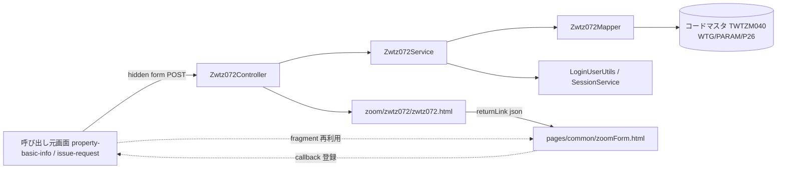
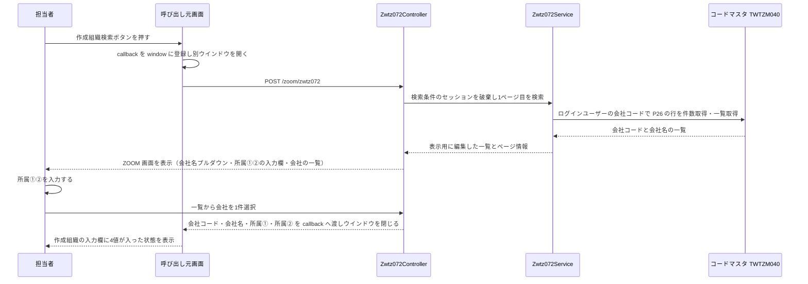

# 技術設計書

> このファイルは **「どう作るか」** を確定させる文書である。実装者ごとの解釈の食い違いを防ぎ、レビュー・実装・検証の共通の土台にする。\
> _分担_: 同一 feature の `requirements.md` が `status: approved` になるまで着手しない。本ファイルが `approved` になるまで `tasks.md` に進まない。`approved` は人間が付ける（エージェントは付けない）。

> _書き方_: 各節は結論から書き、検討の過程や調査ログは残さない。

## 概要（Overview）

- **目的（Purpose）**: 物件基本情報および発行依頼書を登録・変更する担当者に、作成組織をコードの記憶・転記なしに選んで入力欄へ設定する手段を提供する。
- **利用者（Users）**: 物件基本情報登録変更画面（`property-basic-info`）および発行依頼書登録変更画面（`issue-request`）を操作する担当者。本画面を直接メニューから開く利用者は想定しない。
- **影響（Impact）**: 現在の 作成組織をコードで直接入力する運用 を 既存 ZOOM 画面と同じ別ウインドウでの検索・選択 に変更する。既存の ZOOM 基盤（`/zoom/**`・`zoomForm` フラグメント・`ZOOM_DEFINE`）に 1 画面を追加するのみで、既存 ZOOM 画面・既存 WTG 機能には手を入れない。

### 達成目標（Goals）

- 呼び出し元 2 画面から同一の手順で本画面を開き、選択した作成組織が呼び出し元の入力欄に設定される（受入基準 1-1 / 3-1 / 3-2 / 3-4）。
- 会社名をプルダウンから選び、所属①・所属②を入力して、4 値（会社コード・会社名・所属①・所属②）をまとめて呼び出し元へ返せる（受入基準 3-2。**受入基準 2-1 / 2-2 とは差分がある** — `## 設計判断（Design Decisions）` の判断 4）。
- ログインユーザーの会社コード以外の会社が選択肢・検索結果に現れない（受入基準 2-6）。
- 既存 ZOOM 画面 17 本と同じ操作感（ページング単位・ウインドウサイズ定義・選択で閉じる）になる（受入基準 1-2）。
- 既存の共通フラグメント `pages/common/zoomForm.html` を変更せずに成立する（REQ-052）。

### やらないこと（Non-Goals）

- 作成組織マスタの登録・変更・削除の手段を設けること（マスタ保守は改修対象外 — REQ-007 / REQ-008）。今後も本フィーチャーでは持たない。
- 既存 ZOOM 画面（`zwtz001` 以下）の共通化・リファクタリング。今回やらない。
- 呼び出し元画面の入力欄の定義・保存処理。呼び出し元 feature が持つ。

## 責務境界（Boundary Commitments）

### このスペックが持つ責務（This Spec Owns）

- **所有するデータ**:
  - 本画面の検索条件の保持（セッション属性 1 件。キーは `zwtz072Form`。ページング時に検索条件を復元するためだけに使う）
  - 会社の一覧の表示用ビュー（`Zwtz072SearchInfo`。DB 行そのものではなく画面表示のために編集した形）
  - 画面上で入力された所属①・所属②の値（保持はリクエストとセッションの範囲のみ。**永続化しない**）
  - **コードマスタ・発行依頼書情報マスタのいずれも所有しない**（前者は参照のみ、後者は参照も更新もしない）
- **定義するインターフェース**:
  - HTTP エンドポイント `POST /zoom/zwtz072`（初期表示・検索）と `POST /zoom/zwtz072/page`（ページング）
  - 呼び出し元へ返す JSON（既存 ZOOM の標準コールバック契約に準拠。`returnCd` / `returnName` / `returnNameF` / `returnOther1V` / `returnOther2V`）
  - 呼び出し元画面が本画面を開くためのマークアップ契約（`.zoomId` / `.zoomDefine` / `.zoomParam_*` / `.zoomReturn*`。実体は既存の `pages/common/zoomForm.html`）

### このスペックが持たない責務（Out of Boundary）

- **他に任せる範囲と、その委譲先**:
  - 呼び出し元画面での起動ボタンの配置・返却値の格納先要素の指定 → `property-basic-info` / `issue-request`
  - 認証・セッション確認・権限判定・CSRF → 既存共通基盤（`SessionCheckInterceptor` / `PasswordCheckInterceptor` / `AccessControlInterceptor` / `CSRFTokenCheckInterceptor`）
  - ウインドウを開く JavaScript とコールバック登録 → 既存の `pages/common/zoomForm.html`（本フィーチャーで新規に書かない）
  - 作成組織マスタのデータ整備・移行 → 発注者（REQ-054）
- **後のフェーズに回す作業**:
  - 画面ID・PGID の具体値の採番簿への登録（`## 設計判断（Design Decisions）` の判断 1 を参照）

### 依存してよい対象（Allowed Dependencies）

- **依存先**:
  - `jp.co.kccs.wt.common.utils.LoginUserUtils`（ログインユーザーの会社コード取得）
  - `jp.co.kccs.wt.common.service.SessionService`（検索条件のセッション保持）
  - `jp.co.kccs.wt.common.service.ServiceBase`（`createPasesInfo` によるページ情報の生成）
  - `jp.co.kccs.wt.common.bean.PasesInfo`（ページング情報の受け渡し）
  - `jp.co.kccs.wt.common.utils.ZoomUtils`（`ZOOM_DEFINE` からのウインドウサイズ取得）
  - `jp.co.kccs.wt.common.utils.StringUtils`（`escapeSQLforLike` / `leftB` / `defaultString`）
  - `jp.co.kccs.wt.common.annotation.FuncID`（権限判定の宣言）
  - コードマスタ `TWTZM040`（既存テーブル。参照のみ）と `jp.co.kccs.wt.common.service.CodeMstService`（会社名プルダウンの選択肢取得）
- **依存の制約**:
  - 機能パッケージ間の直接依存を持たない。呼び出し元 2 feature とは HTTP と JSON のコールバックだけで接する（`steering/architecture.md` の `## レイヤーと依存ルール`）
  - `controller` → `service` → `mapper` の一方向。`controller` から `mapper` を直接呼ばない
  - 既存の共通クラス・既存 SQL・既存 ZOOM 画面を変更しない（REQ-052）
  - `wing-web.properties` への `ZOOM_DEFINE.zwtz072` の 1 行追加のみ既存ファイルへの変更として許容する（`## ファイル配置計画（File Structure Plan）` の `### 変更する既存ファイル（Modified Files）`）

### 再確認が必要になる変更（Revalidation Triggers）

- 呼び出し元へ返す JSON のキー名・件数の変更（`property-basic-info` / `issue-request` の受け取り側に影響する）
- 検索条件 3 項目の項目名・順序・親子関係の変更（呼び出し元から渡すパラメータの有無に影響する）
- 会社名の取得元（`WTG` / `PARAM` / `P26`）の変更、および所属①②の桁数の変更（一覧の表示項目・入力チェック・返却値に影響する）
- 画面ID・PGID の変更（`@FuncID` の値・URL・`ZOOM_DEFINE` のキー・権限マスタの登録内容がすべて連動する）

## アーキテクチャ（Architecture）

### 既存アーキテクチャの分析（Existing Architecture Analysis）

- **現行のパターンと制約**: `wing`（Spring MVC）側の ZOOM 画面は 17 本あり、いずれも `jp.co.kccs.wt.function.zoom.zwtz<3 桁>` パッケージに `controller` / `form` / `service` / `mapper` / `bean` を持ち、`@RequestMapping("/zoom/zwtz<3 桁>")` と `@FuncID("ZWTZ<3 桁>")` を付け、初期表示・ページングとも **POST** で受ける。1 ページの表示件数は 17 本すべてで `LISTSIZE = 15` の固定値である。
- **守るべきドメイン境界**: ZOOM 画面は呼び出し元の業務を持たない。検索と選択結果の返却だけを行い、呼び出し元の入力値の妥当性・保存には関与しない。
- **維持する統合ポイント**: ① 呼び出し元の `pages/common/zoomForm.html` フラグメント（ウインドウを開き、コールバックを登録する）② `/zoom/wait` への遷移後に hidden フォームを `/zoom/<zoomId>` へ POST する開き方 ③ `window.opener[windowName + 'callback'](json)` による返却 ④ `wing-web.properties` の `ZOOM_DEFINE.<PGID小文字>` によるウインドウサイズ定義。
- **解消 / 回避する技術的負債**: 解消しない。`zwtz002` は専用コールバック（`setCallBack002`）を持つ例外だが、本画面は標準コールバック（`setCallBack`）の枠に収める。標準の枠に収めることで `pages/common/zoomForm.html` への分岐追加が不要になり、既存 ZOOM への影響を出さない（REQ-052）。

### アーキテクチャ方式と境界図（Architecture Pattern & Boundary Map）



- **選択したパターン**: 既存 ZOOM 画面と同一の Controller → Service → Mapper の 3 層。新しい方式を持ち込まない。
- **ドメイン / 機能の切り分け**: 本フィーチャーは「作成組織を探して 1 件返す」だけを持つ。呼び出し元の業務ロジックは持たない。
- **既存パターンとの整合**: パッケージ・URL・`@FuncID`・ビュー名・セッションキー・ページング件数のいずれも既存 17 本の ZOOM と同じ形にそろえる。
- **新規コンポーネントを置く理由**: 作成組織を検索する ZOOM は既存に無いため新設する。既存 ZOOM の流用・拡張は、既存画面の仕様変更にあたるため行わない（REQ-052）。
- **steering との整合**: `steering/architecture.md` の `## 配置原則`（画面単位のパッケージ）・`## レイヤーと依存ルール`（一方向）、`steering/tech.md` の `## 命名規則`（ZOOM 画面は `z` 始まりのパッケージ・`ZOOM_DEFINE.<PGID小文字>`）に従う。`steering/api-standards.md` の HTTP メソッド表とは差異があるため、**同ファイルを実態に合わせて改訂する**（Phase 2 へ差戻し済み — `## 設計判断（Design Decisions）` の判断 2 を参照）。

### 技術スタック（Technology Stack）

| レイヤ | 採用 / バージョン | このフィーチャーでの役割 | 備考 |
|---|---|---|---|
| Frontend | Thymeleaf 3.0.0.RELEASE / jQuery | 検索条件のプルダウン・結果一覧・選択時のコールバック呼び出し | `steering/tech.md` と同じ。追加ライブラリなし |
| Backend / Service | Spring MVC 4.3.5.RELEASE | 画面遷移・検索の実行 | 同上。追加ライブラリなし |
| Data / Storage | MyBatis 3.4.5 + Oracle | 作成組織の検索 | 同上。追加ライブラリなし |

> 本フィーチャーで追加・例外採用する技術は無い（すべて `steering/tech.md` の共通スタックの範囲内）。

## データモデル（Data Models）

### ドメインモデル（Domain Model）

- **集約とトランザクション境界**: 集約を持たない。本フィーチャーは参照専用であり、更新トランザクションを開かない（Service は `@Transactional(readOnly = true)`）。
- **エンティティ / 値オブジェクト / ドメインイベント**:
  - **会社**（参照専用のエンティティ）: 会社コードで識別され、会社名と表示順を持つ。本フィーチャーは読むのみで、生成・変更しない。
  - **作成組織**（値オブジェクト）: 会社コード + 会社名 + 所属① + 所属② の 4 値の組。**識別子を持たず、永続化もされない**（呼び出し元へ渡すためだけに 1 回組み立てられる）。値が同じなら同じ作成組織として扱ってよい。
  - ドメインイベントは発行しない。
- **ビジネスルール / 不変条件**:
  - 会社の一覧はログインユーザーの会社コードに属する行に限る（`steering/security.md` の所有権・エンティティ境界）。**なお、ここでいう「ログインユーザーの会社コード」はコードマスタの行が属する `CompanyCD` であり、検索条件「会社名」の実体である `Key3`（契約稟議起案者の会社コード）とは別の概念である**（`requirements.md` の 未確定事項 ③ に対する確定）。
  - 呼び出し元へ返す作成組織はつねに 1 件（複数選択を持たない）。
  - 所属①②は未入力のまま返してよい（必須にしない）。

### 論理データモデル（Logical Data Model）

- **エンティティ間の多重度（カーディナリティ）**: **作成組織を 1 つのマスタで 3 階層まとめて持つ構造は採らない**（人間判断 / 2026-09-18）。マスタ化されているのは会社だけで、所属①・所属②はマスタを持たない自由入力の文字列である。したがって会社 1 — 所属 N のような関係を持たず、**3 つの項目は互いに独立**する。会社を選んでも所属①②の候補は絞られない（カスケードは成立しない）。
- **属性と型**:
  - **会社（マスタあり）**: 会社コード（`VARCHAR2`。コードマスタ `TWTZM040` の `Key3`）、会社名（`VARCHAR2`。同 `MEISHO`）、表示順（`NUMBER`。同 `HYOJI_JYUN`）。
  - **所属① / 所属②（マスタなし）**: 自由入力の文字列。桁は発行依頼書情報マスタ `TWTGM100` の `Keiyaku_Ringi_Kiansha_Shozoku1` / `Shozoku2` に合わせて 100 桁とする（人間提示 / 2026-09-18）。本フィーチャーはこれらを保存せず、呼び出し元へ渡すだけである。
- **自然キー / 識別子**: **会社コード**（`P26` の `Key3`）。呼び出し元へ返す `returnCd` の実体はこれである（受入基準 3-2）。**作成組織の全体を表す単一のコードは存在しない**（人間判断 / 2026-09-18）。組織は 会社コード + 所属① + 所属② の 3 値の組で表現され、その組に識別子を与えない。
- **参照整合性のルール**: 本フィーチャーは参照のみのため、参照整合性の制約を新たに定義しない。コードマスタ `TWTZM040` に制約を追加することもしない（全サブシステム共通の汎用テーブルであるため）。所属①②はマスタを持たないため、値の妥当性を照合する相手が無い（入力された文字列をそのまま返す）。

### 物理データモデル（Physical Data Model）

| 種別 | 記載 |
|---|---|
| RDB（Oracle）— 会社（確定） | 検索条件「会社名」の選択肢は、**既存のコードマスタ `TWTZM040` の `Shikibetsu_Cd = 'WTG'`（`Constants.SHIKIBETSUCD_WTG`）/ `Key1 = 'PARAM'`（`Constants.KEY1_PARAM`）/ `Key2 = 'P26'` の行から取得する**（人間判断 / 2026-09-18）。この行は `Key3` = 会社コード、`MEISHO` = 会社名 の 1 階層の対応表であり、**既存の意味のまま参照する。行の追加・意味の再解釈を行わない。** 並び順は `HYOJI_JYUN`。`CompanyCD` はログインユーザーの会社コードで絞り込む |
| RDB（Oracle）— 所属① / 所属② | **マスタを持たない。本フィーチャーはテーブルを参照しない**（人間判断 / 2026-09-18）。画面上の自由入力として受け取り、そのまま呼び出し元へ返す。値の**保存先**は呼び出し元（発行依頼書）側の `TWTGM100` の `Keiyaku_Ringi_Kiansha_Shozoku1` / `Keiyaku_Ringi_Kiansha_Shozoku2`（各 100 桁）であり、**保存は `issue-request` の責務**で本フィーチャーは行わない。当該 2 列の実在は既存実装で確認済み（`WTX_Batch/src/jp/co/kccs/wt/wtg/wtg090/PWTGB090Job.java` の `setTWTGM100IssueRequest`）。桁数 100 は提示された値であり、本工程では独立に確認していない |

> 本フィーチャーはテーブル・カラムを新規作成しない。`TWTZM040` へのインデックス追加も行わない（既存機能の実行計画に影響するため — `steering/database.md`）。コードマスタのデータ整備は本フィーチャーの範囲外である。
>
> **`P27` / `P28` は使用しない**（契約稟議の状態管理用に予約済み — 人間判断 / 2026-09-18）。
>
> `CodeMstService` はキー 1 組に対する取得のみを提供しページングに対応しないため、一覧の検索 SQL は専用の `Zwtz072Mapper.xml` に置く（全件をメモリに読み込んでから絞り込まないため — `steering/database.md` の `## クエリパターン`）。会社名プルダウンの選択肢のように 1 組で取得できるものは `CodeMstService` を使い、同等の処理を作り直さない（`steering/tech.md` の `## コード規約`）。

### データ契約と外部連携（Data Contracts & Integration）

- **API**: 呼び出し元へ返す JSON は既存 ZOOM の標準コールバック契約に従う。schema は `## コンポーネントとインターフェース（Components and Interfaces）` の API 契約に記載する。検証は行わない（同一 WAR 内の画面間の受け渡しであり、外部入力ではない）。シリアライズ形式は Thymeleaf のインライン JavaScript が生成する JSON オブジェクトリテラル。
- **イベント**: 発行・購読とも無し。
- **サービス間**: 該当なし（本プロジェクトはサービス間 API 呼び出しを持たない — `steering/security.md` の `### API 間認証（service-to-service）`）。

## コンポーネントとインターフェース（Components and Interfaces）

### コンポーネント一覧（Summary）

| コンポーネント | ドメイン / レイヤ | 目的 | 受け入れ基準ID | 依存 | 契約 |
|---|---|---|---|---|---|
| `Zwtz072Controller` | 作成組織検索 / controller | 画面の初期表示・検索・ページングを受け付け、ビューへ渡す | 1-1, 1-2, 1-3, 1-4, 1-5, 2-4, 2-5 | `Zwtz072Service` | API 契約 |
| `Zwtz072Service` | 作成組織検索 / service | 会社コードによる絞り込みを適用して検索し、表示用に編集する。検索条件をセッションに保持する | 2-3, 2-4, 2-5, 2-6, 2-7 | `Zwtz072Mapper`, `LoginUserUtils`, `SessionService`, `ServiceBase` | サービスインターフェース, 状態管理 |
| `Zwtz072Mapper` | 作成組織検索 / mapper | 会社の件数取得と一覧取得の SQL を実行する | 2-4, 2-6, 2-7 | コードマスタ `TWTZM040` | サービスインターフェース |
| `zwtz072.html` / `zwtz072Script.html` | 作成組織検索 / view | 会社名プルダウン・所属①②の入力欄・会社の一覧を描画し、選択時に 4 値をコールバックへ渡す | 2-1, 2-2, 2-5, 3-2, 3-3 | `pages/common/zoomForm.html`（呼び出し元側） | API 契約 |

### 作成組織検索 / controller

#### `Zwtz072Controller`

| 項目 | 内容 |
|---|---|
| 目的（Intent） | 本 ZOOM 画面の HTTP の入口。初期表示・検索・ページングを受け、ビューへ結果を渡す |
| 受け入れ基準ID | 1-1, 1-2, 1-3, 1-4, 1-5, 2-4, 2-5 |
| 担当 / レビュアー | <DSN_COMPONENT_OWNER> — **不要（記入者: 人間 / 2026-09-18）**: 担当者・レビュアーの割り当ては本プロジェクトの体制（REQ-061 / REQ-062）とレビュー計画（REQ-068）に従い、設計書側で個人名を持たない |

**責務と制約**:
- **主たる責務**: リクエストの受け付けと画面遷移。検索条件の受け取りは `Zwtz072Form` へのバインドで行う。
- **ドメイン境界 / トランザクションの範囲**: トランザクションを開かない（参照のみ。境界は Service 側）。
- **データ所有権 / 不変条件**: データを所有しない。`@FuncID` の値は本画面の PGID と一致していなければならない。

**依存関係**:
- **呼び出し元（Inbound）**:
  - `property-basic-info` の物件基本情報登録変更画面 — 作成組織の入力欄を埋めるため（重要度: 高）
  - `issue-request` の発行依頼書登録変更画面 — 同上（重要度: 高）
- **呼び出し先（Outbound）**:
  - `Zwtz072Service` — 検索の実行と検索条件のセッション保持（重要度: 高）
- **外部（External）**:
  - `AccessControlInterceptor` / `SessionCheckInterceptor` — 到達前の認証・認可（重要度: 高）

**契約の種類**（チェックリスト）
- [ ] サービスインターフェース（Service Interface）
- [x] API 契約（API Contract）
- [ ] イベント契約（Event Contract）
- [ ] バッチ / ジョブ契約（Batch / Job Contract）
- [ ] 状態管理（State Management）

##### API 契約（API Contract）

| Method | Endpoint | Request | Response | Errors |
|---|---|---|---|---|
| POST | `/zoom/zwtz072` | `Zwtz072Form`（`application/x-www-form-urlencoded`）。呼び出し元から渡す初期絞り込みパラメータは持たない（カスケードが成立しないため — 判断 5） | 200 / `zoom/zwtz072/zwtz072` ビュー。モデル属性 `zwtz072Form`（`PasesInfo` を含む）と `searchList` | 302（未ログイン → ログイン画面）／ 200 `error` ビュー（権限なし: `InvalidAccessErrorException`）／ 500（想定外） |
| POST | `/zoom/zwtz072/page` | `selectPage`（ページ番号）。検索条件はセッションから復元する | 同上 | 同上 |

> 呼び出し元へ返す JSON（画面 → 呼び出し元ウインドウ）のキーは次のとおり。既存の `pages/common/zoomForm.html` の標準コールバック `setCallBack` が解釈できるキー名に限定する（新しいキーを足すと同ファイルへの分岐追加が必要になり、既存 ZOOM に影響するため）。

| キー | 内容 | 呼び出し元での格納先の指定 | 呼び出し元での反映のされ方 |
|---|---|---|---|
| `returnCd` | 選択された会社のコード（`P26` の `Key3`） | `.zoomReturnCd` | `.val()`（`SELECT` 以外は `.text()` も） |
| `returnName` | 会社名（一覧の表示幅に合わせて丸めた形） | `.zoomReturnName` / `.zoomReturnNameS` | `.val()` と `.text()` |
| `returnNameF` | 会社名の丸めていない全体 | `.zoomReturnNameF` / `.zoomReturnNameT` | `.val()` と `.text()` / `title` 属性 |
| `returnOther1V` | 画面で入力された所属① | `.zoomReturnOther1V` | `.val()` |
| `returnOther2V` | 画面で入力された所属② | `.zoomReturnOther2V` | `.val()` |

> 5 つのキーはいずれも既存の標準コールバック `setCallBack` が解釈できるものであり、**`pages/common/zoomForm.html` を変更せずに 4 値（会社コード・会社名・所属①・所属②）を返せる**ことを実装で確認した（`returnOther1V` / `returnOther2V` は呼び出し元の入力欄に `.val()` で設定される）。呼び出し元がどれを受け取るかは呼び出し元のマークアップ（`.zoomReturn*` の有無）で決まる。2 つの呼び出し元に対して同一の形式で返す（受入基準 3-4）ことを満たす。
>
> `returnOther1` / `returnOther2`（`V` の付かない側）は `.text()` のみを設定するため使わない。呼び出し元の格納先は入力欄だからである。

### 作成組織検索 / service

#### `Zwtz072Service`

| 項目 | 内容 |
|---|---|
| 目的（Intent） | 会社コードによる絞り込みを適用して作成組織を検索し、表示用に編集する |
| 受け入れ基準ID | 2-3, 2-4, 2-5, 2-6, 2-7 |
| 担当 / レビュアー | <DSN_COMPONENT_OWNER> — **不要（記入者: 人間 / 2026-09-18）**: 上記と同じ理由 |

**責務と制約**:
- **主たる責務**: 検索条件の組み立てと検索の実行、結果の表示用編集、検索条件のセッション保持・復元・破棄。
- **ドメイン境界 / トランザクションの範囲**: `@Transactional(readOnly = true)`。更新を行わない。
- **データ所有権 / 不変条件**: 会社コードは画面からの入力値ではなく `LoginUserUtils.getCompanyCd()` から取得する。リクエストパラメータの会社コードを検索条件に使わない。

**依存関係**:
- **呼び出し元（Inbound）**:
  - `Zwtz072Controller` — 検索とページングの実行（重要度: 高）
- **呼び出し先（Outbound）**:
  - `Zwtz072Mapper` — 件数取得と一覧取得（重要度: 高）
  - `SessionService` — 検索条件の保持（重要度: 中）
  - `ServiceBase#createPasesInfo` — ページ情報の生成（重要度: 中）
- **外部（External）**:
  - `LoginUserUtils` — 会社コードの取得（重要度: 高）

**契約の種類**（チェックリスト）
- [x] サービスインターフェース（Service Interface）
- [ ] API 契約（API Contract）
- [ ] イベント契約（Event Contract）
- [ ] バッチ / ジョブ契約（Batch / Job Contract）
- [x] 状態管理（State Management）

##### サービスインターフェース（Service Interface）

| メソッド | 入力 | 出力 | エラー |
|---|---|---|---|
| `selectListCount` | 会社名の選択値（未選択可） | 件数（`int`） | SQL 実行時の例外はそのまま伝播させる |
| `selectList` | 会社名の選択値 + 開始行 + 終了行 | `List<Zwtz072SearchInfo>` | 同上 |
| `getKaishaOptions` | — | 会社名プルダウンの選択肢（`List<CodeMst>`。`CodeMstService.selectList` に委譲する） | 同上 |
| `clearCondSession` / `getCondSession` / `setCondSession` | — / — / `Zwtz072Form` | — / `Zwtz072Form` / — | — |

- **事前条件（Preconditions）**: ログイン済みであり、`LoginUserUtils.getCompanyCd()` が値を返すこと（`SessionCheckInterceptor` の通過が前提）。
- **事後条件（Postconditions）**: 返す一覧はログインユーザーの会社コードの行のみで構成される。同じ条件で再実行すれば同じ順序で返る。
- **不変条件（Invariants）**: 本 Service はデータを更新しない。所属① / 所属② は Service を通らない（画面で入力され画面から返されるだけで、検索にも編集にも使わない）。

##### 状態管理（State Management）

- **状態モデル**: 検索条件のみ。`初期表示（条件なし）` → `検索実行（条件あり）` → `ページ移動（条件はセッションから復元）` の 3 状態。
- **永続化 / 一貫性**: `SessionService` によるセッション属性 1 件。初期表示のたびに破棄してから開始する（既存 ZOOM と同じ。前回の条件が残らないようにするため）。
- **並行制御**: 不要（参照専用・セッション単位）。

### 作成組織検索 / mapper

#### `Zwtz072Mapper`

| 項目 | 内容 |
|---|---|
| 目的（Intent） | 作成組織の件数取得・一覧取得の SQL を実行する |
| 受け入れ基準ID | 2-4, 2-6, 2-7 |
| 担当 / レビュアー | <DSN_COMPONENT_OWNER> — **不要（記入者: 人間 / 2026-09-18）**: 上記と同じ理由 |

**責務と制約**:
- **主たる責務**: SQL の実行のみ。編集・判定を行わない。
- **ドメイン境界 / トランザクションの範囲**: 呼び出し元 Service のトランザクションに従う。
- **データ所有権 / 不変条件**: `WHERE` に会社コードを必ず含める。`ORDER BY` を必ず付ける（`steering/database.md` の `## クエリパターン`）。

**依存関係**:
- **呼び出し元（Inbound）**: `Zwtz072Service`（重要度: 高）
- **呼び出し先（Outbound）**: なし
- **外部（External）**: コードマスタ `TWTZM040`（重要度: 高）

**契約の種類**（チェックリスト）
- [x] サービスインターフェース（Service Interface）
- [ ] API 契約（API Contract）
- [ ] イベント契約（Event Contract）
- [ ] バッチ / ジョブ契約（Batch / Job Contract）
- [ ] 状態管理（State Management）

##### サービスインターフェース（Service Interface）

| メソッド | 入力 | 出力 | エラー |
|---|---|---|---|
| `selectListCount` | `@Param("companyCd")` + `@Param("kaishaCd")`（会社名の選択値。未選択なら null） | `int` | — |
| `selectList` | 同上 + `startNo` / `endNo` | `List<Zwtz072SearchInfo>` | — |

> SQL は `TWTZM040` を 1 回参照する。`WHERE CompanyCD = #{companyCd} AND Shikibetsu_Cd = 'WTG' AND Key1 = 'PARAM' AND Key2 = 'P26'`、会社名が選択されていれば `AND Key3 = #{kaishaCd}` を動的 SQL（`<if>`）で足し、`ORDER BY HYOJI_JYUN ASC` を付ける。自己結合は行わない。

- **事前条件（Preconditions）**: `companyCd` が非 null であること。
- **事後条件（Postconditions）**: 結果は `ORDER BY` により一意に順序づけられている。
- **不変条件（Invariants）**: パラメータは `#{...}` と `jdbcType` の明示で渡す。`${...}` を使わない。

## 処理フロー（System Flows）



**フロー上の主要な判断**: ① 初期表示とページングをどちらも POST で受ける（既存 ZOOM に合わせる）。② 検索結果が 0 件の場合は一覧を空で描画し、該当が無いことを示す文言を表示する（受入基準 2-5。既存 ZOOM も `totalCount == 0` のとき空リストを渡す形をとる）。③ 選択せずに閉じた場合はコールバックを呼ばないため、呼び出し元の入力値は変わらない（受入基準 3-3）。④ **所属①②は検索に関与しない**ため、ページ移動をまたいでも入力値が失われないよう、検索条件と同じセッションに保持して再表示時に復元する。

## 機能固有のエラー処理（Error Handling）

### バリデーション設計

| チェック対象 | 項目名 | 条件 / ルール | エラーコード | メッセージ例 | UI の対処 |
|---|---|---|---|---|---|
| 検索条件 | 会社名 | プルダウンのため書式・桁のチェックを設けない。未選択（空）は「条件なし」として扱う | — | — | — |
| 入力値 | 所属① / 所属② | 自由入力。**100 桁以下**（保存先 `TWTGM100` の `Keiyaku_Ringi_Kiansha_Shozoku1` / `Shozoku2` の桁に合わせる）。必須にしない（未入力のまま返してよい） | <DSN_VALIDATION_CODE_1> — **未確定**: 桁超過のメッセージIDは `messages.properties` の採番簿の管理事項 | — | 元の画面を再表示し、該当項目の近くに表示する（`steering/api-standards.md`） |

> 桁チェックは Form クラスの Bean Validation（`@Size(max = 100)`）で宣言的に行い、結果を `BindingResult` に積む（`steering/security.md` の入力検証の層の表）。**保存先の桁に合わせた検証を本画面で行う理由**は、呼び出し元へ 100 桁を超える値を渡すと、保存時（`issue-request` 側）に初めて弾かれ、利用者が入力箇所へ戻れなくなるためである。想定外のリクエストパラメータは共通の `InvalidParamErrorException` が扱う。

### 機能固有エラーコード

| エラーコード | HTTP | 意味 | 対応 |
|---|---|---|---|
| <DSN_ERROR_CODE_1> | 200（`error` ビュー） | 権限の無い利用者が本画面へ到達した場合のメッセージ（受入基準 1-4） | 共通の `InvalidAccessErrorException` → `ExceptionResolver` が処理する。**メッセージIDの具体値は未確定（質問中）**: `messages.properties` への採番は採番簿の管理事項であり、推測で置かない |
| <DSN_ERROR_CODE_2> | 200 | 検索結果が 0 件であることを示すメッセージ（受入基準 2-5） | 例外ではなく画面上の文言として表示する。**メッセージIDの具体値は未確定（質問中）**: 同上 |

> 本フィーチャーは固有の例外クラスを追加しない。業務エラーが発生する処理（更新・採番・排他）を持たないため。

### エラー時の分岐フロー

> **不要（記入者: 人間 / 2026-09-18）**: 分岐は「権限の有無」と「検索結果 0 件か否か」の 2 つのみで、上の表から追える。テンプレートが「分岐が多く、表だけでは追いにくい場合に書く」と定める条件に当たらないため、図を作成しない。本セクションは削除せず、この理由を添えて残す。

## ファイル配置計画（File Structure Plan）

```
wing/src/main/
├── java/jp/co/kccs/wt/function/zoom/zwtz072/
│   ├── controller/Zwtz072Controller.java   # HTTP / 入口
│   ├── service/Zwtz072Service.java         # 検索・会社コード絞り込み・セッション保持
│   ├── mapper/Zwtz072Mapper.java           # 永続化アクセス
│   ├── form/Zwtz072Form.java               # 画面の入力値（FormBase を継承）
│   └── bean/Zwtz072SearchInfo.java         # 検索結果 1 行の表示用
├── resources/jp/co/kccs/wt/function/zoom/zwtz072/
│   └── mapper/Zwtz072Mapper.xml            # SQL（Mapper インタフェースと同一パッケージパス）
└── webapp/WEB-INF/pages/zoom/zwtz072/
    ├── zwtz072.html                        # 画面本体
    └── zwtz072Script.html                  # 画面内の JavaScript（選択時のコールバック呼び出し）
```

> 上記はいずれも既存 ZOOM 17 本と同じ構造である。本フィーチャー固有の追加ディレクトリは無い。

### 変更する既存ファイル（Modified Files）

- `wing/src/main/resources/wing-web.properties` — `ZOOM_DEFINE.zwtz072=<幅>,<高さ>` の 1 行を追加する。受入基準 1-2 が本画面の表示サイズをこの定義に従わせると定めるため。既存行は変更しない。サイズの値は検索条件と一覧を持つ既存 ZOOM（`zwtz002` / `zwtz008` / `zwtz010` / `zwtz015` の `750px,450px`）にそろえる。
- 呼び出し元 2 画面の Thymeleaf テンプレート — 起動ボタンと `.zoomId` / `.zoomDefine` / `.zoomReturn*` の hidden input を追加する。**変更の実施は `property-basic-info` / `issue-request` の担当であり、本フィーチャーでは行わない**（`### このスペックが持たない責務（Out of Boundary）`）。

> `pages/common/zoomForm.html` は変更しない。標準コールバック `setCallBack` が解釈できるキーだけを返すことで、同ファイルへの分岐追加を不要にしている。

## 追加検討事項（Additional Considerations）

### セキュリティ上の考慮（Security Considerations）

- **脅威と対策**:
  - 権限の無い利用者による本画面への直接アクセス（強制ブラウズ） → `@FuncID("ZWTZ072")` を付与し `AccessControlInterceptor` が毎リクエスト判定する（受入基準 1-4）
  - 他社の作成組織の閲覧 → 会社コードを `LoginUserUtils` から取得し、`WHERE` 条件に必ず含める。リクエストパラメータの会社コードを使わない（受入基準 2-6）
  - SQL インジェクション → SQL は Mapper XML に置き、パラメータは `#{...}` と `jdbcType` の明示で渡す。あいまい検索を行う場合は `StringUtils.escapeSQLforLike` を通す（既存 ZOOM と同じ）
  - XSS → 一覧の名称は Thymeleaf の `th:text` で描画する。`th:utext` を使わない。**所属①②は利用者が入力した文字列をそのまま呼び出し元へ返すため、再表示時も `th:text` / `th:value` で描画し、コールバックへ渡す JSON もインライン JavaScript のエスケープ（`th:inline="javascript"`）を通す**（`steering/security.md` の出口 — 出力エスケープ）
- **認証・認可**: `steering/security.md` の `## 認証・認可` に従う。本フィーチャー固有の権限は設けず、PGID を権限の単位とする。権限マスタ（`ZMenuAuth`）への本画面の登録は運用側の作業として引き継ぐ。
- **データ保護 / プライバシー**: 本画面が扱うのは会社のコード・名称と、利用者が入力した所属の文字列のみで、契約金額を扱わない。所属①②は組織名の想定だが自由入力であるため、**ログに入力値・検索条件・検索結果を出力しない**。

### 性能とスケーラビリティ（Performance & Scalability）

- **目標値の参照元と計測方法**: `requirements.md` の `## Non-Functional Requirements` はパフォーマンス区分を `steering/non-functional.md` 準拠とし、feature 固有の値を設けていない。本設計でも数値を新たに定義しない。
- **拡張の方針（水平 / 垂直）**: 既存 WiNG と同じ WAR に載るため、本フィーチャー固有の拡張方針を持たない。
- **キャッシュ / 最適化**: キャッシュを設けない（`steering/tech.md` が `HttpSession` 以外のキャッシュ層を新規に導入しないと定める）。件数取得と 1 ページ分の取得を分けて実行し、全件をメモリに読み込まない（`steering/database.md` の `## クエリパターン`）。

### 移行方針（Migration Strategy）

> **不要（記入者: 人間 / 2026-09-18）**: 本フィーチャーは参照専用であり、スキーマ移行・データ移行を伴わない。データ源が新規テーブルに決まった場合は本節を書き直す（`## 設計判断（Design Decisions）` の判断 3）。以下のスロットはこの理由で未記入のまま残す。

- **段階分け**:
  - <DSN_MIGRATION_PHASE_N>
- **ロールバックを実施する条件**: <DSN_MIGRATION_ROLLBACK>
- **検証チェックポイント**: <DSN_MIGRATION_CHECKPOINT>

#### 移行対象ファイル一覧

| ファイル / テーブル名 | 処理区分 | レコード数見込み | 移行方法 | 移行後の扱い |
|---|---|---|---|---|
| <DSN_MIGRATION_FILE_N> | <DSN_MIGRATION_KIND_N> | <DSN_MIGRATION_VOLUME_N> | <DSN_MIGRATION_METHOD_N> | <DSN_MIGRATION_AFTER_N> |

### テスト体制 / テスト仕様

> **不要（記入者: 人間 / 2026-09-18）**: 独立したテスト仕様書を本フィーチャーで設けない（`## テスト戦略（Testing Strategy）` で足りる）。受入テストの準備・運営は発注者が行う（REQ-070）。以下のスロットはこの理由で未記入のまま残す。

- **テスト責任者 / 承認者**: <DSN_TEST_OWNER>
- **テスト環境**: <DSN_TEST_ENVIRONMENT>
- **テスト期間**: <DSN_TEST_PERIOD>
- **問題発生時の連絡先**: <DSN_TEST_ESCALATION>
- **詳細仕様書**: <DSN_TEST_SPEC_LINK>

## テスト戦略（Testing Strategy）

- **単体（Unit）**:
  - `Zwtz072Service` が、リクエストの内容にかかわらず `LoginUserUtils` から取得した会社コードを Mapper へ渡すこと（受入基準 2-6）
  - `Zwtz072Service` が初期表示時に検索条件のセッションを破棄し、ページング時にセッションから復元すること（受入基準 2-4）
  - 検索結果 0 件のとき空の一覧とページ情報が返ること（受入基準 2-5）
  - 所属① / 所属② が 100 桁を超えるとき `BindingResult` にエラーが積まれ、検索が実行されないこと
- **結合（Integration）**:
  - 同じ検索条件で 2 回実行したとき、一覧の並び順が一致すること（受入基準 2-7）
  - 別会社のデータを含む状態で検索し、ログインユーザーの会社コードのデータのみが返ること（受入基準 2-6）
  - 権限を持たないユーザーで `/zoom/zwtz072` へ POST したとき `error` ビューへ遷移すること（受入基準 1-4）
  - 未ログイン状態で POST したときログイン画面へ遷移すること（受入基準 1-3）
- **E2E / UI**:
  - 呼び出し元 2 画面それぞれから本画面を開き、所属①②を入力したうえで一覧から会社を選択したときに、呼び出し元の 4 つの入力欄（会社コード・会社名・所属①・所属②）に値が入りウインドウが閉じること（受入基準 1-1 / 3-1 / 3-2 / 3-4）
  - 選択せずにウインドウを閉じたとき、呼び出し元の入力値が変わらないこと（受入基準 3-3）
  - ページを移動しても所属①②の入力値が保持されること
  - 会社名がプルダウン、所属①②が入力欄として表示されること（**受入基準 2-1 / 2-2 とは差分がある** — 判断 4 の要件変更の提案を参照。要件改訂後にこの確認項目を受入基準へ対応づけ直す）
  - ウインドウのサイズが `ZOOM_DEFINE.zwtz072` の定義どおりであること（受入基準 1-2）
- **性能 / 負荷（Performance / Load）**:
  - 実施しない。feature 固有の性能目標を設けていないため（`### 性能とスケーラビリティ（Performance & Scalability）`）。

## 設計判断（Design Decisions）

### 判断 1: ZOOM ID `ZWTZ072` を機能IDとし、`PWTGOxxx` は採番しない

- **背景（Context）**: `requirements.md` の 未確定事項 ① が、本画面を REQ-051 の `GWTGxxx` / `PWTGOxxx`（WTG の新規機能の体系）に属させるか、`steering/tech.md` の命名規則が示す `z` 始まりの ZOOM の体系に属させるかを基本設計で確定するとしている。
- **判断（Decision）**: ZOOM の体系に属させる（人間判断 / 2026-09-18）。**ZOOM は ZOOM ID 自体が機能IDになる**ため、`PWTGOxxx` は採番しない。具体値は次のとおり。

  | 対象 | 値 |
  |---|---|
  | ZOOM ID（機能ID / PGID） | `ZWTZ072` |
  | パッケージ | `jp.co.kccs.wt.function.zoom.zwtz072` |
  | クラス | `Zwtz072Controller` / `Zwtz072Service` / `Zwtz072Mapper` / `Zwtz072Form` / `Zwtz072SearchInfo` |
  | アノテーション | `@RequestMapping("/zoom/zwtz072")` / `@FuncID(value = "ZWTZ072")` |
  | ビュー | `zoom/zwtz072/zwtz072` |
  | `ZOOM_DEFINE` のキー | `ZOOM_DEFINE.zwtz072` |

- **採用理由（Rationale）**: 既存実装で ZOOM 画面は WTG / WTE などのサブシステムに属さない独立した系列として採番されている（`WTX/WT/zoom/` に 60 本、`wing` 側に `zwtz002`〜`zwtz064` の 17 本、`wing-web.properties` に `ZOOM_DEFINE.zwtz*` が 59 件）。`wing` 側の ZOOM は 17 本すべてが `@FuncID("ZWTZ<3 桁>")` を機能IDとして使っており、別途 `PWTGOxxx` を持たない。連番 `072` は使用済み（`001`〜`071` と `090`）の続きである。
- **代替案（Alternatives）**: ① `GWTGxxx` / `PWTGOxxx` で採番する案 — REQ-051 の字面には沿うが、既存 ZOOM 60 本と配置・URL・プロパティキーが割れるため不採用。② `GWTZ072ZoomAction` のような命名 — **旧 `WTX`（Struts）側の命名であり `wing` では使わない**（人間判断 / 2026-09-18）。
- **採用による影響（Consequences）**: REQ-051（新規機能は `GWTGxxx` / `PWTGOxxx`）の適用範囲を「WTG サブシステムの画面」と読み、ZOOM はその外側とする解釈を取ることになる。この解釈は本フィーチャーに閉じず、7 feature すべてが持つ 未確定事項 ① の判断とそろえる必要がある。権限マスタ（`ZMenuAuth`）に登録する機能IDも `ZWTZ072` である。

### 判断 2: 初期表示・検索・ページングをすべて POST で受ける

- **背景（Context）**: `steering/api-standards.md` の `## HTTP メソッド` は GET を「画面の初期表示、ZOOM 画面の表示」に割り当て、`## エンドポイントのパターン` も `GET /wtg004 — 画面の初期表示` を例示している。一方、`wing` の既存 ZOOM 17 本はいずれも初期表示を `@RequestMapping(value = "", method = RequestMethod.POST)` で受けている。
- **判断（Decision）**: 既存 ZOOM に合わせ、初期表示・ページングとも POST で受ける。
- **採用理由（Rationale）**: ZOOM 画面は `pages/common/zoomForm.html` が hidden フォームを `target=zoom` で submit することで開く仕組みであり、呼び出し元から渡すパラメータをフォームの値として送る。この開き方は共通フラグメントが持っており、GET で受ける画面を 1 本だけ作ると共通フラグメント側に分岐が必要になる（既存 ZOOM への影響 — REQ-052）。
- **代替案（Alternatives）**: GET で受けて共通フラグメントに分岐を足す案 — 既存の共通ファイルを変更することになるため不採用。
- **採用による影響（Consequences）**: `steering/api-standards.md` を実態に合わせて改訂する（人間判断 / 2026-09-18）。**逸脱記録を 7 feature 分積むより steering 1 行の修正が正しい**という判断による。`status-protocol.md` §3 の「全フェーズ | steering | Phase 2（人間承認必須）」に従い、`steering/api-standards.md` を Phase 2 へ差し戻した（`.aidd/gates/phase-5-design.md` の `## 差戻し` に記録）。改訂後に本節の「差異がある」旨の記述は解消する。

### 判断 3: 会社名はコードマスタの既存キー（`WTG` / `PARAM` / `P26`）から取得し、部署・所属は別の持ち方とする

- **背景（Context）**: `requirements.md` の 未確定事項 ② が、プルダウンの選択肢と検索対象をコードマスタから取るか専用マスタから取るかを基本設計で確定するとしている。既存実装（`wing` / `WTX` / `WTX_Batch` / `WTX_Common`）には「作成組織」に相当するテーブル・ドメインクラス・画面・帳票がいずれも存在しない。一方、コードマスタには `WTG` / `PARAM` / `P26`（`Key3` = 会社コード、`MEISHO` = 会社名）が既にあり、`WTX_Batch` の発行依頼書取込バッチが契約稟議起案者の会社名の取得に使っている。
- **判断（Decision）**: 検索条件「会社名」の選択肢は既存の `WTG` / `PARAM` / `P26` から取得する。**この行の意味は変えず、行の追加も行わない。** 部署・所属はコードマスタに相当するキーが無く新設もしないため、**作成組織を 1 つのマスタで 3 階層まとめて持つ構造は採らない**。部署・所属の持ち方は本設計では確定しない（人間判断 / 2026-09-18）。
- **採用理由（Rationale）**: `P26` は会社コードと会社名の対応表として既に運用されており、同じ対応を本画面のプルダウンでも使うことで、画面と既存バッチが同じ会社名を示すことになる。新しいキーを起こすと同じ対応表が 2 つできる。
- **代替案（Alternatives）**: `P26` をコード部、`P27` を名称部として自己結合し、3 つのコードと 3 つの名称を 1 対にする案 — **2026-09-18 に提示されたが同日中に取り下げられた**。`P26` の既存の意味（`Key3` = 会社コード）と一致せず、既存バッチのデグレードになるため（REQ-052）。`P27` / `P28` は契約稟議の状態管理用に予約済みであり使用しない。
- **採用による影響（Consequences）**: 会社の選択肢は既存データに依存する。`P26` に無い会社は選べない。また 3 項目が単一のマスタに揃わないため、検索 SQL は会社と部署・所属で異なる取得元をまたぐ形になる。**部署・所属の取得元が決まるまで、一覧の検索 SQL・表示項目・`returnCd` の実体を確定できない。**
- **2026-09-18 の追加提示と、その扱い**: 「部署・所属にマスタは無く自由入力のテキストとして保持する（`TWTGM100` の `Keiyaku_Ringi_Kiansha_Shozoku1` / `Shozoku2`、各 `String(100)`）。階層ではなく独立で、会社名だけがプルダウン、所属①②はテキスト。カスケードは成立しない。返す作成組織のコードは契約稟議起案者_会社コード（`P26` の `Key3`）のみで、組織全体を表す単一コードは存在しない。返却は 会社コード + 会社名 + 所属① + 所属②」との提示を受けた。**この前提は承認済みの上流と矛盾するため、本設計では採用も棄却もせず保留する**（`## 補足資料（Supporting References）` に矛盾の内訳を記載）。解消には Phase 1（REQ-049）への差戻しが要るため、③ の判断を仰ぐ。

### 判断 4: 提示された前提で設計し、要件側の差分は要件変更の提案として上流に返す

- **背景（Context）**: 提示された前提は、`requirements.md` の次の受入基準と両立しない。① 受入基準 2-2「3 つの検索条件をいずれもプルダウン（選択式）で表示し、自由入力の欄を設けない」— 所属①②がテキストになる。② 受入基準 2-1「検索条件を 3 項目表示し、その内容を『会社名』『部署名』『所属名』とする」— 項目が 会社名 / 所属① / 所属② に変わる。③ 受入基準 2-3「各プルダウンの選択肢を、作成組織を管理するマスタから取得して表示する」— 作成組織を管理するマスタは存在しない（プルダウンは会社名のみで、選択肢は会社の対応表から取る）。④ 受入基準 2-4「指定された検索条件に一致する作成組織の一覧を表示する」— 一覧に並ぶのは会社であり、作成組織そのものではない。上位の要求 REQ-049（`.aidd/requirement-list.md`。出典 RFP §4-6 要求事項）も「作成組織検索の検索項目は3項目とし、プルダウンで表示する」と定めている。
- **判断（Decision）**: **提示された前提を正として設計する**（人間判断 / 2026-09-18。矛盾を提示したうえで再確認を受けた）。`requirements.md` と `.aidd/requirement-list.md` は本工程では編集しない。上記 ①〜④ を**要件変更の提案**として上流へ返し、改訂の要否・時期・差戻し先の判断は ③ と L1 の変更管理に委ねる。
- **採用理由（Rationale）**: 部署・所属にマスタが存在せず新設もしないことが確定した以上、受入基準 2-2 を満たす実装は成立しない（プルダウンの選択肢を作る材料が無い）。要件の側を実態に合わせる以外に解が無い。
- **代替案（Alternatives）**: 設計を止めて Phase 1 への差戻しを先に完了させる案 — 2026-09-18 に提案したが、③ が設計を先に進める判断を示したため不採用。差戻し自体は取り下げられていない（本判断は差戻しの代わりではなく、差戻しを待たずに設計を進める判断である）。
- **採用による影響（Consequences）**: `design.md` が `requirements.md` の受入基準 2-1 / 2-2 / 2-3 / 2-4 と食い違う状態で残る。**受入基準は完了の判定に使われるため、要件が改訂されるまで本 feature の検証は成立しない。** Phase 5 のゲートはこの食い違いを指摘する（規約どおりの検出であり、③ の判断材料である）。本 design を `approved` にすることは、この食い違いを承知のうえで進めることを意味する。

#### 要件変更の提案（上流への申し送り）

| # | 対象 | 現行の記述 | 提案する変更 |
|---|---|---|---|
| 1 | REQ-049（`.aidd/requirement-list.md`。Phase 1 の管轄） | 作成組織検索の検索項目は3項目とし、プルダウンで表示する。 | 検索項目は 3 項目とし、**会社名はプルダウン、所属①・所属②は自由入力**とする（部署・所属にマスタが存在しないため） |
| 2 | 受入基準 2-1（Phase 4 の管轄） | 3 項目の内容を「会社名」「部署名」「所属名」とする | 「会社名」「所属①」「所属②」とする |
| 3 | 受入基準 2-2（同上） | いずれもプルダウンで表示し、自由入力の欄を設けない | 会社名のみプルダウンとし、所属①②は自由入力（各 100 桁以内）とする |
| 4 | 受入基準 2-3（同上） | 各プルダウンの選択肢を、作成組織を管理するマスタから取得して表示する | 会社名プルダウンの選択肢を、コードマスタ（`WTG` / `PARAM` / `P26`）から取得して表示する |
| 5 | 受入基準 2-4（同上） | 検索条件に一致する作成組織の一覧を表示する | 検索条件に一致する**会社**の一覧を表示する |
| 6 | 受入基準 3-2（同上） | 選択された作成組織の値を設定する。コードか名称かは基本設計で確定する | 会社コード・会社名・所属①・所属②の 4 値を設定する（未確定事項 ④ の確定結果） |

### 判断 5: ZOOM の検索対象は会社とし、所属①②は画面で入力して返すだけとする

- **背景（Context）**: 所属①②にマスタが無く、一致判定の相手になるデータが存在しない。一方、呼び出し元へ返すべき値には所属①②が含まれる。
- **判断（Decision）**: 本画面の検索・一覧・ページングの対象は**会社のみ**とする。所属①②は画面上の入力欄として置き、検索には使わず、選択時に入力済みの値をそのまま返す。
- **採用理由（Rationale）**: 返却値に所属①②が含まれる以上、値の入力は本画面で受ける必要がある（呼び出し元で入力するなら本画面が返す必要が無い）。マスタが無いため検索条件としては機能せず、入力欄として持つ以外の扱いができない。
- **代替案（Alternatives）**: 過去の発行依頼書（`TWTGM100`）から所属①②の実績値を集めて選択肢にする案 — requirements に根拠が無く、参照専用の ZOOM が業務データを走査することになるため不採用。必要であれば要件として起こす。
- **採用による影響（Consequences）**: 一覧の行を選ぶ操作と、所属①②を入力する操作が同一画面に同居する。利用者から見ると「会社を選び、所属を書いて、確定する」画面になる。この形は既存 ZOOM 17 本には前例が無い（いずれも検索して選ぶだけ）。

## 補足資料（Supporting References）

| 資料 | 内容 | 参照先 |
|---|---|---|
| 既存 ZOOM 画面の実装（`wing` 側） | Controller / Service / Mapper / Form / bean の構成、`@FuncID` の値、`LISTSIZE = 15`、セッションキーの付け方、会社コードの取得箇所 | `wing/src/main/java/jp/co/kccs/wt/function/zoom/zwtz002/` |
| ZOOM の起動と返却の共通処理 | 呼び出し元がウインドウを開く手順、`.zoomId` / `.zoomDefine` / `.zoomParam_*` / `.zoomReturn*` のマークアップ契約、標準コールバック `setCallBack` が解釈する JSON のキー | `wing/src/main/webapp/WEB-INF/pages/common/zoomForm.html` |
| ZOOM のウインドウサイズ定義 | `ZOOM_DEFINE.<PGID小文字>=<幅>,<高さ>` の 59 件 | `wing/src/main/resources/wing-web.properties` |
| ZOOM の画面ID の使用状況（既存 60 本） | `gwtz001`〜`gwtz090` / `gwtf001` / `gwtf002` の JSP。空き番の確認に使う | `WTX/WT/zoom/` |
| 選択結果の返却の実装例 | `window.opener[windowName + 'callback'](json)` による返却とウインドウのクローズ | `wing/src/main/webapp/WEB-INF/pages/zoom/zwtz002/zwtz002Script.html` |
| コードマスタの構造 | 会社コード + 種別コード + キー1〜3 + 名称 + 表示順 + 文字項目1〜6 + 数値項目1〜5、および上位コードで絞り込む取得メソッド | `wing/src/main/java/jp/co/kccs/wt/common/domain/CodeMst.java` / `common/service/CodeMstService.java` |
| コードマスタの物理テーブルと並び順 | 物理テーブル名 `TWTZM040`、列名（`Shikibetsu_Cd` / `Key1` / `Key2` / `Key3` / `MEISHO` / `HYOJI_JYUN` / `CD1`〜`CD6`）、既存の一覧取得がすべて `ORDER BY TWTZM040.HYOJI_JYUN ASC` を使うこと | `wing/src/main/resources/jp/co/kccs/wt/common/mapper/CodeMstMapper.xml` |
| 種別コード・キー1 の定数 | `SHIKIBETSUCD_WTG = "WTG"` / `KEY1_PARAM = "PARAM"` / `KEY1_CODE` / `KEY1_MASTER` | `wing/src/main/java/jp/co/kccs/wt/common/utils/Constants.java` |
| WTG のキー2 の使用状況 | オンライン側の機能が `KEY2_P01`〜`KEY2_P25` を機能クラス内の定数として使用。`P26` は発行依頼書取込バッチが契約稟議起案者の会社名の取得に使用（`getCodeMasterMeishoByKey3("WTG", "PARAM", "P26", <会社コード>)`）。`P27` はソース上は未使用だが契約稟議の状態管理用に予約済み（人間判断 / 2026-09-18） | `wing/src/main/java/jp/co/kccs/wt/function/wtg/wtg002/service/` / `WTX_Batch/src/jp/co/kccs/wt/wtg/wtg090/PWTGB090Job.java:2802` |

---

_「どう作るか」を確定させる文書。_
