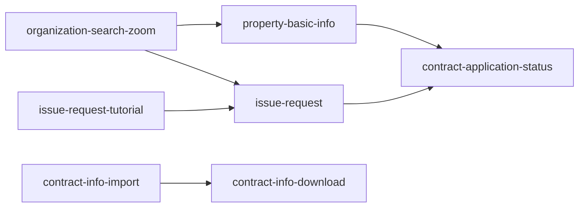

# フィーチャー一覧

> このファイルは **実装順序の根拠（優先度・依存）の正**です。Phase 4 / 5 は優先度順に feature を選び、Phase 6 は依存先を推論せず本ファイルの `依存` 列から引きます。
> **スコープ・完了条件はここに書きません。** それらは `specs/<feature>/requirements.md`（`Boundary Context` / `Acceptance Criteria`）が正です。本ファイルは「どの順で、何を根拠に作るか」だけを持ちます。
> `status: approved` になってから Phase 4 以降の入力にしてください。
>
> **テンプレート**: 山括弧で囲んだ大文字の項目は、プロジェクト確定時に実値へ置換する。

## フィーチャー一覧

> 優先度の昇順に並べる（表の並び自体を実装順とする）。1 行 = 1 feature。`_N` の行を feature の数だけ増やす。各項目の取りうる値は下の `### 項目の定義` を正とする。

| feature 名 | 種別 | 目的 | 依存 | 優先度 | 想定規模 | 対応要求ID |
|---|---|---|---|---|---|---|
| organization-search-zoom | Platform | 作成組織を 3 項目のプルダウンで検索する ZOOM 画面を提供し、呼び出し元画面から利用できるようにする | なし | 1 | 小 | REQ-048, REQ-049, REQ-050 |
| property-basic-info | User | 物件基本情報を登録・変更し、承認フローとステータス・履歴・契約稟議ファイルを管理したうえで、稟議資料となる帳票を出力する | organization-search-zoom | 2 | 大 | REQ-015, REQ-016, REQ-017, REQ-018, REQ-019, REQ-020, REQ-021, REQ-022, REQ-023, REQ-024, REQ-025 |
| issue-request-tutorial | User | 発行依頼書の入力を誘導するチュートリアルの設定画面を提供する（現行の設定用ウインドウ 26 フォーム相当を新規に実現する） | なし | 3 | 中 | REQ-035, REQ-036 |
| issue-request | User | 発行依頼書を登録・変更して契約書に対する発番を行い、チュートリアルによる入力補助とバーコード生成を提供する | organization-search-zoom, issue-request-tutorial | 4 | 大 | REQ-026, REQ-027, REQ-028, REQ-029, REQ-030, REQ-031, REQ-032, REQ-033, REQ-034, REQ-037, REQ-038, REQ-039 |
| contract-application-status | User | 物件契約情報の申請状況を検索・一覧表示し、CSV として出力する | property-basic-info, issue-request | 5 | 中 | REQ-012, REQ-013, REQ-014 |
| contract-info-import | User | 契約情報の取込バッチを画面から実行し、新規・変更・削除の取込と洗替更新を行う | なし | 6 | 中 | REQ-040, REQ-041, REQ-042, REQ-043 |
| contract-info-download | User | 既存の契約情報検索と同一の条件・表示項目で契約情報を検索し、取込で使える形式の CSV としてダウンロードする | contract-info-import | 7 | 中 | REQ-044, REQ-045, REQ-047 |

### 項目の定義

| 項目 | 内容 |
|---|---|
| feature 名 | `specs/<feature-name>/` に対応する識別子 |
| 種別 | `User` / `Platform` |
| 目的 | この feature が満たす要求 |
| 依存 | 前提となる feature（**方向つき**。先に出来ていなければならない側を書く） |
| 優先度 | 実装順の根拠となる値 |
| 想定規模 | `大` / `中` / `小`（分割判断に使う） |
| **対応要求ID** | 要求一覧の要求ID（複数可）。**トレーサビリティの突合キー** |

### 権限制御の扱い（feature にしない範囲）

> REQ-046（新規機能の権限制御を既存 WTB と同様のベンダー／施工会社の権限制御方式に合わせる）は、Phase 1 の再承認（2026-09-11）により分類が `制約` となったため **feature 割当の分母から外れる**。方式の正は `steering/security.md` の `## 認証・認可` であり、各 feature の requirements は steering 適合として検査される。
> 画面単位の権限制御は `機能` の要求として残り、REQ-016 は `property-basic-info`、REQ-027 は `issue-request` が担う。

### 共通基盤を feature にしない基準

> 採番（`NumberingService`）・ファイルアップロード（`FileUploadService`）・コードマスタ取得（`CodeMstService`）・帳票エンジン・バッチ実行基盤は、`steering/architecture.md` の `### 共通基盤（shared）` および `### バッチ` に **既存 WiNG の構成要素として記載済み**であり、本プロジェクトで新たに作るものではない（REQ-053）。したがって feature として立てず、利用する側の feature の中で扱う。
> `organization-search-zoom` を Platform feature として立てているのは、**新規に作成する画面**（REQ-048）であり、対応する `機能` 分類の要求を持つためである。

## 種別の判定

| 種別 | 定義 | 例 |
|---|---|---|
| **User Feature** | それ単体で、利用者が目的を最後まで済ませられる機能の塊 | 注文作成、請求確認 |
| **Platform Feature** | それ単体では誰の目的も終わらず、他の feature に使われて働く共通の仕組み | 認証基盤、通知基盤、監査ログ基盤 |

判定は次の一問で行う。

> **この feature だけが出来上がった状態で、誰かが用事を済ませて終われるか。**
> 終われる → User Feature / 終われない（他の feature の中で使われる）→ Platform Feature

- 利用者には **運用者・管理者も含む**。社内向けの管理機能も User になりうる。
- **画面の有無では決めない**。主目的で決める（ログインは操作を伴うが、用事はその先にあるため Platform）。
- 同じ題材でも切り口で変わる。監査ログを記録する仕組みは Platform、監査担当が検索して確認を終えられる機能は User。
- **「前提かどうか」は種別ではなく `依存` 列が持つ**。先に作る必要があることを理由に Platform としない。

### 本プロジェクトでの判定結果

| feature 名 | 判定 | 根拠 |
|---|---|---|
| organization-search-zoom | Platform | 作成組織検索は呼び出し元画面（物件基本情報登録変更画面・発行依頼書登録変更画面）の入力を助けるために使われる。それ単体では用事が終わらない（REQ-050） |
| property-basic-info | User | 担当者が物件基本情報を登録・変更し、承認に回して帳票を出すところまで終えられる（REQ-015〜REQ-025） |
| issue-request-tutorial | User | チュートリアルの設定を担当する利用者が、設定画面で設定を作り終えられる（REQ-035・REQ-036）。設定という用事がその画面で完結するため Platform としない |
| issue-request | User | 担当者が発行依頼書を登録・変更し、発番まで終えられる（REQ-026〜REQ-034・REQ-037〜REQ-039） |
| contract-application-status | User | 担当者が申請状況を検索・一覧・CSV 出力して確認を終えられる（REQ-012〜REQ-014） |
| contract-info-import | User | 担当者が取込バッチを実行して契約情報の反映を終えられる（REQ-040〜REQ-043） |
| contract-info-download | User | 担当者が契約情報を検索して CSV を取得し終えられる（REQ-044・REQ-045・REQ-047） |

## 優先度の決定方針

1. **依存に基づく必須先行を機械的に決定**する（AI が算出）
2. 必須先行で順序が決まらない範囲は、**`steering/product.md` の主要ユースケース・提供価値と要求一覧を根拠に AI が並べる**。根拠が無い場合は推測で並べず、**質問して停止**する
3. Phase 4 以降の微修正は可。ただし **依存の逆転は禁止**

- **優先度は AI が決定する**。人間による並べ替えは必須工程としない。
- **feature の確定（分割の採否）と `status: approved` は人間**が行う。優先度に異議がある場合はレビューで指摘し、修正して再承認する。

### 本プロジェクトでの算出根拠

優先度 1〜5 は **依存による必須先行で決まる**。6・7 は依存の連鎖から独立しているため、`steering/product.md` の主要ユースケース 5（外部で作成された契約情報の反映と CSV ダウンロード）に対応することを根拠に末尾へ置く。

| 優先度 | feature 名 | 根拠 |
|---|---|---|
| 1 | organization-search-zoom | 依存を持たない。REQ-050 により property-basic-info・issue-request の呼び出し先となるため、両者より先行させる |
| 2 | property-basic-info | organization-search-zoom の後（REQ-050）。contract-application-status が表示する申請状況のデータを生成する側であるため、同 feature より先行させる |
| 3 | issue-request-tutorial | 依存を持たない。issue-request のチュートリアル（REQ-035: 選択肢により順番に入力欄と例が表示される）が動作するには設定が先に存在する必要があるため、issue-request より先行させる |
| 4 | issue-request | organization-search-zoom の後（REQ-050）、issue-request-tutorial の後（REQ-035）。contract-application-status が表示する申請状況のデータを生成する側であるため、同 feature より先行させる |
| 5 | contract-application-status | property-basic-info・issue-request の後。物件契約情報の申請状況（REQ-012）は両 feature が登録・申請したデータを対象とするため、表示対象を生成する側が先行する必要がある |
| 6 | contract-info-import | 依存を持たない。主要ユースケース 5 に対応し、同ユースケースが `product.md` で最後に置かれているため末尾側に置く。REQ-047 により contract-info-download が「取込で使える形式」を出力するため、取込の形式が確定する本 feature を先に置く |
| 7 | contract-info-download | contract-info-import の後（REQ-047: 契約情報取込で使える形式の CSV をダウンロードする） |

依存に循環はない。`organization-search-zoom`・`issue-request-tutorial`・`contract-info-import` は依存を持たず、他の 4 feature の依存はすべてこの 3 つから一方向に伸びる。

## 依存関係図（任意）

> 依存が複雑で表だけでは追えない場合のみ記述する。循環が無いことの確認にも使う。
> **記法**: Mermaid `flowchart`。feature をノード、`依存` 列の関係を矢印で表す。

---

_実装順序の根拠を持つ正のドキュメントです。スコープ・受け入れ基準は `specs/<feature>/requirements.md`、設計は `design.md` に書いてください。要求ID の正は要求一覧です。_
