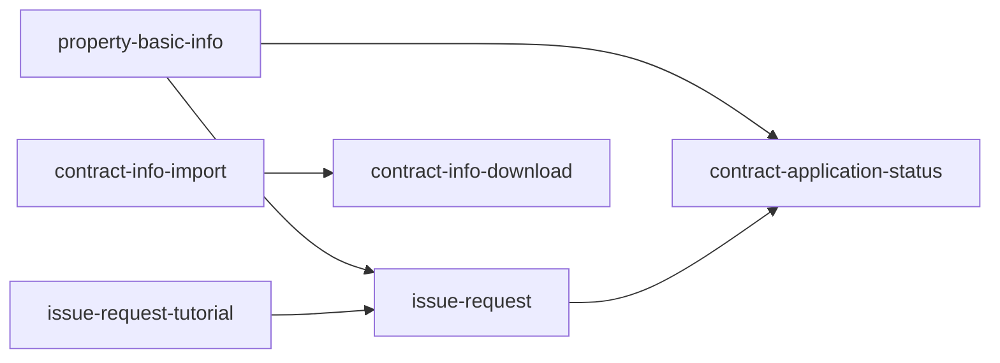

# フィーチャー一覧

> このファイルは **実装順序の根拠（優先度・依存）の正**です。Phase 4 は優先度順に feature を選び、Phase 5 は依存先を推論せず本ファイルの `依存` 列から引きます。
> **スコープ・完了条件はここに書きません。** それらは `specs/<feature>/requirements.md`（`Boundary Context` / `Acceptance Criteria`）が正です。本ファイルは「どの順で、何を根拠に作るか」だけを持ちます。
> `status: approved` になってから Phase 4 以降の入力にしてください。
>
> **テンプレート**: 山括弧で囲んだ大文字の項目は、プロジェクト確定時に実値へ置換する。

## フィーチャー一覧

> 優先度の昇順に並べる（表の並び自体を実装順とする）。1 行 = 1 feature。`_N` の行を feature の数だけ増やす。各項目の取りうる値は下の `### 項目の定義` を正とする。

| feature 名 | 種別 | 目的 | 依存 | 優先度 | 想定規模 | 対応要求ID |
|---|---|---|---|---|---|---|
| property-basic-info | User | 物件基本情報を登録・変更し、承認フローとステータス・履歴・契約稟議ファイルを管理したうえで、稟議資料となる帳票を出力する。作成組織は会社名をラベル表示するのみ | なし | 1 | 大 | REQ-015, REQ-016, REQ-017, REQ-018, REQ-019, REQ-020, REQ-021, REQ-022, REQ-023, REQ-024, REQ-025, REQ-048 |
| issue-request-tutorial | User | WTG080（発行依頼）のボタンから開くポップアップ（WTG081）。契約種別 → 局種別 → 設置設備…の順に、前の選択に応じて、次の選択肢または入力欄とその入力例を順に表示する（REQ-035）。現行の設定用ウインドウ 26 フォームに相当する画面群を、1 つのポップアップの中で順に切り替えて表示する（REQ-036）。選んだ値は WTG080 の入力項目へ設定する。専用の保存テーブル・管理画面・CRUD・排他は持たない（出典: 人間判断 2026-09-29（tutorial requirements 1回目 #1）、2026-09-30（FL-TUT-Q1）） | なし | 2 | 中 | REQ-035, REQ-036 |
| issue-request | User | 発行依頼書を登録・変更して契約書に対する発番を行い、作成組織（会社名・所属①②）を画面上で入力させ、チュートリアルを開くボタンと、チュートリアルで設定された値の受け取りとバーコード生成を提供する | property-basic-info, issue-request-tutorial | 3 | 大 | REQ-026, REQ-027, REQ-028, REQ-029, REQ-030, REQ-031, REQ-032, REQ-033, REQ-034, REQ-037, REQ-038, REQ-039, REQ-048, REQ-049, REQ-050 |
| contract-application-status | User | 物件契約情報の申請状況を検索・一覧表示し、CSV として出力する | property-basic-info, issue-request | 4 | 中 | REQ-012, REQ-013, REQ-014 |
| contract-info-import | User | 契約情報の取込バッチを画面から実行し、新規・変更・削除の取込と洗替更新を行う | なし | 5 | 中 | REQ-040, REQ-041, REQ-042, REQ-043 |
| contract-info-download | User | 既存の契約情報検索と同一の条件・表示項目で契約情報を検索し、取込で使える形式の CSV としてダウンロードする | contract-info-import | 6 | 中 | REQ-044, REQ-045, REQ-047 |

### 項目の定義

| 項目 | 内容 |
|---|---|
| feature 名 | `specs/<feature-name>/` に対応する一意の識別子。半角小文字英数字で始まり、以降は半角小文字英数字・`-`・`_`。`con`・`prn`・`aux`・`nul`・`com1`〜`com9`・`lpt1`〜`lpt9` は使用しない |
| 種別 | `User` / `Platform` |
| 目的 | この feature が満たす要求 |
| 依存 | 前提となる feature 名を半角カンマ区切りで記す。依存なしは `なし`。すべて先行する表の行に存在すること。未知名・自己依存・重複・循環を認めない |
| 優先度 | 1 以上の整数。昇順に配置し、同値の場合も表の行順を維持する。依存先は必ず先行すること |
| 想定規模 | `大` / `中` / `小`（分割判断に使う） |
| **対応要求ID** | 要求一覧の要求ID（複数可）。**トレーサビリティの突合キー** |

**要求IDの多重割当（REQ-048）**

> **REQ-048 のみ `property-basic-info` と `issue-request` の 2 feature に割り当てる。** REQ-048 は 1 つの要求文の中で 2 つの異なる振る舞いを定めているためである。
>
> | feature | REQ-048 のうち担う部分 |
> |---|---|
> | `issue-request` | 作成組織（会社名・所属①・所属②）の**入力欄を設ける** |
> | `property-basic-info` | 発行依頼書情報マスタ（`TWTGM100`）の契約稟議起案者_会社名を**ラベルとして表示する**（入力欄を設けず、所属①・所属②も持たない） |
>
> 品質ゲートは多重割当を検出するが、**本件は意図的なものである**（人間判断 / 2026-09-24）。**2 feature の振る舞いは同一ではなく、入力側と表示側に分かれる。** したがって 2 つの `requirements.md` に同一仕様を要請しない。
>
> **REQ-049 / REQ-050 は `issue-request` のみに割り当てる。** 入力項目の構成（REQ-049）と必須・活性の条件（REQ-050）は発行依頼書登録変更画面にしか現れないためである。
>
> 両 feature は `TWTGM100` を共有するが、**`property-basic-info` は参照のみで書き込まない**（書き込みは `issue-request` の責務）。**`TWTGM100` / `TWTGM080` はいずれも本プロジェクトで新規に追加するテーブルである**（人間判断 / 2026-09-24。`WTX_Batch` の `PWTGB090Job` が両テーブルを参照しているが、これは本プロジェクトより後に作られたコードである）。`TWTGM080` は `property-basic-info` が、`TWTGM100` は `issue-request` が定義する。**契約局情報マスタ `TWTGM140` も PJ45 で新規に追加するテーブルであり、`issue-request` が定義して発行依頼書画面から更新する**（人間判断 / 2026-09-24。根拠: WTG_ｴﾝﾃｨﾃｨ一覧 の改訂履歴 3、WTG080 機能定義書「更新条件(契約局情報ﾏｽﾀ)」）。`property-basic-info` は帳票のために `TWTGM100` / `TWTGM140` を読み取りのみで読む（同 feature の design の契約 2-b）。**`依存` 列は変更しない**（読み取りは契約で受け、`property-basic-info` → `issue-request` の辺を足すと循環する）。
>
> **ただし 2026-09-24 に、両 feature のあいだに依存が 1 本あることが確定した。** テーブルの共有ではなく**申請No の採番元**による依存である（`property-basic-info` が採番し、`issue-request` が受け取って使う）。`依存` 列に反映済み。

**権限制御の扱い（feature にしない範囲）**

> REQ-046（新規機能の権限制御を既存 WTB と同様のベンダー／施工会社の権限制御方式に合わせる）は、Phase 1 の再承認（2026-09-11）により分類が `制約` となったため **feature 割当の分母から外れる**。方式の正は `steering/security.md` の `## 認証・認可` であり、各 feature の requirements は steering 適合として検査される。
> 画面単位の権限制御は `機能` の要求として残り、REQ-016 は `property-basic-info`、REQ-027 は `issue-request` が担う。

**共通基盤を feature にしない基準**

> 採番（`NumberingService`）・ファイルアップロード（`FileUploadService`）・コードマスタ取得（`CodeMstService`）は `steering/architecture.md` の `### 共通基盤（shared）`、バッチ実行基盤は同 `### バッチ`、帳票エンジン（report-engine）は `steering/tech.md` の `## 主要ライブラリ`（一括生成は `architecture.md` の `### バッチ`）に、いずれも **既存 WiNG の構成要素として記載済み**であり、本プロジェクトで新たに作るものではない（REQ-053）。したがって feature として立てず、利用する側の feature の中で扱う。

**作成組織を feature にしない理由（共通基盤とは別の理由）**

> 前節は「既存 WiNG の共通基盤だから feature にしない」という基準であり、本節は理由が異なるため分けて書く。
>
> 作成組織の入力・表示（REQ-048 / REQ-049 / REQ-050）は **feature として立てない**。2026-09-24 の設計変更（2024-06-25 に ZOOM 管理台帳から `ZWTZ072` を廃止したことの確定）により、独立した検索画面ではなく `issue-request` の画面内の入力欄（および `property-basic-info` の画面内のラベル）になったため、**それ単体で成立する画面を持たない**。共通基盤であることを理由としない。

## 種別の判定

| 種別 | 定義 | 例 |
|---|---|---|
| **User Feature** | それ単体で、利用者が目的を最後まで済ませられる機能の塊 | 注文作成、請求確認 |
| **Platform Feature** | それ単体では誰の目的も終わらず、他の feature に使われて働く共通の仕組み | 認証基盤、通知基盤、監査ログ基盤 |

判定は次の一問で行う。

> **この feature だけが出来上がった状態で、誰かが用事を済ませて終われるか。**
> 終われる → User Feature / 終われない（他の feature の中で使われる）→ Platform Feature

- 利用者には **運用者・管理者も含む**。社内向けの管理機能も User になりうる。
- **画面の有無では決めない**。主目的で決める（ログインは操作を伴うが、用事はその先にあるため Platform）。
- 同じ題材でも切り口で変わる。監査ログを記録する仕組みは Platform、監査担当が検索して確認を終えられる機能は User。
- **「前提かどうか」は種別ではなく `依存` 列が持つ**。先に作る必要があることを理由に Platform としない。
- 本プロジェクトの feature は **6 件すべてが User Feature** である（2026-09-24 に `organization-search-zoom` を廃止したため Platform は 0 件）。共通の仕組み（認証・権限制御・採番・コードマスタ取得・ファイルアップロード・帳票エンジン・バッチ実行基盤）はいずれも既存 WiNG の構成要素であり、本プロジェクトで新たに作らないため feature にしない。

**本プロジェクトでの判定結果**

| feature 名 | 判定 | 根拠 |
|---|---|---|
| property-basic-info | User | 担当者が物件基本情報を登録・変更し、承認に回して帳票を出すところまで終えられる（REQ-015〜REQ-025）。作成組織は会社名のラベル表示のみ（REQ-048） |
| issue-request-tutorial | User | 発行依頼書を登録・変更する利用者が、発行依頼画面（WTG080）から開くチュートリアルで契約種別・局種別などの質問に順に答える。そうすると、その依頼に当てはまる転貸借・契約形態が決まり、WTG080 の該当欄に設定されたところで終われる（REQ-035・REQ-036）。どの契約形態に当たるかを決めるという用事がこの画面で完結し、ほかの feature の土台として使われるものではないため、Platform としない（出典: 人間判断 2026-09-29（tutorial requirements 1回目 #1）、2026-09-30（FL-TUT-Q1）） |
| issue-request | User | 担当者が発行依頼書を登録・変更し、発番まで終えられる（REQ-026〜REQ-034・REQ-037〜REQ-039）。作成組織の入力（REQ-048〜REQ-050）は本画面内の入力欄である |
| contract-application-status | User | 担当者が申請状況を検索・一覧・CSV 出力して確認を終えられる（REQ-012〜REQ-014） |
| contract-info-import | User | 担当者が取込バッチを実行して契約情報の反映を終えられる（REQ-040〜REQ-043） |
| contract-info-download | User | 担当者が契約情報を検索して CSV を取得し終えられる（REQ-044・REQ-045・REQ-047） |

> REQ-026・REQ-036 の「チュートリアル設定画面」はこのポップアップを指す。「設定」は WTG080 の欄へ値を設定する意味で、設定データを管理する画面ではない

## 優先度の決定方針

1. **依存に基づく必須先行を機械的に決定**する（AI が算出）
2. 必須先行で順序が決まらない範囲は、**`steering/product.md` の主要ユースケース・提供価値と要求一覧を根拠に AI が並べる**。根拠が無い場合は推測で並べず、**質問して停止**する
3. Phase 4 以降の変更は Phase 3 の修正・再検査・再承認を経る。承認後に JSON を同期し、下流の計画・検査をやり直す。**依存の逆転は禁止**

- **優先度は AI が決定する**。人間による並べ替えは必須工程としない。
- **feature の確定（分割の採否）と `status: approved` は人間**が行う。優先度に異議がある場合はレビューで指摘し、修正して再承認する。

**本プロジェクトでの算出根拠**

優先度 3・4 は **依存による必須先行で決まる**。1・2 は依存を持たない feature で、依存からは前後が決まらない。そこで `property-basic-info` は `steering/product.md` の主要ユースケースの並びで先頭に置き、`issue-request-tutorial` は `issue-request` の直前に置く。5・6 は依存の連鎖から独立しているため、`steering/product.md` の主要ユースケース 5（外部で作成された契約情報の反映と CSV ダウンロード）に対応することを根拠に末尾へ置く。

| 優先度 | feature 名 | 根拠 |
|---|---|---|
| 1 | property-basic-info | 依存を持たない。contract-application-status が表示する申請状況のデータを生成する側であるため、同 feature より先行させる。`steering/product.md` の主要ユースケースのうち最初に置かれる物件基本情報の登録・承認に対応するため、依存を持たない 3 feature（本 feature・issue-request-tutorial・contract-info-import）の先頭に置く |
| 2 | issue-request-tutorial | 依存を持たない。issue-request が本ポップアップを開き、設定された値を受け取るため、issue-request より先行させる |
| 3 | issue-request | `property-basic-info` の後（**申請No を採番するのが同 feature であり、本 feature は画面から受け取った申請No で `TWTGM100` に登録するため** — 2026-09-24 に確定）、`issue-request-tutorial` の後（REQ-035）。contract-application-status が表示する申請状況のデータを生成する側であるため、同 feature より先行させる |
| 4 | contract-application-status | property-basic-info・issue-request の後。物件契約情報の申請状況（REQ-012）は両 feature が登録・申請したデータを対象とするため、表示対象を生成する側が先行する必要がある |
| 5 | contract-info-import | 依存を持たない。主要ユースケース 5 に対応し、同ユースケースが `product.md` で最後に置かれているため末尾側に置く。REQ-047 により contract-info-download が「取込で使える形式」を出力するため、取込の形式が確定する本 feature を先に置く |
| 6 | contract-info-download | contract-info-import の後（REQ-047: 契約情報取込で使える形式の CSV をダウンロードする） |

依存に循環はない。`property-basic-info`・`issue-request-tutorial`・`contract-info-import` は依存を持たず、他の 3 feature の依存はここから一方向に伸びる。**うち `contract-application-status` → `issue-request` → `issue-request-tutorial` は 2 ホップの連鎖である**（依存を持たない feature から直接 1 ホップで届くわけではない）。有向辺は 5 本（`property-basic-info` → `issue-request` / `property-basic-info` → `contract-application-status` / `issue-request-tutorial` → `issue-request` / `issue-request` → `contract-application-status` / `contract-info-import` → `contract-info-download`）。

**2026-09-24 の改訂**: `organization-search-zoom`（旧・優先度 1）を廃止し、優先度を 1〜6 に振り直した。`property-basic-info` と `issue-request` の `依存` から同 feature を外している。作成組織の**入力は `issue-request` のみ**が持ち、`property-basic-info` は `TWTGM100` の契約稟議起案者_会社名をラベル表示するだけである。

**2026-09-24 の追加改訂**: 申請No の採番元が確定したことにより、`issue-request` の `依存` に `property-basic-info` を追加した。**申請No を採番するのは `property-basic-info`（物件申請情報マスタ `TWTGM080` に登録する）**であり、`issue-request` は**画面から受け取った申請No で `TWTGM100` に登録する**（根拠: WTG070 機能定義書の「更新条件(物件申請情報ﾏｽﾀ)」「更新条件(発行依頼書情報ﾏｽﾀ)」、WTG080 機能定義書の「更新条件(発行依頼書情報ﾄﾗﾝ)」。人間判断 / 2026-09-24）。**2026-09-24 に「両 feature をまたぐ依存は発生しない」と記していたが、これは申請No の採番元が未確定だった時点の判断であり、本改訂で取り消す。** 優先度は既に 1 < 3 であるため順序の変更は不要で、循環も生じない。

## 依存関係図（任意）

> 依存が複雑で表だけでは追えない場合のみ記述する。循環が無いことの確認にも使う。
> **記法**: Mermaid `flowchart`。feature をノード、`依存` 列の関係を矢印で表す。

---

_実装順序の根拠を持つ正のドキュメントです。スコープ・受け入れ基準は `specs/<feature>/requirements.md`、設計は `design.md` に書いてください。要求ID の正は要求一覧です。_
