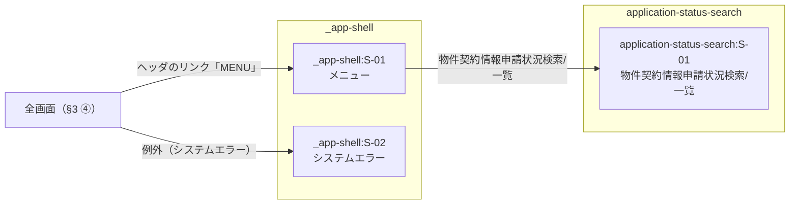

# 画面マップ — 契約書発行依頼業務対応

> 位置づけ: **画面の切り出しと所有・feature 間遷移・入口とシェル・語彙の出どころの正**（案件に 1 つ）。
> **design 承認を通過した** UI feature の `requirements.md` の業務フロー・受け入れ基準と `design.md`（approved）の System Flows、steering から
> 起こす。**画面の中身（項目・操作・状態・文言）は書かない**（画面設計書の役割）。**視覚仕様は書かない**（STYLEGUIDE.md の役割）。
> すべて design 承認の後。初回はその時点で通過している UI feature をまとめて切り出し、以後 design 承認を通過した feature が入るたびに
> **増分で行を足し、差分だけ確認する**（§6-3）。行の確定は所有 feature 単位（frontmatter `features[]`）。
> 各 feature の画面設計書（SD-1）は、本書で所有と決まった画面だけを書き、参照行・入口・出口は本書から転記する。

## 1. 対象 feature と接続

> 入口 = その feature に入るナビ項目（§4）と最初の画面。出口 = 終端画面（完了・通知等）から業務プロセス上の次の行き先。
> **出口は 1 つまで**（複数並べない）。根拠は §3 に書く。UI を持たない feature も行を置き「なし」と書く（対象の判定の記録）。
> **出口列が指すのは §3 の 4 類型のうち「終端画面から次工程」だけ**。**出口が「なし」でも §3 にその feature の行があるのは正常。**
> **`mockup` 列** = `作る` / `省く（理由）`。UI を持たない feature は `—`。

**対象の絞り込み（開始時の宣言）**: design 承認を通過している feature は 7 つあるが、**今回の画面設計の対象は
`application-status-search` だけ**とする（開発者の宣言・2026-10-09）。残る 6 feature は UI の有無を**判定していない**
（下表の「未判定」）。対象に入れるときは増分で行を足す（§6-2 #1）。

| feature | UI | mockup | 入口（ナビ項目 → 最初の画面） | 出口（終端画面 → 次の行き先） | 備考 |
|---|---|---|---|---|---|
| application-status-search | あり | 作る | 「物件契約情報申請状況検索/一覧」→ application-status-search:S-01 | なし（一覧が終端。申請No のリンクは参照のための往復 — §6-2 #2） | requirements 業務フロー「メニューから最初に開く画面」 |
| _app-shell | あり | 作る | —（入口そのもの） | なし | 擬似 feature。入口とシステムエラーを持つ |
| property-basic-info | 未判定 | — | — | — | 今回の対象外（design 承認済み）。§4-2 のナビ項目 #1 は無効表示で載せる |
| issue-request | 未判定 | — | — | — | 今回の対象外（design 承認済み） |
| issue-request-tutorial | 未判定 | — | — | — | 今回の対象外（design 承認済み） |
| print-report | 未判定 | — | — | — | 今回の対象外（design 承認済み） |
| contract-info-import | 未判定 | — | — | — | 今回の対象外（design 承認済み） |
| contract-info-download | 未判定 | — | — | — | 今回の対象外（design 承認済み） |

## 2. 画面一覧（案件全体）

> 画面 ID は `<feature>:S-xx`（案件全体で一意。所有 feature の画面設計書内では `S-xx`）。
> **同じ目的の画面は 1 行にまとめ、所有 feature を 1 つ決める**（判断は §6-1）。
> 根拠は所有 feature の受け入れ基準 ID / System Flows。行の確定は frontmatter `features[]` の所有 feature 単位。

| 画面 ID | 画面名 | 目的（1 行） | 型 | 所有 feature | 使う feature | 根拠（受け入れ基準 ID / System Flows） | 出どころ |
|---|---|---|---|---|---|---|---|
| application-status-search:S-01 | 物件契約情報申請状況検索/一覧 | 物件契約情報の申請を条件で探して一覧で見て、申請を開き、結果を CSV に出す | 一覧 | application-status-search | — | application-status-search AC 1.1, 1.2, 1.3, 1.4, 1.5, 1.6, 1.7, 2.1, 2.2, 2.3, 2.4, 2.5, 2.6, 2.7, 2.8, 2.9, 2.10, 3.1, 3.2, 3.3, 3.4, 3.5, 4.1 / System Flows「メニューから開き、条件を入れて『検索』を押す」「申請No のリンクを押す」 | requirements 業務フロー「利用者がメニューから物件契約情報申請状況検索一覧画面を開く」。画面名は design.md の概要（Users）のメニュー名から画面 ID の接頭辞を除いたもの（ヘッダでの表示の形は §4-1） |
| _app-shell:S-01 | メニュー | 業務の入口。契約・管財管理の画面へのリンクを並べる | 入口 | _app-shell | 全 feature | —（requirements 由来でない。根拠は application-status-search の requirements 業務フロー「メニューから…開く」と STYLEGUIDE.md §4-10「feature 間の導線は入口画面（`.app-menu`）が担う」） | 新設（§4）。既存 WiNG のメニュー画面を写す擬似 feature の画面。**画面名の正は §4-1 の表**。画面設計書は `.aidd/screen-design/_app-shell/screen-spec.md` |
| _app-shell:S-02 | システムエラー | 画面の処理で起きた例外（権限なし・不正パラメータ・排他・CSRF を含む）を知らせる | システムエラー | _app-shell | 全 feature | —（requirements 由来でない。根拠は `steering/tech.md`「方針: Controller から出たすべての例外を `HandlerExceptionResolver` の実装で受け止め、エラー画面へ遷移させる」と同「画面の派生」の例外の一覧） | 共通画面。**inbound は「全画面（§3 ④）」**。権限なしを別画面にしない判断は §6-1 #2 |

型の語彙: **業務画面** = 一覧 / 詳細 / フォーム / 確認 / 完了 / ダイアログ / ダッシュボード、
**共通画面** = 入口 / システムエラー / 権限なし / お知らせ。

**状態にしたもの（画面にしない）**: CSV 出力（AC 3.1〜3.5）はファイルのダウンロードで、閉じると S-01 に残り、
ナビ・パンくず上の位置を持たず、他 feature から直接遷移されないため **S-01 の操作・状態**とする。
上限超過の確認・0 件・入力エラー（AC 2.5, 2.6, 4.1）も S-01 の状態である（中身は画面設計書）。

### 2-1. AC の数え上げ（application-status-search — AC 側から）

| 要件 | AC | 紐づく画面 | 備考 |
|---|---|---|---|
| 1 検索 | 1.1〜1.4 | S-01 | |
| 〃 | 1.5 | S-01 | 営業日の数え方はサーバ側だが、S-01 の検索の挙動を規定する（判定基準 ①） |
| 〃 | 1.6 | S-01 | 社外ユーザーのときの S-01 の見え方 |
| 〃 | 1.7 | S-01 | 検索の対象の絞り込み。S-01 の結果を規定する（判定基準 ①） |
| 2 一覧 | 2.1〜2.6, 2.8 | S-01 | |
| 〃 | 2.7 | S-01 | 遷移先 GWTG070 は今回の画面マップに無い（§6-2 #2） |
| 〃 | 2.9 | S-01 | 否定形の AC（新規登録のボタンを置かない）。画面から外す理由ではない（判定基準 ③） |
| 〃 | 2.10 | S-01 | GWTG070 からの復路（§6-2 #2） |
| 3 CSV | 3.1〜3.5 | S-01 | S-01 の操作として出力する（上の「状態にしたもの」） |
| 4 入力チェック | 4.1 | S-01 | |

**総数 23 / 画面に紐づいた 23 / 画面を伴わない AC 0。**

## 3. feature 間遷移

> feature をまたぐ遷移だけを書く（feature 内の遷移は各画面設計書 §2）。
> mockup はこの表にあるリンクだけを他 feature へ張る（所有側の `pages/` への相対パス。未生成なら pending）。
> **入口からの分岐も本表に書く**（§4 は全ページに載るシェルのナビ、本表は入口画面という 1 画面からの遷移。重複ではない）。

| 類型 | 形 | 行き先の数 |
|---|---|---|
| **① 入口からの分岐** | 入口 → 各 feature の最初の画面 | **1 → N** |
| **② 参照のための往復** | 一覧・詳細から他 feature の画面を参照 → 元の画面へ復帰 | 往路 1 + 復路 1 |
| **③ 終端画面から次工程** | 終端画面 → 業務プロセス上の次の行き先 | **1 つまで** |
| **④ 全画面からの遷移** | 全画面 → 1 画面 | **N → 1**（先ごとに 1 行） |

| 類型 | 遷移元 | 操作・契機 | 遷移先 | 根拠 | 備考 |
|---|---|---|---|---|---|
| 入口からの分岐 | _app-shell:S-01 | リンク「物件契約情報申請状況検索/一覧」 | application-status-search:S-01 | **§4-2 ナビ項目 #2** / application-status-search の requirements 業務フロー「メニューから最初に開く画面」 | §4-2 #1（物件基本情報登録変更）は今回の対象外で遷移先が無い（無効表示）ため行を立てない |
| 全画面からの遷移 | **全画面**（`_app-shell:S-01` を除く） | ヘッダのリンク「MENU」 | _app-shell:S-01 | **§4-1 ヘッダのリンク #1** / STYLEGUIDE.md §4-10「2 行目 = 全画面に共通のリンク」 / 文言は 【人】の決着（2026-10-09・SD-0 起草中の質問） | **入口画面自身では無効表示**（自己参照） |
| 全画面からの遷移 | **全画面** | 画面の処理で起きた例外 | _app-shell:S-02 | `steering/tech.md`「すべての例外を…エラー画面へ遷移させる」 | **共通画面の inbound はこの 1 行だけ**。入力エラー・上限超過・0 件は各画面の状態に残す（application-status-search AC 2.5, 2.6, 4.1） |
| 全画面からの遷移 | **全画面** | ヘッダのリンク「LOGOUT」 | **なし（無効表示）** | **§4-1 ヘッダのリンク #2** / `steering/security.md`「失効トリガ: ログアウト（`LogoutController`）」 / 文言は 【人】の決着（2026-10-09・SD-0 起草中の質問） | 行き先（ログイン画面）は型の語彙に無く、本案件の画面にもない（§6-2 #4） |

## 4. 入口とシェル

> 様式（ヘッダ・ナビ・パンくずの形）は STYLEGUIDE.md §4-10 アプリシェル。ここには書かない。

- **入口**: 新設: `_app-shell:S-01`（画面設計書 `.aidd/screen-design/_app-shell/screen-spec.md`）。
  受領 feature に入口相当が無いため。中身は既存 WiNG のメニュー画面を写す
- **並び・グルーピングの根拠**: `steering/product.md`「主要ユースケース」の並び（UC-1 物件基本情報の登録・申請 → UC-5 申請状況の検索。
  業務プロセスの前後関係）。グループは 1 つ（契約・管財管理。`product.md`「開発物の概要・背景」のサブシステム）
- **グローバルナビ・パンくず**: 持たない（STYLEGUIDE.md §4-10「グローバルナビ・ナビ項目の現在地・無効・パンくずは持たない」—【人】判断）。
  **feature 間の導線は入口画面のリンク一覧が担う**
- **未生成 feature の項目**: 載せる。リンク先が無いことは mockup の manifest `notes[]` に記録する
- **既存 WTG の画面（GWTG003〜GWTG050）**: 改修対象外（`product.md`「プロダクトレベルでやらないこと」）なので載せない（§6-2 #3）

### 4-1. シェルの表示文言（**1 か所で持つ**）

| 項目 | 値 | 備考（使われる先・注意） |
|---|---|---|
| システム名 | WiNG | ヘッダのロゴ位置（`asset.logo` が `none` の間の仮の文字）と、全ページの `<title>` の後半（`<画面名> - WiNG`）。出どころ `product.md`「建設業務支援システム WiNG」 |
| 入口の表示文言 | メニュー | 利用者が読む名前。出どころ application-status-search の requirements 業務フロー「メニューから…開く」と design.md 概要（Users）「メニュー『…』」 |
| 入口画面の画面名 | メニュー | §2 の `_app-shell:S-01` の画面名の正（入口の表示文言と同語） |
| 入口画面のメニューの見出し | 契約・管財管理 | `.app-menu-title` に入る値。出どころ `product.md`「契約・管財管理（サブシステムコード WTG）」 |
| ヘッダの見出し | 利用者 / 所属 / 画面名 | STYLEGUIDE.md §4-10 の割り方（1 行目 = 利用者 + 画面名 / 2 行目 = 所属）に入る見出し |
| ヘッダの画面名の値の形 | `[画面ID]画面名`（例 `[GWTG060]物件契約情報申請状況検索/一覧`）。画面 ID を持たない入口画面は `メニュー` だけ | 既存 UI の形（STYLEGUIDE.md §4-10 が「返すかは別途」とした値）。出どころ 【人】の決着（2026-10-09・SD-0 起草中の質問） |
| ヘッダのリンク | #1「MENU」→ _app-shell:S-01 / #2「LOGOUT」→ なし（無効表示） | **§3 ④ の行と 1 対 1**。2 行目（全画面に共通）の段。1 行目（その画面から直接飛ぶ機能）は画面設計書が持つ。**入口画面自身では #1 を無効表示**。角括弧は様式（STYLEGUIDE.md §4-10）で文言に含めない。出どころ 【人】の決着（2026-10-09・SD-0 起草中の質問） |
| パンくず | **持たない** | STYLEGUIDE.md §4-10（【人】判断・既存画面の再現） |
| 現在地 | ヘッダの画面名の表示 | パンくずを持たないので本行が現在地の正（STYLEGUIDE.md §4-10「現在地はヘッダの `画面名` の表示で示す」） |

### 4-2. ナビ項目（入口画面のリンク一覧）

| # | グループ | ナビ項目（表示文言） | リンク先（画面 ID） | feature | 根拠 |
|---|---|---|---|---|---|
| 1 | 契約・管財管理 | 物件基本情報登録変更 | **なし（無効表示 — 今回の対象外）** | property-basic-info（design 承認済み・今回の対象外） | `product.md`「主要ユースケース」UC-1 / application-status-search の requirements「新規の登録はメニューから物件基本情報登録変更画面を開いて行う」。文言は仮（§6-2 #1） |
| 2 | 契約・管財管理 | 物件契約情報申請状況検索/一覧 | application-status-search:S-01 | application-status-search | `product.md`「主要ユースケース」UC-5（UC-1 の申請の後に状況を探す）/ design.md 概要（Users）のメニュー名 |

## 5. 語彙の出どころ

| 語彙 | 値の例（steering から転記） | 出どころ | 無い場合 |
|---|---|---|---|
| ロール名 | 起案者 / 申請者 / 確認者 / 承認者 | `product.md`「主要ユースケース」UC-3・UC-4・UC-7、`security.md`「担当者の氏名（起案担当者・申請者・確認者・承認者・更新者）」 | — |
| 利用者の区分 | 社内ユーザー / 社外ユーザー | `security.md`「WTG の社内と社外の判定は…P71 で行う」 | — |
| 業務状態名（審査フェーズ） | — | **steering に無い**（`product.md` が正とする `docs/code-design.md` が案件に無い） | 画面設計書は自 feature の design.md の値に従う。ダミーデータは design.md の値だけを使う。§6-2 #7 |
| 業務状態名（状態） | — | 同上 | 同上。§6-2 #7 |
| 共有識別子の書式（申請No） | 無し | steering に無い | 既定 = 汎用の数値のみ（独自の書式を創作しない）。§6-2 #8 |
| 共有識別子の書式（稟議バーコードNo・基地局番号） | 無し | steering に無い | 同上。§6-2 #8 |
| 共通操作の文言（戻る / キャンセル 等） | — | STYLEGUIDE.md §7 | — |
| 共通のシステムエラーに寄せる範囲 | Controller から出た例外だけ。入力エラー・上限超過・0 件は各画面の状態に残す | `steering/tech.md`「方針」 | — |

### 5-1. マスタ参照項目の表示形式

| 参照項目 | 何を見せるか | 何を裏に持つか | 出どころ | 無い場合 |
|---|---|---|---|---|
| エリア | コード:名称 | エリアのコード | application-status-search の design.md「コンポーネントとインターフェース」申請状況検索一覧（一覧と CSV の値の形「エリアは『コード:名称』」） | — |
| 起案会社 | 会社名（コードマスタ `P26` の名称） | 会社コード | 同上（社外ユーザーの起案会社「`P26` の名称」） | — |
| 区分値（依頼内容・審査フェーズ・状態・施策） | 名称 | 区分のコード | 同上（一覧と CSV の値の形「名称」） | 値の一覧は §6-2 #7 |

## 6. 判断・未決・参照

### 6-1. 所有・統合の判断

| # | 判断 | 理由 | 影響 feature |
|---|---|---|---|
| 1 | 入口（メニュー）を `_app-shell` に新設した | 受領 feature（application-status-search）に入口相当が無い。既存 WiNG のメニュー画面を写す | 全 feature（ヘッダのリンク「MENU」の行き先） |
| 2 | 権限なしを別画面にせず、システムエラー（`_app-shell:S-02`）に統合した | `steering/tech.md` が「すべての例外を…エラー画面へ遷移させる」とし、権限なし（`InvalidAccessErrorException`）を例外の 1 つとして挙げている。別の画面を持つ根拠が steering に無い | 全 feature |

### 6-2. 確認事項（本書では決められないもの）

| 宛先 | 意味 | 誰が処理するか |
|---|---|---|
| **上流** | steering / requirements / design.md に足す・直す | 当該文書の所有者 |
| **本書** | 次の revision で本書が処理する | 改訂者 |
| **工程** | SKILL.md の規約に穴がある | 工程の保守側（案件では解決しない） |
| **雛形** | skill の `templates/` の書式に穴がある | 同上 |

| # | 宛先 | 事項 | 影響 |
|---|---|---|---|
| 1 | 本書 | **残る 6 feature を対象に入れていない**（開発者の宣言で application-status-search に絞った）。入れるときは増分で行を足し、UI の有無を判定する。§4-2 #1 の文言（「物件基本情報登録変更」）は feature-list の目的欄からの仮置きで、property-basic-info を足すときにその design.md のメニュー名で確かめる | 足すたびにナビ項目が動けば、全 feature の mockup のシェルを再生成する |
| 2 | 本書 | **申請No のリンクの行き先（GWTG070・property-basic-info）が本書に無い**（AC 2.7 往路・AC 2.10 復路）。property-basic-info を足すときに §3 に ② 参照のための往復を 2 行足す | それまで mockup では申請No のリンクを pending（無効表示）にする。足したら application-status-search の mockup を再生成する |
| 3 | 上流（steering） | 既存 WTG の画面（GWTG003〜GWTG050）が実際のメニューに並ぶかどうかと並び順が steering に無い | 本書のメニューは本案件の画面だけを並べる。実画面と並びが違う |
| 4 | 工程 | ログイン画面・セッションエラー画面（`security.md`「セッションエラー画面へ送る」）が型の語彙に無い | 本書は画面にしない。ログアウトのリンクは無効表示 |
| 5 | 本書（revision 1 で閉じた） | ヘッダのリンクの文言の出どころが steering / design.md に無かった | 「MENU」「LOGOUT」で決着（【人】の決着（2026-10-09・SD-0 起草中の質問））。§4-1 に反映 |
| 6 | 本書（revision 1 で閉じた） | ヘッダの画面名の値の形が決まっていなかった（STYLEGUIDE.md §4-10 の但し書きにより単独で聞いた） | `[画面ID]画面名` で決着（【人】の決着（2026-10-09・SD-0 起草中の質問））。§4-1 に反映 |
| 7 | 上流（steering） | 業務状態名（審査フェーズ・状態）の値の一覧が steering に無い。`product.md` が正とする `docs/code-design.md` が案件に無い | 画面設計書は自 feature の design.md の値に従う。feature 間で名前が揺れないかは次に足す feature で確かめる |
| 8 | 上流（steering） | 申請No・稟議バーコードNo・基地局番号の書式が steering に無い | ダミーデータは汎用の数値のみ |
| 9 | 本書 | 改訂者（frontmatter `editor`）を仮に STYLEGUIDE.md の確定者にした | 人② で確かめる |

### 6-3. 改訂履歴（増分）

| revision | 日付 | 変更（足した・直した行） | confirmed（by / at / recorded_by） | 影響 feature（画面設計書の修正 / mockup の再生成） |
|---|---|---|---|---|
| 1 | 2026-10-09 | 初版（application-status-search を切り出し。入口とシステムエラーを `_app-shell` に新設） | toshiya-fukunaga / 2026-10-09T21:52+09:00 / aidd-system-design | — |

### 6-4. 参照

| 資料 | 版・時点 | 参照先 |
|---|---|---|
| requirements.md（application-status-search） | status approved / updated_at 2026-10-05T20:12:57+09:00 | `specs/application-status-search/requirements.md` |
| design.md（application-status-search） | status approved / updated_at 2026-10-09T13:50:01+09:00（概要・System Flows と、§5-1 の出どころの値の形だけ） | `specs/application-status-search/design.md` |
| steering | `product.md`（2026-10-05T18:25:03+09:00）/ `security.md` / `tech.md` | `steering/` |
| feature-list | status approved（§4-2 #1 の仮の文言だけ） | `.aidd/feature-list.md` |
| STYLEGUIDE.md | version 0.3.10（§4-10 アプリシェルの様式） | `STYLEGUIDE.md`（リポジトリ直下） |

### 6-5. wireframe との突合

wireframe 工程は実施していない（`.aidd/wireframe/` が無い）。
