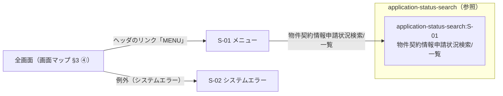

# 画面設計書 — _app-shell

> 位置づけ: **画面の構成・項目・操作・状態・文言の正。** 本 feature は**擬似 feature**であり、`requirements.md` / `design.md` を持たない。
> **実質の上流は画面マップ §4（入口とシェル）・§5（語彙）と steering**で、操作・状態の根拠は steering の該当節を書く（§6 に節名まで）。
> **画面の切り出し・所有・feature 間遷移・入口とナビは画面マップ（SD-0）が決めている**（`.aidd/screen-design/_app-shell/screen-map.md`）。
> 本書は**画面マップで本 feature が所有と決まった画面だけ**を書く（入口 `S-01` とシステムエラー `S-02`）。
> 画面マップに無い画面が要る・所有を移したいときは、本書で足さず・書き換えず、画面マップの改訂に回す（§5-5）。
> 見た目（色・余白・書体・部品の様式）は書かず、**STYLEGUIDE.md** を指す。部品は STYLEGUIDE.md §4 の名で書く。
> **版は frontmatter `inputs` が正**（散文に版番号を書かない。確定文書に工程の通し番号も書かず、工程名で書く）。
> シェル（ヘッダ・ヘッダのリンク・現在地）の様式・並び・リンクの文言は書かない（正は画面マップ §4、様式は STYLEGUIDE.md §4-10）。
> **ただし §4-10 が画面設計書に委ねた値（画面名・ヘッダのリンクの 1 行目）は §3-x-6 に書く。**
> **入口画面の本文（メニューの見出し・リンク一覧）は §4-10 に在っても本文として書く**（シェルは全画面に出る器だけを指す）。
> 他 feature の requirements / design.md は本書の入力にしない（他 feature の情報は画面マップ経由でだけ入る）。
> mockup（`.aidd/screen-design/_app-shell/pages/`）は本書・画面マップ・STYLEGUIDE.md から生成する。手で磨かず、本書を直して再生成する。

## 1. 画面一覧・接続

> 出どころ: **画面マップ §2 の本 feature 所有行**を転記した。wireframe 工程は実施していない（突合先なし）。

| 画面 ID | 画面名 | 目的（1 行） | 画面の型 | 受け入れ基準 ID | 出どころ |
|---|---|---|---|---|---|
| S-01 | メニュー | 業務の入口。契約・管財管理の画面へのリンクを並べる | 入口 | —（requirements を持たない擬似 feature のため） | 画面マップ §2 `_app-shell:S-01` / 画面マップ §4（入口とシェル）・§4-1・§4-2 / STYLEGUIDE.md §4-10「feature 間の導線は入口画面（`.app-menu`）が担う」 |
| S-02 | システムエラー | 画面の処理で起きた例外（権限なし・不正パラメータ・排他・CSRF を含む）を知らせる | システムエラー | —（requirements を持たない擬似 feature のため） | 画面マップ §2 `_app-shell:S-02` / 画面マップ §6-1 #2（権限なしを統合）/ `steering/tech.md`「例外処理 › グローバルハンドラ」「例外クラス命名規約」 |
| application-status-search:S-01 | 物件契約情報申請状況検索/一覧 | 入口のリンク一覧からの遷移先 | 参照（所有: application-status-search） | —（requirements を持たない擬似 feature のため） | 画面マップ §2（所有: application-status-search）/ §3 ① |

### 1-1. 接続（画面マップ §1 の本 feature 行を転記）

| 接続 | 内容 | 出どころ |
|---|---|---|
| 入口 | —（入口そのもの）。全画面のヘッダのリンク「MENU」→ S-01 | 画面マップ §1 / §3 ④ / §4-1 |
| 出口 | なし | 画面マップ §1 |

## 2. 画面遷移

> 出どころ: feature 内・feature 間とも**画面マップ §3**（本 feature は System Flows を持たない）。
> 本表に無いリンクを mockup に張らない。図と表は対で置き、**正は表**。
> 「全画面」には本 feature の S-02 も含む（S-02 からもヘッダのリンク「MENU」で S-01 へ移る）。
> **入口画面 S-01 自身は入口へ戻る行を持たない**（ヘッダのリンク「MENU」は S-01 では無効表示 — 画面マップ §3 ④ / §4-1）。

| 遷移元 | 操作 | 遷移先 | 条件・備考 |
|---|---|---|---|
| S-01 | リンク「物件契約情報申請状況検索/一覧」 | application-status-search:S-01 | 入口からの分岐（画面マップ §3 ① / §4-2 #2）。mockup は所有側の `pages/` への相対リンク |
| S-01 | リンク「物件基本情報登録変更」 | なし（無効表示） | 遷移先の feature（property-basic-info）が今回の対象外（画面マップ §4-2 #1・§6-2 #1）。画面マップ §3 に行が無いのでリンクを張らない |
| 全画面（画面マップ §3 ④） | ヘッダのリンク「MENU」 | S-01 | `inbound`。S-01 自身では無効表示（画面マップ §3 ④ / §4-1） |
| 全画面（画面マップ §3 ④） | 画面の処理で起きた例外 | S-02 | `inbound`。画面上の導線ではない（mockup はリンクを張らない）。入力エラー・上限超過・0 件は各画面の状態に残す（画面マップ §5「共通のシステムエラーに寄せる範囲」） |
| 全画面（画面マップ §3 ④） | ヘッダのリンク「LOGOUT」 | なし（無効表示） | 行き先（ログイン画面）が型の語彙に無く、本案件の画面にもない（画面マップ §3 ④ / §6-2 #4） |

## 3. 画面ごとの仕様

> 画面ごとに **概要 / レイアウト / 項目定義 / 操作 / 状態 / 文言** の 6 小節で固定する。
> 参照行（他 feature の画面）には小節を作らない。

### 3-1. S-01 メニュー

#### 3-1-1. 概要

- **目的**: 業務の入口。契約・管財管理（WTG）の本案件の画面へのリンクを並べ、feature 間の導線を担う
- **利用ロール**: 本案件の全利用者（社内ユーザー / 社外ユーザー — 画面マップ §5）。リンクの出し分けは本書で決めない（§5-4 #3）
- **前提**: ログイン済みであること（`steering/security.md`「認証 › 認証フロー」）
- **受け入れ基準 ID**: —（requirements を持たない擬似 feature のため）

#### 3-1-2. レイアウト（領域構成）

> シェル（ヘッダ・ヘッダのリンク）の行は置かない（正は画面マップ §4、様式は STYLEGUIDE.md §4-10）。

| 領域 | 置くもの（上から） | 備考 |
|---|---|---|
| 本体 | メニューの見出し（§3-1-3 #1）/ リンク一覧（§3-1-3 #2・#3 を画面マップ §4-2 の並び順で縦に） | アクション行・条件表・一覧表は持たない。本文幅は既定（`.app-main`）のまま広げない |

#### 3-1-3. 項目定義

> 出どころ: 画面マップ §4-1（シェルの表示文言）・§4-2（ナビ項目）。部品は STYLEGUIDE.md §4-10 アプリシェルのクラス。

| # | 項目名 | 種別 | 部品（STYLEGUIDE.md §4） | 型・書式 | 必須 | 制約・バリデーション | 出どころ |
|---|---|---|---|---|---|---|---|
| 1 | メニューの見出し | 表示 | アプリシェル（`.app-menu-title`）— 素の文字（親メニューを持たないのでリンクにしない） | 文字列 | — | — | 画面マップ §4-1「入口画面のメニューの見出し」/ STYLEGUIDE.md §4-10「親メニューが無いときは素の文字」 |
| 2 | ナビ項目 #1「物件基本情報登録変更」 | 操作 | アプリシェル（`.app-menu` / `.app-menu-item-disabled`） | リンク（無効） | — | — | 画面マップ §4-2 #1（リンク先なし — 無効表示）。文言は仮（画面マップ §6-2 #1） |
| 3 | ナビ項目 #2「物件契約情報申請状況検索/一覧」 | 操作 | アプリシェル（`.app-menu` / `.app-menu-item`） | リンク | — | — | 画面マップ §4-2 #2 |

- グループは 1 つ（契約・管財管理）なので、グループの見出しはメニューの見出し（#1）と兼ねる（画面マップ §4「グループは 1 つ」）

#### 3-1-4. 操作

> 本 feature は design.md の契約を持たない。A 種（契約・業務ルールを伴う操作）は置かない。

| 操作 | 部品 | トリガー | 結果 | 遷移先 | 確認 | 契約（design.md） |
|---|---|---|---|---|---|---|
| 物件契約情報申請状況検索/一覧 を開く | アプリシェル（`.app-menu-item`） | クリック | — | application-status-search:S-01 | なし | —（遷移のみ） |
| 物件基本情報登録変更 を開く | アプリシェル（`.app-menu-item-disabled`） | なし（押下不可） | 何も起きない（遷移先が無いため無効表示） | なし | なし | —（遷移のみ — 遷移先が無く無効） |

#### 3-1-5. 状態

> 型は共通画面「入口」= **通常のみ**。判定の内訳は §5-1。

| 状態 | 発生条件 | 表示内容・文言 | 受け入れ基準 ID / NFR |
|---|---|---|---|
| 通常 | ログイン後・ヘッダのリンク「MENU」で開いた | メニューの見出し「契約・管財管理」と、リンク一覧（#1 は無効表示 / #2 は application-status-search:S-01 へのリンク）。根拠は画面マップ §4・§4-1・§4-2 | —（requirements を持たない擬似 feature のため） |

#### 3-1-6. 文言

| 箇所 | 文言 | 出どころ |
|---|---|---|
| シェル上の画面名（ヘッダの「画面名」の値） | メニュー | 画面マップ §4-1「ヘッダの画面名の値の形」（画面 ID を持たない入口画面は `メニュー` だけ）。STYLEGUIDE.md §4-10 が本書に委ねた値 |
| ページの `<title>` | メニュー - WiNG | 画面マップ §4-1「システム名」（`<画面名> - WiNG`） |
| ヘッダのリンクの 1 行目（この画面から直接飛ぶ機能） | なし（空のセルで残す） | STYLEGUIDE.md §4-10「0 本の画面ではセルを空で残す」が本書に委ねた値。入口画面の導線は本文のリンク一覧が担う |
| メニューの見出し | 契約・管財管理 | 画面マップ §4-1「入口画面のメニューの見出し」 |
| ナビ項目 #1 | 物件基本情報登録変更 | 画面マップ §4-2 #1（仮の文言 — 画面マップ §6-2 #1） |
| ナビ項目 #2 | 物件契約情報申請状況検索/一覧 | 画面マップ §4-2 #2 |

### 3-2. S-02 システムエラー

#### 3-2-1. 概要

- **目的**: 画面の処理で Controller から出た例外を受け止めたとき、利用者に**エラーの種類・エラーコード・メッセージだけ**を示す
  （`steering/tech.md`「例外処理 › グローバルハンドラ」の方針とルール #1）
- **利用ロール**: 本案件の全利用者（全画面から遷移しうる）
- **前提**: 画面の処理で例外が起きた（権限なし `InvalidAccessErrorException`・不正パラメータ `InvalidParamErrorException`・排他 `ExclusiveException`・CSRF `CSRFTokenErrorException` ほか — `steering/tech.md`「例外クラス命名規約」の「画面の派生」）。
  **入力エラー・上限超過・0 件はここに来ない**（各画面の状態 — 画面マップ §5）
- **受け入れ基準 ID**: —（requirements を持たない擬似 feature のため）

#### 3-2-2. レイアウト（領域構成）

> シェルの行は置かない。

| 領域 | 置くもの（上から） | 備考 |
|---|---|---|
| 本体 | 見出し（§3-2-3 #1）/ エラーの表（§3-2-3 #2〜#4。見出し行 + 明細 1 行） | 詳細欄（`.system-error-detail`）・区切り（`hr`）・戻るボタンは置かない（§5-1 #4・#5） |

#### 3-2-3. 項目定義

> 出どころ: `steering/tech.md`「例外処理 › グローバルハンドラ」ルール #1（種類・コード・メッセージだけを示す）/ 同「命名規則」メッセージキー。
> 部品は STYLEGUIDE.md §4-13 システムエラー画面のクラス。

| # | 項目名 | 種別 | 部品（STYLEGUIDE.md §4） | 型・書式 | 必須 | 制約・バリデーション | 出どころ |
|---|---|---|---|---|---|---|---|
| 1 | 見出し | 表示 | システムエラー画面（`.system-error-title`） | 文字列 | — | — | 画面マップ §2 の画面名（§5-1 #3） |
| 2 | 種別 | 表示 | システムエラー画面（`.system-error-table` — 見出し `.system-error-label` / 値 `.system-error-body`） | 文字列（値の一覧は steering に無い — §5-4 #1） | — | — | `steering/tech.md`「グローバルハンドラ」ルール #1「エラーの種類」 |
| 3 | コード | 表示 | 同上 | メッセージキー `<分類>-<6 桁>`（例 `GEF-000000`） | — | — | `steering/tech.md`「グローバルハンドラ」ルール #1「エラーコード」/「命名規則」メッセージキー。コード = メッセージキーと読んだ（§5-1 #2・§5-4 #1） |
| 4 | メッセージ | 表示 | 同上 | 文字列（`messages.properties` から引いた文言） | — | — | `steering/tech.md`「グローバルハンドラ」ルール #1「メッセージ」/「例外クラス命名規約」ルール #2 |

- **スタックトレース・内部情報は出さない**（`steering/tech.md`「グローバルハンドラ」ルール #2）

#### 3-2-4. 操作

> 本文に操作を置かない（§5-1 #5）。この画面から入口へは、全画面に共通のヘッダのリンク「MENU」で移る（シェル — 画面マップ §3 ④）。

| 操作 | 部品 | トリガー | 結果 | 遷移先 | 確認 | 契約（design.md） |
|---|---|---|---|---|---|---|
| （本文の操作なし） | — | — | — | — | — | — |

#### 3-2-5. 状態

> 型は共通画面「システムエラー」= **通常のみ**。例外の種類による違いは同じ器で中身（種別・コード・メッセージ）だけが変わるため 1 状態に畳んだ（§5-1 #1）。

| 状態 | 発生条件 | 表示内容・文言 | 受け入れ基準 ID / NFR |
|---|---|---|---|
| 通常 | 画面の処理で Controller から例外が出て、`HandlerExceptionResolver` の実装が受け止めた（`steering/tech.md`「例外処理 › グローバルハンドラ」の方針） | 見出し「システムエラー」と、種別・コード・メッセージを 1 行に持つ表。mockup の値は §3-2-6 の例（`GEF-000000`）を使う | —（requirements を持たない擬似 feature のため） |

#### 3-2-6. 文言

| 箇所 | 文言 | 出どころ |
|---|---|---|
| シェル上の画面名（ヘッダの「画面名」の値） | システムエラー | 画面マップ §2 の画面名。画面 ID を持たないので `[画面ID]` を付けない（§5-1 #3）。STYLEGUIDE.md §4-10 が本書に委ねた値 |
| ページの `<title>` | システムエラー - WiNG | 画面マップ §4-1「システム名」（`<画面名> - WiNG`） |
| ヘッダのリンクの 1 行目（この画面から直接飛ぶ機能） | なし（空のセルで残す） | STYLEGUIDE.md §4-10「0 本の画面ではセルを空で残す」が本書に委ねた値 |
| 見出し | システムエラー | 画面マップ §2 の画面名（既存 UI の `System Error` は使わない — §5-1 #3） |
| 表の見出し | 種別 / コード / メッセージ | `steering/tech.md`「グローバルハンドラ」ルール #1 の 3 要素 / STYLEGUIDE.md §4-13 の 3 列 |
| 種別の値（mockup の例） | システムエラー（**仮** — §5-4 #1） | 値の一覧が steering に無いため本書で仮置きした |
| コードの値（mockup の例） | GEF-000000 | `steering/tech.md`「例外クラス命名規約」（画面の基底 `ApplicationException` のメッセージキーの既定） |
| メッセージの値（mockup の例） | 処理を続けられませんでした。お手数ですが、メニューからやり直してください。（**仮** — §5-4 #1） | `GEF-000000` の文言が steering に無いため、STYLEGUIDE.md §7 の文言トーン（敬体）で本書が起草した。正は `messages.properties` |

## 4. 要件被覆

requirements を持たない擬似 feature のため、本節は空である（埋め合わせの受け入れ基準を置かない）。

| 受け入れ基準 ID | 概要 | 画面 ID（状態） |
|---|---|---|
| —（requirements を持たない擬似 feature のため） | — | — |

**分母から外した受け入れ基準**

| 受け入れ基準 ID | 類型 | 理由 |
|---|---|---|
| —（requirements を持たない擬似 feature のため） | — | — |

**UI に関わる NFR（分母に入れない — どの画面・状態に反映したかだけを残す）**

| NFR | 内容 | 反映した画面（状態） |
|---|---|---|
| `steering/tech.md`「グローバルハンドラ」ルール #2 | スタックトレースはログにだけ残し、画面に出さない | S-02（通常）— 詳細欄を置かない（§5-1 #4） |

## 5. 設計判断・未決

### 5-0. 改訂履歴

| # | 日付 | 起点 | 直した小節 | 取り消し | 根拠の所在 |
|---|---|---|---|---|---|
| 初回 | 2026-10-09 | — | 全節 | — | — |

### 5-1. 起草中に判断した事項

| # | 判断 | 理由 | 根拠 |
|---|---|---|---|
| 1 | S-02 は例外の種類（権限なし・不正パラメータ・排他・CSRF・その他）ごとに状態を分けず、**通常の 1 状態に畳んだ** | 同じ器（見出し + 3 列の表）で、中身（種別・コード・メッセージ）だけが変わる。**畳んだので mockup では例外の種類ごとの違いは見せられない**（`GEF-000000` の 1 例だけを描く） | `steering/tech.md`「グローバルハンドラ」方針（すべての例外を 1 つのエラー画面へ）/ 画面マップ §6-1 #2 |
| 2 | S-02 の「コード」は**メッセージキー**（`<分類>-<6 桁>`）を出すと読んだ | ルール #1 の「エラーコード」と「メッセージ（`messages.properties` から引いた文言）」が対で書かれ、メッセージキーの書式が命名規則にある。**明記はされていない**（§5-4 #1） | `steering/tech.md`「グローバルハンドラ」ルール #1 /「命名規則」メッセージキー |
| 3 | S-02 の見出しと画面名は「システムエラー」とし、既存 UI の `System Error` を使わない。シェル上の画面名に `[画面ID]` を付けない | 表示文言は ja で書く（本工程の規約）。画面名の正は画面マップ §2。S-02 は画面 ID を持たないので、画面マップ §4-1 が入口画面に定めた「画面 ID を持たない画面は画面名だけ」と同じ形にそろえた | 画面マップ §2 / §4-1 / STYLEGUIDE.md §4-13（見出しの様式だけを使う） |
| 4 | S-02 に**詳細欄（`.system-error-detail`）を置かなかった** | STYLEGUIDE.md §4-13 の詳細欄は既存 UI のキャプチャだけが根拠で、中身はスタックトレース相当である。steering は「利用者には種類・コード・メッセージだけを示し、スタックトレースは画面に出さない」と定めている | `steering/tech.md`「グローバルハンドラ」ルール #1・#2 |
| 5 | S-02 の本文に**戻るボタンを置かなかった**（区切りの `hr` も置かない） | 「1 つ前の画面へ戻る」遷移は画面マップ §3 に無く、本書で feature 間リンクを足せない。入口へはヘッダのリンク「MENU」（全画面に共通 — 画面マップ §3 ④）で移れる。**置くなら画面マップ §3 に S-02 → 遷移元の画面の行を足す改訂が先**（今回は依頼しない — 画面の要求として根拠が無いため） | 画面マップ §3 / STYLEGUIDE.md §4-13「区切り・戻る」は様式だけを持ち、置くかは決めていない |
| 6 | S-01 にお知らせ欄を置かなかった | 画面マップ §4 は入口の中身を「既存 WiNG のメニュー画面を写す」とするが、ナビ項目（§4-2）以外を挙げていない。STYLEGUIDE.md §6 は既存 UI に入口画面のお知らせ欄が在ることを示すが、お知らせの中身・出どころが steering に無い（§5-4 #2） | 画面マップ §4・§4-2 / STYLEGUIDE.md §6 |
| 7 | S-01 のナビ項目 #1 を本文の無効リンク（`.app-menu-item-disabled`）として残し、操作表にも行を置いた | 画面マップ §4「未生成 feature の項目は載せる」。押下不可でも操作系の部品なので操作表に行を持たせる | 画面マップ §4 / §4-2 #1 / STYLEGUIDE.md §4-10 |

**状態の判定の内訳**（型の各状態を 4 通りに判定した証跡。**落とした数は 0**）

| 画面 | 型の状態 | 判定 | 置いた / 置かない理由・移した先 |
|---|---|---|---|
| S-01 | 通常 | 起こる | 置いた（画面マップ §4・§4-2 が中身を確定している。根拠 `steering/product.md`「開発物の概要・背景」「主要ユースケース」） |
| S-02 | 通常 | 起こる | 置いた（`steering/tech.md`「例外処理 › グローバルハンドラ」方針。例外の種類による違いは 1 状態に畳んだ — #1） |

- 共通画面「入口」「システムエラー」の型は**通常のみ**であり、空・ローディング・エラー（取得失敗）は型に含まれない。
  S-01 は表示する中身（見出しとナビ項目）が画面マップ §4 で固定しているため空になりえず、S-02 は自身が例外の表示先である

### 5-2. wireframe からの引き継ぎと差分（wireframe 工程を実施した案件のみ）

wireframe 工程は実施していない（`.aidd/wireframe/` が無い）。

### 5-3. STYLEGUIDE.md への追記候補（STYLEGUIDE.md §4 に無い部品・様式）

なし（使った部品はすべて STYLEGUIDE.md §4-10 アプリシェル・§4-13 システムエラー画面に在る）。`STYLEGUIDE-backlog.md` への追加もなし。

### 5-4. 上流・工程への確認事項（本書では決められないもの）

| # | 事項 | 宛先 | 画面 | 影響 |
|---|---|---|---|---|
| 1 | システムエラー画面に出す「種別」の値の一覧と、`GEF-000000` などのメッセージの文言（`messages.properties`）が steering に無い。「エラーコード」がメッセージキーと同じものかも明記されていない | steering | S-02 | 種別「システムエラー」とメッセージの文言は本書の**仮置き**で mockup を出す（§3-2-6）。値が決まったら §3-2-6 を改訂する |
| 2 | 既存 WiNG のメニュー画面が持つお知らせ欄を本案件の入口に置くか、置くならその中身の出どころが steering に無い | steering | S-01 | 本書は置かない（§5-1 #6）。置くと決まれば画面マップ §4 の改訂 → 本書の改訂 |
| 3 | 入口のリンク一覧を利用者の権限（社内 / 社外・メニュー権限 `ZMENUAUTH`）で出し分けるかが画面マップ・steering に無い（`steering/security.md`「認可 › チェックの適用箇所」は要求を受け取る側の検査だけを定める） | steering | S-01 | 本書は出し分けない（全項目を表示）。出し分けるなら状態（社外ユーザーのときの見え方）を足す改訂が要る |

### 5-5. 画面マップへの改訂依頼（切り出し・所有・遷移・ナビは本書で決めない）

なし（**改訂を要する: 0 件** / 上流が既に扱うと記録済み: 0 件）。

## 6. 参照

| 資料 | 版・時点 | 参照先 |
|---|---|---|
| design.md | —（擬似 feature のため持たない） | — |
| requirements.md | —（擬似 feature のため持たない） | — |
| steering | `product.md`（updated_at 2026-10-05T18:25:03+09:00）「開発物の概要・背景」「主要ユースケース」/ `tech.md`「命名規則」「例外処理 › 例外処理フロー」「例外処理 › 例外クラス命名規約」「例外処理 › グローバルハンドラ」/ `security.md`「認証 › 認証フロー」「認可 › チェックの適用箇所」 | `steering/` |
| wireframe-manifest.json | なし（wireframe 工程は実施していない） | — |
| STYLEGUIDE.md | frontmatter `inputs.styleguide_version`（§4-10 アプリシェル / §4-13 システムエラー画面 / §6 / §7） | `STYLEGUIDE.md`（リポジトリ直下） |
| 画面マップ | frontmatter `inputs.screen_map_revision` / 本 feature 行の confirmed.at 2026-10-09T21:52+09:00（§1・§2・§3・§4・§4-1・§4-2・§5・§6-1・§6-2） | `.aidd/screen-design/_app-shell/screen-map.md` |
