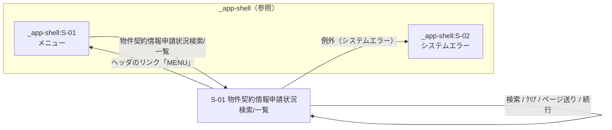

# 画面設計書 — application-status-search

> 位置づけ: **画面の構成・項目・操作・状態・文言の正。** `design.md`（approved）の下位文書であり、
> requirements / design.md に根拠の無い項目・操作・挙動を足さない。design.md は画面を列挙しない。
> **画面の切り出し・所有・feature 間遷移・入口とナビは画面マップ（SD-0）が決めている**（`.aidd/screen-design/_app-shell/screen-map.md`）。
> 本書は**画面マップで本 feature が所有と決まった画面だけ**を書く（各画面は受け入れ基準か System Flows に、各操作は design.md の契約に紐づける）。
> 画面マップに無い画面が要る・所有を移したいときは、本書で足さず・書き換えず、画面マップの改訂に回す（§5-5）。
> 見た目（色・余白・書体・部品の様式）は書かず、**STYLEGUIDE.md** を指す。部品は STYLEGUIDE.md §4 の名で書く。
> **版は frontmatter `inputs` が正**（散文に版番号を書かない。確定文書に工程の通し番号も書かず、工程名で書く）。
> シェル（ヘッダ・グローバルナビ・パンくず）の様式・並び・ナビ項目は書かない（正は画面マップ §4、様式は STYLEGUIDE.md §4-10）。
> **ただし §4-10 が画面設計書に委ねた値（画面名など）は §3-x-6 に書く。**
> 他 feature の requirements / design.md は本書の入力にしない（他 feature の情報は画面マップ経由でだけ入る）。
> mockup（`.aidd/screen-design/application-status-search/pages/`）は本書・画面マップ・STYLEGUIDE.md から生成する。手で磨かず、本書を直して再生成する。

## 1. 画面一覧・接続

| 画面 ID | 画面名 | 目的（1 行） | 画面の型 | 受け入れ基準 ID | 出どころ |
|---|---|---|---|---|---|
| S-01 | 物件契約情報申請状況検索/一覧 | 物件契約情報の申請を条件で探して一覧で見て、申請を開き、結果を CSV に出す | 一覧 | 1.1, 1.2, 1.3, 1.4, 1.5, 1.6, 1.7, 2.1, 2.2, 2.3, 2.4, 2.5, 2.6, 2.7, 2.8, 2.9, 2.10, 3.1, 3.2, 3.3, 3.4, 3.5, 4.1 | 画面マップ §2 `application-status-search:S-01` / requirements 業務フロー「利用者がメニューから物件契約情報申請状況検索一覧画面を開く」/ design.md System Flows「メニューから開き、条件を入れて『検索』を押す」「申請No のリンクを押す」 |
| _app-shell:S-01 | メニュー | 本画面への入口（リンク「物件契約情報申請状況検索/一覧」）と、ヘッダのリンク「MENU」の行き先 | 参照（所有: _app-shell） | 1.1 | 画面マップ §2（所有: _app-shell）/ §3 ① 入口からの分岐・④ 全画面からの遷移 |
| _app-shell:S-02 | システムエラー | 本画面の処理で起きた例外の表示先 | 参照（所有: _app-shell） | — | 画面マップ §2（所有: _app-shell）/ §3 ④ 全画面からの遷移 |

### 1-1. 接続（画面マップ §1 の本 feature 行を転記）

| 接続 | 内容 | 出どころ |
|---|---|---|
| 入口 | ナビ項目「物件契約情報申請状況検索/一覧」→ S-01 | 画面マップ §1 / §4-2 #2 |
| 出口 | なし（一覧が終端。申請No のリンクは参照のための往復で、行き先は画面マップに未収録 — §5-5 #1） | 画面マップ §1 / §6-2 #2 |

## 2. 画面遷移

> feature 内の遷移は S-01 の中で閉じる（同じ画面への再表示）。feature 間は画面マップ §3 にある行だけを載せる。
> 申請No のリンクの行き先（物件基本情報登録変更画面）は画面マップ §3 に無いため、遷移表には行き先を書かずに置く（§5-5 #1）。

| 遷移元 | 操作 | 遷移先 | 条件・備考 |
|---|---|---|---|
| _app-shell:S-01 | リンク「物件契約情報申請状況検索/一覧」 | S-01（初期表示） | `inbound`（画面マップ §3 ① 入口からの分岐 / §4-2 #2）。design.md API 契約 `GET・POST /wtg060` |
| S-01 | 「検索(F)」 | S-01（通常 / 検索結果 0 件 / 上限件数超過 / 警告件数超過の確認 / 入力エラー） | 同じ画面への再表示（design.md System Flows / API 契約 `POST /wtg060/search`） |
| S-01（警告件数超過の確認） | 「続行(Y)」 | S-01（通常） | 警告の確認の印を付けて検索し直す（API 契約 `POST /wtg060/search`） |
| S-01 | 「ｸﾘｱ(R)」 | S-01（初期表示） | API 契約 `POST /wtg060/clear` |
| S-01（通常） | ページ送り | S-01（通常） | API 契約 `POST /wtg060/page` |
| S-01（通常） | 申請No のリンク | —（画面マップ §3 に無い。§5-5 #1） | 取込中でなければ物件基本情報登録変更画面へ移る（design.md System Flows / API 契約 `POST /wtg060/detail`）。**mockup ではリンクを pending として置き、manifest `notes[]` に記録する**（画面マップ §6-2 #2）。押した時点で取込中なら S-01（取込中の申請No を押した） |
| 全画面（画面マップ §3 ④） | ヘッダのリンク「MENU」 | _app-shell:S-01 | 全画面から入口へ（画面マップ §3 ④ / §4-1） |
| 全画面（画面マップ §3 ④） | 画面の処理で起きた例外 | _app-shell:S-02 | 共通のシステムエラー画面へ（画面マップ §3 ④ / `steering/tech.md`「例外処理」）。入力エラー・上限超過・0 件・取込中は本画面の状態に残す |
| 全画面（画面マップ §3 ④） | ヘッダのリンク「LOGOUT」 | なし（無効表示） | 画面マップ §3 ④ / §4-1 #2（行き先のログイン画面が本案件の画面に無い — 画面マップ §6-2 #4） |

## 3. 画面ごとの仕様

### 3-1. S-01 物件契約情報申請状況検索/一覧

#### 3-1-1. 概要

- **目的**: 物件契約情報の申請を 38 項目の検索条件で探し、14 列の一覧で見て、申請No のリンクから物件基本情報登録変更画面を開く。一覧を CSV に出す
- **利用ロール**: 承認フローの担当者（申請者・確認者・承認者）と起案者。社内ユーザーと社外ユーザーの両方（`steering/product.md`「主要ユースケース」、画面マップ §5 のロール名・利用者の区分 / design.md 概要「利用者」— メニュー「[WTG060]物件契約情報申請状況検索/一覧」を使える利用者）
- **前提**: ログイン済みで、メニュー権限（`ZMENUAUTH` の `PWTGO060`）を持つ（design.md セキュリティ上の考慮「認証・認可」）。入口（_app-shell:S-01）から開く
- **受け入れ基準 ID**: 1.1〜1.7, 2.1〜2.10, 3.1〜3.5, 4.1

#### 3-1-2. レイアウト（領域構成）

> シェル（ヘッダ・ヘッダのリンク）の行は置かない（画面マップ §4）。**ヘッダのリンクの 1 行目（その画面から直接飛ぶ機能）は 0 本**（STYLEGUIDE.md §4-10 — セルは空で残す）。

| 領域 | 置くもの（上から / 左から） | 備考 |
|---|---|---|
| 通知 | Banner（`.banner-error` / `.banner-warning` + `.banner-list`） | 状態があるときだけ（§3-1-5）。STYLEGUIDE.md §4-8 の位置（本文の最上部） |
| 検索条件 | Section「検索条件」の中に、条件表 A（§3-1-3 の #1〜#14・#33〜#38）と条件表 B（日付・日時の範囲 #15〜#32）を上下に置く。どちらも `.condition-scroll` に入れる | 条件表の行の割り付けは下の「条件表の組み方」 |
| アクション行 | `.button-area` に Button「検索(F)」「ｸﾘｱ(R)」「CSV出力(O)」（左から） | 条件表の下（STYLEGUIDE.md §5「条件表の下（検索画面）」）。新規登録のボタンは置かない（AC 2.9） |
| 一覧 | 件数 `.list-caption` → `.list-scroll` に入れた `.list-table`（列は §3-1-3 の #39〜#52）→ ページ送り `.pagination` | 初期表示では領域ごと出さない（§3-1-5）。節（Section）に入れず `.app-main` の直下に置く |

**本文幅**: 既定（`.app-main`）。`.app-main-wide` は当てない（§5-1 #6）。

**条件表 A の組み方**（1 行 3 組。列の格子を行ごとに崩さない — STYLEGUIDE.md §4-4 A。2 組目の値の列だけを `lg` にそろえる）

| 行 | 1 組目（値 `md` 以下） | 2 組目（値 `lg`） | 3 組目（値 `md` 以下） |
|---|---|---|---|
| 1 | #1 申請No | #2 稟議ﾊﾞｰｺｰﾄﾞNo | #3 基地局番号 |
| 2 | #5 ｴﾘｱ | #4 基地局名 | #6 ｽﾃｰﾀｽ |
| 3 | #7 状態 | #14 契約稟議起案担当者 | #8 更新者 |
| 4 | #11 契約稟議起案会社名 | #12 契約稟議起案所属① | #9 依頼内容 |
| 5 | #10 施策 | #13 契約稟議起案所属② | #33 押印種別 |
| 6 | #36 進捗検索(日数) | #34 発送書類名 | #37 進捗検索(選択) |
| 7 | #38 転貸借契約種別 | #35 案件小ｸﾞﾙｰﾌﾟ | （空ける） |

**条件表 B の組み方**（1 行 2 組。1 組目 = 日付 + 時刻の範囲、2 組目 = 日付の範囲。値は From と To を「〜」で区切って 1 つの値セルに並べる）

| 行 | 1 組目（日時の範囲） | 2 組目（日付の範囲） |
|---|---|---|
| 1 | #15〜#18 起案日時 | #19・#20 稟議承認日 |
| 2 | #23〜#26 申請日時 | #21・#22 初回支払日 |
| 3 | #29〜#32 確認日時 | #27・#28 発送希望日 |

**一覧の列幅の割り付け**（STYLEGUIDE.md §4-4 B が本書に委ねた宣言。`<colgroup>` の順に）

| 列 | 段 | 列 | 段 |
|---|---|---|---|
| #39 申請No | `.list-col-narrow` | #46 案件小グループ | `.list-col-default` |
| #40 依頼内容 | `.list-col-narrow` | #47 起案会社名 | `.list-col-wide` |
| #41 審査フェーズ | `.list-col-default` | #48 エリア | `.list-col-default` |
| #42 状態 | `.list-col-narrow` | #49 起案担当者 | `.list-col-narrow` |
| #43 稟議バーコードNo | `.list-col-wide` | #50 起案日 | `.list-col-narrow` |
| #44 基地局番号 | `.list-col-default` | #51 発送希望日 | `.list-col-narrow` |
| #45 基地局名 | `.list-col-wide` | #52 施策 | `.list-col-default` |

- 段の合計は 2005px で器（本文幅 980px の中）を超えるため、**「余りを吸う列」は置かない**。超えるぶんは `.list-scroll` が表の中だけで横に流す（STYLEGUIDE.md §4-4 B-1b・B-3 の ①''。**2 段折り返し（B-2）は選ばない** — §5-1 #6）
- 起案日・発送希望日のセルは `.list-cell-num`（日付の右寄せ — STYLEGUIDE.md §5「揃え」）

#### 3-1-3. 項目定義

> 検索条件の入力の形（桁・文字種・コンボの元）・一致の仕方・比べる列は、design.md データモデル「検索条件」が正とする**検索条件の表**（design.md 補足資料「検索条件 38 項目と比べる列」）に従う（§5-1 #1）。
> 「桁」は入力バイト数（入力欄の maxlength）。どの項目も必須にしない（AC 1.1）。初期値は design.md データモデル「初期値」。
> 制約は design.md「バリデーション設計」のエラーコードで参照する。

**検索条件（条件表 A）**

| # | 項目名 | 種別 | 部品（STYLEGUIDE.md §4） | 型・書式 | 必須 | 制約・バリデーション | 出どころ |
|---|---|---|---|---|---|---|---|
| 1 | 申請No | 入力 | Field `.field-input` | テキスト 11 桁・半角英数。前方一致 | — | `GEF-000003` | 検索条件の表 No.1 / AC 1.2 |
| 2 | 稟議ﾊﾞｰｺｰﾄﾞNo | 入力 | Field `.field-input-lg` | テキスト 25 桁・半角英数（「-」を含む）。前方一致 | — | `GEF-000003` | 検索条件の表 No.2 / AC 1.2 |
| 3 | 基地局番号 | 入力 | Field `.field-input` | テキスト 9 桁・半角英数。前方一致 | — | `GEF-000003` | 検索条件の表 No.3 / AC 1.2 |
| 4 | 基地局名 | 入力 | Field `.field-input-lg` | テキスト 120 桁。部分一致 | — | `GEF-000003` | 検索条件の表 No.4 / AC 1.3 |
| 5 | ｴﾘｱ | 選択 | Select `.select` | コンボ `WTZ/CODE/C01`。表示「キー3:名称」、先頭に空行。完全一致 | — | — | 検索条件の表 No.5 / AC 1.4 / 画面マップ §5-1「エリア」 |
| 6 | ｽﾃｰﾀｽ | 選択 | Select `.select` | コンボ `WTG/PARAM/P28`（審査フェーズ）。表示は名称、空行あり。完全一致 | — | — | 検索条件の表 No.6 / AC 1.4（ラベルの文言は §5-4 #6） |
| 7 | 状態 | 選択 | Select `.select` | コンボ `WTG/PARAM/P27`。表示は名称、空行あり。完全一致 | — | — | 検索条件の表 No.7 / AC 1.4 |
| 8 | 更新者 | 入力 | Field `.field-input` | テキスト 20 桁。部分一致 | — | `GEF-000003` | 検索条件の表 No.8 / AC 1.3 |
| 9 | 依頼内容 | 選択 | Select `.select` | コンボ `WTG/PARAM/P29`。選択肢は空行・稟議依頼・再製本依頼の 3 つ。完全一致 | — | — | 検索条件の表 No.9 / AC 1.4 / design.md データモデル「依頼内容」 |
| 10 | 施策 | 選択 | Select `.select` | コンボ `WTG/PARAM/P30`。表示は名称、空行あり。完全一致 | — | — | 検索条件の表 No.10 / AC 1.4 |
| 11 | 契約稟議起案会社名 | 選択 | Select `.select`（**社外ユーザーは `.select-readonly`** — 自社の会社名で固定） | コンボ `WTG/PARAM/P26`（値はキー3、表示は名称）、空行あり。完全一致 | — | — | 検索条件の表 No.11 / AC 1.4, 1.6 / design.md データモデル「社外ユーザー」 |
| 12 | 契約稟議起案所属① | 入力 | Field `.field-input-lg`（**社外ユーザーは `.field-input-readonly`** — 空で入力不可） | テキスト 100 桁。部分一致 | — | `GEF-000003` | 検索条件の表 No.12 / AC 1.3, 1.6 |
| 13 | 契約稟議起案所属② | 入力 | Field `.field-input-lg`（**社外ユーザーは `.field-input-readonly`** — 空で入力不可） | テキスト 100 桁。部分一致 | — | `GEF-000003` | 検索条件の表 No.13 / AC 1.3, 1.6 |
| 14 | 契約稟議起案担当者 | 入力 | Field `.field-input-lg` | テキスト 100 桁。部分一致 | — | `GEF-000003` | 検索条件の表 No.14 / AC 1.3 |
| 33 | 押印種別 | 選択 | Select `.select` | コンボ `WTG/PARAM/P31`。表示は名称、空行あり。完全一致 | — | — | 検索条件の表 No.33 / AC 1.4 |
| 34 | 発送書類名 | 入力 | Field `.field-input-lg`（自由入力）。**候補の提示（データリスト）は STYLEGUIDE.md §4 に器が無い**（§5-3 #1） | テキスト 256 桁。候補は `WTG/PARAM/P32` の名称。前方一致 | — | `GEF-000003` | 検索条件の表 No.34 / AC 1.2 |
| 35 | 案件小ｸﾞﾙｰﾌﾟ | 入力 | Field `.field-input-lg`（自由入力）。**候補の提示（データリスト）は STYLEGUIDE.md §4 に器が無い**（§5-3 #1） | テキスト 50 桁。候補は `WTZ/MASTER/M11` の名称。部分一致 | — | `GEF-000003` | 検索条件の表 No.35 / AC 1.3 / design.md データモデル「案件小グループ」 |
| 36 | 進捗検索(日数) | 入力 | Field `.field-input-xs`（**社外ユーザーには置かない**） | テキスト 2 桁・半角数字。営業日数で範囲比較 | — | `GEF-000014` | 検索条件の表 No.36 / AC 1.5, 1.6 / design.md データモデル「進捗の日数」 |
| 37 | 進捗検索(選択) | 選択 | Select `.select`（**社外ユーザーには置かない**） | コンボ「以上」「以下」（空行なし）。初期値「以上」。#36 が空なら条件にしない | — | — | 検索条件の表 No.37 / AC 1.6 / design.md データモデル「初期値」 |
| 38 | 転貸借契約種別 | 選択 | Select `.select` | コンボ `WTG/PARAM/P53`。表示は名称、空行あり。完全一致 | — | — | 検索条件の表 No.38 / AC 1.4 |

**検索条件（条件表 B — 日付・日時の範囲）**

| # | 項目名 | 種別 | 部品（STYLEGUIDE.md §4） | 型・書式 | 必須 | 制約・バリデーション | 出どころ |
|---|---|---|---|---|---|---|---|
| 15・17 | 起案日時（日）From・To | 入力 | Field `.field-input-sm` + `.field-input-date` | 日付 10 桁 `yyyy/MM/dd`。範囲（両端を含む・片方だけも可） | — | `GEF-000025` | 検索条件の表 No.15〜18 / AC 1.5 / design.md データモデル「承認履歴の日時」 |
| 16・18 | 起案日時（時）From・To | 入力 | Field `.field-input-sm` | 時刻 5 桁 `HH:MM`。初期値 From `00:00`・To `23:59` | — | `WTL-000007` | 同上 / AC 1.1 |
| 19・20 | 稟議承認日 From・To | 入力 | Field `.field-input-sm` + `.field-input-date` | 日付 10 桁 `yyyy/MM/dd`。範囲 | — | `WTG-000003` | 検索条件の表 No.19・20 / AC 1.5 |
| 21・22 | 初回支払日 From・To | 入力 | Field `.field-input-sm` + `.field-input-date` | 日付 10 桁 `yyyy/MM/dd`。範囲 | — | `WTG-000003` | 検索条件の表 No.21・22 / AC 1.5 / design.md データモデル「初回支払日」 |
| 23・25 | 申請日時（日）From・To | 入力 | Field `.field-input-sm` + `.field-input-date` | #15・17 と同じ | — | `GEF-000025` | 検索条件の表 No.23〜26 / AC 1.5 |
| 24・26 | 申請日時（時）From・To | 入力 | Field `.field-input-sm` | #16・18 と同じ | — | `WTL-000007` | 同上 / AC 1.1 |
| 27・28 | 発送希望日 From・To | 入力 | Field `.field-input-sm` + `.field-input-date` | 日付 10 桁 `yyyy/MM/dd`。範囲 | — | `WTG-000003` | 検索条件の表 No.27・28 / AC 1.5 |
| 29・31 | 確認日時（日）From・To | 入力 | Field `.field-input-sm` + `.field-input-date` | #15・17 と同じ | — | `GEF-000025` | 検索条件の表 No.29〜32 / AC 1.5 |
| 30・32 | 確認日時（時）From・To | 入力 | Field `.field-input-sm` | #16・18 と同じ | — | `WTL-000007` | 同上 / AC 1.1 |

- 日時の 1 組の値セルの並び: `[日 From][時 From] 〜 [日 To][時 To]`。日付の 1 組: `[From] 〜 [To]`
- 時刻の欄は `.field-input-sm`（§5-1 #7）。日付欄は押すと月次カレンダーが開く（STYLEGUIDE.md §4-2・§4-11。§3-1-4）

**検索結果の一覧（`.list-table` の列 — 並びは AC 2.1 の 14 項目の順）**

| # | 項目名 | 種別 | 部品（STYLEGUIDE.md §4） | 型・書式 | 必須 | 制約・バリデーション | 出どころ |
|---|---|---|---|---|---|---|---|
| 39 | 申請No | 操作 | `.list-cell` の中のリンク（状態が取込中の行はリンクにせず文字だけ） | 申請No（汎用の数値のみ） | — | — | design.md データモデル「一覧の 14 列」申請No / AC 2.1, 2.7, 2.8 |
| 40 | 依頼内容 | 表示 | `.list-cell` | 文字（`Irai_Naiyo` をそのまま） | — | — | 同「依頼内容」/ AC 2.1 |
| 41 | 審査フェーズ | 表示 | `.list-cell` | `P28` の名称。再申請なら後ろに「(再申請)」 | — | — | 同「審査フェーズ」/ AC 2.1, 2.2 |
| 42 | 状態 | 表示 | `.list-cell`（文字のまま。STYLEGUIDE.md §4-6） | `P27` の名称 | — | — | 同「状態」/ AC 2.1 |
| 43 | 稟議バーコードNo | 表示 | `.list-cell` | 代表局（契約局の連番 1）の値 | — | — | 同「稟議バーコードNo」/ AC 2.1 |
| 44 | 基地局番号 | 表示 | `.list-cell` | 文字。複数局なら後ろに「他n局」 | — | — | 同「基地局番号」/ AC 2.1, 2.3 |
| 45 | 基地局名 | 表示 | `.list-cell` | 文字。複数局なら後ろに「他n局」。**表示 16 バイトで切り、全文はツールチップ**（§5-3 #2） | — | — | 同「基地局名」/ AC 2.1, 2.3 |
| 46 | 案件小グループ | 表示 | `.list-cell` | 文字。**表示 15 バイトで切り、全文はツールチップ** | — | — | 同「案件小グループ」/ AC 2.1 |
| 47 | 起案会社名 | 表示 | `.list-cell` | 文字。**表示 22 バイトで切り、全文はツールチップ** | — | — | 同「起案会社名」/ AC 2.1 |
| 48 | エリア | 表示 | `.list-cell` | 「エリアコード:名称」。コードが空なら空。**表示 15 バイトで切り、全文はツールチップ** | — | — | 同「エリア」/ AC 2.1 / 画面マップ §5-1 |
| 49 | 起案担当者 | 表示 | `.list-cell` | 氏名。**表示 10 バイトで切り、全文はツールチップ** | — | — | 同「起案担当者」/ AC 2.1 |
| 50 | 起案日 | 表示 | `.list-cell-num` | 日付 `yyyy/MM/dd` | — | — | 同「起案日」/ AC 2.1 |
| 51 | 発送希望日 | 表示 | `.list-cell-num` | 日付 `yyyy/MM/dd` | — | — | 同「発送希望日」/ AC 2.1 |
| 52 | 施策 | 表示 | `.list-cell` | `P30` の名称 | — | — | 同「施策」/ AC 2.1 |

- 並びは申請No の降順だけ（AC 2.4。列見出しでの並べ替えは持たない — design.md「やらないこと」）
- 1 ページの件数はコードマスタ `P01` の設定値（50 件）。件数表示は `.list-caption` の `1-50件目/n件` の形（AC 2.5）
- 発行依頼書・契約局情報・承認履歴が無い申請も行に出し、その列は空（design.md データモデル「一覧の 14 列」）
- 更新者の氏名は一覧にも CSV にも出さない（design.md セキュリティ上の考慮「データ保護 / プライバシー」）

**操作系の部品**

| # | 項目名 | 種別 | 部品（STYLEGUIDE.md §4） | 型・書式 | 必須 | 制約・バリデーション | 出どころ |
|---|---|---|---|---|---|---|---|
| 53 | 検索(F) | 操作 | Button `.btn` | — | — | — | design.md コンポーネント一覧「ボタン（検索・クリア・CSV）」 |
| 54 | ｸﾘｱ(R) | 操作 | Button `.btn` | — | — | — | 同上 |
| 55 | CSV出力(O) | 操作 | Button `.btn` | — | — | — | 同上 |
| 56 | ページ送り | 操作 | `.pagination`（`.pagination-current` / `.pagination-link` / `.pagination-side`） | — | — | — | design.md API 契約 `POST /wtg060/page` / 共通部品 `common/pager` |

#### 3-1-4. 操作

| 操作 | 部品 | トリガー | 結果 | 遷移先 | 確認 | 契約（design.md） |
|---|---|---|---|---|---|---|
| 検索 | Button「検索(F)」 | クリック | 入力チェックの後、1 ページ目の一覧を出し、条件をセッションに置く。入力の誤り・上限超過・警告件数超過・0 件は状態に分かれる | S-01（同画面） | 警告件数超過のときだけあり（`DS-100025`） | API 契約 `POST /wtg060/search` / サービスインターフェース `search` |
| 警告件数超過の確認で続行 | Button「続行(Y)」 | クリック | 警告の確認の印を付けて検索し、1 ページ目の一覧を出す | S-01（通常） | — | API 契約 `POST /wtg060/search`（警告の確認の印） |
| 警告件数超過の確認で中止 | Button「中止(N)」 | クリック | 確認を閉じ、検索しない（押す前の表示に戻る） | S-01（同画面） | — | —（画面内） |
| クリア | Button「ｸﾘｱ(R)」 | クリック | 検索条件を初期値に戻し、一覧を消す（セッションの条件を消す） | S-01（初期表示） | なし | API 契約 `POST /wtg060/clear` |
| CSV 出力 | Button「CSV出力(O)」 | クリック | 押した時点の画面の入力で `WTG060_yyyyMMddHHmmss.csv` をダウンロードする。0 件・上限超過は見出し行だけ。入力の誤りがあれば出さず入力エラーの状態にする。警告の確認は出さない | S-01（同画面のまま） | なし | API 契約 `POST /wtg060/csv` / サービスインターフェース `outputCsv` |
| ページ送り | `.pagination` のページ番号 / `＜前へ` / `次へ＞` | クリック | セッションの条件でそのページの一覧を出す | S-01（通常） | なし | API 契約 `POST /wtg060/page` |
| 申請を開く | 一覧 #39 申請No のリンク（取込中の行はリンクにしない） | クリック | 押した時点で取込中でなければ物件基本情報登録変更画面へ移る。取込中なら今のページを再検索して `WTG-100018` を出す | —（画面マップ §3 に無い。§5-5 #1）/ S-01（取込中の申請No を押した） | なし | API 契約 `POST /wtg060/detail` / サービスインターフェース `checkImporting` |
| 月次カレンダーを開く | 条件表 B の日付欄（`.field-input-date`） | クリック（focus） | 月次カレンダーを開く | S-01（月次カレンダー） | なし | —（画面内） |
| カレンダーで日を選ぶ | `.calendar-day` | クリック | 選んだ日を `yyyy/MM/dd` で日付欄に入れ、カレンダーを閉じる | S-01（同画面） | なし | —（画面内） |
| カレンダーの月を送る | `.calendar-nav` | クリック | 前月・翌月を出す | S-01（月次カレンダー） | なし | —（画面内） |
| カレンダーを閉じる | `.dialog-close` | クリック | 日付を入れずに閉じる | S-01（同画面） | なし | —（画面内） |
| 切り詰めた値の全文を見る | 一覧 #45〜#49 のセル | ポインタを載せる | ツールチップで全文を出す | S-01（同画面） | なし | —（画面内）（器は §5-3 #2） |

- 新規登録の操作は置かない（AC 2.9）
- 物件基本情報登録変更画面から戻ったときの再検索（AC 2.10・API 契約 `/wtg060/return`）は本画面の操作ではなく inbound の遷移で、その遷移元が画面マップ §3 に無い（§5-5 #2）。戻った後の表示は「通常」と同じ（前の検索条件と前のページ）

#### 3-1-5. 状態

| 状態 | 発生条件 | 表示内容・文言 | 受け入れ基準 ID / NFR |
|---|---|---|---|
| 初期表示 | メニューから開いた（`/wtg060`）/ 「ｸﾘｱ(R)」を押した（`/wtg060/clear`）/ 未検索で戻った | 検索条件は初期値（どの項目も空。時刻の From `00:00`・To `23:59`、#37 は「以上」）。**一覧の領域は出さない**（件数・表・ページ送りなし） | 1.1 |
| 通常 | 検索して 1 件以上あった / ページ送り / 物件基本情報登録変更画面から戻った（前の条件と前のページで再検索） | 件数 `1-50件目/n件` + 一覧（§3-1-3 #39〜#52、申請No の降順）+ ページ送り。**ダミーの行に次を含める**: 再申請の行（審査フェーズに「(再申請)」）/ 複数局の行（基地局番号・基地局名に「他n局」）/ 状態が取込中の行（申請No がリンクでない）/ 発行依頼書の無い行（その列が空）。複数ページ（ページ送りに 2 ページ目以降のリンク） | 1.2, 1.3, 1.4, 1.5, 1.7, 2.1, 2.2, 2.3, 2.4, 2.5, 2.7, 2.8, 2.9, 2.10, 3.1, 3.2, 3.3, 3.5 |
| 検索結果 0 件 | 検索して 0 件だった（条件の有無を問わない） | 見出し行だけの一覧 + その外に `.empty-state`「該当するデータはありません」（STYLEGUIDE.md §4-4 B・§4-9）。件数表示は置かない | 2.6, 3.4 |
| ローディング | —（根拠なし） | `.wait-message`「処理中です。しばらくお待ちください。」（STYLEGUIDE.md §4-9 の既定。操作は不可）（§5-4 #4） | — |
| 入力エラー | 検索または CSV 出力で、日付・時刻・進捗の日数の形式、または文字の桁の条件を満たさない項目がある | `.banner-error` に 1 件 1 行（`コード：項目名:内容`）+ 該当欄に `.field-input-error`。一覧は出さず、CSV も出さない。**ダミーの誤り**: #19 稟議承認日 From = `2026/02/30`（`WTG-000003`）と #36 進捗検索(日数) = `1a`（`GEF-000014`）の 2 件 | 4.1 |
| 上限件数超過 | 検索・ページ送り・戻りで、検索結果が上限件数（`P02`）を超えた | `.banner-error` に `DS-100024` の 1 行。一覧は出さない。検索条件は入力したまま | 2.5 |
| 警告件数超過の確認 | 検索で、検索結果が警告件数（`P02`）を超え、まだ確認していない | Dialog（`.dialog-backdrop` + `.dialog-panel`。親画面の状態）に `DS-100025` の文（素の `p`）+ `.button-area` に Button「続行(Y)」「中止(N)」。背後は押す前の画面（検索条件を入力した状態） | 2.5 |
| 取込中の申請No を押した | 一覧の表示の後に取込が始まった申請の申請No を押した（押した時点で取込中） | `.banner-warning` に `WTG-100018`「取込処理中のため登録画面へ遷移できません」+ 今のページを再検索した一覧（通常と同じ。その行は取込中になり申請No がリンクでない） | 2.8 |
| 社外ユーザー | ログインユーザーが社外ユーザー（`P71` の文字項目1 が '1'） | #11 契約稟議起案会社名 = 自社の会社名で `.select-readonly`、#12・#13 契約稟議起案所属①② = 空で `.field-input-readonly`、#36・#37 進捗検索はラベルセルごと置かない（条件表 A の 6 行目の 1 組目・3 組目は空のセルで格子を保つ）。一覧は自社の申請と本人が登録した申請だけ（通常と同じ見え方） | 1.6, 1.7 / NFR セキュリティ |
| 長文 | 一覧 #45〜#49 の値が表示バイト数を超える | 表示バイト数で切った値を出し、ポインタを載せるとツールチップで全文（§5-3 #2）。CSV は切らない | 2.1 / NFR プライバシー（起案担当者の氏名を出すのは範囲内の申請だけ） |
| 月次カレンダー | 条件表 B の日付欄を押した | Dialog（`.dialog-panel`）の中に月次カレンダー（`.calendar-panel`）。表示月は今日の月、今日の日に `.calendar-day-today`、選択中の日は無し。**押した日付欄が違っても器は同じ 1 状態に畳む**（§5-1 #10。mockup は #19 稟議承認日 From から開いた形で描く） | 1.5 |

#### 3-1-6. 文言

| 箇所 | 文言 | 出どころ |
|---|---|---|
| シェル上の画面名 | `[GWTG060]物件契約情報申請状況検索/一覧` | 画面マップ §4-1「ヘッダの画面名の値の形」（`[画面ID]画面名`）/ STYLEGUIDE.md §4-10 が本書に委ねた値。画面 ID `GWTG060` は design.md 概要「目的」 |
| ページの `<title>` | `物件契約情報申請状況検索/一覧 - WiNG` | 画面マップ §4-1「システム名」（`<画面名> - WiNG`）/ 画面マップ §2 の画面名 |
| Section の見出し | 検索条件 | AC に無いため本書で起草（design.md の語「検索条件」）— §5-4 #8 |
| 条件表のラベル | §3-1-3 の項目名のとおり（#1〜#38。日付・日時の範囲は 1 組 1 ラベル: 起案日時 / 稟議承認日 / 初回支払日 / 申請日時 / 発送希望日 / 確認日時） | 検索条件の表「画面の項目名」（半角カナは既存の項目名をそのまま使う — STYLEGUIDE.md §7） |
| 範囲の区切り | 〜 | 本書で起草（§5-1 #8） |
| 一覧の列見出し | 申請No / 依頼内容 / 審査フェーズ / 状態 / 稟議バーコードNo / 基地局番号 / 基地局名 / 案件小グループ / 起案会社名 / エリア / 起案担当者 / 起案日 / 発送希望日 / 施策 | requirements AC 2.1 の 14 項目の名前。13 列目は「発送希望日」（design.md データモデル「CSV」— 画面の列見出しは「発送希望日」のまま） |
| 件数表示 | `1-50件目/n件`（表示中の範囲と総件数） | STYLEGUIDE.md §4-4 B の件数の形 |
| ページ送りの両端 | `＜前へ` / `次へ＞` | STYLEGUIDE.md §4-9 |
| ボタン | 検索(F) / ｸﾘｱ(R) / CSV出力(O) | AC に無い。「検索(F)」「ｸﾘｱ(R)」は既存 UI のラベル（STYLEGUIDE.md §1 の既存 UI の癖）をそのまま使い、「CSV出力(O)」は本書で起草 — §5-4 #2 |
| 確認のボタン | 続行(Y) / 中止(N) | 本書で起草 — §5-4 #3 |
| 選択肢（#9 依頼内容） | （空行）/ 稟議依頼 / 再製本依頼 | design.md データモデル「依頼内容」 |
| 選択肢（#37 進捗検索(選択)） | 以上 / 以下 | 検索条件の表 No.37 |
| 再申請の印 | (再申請) | design.md データモデル「一覧の 14 列」審査フェーズ / AC 2.2 |
| 複数局の印 | 他n局（n = 契約局の行数 − 1） | design.md データモデル「一覧の 14 列」「他n局」/ AC 2.3 |
| 検索結果 0 件 | 該当するデータはありません | design.md データモデル「件数」（共通部品 `common/emptyMsg` の文言）/ STYLEGUIDE.md §4-9 の既定と同文 |
| ローディング | 処理中です。しばらくお待ちください。 | STYLEGUIDE.md §4-9 / §7 の既定（§5-4 #4） |
| 入力エラー（日付 — 稟議承認日・初回支払日・発送希望日） | `WTG-000003`「{0}:日付が不正です」（{0} は項目名と From / To。例 `WTG-000003：稟議承認日From:日付が不正です`） | design.md バリデーション設計「メッセージ例」の `WTG-000003` 行から転記（正は design.md） |
| 入力エラー（日時の日付 — 起案日時・申請日時・確認日時） | `GEF-000025`「（既存の文言）」 | design.md バリデーション設計の `GEF-000025` 行（メッセージ例が「（既存の文言）」で実文言の記載が無い — §5-4 #5） |
| 入力エラー（日時の時刻） | `WTL-000007`「（既存の文言）」 | design.md バリデーション設計の `WTL-000007` 行（同上 — §5-4 #5） |
| 入力エラー（進捗検索(日数)） | `GEF-000014`「{0}:数値を入力して下さい」（例 `GEF-000014：進捗検索(日数):数値を入力して下さい`） | design.md バリデーション設計「メッセージ例」の `GEF-000014` 行から転記（正は design.md） |
| 入力エラー（文字の桁） | `GEF-000003`「{0}:桁数が制限を超えています」 | design.md バリデーション設計「メッセージ例」の `GEF-000003` 行から転記（正は design.md） |
| 上限件数超過 | `DS-100024`「（既存の文言）」 | design.md 機能固有エラーコード `DS-100024` 行（意味「検索結果が上限件数を超えた」。実文言の記載が無い — §5-4 #5） |
| 警告件数超過の確認 | `DS-100025`「（既存の文言）」 | design.md 機能固有エラーコード `DS-100025` 行（意味「検索結果が警告件数を超えた。続行すると検索する」。実文言の記載が無い — §5-4 #5） |
| 取込中 | `WTG-100018`「取込処理中のため登録画面へ遷移できません」 | design.md 機能固有エラーコード `WTG-100018` 行から転記（正は design.md） |
| CSV のファイル名 | `WTG060_yyyyMMddHHmmss.csv` | design.md データモデル「CSV」/ AC 3.2 |
| CSV の見出し行 | `申請No,依頼内容,ｽﾃｰﾀｽ,状態,稟議ﾊﾞｰｺｰﾄﾞNo,基地局番号,基地局名,案件小ｸﾞﾙｰﾌﾟ,起案会社名,ｴﾘｱ,起案担当者,起案日,発注希望日,施策` | design.md データモデル「CSV」から転記（正は design.md。画面には出ない） |
| ダミーデータの業務状態名 | 審査フェーズ: 未起案 / 承認済（`P28` の 00・05）。状態: 下書き / 取込中 / 完了（`P27` の 01・06・07）。**これ以外の名称をダミーに使わない** | 検索条件の表 No.6・No.7 / design.md データモデル「一覧の 14 列」申請No（取込中 = '06'）/ 画面マップ §5（業務状態名は design.md の値に従う） |

## 4. 要件被覆

| 受け入れ基準 ID | 概要 | 画面 ID（状態） |
|---|---|---|
| 1.1 | 38 項目を必須にせず初期値を空（時刻 00:00〜23:59）で表示 | S-01（初期表示） |
| 1.2 | 申請No・稟議バーコードNo・基地局番号・発送書類名を前方一致 | S-01（通常 — 項目 #1〜#3・#34 の比べ方） |
| 1.3 | 基地局名・更新者名・所属①②・起案担当者・案件小グループを部分一致 | S-01（通常 — 項目 #4・#8・#12〜#14・#35） |
| 1.4 | エリア〜転貸借の契約種別を完全一致 | S-01（通常 — 項目 #5〜#7・#9〜#11・#33・#38） |
| 1.5 | 日時・日付・進捗の日数を範囲で比べ、進捗は営業日 | S-01（通常 — 項目 #15〜#32・#36・#37 / 月次カレンダー） |
| 1.6 | 社外ユーザーは起案会社と所属を変更させず、進捗の条件を出さない | S-01（社外ユーザー） |
| 1.7 | 社外ユーザーは自社の申請と本人が登録した申請だけ | S-01（社外ユーザー・通常） |
| 2.1 | 14 項目の一覧 | S-01（通常 — 項目 #39〜#52） |
| 2.2 | 再申請は審査フェーズに「(再申請)」 | S-01（通常） |
| 2.3 | 複数局は基地局名を「〜他n局」 | S-01（通常） |
| 2.4 | 申請No の降順 | S-01（通常） |
| 2.5 | 1 ページの件数・上限件数をコードマスタに従わせ、上限超過はエラー | S-01（通常・上限件数超過・警告件数超過の確認） |
| 2.6 | 0 件は該当なしのメッセージ | S-01（検索結果 0 件） |
| 2.7 | 申請No のリンクで物件基本情報登録変更画面へ | S-01（通常 — 操作「申請を開く」。行き先は画面マップに未収録 — §5-5 #1） |
| 2.8 | 取込中の申請No をリンクにしない | S-01（通常・取込中の申請No を押した） |
| 2.9 | 新規登録のボタンを置かない | S-01（通常 — 操作表に置かない。§3-1-2 のアクション行） |
| 2.10 | 物件基本情報登録変更画面から戻ると前の条件で再検索 | S-01（通常 — 戻りの発生条件。遷移元は画面マップに未収録 — §5-5 #2） |
| 3.1 | CSV は一覧と同じ 14 列・MS932・カンマ区切り・見出し行付き | S-01（通常 — 操作「CSV 出力」） |
| 3.2 | ファイル名「WTG060_年月日時分秒.csv」 | S-01（通常 — 操作「CSV 出力」） |
| 3.3 | CSV の範囲は検索と同じ条件・絞り込み・上限件数 | S-01（通常 — 操作「CSV 出力」） |
| 3.4 | 0 件・上限超過は見出し行だけの CSV | S-01（検索結果 0 件 — 操作「CSV 出力」） |
| 3.5 | この画面を使える利用者の CSV 出力を受け付ける | S-01（通常 — 操作「CSV 出力」） |
| 4.1 | 桁数・形式の誤りでメッセージを出し検索を止める | S-01（入力エラー） |

**総数 23 / 画面に紐づいた 23 / 未被覆 0。**

**分母から外した受け入れ基準**

| 受け入れ基準 ID | 類型 | 理由 |
|---|---|---|
| —（なし） | — | 画面マップ §2-1 も「画面を伴わない AC 0」としており、本書でも外さない（AC 2.9 の否定形も画面マップの判定どおり分母に残した） |

**UI に関わる NFR（分母に入れない — どの画面・状態に反映したかだけを残す）**

| NFR | 内容 | 反映した画面（状態） |
|---|---|---|
| セキュリティ | `steering/security.md` 準拠。社外ユーザーの絞り込みは要件 1 | S-01（社外ユーザー — 起案会社・所属の固定、進捗の条件を置かない） |
| プライバシー | 起案担当者と更新者の氏名を `steering/security.md`「機密データ」に従って扱う | S-01（通常・長文 — 起案担当者は一覧に出す / 更新者は検索条件だけで一覧に出さない） |
| パフォーマンス | `steering/non-functional.md` 準拠（本 feature 固有の目標値なし） | 反映なし（ローディングの状態は根拠が無く §5-4 #4） |

## 5. 設計判断・未決

### 5-0. 改訂履歴

| # | 日付 | 起点 | 直した小節 | 取り消し | 根拠の所在 |
|---|---|---|---|---|---|
| 初回 | 2026-10-09 | — | 全節 | — | — |

### 5-1. 起草中に判断した事項

| # | 判断 | 理由 | 根拠 |
|---|---|---|---|
| 1 | 検索条件の 38 項目の項目名・入力の形・一致の仕方を、design.md が正とする「検索条件の表」（`_handoff/phase5-application-status-search-conditions.md`）から転記した | design.md データモデル「検索条件」が「38 項目の入力の形・一致の仕方・比べる列は、検索条件の表を正とする」と書き、本文に 38 項目を列挙していない。**design.md の一部として読んだ**（質問ログ・ゲートレポート等のワークフロー内部資料としては扱っていない）。社外ユーザーの比べ方だけは表でなく design.md（会社コードで比べる）に従った | design.md 出典の表記・データモデル「検索条件」・補足資料。読んでよいかは §5-4 #1 |
| 2 | 初期値を design.md に合わせ、#37 進捗検索(選択) を「以上」、社外ユーザーの #11 を自社の会社名にした | requirements 1.1（初期値は空）から design.md が意図して外れており、上流は後で直すと記録している（upstream-carryover）。画面の項目・初期値の正は design.md | design.md データモデル「初期値」 |
| 3 | CSV 出力・ページ送り・クリアを A 種（契約あり）にした | いずれもサーバーに要求を出す（`/wtg060/csv`・`/page`・`/clear`）。画面内で完結する B 種ではない | design.md API 契約 |
| 4 | CSV 出力は画面の状態を持たせなかった（成功時は画面が変わらない）。入力の誤りは「入力エラー」の状態に合流させた | ダウンロードで画面が変わらず、入力の誤りの見え方は検索と同じ（`BindingResult` に積んで同じ画面に出す） | design.md API 契約 `/wtg060/csv`・エラー処理「返し方」 |
| 5 | `WTG-100018`（取込中）は `.banner-warning`、`DS-100024`（上限超過）と入力エラーは `.banner-error` にした | design.md が `WTG-100018` の種別を Warning としている。一覧は再検索して出すので処理は止まらず、止まるのは遷移だけ。上限超過・入力エラーは検索そのものを止める（STYLEGUIDE.md §4-8「止めるものが error」） | design.md 機能固有エラーコード / STYLEGUIDE.md §4-8 |
| 6 | 一覧は 1 行で並べ、合計 2005px のはみ出しは `.list-scroll` が表の中だけで横に流す形（STYLEGUIDE.md §4-4 B-3 の ①''）にした。本文幅は既定のまま | ①'' が STYLEGUIDE.md の既定。2 段折り返し（B-2）は 7 列ずつに分けても列幅の合計が 1230px で既定の本文幅に入らず、`.app-main-wide` との併用が要る。既存 UI の一覧も表の入れ物を横に流す作り。**人③ で「横に送らせたくない」と判断されれば B-2 + `.app-main-wide` に直す** | STYLEGUIDE.md §4-4 B-1b・B-2・B-3 |
| 7 | 時刻の欄（HH:MM・5 桁）は `.field-input-sm` にした | `xs`（37px）には半角 5 文字が入らない（約 34px + 内側の余白と枠）。段は 5 つだけで中間を作らない | STYLEGUIDE.md §4-2「幅の段」 |
| 8 | 範囲の From と To を「〜」で区切って 1 つの値セルに並べ、範囲 1 つにラベル 1 つを置いた | 検索条件の表が範囲を「起案日時 (日)From・(時)From・(日)To・(時)To」のように 1 項目名で扱っている。「〜」は区切りの文字で、アイコンの代わりではない（STYLEGUIDE.md §7） | 検索条件の表 No.15〜32 |
| 9 | 検索条件を 2 つの条件表（A = 文字・選択 / B = 日付・日時の範囲）に分けた | 列の幅は行をまたいで共有されるので、日時の範囲（値セル約 350px）を A に混ぜると A の同じ列が全部広がり、表が節から溢れる。STYLEGUIDE.md §4-4 A-1b の「単独の表に分ける」に沿う | STYLEGUIDE.md §4-4 A・A-1b |
| 10 | 月次カレンダーは、どの日付欄から開いても 1 状態に畳んだ（mockup は #19 稟議承認日 From から開いた形） | 器（`.calendar-panel`）が同じで中身（入る欄）だけが変わる。畳むと mockup では他の欄から開いた形を見せられない | 本 skill の「同じ器で中身だけが変わるもの」 |
| 11 | 「空」（データが 0 件）と「絞り込み結果なし」（条件に合う行が 0 件）を 1 状態「検索結果 0 件」に畳んだ | 検索画面では条件の有無にかかわらず同じ表示（見出し行だけの表 + 「該当するデータはありません」）になる | design.md データモデル「件数」/ AC 2.6 |
| 12 | 社外ユーザーの #11 は `.select-readonly`、#12・#13 は `.field-input-readonly` にした（`.field-flat` にしない） | 同じ画面に入力できる欄が他に在る（「その欄だけ入力できない」場合） | STYLEGUIDE.md §4-2「編集不可と readonly の使い分け」 |
| 13 | 社外ユーザーの #36・#37 はラベルセルごと置かず、空のセルで格子を保った | AC 1.6 が「表示してはならない」。`colspan` で詰めると列の境目が行ごとに変わる | AC 1.6 / STYLEGUIDE.md §4-4 A |
| 14 | 一覧の切り詰め（表示バイト数）とツールチップを design.md どおり置いた | 一覧の値の形の正は design.md。STYLEGUIDE.md の「セルは折り返す・省略表示で情報を欠落させない」との食い違いは、**【人】判断で design.md に従うと決着した**（2026-10-09・by: toshiya-fukunaga）。STYLEGUIDE.md 側は改訂で例外と器を足す（`STYLEGUIDE-backlog.md` SGB-17） | design.md データモデル「一覧の 14 列」/ 【人】判断 |
| 15 | #37 の部品を `.select` にした（Select の幅の段は §4-2 の段に従い既定 `md`） | 選択肢が「以上」「以下」の 2 つで短いが、Select 専用の段のクラスは §4-3 に無い | STYLEGUIDE.md §4-3 |

**状態の判定の内訳**（型「一覧」= 通常 / 空 / ローディング / エラー（取得失敗）/ 絞り込み結果なし）

| 画面 | 型の状態 | 判定 | 置いた / 置かない理由・移した先 |
|---|---|---|---|
| S-01 | 通常 | 起こる | 置いた（AC 2.1） |
| S-01 | 空 | 起こる | 置いた — 「絞り込み結果なし」と 1 状態「検索結果 0 件」に畳んだ（#11。AC 2.6） |
| S-01 | 絞り込み結果なし | 起こる | 置いた — 同上 |
| S-01 | ローディング | 判断できない | 行を残し §5-4 #4 に記録（発生条件の裏づけが requirements・design.md に無い） |
| S-01 | エラー（取得失敗） | 起こるが、表示先が別画面に移った | _app-shell:S-02（共通のシステムエラー画面。画面マップ §3 ④・`steering/tech.md`「例外処理」） |

型に無い機能固有の状態として 7 行を足した: 初期表示（AC 1.1）/ 入力エラー（AC 4.1）/ 上限件数超過（AC 2.5）/
警告件数超過の確認（AC 2.5・親画面の状態）/ 取込中の申請No を押した（AC 2.8）/ 社外ユーザー（AC 1.6・1.7）/
月次カレンダー（親画面の状態）。品質状態として「長文」を 1 行足した。
**内訳: 型 5 状態のうち 置いた 3（うち 2 を 1 行に畳んだ）/ 起こりえないとして落とした 0 / 別画面に移した 1 / 判断できず残した 1。**

### 5-2. wireframe からの引き継ぎと差分

wireframe 工程は実施していない（`.aidd/wireframe/` が無い）。

### 5-3. STYLEGUIDE.md への追記候補（STYLEGUIDE.md §4 に無い部品・様式）

| # | 必要な部品・様式 | 使う画面 | 代替せずどうしたか |
|---|---|---|---|
| 1 | **候補つきの入力欄（データリスト）** — 候補を出しつつ自由入力も受ける欄（#34 発送書類名・#35 案件小ｸﾞﾙｰﾌﾟ） | S-01 | 自由入力の Field（`.field-input-lg`）として書き、候補の提示は描かない。mockup では `missing[]` に記録する。`STYLEGUIDE-backlog.md` SGB-16 |
| 2 | **切り詰めた値の全文を出すツールチップ** — 一覧 #45〜#49 を表示バイト数で切り、全文をポインタで出す（design.md）。STYLEGUIDE.md §4-4 B・§5 の「セルは折り返す・省略表示で情報を欠落させない」との食い違いは **【人】判断で design.md に従う**（§5-1 #14） | S-01（通常・長文） | 項目定義には design.md どおり切り詰めとツールチップを書いた。STYLEGUIDE.md の改訂で器が入るまで、mockup では `missing[]` に記録する。`STYLEGUIDE-backlog.md` SGB-17（1-1 直す） |
| 3 | **月次カレンダーの月送りと曜日見出しの文言** — §4-11 が `.calendar-nav`（リンク）と `.calendar-weekday` の様式を持つが、表示する文言（前月・翌月の表し方、曜日の表記）を持たない | S-01（月次カレンダー） | 部品が既定で持つラベルなので本書では起草しない。`STYLEGUIDE-backlog.md` SGB-18 |

### 5-4. 上流・工程への確認事項（本書では決められないもの）

| # | 事項 | 宛先 | 画面 | 影響 |
|---|---|---|---|---|
| 1 | 検索条件の 38 項目を、design.md が「本書の正とする」とした「検索条件の表」（`_handoff/`）から転記した。本工程の入力（design.md）の一部として読んでよいか | 工程 | S-01 | 読めないとすると 38 項目の項目名・桁・選択肢の出どころが無くなる。design.md の本文に取り込むかは design.md の変更管理で決める |
| 2 | ボタン名とアクセスキーが AC にも design.md にも無い。「検索(F)」「ｸﾘｱ(R)」は既存 UI のラベルをそのまま使い、「CSV出力(O)」は本書で起草した | requirements | S-01 | 起草値で mockup を出す。画面内のキー F・R・O・Y・N は重ならない。既存 WiNG の他画面の CSV ボタンの文言・キーと揃えるなら差し替える |
| 3 | 警告件数超過の確認（`DS-100025`）のボタン名が design.md に無いので「続行(Y)」「中止(N)」を起草した。既存の共通処理（`validateSearchLimitCount`）の確認の出し方（画面内のダイアログか、ブラウザの確認か）も design.md に無い | design.md | S-01（警告件数超過の確認） | 起草値の Dialog で mockup を出す |
| 4 | 検索・ページ送りの処理中の表示（ローディング）の有無が requirements・design.md に無い | design.md | S-01（ローディング） | 状態を残し、STYLEGUIDE.md §4-9 の既定の文言で mockup を出す。表示しないと決まれば状態を落とす |
| 5 | `GEF-000025`・`WTL-000007` のメッセージ例が「（既存の文言）」、`DS-100024`・`DS-100025` は文言の記載が無い。mockup に実文言を出せない | design.md | S-01（入力エラー・上限件数超過・警告件数超過の確認） | コードと「（既存の文言）」のまま mockup を出す。design.md に実文言が転記されたら本書を改訂する |
| 6 | 検索条件の表の No.6 の項目名が「ｽﾃｰﾀｽ（審査フェーズ）」。括弧の中は説明と読み、ラベルを「ｽﾃｰﾀｽ」にした（一覧の列見出しは AC 2.1 の「審査フェーズ」） | design.md | S-01 | 条件のラベルと一覧の列見出しで語が違う。括弧ごとラベルにするなら差し替える |
| 7 | 一覧の切り詰め（表示バイト数）+ ツールチップ（design.md）と、STYLEGUIDE.md の「セルは折り返す・省略表示で情報を欠落させない」が食い違う — **解決済み: 【人】判断で design.md に従う**（2026-10-09） | design.md | S-01（長文） | design.md は変えない。STYLEGUIDE.md を改訂モードで直す（`STYLEGUIDE-backlog.md` SGB-17） |
| 8 | Section の見出し「検索条件」を本書で起草した | requirements | S-01 | 起草値で mockup を出す |
| 9 | ダミーデータに使える業務状態名が、審査フェーズ 2 つ・状態 3 つだけ（`P28`・`P27` の値の一覧が無い） | steering | S-01（通常） | 画面マップ §6-2 #7 と同じ件。ダミーは §3-1-6 の名称だけを使う |

### 5-5. 画面マップへの改訂依頼（切り出し・所有・遷移・ナビは本書で決めない）

**区分「改訂を要する」（mockup をブロックする）: 0 件。**

**区分「上流が既に扱うと記録済み」（ブロックしない）**

| # | 依頼 | 区分 | 理由 | 扱い |
|---|---|---|---|---|
| 1 | 申請No のリンクの行き先（物件基本情報登録変更画面・property-basic-info）を §3 ② 参照のための往復の往路として足す | 上流が既に扱うと記録済み | 画面マップ §6-2 #2 が「property-basic-info を足すときに §3 に 2 行足す」と記録している（AC 2.7） | 遷移表には行き先を書かずに置いた。mockup はリンクを pending にする |
| 2 | 本画面へ戻る inbound（物件基本情報登録変更画面の戻る `/wtg070/returnList` と削除の後 `/wtg070/deleteShinse`、契約情報取込画面の実行の後 `/wtg090/execute`）を §3 に足す | 上流が既に扱うと記録済み | 前の 2 つは画面マップ §6-2 #2（復路・AC 2.10）、契約情報取込（contract-info-import）からの戻りは §6-2 #1（残る feature を増分で足す）が扱う。**契約情報取込からの戻りは §6-2 にその遷移として名指しで書かれてはいない**ので、区分は人② / 人③ で確かめる | 遷移表に inbound を載せていない。戻った後の表示は「通常」 |

## 6. 参照

| 資料 | 版・時点 | 参照先 |
|---|---|---|
| design.md | updated_at `2026-10-09T13:50:01+09:00` / status approved | `specs/application-status-search/design.md` |
| 検索条件の表（design.md の補足資料・本書の正とされたもの） | — | `_handoff/phase5-application-status-search-conditions.md` |
| requirements.md | status approved / updated_at `2026-10-05T20:12:57+09:00` | `specs/application-status-search/requirements.md` |
| steering | `product.md`「主要ユースケース」/ `security.md`「認証・認可」/ `tech.md`「例外処理」 | `steering/` |
| wireframe-manifest.json | なし（wireframe 工程は実施していない） | — |
| STYLEGUIDE.md | frontmatter `inputs.styleguide_version` | `STYLEGUIDE.md`（案件ルート直下） |
| 画面マップ | frontmatter `inputs.screen_map_revision` / 本 feature 行の confirmed.at `2026-10-09T21:52+09:00` | `.aidd/screen-design/_app-shell/screen-map.md` |
