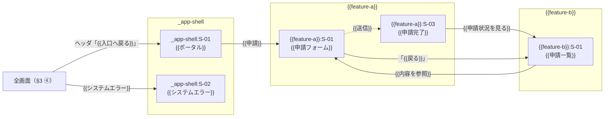

# 画面マップ — {{PROJECT_NAME}}

> 位置づけ: **画面の切り出しと所有・feature 間遷移・入口とシェル・語彙の出どころの正**（案件に 1 つ）。
> **design 承認を通過した** UI feature の `requirements.md` の業務フロー・受け入れ基準と `design.md`（approved）の System Flows、steering から
> 起こす。**画面の中身（項目・操作・状態・文言）は書かない**（画面設計書の役割）。**視覚仕様は書かない**（STYLEGUIDE.md の役割）。
> すべて design 承認の後。初回はその時点で通過している UI feature をまとめて切り出し、以後 design 承認を通過した feature が入るたびに
> **増分で行を足し、差分だけ確認する**（§6-3）。行の確定は所有 feature 単位（frontmatter `features[]`）。
> 各 feature の画面設計書（SD-1）は、本書で所有と決まった画面だけを書き、参照行・入口・出口は本書から転記する。

## 1. 対象 feature と接続

> 入口 = その feature に入るナビ項目（§4）と最初の画面。出口 = 終端画面（完了・通知等）から業務プロセス上の次の行き先。
> **出口は 1 つまで**（複数並べない）。根拠は §3 に書く。UI を持たない feature も行を置き「なし」と書く（対象の判定の記録）。
> **出口列が指すのは §3 の 4 類型のうち「終端画面から次工程」だけ**（入口からの分岐・参照のための往復・全画面からの遷移は出口ではない）。
> **出口が「なし」でも §3 にその feature の行があるのは正常。**
> **`mockup` 列** = `作る` / `省く（理由）`。UI を持つ feature で mockup を省く場合は**この列に理由を書く**
> （feature ごとに宣言する — 黙って省かない）。UI を持たない feature は `—`。

| feature | UI | mockup | 入口（ナビ項目 → 最初の画面） | 出口（終端画面 → 次の行き先） | 備考 |
|---|---|---|---|---|---|
| {{feature-a}} | あり | 作る | 「{{申請}}」→ {{feature-a}}:S-01 | {{feature-a}}:S-03（完了）→ {{feature-b}}:S-01 | |
| {{feature-b}} | あり | 作る | 「{{申請状況}}」→ {{feature-b}}:S-01 | なし（一覧が終端） | |
| {{feature-x}} | なし | — | — | — | バッチのみ |

## 2. 画面一覧（案件全体）

> 画面 ID は `<feature>:S-xx`（案件全体で一意。所有 feature の画面設計書内では `S-xx`）。
> **同じ目的の画面は 1 行にまとめ、所有 feature を 1 つ決める**（判断の優先順は ① その画面の主操作の契約を持つ feature
> ② 業務プロセス上の主 feature ③ 先に design 承認を通る feature。判断は §6-1 に記録）。
> **共通画面（操作ログ一覧・権限なし・エラー・お知らせ等）も 1 行**。feature ごとの別名（「貸与操作ログ」「返却操作ログ」…）を許さない。
> 根拠は所有 feature の受け入れ基準 ID / System Flows。使う feature の受け入れ基準 ID も併記する（要件被覆の突合先）。
> 行の確定は frontmatter `features[]` の所有 feature 単位。
> **wireframe 工程を実施した案件は、切り出した後に `wireframe-manifest.json` の `screens[]` と突合し、結果を §6-5 に書く**
> （wireframe は根拠ではないので、根拠列・出どころ列に wireframe を書かない。`pattern` は SKILL.md の翻訳表で型に写す）。

| 画面 ID | 画面名 | 目的（1 行） | 型 | 所有 feature | 使う feature | 根拠（受け入れ基準 ID / System Flows） | 出どころ |
|---|---|---|---|---|---|---|---|
| {{feature-a}}:S-01 | {{申請フォーム}} | {{…を申請する}} | フォーム | {{feature-a}} | — | {{feature-a}} AC 1.1, 1.2 / System Flows「{{申請登録}}」 | requirements 業務フロー「{{申請する}}」 |
| {{feature-a}}:S-03 | {{申請完了}} | | 完了 | {{feature-a}} | — | {{feature-a}} AC 1.4 | 〃 |
| {{feature-b}}:S-01 | {{申請一覧}} | {{自分の申請の状況を見る}} | 一覧 | {{feature-b}} | {{feature-a}}（出口） | {{feature-b}} AC 1.1 / {{feature-a}} AC 1.5 | requirements 業務フロー「{{状況を確認する}}」 |
| {{feature-c}}:S-05 | {{操作ログ一覧}} | {{操作の履歴を見る}} | 一覧 | {{feature-c}} | {{feature-a}}, {{feature-b}} | {{feature-c}} AC 4.1 / {{feature-a}} AC 5.2 / {{feature-b}} AC 3.3 | 3 feature の requirements に別名で現れたものを統合（§6-1 #1） |
| _app-shell:S-01 | {{ポータル}} | 業務の入口。ロール別にナビ項目を並べる | 入口 | _app-shell | 全 feature | —（requirements 由来でない。根拠は steering `product.md`「{{対象ユーザー}}」） | 新設（§4）。**画面名の正は §4 の表示文言の表**（入口の表示文言と同語でよいが別の値にもできる。工程の語彙「入口」を画面名に使わない）。画面設計書は `.aidd/screen-design/_app-shell/screen-spec.md` |
| _app-shell:S-02 | {{システムエラー}} | {{取得・更新の失敗を知らせる}} | システムエラー | _app-shell | 全 feature | —（requirements 由来でない。根拠は 【人】の決着（{{yyyy-mm-dd}}・{{決めた場}}）） | 共通画面。**inbound は「全画面（§3 ④）」**。1 行に統合し feature ごとの別名を許さない |

型の語彙: **業務画面** = 一覧 / 詳細 / フォーム / 確認 / 完了 / ダイアログ / ダッシュボード、
**共通画面** = 入口 / システムエラー / 権限なし / お知らせ（画面設計書と同じ。他が要る場合は §6-2 に記録）。
**擬似 feature（`_app-shell`）の画面も共通画面の型で判定する。**

**モーダル・印刷ビュー・確認ダイアログは親画面の「状態」**であり、画面にしない（画面設計書の役割）。
基準は「**閉じると必ず親画面に戻り、ナビ・パンくず上の位置を持たず、他 feature から直接遷移されない表示は状態**」。
**逆の 3 つのどれかを満たせば画面**にする（型「ダイアログ」を使うのはこの場合）。

**出どころ列の語彙**: `requirements 業務フロー「…」` / `design.md の System Flows「…」` / `steering の節` /
**`【人】の決着（日付・場）`**（mockup の目視後などに案件の中で人が決めたもの。**エージェントが決めるのではない**）。

## 3. feature 間遷移

> feature をまたぐ遷移だけを書く（feature 内の遷移は各画面設計書 §2）。根拠は steering の状態遷移・ユースケース、または
> 所有側 design.md の System Flows。**requirements の中身を根拠に他 feature の画面を足したり直したりしない**。
> mockup はこの表にあるリンクだけを他 feature へ張る（所有側の `pages/` への相対パス。未生成なら pending）。
>
> **入口からの分岐も本表に書く。** `_app-shell` は擬似 feature なので、**入口画面の本体の導線から各 feature へ**の
> 遷移は feature をまたぐ。**§4 のナビ項目と同じ画面を指すが役割が違う** — §4 は**全ページに載るシェルのナビ**
> （並び・グルーピング・可視ロールの正）、本表は**入口画面という 1 画面からの遷移**
> （動線の正・mockup がリンクを張る根拠・画面設計書 §2 の遷移表の出どころ）。
> **重複ではないのでどちらかを消さない。** 入口行の根拠列には **§4-2 のナビ項目番号**を書く
> （§4 が正であることを行ごとに示す）。

**本表は 4 つの類型を持つ**（「類型」列に書く）:

| 類型 | 形 | 行き先の数 |
|---|---|---|
| **① 入口からの分岐** | 入口（`_app-shell:S-01` か流用元の画面）→ 各 feature の最初の画面 | **1 → N**（UI を持つ feature の数。§4 のナビ項目と 1 対 1） |
| **② 参照のための往復** | 一覧・詳細から他 feature の画面を参照 → 元の画面へ復帰 | 往路 1 + 復路 1 |
| **③ 終端画面から次工程** | 終端画面（完了・通知等）→ 業務プロセス上の次の行き先 | **1 つまで**（複数並べない） |
| **④ 全画面からの遷移** | 全画面（または全業務画面）→ 1 画面。入口へ戻る / 1 つ前へ戻る / 共通のシステムエラー画面へ | **N → 1**（**1 案件で先ごとに 1 行**） |

**「1 つまで」は第 3 の類型にだけ適用する**（確認 #3）。第 1 の類型は 1 → N が正常で、
第 2 の類型は往路と復路の 2 本が対になり、第 4 の類型は N → 1 が正常。**§1 の出口列が指すのは第 3 の類型だけ**。

**第 4 の類型（全画面からの遷移）の書き方**: 遷移元は **`全画面`**（業務画面だけに載るなら `全業務画面`）と書き、
**入口画面自身は自己参照しないので除く**（入口へ戻るリンクは入口画面では無効表示）。
**共通画面（システムエラー・権限なし等）の inbound は「全画面（§3 ④）」**であり、個々の画面からの行は立てない。
**「1 つ前へ戻る」の行き先が状態で変わる場合**は、本表は先を 1 つ決めて条件を備考に書き、
**画面設計書 §2 の遷移表が遷移元を `S-xx（状態）` で書く**。行き先が案件に無い導線は **`なし（無効表示）`** と書く。

**図と表を対で置く。feature 間遷移の正は表。**
図は **feature を `subgraph` で囲み**、案件全体の動線が feature をまたぐところで一目で分かるようにする。
遷移が 1 本も無い revision では、図を置かず「行なし」と書く。

**矢印の描き分け**（本表は feature 間遷移しか持たないので、feature 内の遷移を描かないと**動線が切れる**）:

| 線 | 意味 | 正 | 描く範囲 |
|---|---|---|---|
| **実線** | 本表の行（feature 間遷移） | **本表** | 表の行と 1 対 1。**表に無い実線を描かない** |
| **破線** | feature 内の遷移 | **所有 feature の画面設計書 §2**（本表には載らない） | **動線をつなぐのに必要な分だけ**（feature 内の遷移を網羅しない） |

**第 4 の類型は、図では `ALL["全画面（§3 ④）"]` の 1 ノードから実線 1 本で描く**
（各画面から矢印を引かない。**実線と本表の行の 1 対 1 を保つため**）。

**遷移先が「同一画面の別状態」である場合**（参照専用で開く・ReadOnly で開く等）は、
**遷移先列は画面 ID のまま**にし（状態を書くのは MUST NOT）、
**状態は矢印のラベルと表の備考に書く**。図の下に「同一画面の別状態である」旨を 1 行添える。

> **`{{feature-b}}:S-01` からの矢印の行き先は `{{feature-a}}:S-01` の {{参照専用}}状態**であり、
> 入口から入る記入可能な状態とは別である（**同一画面の別状態**）。

| 類型 | 遷移元 | 操作・契機 | 遷移先 | 根拠 | 備考 |
|---|---|---|---|---|---|
| 入口からの分岐 | _app-shell:S-01 | ナビ項目「{{申請}}」 | {{feature-a}}:S-01 | **§4 ナビ項目 #1** / `product.md`「{{対象ユーザー}}」#1 | **UI feature ごとに 1 本**（§4 のナビ項目と 1 対 1。例は 1 本だけ載せている）。`_app-shell` は requirements / design.md を持たないので根拠は §4 と steering |
| 参照のための往復（往路） | {{feature-b}}:S-01 | {{行クリック}} | {{feature-a}}:S-01 | {{feature-b}} AC 2.2 / System Flows「{{内容を参照}}」 | 遷移先は **{{参照専用}}状態**（同一画面の別状態 — 図の下の注記）。`{{?readonly=1&returnTo=/…}}` |
| 参照のための往復（復路） | {{feature-a}}:S-01 | 「{{戻る}}」 | {{feature-b}}:S-01 | {{feature-b}} AC 4.4 | `{{returnTo}}` で復帰し検索条件を復元。**`{{returnTo}}` が無い経路ではこの遷移は起きない** |
| 終端画面から次工程 | {{feature-a}}:S-03（完了） | 「{{申請状況を見る}}」 | {{feature-b}}:S-01 | `product.md`「{{状態遷移}}: {{申請 → 承認待ち}}」 | **終端からの行き先は 1 つ**（この類型だけ「1 つまで」が効く） |
| 全画面からの遷移 | **全画面**（`_app-shell:S-01` を除く） | ヘッダのリンク「{{入口へ戻る}}」 | _app-shell:S-01 | **§4-1 ヘッダのリンク #{{n}}** / STYLEGUIDE.md §4-10 | **入口画面自身は自己参照になるので除く**（そこでは無効表示）。**先ごとに 1 行** |
| 全画面からの遷移 | **全画面** | ヘッダのリンク「{{1 つ前へ戻る}}」 | {{画面ごとに変わる — 既定は _app-shell:S-01}} | 【人】の決着（{{yyyy-mm-dd}}・{{決めた場}}） | **行き先が状態で変わる場合は備考に条件を書き、画面設計書 §2 が遷移元を `S-xx（状態）` で書く**。入口には 1 つ前が無い（`なし（無効表示）`） |
| 全画面からの遷移 | **全画面** | {{取得・更新・出力の失敗}}（システムエラー） | _app-shell:S-02 | 【人】の決着（{{yyyy-mm-dd}}・{{決めた場}}） | **共通画面の inbound はこの 1 行だけ**（個々の画面からの行を立てない）。{{入力エラー・警告は各画面の状態に残す}} |
| 全画面からの遷移 | **全画面** | ヘッダのリンク「{{ログアウト}}」 | **なし（無効表示）** | §4-1 ヘッダのリンク #{{n}} | 行き先の画面が案件に無い導線は **`なし（無効表示）`** と書く（§6-2 #{{n}}） |

## 4. 入口とシェル

> 入口は受領 feature に入口相当（ダッシュボード・ポータル・お知らせ一覧）があれば**流用**し、無ければ `_app-shell` に**新設**する。
> ナビの並び順・グルーピングは steering `product.md` の**ロールと業務プロセスの前後関係**から導き、どの節から導いたかを書く。
> **機能名を根拠なく並列に並べない。** UI を持つ全 feature がナビから到達できること（確認 #4）。
> 様式（ヘッダ・ナビ・パンくずの形）は STYLEGUIDE.md §4-10 アプリシェル。ここには書かない。

- **入口**: {{流用: <feature>:S-01（{{ダッシュボード}}） | 新設: _app-shell:S-01（画面設計書 `.aidd/screen-design/_app-shell/screen-spec.md`）}}
- **並び・グルーピングの根拠**: `product.md`「{{対象ユーザー}}」（ロールの記載順）+「{{主要ユースケース / 状態遷移}}」（業務プロセスの前後関係）
- **未生成 feature の項目**: 載せる（システム内の位置を見せるため）。リンク先が無いことは mockup の manifest `notes[]` に記録する
- **design 承認前の UI feature**: steering か feature-list に列挙されていれば **`予定（無効表示）`** としてナビに載せてよい
  （根拠列に steering の節を書く。載せておけば、後の増分でナビ項目の増減が起きない）
- **wireframe 工程を実施した案件**: `_app-shell` の `wireframe-manifest.json` の `notes` に並び順・グルーピングと根拠にした
  steering の節が引かれていれば**種**にしてよい（根拠列には steering の節を書く。**形 — ヘッダのナビか・メニュー画面か・
  パンくずの有無 — はもらわない**。正は STYLEGUIDE.md §4-10）

### 4-1. シェルの表示文言（**1 か所で持つ**）

> **1 つの値が「入口の表示文言」「画面名」「パンくずの先頭」「ヘッダの見出し」に流れる**ので、**正を本表 1 か所に置く**。
> **様式（区切り記号・書体・色・並べ方・行数）は STYLEGUIDE.md §4-10 が正**。本表が持つのは**値と段**だけ。

| 項目 | 値 | 備考（使われる先・注意） |
|---|---|---|
| システム名 | {{システム名}} | ヘッダのロゴ位置に出すシステムの名（STYLEGUIDE.md §4-10「システム名の位置」に入る値）。**全ページの `<title>` の後半**（`<画面名> - <システム名>`）にも使う |
| 入口の表示文言 | {{ホーム \| メインメニュー \| 業務メニュー}} | **利用者が画面上で読む名前**。パンくずの先頭と入口画面のメニューの見出しに使う。**「入口」は工程の語彙であり表示文言に使わない**（案件の言葉で決める） |
| 入口画面の画面名 | {{入口の表示文言と同じ \| 別の値}} | §2 の `_app-shell:S-01` の画面名の正。**同語でよいが、別の値にもできる** |
| ヘッダの見出し | {{利用者 / 所属 / 画面名}} | STYLEGUIDE.md §4-10 が本書に委ねた値。**並べ方・行数・様式は §4-10 が正** |
| ヘッダのリンク | {{文言}} → {{行き先}}（**§3 ④ の行と 1 対 1**） | **入口画面自身には入口へ戻るリンクを置かない**（自己参照 — そこでは無効表示）。行き先が案件に無いものは `なし（無効表示）` |
| パンくず | {{入口の表示文言 → ナビ項目 → 画面名（**3 段**） \| **持たない**}} | **持たない場合は「持たない」と書き、現在地の示し方を下行に書く。** **区切り記号・書体・色は書かない**（正が 2 つになる） |
| 現在地 | {{開いている画面の feature に対応するナビ項目 \| ヘッダの画面名の表示}} | パンくずを持たない案件は**本行が現在地の正** |

### 4-2. ナビ項目

| # | グループ（ロール） | ナビ項目（表示文言） | リンク先（画面 ID） | feature | 根拠 |
|---|---|---|---|---|---|
| 1 | {{社員}} | {{申請}} | {{feature-a}}:S-01 | {{feature-a}} | `product.md`「{{対象ユーザー}}」#1 / 「{{主要ユースケース}}」UC-1 |
| 2 | {{社員}} | {{申請状況}} | {{feature-b}}:S-01 | {{feature-b}} | 〃 UC-2（申請の次工程） |
| 3 | {{所属部門の管理者}} | {{承認}} | {{feature-c}}:S-01 | {{feature-c}} | 「{{状態遷移}}」承認待ち → 承認済み |
| 4 | {{情シス}} | {{機器管理}} | {{feature-d}}:S-01 | {{feature-d}} | 「{{対象ユーザー}}」#3 |
| 5 | {{情シス}} | {{棚卸}} | **なし（`予定（無効表示）`）** | {{feature-e}}（**design 承認前**） | `roadmap.md`「{{Specs}}」{{Wave 6}} |

## 5. 語彙の出どころ

> 業務状態名・ロール名・共有識別子の書式は **steering の節を出どころ**に書く（値を確定するのは steering。ここは指すだけ）。
> 無いものは「無い場合」列に既定と確認事項番号を書き、**requirements にも steering にも無い書式を本書で決めない**。
> 画面設計書 §3-x-6（文言）と mockup のダミーデータはこの表の出どころに従う。
>
> **出どころは `product.md` / `glossary.md` に限らない** — 採番規則は `numbering.md`、spec の所有・依存順や入口の所在は `roadmap.md`、
> 業務の前後とロール権限は `workflow.md` / `business-rules.md` にあることが多い。**指す前に steering を一式見る。**
> **`【人】の決着（日付・場）` も出どころに書ける** — mockup の目視後などに**案件の中で人が決めたもの**の受け皿
> （**エージェントが決めるのではない**。決着が無いものは §6-2 へ送る）。

| 語彙 | 値の例（steering から転記） | 出どころ（steering の節 / design.md の該当契約 / 【人】の決着） | 無い場合 |
|---|---|---|---|
| 業務状態名（{{申請}}） | {{承認待ち / 承認済み / 却下}} | `product.md`「{{状態遷移}}」 | — |
| 業務状態名（{{機器}}） | {{在庫 / 貸出中 / 修理中 / 廃棄}} | `product.md`「{{機器の状態}}」 | — |
| ロール名 | {{社員 / 所属部門の管理者 / 情シス}} | `product.md`「{{対象ユーザー}}」 | — |
| 共有識別子の書式（{{管理番号}}） | {{無し}} | {{`numbering.md`「…」 \| `glossary.md`「…」 \| 無し}} | 既定 = 汎用の数値のみ（独自プレフィックスを創作しない）。§6-2 #1 |
| 共通操作の文言（戻る / キャンセル / 一覧へ戻る） | — | STYLEGUIDE.md §7 | — |
| {{共通のシステムエラーに寄せる範囲}} | {{取得・更新・出力の失敗だけ。入力エラー・警告は各画面の状態に残す}} | **【人】の決着（{{yyyy-mm-dd}}・{{決めた場}}）** | — |

### 5-1. マスタ参照項目の表示形式

> **同じマスタを参照する同じ項目が、feature ごとに別の形になるのを防ぐ節。**
> 画面設計書は feature 単位なので、**feature をまたぐ項目の形は本書でしか揃えられない**
> （片方が ID を手で打つ入力欄、片方が選択 + 表示名、という割れ方が実際に起きる）。
> **選び方の UI（直接入力か・選択ダイアログか）は決めない** — それは画面設計書の役割。
> ここが揃えるのは**見せる値と裏に持つ値**だけ。出どころが無いものは §6-2 に送り、本書で決めない。
>
> **未決の閉じ方は revision ごとに記録する。** ここの未決は**後から入る feature の requirements で埋まる**ことがある。
> 埋まったら「無い場合」列を **`§6-2 #{{n}}（revision {{n}} で閉じた）`** に書き換え、**§6-3 にも 1 行残す**
> （閉じた revision が残らないと、2 本目以降の画面設計書がどの版から従えばよいか決まらない）。
> **同じ未決に当たった 2 本目以降の画面設計書は、独自に決めず §6-2 の同じ番号を指す**（自分の §5-4 に重複して起票しない）。

| 参照項目 | 何を見せるか | 何を裏に持つか | 出どころ | 無い場合 |
|---|---|---|---|---|
| {{利用者}} | {{社員番号 + 氏名}} | {{利用者 ID（UUID）}} | {{`design.md` の `UserDirectoryAdapter`}} | — |
| {{組織}} | {{部門コード + 部門名}} | {{組織 ID}} | {{`glossary.md`「…」}} | §6-2 #{{n}} |
| {{承認者}} | {{氏名 + 役職}} | {{利用者 ID}} | {{`design.md` の該当契約}} | **§6-2 #{{n}}（revision {{n}} で閉じた — {{feature-c}} の requirements で埋まった）** |

## 6. 判断・未決・参照

### 6-1. 所有・統合の判断

| # | 判断 | 理由（優先順 ① 主操作の契約を持つ feature ② 業務上の主 feature ③ 先に design 承認を通る feature） | 影響 feature |
|---|---|---|---|
| 1 | {{操作ログ一覧を feature-c の所有に統合した}} | {{ログの取得契約 `GET …` を feature-c の design.md が持つ（①）}} | {{feature-a, feature-b}}（参照行に変更） |

### 6-2. 確認事項（本書では決められないもの — steering / design.md への確認事項を含む）

> **宛先を必ず書く。** 戻す先が違うものが混ざると、どれも返らない。
> **案件の中で解決するもの**（上流 / 本書）と、**案件では解決しないもの**（工程 / 雛形）を分ける。
> **宛先の語彙は下の 4 つ。** 案件の事情で足りなければ**案件が宛先を足してよい**（足した宛先は本表に 1 行加える）。

| 宛先 | 意味 | 誰が処理するか |
|---|---|---|
| **上流** | steering / requirements / design.md に足す・直す（どのファイルかを併記する） | 当該文書の所有者（design.md は承認の改訂管理へ） |
| **本書** | 次の revision で本書が処理する（所有の移動・遷移の追加など） | 改訂者 |
| **工程** | SKILL.md の規約に穴がある | 工程の保守側（**案件では解決しない**） |
| **雛形** | skill の `templates/` の書式に穴がある | 同上 |

| # | 宛先 | 事項 | 影響 |
|---|---|---|---|
| 1 | 上流（steering） | {{管理番号の書式が steering に無い}} | 全 feature のダミーデータは数値のみで統一。書式が決まったら §5 を直す |
| 2 | 上流（design.md） | {{feature-b の design.md に承認結果から貸与処理へ遷移する System Flows が無い}} | §3 の遷移は steering 根拠で仮置き。design.md の変更管理へ |
| 3 | 本書 | {{入口を所有する feature が本 revision の対象外。design 承認を通過した時点で所有の移動の判断が要る}} | 移動時は §6-3 に改訂として記録する |
| 4 | 工程 | {{型の語彙に無い型が必要になった}} | 本書は近い型で仮置きした。規約が決まるまで変えない |

### 6-3. 改訂履歴（増分）

> **本表の行は「所有 feature に紐づかない改訂」の確定の担体でもある**（§4 のシェルだけを直した revision など —
> `features[]` の行が動かないので、そちらには確定が残らない）。**差分確認の確定は `confirmed` 列に
> `{ by, at, recorded_by }` の 3 つ**を書く（`by` = 判断した人、`recorded_by` = 記入した主体。
> **人が直接書けば `by` と同じ。エージェントが代筆したら skill 名**。判断は代行しない）。

| revision | 日付 | 変更（足した・直した行） | confirmed（by / at / recorded_by） | 影響 feature（画面設計書の修正 / mockup の再生成） |
|---|---|---|---|---|
| 1 | {{yyyy-mm-dd}} | 初版（feature-a, feature-b, feature-c を切り出し。入口を新設） | {{開発者}} / {{yyyy-mm-ddThh:mm+09:00}} / {{by と同じ \| 代筆した skill 名}} | — |
| 2 | {{yyyy-mm-dd}} | feature-d の行を追加（`added_in_revision: 2`）。§4 にナビ項目 #4 を追加 | 〃 | 全 feature（ナビ項目の追加 — 本文の入力は不変。目視はシェルのみ） |
| 3 | {{yyyy-mm-dd}} | §4-1 のヘッダのリンクだけを直した（`features[]` の行は動かない。**確定は本表の行が担う**） | 〃 | 全 feature（シェルのみ再生成） |

### 6-4. 参照

| 資料 | 版・時点 | 参照先 |
|---|---|---|
| requirements.md（各 feature） | status approved | `specs/<feature>/requirements.md` |
| design.md（各 feature） | updated_at `{{…}}` / status approved（frontmatter `features[]`） | `specs/<feature>/design.md` |
| steering | `product.md` / `glossary.md` / `roadmap.md` / `numbering.md` / `workflow.md` | `steering/` |
| wireframe `_app-shell`（wireframe 工程を実施した案件のみ） | ds_version `{{…}}` / confirmed_at `{{…}}` | `.aidd/wireframe/_app-shell/pages/wireframe-manifest.json` |
| wireframe-manifest.json（各 feature。同上） | ds_version `{{…}}` / confirmed_at `{{…}}`（feature ごと） | `.aidd/wireframe/<feature>/pages/wireframe-manifest.json`（**manifest だけを読む。HTML・CSS は読まない**） |
| STYLEGUIDE.md | version `{{x.y.z}}`（§4-10 アプリシェルの様式） | `STYLEGUIDE.md`（リポジトリ直下） |

### 6-5. wireframe との突合（wireframe 工程を実施した案件のみ）

> wireframe の `screens[]` を 1 行ずつ、本書のどこに落ちたかを書く。**全行がどれかに落ちる**（黙って落とさない）。
> 扱いの語彙: **`<feature>:S-xx に対応`** / **`状態にした（親 <feature>:S-xx）`** / **`画面にしない（理由）`**。
> **wireframe は根拠ではない** — 対応する画面の根拠は §2 の根拠列にある。
> `pattern` → 型の翻訳、`login` / `report` / 404 の扱いは `screen-map-authoring` の SKILL.md「wireframe-manifest の使い方」が正。
> 増分で足した feature の行は revision を備考に書く。

| feature | `screens[].screen` | `pattern` | 本書での扱い | 備考 |
|---|---|---|---|---|
| {{feature-a}} | {{create-input}} | confirm-flow | {{feature-a}}:S-01 に対応 | |
| {{feature-a}} | {{detail}}（状態 `delete-confirm`） | detail-page | 状態にした（親 {{feature-a}}:S-02） | 確認ダイアログは親画面の状態 |
| {{feature-b}} | {{print}} | report | 画面にしない（印刷ビューは親画面の状態） | |
| {{feature-b}} | {{login}} | login | 画面にしない（型に無い — §6-2 #{{n}}） | |
