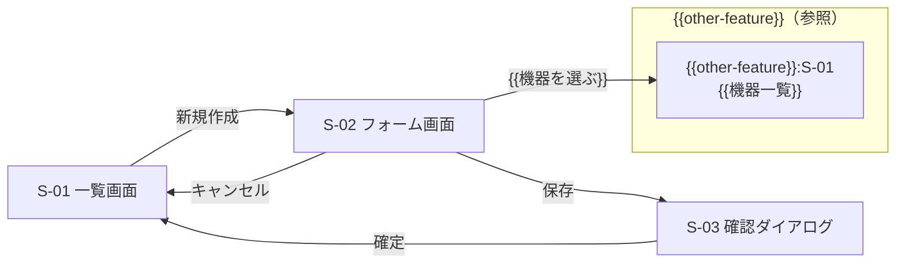

# 画面設計書 — {{FEATURE_NAME}}

> 位置づけ: **画面の構成・項目・操作・状態・文言の正。** `design.md`（approved）の下位文書であり、
> requirements / design.md に根拠の無い項目・操作・挙動を足さない。design.md は画面を列挙しない。
> **画面の切り出し・所有・feature 間遷移・入口とナビは画面マップ（SD-0）が決めている**（`.aidd/screen-design/_app-shell/screen-map.md`）。
> 本書は**画面マップで本 feature が所有と決まった画面だけ**を書く（各画面は受け入れ基準か System Flows に、各操作は design.md の契約に紐づける）。
> 画面マップに無い画面が要る・所有を移したいときは、本書で足さず・書き換えず、画面マップの改訂に回す（§5-5）。
> 見た目（色・余白・書体・部品の様式）は書かず、**STYLEGUIDE.md** を指す。部品は STYLEGUIDE.md §4 の名で書く。
> **版は frontmatter `inputs` が正**（散文に版番号を書かない。確定文書に工程の通し番号も書かず、工程名で書く）。
> シェル（ヘッダ・グローバルナビ・パンくず）の様式・並び・ナビ項目は書かない（正は画面マップ §4、様式は STYLEGUIDE.md §4-10）。
> **ただし §4-10 が画面設計書に委ねた値（画面名など）は §3-x-6 に書く。**
> 他 feature の requirements / design.md は本書の入力にしない（他 feature の情報は画面マップ経由でだけ入る）。
> mockup（`.aidd/screen-design/<feature>/pages/`）は本書・画面マップ・STYLEGUIDE.md から生成する。手で磨かず、本書を直して再生成する。

## 1. 画面一覧・接続

> 出どころ: **画面マップ §2 の本 feature 所有行**を転記する（根拠の受け入れ基準 ID / System Flows も引き継ぐ）。
> wireframe 工程を実施した案件は `wireframe-manifest.json` の `screens[]` を**突合先**にする（顧客が確認した画面と状態の一覧。
> **根拠にしない**。差分は §5-2。画面 → 画面 ID の対応は画面マップ §6-5 が持つ）。
> 他 feature の画面を使う・遷移する場合は**参照行**として置く — 画面 ID は `<feature>:S-xx` の修飾形、画面の型は「参照（所有: <feature>）」。
> 型・項目・状態は写さず、画面ごとの小節も作らない（mockup の画面 × 状態の数に入れない）。参照行は画面マップ §2〜§3 から転記する。

| 画面 ID | 画面名 | 目的（1 行） | 画面の型 | 受け入れ基準 ID | 出どころ |
|---|---|---|---|---|---|
| S-01 | {{一覧画面名}} | {{何をする画面か}} | 一覧 | 1.1, 1.2 | 画面マップ §2 `{{feature}}:S-01` / requirements 業務フロー「{{申請を確認する}}」/ design.md System Flows `{{フロー名}}` |
| S-02 | {{フォーム画面名}} | | フォーム | 2.1 | 画面マップ §2 / requirements AC 2.1（wireframe `screens[].screen = {{create-input}}` に対応 — §5-2） |
| S-03 | {{確認ダイアログ名}} | | ダイアログ | 2.2 | 画面マップ §2 / requirements AC 2.2（確定前の確認） |
| {{other-feature}}:S-01 | {{機器一覧}} | {{申請対象を選ぶ導線として使う}} | 参照（所有: {{other-feature}}） | 2.1 | 画面マップ §2（所有: {{other-feature}}）/ §3 |

画面の型の語彙: **一覧 / 詳細 / フォーム / 確認 / 完了 / ダイアログ / ダッシュボード**、
共通画面は **入口 / システムエラー / 権限なし / お知らせ**（他が要る場合は §5 に記録）。
他 feature の画面を指すときだけ **参照（所有: <feature>）** を使う。
擬似 feature（`_app-shell` 等）は受け入れ基準 ID の欄を `—（requirements を持たない擬似 feature のため）` と書く（空欄にしない）。

### 1-1. 接続（画面マップ §1 の本 feature 行を転記）

| 接続 | 内容 | 出どころ |
|---|---|---|
| 入口 | ナビ項目「{{申請}}」→ S-01 | 画面マップ §1 / §4 #{{n}} |
| 出口 | S-03（完了）→ {{other-feature}}:S-01「{{申請状況を見る}}」 | 画面マップ §1 / §3 |

## 2. 画面遷移

> 出どころ: feature 内は design.md「System Flows」/ requirements の操作の流れ。feature 間は**画面マップ §3 にあるものだけ**。
> 本表に無いリンクを mockup に張らない。
> **図には feature 間遷移も描く**（遷移先は `<feature>:S-xx` の修飾形。参照行であることが分かるよう他 feature 側を
> `subgraph` で囲む）。図と表は対で置き、**正は表**（表に無い矢印を描かない）。
> **遷移元は `S-xx（状態）` で書いてよい**（「1 つ前へ戻る」の行き先が状態で変わるとき）。
> **全画面から 1 つの画面へ向かう遷移**（入口へ戻る / 共通のシステムエラー画面へ）は、
> 遷移元を `全画面（画面マップ §3 ④）` と書いて 1 行にまとめる。**入口画面自身は入口へ戻る行を持たない。**

| 遷移元 | 操作 | 遷移先 | 条件・備考 |
|---|---|---|---|
| S-01 | 「新規作成」 | S-02 | — |
| S-02 | 「保存」 | S-03 | 入力エラーが無いこと（§3-2-5 入力エラー） |
| S-02 | 「{{機器を選ぶ}}」 | {{other-feature}}:S-01 | 他 feature の画面へ（画面マップ §3）。mockup は所有側の `pages/` への相対リンク（未生成なら pending として置き、manifest `notes[]` に記録） |
| S-02（入力エラー） | 「{{戻る}}」 | S-01 | 1 つ前へ戻る。**遷移元を状態で書いた行**（状態によって行き先が変わるため） |
| 全画面（画面マップ §3 ④） | 「{{入口へ戻る}}」 | {{_app-shell}}:S-01 | 全画面から 1 つの画面へ向かう遷移。**入口画面自身には置かない** |
| {{other-feature}}:S-01 | 「{{申請する}}」 | S-02 | `inbound`（他 feature から入ってくる遷移。画面マップ §3） |

## 3. 画面ごとの仕様

> 画面ごとに **概要 / レイアウト / 項目定義 / 操作 / 状態 / 文言** の 6 小節で固定する。
> 参照行（他 feature の画面）には小節を作らない。共有画面に項目・操作・状態を足すときは**所有 feature の画面設計書を改訂**し、
> 足した行の根拠に本 feature の受け入れ基準 ID を書く（本書には書かない — 正を 2 つにしない）。
> **要求側の AC と所有側の AC が矛盾したら所有側を優先**し、要求側は §5-4（宛先 `requirements`）で変更管理へ返す。

### 3-1. S-01 {{画面名}}

#### 3-1-1. 概要

- **目的**: {{1〜2 行}}
- **利用ロール**: {{steering product.md のロール名}}
- **前提**: {{この画面に来るまでに満たしているもの}}
- **受け入れ基準 ID**: {{1.1, 1.2}}

#### 3-1-2. レイアウト（領域構成）

> 視覚仕様は書かない。**領域と、そこに置く要素の並び**だけを書く。余白・揃えは STYLEGUIDE.md §5 に従う。
> シェル（ヘッダ・グローバルナビ・パンくず）の行は置かない（全画面共通。正は画面マップ §4）。
> wireframe 工程を実施した案件は manifest の `components` を領域の顔ぶれの突合先にする。
> **配置・段組み・アクション行は STYLEGUIDE.md §5 が正**で、wireframe の配置は写さない（差分は §5-2）。

| 領域 | 置くもの（上から / 左から） | 備考 |
|---|---|---|
| ヘッダ | 画面タイトル「{{…}}」/ 主操作 Button「{{新規作成}}」（右端） | primary は 1 つ |
| 絞り込み | Field「{{キーワード}}」/ Select「{{ステータス}}」/ Button secondary「絞り込む」 | 1 行に収める |
| 本体 | Table（列は §3-1-3） | 空状態は表内に EmptyState |
| フッタ | 件数表示 + Pagination | 右寄せ |

#### 3-1-3. 項目定義

> 出どころ: design.md「Data Models」（属性・型）/「Error Handling › バリデーション設計」（条件・エラーコード）。
> 表示の書式は STYLEGUIDE.md §7 の表記（日付・数値）に従う。

| # | 項目名 | 種別 | 部品（STYLEGUIDE.md §4） | 型・書式 | 必須 | 制約・バリデーション | 出どころ |
|---|---|---|---|---|---|---|---|
| 1 | {{申請番号}} | 表示 | Table 列 | 数値（汎用の数値のみ） | — | — | Data Models `{{Entity.field}}` |
| 2 | {{申請日}} | 表示 | Table 列 | 日付 `yyyy/MM/dd` | — | — | 〃 |
| 3 | {{ステータス}} | 表示 | Badge | 列挙（{{下書き / 申請中 / 承認済み}}） | — | — | 〃 |
| 4 | {{返却予定日}} | 入力 | Field（date） | 日付 | ○ | 本日以降・90 日以内 → `{{LOAN_DUE_DATE_INVALID}}` | バリデーション設計 |

- 種別の語彙: **表示 / 入力 / 選択 / 操作**
- 制約は design.md のバリデーション表の**エラーコードで参照**し、条件文を転記しない

#### 3-1-4. 操作

> 出どころ: design.md「Components and Interfaces」の契約（サービスインターフェース / API 契約）。
> **3 種に切り分けて書く** — **A 種**（契約・業務ルールを伴う）は契約名。契約に無ければ置かず §5-4 に記録するが、
> **AC が画面挙動を明記していれば置き、契約列に `契約なし（§5-4 #n）` と書いて §5-4 に記録する**（落とさない）。
> **B 種**（画面内で完結）は `—（画面内）`、**C 種**（他画面へ遷移するだけ）は `—（遷移のみ）`。
> **項目定義（§3-x-3）が置いた操作系の部品と、状態（§3-x-5）に現れる導線は、すべてこの表に行を持つ。**

| 操作 | 部品 | トリガー | 結果 | 遷移先 | 確認 | 契約（design.md） |
|---|---|---|---|---|---|---|
| {{新規作成}} | Button primary | クリック | — | S-02 | なし | —（遷移のみ） |
| {{絞り込む}} | Button secondary | クリック | 一覧を再取得（条件は §3-1-3 #…） | S-01（同画面） | なし | API 契約 `GET {{/api/v1/loan-requests}}` |
| {{条件をクリア}} | Button secondary | クリック | 絞り込み条件を初期化する（一覧は消さない） | S-01（同画面） | なし | —（画面内） |
| {{削除}} | Button danger（行内） | クリック | 確認ダイアログを開く | S-03 | あり | —（確定時に S-03 から `{{DELETE …}}` を呼ぶ） |
| {{一括承認}} | Button primary | クリック | {{選択した申請をまとめて承認する}} | S-01（同画面） | あり | `契約なし（§5-4 #2）`（**AC {{4.2}} が画面挙動を明記しているので置く**） |

#### 3-1-5. 状態

> **下限**: 全画面 = 通常 / 空 / ローディング / エラー（取得失敗）。フォーム = + 入力エラー / 送信中 / 完了。
> 一覧 = + 絞り込み結果なし。共通画面 = 入口 / システムエラー / 権限なし は 通常のみ、お知らせは 通常 / 空。
> 長文・大量件数などの品質状態は 1 行足す。
> **モーダル・印刷ビュー・確認ダイアログは親画面の状態として行を置く**（画面にしない。
> 閉じると必ず親画面に戻り・ナビ上の位置を持たず・他 feature から直接遷移されない表示は状態）。
> 表示内容・文言は**機能固有のものだけ**を書く（部品が既定で持つ枠・見出しは書かない）。
> 文言は §3-x-6 に実文言を置き、ここでは design.md バリデーション設計の**エラーコード**で指す。
> **UI に関わる NFR は「受け入れ基準 ID / NFR」列に書く**（§4 の別掲枠にも載せる。要件被覆の分母には入れない）。
> **置かなかった状態・別画面に移した状態は §5-1 の内訳表に残す**（落とした数が 0 でも表を出す）。
> wireframe 工程を実施した案件は manifest の `states` を突合先にする（SKILL.md の翻訳表 B で型の状態に写す。
> **器が無い状態は §5-2 に「引き続き画面にしない」**と理由を書く。DS の状態名をそのまま書かない）。

| 状態 | 発生条件 | 表示内容・文言 | 受け入れ基準 ID / NFR |
|---|---|---|---|
| 通常 | データが 1 件以上ある | 一覧（§3-1-3 の列）と件数「{{全 n 件}}」 | 1.1 |
| 空 | データが 0 件 | EmptyState「まだ{{申請}}はありません」+ Button「{{新規作成}}」 | 1.1 |
| 絞り込み結果なし | 条件に一致する行が 0 件 | 「条件に一致する{{申請}}はありません」+ 条件を解除する導線 | 1.3 |
| ローディング | 取得中 | Table の骨組み表示。操作は不可 | — |
| エラー（取得失敗） | 取得に失敗した | Banner error「読み込めませんでした。再試行してください」+ Button「再試行」 | — |
| 長文 | 項目 #… が想定幅を超える | 折り返し（省略しない） | NFR {{表示の可読性}} |
| {{確認モーダル}} | {{S-01 で「削除」を押した}} | {{確認の見出し + Button「確定」「キャンセル」}}（親画面の状態として置く） | 2.2 |

#### 3-1-6. 文言

> **実文言を置く**（参照で止めない — mockup は design.md を読まないため、参照形だけでは画面に文言が出ない）。
> design.md のメッセージ例は**エラーコード付きで転記し、出どころ列に転記元の行を書く**（**正は design.md のまま**）。
> **AC にボタン名・アクセスキーが無い場合は本書が起草し、§5-4 に記録する**（案件内でキーが衝突しないかも見る）。
> 部品が既定で持つラベルは起草せず §5-3 の追記候補にする。
> **シェルの様式・並びは書かないが、STYLEGUIDE.md §4-10 が本書に委ねた値（画面名など）はここに書く。**

| 箇所 | 文言 | 出どころ |
|---|---|---|
| 画面タイトル | {{…}} | requirements 用語 |
| 主操作ボタン | {{新規作成}}（アクセスキー `{{J}}`） | {{requirements AC 2.1 / AC に無いため本書で起草 — §5-4 #n}} |
| 空状態 | まだ{{…}}はありません | STYLEGUIDE.md §7 の型で起草 |
| 入力エラー | `{{LOAN_DUE_DATE_INVALID}}`「{{返却予定日は本日以降 90 日以内で入力してください}}」 | design.md バリデーション設計「メッセージ例」の `{{LOAN_DUE_DATE_INVALID}}` 行から転記（正は design.md） |
| シェル上の画面名 | {{申請一覧}} | STYLEGUIDE.md §4-10 が本書に委ねた値 |

### 3-2. S-02 {{画面名}}

（3-1 と同じ 6 小節）

## 4. 要件被覆

> UI に関わる受け入れ基準 ID がすべて画面 ID に紐づくこと（確認 #1）。
> **分母から外す 2 類型**（**不在が画面で示せない AC** / バックエンド専用処理）は類型を付けて別掲する。
> **画面マップが「画面を伴わない」として既に外した AC を、ここで二重に外さない。**
> 擬似 feature は本節を空のまま置き、「requirements を持たない擬似 feature のため」と 1 行書く。
> 他 feature の画面に紐づける AC は `<feature>:S-xx` の修飾形で書き、所有側の画面設計書（改訂）が confirmed になってから確認 #1 を通す。

| 受け入れ基準 ID | 概要 | 画面 ID（状態） |
|---|---|---|
| 1.1 | {{…}} | S-01（通常・空） |
| 1.2 | {{…}} | S-02（通常・入力エラー） |
| 2.1 | {{…}} | {{other-feature}}:S-01（通常）— 所有側で定義 |

**分母から外した受け入れ基準**

| 受け入れ基準 ID | 類型 | 理由 |
|---|---|---|
| 2.4 | 不在が画面で示せない | 「〜しない」— 不在は画面要素として指し示せない |
| 3.2 | バックエンド専用 | 非同期送信。UI に現れないことが仕様 |

**UI に関わる NFR（分母に入れない — どの画面・状態に反映したかだけを残す）**

| NFR | 内容 | 反映した画面（状態） |
|---|---|---|
| {{NFR-1}} | {{例: 一覧は 1 秒以内に初期表示する}} | S-01（ローディング） |

## 5. 設計判断・未決

### 5-0. 改訂履歴

> **初回は「初回」の 1 行だけ。改訂のたびに 1 行積む**（消さない・上書きしない）。
> 改訂は**宣言した小節だけを直す**（全文を作り直すと `status: confirmed` と確定者・日時が消える）。
> 改訂したら **frontmatter の `status` を `draft` に戻し、`confirmed` を空にする**。
> **前の改訂を取り消したときは「取り消し」列に書く**（本文からは消えるため、履歴にしか残らない。理由は §5-1 に書く）。

| # | 日付 | 起点 | 直した小節 | 取り消し | 根拠の所在 |
|---|---|---|---|---|---|
| 初回 | {{2026-01-01}} | — | 全節 | — | — |
| {{1}} | {{2026-01-15}} | {{① mockup の目視 / ② 画面マップの改訂 / ③ design.md の変更管理 / ④ 確認事項の解決 / ⑤ STYLEGUIDE.md が本書に決定を委ねた}} | {{§3-1-4, §3-1-5, §4, §6}} | — | {{所在}} |
| {{2}} | {{2026-01-20}} | {{④ 確認事項の解決}} | {{§3-1-5}} | {{改訂 1 の §3-1-5 の追加を取り消した（理由: §5-1 #n）}} | {{所在}} |

### 5-1. 起草中に判断した事項

| # | 判断 | 理由 | 根拠 |
|---|---|---|---|
| 1 | {{一覧をカードでなく Table にした}} | {{列で比較できる}} | design.md Design Decisions `{{Decision n}}` |
| 2 | {{例: 確認を S-03 ダイアログにし、確認画面を別に置かなかった}} | {{項目が 3 つで 1 画面に値しない}} | 画面マップ §2 の型「ダイアログ」に沿う（所有・切り出しは画面マップで決定済み） |
| 3 | {{例: AC の「カンマ区切りで複数可」は受け口の仕様と読み、複数選択の器は置かなかった}} | {{画面の要求ではない}} | requirements AC {{n}} |

**状態の判定の内訳**（型の各状態を 4 通りに判定した証跡。**落とした数が 0 のときも表を残す**）

| 画面 | 型の状態 | 判定 | 置いた / 置かない理由・移した先 |
|---|---|---|---|
| S-01 | 空 | 起こる | 置いた（AC 1.1） |
| S-01 | エラー（取得失敗） | 起こるが、表示先が別画面に移った | {{_app-shell}}:S-02（共通のシステムエラー画面）へ |
| S-01 | {{送信中}} | 起こりえない | {{この画面は送信を持たない}} |
| S-02 | {{完了}} | 判断できない | 行を残し §5-4 #{{n}} に記録（発生条件の裏づけが無い） |

### 5-2. wireframe からの引き継ぎと差分（wireframe 工程を実施した案件のみ）

> wireframe は顧客が**型・構成・情報量・状態の顔ぶれ**を確認した合意記録。**根拠ではなく突合先**で、様式と配置は STYLEGUIDE.md が正。
> ① `unrealized[]` はそのまま引き継ぐ（`acknowledged` が入っていれば再検討しない）。
> ② **差分**は wireframe の状態と部品を 1 行ずつ落とす。扱いの語彙: `そのまま（…）` / `状態にした（S-xx の状態）` /
> `部品を置き換えた（§4 の部品名）` / `引き続き画面にしない（理由）` / `器が無い（§5-3 #n）`。**全行がどれかに落ちる**（確認 7-2）。
> 画面そのものの対応（wireframe の画面 → 画面 ID）は画面マップ §6-5 が持つので、ここでは状態と部品を書く。
> DS の部品名・状態名の翻訳は `screen-spec-authoring` の SKILL.md の翻訳表 A / B が正。**DS の名をそのまま本文に書かない。**

**① `unrealized[]` の引き継ぎ**

| 要件 ID | 想定画面 | 類型 | 本書での扱い |
|---|---|---|---|
| {{R-…}} | {{…}} | {{DS 不足 / requirements 起因 / UI 対象外 / その他}} | {{S-0x に収めた / 引き続き画面にしない（理由）}} |

**② 差分（顧客が wireframe で見たものと、本書で変えたもの）**

| wireframe の画面（`screen`） | 状態 / 部品 | 本書での扱い | 理由 |
|---|---|---|---|
| {{list}} | 状態 `loading`（Skeleton） | 引き続き画面にしない | STYLEGUIDE.md §4 にローディングの器が無い（§5-3 #{{n}}） |
| {{create-input}} | 部品 Combobox（{{会議室}}） | 部品を置き換えた（{{§4 のマスタ参照の器}}） | 選び方の器は STYLEGUIDE.md §4 が正。見せる値・裏の値は画面マップ §5-1 |
| {{create-input}} | 状態 `input-error`（項目直下のテキスト） | そのまま（S-02 入力エラー）。**出し方は STYLEGUIDE.md §4 / §7 に従う** | 状態は同じで様式が違う。顧客提示で説明する |
| {{detail}} | 状態 `delete-confirm` | 状態にした（S-03 の確認ダイアログ） | 確認ダイアログは親画面の状態 |

### 5-3. STYLEGUIDE.md への追記候補（STYLEGUIDE.md §4 に無い部品・様式）

| 必要な部品・様式 | 使う画面 | 代替せずどうしたか |
|---|---|---|
| {{例: 進捗ステッパー}} | S-02 | 画面設計書には部品名を仮置きし、mockup では作らず `missing[]` に記録 |

### 5-4. 上流・工程への確認事項（本書では決められないもの）

> **宛先の語彙**: `design.md` / `requirements` / `steering` / `工程`（本工程の規約）/ `雛形`。
> 本書で起草したもの（ボタン名・アクセスキー・暫定のソート順）も、起草した旨をここに残す。

| # | 事項 | 宛先 | 画面 | 影響 |
|---|---|---|---|---|
| 1 | {{例: 一覧の既定ソート順が design.md に無い}} | design.md | S-01 | mockup は暫定で申請日降順にし、その旨を注記 |
| 2 | {{例: S-02 の保存に対応する API 契約が design.md に無い（AC 4.2 は画面挙動を明記）}} | design.md | S-02 | 操作表には置き契約列を `契約なし（§5-4 #2）` にした。契約の追加を design.md の変更管理へ |
| 3 | {{例: 承認ボタンのアクセスキーが AC に無いので本書で起草した（`{{A}}`）}} | requirements | S-02 | 起草値で mockup を出す。AC が付いたら差し替える |
| 4 | {{例: 共有画面で要求側と所有側の AC が矛盾した（所有側を優先した）}} | requirements | {{other-feature}}:S-01 | 要求側の AC を requirements の変更管理へ返す |

### 5-5. 画面マップへの改訂依頼（切り出し・所有・遷移・ナビは本書で決めない）

> **区分**: **改訂を要する（mockup をブロックする）** / **上流が既に次の revision で扱うと記録済み（ブロックしない）**。
> 後者は 0 件に数えず別枠で見せる。

| # | 依頼 | 区分 | 理由 | 扱い |
|---|---|---|---|---|
| 1 | {{例: 受け入れ基準 3.4 を満たす画面が画面マップに無い（履歴表示）}} | 改訂を要する | {{AC 3.4 は一覧とは別の画面操作を要する}} | 画面マップに行を追加してもらい、差分確認の後に本書へ小節を足す。それまで §4 の AC 3.4 は未被覆として別掲 |
| 2 | {{例: 出口を other-feature:S-01 ではなく S-04 にしたい}} | 上流が既に扱うと記録済み | {{画面マップ §6-2 #n が次の revision で扱うと記録している}} | 本書の遷移表は画面マップに合わせたまま。mockup はブロックしない |

## 6. 参照

| 資料 | 版・時点 | 参照先 |
|---|---|---|
| design.md | updated_at `{{…}}` / status approved | `specs/{{feature}}/design.md` |
| requirements.md | status approved | `specs/{{feature}}/requirements.md` |
| steering | `product.md` / `tech.md` | `steering/` |
| wireframe-manifest.json | ds_version `{{…}}` / confirmed_at `{{…}}` | `.aidd/wireframe/{{feature}}/pages/` |
| STYLEGUIDE.md | version `{{x.y.z}}` | `STYLEGUIDE.md`（リポジトリ直下） |
| 画面マップ | revision `{{n}}` / 本 feature 行の confirmed.at `{{…}}` | `.aidd/screen-design/_app-shell/screen-map.md` |
