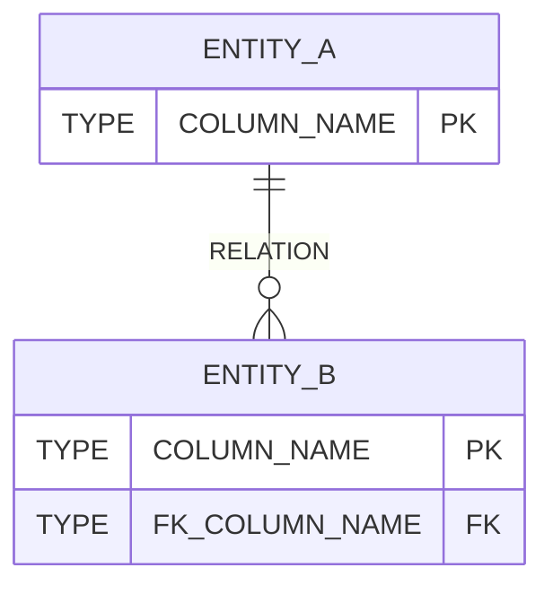

# データモデル全体図

> システム全体の ER 図とスキーマを管理する実態ドキュメント。\
> _分担_: フィーチャー固有のテーブル定義は `specs/<feature>/design.md` の `## データモデル（Data Models）`。命名規則・型の指針・マイグレーションなどの共通ルールは `steering/database.md` に従う。

> _書き方_: 本ファイルを更新したら、関係する `design.md` の `### 物理データモデル（Physical Data Model）` と食い違っていないか確認する。

## ER 図

> システム全体のエンティティと関連を 1 枚で示す節。

> _書き方_: エンティティ名・型・カラム名・関連名はすべて実際の名前に置き換える。主キーには `PK`、外部キーには `FK` を付ける。関連の記号は Mermaid の記法に従う。

## 主要エンティティ一覧

> どのエンティティをどのスペックが持っているかを一覧にする節。

> _書き方_: 1 行 1 エンティティ。エンティティ名には業務で呼んでいる名前、テーブル名には実際の DB 上の名前を書く。概要には、そのエンティティが何を表すかを 1 行で書く。所有スペックには、そのエンティティを所有する `specs/<feature>/design.md` のパスを書く。

| エンティティ名 | テーブル名 | 概要 | 所有スペック |
|---|---|---|---|
| <DM_ENTITY_NAME_N> | <DM_TABLE_NAME_N> | <DM_ENTITY_SUMMARY_N> | <DM_OWNER_SPEC_N> |

## ドメイン境界（DB 観点）

> 業務上のまとまりごとに、どのテーブルが属するかを示す節。\
> _分担_: まとまりの名前は `docs/architecture/system-overview.md` の `## ドメイン境界の地図` と揃える。ここにはテーブルの帰属だけを書く。

> _書き方_: まとまりの単位は `docs/architecture/system-overview.md` の `## ドメイン境界の地図` に合わせる。1 まとまり 1 行で、属するテーブルを挙げる。

- **<DM_BOUNDARY_NAME_N>**: <DM_BOUNDARY_TABLES_N>

---

_システム全体の ER 図とスキーマを管理する実態ドキュメント。_
