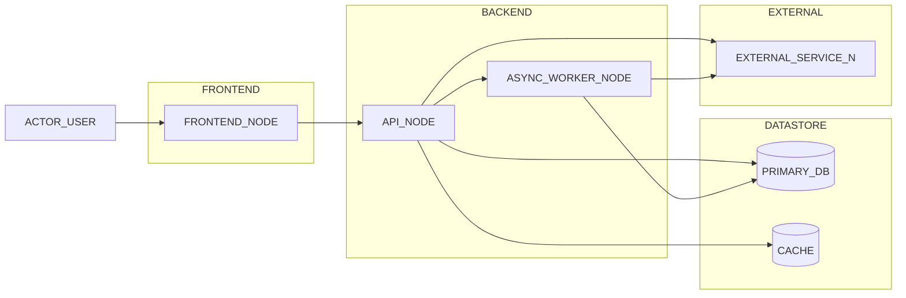
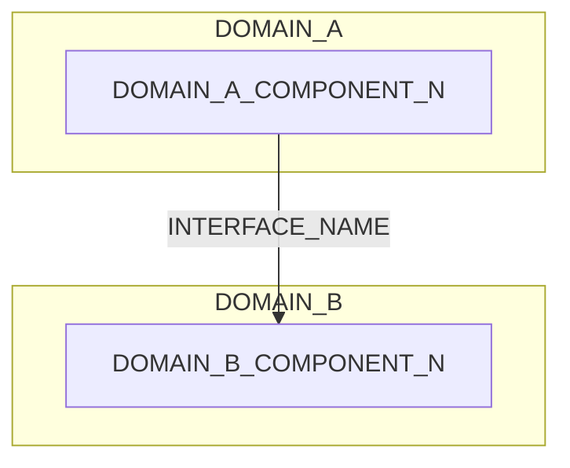
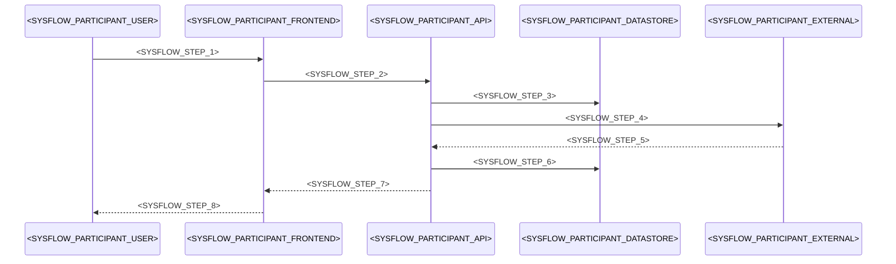

# システム全体像

> プロジェクトの進行とともに更新する実態ドキュメント。システム全体の構成と主要な流れを 1 箇所に集める。\
> _分担_: 図のルールは `steering/architecture.md` の `## 全体図のルール`。フィーチャー個別のシーケンス図・ステート図は `specs/<feature>/design.md` の `## 処理フロー（System Flows）`。

> _書き方_: 図は Mermaid で描き、画像を貼らない。達成実績の数値は書かない。

## 全体構成図

> 主要コンポーネントの接続を 1 枚で示す節。新しいフィーチャーの境界がこの図のどこに入るかを判断できる粒度に保つ。\
> _分担_: subgraph とノードは `steering/architecture.md` の `## 各システムコンポーネントの役割` と対応させる。製品名は `steering/tech.md` に従う。

> _書き方_: ノードの粒度は `steering/architecture.md` の `### 図の種別と粒度` に従う。図の中の大文字の名前はすべて実際の名前に置き換える。製品のバージョンは書かない。`#` 列には並び順の連番を、全体像の補足には図だけでは読み取れないこと（矢印や点線の意味、通信の向きなど）を書く。

| # | 全体像の補足 |
| --- | --- |
| <SYSFLOW_OVERVIEW_NO_N> | <SYSFLOW_OVERVIEW_NOTE_N> |

## ドメイン境界の地図

> 業務上のまとまりが複数あるときに、責務の重なりを早く見つけるための節。\
> _分担_: まとまりの名前と境界は `steering/architecture.md` の `## 配置原則` と整合させる。テーブルの帰属は `docs/architecture/data-model.md` の `## ドメイン境界（DB 観点）`。

> _書き方_: まとまりの単位はプロジェクトの設計に合わせる。DDD（ドメイン駆動設計）を採用しているなら境界づけられたコンテキストを単位にする。図の中の大文字の名前はすべて実際の名前に置き換える。`#` 列には並び順の連番を、境界に関する補足には、まとまりをまたぐやりとりで注意することを書く。

| # | 境界に関する補足 |
| --- | --- |
| <SYSFLOW_DOMAIN_NO_N> | <SYSFLOW_DOMAIN_NOTE_N> |

## 外部サービス連携の俯瞰

> 外部サービスとの連携をまとめて見渡す節。連携先ごとに失敗時の方針が違う場合に効く。\
> _分担_: 失敗時の数値やリトライは `steering/non-functional.md` の `### リトライ`、認証は `steering/security.md` の `## 認証・認可` と整合させる。

> _書き方_: 連携先にはサービス名を、用途にはそれを何のために使うかを書く。同期 / 非同期には呼び出し方を書く。失敗時の方針は方針名だけを書き、数値は書かない。

| 連携先 | 用途 | 同期 / 非同期 | 失敗時の方針 |
| --- | --- | --- | --- |
| <SYSFLOW_INTEGRATION_NAME_N> | <SYSFLOW_INTEGRATION_PURPOSE_N> | <SYSFLOW_INTEGRATION_SYNC_MODE_N> | <SYSFLOW_INTEGRATION_FAILURE_POLICY_N> |

## 主要ビジネスフロー

> 代表的な利用の流れを sequenceDiagram で示す節。\
> _分担_: どのフローを載せるかは `steering/product.md` の `## 主要ユースケース` に従う。フィーチャー個別の流れは `specs/<feature>/design.md` の `## 処理フロー（System Flows）`。認証を含むフローは `steering/security.md` の `## 認証・認可` と整合させる。失敗時の詳細は `steering/non-functional.md` の `## 運用・障害対応`。

> _書き方_: 見出しには利用者から見た流れの名前を書き、`steering/product.md` の `## 主要ユースケース` と同じ名前にする。\
> 図と、その下の説明をひと組にする。ここには流れの概要だけを書き、詳細は参照先に委ねる。\
> participant は登場する範囲に合わせて増減させ、別名とメッセージは実際の名前に置き換える。左端の 1 文字の識別子（`U` `W` `A` など）は図の中だけの記号なので変えなくてよい。

### <SYSFLOW_BUSINESS_FLOW_NAME_N>

**説明**:

- **目的**: <SYSFLOW_FLOW_PURPOSE>
- **対象ドメイン**: <SYSFLOW_FLOW_DOMAIN>
- **前提**: <SYSFLOW_FLOW_PREREQUISITE>
- **失敗時の概要**: <SYSFLOW_FLOW_FAILURE_SUMMARY>

## 運用ツール・参照リンク集

> 監視ダッシュボード・課題管理・工程表などの参照先を集める節。URL の一覧はここに集約する。\
> _分担_: 運用の方針・骨格は `steering/non-functional.md` の `## 運用・障害対応`。

> _書き方_: ツールには製品名やサービス名を書く。用途には、何を見るために使うかを書く。参照先には URL を書き、社内限定など到達に条件があるものはその旨を添える。

| ツール | 用途 | 参照先（URL / 未定） |
| --- | --- | --- |
| <SYSFLOW_TOOL_NAME_N> | <SYSFLOW_TOOL_PURPOSE_N> | <SYSFLOW_TOOL_REFERENCE_N> |

---

_システム全体の構成と主要な流れを管理する実態ドキュメント。_
