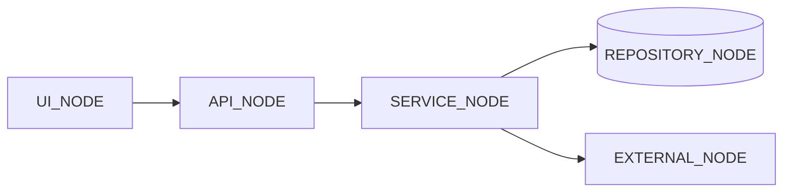
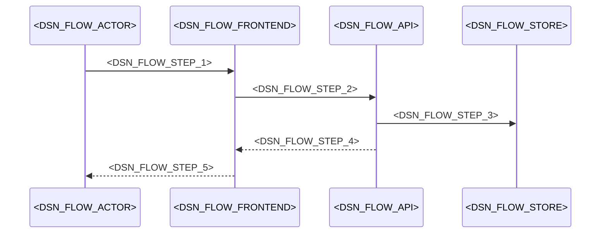
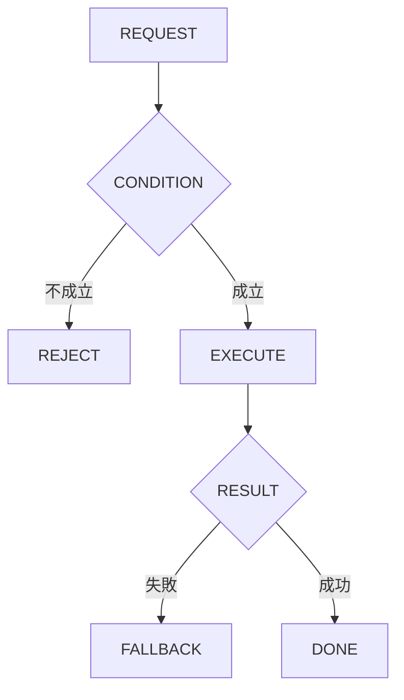

# 技術設計書

> このファイルは **「どう作るか」** を確定させる文書である。実装者ごとの解釈の食い違いを防ぎ、レビュー・実装・検証の共通の土台にする。\
> _分担_: 同一 feature の `requirements.md` が `status: approved` になるまで着手しない。本ファイルが `approved` になるまで `tasks.md` に進まない。`approved` は人間が付ける（エージェントは付けない）。

> _書き方_: 各節は結論から書き、検討の過程や調査ログは残さない。

## 概要（Overview）

> 実装者が最初に読む節。何を誰に提供し、既存の何が変わるかを示す。\
> _分担_: 要件そのものは `requirements.md`。ここには設計上の位置づけだけを書く。

> _書き方_: 設計用語を使わず、この設計書を初めて読む人に通じる言葉で書く。

- **目的（Purpose）**: <DSN_OVERVIEW_TARGET_USER> に <DSN_OVERVIEW_VALUE> を提供する。
- **利用者（Users）**: <DSN_OVERVIEW_USERS>
- **影響（Impact）**: 現在の <DSN_OVERVIEW_CURRENT_STATE> を <DSN_OVERVIEW_CHANGE> に変更する。

### 達成目標（Goals）
> このフィーチャーが成功したと言える状態を定める節。

> _書き方_: 1 項目 1 行。基準を明記して、達成したかどうかを後から判定できる書き方にする。

- <DSN_GOAL_N>

### やらないこと（Non-Goals）

> 達成目標に含めないことを先に宣言する節。`### 達成目標（Goals）` と対で読む。\
> _分担_: 実装として持たないものは `### このスペックが持たない責務（Out of Boundary）`。ここには目標の話だけを書く。

> _書き方_: 今回やらないだけのものと、今後もやらないものを書き分ける。

- <DSN_NONGOAL_N>

## 責務境界（Boundary Commitments）

> 実装物として**どのスペックが何を持つか**を確定させる節。タスク分解と後工程の検証もここを基準にする。\
> _分担_: 何を作り何を作らないかは `requirements.md` の `## スコープの境界（Boundary Context）`。ここには所有するデータとインターフェース、依存してよい相手を書く。

### このスペックが持つ責務（This Spec Owns）

> このスペックが持ち主になるものを宣言する節。

> _書き方_: 各項目 1 行。他のスペックとの間で担当が曖昧になりやすいものから先に書く。振る舞いをどのコンポーネントが担うかは `## コンポーネントとインターフェース（Components and Interfaces）` に書く。

- **所有するデータ**:
  - <DSN_OWNS_DATA_N>
- **定義するインターフェース**:
  - <DSN_OWNS_INTERFACE_N>

### このスペックが持たない責務（Out of Boundary）

> 関連はするが、このスペックが持ち主にならないものを宣言する節。「ついでに」で実装範囲が広がるのを防ぐ。\
> _分担_: ここには持ち主が他にあるものだけを書く。目標として掲げないものと、今回やらないと決めただけのものは `### やらないこと（Non-Goals）`。

> _書き方_: 他に任せるものは委譲先を必ず添える。委譲先が決まっていないものは `## 設計判断（Design Decisions）` で扱う。

- **他に任せる範囲と、その委譲先**:
  - <DSN_OUT_DELEGATED_N>
- **後のフェーズに回す作業**:
  - <DSN_OUT_DEFERRED_N>

### 依存してよい対象（Allowed Dependencies）

> このフィーチャーが前提にしてよい既存の仕組みを列挙する節。\
> _分担_: 要件として何に依存するかは `requirements.md` の `## 前提と依存（Dependencies / Assumptions）`。ここには実装が使ってよい範囲と守る制約を書く。

> _書き方_: 依存先は、システム名・コンポーネント名・共有基盤名など後から特定できる固有名で書く。制約には一方向性、循環の禁止、レイヤをまたぐ条件など、守るべき条件を書く。

- **依存先**:
  - <DSN_ALLOWED_DEP_N>
- **依存の制約**:
  - <DSN_DEP_CONSTRAINT_N>

### 再確認が必要になる変更（Revalidation Triggers）

> ここに挙げた変更が起きたら、依存するスペックや利用側に再確認を依頼する節。

> _書き方_: 1 項目 1 行（例: 契約の形（API・イベント・型の定義）の変更、データ所有権の移動、依存方向の変更、起動・実行時の前提条件の変更）。

- <DSN_REVALIDATION_TRIGGER_N>

## アーキテクチャ（Architecture）

> このフィーチャーをどの構成に載せるかを決める節。\
> _分担_: レイヤ構成と依存のルールは `steering/architecture.md` の `## レイヤーと依存ルール`、命名とコード規約は `steering/tech.md` の `## 命名規則` と `## コード規約`。ここにはこのフィーチャー固有の構成だけを書く。

### 既存アーキテクチャの分析（Existing Architecture Analysis）

> 既存システムに手を入れる場合に、守るべき前提を確認する節。

> _書き方_: 今回の変更で壊してはいけないものを挙げる。現状の評価や改善案は書かない。

- **現行のパターンと制約**: <DSN_EXISTING_PATTERN>
- **守るべきドメイン境界**: <DSN_EXISTING_BOUNDARY>
- **維持する統合ポイント**: <DSN_EXISTING_INTEGRATION>
- **解消 / 回避する技術的負債**: <DSN_EXISTING_DEBT>

### アーキテクチャ方式と境界図（Architecture Pattern & Boundary Map）

> 採用する構成とコンポーネント間の関係を、図と文で示す節。

> _書き方_: 図は例であり、大文字の名前はすべて実際のコンポーネント名に置き換えたり、ノードを追加したりして関係性を示すようにする。関係が複雑でない場合は図を省いて文だけでもよい。



- **選択したパターン**: <DSN_ARCH_PATTERN>
- **ドメイン / 機能の切り分け**: <DSN_ARCH_BOUNDARY>
- **既存パターンとの整合**: <DSN_ARCH_CONSISTENCY>
- **新規コンポーネントを置く理由**: <DSN_ARCH_NEW_COMPONENT_REASON>
- **steering との整合**: <DSN_ARCH_STEERING_ALIGNMENT>

### 技術スタック（Technology Stack）

> このフィーチャーで追加する、または例外的に採用する技術を書く節。\
> _分担_: プロジェクト共通のスタックは `steering/tech.md` の `## コアテクノロジ` と `## 主要ライブラリ`。ここには差分だけを書く。

> _書き方_: 1 行 1 技術。レイヤは Frontend / CLI、Backend / Service、Data / Storage、Messaging / Event、Infrastructure / Runtime などから選ぶ。

| レイヤ | 採用 / バージョン | このフィーチャーでの役割 | 備考 |
|---|---|---|---|
| <DSN_STACK_LAYER_N> | <DSN_STACK_CHOICE_N> | <DSN_STACK_ROLE_N> | <DSN_STACK_NOTE_N> |

## データモデル（Data Models）

> このフィーチャーで変更するデータ構造を確定させる節。\
> _分担_: システム全体の ER 図・全体スキーマは `docs/architecture/data-model.md` の `## ER 図` に従う。命名と型の共通ルールは `steering/database.md` の `## 命名規則` と `## 型の指針`。

> _書き方_: このフィーチャーで変更するエンティティだけを書く。物理データモデルを変えたら `docs/architecture/data-model.md` との整合を確認する。

### ドメインモデル（Domain Model）

> 業務上の概念とその関係を、保存形式に依らない形で書く節。

> _書き方_: 実装の都合ではなく、業務としてどう成り立っているかで書く。集約は、一緒に更新しないと辻褄が合わなくなるデータのまとまり。値オブジェクトは、金額や住所のように、値が同じなら同じものとして扱ってよいもの。ドメインイベントは、「注文が確定した」のように業務で起きた出来事のうち、他に知らせる必要があるものを指す。不変条件は、いつ見ても成り立っていなければならない決まりを指す。

- **集約とトランザクション境界**: <DSN_DOMAIN_AGGREGATE>
- **エンティティ / 値オブジェクト / ドメインイベント**: <DSN_DOMAIN_ENTITY>
- **ビジネスルール / 不変条件**: <DSN_DOMAIN_RULE>

### 論理データモデル（Logical Data Model）
> ドメインモデルをデータ構造として整理する節。

> _書き方_: 保存先の製品には依存させない。製品固有の話は物理データモデルに書く

- **エンティティ間の多重度（カーディナリティ）**: <DSN_LOGICAL_CARDINALITY>
- **属性と型**: <DSN_LOGICAL_ATTRIBUTE>
- **自然キー / 識別子**: <DSN_LOGICAL_KEY>
- **参照整合性のルール**: <DSN_LOGICAL_INTEGRITY>

### 物理データモデル（Physical Data Model）
> 論理データモデルを実際の保存形式に落とした定義を書く節。

> _書き方_: 種別は RDB / Document Store / Event Store / KV・Wide-column などから選ぶ。RDB ならテーブル定義・主キー・外部キー・インデックス・分割方針、Document Store ならコレクション構造・埋め込みと参照の使い分け・シャードキーを書く。

| 種別 | 記載 |
|---|---|
| <DSN_PHYSICAL_KIND_N> | <DSN_PHYSICAL_DEFINITION_N> |

### データ契約と外部連携（Data Contracts & Integration）

> 外部とやり取りするデータの形と、その互換性の方針を決める節。

> _書き方_: API はリクエスト / レスポンスの schema・検証・シリアライズ形式、イベントは schema・バージョニング・互換性、サービス間は分散トランザクション（Saga / 2PC など）と整合性の方針を書く。

- **API**: <DSN_CONTRACT_API>
- **イベント**: <DSN_CONTRACT_EVENT>
- **サービス間**: <DSN_CONTRACT_CROSS_SERVICE>

## コンポーネントとインターフェース（Components and Interfaces）

> 各コンポーネントの責務と、外部に公開する契約を確定させる節。契約は 5 種類ある。
>
> - **サービスインターフェース**: 他のコンポーネントから呼ばれる口
> - **API 契約**: 外部から HTTP で呼ばれる口
> - **イベント契約**: 非同期にやり取りするイベントの発行・購読
> - **バッチ / ジョブ契約**: 定期実行や一括処理
> - **状態管理**: 状態の持ち方と守り方
>
> _分担_: 物理配置は `## ファイル配置計画（File Structure Plan）`。全 API 共通の形式は `steering/api-standards.md` の `## リクエスト / レスポンス形式`、エラー表現は同ファイルの `## エラーハンドリング（API 契約）`。ここには論理的な責務と、このフィーチャー固有の契約を書く。

> _書き方_: まず一覧で全体像を示し、そのあと新しい境界を持つコンポーネントだけ詳細を書く。契約の種類は該当するものにチェックを入れ、同じ名前の小節だけを書く。実装上の注意やリスクは、判断に関わるものは `## 設計判断（Design Decisions）`、確認方法は `## テスト戦略（Testing Strategy）` に書く。
>
> - **ドメイン / レイヤの見出し**: ドメイン名で切るかレイヤ名で切るかはプロジェクトで決め、この節の中で揃える。複数あれば同じ形で繰り返す。`_N` は繰り返す印であり、配下のコンポーネントの `_N` と番号が対応するわけではない。
> - **サービスインターフェース**: メソッドごとに 1 行。型名は設計上の名前でよく、実装の型と一致していなくてよい。事前条件は呼ぶ側が満たしておくこと、事後条件は呼び出しが成功したときに保証されること、不変条件は処理の前後どちらでも常に成り立つことを書く。
> - **API 契約**: 1 行 1 エンドポイント。エラー列には返しうるステータスコードを列挙する。
> - **イベント契約**: 到達保証・順序保証は at-least-once / FIFO などの方式名で書く。
> - **バッチ / ジョブ契約**: 冪等性（同じ処理を何度実行しても結果が変わらない性質）をどう担保するかと、失敗時の復旧手順を書く。
> - **状態管理**: 状態が同時に更新されうる場合は、並行制御の方式まで書く。

### コンポーネント一覧（Summary）

> このフィーチャーのコンポーネントを 1 行ずつ並べ、詳細を書くものを選ぶための節。

> _書き方_: 各行は下の詳細と対応し、コンポーネント名・ドメイン / レイヤ・目的・受け入れ基準ID は同じ値を書く。依存には主なものだけ、契約にはチェックした種類名を書く。

| コンポーネント | ドメイン / レイヤ | 目的 | 受け入れ基準ID | 依存 | 契約 |
|---|---|---|---|---|---|
| <DSN_COMPONENT_NAME_N> | <DSN_DOMAIN_LAYER_N> | <DSN_COMPONENT_INTENT_N> | <DSN_COMPONENT_AC_ID_N> | <DSN_SUMMARY_DEPENDENCY_N> | <DSN_SUMMARY_CONTRACT_N> |

### <DSN_DOMAIN_LAYER_N>

#### <DSN_COMPONENT_NAME_N>

| 項目 | 内容 |
|---|---|
| 目的（Intent） | <DSN_COMPONENT_INTENT> |
| 受け入れ基準ID | <DSN_COMPONENT_AC_ID> |
| 担当 / レビュアー | <DSN_COMPONENT_OWNER> |

**責務と制約**:
- **主たる責務**: <DSN_COMPONENT_RESPONSIBILITY>
- **ドメイン境界 / トランザクションの範囲**: <DSN_COMPONENT_TRANSACTION>
- **データ所有権 / 不変条件**: <DSN_COMPONENT_INVARIANT>

**依存関係**:
- **呼び出し元（Inbound）**:
  - <DSN_INBOUND_N> — <DSN_INBOUND_PURPOSE_N>（重要度: <DSN_INBOUND_CRITICALITY_N>）
- **呼び出し先（Outbound）**:
  - <DSN_OUTBOUND_N> — <DSN_OUTBOUND_PURPOSE_N>（重要度: <DSN_OUTBOUND_CRITICALITY_N>）
- **外部（External）**:
  - <DSN_EXTERNAL_N> — <DSN_EXTERNAL_PURPOSE_N>（重要度: <DSN_EXTERNAL_CRITICALITY_N>）

**契約の種類**（チェックリスト）
- [ ] サービスインターフェース（Service Interface）
- [ ] API 契約（API Contract）
- [ ] イベント契約（Event Contract）
- [ ] バッチ / ジョブ契約（Batch / Job Contract）
- [ ] 状態管理（State Management）

##### サービスインターフェース（Service Interface）

| メソッド | 入力 | 出力 | エラー |
|---|---|---|---|
| <DSN_SVC_METHOD_N> | <DSN_SVC_INPUT_N> | <DSN_SVC_OUTPUT_N> | <DSN_SVC_ERROR_N> |

- **事前条件（Preconditions）**: <DSN_SVC_PRECONDITION>
- **事後条件（Postconditions）**: <DSN_SVC_POSTCONDITION>
- **不変条件（Invariants）**: <DSN_SVC_INVARIANT>

##### API 契約（API Contract）

| Method | Endpoint | Request | Response | Errors |
|---|---|---|---|---|
| <DSN_API_METHOD_N> | <DSN_API_ENDPOINT_N> | <DSN_API_REQUEST_N> | <DSN_API_RESPONSE_N> | <DSN_API_ERRORS_N> |

##### イベント契約（Event Contract）

- **発行するイベント（Published）**:
  - <DSN_EVENT_PUBLISHED_N> — <DSN_EVENT_PAYLOAD_N>
- **購読するイベント（Subscribed）**:
  - <DSN_EVENT_SUBSCRIBED_N>
- **到達保証 / 順序保証**: <DSN_EVENT_DELIVERY>

##### バッチ / ジョブ契約（Batch / Job Contract）

- **起動契機（Trigger）**: <DSN_BATCH_TRIGGER>
- **入力と検証**: <DSN_BATCH_INPUT>
- **出力先**: <DSN_BATCH_OUTPUT>
- **冪等性 / 復旧手順**: <DSN_BATCH_RECOVERY>

##### 状態管理（State Management）

- **状態モデル**: <DSN_STATE_MODEL>
- **永続化 / 一貫性**: <DSN_STATE_PERSISTENCE>
- **並行制御**: <DSN_STATE_CONCURRENCY>

## 処理フロー（System Flows）

> このフィーチャーの主要な処理の流れを図で示す節。\
> _分担_: システム全体の主要ビジネスフローは `docs/architecture/system-overview.md` の `## 主要ビジネスフロー`。エラーコードの出し分けが複雑な場合は `## 機能固有のエラー処理（Error Handling）` の `### エラー時の分岐フロー`。

> _書き方_: プレースホルダは実際のコンポーネント名に置き換える。分岐・リトライ・例外時の扱いは、図に描くか図の下に文で補う。


**フロー上の主要な判断**: <DSN_FLOW_KEY_DECISION>

## 機能固有のエラー処理（Error Handling）

> このフィーチャー固有のエラーコードと復旧の流れを決める節。\
> _分担_: API のエラー契約は `steering/api-standards.md` の `## エラーハンドリング（API 契約）`、例外処理の方針は `steering/tech.md` の `## 例外処理`、ログ・リトライ・監視は `steering/non-functional.md` の `## 信頼性・観測性`。

### バリデーション設計

> 入力を受け付けるかどうかの判定条件を決める節。\
> _分担_: 入力検証と出力エスケープの全体方針は `steering/security.md` の `## 入力検証 / 出力エスケープ`、API 共通のバリデーション形式は `steering/api-standards.md` の `### 複数フィールドのバリデーション`。

> _書き方_: 全体方針と重複しない、このフィーチャー固有の条件だけを書く。

| チェック対象 | 項目名 | 条件 / ルール | エラーコード | メッセージ例 | UI の対処 |
|---|---|---|---|---|---|
| <DSN_VALIDATION_TARGET_N> | <DSN_VALIDATION_FIELD_N> | <DSN_VALIDATION_RULE_N> | <DSN_VALIDATION_CODE_N> | <DSN_VALIDATION_MESSAGE_N> | <DSN_VALIDATION_UI_N> |

### 機能固有エラーコード

> このフィーチャーだけが返すエラーコードを一覧にする節。

> _書き方_: 例「`FEATURE_X_INVALID_STATE` / 409 / 状態遷移の不整合 / UI でステータスを取得し直す」「`FEATURE_X_DEPENDENCY_DOWN` / 503 / 外部依存が使えない / 自動リトライ後にフォールバック」。

| エラーコード | HTTP | 意味 | 対応 |
|---|---|---|---|
| <DSN_ERROR_CODE_N> | <DSN_ERROR_HTTP_N> | <DSN_ERROR_MEANING_N> | <DSN_ERROR_ACTION_N> |

### エラー時の分岐フロー

> `### 機能固有エラーコード` で定めたコードを、どの条件で返すかを図で示す節。分岐が多く、表だけでは追いにくい場合に書く。\
> _分担_: 処理の主要な流れは `## 処理フロー（System Flows）`。

> _書き方_: 図の中の大文字の名前は実際の処理名・エラーコードに置き換える。分岐のラベル（成立 / 不成立 / 成功 / 失敗）も判定内容に合わせて書き換える。



## ファイル配置計画（File Structure Plan）

> このフィーチャーで追加・変更するファイルを、どのディレクトリに置くかを示す節。\
> _分担_: ディレクトリ構成の規約は `steering/architecture.md` の `## ディレクトリ構成`、ファイルやディレクトリの命名規則は `steering/tech.md` の `## 命名規則`。論理的な責務は `## コンポーネントとインターフェース（Components and Interfaces）`。ここには規約に従って置く実際のファイルだけを書く。

> _書き方_: 繰り返し現れる構造はパターンを 1 度だけ書く。個別ファイルは責務が読み取りにくいときだけ挙げる。

```
src/
├── <DSN_DOMAIN_DIR>/
│   ├── controller.<DSN_SRC_EXT>          # HTTP / 入口
│   ├── service.<DSN_SRC_EXT>             # ビジネスロジック
│   ├── repository.<DSN_SRC_EXT>          # 永続化
│   └── types.<DSN_SRC_EXT>               # ドメイン型
└── shared/
    └── <DSN_SHARED_FILE>.<DSN_SRC_EXT>   # <DSN_SHARED_FILE_REASON>
```

### 変更する既存ファイル（Modified Files）

> 新規追加ではなく、既存ファイルに手を入れる箇所を挙げる節。

> _書き方_: 何をどう変えるか、なぜ変えるかを 1 行で書く。

- <DSN_MODIFIED_FILE_N> — <DSN_MODIFIED_REASON_N>

## 追加検討事項（Additional Considerations）

> 機能の振る舞いそのものではないが、実装前に決めておくことをまとめる節。配下の見出しのうち、このフィーチャーに関係するものを書く。\
> _分担_: 選択肢を比べて選んだ判断は `## 設計判断（Design Decisions）`。要件としての目標値は `requirements.md` の `## 非機能要件（Non-Functional Requirements）`。

### セキュリティ上の考慮（Security Considerations）

> 認証・機密データ・外部連携・権限を扱うフィーチャーで書く節。\
> _分担_: 横断的な防御は `steering/security.md` の `## 基本方針`、認証・認可の標準は同ファイルの `## 認証・認可`。要件としてのセキュリティ目標は `requirements.md` の `## 非機能要件（Non-Functional Requirements）`。ここには実現手段だけを書く。

> _書き方_: 想定する攻撃者と守る対象を先に決めてから、対策を書く。

- **脅威と対策**:
  - <DSN_SEC_THREAT_N>
- **認証・認可**: <DSN_SEC_AUTH>
- **データ保護 / プライバシー**: <DSN_SEC_PRIVACY>

### 性能とスケーラビリティ（Performance & Scalability）

> 性能・高負荷・拡張に懸念があるフィーチャーで書く節。\
> _分担_: 目標値は `requirements.md` の `## 非機能要件（Non-Functional Requirements）` を参照する。

> _書き方_: 数値は再定義せず、参照元を示す。

- **目標値の参照元と計測方法**: <DSN_PERF_TARGET_REF>
- **拡張の方針（水平 / 垂直）**: <DSN_PERF_SCALING>
- **キャッシュ / 最適化**: <DSN_PERF_CACHE>

### 移行方針（Migration Strategy）

> スキーマ移行やデータ移行が必要なフィーチャーで書く節。

> _書き方_: 各段階について、どこまで戻せるかを明記する。段階を図で示す場合は Mermaid のフローチャートを使う。

- **段階分け**:
  - <DSN_MIGRATION_PHASE_N>
- **ロールバックを実施する条件**: <DSN_MIGRATION_ROLLBACK>
- **検証チェックポイント**: <DSN_MIGRATION_CHECKPOINT>

#### 移行対象ファイル一覧

> 移行するファイル・テーブルを漏れなく数え上げる節。\
> _分担_: ファイルごとの詳細仕様は `## コンポーネントとインターフェース（Components and Interfaces）` のバッチ / ジョブ契約と `## データモデル（Data Models）`。

> _書き方_: 処理区分は 新規 / 更新 / 廃止。移行後の扱いは 削除 / アーカイブ / 引き継ぎ先 などを書く。

| ファイル / テーブル名 | 処理区分 | レコード数見込み | 移行方法 | 移行後の扱い |
|---|---|---|---|---|
| <DSN_MIGRATION_FILE_N> | <DSN_MIGRATION_KIND_N> | <DSN_MIGRATION_VOLUME_N> | <DSN_MIGRATION_METHOD_N> | <DSN_MIGRATION_AFTER_N> |

### テスト体制 / テスト仕様

> 総合テストや受け入れテストで独立した仕様書が必要な場合に書く節。通常は `## テスト戦略（Testing Strategy）` で足りる。

> _書き方_: 連絡先は非機密の情報だけを書く。

- **テスト責任者 / 承認者**: <DSN_TEST_OWNER>
- **テスト環境**: <DSN_TEST_ENVIRONMENT>
- **テスト期間**: <DSN_TEST_PERIOD>
- **問題発生時の連絡先**: <DSN_TEST_ESCALATION>
- **詳細仕様書**: <DSN_TEST_SPEC_LINK>

## テスト戦略（Testing Strategy）

> このフィーチャーで何をどの粒度で確認するかを決める節。\
> _分担_: 共通のテスト方針は `steering/tech.md` の `## テスト方針`。総合テストや受け入れテストで独立した仕様書が要る場合は `### テスト体制 / テスト仕様`。

> _書き方_: 各項目は外から確認できる期待結果とセットで書き、**受け入れ基準ID** と対応づける。受け入れ基準を確認できる分だけ書き、区分ごとに件数を揃えることは目的にしない。

- **単体（Unit）**:
  - <DSN_TEST_UNIT_N>
- **結合（Integration）**:
  - <DSN_TEST_INTEGRATION_N>
- **E2E / UI**:
  - <DSN_TEST_E2E_N>
- **性能 / 負荷（Performance / Load）**:
  - <DSN_TEST_PERFORMANCE_N>

## 設計判断（Design Decisions）

> このフィーチャーで下した技術判断を、結論とその理由で残す節。\
> _分担_: セキュリティ・性能・移行など、実装前に決めておく観点は `## 追加検討事項（Additional Considerations）`。比較表や調査資料そのものは `## 補足資料（Supporting References）`。ここには選択肢を比べて選んだことだけを書く。

> _書き方_: 1 つの判断につき 1 ブロック。判断 2 以降も同じ形で追加する。背景には「なぜ判断が必要になったか」を書く。判断は選んだ結論だけを言い切る。採用理由には、他の案ではなくこれを選んだ決め手だけを書く。代替案は実際に検討したものだけを不採用の理由とセットで挙げ、検討していない案は書かない。採用による影響には、引き受ける負担・残るリスク・後で見直す条件を書く。

### 判断 1: <DSN_DECISION_TITLE>

- **背景（Context）**: <DSN_DECISION_CONTEXT>
- **判断（Decision）**: <DSN_DECISION_RESULT>
- **採用理由（Rationale）**: <DSN_DECISION_RATIONALE>
- **代替案（Alternatives）**: <DSN_DECISION_ALTERNATIVE>
- **採用による影響（Consequences）**: <DSN_DECISION_CONSEQUENCE>

## 補足資料（Supporting References）

> 本文に置くと長くなる資料の置き場所を示す節。\
> _分担_: 調査の結論は `## 設計判断（Design Decisions）` に要約だけを書く。ここには資料のありかだけを書く。

> _書き方_: 資料には巨大な型定義、製品比較、全カラム表などを挙げる。内容にはその資料を見ると何が分かるかを書く。参照先には変わりにくいパスまたは URL を書き、確定していなければ未定と書く。

| 資料 | 内容 | 参照先 |
|---|---|---|
| <DSN_SUPPORTING_REF_NAME_N> | <DSN_SUPPORTING_REF_CONTENT_N> | <DSN_SUPPORTING_REF_LOCATION_N> |

---

_「どう作るか」を確定させる文書。_
