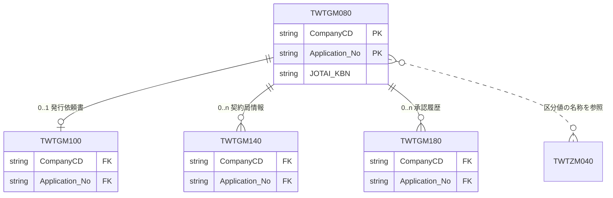

# データモデル全体図

> システム全体の ER 図とスキーマを管理する実態ドキュメント。\
> _分担_: フィーチャー固有のテーブル定義は `specs/<feature>/design.md` の `## データモデル（Data Models）`。命名規則・型の指針・マイグレーションなどの共通ルールは `steering/database.md` に従う。

> _範囲_: 本書は application-status-search（物件契約情報申請状況検索一覧 GWTG060）が読むテーブルの分だけを載せている（人の明示指示による範囲。他の feature のテーブル定義は本書に含めない）。application-status-search は表を作らず変えず、読むだけである。

> _書き方_: 本ファイルを更新したら、関係する `design.md` の `### 物理データモデル（Physical Data Model）` と食い違っていないか確認する。

## ER 図

> システム全体のエンティティと関連を 1 枚で示す節。

> _書き方_: エンティティ名・型・カラム名・関連名はすべて実際の名前に置き換える。主キーには `PK`、外部キーには `FK` を付ける。関連の記号は Mermaid の記法に従う。

> _本書での図の範囲_: application-status-search の design が結合・検索に使うと書いている列のうち、結合キーと状態の区分だけを描く。ほかの列と型は、各テーブルの持ち主の design の物理データモデルを正とする。型は `steering/database.md` の `## 型の指針` による（ID・番号と区分値は文字列）。持ち主の design が結合の相手を「会社コード＋申請No」と書いているため、`TWTGM100`・`TWTGM140`・`TWTGM180` の外部キーはその 2 列とする（`TWTGM140` の連番の列、`TWTGM180` の審査回の列（`Shinsa_Count`。application-status-search の design の記載）は、持ち主の design に従い本図では描かない）。図の `PK` は結合キーを示す記号であり、主キー制約の有無は各テーブルの持ち主の design に従う。コードマスタ `TWTZM040` は、区分値の名称を引くための参照であり、外部キーでは結び付けない（列は `steering/database.md` と持ち主の定義に従い本図では描かない）。

## 主要エンティティ一覧

> どのエンティティをどのスペックが持っているかを一覧にする節。

> _書き方_: 1 行 1 エンティティ。エンティティ名には業務で呼んでいる名前、テーブル名には実際の DB 上の名前を書く。概要には、そのエンティティが何を表すかを 1 行で書く。所有スペックには、そのエンティティを所有する `specs/<feature>/design.md` のパスを書く。

> _本書での扱い_: 表は application-status-search が読むテーブルと、行を登録する `ZMENUAUTH` を挙げる。application-status-search は、どのテーブルも所有しない（表の定義を持たず、実行時に書かない。行の登録は移行で行う）。概要には、application-status-search がそのテーブルをどう読むかだけを書く（持ち主の定義は複写しない）。

| エンティティ名 | テーブル名 | 概要 | 所有スペック |
|---|---|---|---|
| 物件申請情報 | `TWTGM080` | 申請。application-status-search の検索の主表で、`CompanyCD`＝ログインの会社コードで絞り、申請No ごとに 1 行を一覧に出す。`JOTAI_KBN` が '06'（取込中）の申請は、一覧でリンクにしない | `specs/property-basic-info/design.md` |
| 発行依頼書情報 | `TWTGM100` | 申請に 0..1 件ぶら下がる発行依頼書。起案会社・案件小グループ・初回支払日などの検索条件と一覧の列を、外部結合で読む | `specs/issue-request/design.md` |
| 契約局情報 | `TWTGM140` | 申請に 0..n 件ぶら下がる契約局の行。検索では全部の行と比べ、一覧の稟議バーコードNo は連番 1 の行を別に結合して出す | `specs/property-basic-info/design.md` |
| 承認履歴 | `TWTGM180` | 申請に 0..n 件ぶら下がる承認の履歴。検索では最新の審査回の日時と比べ、一覧の起案日（最新の審査回の審査権限 '01' の行）に使う。検索条件の進捗の日数（一覧・CSV には出さない）は審査回 1 の申請依頼の行で数える | `specs/property-basic-info/design.md` |
| メニュー権限 | `ZMENUAUTH` | 画面を使えるかを判定する既存の共通基盤の表。application-status-search は、メニュー「[WTG060]物件契約情報申請状況検索/一覧」の `PWTGO060` の行を登録するだけである（表の定義は持たない） | 既存 WiNG の共通基盤（`specs/` に所有する design は無い。`specs/application-status-search/design.md` は `PWTGO060` の行の登録だけを行う） |
| コードマスタ | `TWTZM040` | 区分値の名称・社外ユーザーの判定・休日・件数の設定を引く既存の共通マスタ。application-status-search は画面の 1 ページの件数の行（`WTZ/PARAM/P01`、キー3＝`PWTGO060`）を 1 行追加する。コード値は `docs/code-design.md` を参照 | 既存 WiNG の共通マスタ（`specs/` に所有する design は無い。`specs/application-status-search/design.md` は上記の 1 行を追加するだけ） |

## ドメイン境界（DB 観点）

> 業務上のまとまりごとに、どのテーブルが属するかを示す節。\
> _分担_: まとまりの名前は `docs/architecture/system-overview.md` の `## ドメイン境界の地図` と揃える。ここにはテーブルの帰属だけを書く。

> _書き方_: まとまりの単位は `docs/architecture/system-overview.md` の `## ドメイン境界の地図` に合わせる。1 まとまり 1 行で、属するテーブルを挙げる。

- **物件基本情報（property-basic-info）**: `TWTGM080`・`TWTGM140`・`TWTGM180`
- **発行依頼書（issue-request）**: `TWTGM100`
- **共通基盤（コードマスタ・メニュー権限）**: `TWTZM040`・`ZMENUAUTH`（メニュー権限）
- **契約情報取込（contract-info-import）**: 本書の範囲のテーブルは持たない（`TWTGM080.JOTAI_KBN` の取込中の印を付け・戻す側であり、その列は物件基本情報に属する）
- **申請状況検索一覧（application-status-search）**: 所有するテーブルは無い（読むだけ。`TWTZM040` に画面の 1 ページの件数の行を 1 行追加する）

---

_システム全体の ER 図とスキーマを管理する実態ドキュメント。_
