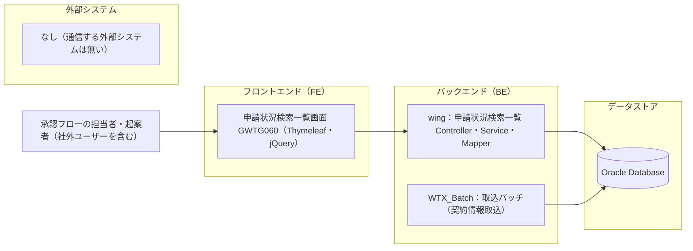
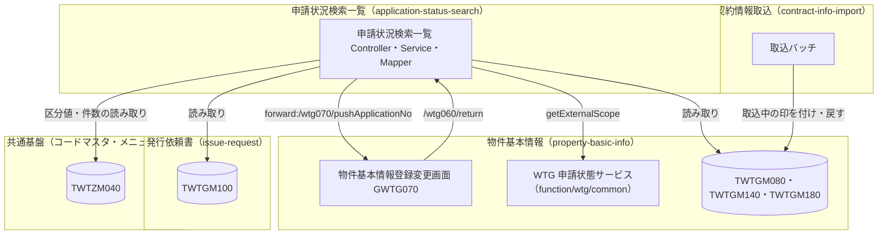
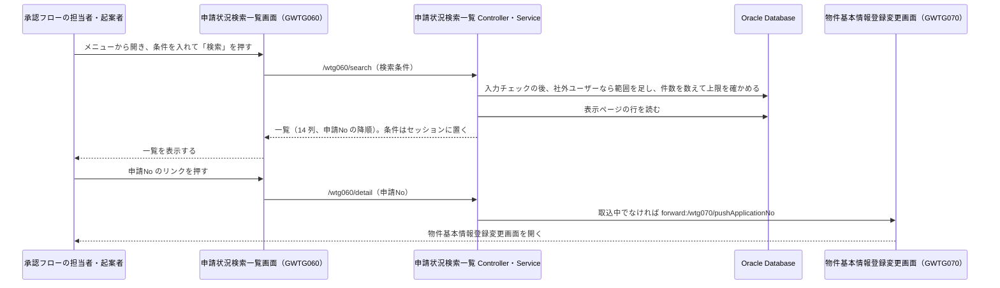

# システム全体像

> プロジェクトの進行とともに更新する実態ドキュメント。システム全体の構成と主要な流れを 1 箇所に集める。\
> _分担_: 図のルールは `steering/architecture.md` の `## 全体図のルール`。フィーチャー個別のシーケンス図・ステート図は `specs/<feature>/design.md` の `## 処理フロー（System Flows）`。

> _範囲_: 本書は application-status-search（物件契約情報申請状況検索一覧 GWTG060）の分だけを描いている（人の明示指示による範囲。他の feature の構成・フローは本書に含めない。他の feature は、application-status-search から見た接点としてだけ名前を挙げる）。

> _書き方_: 図は Mermaid で描き、画像を貼らない。達成実績の数値は書かない。

## 全体構成図

> 主要コンポーネントの接続を 1 枚で示す節。新しいフィーチャーの境界がこの図のどこに入るかを判断できる粒度に保つ。\
> _分担_: subgraph とノードは `steering/architecture.md` の `## 各システムコンポーネントの役割` と対応させる。製品名は `steering/tech.md` に従う。

> _書き方_: ノードの粒度は `steering/architecture.md` の `### 図の種別と粒度` に従う。図の中の大文字の名前はすべて実際の名前に置き換える。製品のバージョンは書かない。`#` 列には並び順の連番を、全体像の補足には図だけでは読み取れないこと（矢印や点線の意味、通信の向きなど）を書く。

| # | 全体像の補足 |
| --- | --- |
| 1 | 実線の矢印は呼び出しや読み書きの向きを表す。ブラウザと wing は HTTP のフォーム送信で、application-status-search の検索と CSV 出力は画面以外から呼ばれない（`steering/architecture.md` の `## アーキテクチャ概要`、`steering/api-standards.md`） |
| 2 | wing の Controller → Service → Mapper の向きで呼び、Mapper が Oracle の `TWTGM080`・`TWTGM100`・`TWTGM140`・`TWTGM180`・`TWTZM040` を読む。application-status-search はデータベースに書かない（`specs/application-status-search/design.md`） |
| 3 | WTX_Batch は application-status-search を呼ばない。同じデータベースを共有し、契約情報取込が申請の状態に取込中（`JOTAI_KBN`＝'06'）の印を付けている間、一覧は申請No をリンクにしない（`specs/application-status-search/design.md` の `### データ契約と外部連携（Data Contracts & Integration）`） |
| 4 | キャッシュ・メッセージングは使わない（`steering/tech.md` の `## コアテクノロジ`）。そのためデータストアにキャッシュは無く、外部システムは「なし」として図の枠だけ残している（`steering/architecture.md` の `### 外部 API / 外部システム`） |

## ドメイン境界の地図

> 業務上のまとまりが複数あるときに、責務の重なりを早く見つけるための節。\
> _分担_: まとまりの名前と境界は `steering/architecture.md` の `## 配置原則` と整合させる。テーブルの帰属は `docs/architecture/data-model.md` の `## ドメイン境界（DB 観点）`。

> _書き方_: まとまりの単位はプロジェクトの設計に合わせる。DDD（ドメイン駆動設計）を採用しているなら境界づけられたコンテキストを単位にする。図の中の大文字の名前はすべて実際の名前に置き換える。`#` 列には並び順の連番を、境界に関する補足には、まとまりをまたぐやりとりで注意することを書く。

> _本書での単位_: `steering/architecture.md` の `## 配置原則` の機能ID の単位（feature）でまとめる。application-status-search 以外のまとまりは、application-status-search との接点（呼ぶ口・読む表）だけを描く。

| # | 境界に関する補足 |
| --- | --- |
| 1 | 申請状況検索一覧は、他のまとまりのテーブルを読むだけで書かない。他の機能パッケージの Service・Mapper は呼ばず（ただし WTG 申請状態サービスは `function/wtg/common` にある公開契約であり、呼んでよい）、物件基本情報登録変更画面へは `forward:` で移る（`steering/architecture.md` の `## レイヤーと依存ルール`） |
| 2 | 物件基本情報登録変更画面からの戻り先は `/wtg060/return`（`/wtg060` は検索条件のセッションを消す初期表示のため）。物件基本情報登録変更画面側の戻り先の記述が `/wtg060` のままになっている点は、application-status-search の design が上流持ち越し（upstream-carryover）として記録している（`specs/application-status-search/design.md` の `### データ契約と外部連携（Data Contracts & Integration）`） |
| 3 | 社外ユーザーの範囲は、物件基本情報の WTG 申請状態サービス（`getExternalScope`）の判定をログインユーザーから毎回作って使う。遷移先でも同じ判定で範囲外を拒否する |
| 4 | 契約情報取込の実行画面（`/wtg090/execute`）の後も `/wtg060/return` で受け、セッションの条件で前に見ていたページを再検索する（未検索なら初期表示） |
| 5 | 申請を削除した後（`/wtg070/deleteShinse`）も `/wtg060/return` で受け、セッションの条件で再検索する（削除した申請は一覧から消える。未検索なら初期表示）。物件基本情報登録変更画面（pbi design）側の受け先 URL の記述は上流持ち越しである（`specs/application-status-search/design.md` の `### データ契約と外部連携（Data Contracts & Integration）`） |

## 外部サービス連携の俯瞰

> 外部サービスとの連携をまとめて見渡す節。連携先ごとに失敗時の方針が違う場合に効く。\
> _分担_: 失敗時の数値やリトライは `steering/non-functional.md` の `### リトライ`、認証は `steering/security.md` の `## 認証・認可` と整合させる。

> _書き方_: 連携先にはサービス名を、用途にはそれを何のために使うかを書く。同期 / 非同期には呼び出し方を書く。失敗時の方針は方針名だけを書き、数値は書かない。

> _本書での扱い_: application-status-search が通信する外部システムは無い（`steering/architecture.md` の `### 外部 API / 外部システム`。進捗管理DB へは CSV ファイルを渡すだけでシステム間の通信はしない — 回答 Q-STR-109。application-status-search の design でも外部システムとは通信しない）。

| 連携先 | 用途 | 同期 / 非同期 | 失敗時の方針 |
| --- | --- | --- | --- |
| <SYSFLOW_INTEGRATION_NAME_N>（不要：通信する外部システムが無いため — `steering/architecture.md` の `### 外部 API / 外部システム`、回答 Q-STR-109） | <SYSFLOW_INTEGRATION_PURPOSE_N>（不要：同上） | <SYSFLOW_INTEGRATION_SYNC_MODE_N>（不要：同上） | <SYSFLOW_INTEGRATION_FAILURE_POLICY_N>（不要：同上） |

## 主要ビジネスフロー

> 代表的な利用の流れを sequenceDiagram で示す節。\
> _分担_: どのフローを載せるかは `steering/product.md` の `## 主要ユースケース` に従う。フィーチャー個別の流れは `specs/<feature>/design.md` の `## 処理フロー（System Flows）`。認証を含むフローは `steering/security.md` の `## 認証・認可` と整合させる。失敗時の詳細は `steering/non-functional.md` の `## 運用・障害対応`。

> _書き方_: 見出しには利用者から見た流れの名前を書き、`steering/product.md` の `## 主要ユースケース` と同じ名前にする。\
> 図と、その下の説明をひと組にする。ここには流れの概要だけを書き、詳細は参照先に委ねる。\
> participant は登場する範囲に合わせて増減させ、別名とメッセージは実際の名前に置き換える。左端の 1 文字の識別子（`U` `W` `A` など）は図の中だけの記号なので変えなくてよい。

> _本書での扱い_: `steering/product.md` の `## 主要ユースケース` のうち 5 番（申請状況の検索と一覧）だけを載せる。`steering/product.md` では番号付きの文でユースケースを挙げていて短い名前が無いため、見出しはその文の骨子（「物件契約情報の申請状況を検索し、結果を一覧で確認する」）とする。

### 物件契約情報の申請状況を検索し、結果を一覧で確認する

**説明**:

- **目的**: 承認フローの担当者と起案者が、自分の関わる申請を条件で探し、一覧から物件基本情報登録変更画面を開く。必要なときは、検索結果を CSV（`/wtg060/csv`）に出力する（`specs/application-status-search/requirements.md` の要件 1〜3）
- **対象ドメイン**: 申請状況検索一覧（application-status-search）。物件基本情報（property-basic-info）の画面へ遷移する
- **前提**: 利用者がログインしていて、メニュー「[WTG060]物件契約情報申請状況検索/一覧」を使える権限（`ZMENUAUTH`）がある。認証・権限の判定は wing のインターセプタが行う（`steering/security.md` の `## 認証・認可`）
- **失敗時の概要**: 入力チェックの誤りは同じ画面にメッセージを出し、検索も CSV もしない。検索結果が上限件数を超えるときは `DS-100024` を出す（CSV は見出し行だけの出力）。警告件数を超えるときは `DS-100025` の確認を出す。リンクを押した時点で申請が取込中なら `WTG-100018` を出して今のページを再検索する。詳細は `specs/application-status-search/design.md` の `## 機能固有のエラー処理（Error Handling）`

## 運用ツール・参照リンク集

> 監視ダッシュボード・課題管理・工程表などの参照先を集める節。URL の一覧はここに集約する。\
> _分担_: 運用の方針・骨格は `steering/non-functional.md` の `## 運用・障害対応`。

> _書き方_: ツールには製品名やサービス名を書く。用途には、何を見るために使うかを書く。参照先には URL を書き、社内限定など到達に条件があるものはその旨を添える。

> _本書での扱い_: 保守運用は既存 WiNG の運用に従い、本プロジェクトでは監視基盤・ダッシュボードなどを新たに定めない（`steering/non-functional.md`。回答 6）。application-status-search 固有の監視項目も無い（`specs/application-status-search/design.md`）。ソース管理は Backlog の Git（`steering/tech.md` の `### Git 戦略`）だが、参照先の URL は入力に無いため書かない。

| ツール | 用途 | 参照先（URL / 未定） |
| --- | --- | --- |
| <SYSFLOW_TOOL_NAME_N>（不要：保守運用は既存 WiNG の運用に従い、本プロジェクトでは定めない — `steering/non-functional.md`、回答 6） | <SYSFLOW_TOOL_PURPOSE_N>（不要：同上） | <SYSFLOW_TOOL_REFERENCE_N>（不要：同上） |

---

_システム全体の構成と主要な流れを管理する実態ドキュメント。_
