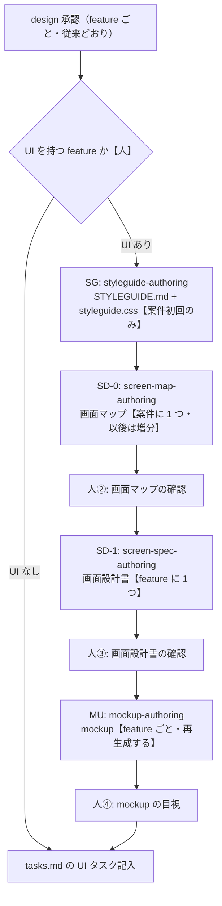

# 画面設計工程（簡素版）— 使い方ガイド（人間向け）

> 状態: ドラフト（2026-09-15 起草）。
> **本書は「人が読んで工程を理解し、実際に手を動かす」ための説明資料。** **実行規約の正は本ワークスペース同梱の
> 各 `SKILL.md`（自己完結）**、**実務手順の正は同梱の `README.md`** である。**本書はそれらを言い換えず、
> 要点とポインタでまとめる。** 新しく足すのは「正の優先順位」「人間判断のコツ」「下流工程（tasks.md 工程・
> 実装工程）との接続点」「注意事項」で、ここは他文書に無い内容である。**本書と同梱の `README.md`・5 つの
> `SKILL.md` だけで工程は完結する**（外部の文書を参照しない）。

## 0. 読み方

| 知りたいこと | 見る場所 |
|---|---|
| 実際に何をどう作るか（各 skill の詳細手順・自己完結） | 本ワークスペース同梱の `.claude/skills/<skill 名>/SKILL.md` |
| セットアップ・呼び方・書式・書き込み範囲の機械担保・構成 | 本ワークスペース同梱の `README.md`（「初回セットアップ」「書かないもの」「構成」） |
| 工程の位置づけ・成果物の正の優先順位 | **本書 §1**（全体の流れ・SKILL の役割・正の優先順位） |
| **本書** | 全体像をつかむための案内・SKILL の要点整理・正の優先順位・人間判断のコツ・下流工程（tasks.md 工程・実装工程）との接続点・注意事項 |

---

## 1. 全体の流れと 4 つの SKILL

design 承認（`design.md` が `status: approved`）の後・`tasks.md` 着手の前に、**UI を持つ feature だけ**で
次の順に回す。承認ゲートは増やさない・動かさない。



### SKILL の役割（要点だけ。詳細は各 `SKILL.md`）

| SKILL（呼び名） | 何を作るか | 生成単位 | 一言で | 詳細 |
|---|---|---|---|---|
| `styleguide-authoring`（**SG**） | `STYLEGUIDE.md` / `styleguide.css` / `STYLEGUIDE-backlog.md` | **案件に 1 回**（初回のみ） | 見た目の正 1 枚（**スタイルガイド**）を用意する | → §2（本書）/ `.claude/skills/styleguide-authoring/SKILL.md` |
| `screen-map-authoring`（**SD-0**） | `screen-map.md` | **案件に 1 つ**（以後は増分） | 画面の切り出し・所有・feature 間遷移・入口とナビを決める（**画面マップ**） | `.claude/skills/screen-map-authoring/SKILL.md` |
| `screen-spec-authoring`（**SD-1**） | `screen-spec.md` | **feature ごと** | 画面の構成・項目・操作・状態・文言を決める（**画面設計書**） | `.claude/skills/screen-spec-authoring/SKILL.md` |
| `mockup-authoring`（**MU**） | 状態別 HTML + `mockup-manifest.json` | **feature ごと**（入力が変われば再生成） | 三者（画面設計書・画面マップ・STYLEGUIDE.md）を具体形に描く（**モックアップ**） | `.claude/skills/mockup-authoring/SKILL.md` |
| `aidd-system-design`（**入口**） | 上 4 つの実行順の判定と、`.aidd/screen-design/README.md` の更新 | — | 「次の 1 手」を成果物側の状態だけから判定して回す（**進行案内**） | `.claude/skills/aidd-system-design/SKILL.md` |

**呼び方は 2 通り**（詳細は同梱の `README.md`「使い方 A / B」）:

- **一連 `/aidd-system-design`**（推奨）: 進行状態を機械判定し、次の 1 手を実行して人の確定点で止まる。確定したら
  もう一度呼べば続きから進む。**普段はこれだけ呼べばよい**
- **単独**: 4 つの skill を直接呼ぶ。各 skill が前提を満たさないときは生成せず停止する

### 人が止まる 5 点（+ 前提不足の 4 停止）

**mockup は「描画」であって独立の正を持たない**ため、人が確定するのは実質 4 つの文書と 1 つの判断である。

| # | 何を確認するか | 記入する場所 |
|---|---|---|
| 人① | STYLEGUIDE.md の確定（案件の既存画面キャプチャと突合） | `STYLEGUIDE.md` §1-2 改訂履歴の当該行 `確定` |
| 人② | 画面マップの差分確認 | `screen-map.md` の `features[]` 行ごとの `confirmed` |
| 人③ | 画面設計書の確認 | `screen-spec.md` frontmatter `status: confirmed` |
| 人④ | mockup の目視 | `mockup-manifest.json` の `viewed` |
| 人⑤ | 画面設計書の鮮度の確認（design.md が後から変わった場合） | 改訂するか据え置くかを判断 |

正の一覧・停止時に何が提示されるかは `.claude/skills/aidd-system-design/SKILL.md`「停止点」節が正。

### 正の優先順位（固定・4 段階）

**成果物どうしが食い違ったときは、上位に合わせて下位を直す。** この順序は工程を通じて固定で、増やさない。

| 順 | 何の正か | 担う文書 |
|---|---|---|
| ① | 挙動・要件 | `requirements.md` / `design.md`（**上流。本工程は書き換えない**） |
| ② | 画面の切り出し・所有・feature 間遷移・入口とナビ | 画面マップ `screen-map.md` |
| ③ | 画面の構成・項目・操作・状態・文言 | 画面設計書 `screen-spec.md` |
| ④ | 見た目（色・間隔・部品の様式） | `STYLEGUIDE.md` / `styleguide.css` |

**mockup はこの表に入らない** — ②③④ から生成した描画であって、独立の正を持たない。直したいところは
mockup ではなく**入力を直して再生成する**。

### 意図通りにならないとき・手戻りで戻るときの進め方

- **停止点の確認で指摘事項が出たとき**: その場で文書を直接書き換えず、まず**同じスレッドで AI と対話して
  方針を決めてから**、必要な文書を改訂する。改訂の起点は SKILL ごとに決まっている（例:
  STYLEGUIDE.md は本書 §2「改訂の起点」①〜④、画面設計書は §5-5 の画面マップへの改訂依頼・人⑤の鮮度確認）。
  **AI が改訂の起点を特定できないときは、直さずに現状を報告して停止する**（判断は人が行う）
- **手戻り（前の工程まで戻る必要が出たとき）は、基本 AI（`/aidd-system-design`）が判定して提案する。**
  人が依存関係を追って戻り先を探す必要はない。例: 画面設計書 §5-5 に区分「改訂を要する」が残る →
  画面マップの改訂・差分確認に戻ってから、影響する feature の画面設計書を直す。STYLEGUIDE.md の版が
  上がる／画面マップ §4（入口・シェル）が変わる → 影響する mockup を作り直す。design.md が承認後に
  変わる → 人⑤で鮮度を確認してから続きを判断する。**`/aidd-system-design` をもう一度呼べば、次にすべきことが
  成果物側の状態だけから自動判定される**（単独で skill を呼ぶ場合も、前提を満たさなければ生成せず停止する
  ので、戻り先を間違えて先へ進むことはない）

---

## 2. STYLEGUIDE.md をどう用意するか — 3 ルートの選び方

**案件に 1 枚だけ、初回に 1 回作る。** 迷ったら次の順で選ぶ（正は
`.claude/skills/styleguide-authoring/SKILL.md`「入力」節）。

| 状況 | 選ぶルート | やること |
|---|---|---|
| **同系システムの案件**（例: WiNG 系）で `.claude/skills/styleguide-authoring/presets/<name>/` が既にある | **ルート C（プリセットの取り込み）** — 実務上はこれが「デフォ」に近い | 3 点（`STYLEGUIDE.md` / `styleguide.css` / `STYLEGUIDE-backlog.md`）を案件ルート直下に複製し、`product` を案件名に直す。**版はプリセットの版を継続する**（`0.1.0` に戻さない） |
| **既存システムの改修・新画面**で、代表画面のキャプチャ（5 画面程度）が用意できる | **ルート A（既存 UI からの抽出）**〔※1〕 — skill の既定 | キャプチャ + あればコードからトークンと部品の様式を抽出する |
| **新規案件で既存 UI が無い** | **ルート B（ブランドヒアリング）**〔※1〕 | コーポレートカラー・ロゴ・文言トーンの回答から起こす。**§4 部品の様式・§5 レイアウトは skill が決めない**（選択肢と推奨案が提示されるので人が選ぶ） |
| **`STYLEGUIDE.md` が既にあり、直したい** | ルート選択ではなく **改訂モード**〔※1〕 | 初回として実行しない（実行すると確定が消える）。改訂の起点は次の 4 つに限る（②③は台帳 `STYLEGUIDE-backlog.md` に集約される） |

> **〔※1〕① 一旦やってみてうまくいかないとき／② 精度の高い見た目に仕上げたいとき**（改訂モードも同じ）は、
> **デザイン担当者へご相談ください。** **ルート B は他より難易度が高い**（既存 UI もヒアリングの外側の
> 拠り所も無く、決まらない範囲が §4 / §5 のほぼ全体に及ぶ）ため、早めのご相談をお勧めします。

**改訂の起点（増やさない）**: ① mockup の目視・顧客提示で出た見た目の指摘 ② 画面設計書の確認で出た部品の語彙の不足
③ 実装からの申告 ④ 配布物（この skill 一式）の版が上がった。

**いずれのルートも確定は人が行う**（キャプチャとの突合。ルート C で案件の既存画面が無ければプリセットの抽出元と突合）。
**確定なしに画面マップ（SD-0）へは進めない。**

---

## 3. feature ごとにスレッドを分ける対応

**SD-1（画面設計書）・MU（mockup）の 2 feature 目以降は、同じスレッドで続けて回さない。**

**このタイミングは人が自分で覚えておく必要はない。** 停止点に達すると `/aidd-system-design` の入口 skill が
「新しいスレッドで呼んでください」とその場で案内して停止する（**停止 D**。下記「いつ」参照）。
本書の説明は背景と対応の確認用であり、実際の切り替え指示はエージェント側からも出る。

- **なぜ**: 1 feature 分を起草した文脈のまま次の feature を続けると、隣接 feature の操作・UI を誤って
  足す「越境」が増える（**配布元の検証での実測値**: 越境は禁止文言の明示で 3 件 → 0 件。
  11 feature を独立生成して後から結合した検証では、後付け結合で本文修正が 6 件出た）
- **いつ**: 1 feature 分が停止点（人③ または 人④）に達したとき。`/aidd-system-design` の入口 skill が
  「新しいスレッドで呼んでください」と案内して停止する（**停止 D**）
- **どうする**: 案内どおり**新しいスレッドを開き**、`/aidd-system-design`（引数無しなら `project.local.json` から
  自動解決、または `/aidd-system-design <案件ルート> <feature>` で明示）を呼ぶ。状態は成果物側にあるので、
  スレッドを分けても進行状態は失われない
- **画面マップ・`STYLEGUIDE-backlog.md` のような案件で共有する成果物への書き込みも 1 スレッドずつ**にする
  （同時に書くと行が失われる）

複数案件を並行して回す場合も同じ理屈で、**案件ごとに別スレッド**にする（`project.local.json` と
`additionalDirectories` を同時に書き換えるため、同時に触ると競合する）。

---

## 4. 動かし方（コマンド）

### 4-1. 初回セットアップ（最初の 1 回だけ）

**手順 2〜5 はコマンドを打つ必要はない。** 開いている Claude Code / Cursor に**文章でそのまま頼む**。
手順 3 で `.claude/settings.local.json` を**新規作成**し、この先の追加設定（手順 4 で必要になった場合）は
**同じ 1 つのファイルに追記していく**（別ファイルは作らない）。

1. 本ワークスペースを clone し、**Claude Code または Cursor で開く**（Cursor は `.claude/skills/` を互換読み込みするため、
   skill 一覧・呼び出しは追加改修なしで使える。手順 3〜4 の機械担保は Claude Code 専用形式で Cursor には効かない）
2. 案件ルートの絶対パス（`/` 区切り。例 `C:/Work/my-project`）を用意し、頼む:
   > `project.example.json` を `project.local.json` としてコピーし、`project_root` を `C:/Work/my-project` に書き換えて
3. 同じパスを使い、頼む:
   > `.claude/settings.local.json` を新しく作って、次の内容にして:
   > `{ "permissions": { "additionalDirectories": ["C:/Work/my-project"] } }`
4. **書き込み禁止の初回確認を 1 度だけ行う**（案件の `specs/` 配下に 1 行足すよう頼んで、拒否されることを確かめる。
   書き込み禁止は `deny` と PreToolUse hook の二重で、どちらが発火しても正常）。拒否メッセージが一度も出ない
   場合だけ異常で、そのときは手順 3 で作った同じファイルに `deny` を追記するよう頼む（新しいファイルは作らない）
5. **（任意）配布物自身の凍結** — 本ワークスペースで**案件を回すだけ**（skill を直さない）なら、手順 3 で作った
   同じファイルに `deny` を 4 行足して `.claude/skills/` を凍結できる（頼み方は同梱 `README.md` 手順 5）

手順の詳細・うまく拒否されない場合の対処は同梱の `README.md`「初回セットアップ」が正。

### 4-2. 使い方 A（一連・普段はこれだけ）

```
/aidd-system-design
/aidd-system-design <案件ルート> <feature>   ← project.local.json より優先。1 回だけ別案件を触るとき
```

呼ぶたびに次の 1 手が実行され、人の確定点で止まる。確定したらもう一度呼ぶ。

### 4-3. 使い方 B（単独・4 skill を直接呼ぶ）

```
/styleguide-authoring
/screen-map-authoring
/screen-spec-authoring
/mockup-authoring
```

前提（例: 画面マップの自 feature 行が `confirmed` になっているか）を満たさないときは、生成せず停止する。
各前提の正は各 `SKILL.md` の「単独起動時の前提」節。

### 4-4. 複数案件の切り替え

`project.local.json` の `project_root` と `.claude/settings.local.json` の `additionalDirectories` を
**同時に**書き換える。案件ごとに別スレッドで作業する。

### 4-5. 機械検査（通常は MU が自動実行する。手で確かめたいときだけ）

```
node <本ワークスペース>/.claude/skills/mockup-authoring/scripts/check-palette.mjs <案件ルート> .aidd/screen-design/<feature>/pages
node <本ワークスペース>/.claude/skills/mockup-authoring/scripts/check-links.mjs <案件ルート>/.aidd/screen-design --entry <入口ページ>
```

---

## 5. ディレクトリ構成

### 本ワークスペース側（触るのは `project.local.json` と `.claude/settings.local.json` だけ）

```
<本ワークスペース>/
├── README.md                     … 使い方の正
├── HOW-TO-USE.md                 … 本書
├── project.local.json            … 案件ルートの宣言（git 管理外・自分で作る）
├── .claude/settings.local.json   … additionalDirectories（git 管理外・自分で作る）
├── .claude/hooks/                … deny のバックストップ（PreToolUse hook）
└── .claude/skills/
    ├── aidd-system-design/       … 入口 skill
    ├── styleguide-authoring/     … SG（templates/ + presets/<name>/）
    ├── screen-map-authoring/     … SD-0（templates/）
    ├── screen-spec-authoring/    … SD-1（templates/）
    └── mockup-authoring/         … MU（templates/ + scripts/）
```

### 案件側（本工程が書くのはここだけ）

```
<案件ルート>/
├── STYLEGUIDE.md / styleguide.css / STYLEGUIDE-backlog.md   … 見た目の正 3 点（ルート直下）
├── steering/  specs/<feature>/…                              … 読み取り専用（本工程は書かない）
└── .aidd/screen-design/
    ├── README.md              … 成果物の所在・状態・tasks.md からの参照先の案内（入口 skill が書く）
    ├── _app-shell/             … 画面マップ + 入口・シェルの画面設計書と mockup
    ├── <feature>/              … screen-spec.md / pages/（HTML + mockup-manifest.json + README.md）
    └── _tools/                 … mockup 生成器の既定の置き場
```

**実際にどんなファイルが何本できるか**は、案件を 1 つ回して `.aidd/screen-design/<feature>/pages/README.md`
を見ると分かる。この `pages/README.md` が「人が mockup を見るときの観点」を持つ実物である。

---

## 6. 人間判断のコツ — どこを見れば効率的か

**見た目の良し悪しはどの停止点でも見ない**（それは目視〔人④〕の役割）。以下は「数え上げの確認」で
実際に見落としが出やすかった観点。

### 画面マップの確認（人②）で見るべき 2 点

- **AC（受け入れ基準）要求が画面側にちゃんと上がってきているか**:
  画面マップの確認は「画面側から見る」のではなく **AC 側から数え上げる**のが正しいやり方
  （`screen-map-authoring` の SKILL.md 確認【人】#1）。対象 feature の全 AC を列挙し、
  どの画面にも紐づかない AC が残っていないかを見る。紐づかない AC は「画面を伴わない AC」として
  §6-2 に記録されているはずで、**黙って落ちているものが無いか**がここでの実質的なチェックになる
- **画面遷移図が正しく出力できているか**: `screen-map.md` §3 の mermaid 図（feature 間遷移）を見て、
  遷移元・遷移先が画面一覧に実在するか、4 類型（入口からの分岐 / 参照の往復 / 終端画面から次工程 1 つまで /
  全画面からの遷移）のどれかに整理されているかを確かめる（同 SKILL.md 確認【人】#3）

### 画面設計書の確認（人③）で見るべき 2 点

- **矛盾が出たら requirements / design.md 側を優先して画面設計書を合わせる**:
  正の優先順位は「① 挙動・要件（requirements.md / design.md）② 画面の切り出し・所有・遷移（画面マップ）
  ③ 構成・項目・状態・文言（画面設計書）④ 見た目（STYLEGUIDE.md）」で固定されている
  （**本書 §1「正の優先順位」**）。画面設計書の記述が要件や設計と食い違っていたら、
  **画面設計書側を直す**のが既定の直し方で、要件側を画面設計書に合わせて変更管理に回すのは逆順になる
- **各 feature の `pages/README.md` に挙がってくる「見るときの観点」**:
  mockup の目視（人④）は総花的に全ページを見るのではなく、`<feature>/pages/README.md` の
  「見るときの観点」節（A: 読み込み切れ・崩れ・シェルとナビの一致の固定 3 点 + B: その回の `missing[]` /
  `notes[]` から導いた可変分）と、そこに指名されている代表ページだけをまず見ればよい。
  **B は生成側の申告に基づくので、B に無い箇所の欠陥は目視でしか拾えない**ことは意識しておく

---

## 7. 下流工程（tasks.md 工程・実装工程）との接続点 — 工程を検討する人向け

**前提**: 画面設計工程（簡素版）は AIDD 本フロー（`/aidd-*` の各コマンド）に載らない独立の側流であり、**tasks.md 工程（AIDD フロー側）も
実装工程も、この工程の存在を知らない。** したがって、本工程の成果物を UI タスクの参照先・実装の入力にするなら、
その接続は**下流側の規約として別途明示的に設計する必要がある**（本工程からは何も自動連携しない）。
以下は、その規約を設計するときに押さえるべき接続点。実際に `tasks.md` を書く担当者・実装担当者への
申し送り事項にもそのままなる。

### 7-1. 入口と「正」の担体（tasks.md 工程・実装工程に共通）

- **接続の入口は `.aidd/screen-design/README.md` 1 本でよい。ただし「案内であって正ではない」。**
  入口 skill が停止のたびに書き直す案内で、成果物の所在・それぞれの状態・参照の仕方を持つ。**下流工程は
  まずこの 1 ファイルで何が確定済みかを確認し、値が食い違ったら担体側を正とする**（前提ゲートの判定は
  担体の値で行う）。担体は次の 4 つ:

  | 何の状態 | 担体（正） |
  |---|---|
  | スタイルガイドの確定 | `STYLEGUIDE.md` §1-2 改訂履歴の最新行の `確定` |
  | 画面の切り出しの確認 | `_app-shell/screen-map.md` frontmatter `features[]` の**行ごとの** `confirmed` |
  | 画面設計書の確認 | `<feature>/screen-spec.md` frontmatter `status` |
  | mockup の検査と目視 | `<feature>/pages/mockup-manifest.json` の `checks` / `viewed` |

- **機械可読なマニフェストは既に置いてある** — `<feature>/pages/mockup-manifest.json`。wireframe 工程の
  `.aidd/wireframe/<feature>/pages/wireframe-manifest.json` と**同じ粒度・同じ位置**にある。
  **案件単位のマニフェストは新設しない**（状態の正は上表の 4 担体にあり、5 つ目のコピーを置くと古い値が残る）。
  下流が機械で読む必要に当たったときも、**担体から生成する派生物として置き、手で書かない**
- **`README.md` を作るのは入口 skill だけ。** 使い方 B（4 つの skill を単独で呼ぶ）だけで回した案件には
  README.md が無い。**接続を前提にするなら、最後に一度 `/aidd-system-design` を呼んで README.md を作る**
  （状態は成果物側にあるので、後から呼んでも最新の内容が書かれる）

### 7-2. tasks.md 工程との接続点

**UI タスクを起こすときに開くもの**（この順に見る）:

| # | ファイル・節 | 何のために |
|---|---|---|
| 1 | `.aidd/screen-design/README.md` | 前提ゲート。確定済みでないものはタスク化しない |
| 2 | `<feature>/screen-spec.md` §1 画面一覧・接続 | **タスクの単位**（画面 ID・画面名・画面の型）。`<other>:S-xx` の**参照行は所有 feature 側のタスク**なので起こさない |
| 3 | 同 §4 要件被覆 | 受け入れ基準 → 画面（状態）の対応。**分母から外した AC の表**＝ UI タスクにならない AC の明示 |
| 4 | `<feature>/pages/mockup-manifest.json` の `pages[]` | 画面 × 状態の確定一覧（機械可読）。**完了条件の状態数はここから数える** |
| 5 | `_app-shell/screen-map.md` §4 入口とシェル | シェル・ナビは全画面共通 — **feature ごとではなく共通タスクに切る** |
| 6 | 同 §3 feature 間遷移 ＋ manifest の `cross_feature_links[]`（`pending`） | feature の**着手順**（遷移先が未生成なら相手が先） |
| 7 | `<feature>/screen-spec.md` §5-4 上流・工程への確認事項 | 未決事項。タスク化の前に潰すか、但し書きとして残す |

**tasks.md 側の規約として決めておくこと**:

- **UI タスクの参照先の形**: `screen-spec.md`（画面設計書。画面 ID と状態名）と mockup
  （`pages/<画面 ID>-<状態>.html`）を指す形で書く。design.md を指す既存の書き方（`_Design:` に該当見出しを書く）
  と同じ要領で、`_Design:` に相当する参照キーを screen-spec.md 側にも用意するとよい
- **完了条件に組み込む型**: 「画面設計書の状態数と同数の状態別レンダリングが確認できること」＋
  「`STYLEGUIDE.md` / `styleguide.css` の変数・部品様式に従うこと」の 2 つを完了条件のテンプレートに含める。
  **実装コードの生値検査（hex や px を直書きしていないか等）は本工程の対象外**（→ §7-3）
- **スコープ外を明示する**: 状態管理・API 接続・ルーティングは本工程が生成するものに含まれない。
  tasks.md 側では、これらを画面設計工程からの参照ではなく通常の実装タスクとして同じ章に並べる設計にする
- **前提ゲートをタスク生成側にも持たせる**: UI タスクを起こしてよいのは、対象 feature の画面設計書が
  `status: confirmed` かつ mockup の機械検査（パレット検査・動線検査）が pass、目視（`viewed`）が
  記入済みの場合に限る（＝ `.aidd/screen-design/README.md` の状態欄がすべて済。**判定は担体の値で行う**）。
  未確定のまま tasks.md 側が先に UI タスクを確定させると、後から画面設計側の内容が変わったときに
  タスク側の記述が古い版を指したまま残る

### 7-3. 実装工程との接続点

**画面 1 つを実装するときに開くもの**（この順に見る。**開いてよいのは `.aidd/screen-design/README.md` の
状態欄が済のもの**＝ 画面設計書が `status: confirmed`・機械検査が pass・`viewed` が記入済み）:

| # | ファイル・節 | 何が書いてあるか |
|---|---|---|
| 1 | `<feature>/screen-spec.md` §3-x-1 概要 | 目的・利用ロール・前提・受け入れ基準 ID |
| 2 | 同 §3-x-2 レイアウト | 領域と、そこに置く要素の並び（**視覚仕様は書かれていない**） |
| 3 | 同 §3-x-3 項目定義 | 項目・種別・使う部品・型 / 書式・必須・バリデーション・出どころ |
| 4 | 同 §3-x-4 操作 | トリガー・結果・遷移先・確認の有無・**呼ぶ契約名**（A 種 = 契約 / B 種 = 画面内 / C 種 = 遷移のみ） |
| 5 | 同 §3-x-5 状態 | **実装する状態の全部**（下限は 通常 / 空 / ローディング / エラー。モーダル・確認ダイアログは親画面の状態として並ぶ） |
| 6 | 同 §3-x-6 文言 | 画面に出す**実文言**（エラーコード付き） |
| 7 | `_app-shell/screen-map.md` §4-1 / §4-2 | シェルの表示文言・ナビ項目と並び・現在地 |
| 8 | `STYLEGUIDE.md` §4 / §5 / §7 ＋ **案件ルート直下**の `styleguide.css` | 部品の様式・レイアウトの原則・文言のトーンと表記・変数と部品クラスの実体 |
| 9 | `<feature>/pages/<画面 ID>-<状態>.html` | **見比べる相手**（1 状態 1 ファイル） |
| 10 | `<feature>/pages/README.md` | mockup の限界の注記（JS 無し・データは固定値ダミー） |

**`design.md` の併読が要る。** 画面設計書はバリデーションを**エラーコードで参照**し、操作を**契約名で参照**する
（条件文と契約の実体を二重に持たないため）。条件式と API 契約の正は `design.md`（Data Models /
Error Handling › バリデーション設計 / Components and Interfaces）にあり、**画面設計書だけでは実装は閉じない**。

**開かないもの**:

| 開かないもの | 理由 |
|---|---|
| `<feature>/pages/tokens/styleguide.css` | 案件ルート直下の `styleguide.css` の複製。**実装が参照するのは案件直下**（複製は顧客提示の凍結版が単体で開けるための証跡で、手で編集すると MU の機械検査が落ちる） |
| `<feature>/presented/<日付>/` | 顧客に提示した版の凍結コピー（証跡） |
| `.aidd/screen-design/_tools/` | mockup の生成器 |
| `.aidd/wireframe/` | 要件定義工程のワイヤーフレーム。**見た目の正ではない** |

**実装工程の規約として決めておくこと**:

- **mockup の HTML をスキャフォールドとして流用しない。** mockup は画面設計書 / 画面マップ / STYLEGUIDE.md
  から生成した描画で、**JS 無し・表示データは固定値のダミー**（挙動を再現していない）。流用すると、直したい点を
  mockup 側に手で足してしまい、**次に aidd-system-design 側が再生成した時点で消える**。この旨は tasks.md 工程・
  実装工程の**両方の規約に明記する**
- **実装の受け入れ単位は「画面 × 状態」。** 画面設計書の状態と mockup の `pages[]` は 1:1 で、
  `mockup-manifest.json` の `pages[]` がその一覧である。実装も**同じ状態名で数える**（状態を足す・減らす判断は
  画面設計書側の改訂であって、実装側では決めない）
- **実装コードの生値検査は本工程の対象外。** `check-palette.mjs` が見るのは mockup の `pages/` 配下だけで、
  実装コードには当たらない。**同じ考え方（変数・部品クラスだけを使い hex / px を直書きしない）を、実装側の
  lint・レビュー規約として別に持つ**

**実装で出たものの戻し先**（本工程への戻り口。**戻し先を実装工程の規約に持たせる**）:

| 出たもの | 戻す先 |
|---|---|
| 部品・変数が足りない | 案件の `STYLEGUIDE-backlog.md` に申告する（**コードに色・px の生値を直書きしない**）。`styleguide-authoring` の改訂の起点③「実装からの申告」にあたる。**申告の記録の所在は案件裁量なので、実装工程側で申告先を 1 か所に決めておく** |
| 画面の項目・状態・文言が違う | `screen-spec.md` を改訂する（コード側だけ直すと正がずれる） |
| 画面の切り出し・遷移・ナビが違う | `screen-map.md` を改訂 → 差分確認 → 影響する feature の `screen-spec.md` |
| 要件そのものが違う | 上流の変更管理（**本工程では直さない**） |

上 3 つは**新しいスレッドで `/aidd-system-design` を呼べば改訂モードで回る**。

---

## 8. 注意事項

- **STYLEGUIDE.md は工数の関係で 1 ファイルに詰め込んでいる。** 改訂を重ねるとコンテキスト消費が激しくなる。
  本来はワイヤーフレーム工程で行っているようにデザインシステム（DS — 構造化データ）を構築するのが望ましいが、
  それは工数をかけて行う判断であり、**課題が実際に出た時点で** STYLEGUIDE.md → DS の一方向で落とし込む
  （先回りして DS を作らない。判断材料と手順は `styleguide-authoring` の SKILL.md「DS への落とし込み」節）
- **wireframe 工程のマニュフェスト（`wireframe-manifest.json`）連携はテスト実行できていない。**
  画面マップ（SD-0）・画面設計書（SD-1）の両 SKILL.md は、wireframe-manifest がある場合にそれを
  「種と突合先」（根拠にはしない）として使う想定の手順を持つが、この経路は一度も実案件で踏んでいない。
  **wireframe 工程を実施した案件で SD-0 / SD-1 を回すときは、想定どおりに動くかを注意して見る**こと。
  **wireframe なしでの実行（ルート A / B からの STYLEGUIDE.md 起草 → 画面マップ → 画面設計書 → mockup）は
  テスト済み**（配布元での試行と、サンプル案件 1 件を通しで回した実測による）
- **STYLEGUIDE.md は他社・他システムでも汎用的に使えることを想定しており、WiNG 関連のロゴ画像などは
  配布物に含めていない**（`presets/wing/README.md`「抽出元のキャプチャ（同梱しない）」と同じ考え方で、
  ブランドマークは「持っていない」ものとして `none` を入れ、差し替え点として明示する運用）。
  **必要であれば案件側で用意して差し替える。** 想定サイズの目安: ロゴ等の装飾画像は
  `styleguide.css` に `data:` URI で埋め込む前提のため、**1 点あたり数十 KB 以下**（できれば SVG や
  小さい PNG で数 KB〜十数 KB 程度）に収め、**案件全体の装飾画像の合計が数十 KB を超えないか**を目安に
  検討する（超える場合は `` 参照に切り替えるかを検討する。根拠は
  `styleguide-authoring` の SKILL.md「styleguide.css の生成規約」8 番）
