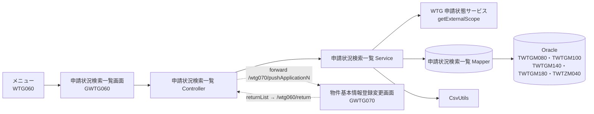
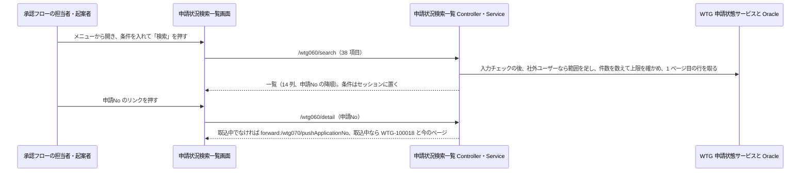
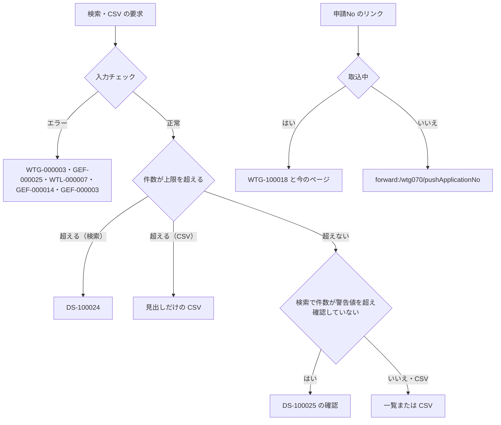

# 技術設計書

> このファイルは **「どう作るか」** を確定させる文書である。実装者ごとの解釈の食い違いを防ぎ、レビュー・実装・検証の共通の土台にする。\
> _分担_: 同一 feature の `requirements.md` が `status: approved` になるまで着手しない。本ファイルが `approved` になるまで `tasks.md` に進まない。`approved` は人間が付ける（エージェントは付けない）。

> _書き方_: 各節は結論から書き、検討の過程や調査ログは残さない。

> _出典の表記_: 「要件 N」「N.M」は `specs/application-status-search/requirements.md` の要件と受け入れ基準ID。「Q-DS-AS-xxx」は本 feature の design 作成中の質問への回答（回答者 Junichi Noumi、2026-10-08。原文は `.aidd/.engine/answer-ds-as-20261008-1504.txt`）。「検索条件の表」は回答者が渡した検索条件 38 項目と比べる列の表（`_handoff/phase5-application-status-search-conditions.md`）で、回答者の指示で本書の正とする。ただし社外ユーザーの絞り込みは、表の「会社名で比べる」ではなく、回答（Q-DS-AS-005 の 2）の「会社コードで比べる」に従う。「pbi design」は `specs/property-basic-info/design.md`（approved）。既存 wing のパスは、既存の実装から読み取った根拠を示す。\
> _上流との関係_: 本書で「上流から意図して外れる」と書いた箇所は、人間の回答に従って書いたもので、上流（requirements・pbi design）は Phase 5 の最後にまとめて直す（upstream-carryover）。

## 概要（Overview）

> 実装者が最初に読む節。何を誰に提供し、既存の何が変わるかを示す。\
> _分担_: 要件そのものは `requirements.md`。ここには設計上の位置づけだけを書く。

> _書き方_: 設計用語を使わず、この設計書を初めて読む人に通じる言葉で書く。

- **目的（Purpose）**: 承認フローの担当者（申請者・確認者・承認者）と起案者（社外ユーザーを含む） に 物件契約情報の申請を条件で探して一覧で見て、物件基本情報登録変更画面を開き、一覧を CSV に出せる画面（物件契約情報申請状況検索一覧 GWTG060） を提供する。
- **利用者（Users）**: メニュー「[WTG060]物件契約情報申請状況検索/一覧」を使える利用者（社外ユーザーを含む）（`requirements.md` の概要、Q-DS-AS-001）
- **影響（Impact）**: 現在の 物件契約情報の申請を探す画面が無い状態 を メニューから最初に開く検索一覧の画面で探し、申請No のリンクから物件基本情報登録変更画面へ移る形 に変更する。

### 達成目標（Goals）
> このフィーチャーが成功したと言える状態を定める節。

> _書き方_: 1 項目 1 行。基準を明記して、達成したかどうかを後から判定できる書き方にする。

- 38 項目の検索条件が、検索条件の表のとおりの一致の仕方と比べる列で働き、入れた項目だけが AND で効く（1.1〜1.5、Q-DS-AS-002〜004）
- 社外ユーザーは、起案会社が自社の会社名で固定され、所属①②と進捗の条件が使えず、検索の対象が自社の申請と本人が登録した申請だけになる（1.6・1.7、Q-DS-AS-005）
- 一覧に 14 項目が申請No の降順で出て、1 ページの件数と上限件数がコードマスタ（`P01`・`P02`）に従う（2.1〜2.6、Q-DS-AS-006・Q-DS-AS-008）
- 申請No のリンクで物件基本情報登録変更画面へ移り、取込中の申請はリンクにならず、戻ると前の条件と前のページで再検索される（2.7〜2.10、Q-DS-AS-009）
- CSV が一覧と同じ 14 列・MS932・見出し行付きで `WTG060_yyyyMMddHHmmss.csv` として出る（3.1〜3.5、Q-DS-AS-010）
- 形式・桁の誤りは、検索も CSV も止めてメッセージを出す（4.1、Q-DS-AS-007）

### やらないこと（Non-Goals）

> 達成目標に含めないことを先に宣言する節。`### 達成目標（Goals）` と対で読む。\
> _分担_: 実装として持たないものは `### このスペックが持たない責務（Out of Boundary）`。ここには目標の話だけを書く。

> _書き方_: 今回やらないだけのものと、今後もやらないものを書き分ける。

- 今後もやらない：新規登録のボタン（2.9）
- 今後もやらない：一覧の列見出しでの並べ替え（並びは申請No の降順だけ。Q-DS-AS-006）
- 今後もやらない：範囲の開始が終了より後のときの検査（0 件になるだけ。Q-DS-AS-007 の A）
- 今回やらない：本 feature 固有の性能目標値を設けること（`requirements.md` の非機能要件。既存 WiNG の水準に従う）
- 今回やらない：画面の配置と見た目を決めること。本書は項目・一覧の列・ボタンとその規則だけを書き、配置と見た目は Phase 8 の実装で決める（物件基本情報登録変更と同じ）

## 責務境界（Boundary Commitments）

> 実装物として**どのスペックが何を持つか**を確定させる節。タスク分解と後工程の検証もここを基準にする。\
> _分担_: 何を作り何を作らないかは `requirements.md` の `## スコープの境界（Boundary Context）`。ここには所有するデータとインターフェース、依存してよい相手を書く。

### このスペックが持つ責務（This Spec Owns）

> このスペックが持ち主になるものを宣言する節。

> _書き方_: 各項目 1 行。他のスペックとの間で担当が曖昧になりやすいものから先に書く。振る舞いをどのコンポーネントが担うかは `## コンポーネントとインターフェース（Components and Interfaces）` に書く。

- **所有するデータ**:
  - 検索条件のセッション（キー "PWTGO060Form"。検索のたびにフォーム全体を置き、初期表示とクリアで消す）（既存の検索一覧と同じ。`wing/src/main/java/jp/co/kccs/wt/function/wtg/wtg002/controller/Pwtgo004Controller.java:75`〜`:100`）
  - コードマスタ `WTZ/PARAM/P01` のこの画面の行（キー3＝`PWTGO060`、数値項目1＝50）と、メッセージ `WTG-100018`（Q-DS-AS-008・Q-DS-AS-009）
- **定義するインターフェース**:
  - 物件契約情報申請状況検索一覧画面（GWTG060）と、その口（`/wtg060`・`/wtg060/search`・`/wtg060/page`・`/wtg060/clear`・`/wtg060/return`・`/wtg060/detail`・`/wtg060/csv`）（Q-DS-AS-001）
  - 検索結果の CSV（14 列の見出しと値の形）（Q-DS-AS-010）

### このスペックが持たない責務（Out of Boundary）

> 関連はするが、このスペックが持ち主にならないものを宣言する節。「ついでに」で実装範囲が広がるのを防ぐ。\
> _分担_: ここには持ち主が他にあるものだけを書く。目標として掲げないものと、今回やらないと決めただけのものは `### やらないこと（Non-Goals）`。

> _書き方_: 他に任せるものは委譲先を必ず添える。委譲先が決まっていないものは `## 設計判断（Design Decisions）` で扱う。

- **他に任せる範囲と、その委譲先**:
  - 申請・契約局情報・承認履歴のデータと、申請の登録・変更、物件基本情報登録変更画面（`/wtg070/pushApplicationNo` で開く、`/wtg070/returnList` で `/wtg060/return` へ戻す）→ `specs/property-basic-info/design.md`。pbi design は `/wtg070/returnList` の戻り先を `/wtg060` と書いているが、本書の `/wtg060/return` に直す。pbi design は Phase 5 の最後にまとめて直す（upstream-carryover。design-check 1 回目 #1）
  - 社外ユーザーの範囲の決まり（`getExternalScope`）→ WTG 申請状態サービス（pbi design）
  - 発行依頼書（起案会社・案件グループ・初回支払日など）→ `specs/issue-request/design.md`
  - 取込中（`JOTAI_KBN`＝'06'）にすることと戻すこと → 契約局取込（WTG090。契約情報取込 contract-info-import の design。`.aidd/feature-list.md`）（Q-DS-AS-009）
  - CSV の共通部品 `CsvUtils`（orangesignal-csv）→ pbi design が新しく作る
  - コードマスタ `P01` の行の登録 → PJ45 で足すほかのコードマスタの行と同じ扱い（Q-DS-AS-008）
- **後のフェーズに回す作業**:
  - 画面の配置・見た目と、画面部品の属性（IME など）：Phase 8 の実装で決める（物件基本情報登録変更と同じ）
  - Oracle を使う確認（Mapper XML の SQL）：総合テスト（試験仕様書）に回す（物件基本情報登録変更と同じ。Q-DS-PBI-014）

### 依存してよい対象（Allowed Dependencies）

> このフィーチャーが前提にしてよい既存の仕組みを列挙する節。\
> _分担_: 要件として何に依存するかは `requirements.md` の `## 前提と依存（Dependencies / Assumptions）`。ここには実装が使ってよい範囲と守る制約を書く。

> _書き方_: 依存先は、システム名・コンポーネント名・共有基盤名など後から特定できる固有名で書く。制約には一方向性、循環の禁止、レイヤをまたぐ条件など、守るべき条件を書く。

- **依存先**:
  - WTG 申請状態サービス（`function/wtg/common`。pbi design の公開契約）：`getExternalScope`（社外ユーザーの判定と範囲）
  - 物件申請情報（`TWTGM080`）・契約局情報（`TWTGM140`）・承認履歴（`TWTGM180`）の定義（pbi design）、発行依頼書（`TWTGM100`）の定義（ir design。`specs/issue-request/design.md` の `#### TWTGM100 の DB レイアウト（発行依頼書情報ﾏｽﾀ。Q-DS-IR-003）`）。本 feature は読むだけ。feature-list の依存列は property-basic-info だけだが、本 feature は `TWTGM100` を外部結合で読むため ir design の DB レイアウトを読む。feature-list の依存列は Phase 5 の最後にまとめて直す（upstream-carryover）
  - 物件基本情報登録変更の口：`/wtg070/pushApplicationNo`（申請No を受けて開く）（pbi design）
  - wing の共通基盤：`ServiceBase` の 1 ページの件数・上限件数・警告件数（`validateSearchLimitCount`）とページング（`wing/src/main/java/jp/co/kccs/wt/common/service/ServiceBase.java:112`〜`:242`）、ファイルのダウンロード（同 `:252`〜`:264`）、`SessionService`、`StringUtils.escapeSQLforLike`（`wing/src/main/java/jp/co/kccs/wt/common/utils/StringUtils.java:936`）、`LoginUserUtils`、`CodeMstService`、共通部品 `common/pager`・`common/pageCount`・`common/emptyMsg`
  - CSV：`CsvUtils`（pbi design が新しく作る。orangesignal-csv 2.2.1）
  - コードマスタ：WTZ/CODE/`C01`、WTG/PARAM/`P26`〜`P32`・`P35`・`P53`・`P71`、WTZ/MASTER/`M11`、WTZ/PARAM/`P01`・`P02`、WTI/CODE/`C06`（休日）
- **依存の制約**:
  - Controller → Service → Mapper の向きだけで呼び、ほかの機能パッケージ（`wtg070` ほか）の Service・Mapper を呼ばない。物件基本情報登録変更画面へは `forward:/wtg070/pushApplicationNo` で移る（`steering/architecture.md` の `## レイヤーと依存ルール`）
  - 業務の表を書かない（検索と CSV だけ）

### 再確認が必要になる変更（Revalidation Triggers）

> ここに挙げた変更が起きたら、依存するスペックや利用側に再確認を依頼する節。

> _書き方_: 1 項目 1 行（例: 契約の形（API・イベント・型の定義）の変更、データ所有権の移動、依存方向の変更、起動・実行時の前提条件の変更）。

- `TWTGM080`・`TWTGM100`・`TWTGM140`・`TWTGM180` の比べる列・出す列の変更（pbi design・ir design）
- `/wtg070/pushApplicationNo`・`/wtg070/returnList`・`/wtg070/deleteShinse`（削除の後の戻り先）の口の変更（pbi design）
- 取込中の印（`JOTAI_KBN`＝'06'）の付け方・戻し方の変更（契約局取込）
- 社外ユーザーの範囲の決まり（`getExternalScope`）の変更
- コードマスタ（`P26`〜`P32`・`P35`・`P53`・`P71`・`M11`・`C01`・`C06`・`P01`・`P02`）の意味の変更
- `CsvUtils` の入出力の変更（pbi design）

## アーキテクチャ（Architecture）

> このフィーチャーをどの構成に載せるかを決める節。\
> _分担_: レイヤ構成と依存のルールは `steering/architecture.md` の `## レイヤーと依存ルール`、命名とコード規約は `steering/tech.md` の `## 命名規則` と `## コード規約`。ここにはこのフィーチャー固有の構成だけを書く。

### 既存アーキテクチャの分析（Existing Architecture Analysis）

> 既存システムに手を入れる場合に、守るべき前提を確認する節。

> _書き方_: 今回の変更で壊してはいけないものを挙げる。現状の評価や改善案は書かない。

- **現行のパターンと制約**: 既存の検索一覧（`wing/src/main/java/jp/co/kccs/wt/function/wtg/wtg002/controller/Pwtgo004Controller.java`）は、件数を数えてから `ROW_NUMBER() OVER (ORDER BY …)` で表示ページの行だけを取り、ページ送りは `/<機能ID>/page`、検索条件はセッションに置き、詳細画面へは一覧の Controller で受けてから `forward:` する。1 ページの件数・上限件数・警告件数は `ServiceBase` の共通処理がコードマスタ `P01`・`P02` から決める
- **守るべきドメイン境界**: 申請・契約局情報・承認履歴は物件基本情報登録変更、発行依頼書は発行依頼書登録変更が持つ。本 feature は読むだけ
- **維持する統合ポイント**: ログインとセッション、メニュー権限（`ZMENUAUTH`）、コードマスタ（`TWTZM040`）、メッセージ（`wing/src/main/resources/messages.properties`）
- **解消 / 回避する技術的負債**: <DSN_EXISTING_DEBT>（不要：既存の構成（Spring MVC＋MyBatis、既存の共通部品）にそのまま乗せる新しい機能で既存のコードは直さないため、解消する技術的負債も、避けるために設計を変える技術的負債も無い — 回答者 Junichi Noumi、2026-10-07（物件基本情報登録変更と同じ））

### アーキテクチャ方式と境界図（Architecture Pattern & Boundary Map）

> 採用する構成とコンポーネント間の関係を、図と文で示す節。

> _書き方_: 図は例であり、大文字の名前はすべて実際のコンポーネント名に置き換えたり、ノードを追加したりして関係性を示すようにする。関係が複雑でない場合は図を省いて文だけでもよい。



- **選択したパターン**: 既存 wing の 3 層（Controller → Service → Mapper）と、既存の検索一覧と同じページング・セッション・戻りの作り
- **ドメイン / 機能の切り分け**: 入力チェック・社外ユーザーの判定と範囲・件数の上限・一覧と CSV の値の形は Service、検索の SQL（結合・条件・まとめ・ページ）は Mapper、画面の入力と一覧の表示は画面のテンプレート
- **既存パターンとの整合**: プログラムID `PWTGO060`、機能ID `WTG060`、画面ID `GWTG060`、パッケージ `function/wtg/wtg060`、URL `/wtg060/<アクション>`（`steering/tech.md` の `## 命名規則`、Q-DS-AS-001）
- **新規コンポーネントを置く理由**: 物件契約情報の申請を探す画面は既存に無い（`requirements.md` の要件 1）
- **steering との整合**: 新しい技術を持ち込まない。CSV は pbi design が足す orangesignal-csv の共通部品を使う。権限は `AccessControlInterceptor`、社外ユーザーの範囲は WTG 申請状態サービスで決める（`steering/security.md` の `#### 権限モデル`）

### 技術スタック（Technology Stack）

> このフィーチャーで追加する、または例外的に採用する技術を書く節。\
> _分担_: プロジェクト共通のスタックは `steering/tech.md` の `## コアテクノロジ` と `## 主要ライブラリ`。ここには差分だけを書く。

> _書き方_: 1 行 1 技術。レイヤは Frontend / CLI、Backend / Service、Data / Storage、Messaging / Event、Infrastructure / Runtime などから選ぶ。

| レイヤ | 採用 / バージョン | このフィーチャーでの役割 | 備考 |
|---|---|---|---|
| Infrastructure / Runtime | 開発端末の JDK 1.8（`-source`/`-target` 1.7） | 開発端末でのコンパイルと自動テストの実行 | 本番は JDK 1.7（`steering/tech.md`）。物件基本情報登録変更と同じ（Q-DS-PBI-014）。steering/tech.md から意図して外れる。上流は Phase 5 の最後にまとめて直す（upstream-carryover） |

## データモデル（Data Models）

> このフィーチャーで変更するデータ構造を確定させる節。\
> _分担_: システム全体の ER 図・全体スキーマは `docs/architecture/data-model.md` の `## ER 図` に従う。命名と型の共通ルールは `steering/database.md` の `## 命名規則` と `## 型の指針`。

> _書き方_: このフィーチャーで変更するエンティティだけを書く。物理データモデルを変えたら `docs/architecture/data-model.md` との整合を確認する。

### ドメインモデル（Domain Model）

> 業務上の概念とその関係を、保存形式に依らない形で書く節。

> _書き方_: 実装の都合ではなく、業務としてどう成り立っているかで書く。集約は、一緒に更新しないと辻褄が合わなくなるデータのまとまり。値オブジェクトは、金額や住所のように、値が同じなら同じものとして扱ってよいもの。ドメインイベントは、「注文が確定した」のように業務で起きた出来事のうち、他に知らせる必要があるものを指す。不変条件は、いつ見ても成り立っていなければならない決まりを指す。

- **集約とトランザクション境界**: 「申請」を 1 行として読む（読み取りだけ）。1 申請に発行依頼書 0..1・契約局情報 0..n・承認履歴 0..n を外部結合し、申請No でまとめて 1 申請 1 行にする（検索条件の表の共通の結合）
- **エンティティ / 値オブジェクト / ドメインイベント**: 値オブジェクトは検索条件（38 項目）・一覧の 1 行（14 項目）・進捗の日数。エンティティとドメインイベントは無い（読むだけ）
- **ビジネスルール / 不変条件**:
  - **検索条件**（1.1〜1.5。一致の仕方は前方 1.2・部分 1.3・完全 1.4・範囲 1.5。Q-DS-AS-002・Q-DS-AS-003）：38 項目の入力の形（桁・文字種・コンボの元）・一致の仕方・比べる列は、検索条件の表を正とする。空の項目は条件に入れず、入れた項目だけを AND でつなぐ。前方一致と部分一致は `StringUtils.escapeSQLforLike` で `%`・`_` を逃がし、`LIKE … ESCAPE '/'` で比べる
  - **契約局情報と比べる項目**（Q-DS-AS-003）：稟議バーコードNo・基地局番号・基地局名・押印種別・転貸借の契約種別・発送書類名は、その申請の**全部の契約局の行**と比べ、どれか 1 行が合えば該当にする。契約局がまだ無い申請は、これらを入れると当たらない
  - **案件小グループ**：比べる値と一覧の値は「M11 の名称（`TWTGM100.Anken_Syo_Grp_Cd` で引く）→ 無ければ P35 の名称（`TWTGM100.Sonota1` で引く）→ 無ければ `TWTGM100.Sonota1_Freeform`」（部分一致）
  - **依頼内容**：選択肢は `P29` の 2 つ（稟議依頼・再製本依頼）だけで、選んだ行の名称で `TWTGM080.Irai_Naiyo` と比べる（修正稟議も "稟議依頼" で当たる）
  - **承認履歴の日時**（Q-DS-AS-002・Q-DS-AS-007）：起案日時・稟議承認日・申請日時・確認日時は、その申請の最新の審査回（MAX(`Shinsa_Count`)）の承認履歴のうち、判定 01（申請依頼）・04（承認）・02（申請）・03（確認）の行の `Last_UpdatedDT` と比べる。種類ごとに EXISTS で書き、2 種類以上入れたら AND。日時は From に秒 00、To に秒 59 を付け、稟議承認日（日付だけ）は From 00:00:00・To 23:59:59。両端を含み、片方だけも受け付ける。日付があって時刻が空なら、エラーにせずその端を条件から外す（時刻の初期値 00:00／23:59 が入るので通常は空にならない）
  - **初回支払日**：`TWTGM100.First_Pay_Day1`〜`4`（yyyyMMdd）。From は 1〜4 のどれかが From 以上、To は 1〜4 のどれかが To 以下（別々に判定）
  - **進捗の日数**（1.5、Q-DS-AS-004）：最初の申請依頼（承認履歴の審査回 1・審査権限 '01'・判定 '01' の行の `Last_UpdatedDT`）の日付を 0 日目とし、翌日から今日までの日数から、その間の休日（`WTI/CODE/C06`、会社コード＝申請の会社コード、数値項目1 が yyyyMMdd）の数を引いた営業日数。承認済・完了・取下げでも止めずに数える。申請依頼の行が無い申請は日数が無く、日数を入れると当たらない。「以上」なら 日数 ≧ 入力、「以下」なら 日数 ≦ 入力。一覧・CSV には出さない
  - **社外ユーザー**（1.6・1.7、Q-DS-AS-005）：ログインの権限区分をキー3 にした `P71` の行の文字項目1 が '1' なら社外、行が無いか '1' 以外なら社内。社外ユーザーの画面では、起案会社に自社の会社名（`P71` の文字項目2 をキー3 にして引いた `P26` の名称）を入れて変更不可、所属①②は空で変更不可、進捗検索(日数)・(選択) は出さない。初期表示・検索後の再表示・戻りのたびに入れ直す。起案会社は画面に出すだけで条件に加えない（変更不可の項目は送られない）。社外ユーザーのときは、Service が起案会社・所属①②・進捗検索(日数)・(選択) の値を空として扱い、条件に入れない（画面から送られても効かない。`steering/security.md` の禁止「サーバー側でも判定する」。design-check 1 回目 #3）
  - **検索の範囲**（1.7、Q-DS-AS-005）：社内も社外も `TWTGM080.CompanyCD ＝ ログイン会社コード` を付ける。社外ユーザーには、`getExternalScope` で得る範囲 `( TWTGM100.Keiyaku_Ringi_Kiansha_Kaisha_Cd ＝ 自社の会社コード（P71 の文字項目2） OR TWTGM080.RegisteredPerson ＝ ログインのユーザーID )` を括弧でくくって AND で足す（括弧が無いと OR が会社の条件まで外す）。検索条件の表は会社名で比べると書いているが、回答（Q-DS-AS-005 の 2）と requirements 1.7 のとおり会社コードで比べる
  - **初期値**（1.1）：どの項目も空。時刻の範囲の初期値は From 00:00・To 23:59。進捗検索(選択) の初期値は「以上」。社外ユーザーの起案会社は自社の名前。requirements 1.1（初期値は空）から意図して外れる（「以上」と自社の名前）。上流は Phase 5 の最後にまとめて直す（upstream-carryover）
  - **一覧の 14 列**（2.1〜2.4、Q-DS-AS-006）

    | 列 | 出す値 |
    |---|---|
    | 申請No | `TWTGM080.Application_No`。`JOTAI_KBN` が '06'（取込中）ならリンクにせず文字だけ |
    | 依頼内容 | `Irai_Naiyo` をそのまま（修正稟議も "稟議依頼"） |
    | 審査フェーズ | `P28` の名称。その申請の承認履歴の MAX(審査回) が 2 以上なら後ろに「(再申請)」 |
    | 状態 | `P27` の名称 |
    | 稟議バーコードNo | 契約局情報の連番 1 の行の `Ringi_Barcode_No`（検索で比べる全部の行とは別に、連番 1 の行を外部結合する） |
    | 基地局番号 | `TWTGM080.Kichikyoku_No`。複数局なら後ろに「他n局」 |
    | 基地局名 | `TWTGM080.Kichikyoku_Name`。複数局なら後ろに「他n局」 |
    | 案件小グループ | 上の案件小グループの値 |
    | 起案会社名 | `TWTGM100.Keiyaku_Ringi_Kiansha_Kaisha_Name` |
    | エリア | 「エリアコード:名称」（`C01`）。コードが空なら空 |
    | 起案担当者 | `TWTGM100.Keiyaku_Ringi_Kiansha_Name` |
    | 起案日 | 最新の審査回の承認履歴の審査権限 '01' の行の `Last_UpdatedDT` を YYYY/MM/DD |
    | 発送希望日 | `Hasso_Kibo_Date` を YYYY/MM/DD |
    | 施策 | `P30` の名称 |

    - 「他n局」：単独複数局ﾌﾗｸﾞが "0" なら付けない。"0" 以外で契約局情報の行数が 2 以上なら「他（行数－1）局」。0〜1 行なら付けない。基地局番号にも付けるのは requirements 2.3（基地局名）から意図して外れる。上流は Phase 5 の最後にまとめて直す（upstream-carryover）
    - 長い値は表示バイト数で切り、ツールチップで全部を出す：基地局名 16、案件小グループ 15、起案会社名 22、エリア 15、起案担当者 10（バイト）。CSV は切らない
    - 発行依頼書・契約局情報・承認履歴が無い申請も出す（外部結合）。その列は空
    - 並びは申請No の降順だけ
  - **件数**（2.5・2.6、Q-DS-AS-008）：1 ページの件数は `WTZ/PARAM/P01` のこの画面の行（キー3＝`PWTGO060`、数値項目1＝50）。上限件数と警告件数は `P02` の ALL の行（この画面の行は足さない）。共通処理 `validateSearchLimitCount` のまま使い、上限を超えたら `DS-100024`、警告件数を超えたら `DS-100025` の確認を出す。0 件なら共通部品 `common/emptyMsg` の「該当するデータはありません」を出す
  - **CSV**（3.1〜3.5、Q-DS-AS-010）：一覧と同じ 14 列・同じ値の形（名称、「(再申請)」、「他n局」、エリアは「コード:名称」、日付 YYYY/MM/DD。表示バイト数で切らない）。見出しは `申請No,依頼内容,ｽﾃｰﾀｽ,状態,稟議ﾊﾞｰｺｰﾄﾞNo,基地局番号,基地局名,案件小ｸﾞﾙｰﾌﾟ,起案会社名,ｴﾘｱ,起案担当者,起案日,発注希望日,施策`（半角カナ）。13 列目の見出しを「発注希望日」にするのは requirements 3.1（一覧と同じ列）から意図して外れる（画面の列見出しは「発送希望日」のまま）。上流は Phase 5 の最後にまとめて直す（upstream-carryover）。全項目をダブルクォートで囲み（値の中の " は ""）、改行は CRLF、NULL は空文字、文字コードは MS932。ファイル名は `WTG060_yyyyMMddHHmmss.csv`（出力した時刻。3.2）。条件は押した時点の画面の入力で、絞り込みと上限件数は検索と同じ。警告の確認は出さない。0 件と上限超えは見出し行だけ

### 論理データモデル（Logical Data Model）
> ドメインモデルをデータ構造として整理する節。

> _書き方_: 保存先の製品には依存させない。製品固有の話は物理データモデルに書く

- **エンティティ間の多重度（カーディナリティ）**: 申請 1 : 発行依頼書 0..1、申請 1 : 契約局情報 0..n（検索は全行、一覧の稟議バーコードNo は連番 1）、申請 1 : 承認履歴 0..n（最新の審査回、進捗の日数は審査回 1）
- **属性と型**: 読むだけ。各属性と型は pbi design・ir design の物理データモデルのとおり。検索条件の入力の形は検索条件の表のとおり
- **自然キー / 識別子**: 申請は「会社コード＋申請No」。一覧の 1 行も申請No で識別する
- **参照整合性のルール**: <DSN_LOGICAL_INTEGRITY>（不要：本 feature は読むだけで、整合を保つ責任は持ち主の feature にある — pbi design・ir design）

### 物理データモデル（Physical Data Model）
> 論理データモデルを実際の保存形式に落とした定義を書く節。

> _書き方_: 種別は RDB / Document Store / Event Store / KV・Wide-column などから選ぶ。RDB ならテーブル定義・主キー・外部キー・インデックス・分割方針、Document Store ならコレクション構造・埋め込みと参照の使い分け・シャードキーを書く。

| 種別 | 記載 |
|---|---|
| RDB | 表は作らず変えない。主表 `TWTGM080`（`CompanyCD ＝ ログイン会社コード`）に、`TWTGM100`（会社コード＋申請No）、`TWTGM140`（会社コード＋申請No の全行。一覧の稟議バーコードNo 用に連番 1 の行も別に）、`TWTGM180`（会社コード＋申請No＋最新の審査回）を外部結合し、申請No で GROUP BY する。件数を数えてから `ROW_NUMBER() OVER (ORDER BY Application_No DESC)` で表示ページの行だけを取る。進捗の日数は審査回 1 の承認履歴と `TWTZM040` の WTI/CODE/C06 で数える。コードの名称は `TWTZM040`（`M11` を含む）を外部結合して引く（検索条件の表、Q-DS-AS-004・Q-DS-AS-006） |

### データ契約と外部連携（Data Contracts & Integration）

> 外部とやり取りするデータの形と、その互換性の方針を決める節。

> _書き方_: API はリクエスト / レスポンスの schema・検証・シリアライズ形式、イベントは schema・バージョニング・互換性、サービス間は分散トランザクション（Saga / 2PC など）と整合性の方針を書く。

- **API**: 画面以外から呼ばれる API は持たない（`steering/api-standards.md` の本プロジェクトでの扱い）。画面の要求は `##### API 契約（API Contract）` のフォーム送信だけ
- **イベント**: 持たない。メッセージングを使わない（`steering/tech.md` の `## コアテクノロジ`）
- **サービス間**: 申請状況一覧と契約情報取込バッチは同じ DB を共有する。取込中（`JOTAI_KBN`＝'06'）の申請は一覧でリンクにせず、リンクを押した時点で取込中になっていれば `WTG-100018` で止める（Q-DS-AS-009）
- **物件基本情報登録変更との口**（pbi design）：申請No のリンクは `/wtg060/detail` で受け、取込中でなければ `forward:/wtg070/pushApplicationNo`（申請No を渡す）。物件基本情報登録変更画面の戻るは `/wtg070/returnList` から `/wtg060/return` に戻り、セッションの条件で前に見ていたページを再検索する（2.7・2.10）。契約情報取込画面の実行（`/wtg090/execute`）の後も `forward:/wtg060/return` で戻り、セッションの条件で前に見ていたページを再検索する（未検索なら初期表示）（横断確認 1 回目 #9）。物件基本情報登録変更画面で申請を削除した後（`/wtg070/deleteShinse`）も `/wtg060/return` で受け、セッションの条件で前に見ていたページを再検索する（削除した申請は一覧から消える。未検索なら初期表示）。pbi design の `/wtg070/deleteShinse` の Response は「申請状況一覧（GWTG060）へ戻る」だけで受ける URL を書いていないので、`/wtg070/returnList` と同じく Phase 5 の最後にまとめて直す（upstream-carryover。design-check 3 回目 #1）。pbi design は `/wtg070/returnList` の戻り先を `/wtg060` と書いているが、本書の `/wtg060/return` に直す（`/wtg060` は条件のセッションを消す初期表示のため）。pbi design は Phase 5 の最後にまとめて直す（upstream-carryover。design-check 1 回目 #1）
- **CSV**（Q-DS-AS-010）：1 行の bean（`Pwtgo060SearchInfo`）に `@CsvEntity`、14 項目に `@CsvColumn(name = 見出し)` を付け、`CsvUtils.save(list, stream, "MS932", CsvUtils.defaultCsvConfig(), new CsvEntityListHandler<>(Pwtgo060SearchInfo.class))` で書く。見出し行は `@CsvEntity`（header の既定は true）が書く。0 件・上限超えでは、要素が null 1 つのリストを渡して見出しだけにする。`CsvUtils` の入出力は変えない。返し方は `Content-Disposition: attachment`・`application/octet-stream` のダウンロード。出力管理（`TZZZM027`）は使わない

## コンポーネントとインターフェース（Components and Interfaces）

> 各コンポーネントの責務と、外部に公開する契約を確定させる節。契約は 5 種類ある。
>
> - **サービスインターフェース**: 他のコンポーネントから呼ばれる口
> - **API 契約**: 外部から HTTP で呼ばれる口
> - **イベント契約**: 非同期にやり取りするイベントの発行・購読
> - **バッチ / ジョブ契約**: 定期実行や一括処理
> - **状態管理**: 状態の持ち方と守り方
>
> _分担_: 物理配置は `## ファイル配置計画（File Structure Plan）`。全 API 共通の形式は `steering/api-standards.md` の `## リクエスト / レスポンス形式`、エラー表現は同ファイルの `## エラーハンドリング（API 契約）`。ここには論理的な責務と、このフィーチャー固有の契約を書く。

> _書き方_: まず一覧で全体像を示し、そのあと新しい境界を持つコンポーネントだけ詳細を書く。契約の種類は該当するものにチェックを入れ、同じ名前の小節だけを書く。実装上の注意やリスクは、判断に関わるものは `## 設計判断（Design Decisions）`、確認方法は `## テスト戦略（Testing Strategy）` に書く。
>
> - **ドメイン / レイヤの見出し**: ドメイン名で切るかレイヤ名で切るかはプロジェクトで決め、この節の中で揃える。複数あれば同じ形で繰り返す。`_N` は繰り返す印であり、配下のコンポーネントの `_N` と番号が対応するわけではない。
> - **サービスインターフェース**: メソッドごとに 1 行。型名は設計上の名前でよく、実装の型と一致していなくてよい。事前条件は呼ぶ側が満たしておくこと、事後条件は呼び出しが成功したときに保証されること、不変条件は処理の前後どちらでも常に成り立つことを書く。
> - **API 契約**: 1 行 1 エンドポイント。エラー列には返しうるステータスコードを列挙する。
> - **イベント契約**: 到達保証・順序保証は at-least-once / FIFO などの方式名で書く。
> - **バッチ / ジョブ契約**: 冪等性（同じ処理を何度実行しても結果が変わらない性質）をどう担保するかと、失敗時の復旧手順を書く。
> - **状態管理**: 状態が同時に更新されうる場合は、並行制御の方式まで書く。

- **監視**: 本 feature 固有の監視項目は無い。既存の WiNG の監視に任せる（`steering/non-functional.md` の `### 監視 / ヘルス`）

### コンポーネント一覧（Summary）

> このフィーチャーのコンポーネントを 1 行ずつ並べ、詳細を書くものを選ぶための節。

> _書き方_: 各行は下の詳細と対応し、コンポーネント名・ドメイン / レイヤ・目的・受け入れ基準ID は同じ値を書く。依存には主なものだけ、契約にはチェックした種類名を書く。

| コンポーネント | ドメイン / レイヤ | 目的 | 受け入れ基準ID | 依存 | 契約 |
|---|---|---|---|---|---|
| 申請状況検索一覧 Controller | 申請状況検索一覧 / Controller | 初期表示・検索・ページ送り・クリア・戻り・申請No のリンク・CSV の要求を受け、同じ画面か遷移先かファイルを返す | 1.1、2.5〜2.10、3.1〜3.5、4.1 | 申請状況検索一覧 Service | API 契約 |
| 申請状況検索一覧 Service | 申請状況検索一覧 / Service | 入力チェック、社外ユーザーの判定と範囲、件数の上限、検索条件のセッション、一覧と CSV の値の形、取込中の確認 | 1.1〜1.7、2.1〜2.8、2.10、3.1〜3.5、4.1 | WTG 申請状態サービス、申請状況検索一覧 Mapper、`CodeMstService`、`CsvUtils` | サービスインターフェース |
| 申請状況検索一覧 Mapper | 申請状況検索一覧 / Mapper | 件数と表示ページの行の検索、CSV の全件の検索、取込中の確認 | 1.2〜1.5、1.7、2.1〜2.4、2.8、3.3 | Oracle | — |
| 申請状況検索一覧画面のテンプレートとスクリプト | 画面 / FE | 38 項目の検索条件、一覧の 14 列とリンク、ページ、ボタン（検索・クリア・CSV）、ツールチップ | 1.1、1.6、2.1〜2.4、2.6、2.8、2.9 | Controller | — |

### 申請状況検索一覧

#### 申請状況検索一覧 Controller

| 項目 | 内容 |
|---|---|
| 目的（Intent） | 初期表示・検索・ページ送り・クリア・戻り・申請No のリンク・CSV の要求を受け、同じ画面か遷移先かファイルを返す |
| 受け入れ基準ID | 1.1、2.5〜2.10、3.1〜3.5、4.1 |
| 担当 / レビュアー | <DSN_COMPONENT_OWNER>（不要：体制（担当・レビュアー）は案件の計画書で管理する — 回答者 Junichi Noumi、2026-10-07（物件基本情報登録変更と同じ）） |

**責務と制約**:
- **主たる責務**: `@RequestMapping("/wtg060")`・`@FuncID("PWTGO060")` で 7 つの口を受ける。入力チェックの結果でエラーなら同じ画面にメッセージを出す。申請No のリンクでは取込中でなければ `forward:/wtg070/pushApplicationNo` する。CSV はファイルを返す
- **ドメイン境界 / トランザクションの範囲**: トランザクションを持たない（Service が持つ）
- **データ所有権 / 不変条件**: Mapper を直接呼ばない

**依存関係**:
- **呼び出し元（Inbound）**:
  - 申請状況検索一覧画面のテンプレートとスクリプト — フォーム送信（重要度: 高）
  - メニュー — 初期表示（重要度: 高）
  - 物件基本情報登録変更画面（`/wtg070/returnList`）— 戻り（重要度: 高）
  - 契約情報取込画面（`/wtg090/execute` の後）— 戻り（重要度: 中。横断確認 1 回目 #9）
  - 物件基本情報登録変更画面（`/wtg070/deleteShinse` の後）— 戻り。`/wtg060/return` で受ける（重要度: 中。design-check 3 回目 #1）
- **呼び出し先（Outbound）**:
  - 申請状況検索一覧 Service — すべての処理（重要度: 高）
- **外部（External）**:
  - なし — 外部システムと通信しない（重要度: —）

**契約の種類**（チェックリスト）
- [ ] サービスインターフェース（Service Interface）
- [x] API 契約（API Contract）
- [ ] イベント契約（Event Contract）
- [ ] バッチ / ジョブ契約（Batch / Job Contract）
- [ ] 状態管理（State Management）

##### API 契約（API Contract）

> 画面のフォーム送信の口であり、画面以外から呼ばれる API ではない。URL は既存の規約どおり `/wtg060/<アクション>` の 1 段にする（`steering/tech.md` の `## 命名規則`）。どの口もデータを変えない要求で、CSRF の照合（URL の末尾が `regist`・`update`・`delete`・`approved`・`reset`・`execute`・`upload` のものだけ）に乗らない。`servlet-context.xml` は変えない（Q-DS-AS-010）。Response の「画面」は申請状況検索一覧画面（`pwtgo060.html`）を表示すること。エラーはどれも HTTP 200 で同じ画面にメッセージを出す。

| Method | Endpoint | Request | Response | Errors |
|---|---|---|---|---|
| GET・POST | `/wtg060` | `FunctionID`（メニューから） | 画面（初期値。検索条件のセッションを消す。一覧は出さない）（1.1） | なし |
| POST | `/wtg060/search` | 38 項目の検索条件、警告の確認の印 | 画面（1 ページ目の一覧。条件をセッションに置く）（1.2〜1.7、2.1〜2.6） | 入力（`### バリデーション設計`）、件数（`DS-100024`・`DS-100025` の確認） |
| POST | `/wtg060/page` | 表示するページ | 画面（セッションの条件でそのページの一覧）（2.5） | 件数（`DS-100024`） |
| POST | `/wtg060/clear` | なし | 画面（初期表示と同じ。セッションを消す）（1.1） | なし |
| GET・POST | `/wtg060/return` | なし | 画面（セッションの条件で前に見ていたページを再検索。警告の確認は出さない。未検索なら初期表示）（2.10） | 件数（`DS-100024`） |
| POST | `/wtg060/detail` | 申請No | 取込中でなければ `forward:/wtg070/pushApplicationNo`。取込中なら画面（セッションの条件で今のページを再検索）（2.7・2.8） | 業務（`WTG-100018`） |
| POST | `/wtg060/csv` | 38 項目の検索条件（押した時点の画面の入力） | `WTG060_yyyyMMddHHmmss.csv` のダウンロード（`attachment`、`application/octet-stream`）（3.1〜3.5） | 入力（`### バリデーション設計`。エラーなら画面にメッセージを出し CSV を出さない） |

#### 申請状況検索一覧 Service

| 項目 | 内容 |
|---|---|
| 目的（Intent） | 入力チェック、社外ユーザーの判定と範囲、件数の上限、検索条件のセッション、一覧と CSV の値の形、取込中の確認 |
| 受け入れ基準ID | 1.1〜1.7、2.1〜2.8、2.10、3.1〜3.5、4.1 |
| 担当 / レビュアー | <DSN_COMPONENT_OWNER>（不要：体制（担当・レビュアー）は案件の計画書で管理する — 回答者 Junichi Noumi、2026-10-07（物件基本情報登録変更と同じ）） |

**責務と制約**:
- **主たる責務**: 画面の初期値と社外ユーザーの固定値を作る。入力チェックをする。検索条件（`Pwtgo060CondInfo`）から SQL に渡す条件（`Pwtgo060SearchCond`）を作り、社外ユーザーの範囲を足す。件数の上限を共通処理で確かめ、表示ページの行を取って一覧の値の形にする。CSV を書く。申請No のリンクで取込中かを確かめる
- **ドメイン境界 / トランザクションの範囲**: 読み取りだけ（クラスに `@Transactional(readOnly = true)`）
- **データ所有権 / 不変条件**: 業務の表を書かない。社外ユーザーの範囲は、画面から送られた値ではなく、ログインユーザーから毎回作る

**依存関係**:
- **呼び出し元（Inbound）**:
  - 申請状況検索一覧 Controller — すべての処理（重要度: 高）
- **呼び出し先（Outbound）**:
  - WTG 申請状態サービス — `getExternalScope`（社外ユーザーの判定と範囲）（重要度: 高）
  - 申請状況検索一覧 Mapper — 検索（重要度: 高）
  - `CodeMstService` — コンボの選択肢、`P71`・`P26` の自社の会社名（重要度: 中）
  - `CsvUtils` — CSV の書き出し（重要度: 中）
- **外部（External）**:
  - なし — 外部システムと通信しない（重要度: —）

**契約の種類**（チェックリスト）
- [x] サービスインターフェース（Service Interface）
- [ ] API 契約（API Contract）
- [ ] イベント契約（Event Contract）
- [ ] バッチ / ジョブ契約（Batch / Job Contract）
- [ ] 状態管理（State Management）

##### サービスインターフェース（Service Interface）

| メソッド | 入力 | 出力 | エラー |
|---|---|---|---|
| 初期表示（`initDisplay`） | ログインユーザー | 初期値の検索条件（時刻 00:00／23:59、進捗検索(選択)「以上」、社外ユーザーは起案会社に自社の会社名・所属①②は空・変更不可、進捗の 2 項目を出さない）、コンボの選択肢 | なし |
| 検索（`search`） | 検索条件、表示するページ、警告の確認の印、ログインユーザー | 一覧の行（14 列）と件数・ページ | 入力チェック → `BindingResult` に積む（`### バリデーション設計`）。件数 → `DS-100024`・`DS-100025`（共通処理） |
| 取込中の確認（`checkImporting`） | 会社コード、申請No | 取込中か | 取込中 → `WTG-100018` を `BindingResult` に積む |
| CSV（`outputCsv`） | 検索条件、ログインユーザー、出力先 | CSV（14 列、0 件・上限超えは見出しだけ） | 入力チェック → `BindingResult` に積む |

- **事前条件（Preconditions）**: ログインユーザーの会社コード・ユーザーID・権限区分がセッションにある。`P01` にこの画面の行、`P02` に ALL の行がある
- **事後条件（Postconditions）**: 検索の成功後、条件がセッション（"PWTGO060Form"）に置かれ、一覧は申請No の降順で表示ページの行だけ。CSV は画面の一覧と同じ範囲・同じ値の形
- **不変条件（Invariants）**: 社外ユーザーには、どの口でも範囲の絞り込みが必ず付く。データベースに書かない

## 処理フロー（System Flows）

> このフィーチャーの主要な処理の流れを図で示す節。\
> _分担_: システム全体の主要ビジネスフローは `docs/architecture/system-overview.md` の `## 主要ビジネスフロー`。エラーコードの出し分けが複雑な場合は `## 機能固有のエラー処理（Error Handling）` の `### エラー時の分岐フロー`。

> _書き方_: プレースホルダは実際のコンポーネント名に置き換える。分岐・リトライ・例外時の扱いは、図に描くか図の下に文で補う。


**フロー上の主要な判断**: 社外ユーザーの範囲は、画面の値ではなくログインユーザーから毎回作って足す。一覧の表示とリンクの押下の間に取込が始まることがあるので、リンクを押した時点でも取込中を確かめる（Q-DS-AS-009）。CSV は前の検索条件ではなく、押した時点の画面の入力で作る（Q-DS-AS-010）。

## 機能固有のエラー処理（Error Handling）

> このフィーチャー固有のエラーコードと復旧の流れを決める節。\
> _分担_: API のエラー契約は `steering/api-standards.md` の `## エラーハンドリング（API 契約）`、例外処理の方針は `steering/tech.md` の `## 例外処理`、ログ・リトライ・監視は `steering/non-functional.md` の `## 信頼性・観測性`。

- **返し方**: 入力チェックと取込中は、既存の検索一覧と同じく `BindingResult` に積んで同じ画面に出す。件数の上限と警告は共通処理（`validateSearchLimitCount`）のまま
- **ログ**: 本 feature 固有のログ項目は無い。予期しない例外は既存の `ExceptionResolver` に任せる。氏名などの個人情報はログに出さない（`steering/non-functional.md` の `#### 出力しない`）

### バリデーション設計

> 入力を受け付けるかどうかの判定条件を決める節。\
> _分担_: 入力検証と出力エスケープの全体方針は `steering/security.md` の `## 入力検証 / 出力エスケープ`、API 共通のバリデーション形式は `steering/api-standards.md` の `### 複数フィールドのバリデーション`。

> _書き方_: 全体方針と重複しない、このフィーチャー固有の条件だけを書く。

- 検索と CSV の両方で同じ入力チェックをする。どの項目も必須にしない（1.1）。桁は入力欄の最大桁（maxlength）で抑え、桁を超える値はサーバーでも検索条件の表の桁で検査する。文字種（申請No・基地局番号の半角英数、稟議ﾊﾞｰｺｰﾄﾞNo の半角英数記号など）は検査しない（前方一致で 0 件になるだけ）。形式を検査するのは、日付・時刻・進捗の日数だけ（Q-DS-AS-007。design-check 1 回目 #2）。範囲の開始が終了より後でも検査しない（0 件になるだけ。進捗の日数も同じ）（Q-DS-AS-007）。新しいキーは作らない

| チェック対象 | 項目名 | 条件 / ルール | エラーコード | メッセージ例 | UI の対処 |
|---|---|---|---|---|---|
| 検索条件 | 稟議承認日・初回支払日・発送希望日（From・To） | YYYY/MM/DD の実在する日付 | `WTG-000003`（既存） | {0}:日付が不正です | 同じ画面にメッセージを出し、検索・CSV をしない |
| 検索条件 | 起案日時・申請日時・確認日時の日付（From・To） | YYYY/MM/DD の実在する日付 | `GEF-000025`（既存） | （既存の文言） | 同上 |
| 検索条件 | 起案日時・申請日時・確認日時の時刻（From・To） | HH:MM | `WTL-000007`（既存） | （既存の文言） | 同上 |
| 検索条件 | 進捗検索(日数) | 半角数字（2 桁まで） | `GEF-000014`（既存） | {0}:数値を入力して下さい | 同上 |
| 検索条件 | 文字の入力項目（申請No・稟議ﾊﾞｰｺｰﾄﾞNo・基地局番号・基地局名・更新者・所属①②・起案担当者・発送書類名・案件小ｸﾞﾙｰﾌﾟ） | 検索条件の表の桁（バイト）以内 | `GEF-000003`（既存） | {0}:桁数が制限を超えています | 同上 |

### 機能固有エラーコード

> このフィーチャーだけが返すエラーコードを一覧にする節。

> _書き方_: 例「`FEATURE_X_INVALID_STATE` / 409 / 状態遷移の不整合 / UI でステータスを取得し直す」「`FEATURE_X_DEPENDENCY_DOWN` / 503 / 外部依存が使えない / 自動リトライ後にフォールバック」。

| エラーコード | HTTP | 意味 | 対応 |
|---|---|---|---|
| `WTG-100018`（新規。種別 Warning） | 200（同じ画面に戻す） | 押した申請No が取込中（`JOTAI_KBN`＝'06'）。文言「取込処理中のため登録画面へ遷移できません」（2.8、Q-DS-AS-009）。pbi design は既存のキーと書いているが今の wing に無く、本 feature で新しく足す。pbi design は Phase 5 の最後にまとめて直す（upstream-carryover） | 取込が終わってから押し直す |
| `DS-100024`（既存） | 200（同じ画面） | 検索結果が上限件数を超えた（2.5） | 条件を絞り直す |
| `DS-100025`（既存） | 200（確認） | 検索結果が警告件数を超えた。続行すると検索する（2.5） | 続行するか条件を絞り直す |

### エラー時の分岐フロー

> `### 機能固有エラーコード` で定めたコードを、どの条件で返すかを図で示す節。分岐が多く、表だけでは追いにくい場合に書く。\
> _分担_: 処理の主要な流れは `## 処理フロー（System Flows）`。

> _書き方_: 図の中の大文字の名前は実際の処理名・エラーコードに置き換える。分岐のラベル（成立 / 不成立 / 成功 / 失敗）も判定内容に合わせて書き換える。



## ファイル配置計画（File Structure Plan）

> このフィーチャーで追加・変更するファイルを、どのディレクトリに置くかを示す節。\
> _分担_: ディレクトリ構成の規約は `steering/architecture.md` の `## ディレクトリ構成`、ファイルやディレクトリの命名規則は `steering/tech.md` の `## 命名規則`。論理的な責務は `## コンポーネントとインターフェース（Components and Interfaces）`。ここには規約に従って置く実際のファイルだけを書く。

> _書き方_: 繰り返し現れる構造はパターンを 1 度だけ書く。個別ファイルは責務が読み取りにくいときだけ挙げる。

```
wing/src/main/
├── java/jp/co/kccs/wt/function/wtg/wtg060/       # 機能ID WTG060（Q-DS-AS-001）
│   ├── controller/Pwtgo060Controller.java        # /wtg060 の 7 つの口、@FuncID("PWTGO060")
│   ├── service/Pwtgo060Service.java
│   ├── mapper/Pwtgo060Mapper.java
│   ├── form/Pwtgo060Form.java
│   └── bean/Pwtgo060CondInfo.java・Pwtgo060SearchCond.java・Pwtgo060SearchInfo.java   # 入力の条件・SQL の条件・一覧と CSV の 1 行（@CsvEntity）
├── resources/jp/co/kccs/wt/function/wtg/wtg060/Pwtgo060Mapper.xml
└── webapp/WEB-INF/pages/wtg/wtg060/
    └── pwtgo060.html・pwtgo060Script.html
```

### 変更する既存ファイル（Modified Files）

> 新規追加ではなく、既存ファイルに手を入れる箇所を挙げる節。

> _書き方_: 何をどう変えるか、なぜ変えるかを 1 行で書く。

- `wing/src/main/resources/messages.properties` — `WTG-100018`（取込処理中のため登録画面へ遷移できません）を種別 Warning で追加する（Q-DS-AS-009）

## 追加検討事項（Additional Considerations）

> 機能の振る舞いそのものではないが、実装前に決めておくことをまとめる節。配下の見出しのうち、このフィーチャーに関係するものを書く。\
> _分担_: 選択肢を比べて選んだ判断は `## 設計判断（Design Decisions）`。要件としての目標値は `requirements.md` の `## 非機能要件（Non-Functional Requirements）`。

### セキュリティ上の考慮（Security Considerations）

> 認証・機密データ・外部連携・権限を扱うフィーチャーで書く節。\
> _分担_: 横断的な防御は `steering/security.md` の `## 基本方針`、認証・認可の標準は同ファイルの `## 認証・認可`。要件としてのセキュリティ目標は `requirements.md` の `## 非機能要件（Non-Functional Requirements）`。ここには実現手段だけを書く。

> _書き方_: 想定する攻撃者と守る対象を先に決めてから、対策を書く。

- **脅威と対策**:
  - 社外ユーザーが他社の申請を探す・CSV に出す → 範囲の絞り込みを画面の値でなくログインユーザーから毎回作り、括弧でくくって AND で足す。起案会社は条件に使わない（変更不可の値を書き換えて送っても効かない）（1.7、Q-DS-AS-005）
  - 社外ユーザーが他社の申請No のリンクを直接送る → 遷移先の物件基本情報登録変更が `getExternalScope` で範囲外を拒否する（pbi design）
  - 入力値による SQL インジェクション → SQL は `#{}` だけを使い、LIKE は `escapeSQLforLike` で逃がす（`steering/security.md` の `### 共通ルール`）
  - 一覧の値による XSS → 出力は `th:text`（同上）
- **認証・認可**: 画面を使えるかは既存の `AccessControlInterceptor`（`ZMENUAUTH`）で判定する。メニュー名は「[WTG060]物件契約情報申請状況検索/一覧」（Q-DS-AS-001）。社外ユーザーの判定は `P71`（`steering/security.md` の `#### 権限モデル`）
- **データ保護 / プライバシー**: 一覧と CSV に起案担当者の氏名が出る。更新者の氏名は検索条件として比べるだけで、画面にも CSV にも出さない。出すのは範囲内の申請だけで、ログに出さない（`steering/security.md` の `## 機密データ`。design-check 1 回目 #4）

### 性能とスケーラビリティ（Performance & Scalability）

> 性能・高負荷・拡張に懸念があるフィーチャーで書く節。\
> _分担_: 目標値は `requirements.md` の `## 非機能要件（Non-Functional Requirements）` を参照する。

> _書き方_: 数値は再定義せず、参照元を示す。

- **目標値の参照元と計測方法**: `requirements.md` の非機能要件（`steering/non-functional.md` 準拠。本 feature 固有の目標値は無い）。総合テストで確かめる
- **拡張の方針（水平 / 垂直）**: 既存 WiNG の構成に従い、本 feature では変えない（`steering/non-functional.md` の `### 性能・容量運用（方針）`）
- **キャッシュ / 最適化**: キャッシュは持たない。件数を先に数え、表示ページの行だけを取る。上限件数（`P02` の ALL の行）で取り出す件数を抑える

### 移行方針（Migration Strategy）

> スキーマ移行やデータ移行が必要なフィーチャーで書く節。

> _書き方_: 各段階について、どこまで戻せるかを明記する。段階を図で示す場合は Mermaid のフローチャートを使う。

- **段階分け**:
  - コードマスタ `WTZ/PARAM/P01` にこの画面の行（キー3＝`PWTGO060`、名称「[GWTG060]物件契約情報申請状況検索/一覧」、数値項目1＝50）を、PJ45 で足すほかのコードマスタの行と同じ扱いで登録する。`P02` は足さない（Q-DS-AS-008）
  - メニュー「[WTG060]物件契約情報申請状況検索/一覧」と `ZMENUAUTH` の `PWTGO060` の行を、ほかの画面と同じ扱いで登録する（Q-DS-AS-001）
- **ロールバックを実施する条件**: <DSN_MIGRATION_ROLLBACK>（不要：既存データの移行は無く、追加するマスタの行はほかのコードマスタの行と同じ扱いで登録する — Q-DS-PBI-015 と同じ）
- **検証チェックポイント**: <DSN_MIGRATION_CHECKPOINT>（不要：既存データの移行は無く、テストの詳細は試験仕様書に書く — Q-DS-PBI-015 と同じ）

#### 移行対象ファイル一覧

> 移行するファイル・テーブルを漏れなく数え上げる節。\
> _分担_: ファイルごとの詳細仕様は `## コンポーネントとインターフェース（Components and Interfaces）` のバッチ / ジョブ契約と `## データモデル（Data Models）`。

> _書き方_: 処理区分は 新規 / 更新 / 廃止。移行後の扱いは 削除 / アーカイブ / 引き継ぎ先 などを書く。

| ファイル / テーブル名 | 処理区分 | レコード数見込み | 移行方法 | 移行後の扱い |
|---|---|---|---|---|
| `TWTZM040`（WTZ/PARAM/P01 キー3 `PWTGO060`） | 更新（行の追加） | 1 行 | ほかのコードマスタの行と同じ扱いで登録 | ― |
| メニューと `ZMENUAUTH`（`PWTGO060`） | 更新（行の追加） | この画面を使うメニューの数 | ほかの画面と同じ扱いで登録 | ― |

### テスト体制 / テスト仕様

> 総合テストや受け入れテストで独立した仕様書が必要な場合に書く節。通常は `## テスト戦略（Testing Strategy）` で足りる。

> _書き方_: 連絡先は非機密の情報だけを書く。

- **テスト責任者 / 承認者**: <DSN_TEST_OWNER>（不要：体制・環境・期間・連絡先は案件の計画書で管理し、テストの詳細は試験仕様書に書くため。試験仕様書と計画書で扱う — Q-DS-PBI-015 と同じ）
- **テスト環境**: <DSN_TEST_ENVIRONMENT>（不要：体制・環境・期間・連絡先は案件の計画書で管理し、テストの詳細は試験仕様書に書くため。試験仕様書と計画書で扱う — Q-DS-PBI-015 と同じ）
- **テスト期間**: <DSN_TEST_PERIOD>（不要：体制・環境・期間・連絡先は案件の計画書で管理し、テストの詳細は試験仕様書に書くため。試験仕様書と計画書で扱う — Q-DS-PBI-015 と同じ）
- **問題発生時の連絡先**: <DSN_TEST_ESCALATION>（不要：体制・環境・期間・連絡先は案件の計画書で管理し、テストの詳細は試験仕様書に書くため。試験仕様書と計画書で扱う — Q-DS-PBI-015 と同じ）
- **詳細仕様書**: <DSN_TEST_SPEC_LINK>（不要：体制・環境・期間・連絡先は案件の計画書で管理し、テストの詳細は試験仕様書に書くため。試験仕様書と計画書で扱う — Q-DS-PBI-015 と同じ）

## テスト戦略（Testing Strategy）

> このフィーチャーで何をどの粒度で確認するかを決める節。\
> _分担_: 共通のテスト方針は `steering/tech.md` の `## テスト方針`。総合テストや受け入れテストで独立した仕様書が要る場合は `### テスト体制 / テスト仕様`。

> _書き方_: 各項目は外から確認できる期待結果とセットで書き、**受け入れ基準ID** と対応づける。受け入れ基準を確認できる分だけ書き、区分ごとに件数を揃えることは目的にしない。

- **単体（Unit）**:
  - 入力チェック：日付・日時・時刻・数字・桁の誤りで、表のキーが積まれ、検索も CSV もしない。開始＞終了は通る（4.1）
  - 条件の組立て：入れた項目だけが条件に入り、前方・部分一致の値が `escapeSQLforLike` で逃がされ、日時の From に秒 00・To に秒 59、稟議承認日に 00:00:00／23:59:59 が付き、時刻が空の端は外れる（1.2〜1.5）
  - 社外ユーザー：`P71` の文字項目1 が '1' の権限区分で、起案会社が自社の会社名で変更不可、所属①②が空で変更不可、進捗の 2 項目が出ず、範囲の条件が括弧付きで足される。起案会社・所属①②・進捗の値を送っても条件に入らない。社内は会社の条件だけ（1.6・1.7）
  - 一覧の値：「(再申請)」、「他n局」（単独複数局ﾌﾗｸﾞ "0"・行数 0〜1 では付かない）、エリア「コード:名称」、案件小グループの名称の順、日付の形（2.1〜2.3）
  - CSV：14 列の見出しの文言、全項目のダブルクォート、CRLF、MS932、ファイル名、0 件・上限超えで見出しだけ（3.1〜3.4）
  - 取込中：`JOTAI_KBN`＝'06' の申請でリンクを押すと `WTG-100018`（2.8）
  - 自動テストは JUnit 4.12 と spring-test で書き、Mapper の代わりは手書きの代替クラスにする。結果は Maven Surefire の XML・HTML を使い、カバレッジは取らない（`steering/tech.md` の `## テスト方針`。物件基本情報登録変更と同じ。Q-DS-PBI-014）
- **結合（Integration）**:
  - Oracle を使う確認（38 項目の SQL、全部の契約局の行との比較、最新の審査回の承認履歴、進捗の営業日数、ページング、件数の上限）は開発端末では動かせないため、総合テスト（試験仕様書）で行う（1.2〜1.7、2.4〜2.6、3.3。物件基本情報登録変更と同じ。Q-DS-PBI-014）
- **E2E / UI**:
  - 画面の操作の確認（初期値、検索、ページ送り、クリア、申請No のリンクと戻り、ツールチップ、CSV のダウンロード、新規登録のボタンが無いこと）は総合テスト（試験仕様書）で行う（1.1、2.5〜2.10、3.5。物件基本情報登録変更と同じ。Q-DS-PBI-014・Q-DS-PBI-015）
- **性能 / 負荷（Performance / Load）**:
  - <DSN_TEST_PERFORMANCE_N>（不要：本 feature 固有の性能目標値は無い — `requirements.md` の非機能要件。既存 WiNG の水準に従う）

## 設計判断（Design Decisions）

> このフィーチャーで下した技術判断を、結論とその理由で残す節。\
> _分担_: セキュリティ・性能・移行など、実装前に決めておく観点は `## 追加検討事項（Additional Considerations）`。比較表や調査資料そのものは `## 補足資料（Supporting References）`。ここには選択肢を比べて選んだことだけを書く。

> _書き方_: 1 つの判断につき 1 ブロック。判断 2 以降も同じ形で追加する。背景には「なぜ判断が必要になったか」を書く。判断は選んだ結論だけを言い切る。採用理由には、他の案ではなくこれを選んだ決め手だけを書く。代替案は実際に検討したものだけを不採用の理由とセットで挙げ、検討していない案は書かない。採用による影響には、引き受ける負担・残るリスク・後で見直す条件を書く。

### 判断 1: 契約局情報と比べる項目は全部の契約局の行と比べる

- **背景（Context）**: 稟議バーコードNo・基地局番号・基地局名・押印種別・転貸借の契約種別・発送書類名は、契約局ごとに値がある。一覧の稟議バーコードNo は代表局（連番 1）の値を出す
- **判断（Decision）**: 検索では全部の契約局の行と外部結合し、どれか 1 行が合えば該当にして申請No でまとめる。一覧の稟議バーコードNo は連番 1 の行を別に結合して出す（Q-DS-AS-003 の B）
- **採用理由（Rationale）**: 回答者の決定に従う。2 行目以降の契約局の基地局番号や稟議バーコードNo でも申請を探せる
- **代替案（Alternatives）**: 代表局（連番 1）の行とだけ比べる案（Q-DS-AS-003 の A）— 回答者が B を選んだため採らない
- **採用による影響（Consequences）**: 検索と一覧で見る契約局の行が違う（検索で当たった値が一覧に出ないことがある）。SQL は申請No でまとめる必要がある

### 判断 2: 社外ユーザーの起案会社は画面に出すだけで、範囲は会社コードの絞り込みで決める

- **背景（Context）**: requirements 1.6 は社外ユーザーに起案会社を変更させないこと、1.7 は自社の申請と本人が登録した申請だけを対象にすることを求める
- **判断（Decision）**: 起案会社は自社の会社名を入れて変更不可にするだけで条件に加えず、範囲は `( 起案会社コード ＝ 自社の会社コード OR 登録者 ＝ 本人 )` を括弧でくくって AND で足して決める（Q-DS-AS-005 の 2 の A）
- **採用理由（Rationale）**: 回答者の決定に従う。変更不可の項目は画面から送られないので、範囲を画面の値に頼らずに決められる
- **代替案（Alternatives）**: 起案会社の値を条件にも加える案（Q-DS-AS-005 の 2 の B）— 回答者が A を選んだため採らない。会社名で比べる案（検索条件の表の書き方）— 回答と requirements 1.7 が会社コードで比べるとしているため採らない
- **採用による影響（Consequences）**: 社外ユーザーは本人が登録した他社起案の申請も見える（1.7 のとおり）

## 補足資料（Supporting References）

> 本文に置くと長くなる資料の置き場所を示す節。\
> _分担_: 調査の結論は `## 設計判断（Design Decisions）` に要約だけを書く。ここには資料のありかだけを書く。

> _書き方_: 資料には巨大な型定義、製品比較、全カラム表などを挙げる。内容にはその資料を見ると何が分かるかを書く。参照先には変わりにくいパスまたは URL を書き、確定していなければ未定と書く。

| 資料 | 内容 | 参照先 |
|---|---|---|
| 検索条件 38 項目と比べる列 | 共通の結合、38 項目の入力の形（桁・文字種・コンボの元）・一致の仕方・比べる列、日時の範囲、社外ユーザーの絞り込み（回答者の指示で本書の正。社外ユーザーの比べ方は Q-DS-AS-005 に従う） | `_handoff/phase5-application-status-search-conditions.md` |
| 既存の検索一覧の手本 | ページング・セッション・戻り・一覧から詳細画面への forward・LIKE の書き方 | `wing/src/main/java/jp/co/kccs/wt/function/wtg/wtg002/controller/Pwtgo004Controller.java`・`wing/src/main/resources/jp/co/kccs/wt/function/wtg/wtg002/Pwtgo004Mapper.xml` |
| 件数の共通処理とダウンロード | 1 ページの件数・上限件数・警告件数（`P01`・`P02`）、ページング、ファイルの返し方 | `wing/src/main/java/jp/co/kccs/wt/common/service/ServiceBase.java` |
| 日時の範囲の手本 | 時刻の初期値と秒の付け方、日付・時刻のキー | `wing/src/main/java/jp/co/kccs/wt/function/wtl/wtl020/service/Pwtlo021Service.java` |
| 物件基本情報登録変更との口と CSV の共通部品 | `/wtg070/pushApplicationNo`・`/wtg070/returnList`・`/wtg070/deleteShinse`、`getExternalScope`、`CsvUtils` | `specs/property-basic-info/design.md` |

---

_「どう作るか」を確定させる文書。_
