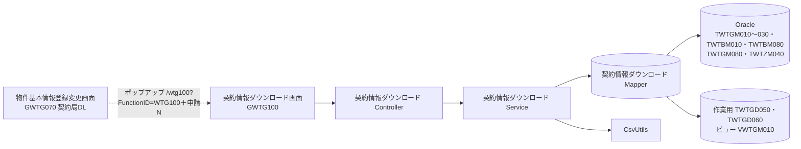
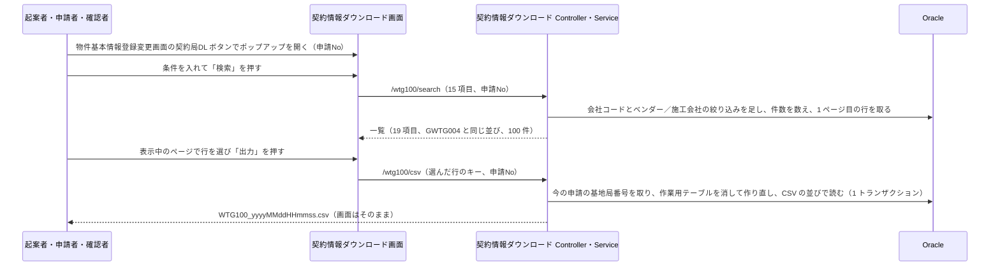
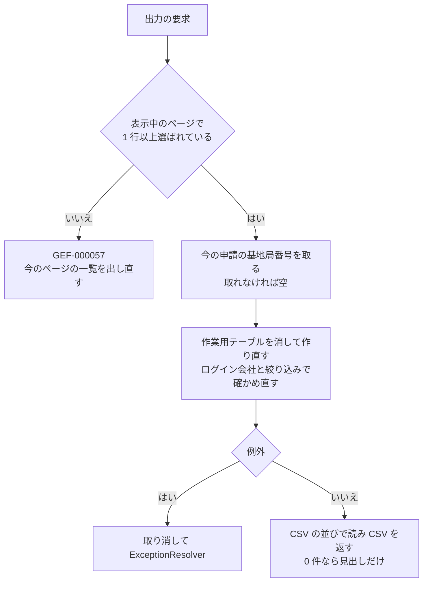

# 技術設計書

> このファイルは **「どう作るか」** を確定させる文書である。実装者ごとの解釈の食い違いを防ぎ、レビュー・実装・検証の共通の土台にする。\
> _分担_: 同一 feature の `requirements.md` が `status: approved` になるまで着手しない。本ファイルが `approved` になるまで `tasks.md` に進まない。`approved` は人間が付ける（エージェントは付けない）。

> _書き方_: 各節は結論から書き、検討の過程や調査ログは残さない。

> _出典の表記_: 「要件 N」「N.M」は `specs/contract-info-download/requirements.md` の要件と受け入れ基準ID。「Q-DS-CD-xxx」は本 feature の design 作成中の質問への回答（回答者 Junichi Noumi、2026-10-08。原文は `.aidd/.engine/answer-ds-cd-20261008-1845.txt`）。「出力の定義」は回答者が渡した CSV の 381 列の表（`_handoff/csv-layout-wtg100.md`）を写した本 feature の補足資料 `specs/contract-info-download/csv-layout-wtg100.md`、「作業用テーブルの表」は回答者が渡した作業用テーブルとビューの表（`_handoff/work-tables-wtg100.md`）を写した補足資料 `specs/contract-info-download/work-tables-wtg100.md` で、どちらも回答者の指示で本書の正とする。「pbi design」は `specs/property-basic-info/design.md`（approved）、「ci design」は `specs/contract-info-import/design.md`（approved）。既存 wing のパスは、既存の実装から読み取った根拠を示す。\
> _上流との関係_: 本書で「上流から意図して外れる」と書いた箇所は、人間の回答に従って書いたもので、上流（requirements・steering）は Phase 5 の最後にまとめて直す（upstream-carryover）。

## 概要（Overview）

> 実装者が最初に読む節。何を誰に提供し、既存の何が変わるかを示す。\
> _分担_: 要件そのものは `requirements.md`。ここには設計上の位置づけだけを書く。

> _書き方_: 設計用語を使わず、この設計書を初めて読む人に通じる言葉で書く。

- **目的（Purpose）**: 起案者・申請者・確認者（ベンダー／施工会社の利用者を含む） に 既存の契約情報を条件で探し、選んだ行を契約情報取込にそのまま使える 381 列の CSV で受け取れる画面（契約情報ダウンロード GWTG100） を提供する。
- **利用者（Users）**: 物件基本情報登録変更画面の契約局DL ボタンを使える利用者（`requirements.md` の概要、Q-DS-CD-008）
- **影響（Impact）**: 現在の 取込用の CSV を手で作るしかない状態 を 既存の契約情報（`TWTGM010`〜`TWTGM030`）から取込用の CSV を出せる形 に変更する。

### 達成目標（Goals）
> このフィーチャーが成功したと言える状態を定める節。

> _書き方_: 1 項目 1 行。基準を明記して、達成したかどうかを後から判定できる書き方にする。

- 契約局DL ボタンで、申請No を隠し項目に持った画面がポップアップで開き、検索条件は空のまま出る（1.1・1.2・1.6、Q-DS-CD-008・Q-DS-CD-009）
- 15 項目の検索条件が、`### ドメインモデル（Domain Model）` の表の一致の仕方で働き、入れた項目だけが AND で効く（1.3、Q-DS-CD-004）
- 一覧に 19 項目（対象・No を含む）が GWTG004 と同じ並びで、1 ページ 100 件で出る（1.4・1.5、Q-DS-CD-003・Q-DS-CD-007）
- ベンダー区分か施工会社区分に値のある利用者には、工事案件マスタに行が無い契約情報と、値のある区分に合う行がある契約情報だけが出る。両方空の利用者には絞り込みが無い（2.1・2.2）
- 表示中のページで選んだ行だけが、出力の定義の 381 列・MS932・見出し行付きで `WTG100_yyyyMMddHHmmss.csv` として出る。今の申請の基地局番号の行が先頭に来る（3.1〜3.6、Q-DS-CD-001・Q-DS-CD-002・Q-DS-CD-009）
- 1 行も選ばずに出力すると `GEF-000057` を出し、CSV を出さない（3.3、Q-DS-CD-010）

### やらないこと（Non-Goals）

> 達成目標に含めないことを先に宣言する節。`### 達成目標（Goals）` と対で読む。\
> _分担_: 実装として持たないものは `### このスペックが持たない責務（Out of Boundary）`。ここには目標の話だけを書く。

> _書き方_: 今回やらないだけのものと、今後もやらないものを書き分ける。

- 今後もやらない：ページをまたいだ選択の記憶（出力するのは表示中のページで選んだ行だけ。Q-DS-CD-006 の B）
- 今後もやらない：サーバーでの検索条件の桁・形式のチェック（画面の入力桁と IME の入力モードで抑える。Q-DS-CD-005）
- 今後もやらない：検索件数の上限と警告（`P02`・`DS-100024`・`DS-100025`）と、CSV の件数の上限（3.4、Q-DS-CD-007）
- 今後もやらない：開いたとき・出力のときに、渡された申請No の申請でこの画面を使えるかを確かめ直すこと、社外ユーザーの範囲を当てること（Q-DS-CD-009 の 2・4）
- 今後もやらない：閉じるボタン（ウインドウはブラウザーで閉じる。Q-DS-CD-008 の 2）と、基地局番号のリンク（ラベルで表示する。Q-DS-CD-003 の 2）
- 今回やらない：本 feature 固有の性能目標値を設けること（`requirements.md` の非機能要件。既存 WiNG の水準に従う）
- 今回やらない：画面の配置と見た目を決めること。本書は項目・一覧の列・ボタンとその規則だけを書き、配置と見た目は Phase 8 の実装で決める（物件基本情報登録変更と同じ）

## 責務境界（Boundary Commitments）

> 実装物として**どのスペックが何を持つか**を確定させる節。タスク分解と後工程の検証もここを基準にする。\
> _分担_: 何を作り何を作らないかは `requirements.md` の `## スコープの境界（Boundary Context）`。ここには所有するデータとインターフェース、依存してよい相手を書く。

### このスペックが持つ責務（This Spec Owns）

> このスペックが持ち主になるものを宣言する節。

> _書き方_: 各項目 1 行。他のスペックとの間で担当が曖昧になりやすいものから先に書く。振る舞いをどのコンポーネントが担うかは `## コンポーネントとインターフェース（Components and Interfaces）` に書く。

- **所有するデータ**:
  - 作業用テーブル `TWTGD050`（発行依頼書リバースデータ）・`TWTGD060`（発行依頼書フォーマット）と、ビュー `VWTGM010`（発行依頼書リバースデータビュー）。定義は作業用テーブルの表（Q-DS-CD-002）。DDL は本 feature の tasks で作る（Q-DS-CD-002 の 5）
  - 検索条件のセッション（キー "PWTGO100Form"。検索のたびにフォーム全体を置き、初期表示とクリアで消す）（既存の検索一覧と同じ。`wing/src/main/java/jp/co/kccs/wt/function/wtg/wtg002/controller/Pwtgo004Controller.java:75`〜`:100`）
  - コードマスタ `WTZ/PARAM/P01` のこの画面の行（キー3＝`PWTGO100`、数値項目1＝100）と、`ZMENUAUTH` の `PWTGO100` の行（Q-DS-CD-007・Q-DS-CD-008）。投入の文と手順は本 feature の tasks で作る
- **定義するインターフェース**:
  - 契約情報ダウンロード画面（GWTG100）と、その口（`/wtg100`・`/wtg100/search`・`/wtg100/page`・`/wtg100/clear`・`/wtg100/csv`）（Q-DS-CD-008）
  - 出力する CSV の 381 列の見出しと値の形（出力の定義。Q-DS-CD-001 の 6）

### このスペックが持たない責務（Out of Boundary）

> 関連はするが、このスペックが持ち主にならないものを宣言する節。「ついでに」で実装範囲が広がるのを防ぐ。\
> _分担_: ここには持ち主が他にあるものだけを書く。目標として掲げないものと、今回やらないと決めただけのものは `### やらないこと（Non-Goals）`。

> _書き方_: 他に任せるものは委譲先を必ず添える。委譲先が決まっていないものは `## 設計判断（Design Decisions）` で扱う。

- **他に任せる範囲と、その委譲先**:
  - 契約局DL ボタンの表示と、この画面を開く口（`/wtg070/keyakuDl` から `/wtg100?FunctionID=WTG100&applicationNo=<申請No>` でポップアップで開く。pbi design は「申請No だけを渡す」と書いており、`FunctionID` とパラメータ名 `applicationNo` を足すことを Phase 5 の最後にまとめて直す（upstream-carryover。design-check 1 回目 #6））→ `specs/property-basic-info/design.md`（14.14、Q-DS-CD-008 の 1）
  - CSV の取込と、取り込む側のリバースの 381 列の定義 → `specs/contract-info-import/design.md`。ci design は直さない。出力の定義と取込側の表の列の並びが同じであることは、全機能をまたいだ確認で確かめる（Q-DS-CD-001 の 6。upstream-carryover に記録）
  - 既存の契約情報（`TWTGM010`〜`TWTGM030`）・計画マスタ（`TWTBM010`）・工事案件マスタ（`TWTBM080`）の定義と更新 → 既存の WTG・WTB。本 feature は読むだけ
  - 物件申請情報（`TWTGM080`）の定義 → pbi design。本 feature は基地局番号を読むだけ
  - CSV の共通部品 `CsvUtils`（orangesignal-csv）→ pbi design が新しく作る。本 feature は引数を足さずに使う（Q-DS-CD-001 の 5）
  - コードマスタ `P01` の行と `ZMENUAUTH` の行の投入 → 発注者が導入手順書に沿って行う（Q-DS-CD-007 の 3・Q-DS-CD-008 の 4）
- **後のフェーズに回す作業**:
  - 画面の配置・見た目：Phase 8 の実装で決める（物件基本情報登録変更と同じ）
  - 2 つの作業用テーブルとビューの DDL、`P01`・`ZMENUAUTH` の投入の文と手順：本 feature の tasks で作る（Q-DS-CD-002 の 5・Q-DS-CD-007 の 3・Q-DS-CD-008 の 4）
  - Oracle を使う確認（Mapper XML の SQL とビュー）：総合テスト（試験仕様書）に回す（物件基本情報登録変更と同じ。Q-DS-PBI-014）

### 依存してよい対象（Allowed Dependencies）

> このフィーチャーが前提にしてよい既存の仕組みを列挙する節。\
> _分担_: 要件として何に依存するかは `requirements.md` の `## 前提と依存（Dependencies / Assumptions）`。ここには実装が使ってよい範囲と守る制約を書く。

> _書き方_: 依存先は、システム名・コンポーネント名・共有基盤名など後から特定できる固有名で書く。制約には一方向性、循環の禁止、レイヤをまたぐ条件など、守るべき条件を書く。

- **依存先**:
  - 既存の契約情報 `TWTGM010`（契約基本情報）・`TWTGM020`（契約者情報）・`TWTGM030`（契約支払情報）、計画マスタ `TWTBM010`、工事案件マスタ `TWTBM080`、コードマスタ `TWTZM040`（読むだけ）
  - 物件申請情報 `TWTGM080` の `Kichikyoku_No`（pbi design。読むだけ）
  - wing の共通基盤：`ServiceBase` の 1 ページの件数（`selectListSize`）とページ（`createPasesInfo`・`createInitPasesInfo`）（`wing/src/main/java/jp/co/kccs/wt/common/service/ServiceBase.java:112`〜`:242`）、`SessionService`、`StringUtils.escapeSQLforLike`（`wing/src/main/java/jp/co/kccs/wt/common/utils/StringUtils.java:936`）、`LoginUserUtils`（ベンダー区分 `getCoVendKbn`・施工会社区分 `getCoSekoKbn`。`wing/src/main/java/jp/co/kccs/wt/function/wte/wte020/service/Pwteo021Service.java:224`〜`:225`）、`CodeMstService`、共通部品 `common/pager`・`common/pageCount`・`common/emptyMsg`
  - CSV：`CsvUtils`（pbi design が新しく作る）と、orangesignal-csv 2.2.1 の `CsvEntityListHandler`・`@CsvEntity`・`@CsvColumn`（pbi design が依存に足す。申請状況検索一覧の CSV と同じ使い方）
  - コードマスタ：WTG/PARAM/`P21`・`P15`、WTB/CODE/`C39`、WTZ/MASTER/`M04`・`M05`、WTZ/PARAM/`P01`。ビューの名称の引き方は作業用テーブルの表のとおり（`P07`・`P08`・`P10`・`P16`〜`P18`・`P23`・`P24`、WTG/CODE/`C02`、WTZ/MASTER/`M01`・`M10`・`M11`）
- **依存の制約**:
  - Controller → Service → Mapper の向きだけで呼び、ほかの機能パッケージ（`wtg002`・`wtg070` ほか）の Service・Mapper を呼ばない。GWTG004 の作りは手本として写し、呼ばない（`steering/architecture.md` の `## レイヤーと依存ルール`）
  - 書くのは自分が持つ作業用テーブル（`TWTGD050`・`TWTGD060`）だけ。業務の表は書かない

### 再確認が必要になる変更（Revalidation Triggers）

> ここに挙げた変更が起きたら、依存するスペックや利用側に再確認を依頼する節。

> _書き方_: 1 項目 1 行（例: 契約の形（API・イベント・型の定義）の変更、データ所有権の移動、依存方向の変更、起動・実行時の前提条件の変更）。

- 契約情報取込のリバースの 381 列の並び・形の変更（ci design）。出力の定義を合わせて直す
- `TWTGM010`〜`TWTGM030`・`TWTBM010`・`TWTBM080` の列の変更
- `/wtg070/keyakuDl` からこの画面を開く口（URL・渡す値）の変更（pbi design）
- `TWTGM080.Kichikyoku_No` の意味の変更（pbi design）
- コードマスタ（`P21`・`P15`・`C39`・`M04`・`M05`・`P01` とビューで引く名称）の意味の変更
- `CsvUtils` の入出力の変更（pbi design）

## アーキテクチャ（Architecture）

> このフィーチャーをどの構成に載せるかを決める節。\
> _分担_: レイヤ構成と依存のルールは `steering/architecture.md` の `## レイヤーと依存ルール`、命名とコード規約は `steering/tech.md` の `## 命名規則` と `## コード規約`。ここにはこのフィーチャー固有の構成だけを書く。

### 既存アーキテクチャの分析（Existing Architecture Analysis）

> 既存システムに手を入れる場合に、守るべき前提を確認する節。

> _書き方_: 今回の変更で壊してはいけないものを挙げる。現状の評価や改善案は書かない。

- **現行のパターンと制約**: 既存の契約情報検索／一覧（GWTG004。`wing/src/main/java/jp/co/kccs/wt/function/wtg/wtg002/controller/Pwtgo004Controller.java`、`@RequestMapping("/wtg002")`・`@FuncID("PWTGO004")`）は、契約基本情報の「会社コード＋計画基地局番号＋枝番」ごとに 1 行とし、契約者情報と契約支払情報を外部結合して `MAX` でまとめる（`wing/src/main/resources/jp/co/kccs/wt/function/wtg/wtg002/Pwtgo004Mapper.xml:264`〜`:283`・`:505`〜`:520`）。件数を数えてから表示ページの行だけを取り、ページ送りは `/<機能ID>/page`、検索条件はセッションに置く。全選択・全解除はブラウザ側で表示中の行のチェックを切り替えるだけ（`wing/src/main/webapp/WEB-INF/pages/wtg/wtg002/pwtgo004Script.html:47`〜`:60`）。1 ページの件数は `ServiceBase.selectListSize` がコードマスタ `P01` から決める
- **守るべきドメイン境界**: 既存の契約情報（`TWTGM010`〜`TWTGM030`）は既存の WTG、計画マスタ・工事案件マスタは既存の WTB、物件申請情報は物件基本情報登録変更が持つ。本 feature は読むだけ
- **維持する統合ポイント**: ログインとセッション、メニュー権限（`ZMENUAUTH`）、コードマスタ（`TWTZM040`）、メッセージ（`wing/src/main/resources/messages.properties`）
- **解消 / 回避する技術的負債**: <DSN_EXISTING_DEBT>（不要：既存の構成（Spring MVC＋MyBatis、既存の共通部品）にそのまま乗せる新しい機能で既存のコードは直さないため、解消する技術的負債も、避けるために設計を変える技術的負債も無い — 回答者 Junichi Noumi、2026-10-07（物件基本情報登録変更と同じ））

### アーキテクチャ方式と境界図（Architecture Pattern & Boundary Map）

> 採用する構成とコンポーネント間の関係を、図と文で示す節。

> _書き方_: 図は例であり、大文字の名前はすべて実際のコンポーネント名に置き換えたり、ノードを追加したりして関係性を示すようにする。関係が複雑でない場合は図を省いて文だけでもよい。



- **選択したパターン**: 既存 wing の 3 層（Controller → Service → Mapper）と、既存の契約情報検索／一覧（GWTG004）と同じ検索・ページ・セッションの作り。CSV は作業用テーブルで 1 契約 1 行に組み立ててから書き出す（Q-DS-CD-002）
- **ドメイン / 機能の切り分け**: 申請No の基地局番号の取得・ベンダー／施工会社の区分の取得・検索条件の組立て・作業用テーブルの作り直しの順序・CSV の書き出しは Service、検索の SQL（結合・条件・まとめ・ページ）と作業用テーブルの削除・登録・更新・読取りは Mapper、データ種別ごとの列の形のそろえ方はビュー `VWTGM010`、画面の入力と一覧の表示と全選択・全解除は画面のテンプレートとスクリプト
- **既存パターンとの整合**: プログラムID `PWTGO100`、機能ID `WTG100`、画面ID `GWTG100`、パッケージ `function/wtg/wtg100`、URL `/wtg100/<アクション>`（`steering/tech.md` の `## 命名規則`、Q-DS-CD-008 の 1）
- **新規コンポーネントを置く理由**: 既存の契約情報から取込用の CSV を出す画面は既存に無い（`requirements.md` の要件 1・3）
- **steering との整合**: 新しい技術を持ち込まない。CSV は pbi design が足す orangesignal-csv の共通部品を使う。画面を使えるかは `AccessControlInterceptor`、既存の契約情報の絞り込みは既存の WTB と同じ計画マスタの方式で比べる列と区分の扱いを合わせる（`steering/security.md` の `#### 所有権・エンティティ境界`）。ただし工事案件マスタに行が無い契約情報を出す点は既存の WTB と違う（`## 追加検討事項（Additional Considerations）`。steering から意図して外れる）

### 技術スタック（Technology Stack）

> このフィーチャーで追加する、または例外的に採用する技術を書く節。\
> _分担_: プロジェクト共通のスタックは `steering/tech.md` の `## コアテクノロジ` と `## 主要ライブラリ`。ここには差分だけを書く。

> _書き方_: 1 行 1 技術。レイヤは Frontend / CLI、Backend / Service、Data / Storage、Messaging / Event、Infrastructure / Runtime などから選ぶ。

| レイヤ | 採用 / バージョン | このフィーチャーでの役割 | 備考 |
|---|---|---|---|
| Infrastructure / Runtime | 開発端末の JDK 1.8（`-source`/`-target` 1.7） | 開発端末でのコンパイルと自動テストの実行 | 本番は JDK 1.7（`steering/tech.md`）。物件基本情報登録変更と同じ（Q-DS-PBI-014）。steering/tech.md から意図して外れる。上流は Phase 5 の最後にまとめて直す（upstream-carryover） |

## データモデル（Data Models）

> このフィーチャーで変更するデータ構造を確定させる節。\
> _分担_: システム全体の ER 図・全体スキーマは `docs/architecture/data-model.md` の `## ER 図` に従う。命名と型の共通ルールは `steering/database.md` の `## 命名規則` と `## 型の指針`。

> _書き方_: このフィーチャーで変更するエンティティだけを書く。物理データモデルを変えたら `docs/architecture/data-model.md` との整合を確認する。

### ドメインモデル（Domain Model）

> 業務上の概念とその関係を、保存形式に依らない形で書く節。

> _書き方_: 実装の都合ではなく、業務としてどう成り立っているかで書く。集約は、一緒に更新しないと辻褄が合わなくなるデータのまとまり。値オブジェクトは、金額や住所のように、値が同じなら同じものとして扱ってよいもの。ドメインイベントは、「注文が確定した」のように業務で起きた出来事のうち、他に知らせる必要があるものを指す。不変条件は、いつ見ても成り立っていなければならない決まりを指す。

- **集約とトランザクション境界**: 「契約」（契約基本情報の「会社コード＋計画基地局番号＋枝番」）を 1 行として読む。1 契約に契約者情報 0..n・契約支払情報 0..n が付く。CSV の作り直し（作業用テーブルの削除 → `TWTGD050` の登録 → `TWTGD060` の登録と更新 → 読取り）は 1 つのトランザクションで行う（読み取り専用にしない。Q-DS-CD-002 の 3）
- **エンティティ / 値オブジェクト / ドメインイベント**: 値オブジェクトは検索条件（15 項目）・一覧の 1 行（19 項目）・CSV の 1 行（381 列）。作業用テーブルの行は、実行ユーザーID で分けた一時的な写しで、業務のエンティティではない。ドメインイベントは無い
- **ビジネスルール / 不変条件**:
  - **検索条件**（1.2・1.3、Q-DS-CD-004・Q-DS-CD-005）：15 項目。空の項目は条件に入れず、入れた項目だけを AND でつなぐ。前方一致と部分一致は `StringUtils.escapeSQLforLike` で `%`・`_` を逃がし、`LIKE … ESCAPE '/'` で比べる（GWTG004 と同じ。`Pwtgo004Mapper.xml:361`〜`:499`）。サーバーでは桁・形式を確かめない（`### バリデーション設計`）

    | 検索条件 | 比べる列 | 一致の仕方 | 入力桁 | IME |
    |---|---|---|---|---|
    | 登録状態 | `TWTGM010.Status_Kind` | 一致（コンボ。`WTG/PARAM/P21`、先頭は空） | ― | ― |
    | 計画基地局番号 | `TWTGM010.Keikaku_Kichikyoku_No` | 前方一致 | 9 | 半角英数 |
    | 計画基地局名 | `TWTGM010.Keikaku_Kichikyoku_Name` | 部分一致 | 120 | ひらがな |
    | 枝番 | `TWTGM010.Plan_SiteID_Branch` | 一致 | 5 | 半角英数 |
    | 契約者番号 | `TWTGM020.Constract_CD` | 前方一致 | 20 | 半角英数 |
    | ロケーションID | `TWTBM010.LOCATION_ID` | 前方一致 | 20 | 半角英数 |
    | 代表契約局番 | `TWTGM010.Represent_Contract_No` | 前方一致 | 9 | 半角英数 |
    | 代表契約枝番 | `TWTGM010.Represent_Contract_Branch_No` | 前方一致 | 5 | 半角英数 |
    | 転貸借 | `TWTGM010.Move_Lease` | 一致（コンボ。`WTB/CODE/C39`、先頭は空） | ― | ― |
    | 建物、ﾋﾞﾙ | `TWTGM010.ADDRESS4` | 部分一致 | 100 | ひらがな |
    | 基地局番号 | `TWTGM010.Kichikyoku_No` | 前方一致 | 9 | 半角英数 |
    | 基地局名 | `TWTGM010.Kichikyoku_Name` | 部分一致 | 120 | ひらがな |
    | 転貸借契約書名 | `TWTGM010.MOVE_LEASE_CONTRACT` | 一致（コンボ。`WTG/PARAM/P15` の「キー3:名称」を表示順に出し、先頭は空） | ― | ― |
    | 法人名/個人名 | `TWTGM020.Name` | 部分一致 | 60 | ひらがな |
    | 法人名/個人名(ｶﾅ) | `TWTGM020.Name_Kana` | 部分一致 | 80 | ひらがな |

    - 代表契約局番・代表契約枝番を前方一致にするのは requirements 1.3（GWTG004 と同じ。GWTG004 は一致）から意図して外れる。転貸借契約書名は GWTG004 に無いので、Q-DS-CD-004 で定めた形にする。上流は Phase 5 の最後にまとめて直す（upstream-carryover）
    - 契約者番号・法人名/個人名の条件は、その契約のどれか 1 行の契約者情報が合えば当たる（GWTG004 と同じ外部結合と `MAX` のまとめ）
  - **ベンダー／施工会社の絞り込み**（2.1・2.2、Q-DS-CD 冒頭の訂正 13）：ログインユーザーのベンダー区分（`LoginUserUtils.getLoginUserInfo().getCoVendKbn()`）か施工会社区分（`getCoSekoKbn()`）に値があるときだけ、次の条件を AND で足す。両方空なら足さない
    - 結合の順：契約基本情報 →（会社コード・計画基地局番号）→ 計画マスタ `TWTBM010` →（会社コード・計画基地局番号）→ 工事案件マスタ `TWTBM080`
    - 条件：「その契約の工事案件マスタの行が 1 行も無い」**または**「工事案件マスタのどれか 1 行が、値のある区分について `TWTBM080.Bs_Vendor_Cd ＝ ベンダー区分` か `TWTBM080.Motouke_Kaisya_Cd ＝ 施工会社区分` に合う」。両方に値があれば 2 つの比べ方を OR でつなぎ、値の無い区分は比べない。全体を括弧でくくって AND で足す
    - 計画マスタに行が無い契約情報も、工事案件マスタの行が無いものとして出す
    - requirements 2.1・2.2 の「計画マスタ（`TWTBM080`）」は「工事案件マスタ（`TWTBM080`）」の書き誤りとして読む。上流は Phase 5 の最後にまとめて直す（upstream-carryover）
    - 比べる列と値のある区分だけで絞る点は既存の WTB（`WTX/WEB-INF/src/jp/co/kccs/wt/wtb/wtb020/PWTBO021Action.java:724`〜`:756`、wing の同じ形は `wing/src/main/resources/jp/co/kccs/wt/function/wte/wte020/Pwteo021Mapper.xml:169`〜`:185`）と同じ。工事案件マスタに行が無い契約情報を出す点は既存の WTB（`EXISTS` だけ）と違い、`steering/security.md` 285 行目の「既存の WTB と同じ方式」から意図して外れる。上流は Phase 5 の最後にまとめて直す（upstream-carryover）
    - 検索と同じ絞り込みを CSV の作り直しでも当てる（`### 機能固有のエラー処理`・`### セキュリティ上の考慮`）
  - **一覧の 19 項目**（1.4、Q-DS-CD-003）

    | 順 | 項目 | 出す値 | 表示 |
    |---|---|---|---|
    | 1 | 対象 | チェックボックス | 中央 |
    | 2 | No | 表示中のページの通し番号 | 5 桁 |
    | 3 | 基地局番号 | `TWTGM010.Kichikyoku_No`（ラベル。リンクにしない） | 全部表示 |
    | 4 | 枝番 | `TWTGM010.Plan_SiteID_Branch` | 全部表示 |
    | 5 | 登録状態 | `P21` の「キー3:名称」 | 全部表示 |
    | 6 | 基地局名 | `TWTGM010.Kichikyoku_Name` | 20 バイト＋ツールチップ |
    | 7 | ロケーションID | `TWTBM010.LOCATION_ID` | 全部表示 |
    | 8 | 都道府県 | `TWTGM010.ADDRESS_CD1` の `M05` の名称 | 8 バイト |
    | 9 | 市区町村 | `TWTGM010.ADDRESS_CD2` の `M04` の名称 | 12 バイト＋ツールチップ |
    | 10 | 字、番地 | `TWTGM010.ADDRESS3` | 20 バイト＋ツールチップ |
    | 11 | 建物、ﾋﾞﾙ | `TWTGM010.ADDRESS4` | 20 バイト＋ツールチップ |
    | 12 | 契約先/法人名 | `TWTGM020.Name` | 20 バイト＋ツールチップ |
    | 13 | 契約先/法人名(ｶﾅ) | `TWTGM020.Name_Kana` | 20 バイト＋ツールチップ |
    | 14 | 契約先/所属部署名 | `TWTGM020.Belonging_Post` | 20 バイト＋ツールチップ |
    | 15 | 契約先/都道府県 | `TWTGM020.Address_CD1` の `M05` の名称 | 8 バイト＋ツールチップ |
    | 16 | 契約先/市区町村 | `TWTGM020.Address_CD2` の `M04` の名称 | 12 バイト＋ツールチップ |
    | 17 | 契約先/字、番地 | `TWTGM020.Address3` | 20 バイト＋ツールチップ |
    | 18 | 契約先/建物、ﾋﾞﾙ | `TWTGM020.Address4` | 20 バイト＋ツールチップ |
    | 19 | 受電方法 | `TWTGM010.Elect_Kind`（1:電力会社直受／2:ﾃﾅﾝﾄ受電／3:ａｕ受電） | 20 バイト＋ツールチップ |

    - 「契約先/…」の 7 項目は、その契約の契約者情報のうち契約者区分 1 の行から 1 行を選んで出す。検索条件のうち契約者に掛かるもの（契約者番号＝前方一致、法人名/個人名・法人名/個人名(ｶﾅ)＝部分一致。入力があるものだけ）で契約者区分 1 の行を絞り、契約者番号の降順で先頭の 1 行を出す。絞って当たらなければ、条件を外した契約者区分 1 の行の、契約者番号の降順で先頭の 1 行を出す。比べ方は検索条件と同じ（`escapeSQLforLike` で逃がした LIKE）にする。GWTG004 の手順（`wing/src/main/java/jp/co/kccs/wt/function/wtg/wtg002/service/Pwtgo004Service.java:404`〜`:460`、`Pwtgo004Mapper.xml:769`〜`:793`・`:823`〜`:836`）にならうが、GWTG004 の「法人名の条件をカナの値で上書きする」（Service:408）と「法人名を完全一致で比べる」（Mapper:824）はまねしない（design-check 1 回目 #5）
    - 表示のバイト数で切り、ツールチップで全部を出す
    - 並びは GWTG004 と同じで、会社コード・基地局番号・枝番・基地局名・契約者名・住居の都道府県コード・市区町村コード・字地番・建物ビルの昇順（`Pwtgo004Mapper.xml:509`〜`:520`）。今の申請の基地局番号を先頭にするのは CSV だけ（Q-DS-CD-003 の 1）
  - **件数**（1.5、Q-DS-CD-007）：1 ページの件数は `ServiceBase.selectListSize` で `WTZ/PARAM/P01` のこの画面の行（キー3＝`PWTGO100`、数値項目1＝100）から取る。件数の上限と警告（`P02`・`DS-100024`・`DS-100025`）は掛けない（`validateSearchLimitCount` を呼ばない）。0 件なら共通部品 `common/emptyMsg` の「該当するデータはありません」を出す（メッセージキーは使わない）
  - **選択**（3.1・3.3、Q-DS-CD-006）：出力するのは表示中のページでチェックした行だけ。全選択(X)・全解除(Y) は表示中のページの行のチェックをブラウザ側で切り替える。検索し直したとき・ページを移ったとき・クリアしたときは、それまでの選択を残さない
  - **今の申請の基地局番号**（3.5、Q-DS-CD-009）：画面の隠し項目に持った申請No で、`TWTGM080` を会社コード＝ログイン会社、申請No＝その申請No で引き、`Kichikyoku_No` を取る。複数局の申請でも見るのはこの 1 つだけで、`TWTGM140` は見ない。申請No が無い、または物件申請情報に無いときは、エラーにせず先頭にする行が無いものとして並べる。開いたとき・出力のときに、その申請でこの画面を使えるかは確かめない。社外ユーザーの範囲は当てない。検索条件の初期値には使わない（1.6）
  - **CSV**（3.1〜3.6、Q-DS-CD-001・Q-DS-CD-002）：1 行は契約 1 件（計画基地局番号＋枝番）。列は出力の定義の 381 列（契約基本 46 列、契約者①〜⑤ 各 27 列、支払情報①〜④ 各 50 列）
    - 契約者①〜⑤：契約者情報から関係_地位（`RELATION`）に「旧」を含む行を除き、契約者区分の昇順・契約者番号の昇順で 1〜5 番目を入れる
    - 支払情報①〜④：契約支払情報のうち支払有効期間TO（`PAY_EFFECTIVE_TO`）が空の行を、支払内容区分の昇順で 1〜4 番目を入れる
    - どちらも枠を超えた行は出さず、足りない枠は空にする。`TWTGM040`・`TWTGM050`・`TWTGM060` は使わない
    - 見出し行は出力の定義の「見出し」のとおり（`TWTGD060` の列の表示名）。No 6 と No 44 は同じ見出し「契約基本_基地局名_ｶﾅ」で、値は No 6 が基地局名_ｶﾅ、No 44 が予備項目3。「ｶﾅ」と「カナ」の混在も表のとおり
    - 値はすべて文字列。日付は出力の定義で `YYYY/MM/DD` にしている列だけをその形で出し、ほかの列は元の値のまま。ただし、契約者①〜⑤_契約者区分は「契約者」「関係者」、法人_個人区分は「法人」「個人」（`P06` の名称と同じ）、契約基本_受電方法は予備項目4（`YOBI_KOMOKU4`）に値があればその値、空なら `ELECT_KIND` を「1:電力会社直受」「2:テナント受電」「3:ａｕ受電」の文字にして、ビュー `VWTGM010` で出す。支払情報①〜④_消費税扱いはコードのまま出す（取込はキー3 で照合する）（横断確認 1 回目 #1。出力の定義・作業用テーブルとビュー）
    - 並び：`ORDER BY CASE WHEN 基地局番号 ＝ 今の申請の基地局番号 THEN 1 ELSE 2 END, 基地局番号 昇順, 枝番 降順, 基地局名, 契約者①の法人名/個人名, 住居の都道府県コード, 市区町村コード, 字地番, 建物ビル`（同じ行を 2 回出さない形。Q-DS-CD-009 の 1）。今の申請の基地局番号が無ければ CASE はすべて 2 になる
    - 0 件（選んだ行から 1 行も作れなかった）のときは見出し行だけを出す
    - 件数の上限は設けない（3.4）
    - ファイル名は `WTG100_yyyyMMddHHmmss.csv`（出力した時刻。3.2）。文字コードは MS932（Java の `Windows-31J`）、書き方は `CsvUtils.defaultCsvConfig()`（カンマ区切り、全項目をダブルクォートで囲む、改行 CRLF、NULL は空文字）

### 論理データモデル（Logical Data Model）
> ドメインモデルをデータ構造として整理する節。

> _書き方_: 保存先の製品には依存させない。製品固有の話は物理データモデルに書く

- **エンティティ間の多重度（カーディナリティ）**: 契約 1 : 契約者情報 0..n（一覧は契約者区分 1 の先頭 1 行、CSV は①〜⑤）、契約 1 : 契約支払情報 0..n（CSV は支払有効期間TO が空の①〜④）、契約 0..1 : 計画マスタ（計画基地局番号）、計画マスタ 1 : 工事案件マスタ 0..n。作業用 `TWTGD050` は契約 1 につき 基本 1 行＋契約者 n 行＋支払 n 行、`TWTGD060` は契約 1 につき 1 行
- **属性と型**: 既存の表は読むだけ。作業用テーブルの列はすべて文字列（`TWTGD050` の処理順2 だけ数値）で、列名・型・桁は作業用テーブルの表のとおり
- **自然キー / 識別子**: 契約は「会社コード＋計画基地局番号＋枝番」。作業用テーブルの行は実行ユーザーID で分け、`TWTGD050` はデータ種別と処理順、`TWTGD060` は計画基地局番号＋枝番で識別する（キーの制約は持たない）
- **参照整合性のルール**: <DSN_LOGICAL_INTEGRITY>（不要：既存の表は読むだけで整合を保つ責任は持ち主にあり、作業用テーブルは出力のたびに作り直す写しで、外部キーを持たない — Q-DS-CD-002 の 2）

### 物理データモデル（Physical Data Model）
> 論理データモデルを実際の保存形式に落とした定義を書く節。

> _書き方_: 種別は RDB / Document Store / Event Store / KV・Wide-column などから選ぶ。RDB ならテーブル定義・主キー・外部キー・インデックス・分割方針、Document Store ならコレクション構造・埋め込みと参照の使い分け・シャードキーを書く。

| 種別 | 記載 |
|---|---|
| RDB（検索） | 表は変えない。主表 `TWTGM010`（`CompanyCD ＝ ログイン会社コード`）に `TWTGM020`・`TWTGM030`・`TWTBM010` を外部結合し、「会社コード＋計画基地局番号＋枝番」で GROUP BY する（GWTG004 と同じ）。件数を数えてから `ROW_NUMBER() OVER (ORDER BY …)` で表示ページの行だけを取る。ベンダー／施工会社の絞り込みは `TWTBM010`→`TWTBM080` の NOT EXISTS と EXISTS の OR で足す。コードの名称は `TWTZM040` を外部結合して引く |
| RDB（作業用。新規） | **`TWTGD050`（発行依頼書リバースデータ）**：60 列（実行ユーザーID・データ種別・処理順・計画基地局番号・枝番・項目1〜50・検索条件 4 列・処理順2）。**`TWTGD060`（発行依頼書フォーマット）**：実行ユーザーID（String 20）と CSV の 381 列（すべて String 500）。どちらも主キー・一意キー・索引・外部キー・共通列（会社コード・登録者・登録日時・更新者・更新日時・排他フラグ）を持たない。列名・型・桁は作業用テーブルの表のとおり（Q-DS-CD-002） |
| RDB（ビュー。新規） | **`VWTGM010`（発行依頼書リバースデータビュー）**：1基本情報（`TWTGM010` の全行。処理順2＝1）、2契約者（`TWTGM010` と `TWTGM020` を内部結合し、関係_地位に「旧」を含む行を除く。処理順2＝計画基地局番号＋枝番ごとに契約者区分・契約者番号の昇順の番号）、3支払情報（`TWTGM010` と `TWTGM030` を内部結合し、支払有効期間TO が空の行だけ。処理順2＝計画基地局番号＋枝番ごとに支払内容区分の昇順の番号）の 3 つの SELECT を UNION ALL する。コードの名称は `TWTZM040` を会社コード 'UQ' で引く。列はデータ種別ごとに意味が変わり、作業用テーブルの表のとおり（1基本情報の住居_字_地番・住居_建物_ビルは `TWTGM010` の `ADDRESS3`・`ADDRESS4`、登記_字_地番・登記_カナは `PLACE_ADDRESS3`・`PLACE_KANA` から取る。design-check 2 回目 #1）。表の「処理順_帳票用」の欄の式は使わず、上の処理順2 の式で作る（作業用テーブルの表の注記） |

### データ契約と外部連携（Data Contracts & Integration）

> 外部とやり取りするデータの形と、その互換性の方針を決める節。

> _書き方_: API はリクエスト / レスポンスの schema・検証・シリアライズ形式、イベントは schema・バージョニング・互換性、サービス間は分散トランザクション（Saga / 2PC など）と整合性の方針を書く。

- **API**: 画面以外から呼ばれる API は持たない（`steering/api-standards.md` の本プロジェクトでの扱い）。画面の要求は `##### API 契約（API Contract）` のフォーム送信だけ
- **イベント**: 持たない。メッセージングを使わない（`steering/tech.md` の `## コアテクノロジ`）
- **サービス間**: 既存の契約情報は他の機能が書き換えうるが、本 feature は読むだけで、CSV は出力した時点の値で作る。作業用テーブルは実行ユーザーID で分け、同じ人が 2 つのウインドウで同時に出力した場合は防がない（後から実行した方が行を消して作り直す。Q-DS-CD-002 の 4）
- **物件基本情報登録変更との口**（pbi design、Q-DS-CD-008 の 1）：契約局DL ボタン（`/wtg070/keyakuDl`）が `/wtg100?FunctionID=WTG100` にパラメータ `applicationNo`（申請No）を足して（`/wtg100?FunctionID=WTG100&applicationNo=<申請No>`）ポップアップで開く。申請No は画面の隠し項目 `applicationNo` に `FunctionID` と同じ持ち方で持ち、検索・ページ送り・クリア・出力のフォームと一緒に送る（Q-DS-CD-009 の 5）。戻りの口は無い
- **契約情報取込との口**（ci design、Q-DS-CD-001 の 6）：出力する CSV は契約情報取込のリバースデータとして取り込む形。列の並びは出力の定義を正とし、取込側の表と同じであることを全機能をまたいだ確認で確かめる。値の形は、契約者区分・法人_個人区分・受電方法を名称（文字）で、消費税扱いをコードで渡し、取込はそれぞれ名称・キー3 で照合する。受電方法は取込側で先頭の「1:」「2:」を削るなどの成形をしてから照合する（ci design。横断確認 1 回目 #1）
- **CSV**（Q-DS-CD-001 の 5）：`TWTGD060` の 1 行を写す bean（`Pwtgo100CsvInfo`）に `@CsvEntity`、381 列すべてに `@CsvColumn(position = 出力の定義の No − 1, name = 見出し)` を付け、列の並びを出力の定義の No で固定する。No 6 と No 44 は見出しが同じなので position で区別する（design-check 1 回目 #2）。`CsvUtils.save(list, stream, "MS932", CsvUtils.defaultCsvConfig(), new CsvEntityListHandler<>(Pwtgo100CsvInfo.class))` で書く。見出し行は `CsvEntityListHandler` が `@CsvColumn` の position の順に name から出す。0 件のときは空の要素を 1 つ渡して見出し行だけにする。`CsvUtils` に引数は足さない。返し方は `Content-Disposition: attachment`・`application/octet-stream` のダウンロード。ファイル名はヘッダに入れるときに `Windows-31J` → `ISO-8859-1` に変える（`ServiceBase.java:252`〜`:277` と同じ）。出力管理（`TZZZM027`）は使わない

## コンポーネントとインターフェース（Components and Interfaces）

> 各コンポーネントの責務と、外部に公開する契約を確定させる節。契約は 5 種類ある。
>
> - **サービスインターフェース**: 他のコンポーネントから呼ばれる口
> - **API 契約**: 外部から HTTP で呼ばれる口
> - **イベント契約**: 非同期にやり取りするイベントの発行・購読
> - **バッチ / ジョブ契約**: 定期実行や一括処理
> - **状態管理**: 状態の持ち方と守り方
>
> _分担_: 物理配置は `## ファイル配置計画（File Structure Plan）`。全 API 共通の形式は `steering/api-standards.md` の `## リクエスト / レスポンス形式`、エラー表現は同ファイルの `## エラーハンドリング（API 契約）`。ここには論理的な責務と、このフィーチャー固有の契約を書く。

> _書き方_: まず一覧で全体像を示し、そのあと新しい境界を持つコンポーネントだけ詳細を書く。契約の種類は該当するものにチェックを入れ、同じ名前の小節だけを書く。実装上の注意やリスクは、判断に関わるものは `## 設計判断（Design Decisions）`、確認方法は `## テスト戦略（Testing Strategy）` に書く。
>
> - **ドメイン / レイヤの見出し**: ドメイン名で切るかレイヤ名で切るかはプロジェクトで決め、この節の中で揃える。複数あれば同じ形で繰り返す。`_N` は繰り返す印であり、配下のコンポーネントの `_N` と番号が対応するわけではない。
> - **サービスインターフェース**: メソッドごとに 1 行。型名は設計上の名前でよく、実装の型と一致していなくてよい。事前条件は呼ぶ側が満たしておくこと、事後条件は呼び出しが成功したときに保証されること、不変条件は処理の前後どちらでも常に成り立つことを書く。
> - **API 契約**: 1 行 1 エンドポイント。エラー列には返しうるステータスコードを列挙する。
> - **イベント契約**: 到達保証・順序保証は at-least-once / FIFO などの方式名で書く。
> - **バッチ / ジョブ契約**: 冪等性（同じ処理を何度実行しても結果が変わらない性質）をどう担保するかと、失敗時の復旧手順を書く。
> - **状態管理**: 状態が同時に更新されうる場合は、並行制御の方式まで書く。

- **監視**: 本 feature 固有の監視項目は無い。既存の WiNG の監視に任せる（`steering/non-functional.md` の `### 監視 / ヘルス`）

### コンポーネント一覧（Summary）

> このフィーチャーのコンポーネントを 1 行ずつ並べ、詳細を書くものを選ぶための節。

> _書き方_: 各行は下の詳細と対応し、コンポーネント名・ドメイン / レイヤ・目的・受け入れ基準ID は同じ値を書く。依存には主なものだけ、契約にはチェックした種類名を書く。

| コンポーネント | ドメイン / レイヤ | 目的 | 受け入れ基準ID | 依存 | 契約 |
|---|---|---|---|---|---|
| 契約情報ダウンロード Controller | 契約情報ダウンロード / Controller | 初期表示・検索・ページ送り・クリア・出力の要求を受け、同じ画面かファイルを返す | 1.1、1.5、1.6、3.1〜3.3 | 契約情報ダウンロード Service | API 契約 |
| 契約情報ダウンロード Service | 契約情報ダウンロード / Service | 検索条件の組立てとベンダー／施工会社の絞り込み、ページ、検索条件のセッション、未選択のチェック、今の申請の基地局番号の取得、作業用テーブルの作り直しと CSV の書き出し | 1.2〜1.6、2.1、2.2、3.1〜3.6 | 契約情報ダウンロード Mapper、`CodeMstService`、`CsvUtils` | サービスインターフェース |
| 契約情報ダウンロード Mapper | 契約情報ダウンロード / Mapper | 件数と表示ページの行の検索、`TWTGM080` の基地局番号の読取り、作業用テーブルの削除・登録・更新・読取り | 1.3〜1.5、2.1、2.2、3.1、3.5、3.6 | Oracle | — |
| 発行依頼書リバースデータビュー（`VWTGM010`） | 契約情報ダウンロード / DB | 契約基本・契約者・支払情報を、データ種別ごとに同じ列の形にそろえ、処理順2 を振る | 3.1 | `TWTGM010`〜`TWTGM030`、`TWTZM040` | — |
| 契約情報ダウンロード画面のテンプレートとスクリプト | 画面 / FE | 15 項目の検索条件（入力桁・IME）、一覧の 19 項目とチェック、ページ、ボタン（検索・クリア・全選択・全解除・出力）、ツールチップ、申請No の隠し項目 | 1.1、1.2、1.4、1.6、3.3 | Controller | — |

### 契約情報ダウンロード

#### 契約情報ダウンロード Controller

| 項目 | 内容 |
|---|---|
| 目的（Intent） | 初期表示・検索・ページ送り・クリア・出力の要求を受け、同じ画面かファイルを返す |
| 受け入れ基準ID | 1.1、1.5、1.6、3.1〜3.3 |
| 担当 / レビュアー | <DSN_COMPONENT_OWNER>（不要：体制（担当・レビュアー）は案件の計画書で管理する — 回答者 Junichi Noumi、2026-10-07（物件基本情報登録変更と同じ）） |

**責務と制約**:
- **主たる責務**: `@RequestMapping("/wtg100")`・`@FuncID("PWTGO100")` で 5 つの口を受ける。出力で未選択なら、セッションの条件で今のページを検索し直した一覧と `GEF-000057` を同じ画面に出し、CSV を返さない。出力が通ればファイルを返し、画面はそのまま（ブラウザーはダウンロードだけを受け、表示中の検索結果と選択が残る）
- **ドメイン境界 / トランザクションの範囲**: トランザクションを持たない（Service が持つ）
- **データ所有権 / 不変条件**: Mapper を直接呼ばない

**依存関係**:
- **呼び出し元（Inbound）**:
  - 契約情報ダウンロード画面のテンプレートとスクリプト — フォーム送信（重要度: 高）
  - 物件基本情報登録変更画面（契約局DL ボタン）— 初期表示（重要度: 高）
- **呼び出し先（Outbound）**:
  - 契約情報ダウンロード Service — すべての処理（重要度: 高）
- **外部（External）**:
  - なし — 外部システムと通信しない（重要度: —）

**契約の種類**（チェックリスト）
- [ ] サービスインターフェース（Service Interface）
- [x] API 契約（API Contract）
- [ ] イベント契約（Event Contract）
- [ ] バッチ / ジョブ契約（Batch / Job Contract）
- [ ] 状態管理（State Management）

##### API 契約（API Contract）

> 画面のフォーム送信の口であり、画面以外から呼ばれる API ではない。URL は既存の規約どおり `/wtg100/<アクション>` の 1 段にする（`steering/tech.md` の `## 命名規則`）。出力は `download` ではなく `csv`。どの口も業務の表を変えない要求で、CSRF の照合（URL の末尾が `regist`・`update`・`delete`・`approved`・`reset`・`execute`・`upload` のものだけ）に乗らない。照合の設定は変えない（Q-DS-CD-008 の 1）。Response の「画面」は契約情報ダウンロード画面（`pwtgo100.html`）を表示すること。エラーはどれも HTTP 200 で同じ画面にメッセージを出す。どの口も、申請No の隠し項目を受け取り、画面に持ち回す。

| Method | Endpoint | Request | Response | Errors |
|---|---|---|---|---|
| GET・POST | `/wtg100` | `FunctionID`（＝`WTG100`）、`applicationNo`（申請No。無くてもよい） | 画面（検索条件は空。検索条件のセッションを消す。一覧は出さない。申請No を隠し項目に置く）（1.1・1.2・1.6） | なし |
| POST | `/wtg100/search` | 15 項目の検索条件、申請No | 画面（1 ページ目の一覧。条件をセッションに置く。選択は空）（1.3〜1.5、2.1・2.2） | なし（0 件は「該当するデータはありません」） |
| POST | `/wtg100/page` | `selectPage`（表示するページ）、申請No | 画面（セッションの条件でそのページの一覧。選択は空）（1.5） | なし |
| POST | `/wtg100/clear` | 申請No | 画面（初期表示と同じ。セッションを消す。申請No は残す）（1.2） | なし |
| POST | `/wtg100/csv` | 表示中のページの行のチェックとキー（計画基地局番号＋枝番）、申請No | `WTG100_yyyyMMddHHmmss.csv` のダウンロード（`attachment`、`application/octet-stream`）（3.1〜3.6） | 入力（`GEF-000057`。画面にセッションの条件で今のページの一覧とメッセージを出し、CSV を出さない）（3.3） |

#### 契約情報ダウンロード Service

| 項目 | 内容 |
|---|---|
| 目的（Intent） | 検索条件の組立てとベンダー／施工会社の絞り込み、ページ、検索条件のセッション、未選択のチェック、今の申請の基地局番号の取得、作業用テーブルの作り直しと CSV の書き出し |
| 受け入れ基準ID | 1.2〜1.6、2.1、2.2、3.1〜3.6 |
| 担当 / レビュアー | <DSN_COMPONENT_OWNER>（不要：体制（担当・レビュアー）は案件の計画書で管理する — 回答者 Junichi Noumi、2026-10-07（物件基本情報登録変更と同じ）） |

**責務と制約**:
- **主たる責務**: コンボの選択肢を作る。検索条件（`Pwtgo100CondInfo`）から SQL に渡す条件（`Pwtgo100SearchCond`）を作り、ログイン会社コードとベンダー／施工会社の区分を足す。件数を数え、`selectListSize` の件数でページを作り、表示ページの行を一覧の値の形にする。出力では未選択を確かめ、作業用テーブルを作り直して CSV を書く
- **ドメイン境界 / トランザクションの範囲**: 検索・ページ送りは読み取りだけ。出力（`outputCsv`）は作業用テーブルの削除・登録・更新・読取りを 1 つのトランザクション（`@Transactional`。読み取り専用にしない）で行い、例外ならすべて取り消す（Q-DS-CD-002 の 3）
- **データ所有権 / 不変条件**: 書くのは作業用テーブルのログインユーザーの行だけ。絞り込みの区分と会社コードは、画面から送られた値ではなくログインユーザーから毎回作る

**依存関係**:
- **呼び出し元（Inbound）**:
  - 契約情報ダウンロード Controller — すべての処理（重要度: 高）
- **呼び出し先（Outbound）**:
  - 契約情報ダウンロード Mapper — 検索と作業用テーブル（重要度: 高）
  - `CodeMstService` — コンボの選択肢（`P21`・`C39`・`P15`）（重要度: 中）
  - `CsvUtils` — CSV の書き出し（重要度: 中）
- **外部（External）**:
  - なし — 外部システムと通信しない（重要度: —）

**契約の種類**（チェックリスト）
- [x] サービスインターフェース（Service Interface）
- [ ] API 契約（API Contract）
- [ ] イベント契約（Event Contract）
- [ ] バッチ / ジョブ契約（Batch / Job Contract）
- [ ] 状態管理（State Management）

##### サービスインターフェース（Service Interface）

| メソッド | 入力 | 出力 | エラー |
|---|---|---|---|
| 初期表示（`initDisplay`） | ログインユーザー、申請No | 空の検索条件、コンボの選択肢（どれも先頭は空）、申請No | なし |
| 検索（`search`） | 検索条件、表示するページ、ログインユーザー | 一覧の行（19 項目）と件数・ページ | なし |
| 出力（`outputCsv`） | 選んだ行のキー（計画基地局番号＋枝番）、申請No、ログインユーザー、出力先 | CSV（381 列、0 件は見出しだけ） | 未選択 → `GEF-000057`（{0}＝「対象」）を `BindingResult` に積み、作業用テーブルに触れない |

- **出力の手順**（3.1・3.5・3.6、Q-DS-CD-002 の 3・Q-DS-CD-009）:
  1. 選んだ行が 1 件も無ければ `GEF-000057` を積んで終わる
  2. 申請No があれば `TWTGM080`（会社コード＝ログイン会社、申請No）の `Kichikyoku_No` を取る。無ければ空
  3. `TWTGD050`・`TWTGD060` から、実行ユーザーID＝ログインのユーザーID の行を消す
  4. `VWTGM010` から、選んだ行（計画基地局番号＋枝番）の 1基本情報・2契約者・3支払情報の行を全部 `TWTGD050` に入れる（実行ユーザーID＝ログインのユーザーID）。このとき、選んだ行がログイン会社の `TWTGM010` にあり、検索と同じベンダー／施工会社の絞り込みに合うものだけを入れる（画面から送られたキーをそのまま信じない）。ビューと作業用テーブルは会社コードの列を持たないが、契約情報の会社は 'UQ' だけなので、他社の行が混ざることは扱わない（ビューのコード名称を会社コード 'UQ' で引くのと同じ前提。design-check 1 回目 #3）
  5. `TWTGD050` の 1基本情報の行から、1 契約 1 行で `TWTGD060` に入れる（契約基本の 46 列）
  6. `TWTGD050` の 2契約者の行のうち処理順2 が 1〜5 のものを、計画基地局番号＋枝番で突き合わせて `TWTGD060` の契約者①〜⑤に更新する
  7. `TWTGD050` の 3支払情報の行のうち処理順2 が 1〜4 のものを、同じように支払情報①〜④に更新する
  8. `TWTGD060` のログインユーザーの行を CSV の並び（`### ドメインモデル（Domain Model）`）で読み、CSV に書く
  - 作業用テーブルの行は消さずに残し、次の出力の 3. で消す
- **事前条件（Preconditions）**: ログインユーザーの会社コード・ユーザーID・ベンダー区分・施工会社区分がセッションにある。`P01` にこの画面の行がある。`TWTGD050`・`TWTGD060`・`VWTGM010` が作られている
- **事後条件（Postconditions）**: 検索の成功後、条件がセッション（"PWTGO100Form"）に置かれ、一覧は GWTG004 と同じ並びで表示ページの行だけ。出力の成功後、作業用テーブルにはログインユーザーの今回の行だけがあり、CSV はその `TWTGD060` の行を CSV の並びで書いたもの
- **不変条件（Invariants）**: ベンダー区分か施工会社区分に値のある利用者には、検索でも出力でも絞り込みが必ず付く。他の利用者の作業用テーブルの行に触れない

## 処理フロー（System Flows）

> このフィーチャーの主要な処理の流れを図で示す節。\
> _分担_: システム全体の主要ビジネスフローは `docs/architecture/system-overview.md` の `## 主要ビジネスフロー`。エラーコードの出し分けが複雑な場合は `## 機能固有のエラー処理（Error Handling）` の `### エラー時の分岐フロー`。

> _書き方_: プレースホルダは実際のコンポーネント名に置き換える。分岐・リトライ・例外時の扱いは、図に描くか図の下に文で補う。


**フロー上の主要な判断**: 出力では画面から送られたキーを、ログイン会社と絞り込みで確かめ直してから作業用テーブルに入れる。今の申請の基地局番号は出力のときに引き、取れなければ先頭にする行が無いものとして並べる（Q-DS-CD-009）。出力の後に画面を描き直さないので、検索結果と選択は残る（Q-DS-CD-008 の 3）。

## 機能固有のエラー処理（Error Handling）

> このフィーチャー固有のエラーコードと復旧の流れを決める節。\
> _分担_: API のエラー契約は `steering/api-standards.md` の `## エラーハンドリング（API 契約）`、例外処理の方針は `steering/tech.md` の `## 例外処理`、ログ・リトライ・監視は `steering/non-functional.md` の `## 信頼性・観測性`。

- **返し方**: 未選択は既存の検索一覧と同じく `BindingResult` に積んで同じ画面に出す。画面にはセッションの条件で今のページを検索し直した一覧を出す（Q-DS-CD-008 の 3）
- **出力の失敗**: 作業用テーブルの作り直しか CSV の書き出しで例外が起きたら、トランザクションを取り消し、既存の `ExceptionResolver` に任せる（作業用テーブルは前回の行のまま残る）
- **ログ**: 本 feature 固有のログ項目は無い。契約者の氏名・住所・電話番号・メールアドレスはログに出さない（`steering/non-functional.md` の `#### 出力しない`）

### バリデーション設計

> 入力を受け付けるかどうかの判定条件を決める節。\
> _分担_: 入力検証と出力エスケープの全体方針は `steering/security.md` の `## 入力検証 / 出力エスケープ`、API 共通のバリデーション形式は `steering/api-standards.md` の `### 複数フィールドのバリデーション`。

> _書き方_: 全体方針と重複しない、このフィーチャー固有の条件だけを書く。

- サーバーで行う入力チェックは、出力のときの未選択チェックだけ（Q-DS-CD-005）
- 検索条件の桁は画面の入力桁（maxlength）と IME の入力モード（`### ドメインモデル（Domain Model）` の検索条件の表）で、桁を超えて入力させない。文字数かバイト数かは問わず、画面の maxlength で数える。形式は確かめない。`WTX-100012` は使わない（Q-DS-CD-005 の 1〜3）
- requirements 4.1（桁数・形式の条件を満たさない項目があればエラーメッセージを出して検索を止める）は、画面で桁を超えて入力させないことで満たし、サーバーでの桁・形式のチェックとメッセージは持たない。requirements 4.1 から意図して外れる。上流は Phase 5 の最後にまとめて直す（upstream-carryover）
- steering/security.md の `### 入り口 — 入力検証`（画面の層の桁数・形式のチェック）と `### 共通ルール` 1（入力はサーバー側で必ず検査する）からも意図して外れる。上流は Phase 5 の最後にまとめて直す（upstream-carryover。design-check 1 回目 #4）

| チェック対象 | 項目名 | 条件 / ルール | エラーコード | メッセージ例 | UI の対処 |
|---|---|---|---|---|---|
| 出力 | 対象（チェックボックス） | 表示中のページで 1 行以上選ばれている（3.3） | `GEF-000057`（既存。{0}＝「対象」） | 対象:対象を選択してください | 検索結果を残したまま同じ画面にメッセージを出し、CSV を返さない |

### 機能固有エラーコード

> このフィーチャーだけが返すエラーコードを一覧にする節。

> _書き方_: 例「`FEATURE_X_INVALID_STATE` / 409 / 状態遷移の不整合 / UI でステータスを取得し直す」「`FEATURE_X_DEPENDENCY_DOWN` / 503 / 外部依存が使えない / 自動リトライ後にフォールバック」。

新しく足すメッセージキーは無い（Q-DS-CD-010 の 3）。使うのは既存のキーだけ。

| エラーコード | HTTP | 意味 | 対応 |
|---|---|---|---|
| `GEF-000057`（既存。`wing/src/main/resources/messages.properties:365`） | 200（同じ画面） | 1 行も選ばずに出力した（3.3）。{0} は「対象」で、GWTG004 と同じ（`wing/src/main/java/jp/co/kccs/wt/function/wtg/wtg002/service/Pwtgo004Service.java:706`） | 行を選んで出力し直す |

### エラー時の分岐フロー

> `### 機能固有エラーコード` で定めたコードを、どの条件で返すかを図で示す節。分岐が多く、表だけでは追いにくい場合に書く。\
> _分担_: 処理の主要な流れは `## 処理フロー（System Flows）`。

> _書き方_: 図の中の大文字の名前は実際の処理名・エラーコードに置き換える。分岐のラベル（成立 / 不成立 / 成功 / 失敗）も判定内容に合わせて書き換える。



## ファイル配置計画（File Structure Plan）

> このフィーチャーで追加・変更するファイルを、どのディレクトリに置くかを示す節。\
> _分担_: ディレクトリ構成の規約は `steering/architecture.md` の `## ディレクトリ構成`、ファイルやディレクトリの命名規則は `steering/tech.md` の `## 命名規則`。論理的な責務は `## コンポーネントとインターフェース（Components and Interfaces）`。ここには規約に従って置く実際のファイルだけを書く。

> _書き方_: 繰り返し現れる構造はパターンを 1 度だけ書く。個別ファイルは責務が読み取りにくいときだけ挙げる。

```
wing/src/main/
├── java/jp/co/kccs/wt/function/wtg/wtg100/       # 機能ID WTG100（Q-DS-CD-008）
│   ├── controller/Pwtgo100Controller.java        # /wtg100 の 5 つの口、@FuncID("PWTGO100")
│   ├── service/Pwtgo100Service.java
│   ├── mapper/Pwtgo100Mapper.java                # 検索、TWTGM080 の基地局番号、作業用テーブルの削除・登録・更新・読取り
│   ├── form/Pwtgo100Form.java                    # 検索条件・一覧・選択・申請No の隠し項目
│   └── bean/Pwtgo100CondInfo.java・Pwtgo100SearchCond.java・Pwtgo100SearchInfo.java・Pwtgo100CsvInfo.java   # 入力の条件・SQL の条件・一覧の 1 行・CSV の 1 行（@CsvEntity、381 列の @CsvColumn）
├── resources/jp/co/kccs/wt/function/wtg/wtg100/Pwtgo100Mapper.xml
└── webapp/WEB-INF/pages/wtg/wtg100/
    └── pwtgo100.html・pwtgo100Script.html          # 検索条件の入力桁・IME、全選択・全解除
```

DB の新しいオブジェクト（`TWTGD050`・`TWTGD060`・`VWTGM010`）の DDL と、`P01`・`ZMENUAUTH` の投入の文は、本 feature の tasks で作り、既存の DDL・投入の文と同じ置き場所に置く（Q-DS-CD-002 の 5・Q-DS-CD-007 の 3・Q-DS-CD-008 の 4）。

### 変更する既存ファイル（Modified Files）

> 新規追加ではなく、既存ファイルに手を入れる箇所を挙げる節。

> _書き方_: 何をどう変えるか、なぜ変えるかを 1 行で書く。

- <DSN_MODIFIED_FILE_N>（不要：既存のファイルは変えない。メッセージを足さず、CSRF の照合設定も変えない — Q-DS-CD-008 の 1・Q-DS-CD-010 の 3） — <DSN_MODIFIED_REASON_N>（不要：同上）

## 追加検討事項（Additional Considerations）

> 機能の振る舞いそのものではないが、実装前に決めておくことをまとめる節。配下の見出しのうち、このフィーチャーに関係するものを書く。\
> _分担_: 選択肢を比べて選んだ判断は `## 設計判断（Design Decisions）`。要件としての目標値は `requirements.md` の `## 非機能要件（Non-Functional Requirements）`。

### セキュリティ上の考慮（Security Considerations）

> 認証・機密データ・外部連携・権限を扱うフィーチャーで書く節。\
> _分担_: 横断的な防御は `steering/security.md` の `## 基本方針`、認証・認可の標準は同ファイルの `## 認証・認可`。要件としてのセキュリティ目標は `requirements.md` の `## 非機能要件（Non-Functional Requirements）`。ここには実現手段だけを書く。

> _書き方_: 想定する攻撃者と守る対象を先に決めてから、対策を書く。

- **脅威と対策**:
  - ベンダー／施工会社の利用者が他社の契約情報を探す → 絞り込みを画面の値でなくログインユーザーの区分から毎回作り、括弧でくくって AND で足す（2.2、`steering/security.md` の `#### 所有権・エンティティ境界`）。工事案件マスタに行が無い契約情報は出す（2.1。既存の WTB と違う点は `### ドメインモデル（Domain Model）`）
  - 画面から他社や範囲外の契約のキーを送って CSV に出す → 出力の手順 4. で、送られたキーをログイン会社の `TWTGM010` と同じ絞り込みで確かめ直し、合うものだけを作業用テーブルに入れる（`steering/security.md` の禁止「画面の表示だけで制御せず、サーバー側でも権限を判定する」）
  - 他の利用者の作業用テーブルの行を消す・読む → 削除・登録・更新・読取りの条件に、必ず実行ユーザーID＝ログインのユーザーID を付ける。実行ユーザーID は画面から受け取らない
  - 入力値による SQL インジェクション → SQL は `#{}` だけを使い、LIKE は `escapeSQLforLike` で逃がす（`steering/security.md` の `### 共通ルール`）
  - 一覧の値による XSS → 出力は `th:text`（同上）
- **認証・認可**: 画面を使えるかは既存の `AccessControlInterceptor` が、セッションのメニューID と `@FuncID("PWTGO100")` で `ZMENUAUTH` を引いて判定する（`wing/src/main/java/jp/co/kccs/wt/common/interceptor/AccessControlInterceptor.java:45`〜`:54`）。`PWTGO100` の行を、`PWTGO070` を登録するメニュー（［WTG070］と［WTG060］のメニュー。権限区分ごとに分かれていればそのすべて）すべてに、メニューID ごとに 1 行、`ZMENUAUTH` に足す（横断確認 1 回目 #4。Q-DS-CD-008 の 4）。渡された申請No の申請で使えるかは確かめず、社外ユーザーの範囲も当てない（Q-DS-CD-009 の 2・4）
- **データ保護 / プライバシー**: 一覧と CSV に契約者の氏名・住所・電話番号・メールアドレスが出る。出すのは絞り込みに合う契約だけで、ログに出さない。作業用テーブルには出力のたびに写しが残り、次の出力で消える（`requirements.md` の非機能要件のプライバシー、`steering/security.md` の `## 機密データ`）

### 性能とスケーラビリティ（Performance & Scalability）

> 性能・高負荷・拡張に懸念があるフィーチャーで書く節。\
> _分担_: 目標値は `requirements.md` の `## 非機能要件（Non-Functional Requirements）` を参照する。

> _書き方_: 数値は再定義せず、参照元を示す。

- **目標値の参照元と計測方法**: `requirements.md` の非機能要件（`steering/non-functional.md` 準拠。本 feature 固有の目標値は無い）。総合テストで確かめる
- **拡張の方針（水平 / 垂直）**: 既存 WiNG の構成に従い、本 feature では変えない（`steering/non-functional.md` の `### 性能・容量運用（方針）`）
- **キャッシュ / 最適化**: キャッシュは持たない。検索は件数を先に数え、表示ページの行だけを取る。出力は表示中のページで選んだ行（1 ページ 100 件まで）だけを作業用テーブルに写す。作業用テーブルは索引を持たない（Q-DS-CD-002 の 2）

### 移行方針（Migration Strategy）

> スキーマ移行やデータ移行が必要なフィーチャーで書く節。

> _書き方_: 各段階について、どこまで戻せるかを明記する。段階を図で示す場合は Mermaid のフローチャートを使う。

- **段階分け**:
  - 作業用テーブル `TWTGD050`・`TWTGD060` とビュー `VWTGM010` を作る。DDL は作業用テーブルの表（列名・型・桁、ビューの定義、絞り込みと処理順2）をもとに本 feature の tasks で作る（Q-DS-CD-002 の 5）
  - コードマスタ `WTZ/PARAM/P01` にこの画面の行（キー3＝`PWTGO100`、名称「[GWTG100]契約情報ﾀﾞｳﾝﾛｰﾄﾞ画面」、表示順 55、数値項目1＝100）を足す（Q-DS-CD-007 の 1）
  - `ZMENUAUTH` に、`PWTGO100` の行を、`PWTGO070` を登録するメニュー（［WTG070］と［WTG060］のメニュー。権限区分ごとに分かれていればそのすべて）すべてに、メニューID ごとに 1 行足す（Q-DS-CD-008 の 4、横断確認 1 回目 #4）
  - 投入の文と手順は本 feature の tasks で作り、投入は発注者が導入手順書に沿って行う（Q-DS-CD-007 の 3）
- **ロールバックを実施する条件**: <DSN_MIGRATION_ROLLBACK>（不要：既存データの移行は無く、新しいオブジェクトとマスタの行を足すだけで、ほかのコードマスタの行と同じ扱いで登録する — Q-DS-PBI-015 と同じ）
- **検証チェックポイント**: <DSN_MIGRATION_CHECKPOINT>（不要：既存データの移行は無く、テストの詳細は試験仕様書に書く — Q-DS-PBI-015 と同じ）

#### 移行対象ファイル一覧

> 移行するファイル・テーブルを漏れなく数え上げる節。\
> _分担_: ファイルごとの詳細仕様は `## コンポーネントとインターフェース（Components and Interfaces）` のバッチ / ジョブ契約と `## データモデル（Data Models）`。

> _書き方_: 処理区分は 新規 / 更新 / 廃止。移行後の扱いは 削除 / アーカイブ / 引き継ぎ先 などを書く。

| ファイル / テーブル名 | 処理区分 | レコード数見込み | 移行方法 | 移行後の扱い |
|---|---|---|---|---|
| `TWTGD050`（発行依頼書リバースデータ） | 新規（表） | 0 行（出力のたびに作り直す） | DDL を tasks で作り、発注者が導入手順書に沿って作る | ― |
| `TWTGD060`（発行依頼書フォーマット） | 新規（表） | 0 行（同上） | 同上 | ― |
| `VWTGM010`（発行依頼書リバースデータビュー） | 新規（ビュー） | ― | 同上 | ― |
| `TWTZM040`（WTZ/PARAM/P01 キー3 `PWTGO100`） | 更新（行の追加） | 1 行 | 投入の文を tasks で作り、発注者が導入手順書に沿って投入 | ― |
| `ZMENUAUTH`（`PWTGO100`） | 更新（行の追加） | `PWTGO070` を登録するメニューの数（メニューID ごとに 1 行。横断確認 1 回目 #4） | 同上 | ― |

### テスト体制 / テスト仕様

> 総合テストや受け入れテストで独立した仕様書が必要な場合に書く節。通常は `## テスト戦略（Testing Strategy）` で足りる。

> _書き方_: 連絡先は非機密の情報だけを書く。

- **テスト責任者 / 承認者**: <DSN_TEST_OWNER>（不要：体制・環境・期間・連絡先は案件の計画書で管理し、テストの詳細は試験仕様書に書くため。試験仕様書と計画書で扱う — Q-DS-PBI-015 と同じ）
- **テスト環境**: <DSN_TEST_ENVIRONMENT>（不要：体制・環境・期間・連絡先は案件の計画書で管理し、テストの詳細は試験仕様書に書くため。試験仕様書と計画書で扱う — Q-DS-PBI-015 と同じ）
- **テスト期間**: <DSN_TEST_PERIOD>（不要：体制・環境・期間・連絡先は案件の計画書で管理し、テストの詳細は試験仕様書に書くため。試験仕様書と計画書で扱う — Q-DS-PBI-015 と同じ）
- **問題発生時の連絡先**: <DSN_TEST_ESCALATION>（不要：体制・環境・期間・連絡先は案件の計画書で管理し、テストの詳細は試験仕様書に書くため。試験仕様書と計画書で扱う — Q-DS-PBI-015 と同じ）
- **詳細仕様書**: <DSN_TEST_SPEC_LINK>（不要：体制・環境・期間・連絡先は案件の計画書で管理し、テストの詳細は試験仕様書に書くため。試験仕様書と計画書で扱う — Q-DS-PBI-015 と同じ）

## テスト戦略（Testing Strategy）

> このフィーチャーで何をどの粒度で確認するかを決める節。\
> _分担_: 共通のテスト方針は `steering/tech.md` の `## テスト方針`。総合テストや受け入れテストで独立した仕様書が要る場合は `### テスト体制 / テスト仕様`。

> _書き方_: 各項目は外から確認できる期待結果とセットで書き、**受け入れ基準ID** と対応づける。受け入れ基準を確認できる分だけ書き、区分ごとに件数を揃えることは目的にしない。

- **単体（Unit）**:
  - 条件の組立て：入れた項目だけが条件に入り、前方一致（代表契約局番・代表契約枝番を含む）・部分一致の値が `escapeSQLforLike` で逃がされ、コンボの 3 項目は一致になる（1.3）
  - 絞り込み：ベンダー区分だけ・施工会社区分だけ・両方に値のある利用者で、値のある区分だけが条件に入り、工事案件マスタの行が無い契約を出す条件が OR で付く。両方空なら付かない（2.1・2.2）
  - 初期表示：検索条件が空で、申請No が隠し項目に入り、検索条件の初期値に使われない（1.1・1.2・1.6）
  - 件数：1 ページの件数が `P01` の `PWTGO100` の行（100）で、101 件なら 2 ページ。上限・警告のメッセージが出ない（1.5）
  - 出力：未選択で `GEF-000057`（{0}＝対象）が積まれ、作業用テーブルに触れない。選んだときは、削除 → `TWTGD050` の登録 → `TWTGD060` の登録・契約者の更新・支払の更新 → 読取りの順に、実行ユーザーID＝ログインのユーザーID で Mapper が呼ばれる。申請No が無いとき・物件申請情報に無いときは、先頭にする基地局番号が空で並ぶ（3.1・3.3・3.5・3.6）
  - CSV：見出し行が出力の定義の 381 の見出しのとおり（No 6・No 44 が同じ見出し）で、No 6 に基地局名_ｶﾅ、No 44 に予備項目3 の値が出る。全項目のダブルクォート、CRLF、MS932、ファイル名 `WTG100_yyyyMMddHHmmss.csv`、0 件で見出しだけ（3.1・3.2）
  - 自動テストは JUnit 4.12 と spring-test で書き、Mapper の代わりは手書きの代替クラスにする。結果は Maven Surefire の XML・HTML を使い、カバレッジは取らない（`steering/tech.md` の `## テスト方針`。物件基本情報登録変更と同じ。Q-DS-PBI-014）
- **結合（Integration）**:
  - Oracle を使う確認（15 項目の SQL、絞り込みの NOT EXISTS と EXISTS、ページング、ビュー `VWTGM010` の 3 つのデータ種別と処理順2、契約者①〜⑤・支払情報①〜④の入れ方、CSV の並び、送られたキーの確かめ直し）は開発端末では動かせないため、総合テスト（試験仕様書）で行う（1.3〜1.5、2.1・2.2、3.1・3.4〜3.6。物件基本情報登録変更と同じ。Q-DS-PBI-014）
- **E2E / UI**:
  - 画面の操作の確認（契約局DL ボタンからのポップアップ、検索、ページ送りで選択が消えること、クリア、全選択・全解除が表示中のページだけに効くこと、入力桁と IME、ツールチップ、出力の後に検索結果と選択が残ること、未選択のエラー）は総合テスト（試験仕様書）で行う（1.1・1.2・1.4、3.3。物件基本情報登録変更と同じ。Q-DS-PBI-014・Q-DS-PBI-015）
  - 出力した CSV を契約情報取込で取り込めることは、総合テスト（試験仕様書）で行う（3.1）
- **性能 / 負荷（Performance / Load）**:
  - <DSN_TEST_PERFORMANCE_N>（不要：本 feature 固有の性能目標値は無い — `requirements.md` の非機能要件。既存 WiNG の水準に従う）

## 設計判断（Design Decisions）

> このフィーチャーで下した技術判断を、結論とその理由で残す節。\
> _分担_: セキュリティ・性能・移行など、実装前に決めておく観点は `## 追加検討事項（Additional Considerations）`。比較表や調査資料そのものは `## 補足資料（Supporting References）`。ここには選択肢を比べて選んだことだけを書く。

> _書き方_: 1 つの判断につき 1 ブロック。判断 2 以降も同じ形で追加する。背景には「なぜ判断が必要になったか」を書く。判断は選んだ結論だけを言い切る。採用理由には、他の案ではなくこれを選んだ決め手だけを書く。代替案は実際に検討したものだけを不採用の理由とセットで挙げ、検討していない案は書かない。採用による影響には、引き受ける負担・残るリスク・後で見直す条件を書く。

### 判断 1: CSV は 381 列の値を持つ作業用テーブルで組み立てる

- **背景（Context）**: requirements 3.6 は、出力の前にログインユーザーの作業用テーブルの行を消して作り直すことを求める。1 契約に契約者・支払情報が複数行あり、381 列の 1 行に並べ替える必要がある
- **判断（Decision）**: ビュー `VWTGM010` でデータ種別ごとに列をそろえて `TWTGD050` に写し、`TWTGD060`（381 列）に基本 → 契約者 → 支払の順で 1 契約 1 行に組み立ててから読む（Q-DS-CD-002）
- **採用理由（Rationale）**: 回答者の決定に従う。CSV の 1 行と同じ形の表を読むだけで書き出せ、見出しも `TWTGD060` の列の表示名で決まる
- **代替案（Alternatives）**: 作業用テーブルにはキー（計画基地局番号＋枝番と出力順）だけを持ち、CSV を作るときに既存の表と結合する案（質問の下書きの案）— 回答者が 381 列の値をそのまま持つ形を選んだため採らない
- **採用による影響（Consequences）**: 新しい表 2 つとビュー 1 つを作る。作業用テーブルに契約者の個人情報の写しが次の出力まで残る。同じ人が同時に 2 つのウインドウで出力すると、後の方が先の方の行を消す（防がない。Q-DS-CD-002 の 4）

### 判断 2: ページをまたいだ選択は覚えない

- **背景（Context）**: 一覧は 1 ページ 100 件で、チェックの値は表示中のページの行だけが送られる（GWTG004 と同じ作り）
- **判断（Decision）**: 出力するのは表示中のページで選んだ行だけにし、検索し直し・ページの移動・クリアで選択を消す。全選択・全解除も表示中のページだけに効く（Q-DS-CD-006 の B）
- **採用理由（Rationale）**: 回答者の決定に従う。既存の GWTG004 と同じ作りで済み、サーバーに選択を持たなくてよい
- **代替案（Alternatives）**: ページをまたいで選択をセッションに覚える案（Q-DS-CD-006 の A）— 回答者が B を選んだため採らない
- **採用による影響（Consequences）**: 100 件を超える契約を 1 つの CSV にまとめることはできない（ページごとに出力する）

### 判断 3: 工事案件マスタに行が無い契約情報は絞り込みで落とさない

- **背景（Context）**: 既存の WTB の絞り込みは `EXISTS` だけで、工事案件マスタに行が無い契約情報は区分に値のある利用者に出ない。requirements 2.1 はそれらを出すことを求める
- **判断（Decision）**: 「工事案件マスタの行が無い、または値のある区分に合う行がある」を絞り込みの条件にする。計画マスタに無い契約情報も行が無いものとして出す（2.1・2.2、Q-DS-CD 冒頭の訂正 13）
- **採用理由（Rationale）**: requirements 2.1 と回答者の訂正に従う。比べる列と区分の扱いは既存の WTB と同じにする
- **代替案（Alternatives）**: 既存の WTB と同じ `EXISTS` だけにする案 — requirements 2.1 に合わないため採らない
- **採用による影響（Consequences）**: `steering/security.md` 285 行目の「既存の WTB と同じ方式」から意図して外れる。上流は Phase 5 の最後にまとめて直す（upstream-carryover）

## 補足資料（Supporting References）

> 本文に置くと長くなる資料の置き場所を示す節。\
> _分担_: 調査の結論は `## 設計判断（Design Decisions）` に要約だけを書く。ここには資料のありかだけを書く。

> _書き方_: 資料には巨大な型定義、製品比較、全カラム表などを挙げる。内容にはその資料を見ると何が分かるかを書く。参照先には変わりにくいパスまたは URL を書き、確定していなければ未定と書く。

| 資料 | 内容 | 参照先 |
|---|---|---|
| 出力の定義（CSV の 381 列） | 見出し、`TWTGD060` の列と物理名、取得元（`VWTGM010` の列と元の表の列）、契約者①〜⑤・支払情報①〜④の入れ方、並び、0 件のとき（回答者が渡した表を写したもの。本書の正） | `specs/contract-info-download/csv-layout-wtg100.md` |
| 作業用テーブルとビュー | `TWTGD050` の 60 列・`TWTGD060` の形・`VWTGM010` のデータ種別ごとの列、出力の流れ、絞り込みと処理順2（回答者が渡した表を写したもの。本書の正。DDL の元） | `specs/contract-info-download/work-tables-wtg100.md` |
| 既存の契約情報検索／一覧の手本 | 検索条件の列と一致の仕方、1 契約 1 行のまとめ方、並び、契約先の取り方、全選択・全解除、ページング | `wing/src/main/java/jp/co/kccs/wt/function/wtg/wtg002/controller/Pwtgo004Controller.java`・`wing/src/main/resources/jp/co/kccs/wt/function/wtg/wtg002/Pwtgo004Mapper.xml`・`wing/src/main/webapp/WEB-INF/pages/wtg/wtg002/pwtgo004Script.html` |
| ベンダー／施工会社の絞り込みの手本 | 区分の取り方と、値のある区分だけで比べる形 | `wing/src/main/resources/jp/co/kccs/wt/function/wte/wte020/Pwteo021Mapper.xml`・`WTX/WEB-INF/src/jp/co/kccs/wt/wtb/wtb020/PWTBO021Action.java` |
| 件数の共通処理とダウンロード | 1 ページの件数（`P01`）、ページング、ファイル名のヘッダの入れ方 | `wing/src/main/java/jp/co/kccs/wt/common/service/ServiceBase.java` |
| CSV の共通部品と物件基本情報登録変更との口 | `CsvUtils`、契約局DL ボタン | `specs/property-basic-info/design.md` |
| 取り込む側のリバースの 381 列 | 取込側の表（並びが同じかは全機能をまたいだ確認で確かめる） | `specs/contract-info-import/design.md` |

---

_「どう作るか」を確定させる文書。_
