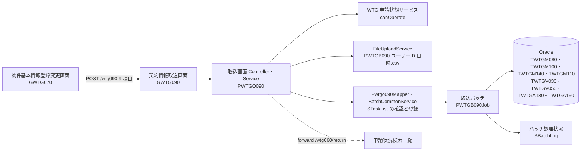
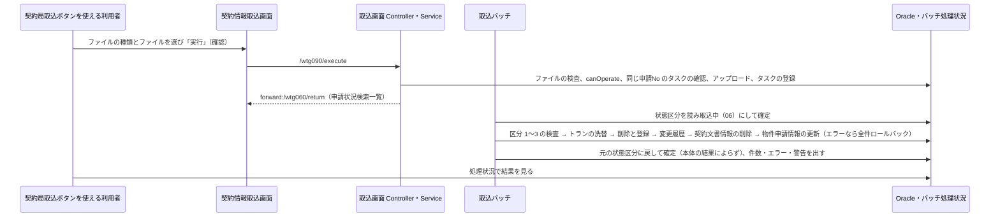
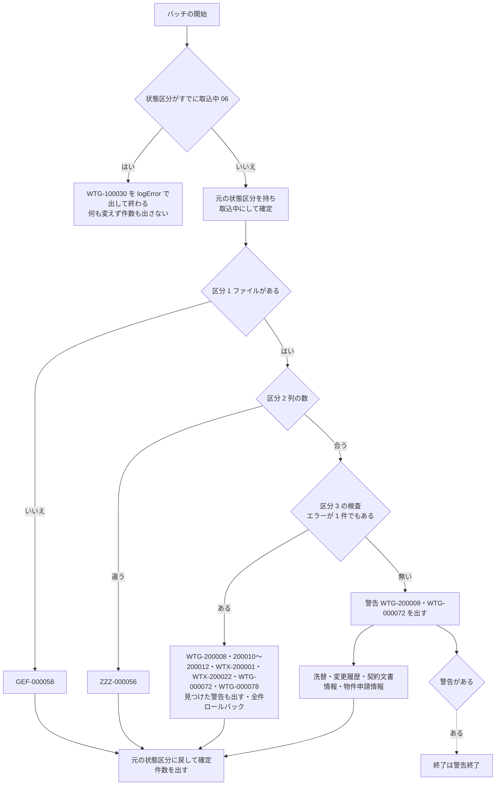

# 技術設計書

> このファイルは **「どう作るか」** を確定させる文書である。実装者ごとの解釈の食い違いを防ぎ、レビュー・実装・検証の共通の土台にする。\
> _分担_: 同一 feature の `requirements.md` が `status: approved` になるまで着手しない。本ファイルが `approved` になるまで `tasks.md` に進まない。`approved` は人間が付ける（エージェントは付けない）。

> _書き方_: 各節は結論から書き、検討の過程や調査ログは残さない。

> _出典の表記_: 「要件 N」「N.M」は `specs/contract-info-import/requirements.md` の要件と受け入れ基準ID。「Q-DS-CI-xxx」は本 feature の design 作成中の質問への回答（回答者 Junichi Noumi、2026-10-08。原文は `.aidd/.engine/answer-ds-ci-20261008-1551.txt`）。「リバースの表」「対応表」「検査表」は回答者が渡した資料（`_handoff/phase5-contract-info-import-reverse-381.md`・`_handoff/phase5-contract-info-import-mapping.md`・`_handoff/phase5-contract-info-import-checks.md`）で、回答者の指示で本書の正とする。「pbi design」は `specs/property-basic-info/design.md`、「ir design」は `specs/issue-request/design.md`（どちらも approved）。既存 wing・WTX_Batch のパスは、steering が手本に挙げる既存の実装（PWTGB040・PWTGB050 ほか）から読み取った根拠を示す。今回の案件の成果物（正解）にあたるコードは根拠にしていない（作業ツリーに該当するコードは無い）。\
> _上流との関係_: 本書で「上流から意図して外れる」と書いた箇所は、人間の回答に従って書いたもので、上流（steering・pbi design）は Phase 5 の最後にまとめて直す（upstream-carryover）。

## 概要（Overview）

> 実装者が最初に読む節。何を誰に提供し、既存の何が変わるかを示す。\
> _分担_: 要件そのものは `requirements.md`。ここには設計上の位置づけだけを書く。

> _書き方_: 設計用語を使わず、この設計書を初めて読む人に通じる言葉で書く。

- **目的（Purpose）**: 物件基本情報登録変更画面の契約局取込ボタンを使える利用者 に 契約局情報と発行依頼書を CSV（リバースデータ 381 列か発行依頼書データ 228 列）から申請ごとに入れ直す取込画面（契約情報取込 GWTG090）と取込バッチ（PWTGB090） を提供する。
- **利用者（Users）**: 物件基本情報登録変更画面の契約局取込ボタンを使える利用者と申請の状態（pbi requirements の 14.5）（`requirements.md` の 1.7）
- **影響（Impact）**: 現在の 契約局情報と発行依頼書を画面で 1 件ずつ入れる形 を ファイル 1 つで申請の契約局情報と発行依頼書を全部入れ直し、変わった行の前の内容を変更履歴に残す形 に変更する。

### 達成目標（Goals）
> このフィーチャーが成功したと言える状態を定める節。

> _書き方_: 1 項目 1 行。基準を明記して、達成したかどうかを後から判定できる書き方にする。

- 取込画面で実行すると、取込のタスクが登録され、物件契約情報申請状況検索一覧に戻る。同じ申請No のタスクが待機中・処理中なら受け付けない（1.1〜1.8、Q-DS-CI-006・Q-DS-CI-015）
- バッチが、検査表のとおりに区分 1〜3 を検査し、エラーが 1 件でもあれば全件を取り消し、無ければ申請の契約局情報と発行依頼書を対応表のとおりに入れ直す（2.1〜2.6、4.1〜4.5、Q-DS-CI-001〜004・Q-DS-CI-010・Q-DS-CI-011）
- 洗替の前後で連番が同じで内容が違う行だけ、前の内容が変更履歴（`TWTGA150`・`TWTGA130`）に入る（3.1・3.2、Q-DS-CI-008）
- 取込のあいだ申請は取込中（06）になり、本体が失敗しても必ず元の状態に戻る（2.7、Q-DS-CI-006・Q-DS-CI-007）
- 件数・エラー・警告がバッチ処理状況に行番号付きで出る（4.6〜4.8、Q-DS-CI-012）

### やらないこと（Non-Goals）

> 達成目標に含めないことを先に宣言する節。`### 達成目標（Goals）` と対で読む。\
> _分担_: 実装として持たないものは `### このスペックが持たない責務（Out of Boundary）`。ここには目標の話だけを書く。

> _書き方_: 今回やらないだけのものと、今後もやらないものを書き分ける。

- 今後もやらない：取込中のまま残った申請を画面から戻す手段（運用で DB を直す。Q-DS-CI-007）
- 今後もやらない：取込の結果の表示画面と、取り込んだファイルの画面からのダウンロード（既存のバッチ処理状況一覧を使う。2.11）
- 今後もやらない：既存の契約情報のテーブル（`TWTGM010` 系）の更新（2.10）
- 今回やらない：本 feature 固有の性能目標値を設けること（`requirements.md` の非機能要件。既存 WiNG の水準に従う）
- 今回やらない：画面の配置と見た目を決めること（Phase 8 の実装で決める。物件基本情報登録変更と同じ）

## 責務境界（Boundary Commitments）

> 実装物として**どのスペックが何を持つか**を確定させる節。タスク分解と後工程の検証もここを基準にする。\
> _分担_: 何を作り何を作らないかは `requirements.md` の `## スコープの境界（Boundary Context）`。ここには所有するデータとインターフェース、依存してよい相手を書く。

### このスペックが持つ責務（This Spec Owns）

> このスペックが持ち主になるものを宣言する節。

> _書き方_: 各項目 1 行。他のスペックとの間で担当が曖昧になりやすいものから先に書く。振る舞いをどのコンポーネントが担うかは `## コンポーネントとインターフェース（Components and Interfaces）` に書く。

- **所有するデータ**:
  - 取込による契約局情報（`TWTGM140`）と発行依頼書（`TWTGM100`）の申請ごとの洗替（削除と登録）。テーブルの定義は pbi design・ir design が持つ（`.aidd/feature-list.md` の注記）
  - 取込のあいだの物件申請情報（`TWTGM080`）の状態区分（取込中 06 と元の状態）と、取込の終わりの基地局番号ほかと単独複数局フラグの更新（2.7・2.8、Q-DS-CI-005）
  - 契約文書情報（`TWTGM110`）の、稟議バーコードNo が契約局情報に無くなった行の物理削除（2.9、Q-DS-CI-009）
  - 取込のタスク（タスクID `A8B36D2BB98F419FB0718303BCA2C9B6`）・出力コード `PWTGB090` と、取り込んだファイル（Q-DS-CI-013・Q-DS-CI-014）
  - JAVA-KIT のメッセージ `WTG-200008`〜`WTG-200012` と `WTG-100030`（Q-DS-CI-012、design-check 2 回目 #3）
- **定義するインターフェース**:
  - 契約情報取込画面（GWTG090）と、その口（`/wtg090` が受け取る 9 項目、`/wtg090/execute` ほか）（Q-DS-CI-015）
  - 取込ファイルの形：リバースデータ 381 列（リバースの表。契約情報ダウンロードの出力と同じ並び）と発行依頼書データ 228 列（pbi design の出力 CSV の 2 行目以降と同じ並び）（2.1・2.2、Q-DS-CI-001・Q-DS-CI-002）
  - 取込のタスクのパラメータ（Q-DS-CI-015 の 6）

### このスペックが持たない責務（Out of Boundary）

> 関連はするが、このスペックが持ち主にならないものを宣言する節。「ついでに」で実装範囲が広がるのを防ぐ。\
> _分担_: ここには持ち主が他にあるものだけを書く。目標として掲げないものと、今回やらないと決めただけのものは `### やらないこと（Non-Goals）`。

> _書き方_: 他に任せるものは委譲先を必ず添える。委譲先が決まっていないものは `## 設計判断（Design Decisions）` で扱う。

- **他に任せる範囲と、その委譲先**:
  - 契約局取込ボタンと、取込画面に渡す 9 項目（14.6）、ボタンを出す番と状態（14.5）、操作できるかの判定 `canOperate`（契約局取込）→ `specs/property-basic-info/design.md`
  - `TWTGM140`・`TWTGM080`・`TWTGM110` の定義 → pbi design。`TWTGM100`・トラン（`TWTGV030`・`TWTGV050`）・変更履歴（`TWTGA130`・`TWTGA150`）の定義と、変更履歴の手順の元 → ir design（Q-DS-CI-008）
  - 物件契約情報申請状況検索一覧の `/wtg060/return`（取込の後の遷移先）→ `specs/application-status-search/design.md`
  - リバースデータと同じ 381 列の CSV の出力 → 契約情報ダウンロード（contract-info-download）
  - バッチ処理状況一覧（`/zzz010/`）→ 既存
  - タスク・出力定義・メニュー権限・VE・JAVA-KIT のメッセージの投入の実施 → 発注者が導入手順書に沿って行う。投入の文と手順は本 feature の tasks で作る（Q-DS-CI-014）
  - 取込中のまま残った申請の戻し → 運用（導入手順書・運用手順に書く。Q-DS-CI-007）
- **後のフェーズに回す作業**:
  - 画面の配置・見た目：Phase 8 の実装で決める（物件基本情報登録変更と同じ）
  - Oracle を使う確認（VE・SQL）とバッチの実行の確認：総合テスト（試験仕様書）に回す（物件基本情報登録変更と同じ。Q-DS-PBI-014）

### 依存してよい対象（Allowed Dependencies）

> このフィーチャーが前提にしてよい既存の仕組みを列挙する節。\
> _分担_: 要件として何に依存するかは `requirements.md` の `## 前提と依存（Dependencies / Assumptions）`。ここには実装が使ってよい範囲と守る制約を書く。

> _書き方_: 依存先は、システム名・コンポーネント名・共有基盤名など後から特定できる固有名で書く。制約には一方向性、循環の禁止、レイヤをまたぐ条件など、守るべき条件を書く。

- **依存先**:
  - WTG 申請状態サービス（`function/wtg/common`。pbi design の公開契約）：`getApplication`・`canOperate`（契約局取込）・`getExternalScope`（社外ユーザーの範囲）
  - wing の共通基盤：`BatchCommonService.insertTask`（`wing/src/main/java/jp/co/kccs/wt/common/service/BatchCommonService.java:50`〜`:63`。タスクの登録だけで、`STaskList` を調べる口は無いので、確認は本 feature の Mapper で行う）、`FileUploadService.fileUpload`（`wing/src/main/java/jp/co/kccs/wt/common/service/FileUploadService.java:60`〜`:85`）、バッチ処理状況一覧への渡し方（`Pzzzo011CondInfo`）、`SessionService`、`LoginUserUtils`
  - WTX_Batch の共通基盤：`WTBatchJob`（`logError`・`logWarn`・`writeCustomLog`）、`WTJobUtils`（`getUserID`・件数）、`DSOutputLogic.findHistoryFile`、`WTImportFileParser`、`KCProperty`（`CHARSET`＝Windows-31J）、VE（`GDBVirtualEntityLoaderImpl`）
  - WTX_Batch の既存の共通部品 `WTKeikakuJudgeUtils.chkKichikyoku(String)`（`WTX_Batch/src/jp/co/kccs/wt/util/WTKeikakuJudgeUtils.java:98`。局種別判定マスタ `WTZ/MASTER/M09` を引く。ir design が使う wing の同名の部品と同じ判定）（契約区分の判定。design-check 1 回目 #9）
  - マスタ：計画マスタ（`TWTBM010`）・工事案件マスタ（`TWTBM080`）・契約基本情報（`TWTGM010`。リバースデータの検査だけ）・郵便番号-住所マスタ・ユーザー管理マスタ（`TWTZM010`）・コードマスタ（`TWTZM040`）（読むだけ）
- **依存の制約**:
  - 画面は Controller → Service の向きだけで呼び、ほかの機能パッケージの Service・Mapper を呼ばない。WTG 申請状態サービスは `function/wtg/common` の共通部品として呼ぶ（`steering/architecture.md` の `## レイヤーと依存ルール`）
  - バッチは wing の画面のクラスを参照しない。テーブルは VE を通して読み書きする
  - 既存の契約情報のテーブル（`TWTGM010` 系）を書かない（2.10）。承認履歴（`TWTGM180`）を増やさない（pbi design）

### 再確認が必要になる変更（Revalidation Triggers）

> ここに挙げた変更が起きたら、依存するスペックや利用側に再確認を依頼する節。

> _書き方_: 1 項目 1 行（例: 契約の形（API・イベント・型の定義）の変更、データ所有権の移動、依存方向の変更、起動・実行時の前提条件の変更）。

- `TWTGM140`・`TWTGM100` の列の変更（対応表とリバースの表が変わる。pbi design・ir design）
- トラン・変更履歴の列と比べる範囲の変更（ir design と本 feature が同じ手順を使う）
- 物件基本情報登録変更の出力 CSV（228 列）と、契約情報ダウンロードの CSV（381 列）の並びの変更
- 物件基本情報登録変更から渡す 9 項目と、`canOperate`（契約局取込）の条件の変更
- 稟議バーコードNo の形の変更（ir design の 3.2）
- 検査の基準になる発行依頼書登録変更の入力チェック（`specs/issue-request/design.md` の `#### 項目ごとの規則（Q-DS-IR-006）`）の変更

## アーキテクチャ（Architecture）

> このフィーチャーをどの構成に載せるかを決める節。\
> _分担_: レイヤ構成と依存のルールは `steering/architecture.md` の `## レイヤーと依存ルール`、命名とコード規約は `steering/tech.md` の `## 命名規則` と `## コード規約`。ここにはこのフィーチャー固有の構成だけを書く。

### 既存アーキテクチャの分析（Existing Architecture Analysis）

> 既存システムに手を入れる場合に、守るべき前提を確認する節。

> _書き方_: 今回の変更で壊してはいけないものを挙げる。現状の評価や改善案は書かない。

- **現行のパターンと制約**: 既存の取込（画面 `wing/src/main/java/jp/co/kccs/wt/function/wtg/wtg040/service/Pwtgo040Service.java`、バッチ `WTX_Batch/src/jp/co/kccs/wt/wtg/wtg040/PWTGB040Job.java`）は、画面がファイルを `FileUploadService` で置いてタスクを登録し、バッチが 1 つのトランザクションで全件を検査・登録して、エラーがあれば全件ロールバックし、エラーを 1 件ずつ `logError`、件数を `writeCustomLog` で出す。列ごとの検査は Const の表と `CheckUtils.onCheck` で行う。バッチのメッセージは JAVA-KIT の DB から読む
- **守るべきドメイン境界**: 承認フロー（審査フェーズ・承認履歴）は WTG 申請状態サービスが持ち、取込は審査フェーズを変えず、承認履歴を増やさない。既存の契約情報（`TWTGM010` 系）は変えない（2.10、`steering/product.md` の既存 WTG 機能の保全）
- **維持する統合ポイント**: タスク（`STaskList`・`SBatchInfo`）、出力定義と出力履歴（`TZZZM026`・`TZZZM027`）、バッチ処理状況一覧（`/zzz010/`）、メニュー権限（`ZMENUAUTH`）、VE、JAVA-KIT のメッセージ
- **解消 / 回避する技術的負債**: <DSN_EXISTING_DEBT>（不要：既存の構成（画面とバッチ、既存の共通部品）にそのまま乗せる新しい機能で既存のコードは直さないため、解消する技術的負債も、避けるために設計を変える技術的負債も無い — 回答者 Junichi Noumi、2026-10-07（物件基本情報登録変更と同じ））

### アーキテクチャ方式と境界図（Architecture Pattern & Boundary Map）

> 採用する構成とコンポーネント間の関係を、図と文で示す節。

> _書き方_: 図は例であり、大文字の名前はすべて実際のコンポーネント名に置き換えたり、ノードを追加したりして関係性を示すようにする。関係が複雑でない場合は図を省いて文だけでもよい。



- **選択したパターン**: 既存の取込と同じ「画面がファイルを置いてタスクを登録 → バッチが検査して入れ直す」作り。取込中にする更新と元に戻す更新は、本体と別のトランザクションにする（Q-DS-CI-006・Q-DS-CI-007、`steering/database.md` の取込のトランザクション）
- **ドメイン / 機能の切り分け**: 画面は受け付けの判定・ファイルの検査（区分 0）・アップロード・タスクの登録だけ。ファイルの中身の検査・洗替・変更履歴・状態の更新はバッチ
- **既存パターンとの整合**: プログラムID `PWTGO090`（画面）・`PWTGB090`（バッチ）、パッケージ `function/wtg/wtg090/`（画面）・`jp.co.kccs.wt.wtg.wtg090`（バッチ）、URL `/wtg090/<アクション>`、Const・CheckUtils・Job の分け方は PWTGB040 と同じ（`steering/tech.md` の `## 命名規則`、Q-DS-CI-015）
- **新規コンポーネントを置く理由**: 契約局情報と発行依頼書を入れ直す取込は既存に無い（`requirements.md` の要件 1・2）
- **steering との整合**: 新しい技術を持ち込まない（`steering/tech.md`）。取込中の更新と戻す更新を本体と別に確定し、失敗した取込は自動で再実行しない（`steering/database.md`・`steering/non-functional.md` のリトライ）。警告に住所の値を出すことと、タスクのパラメータに氏名を入れることは steering から意図して外れる（`### セキュリティ上の考慮（Security Considerations）`）

### 技術スタック（Technology Stack）

> このフィーチャーで追加する、または例外的に採用する技術を書く節。\
> _分担_: プロジェクト共通のスタックは `steering/tech.md` の `## コアテクノロジ` と `## 主要ライブラリ`。ここには差分だけを書く。

> _書き方_: 1 行 1 技術。レイヤは Frontend / CLI、Backend / Service、Data / Storage、Messaging / Event、Infrastructure / Runtime などから選ぶ。

| レイヤ | 採用 / バージョン | このフィーチャーでの役割 | 備考 |
|---|---|---|---|
| Infrastructure / Runtime | 開発端末の JDK 1.8（`-source`/`-target` 1.7） | 開発端末でのコンパイルと自動テストの実行 | 本番は JDK 1.7（`steering/tech.md`）。物件基本情報登録変更と同じ（Q-DS-PBI-014）。steering/tech.md から意図して外れる。上流は Phase 5 の最後にまとめて直す（upstream-carryover） |

## データモデル（Data Models）

> このフィーチャーで変更するデータ構造を確定させる節。\
> _分担_: システム全体の ER 図・全体スキーマは `docs/architecture/data-model.md` の `## ER 図` に従う。命名と型の共通ルールは `steering/database.md` の `## 命名規則` と `## 型の指針`。

> _書き方_: このフィーチャーで変更するエンティティだけを書く。物理データモデルを変えたら `docs/architecture/data-model.md` との整合を確認する。

### ドメインモデル（Domain Model）

> 業務上の概念とその関係を、保存形式に依らない形で書く節。

> _書き方_: 実装の都合ではなく、業務としてどう成り立っているかで書く。集約は、一緒に更新しないと辻褄が合わなくなるデータのまとまり。値オブジェクトは、金額や住所のように、値が同じなら同じものとして扱ってよいもの。ドメインイベントは、「注文が確定した」のように業務で起きた出来事のうち、他に知らせる必要があるものを指す。不変条件は、いつ見ても成り立っていなければならない決まりを指す。

- **集約とトランザクション境界**: 「申請」を集約とし、1 回の取込でその申請No の契約局情報と発行依頼書を全部入れ直す（2.3）。トランザクションは 3 つに分ける：①取込中にする更新、②本体（検査・洗替・変更履歴・`TWTGM110` の削除・`TWTGM080` の更新。全件を 1 つで、エラーなら全件ロールバック）、③元に戻す更新（本体の結果によらず必ず実行）（Q-DS-CI-006・Q-DS-CI-007）
- **エンティティ / 値オブジェクト / ドメインイベント**: エンティティは契約局情報（行）・発行依頼書・変更履歴（行）。値オブジェクトはファイルの種類（"0" リバースデータ・"1" 発行依頼書データ）・データ行・行番号・稟議バーコードNo。ドメインイベントは「取込が終わった」（バッチ処理状況に件数として出す。他のシステムへは知らせない）
- **ビジネスルール / 不変条件**:
  - **ファイルの形**（2.1・2.2、Q-DS-CI-001・Q-DS-CI-002）：文字コード Windows-31J の CSV。1 行目が見出し行、2 行目からの 1 行が契約局 1 件。列の数は発行依頼書データが 228 列、リバースデータが 381 列で、見出し行も列の数だけを確かめる（値は見ない）。違えば `ZZZ-000056`。発行依頼書データの 228 列は、物件基本情報登録変更の出力 CSV の 2 行目以降と同じ並び（出力 CSV の 1 行目の 188 列は見出し行に置き換えないと取り込めない）。pbi design の「契約情報取込で読める形」はこのとおりではなく、pbi design は Phase 5 の最後にまとめて直す（upstream-carryover）。リバースデータの 381 列の並びはリバースの表（契約情報ダウンロードの出力と同じ。見出しの文字は見ない）
  - **入れる値**（2.4〜2.6、Q-DS-CI-001・Q-DS-CI-003・Q-DS-CI-004）：列ごとの入れ方は対応表（`TWTGM140` は 1、`TWTGM100` は 2。発行依頼書データとリバースデータで分けて書いている）を正とする
    - コードの列は、ファイルの名称でコードマスタを引いてキー3 を入れ、名称の列（「〜名」「(ﾌﾘｰﾌｫｰﾑ)」）にはファイルの名称をそのまま入れる。リバースデータのコードの列（都道府県ｺｰﾄﾞ・市区町村ｺｰﾄﾞなど）はコードのまま入れる。リバースデータの支払情報①〜④_消費税扱いは、契約情報ダウンロードがコードのまま出すので、検査では `P10` をキー3（ファイルの値）で引き（名称では引かない）、コードのまま税区分に入れる。契約者区分・法人_個人区分は、契約情報ダウンロードが名称（契約者区分は「契約者」「関係者」、法人_個人区分は `P06` の名称）にして出すので、名称で照合する。リバースデータの契約基本_受電方法（契約情報ダウンロードが予備項目4 の値か、予備項目4 が空なら ELECT_KIND を「1:電力会社直受」「2:テナント受電」「3:ａｕ受電」の文字にして出したもの）は、検査表 2-2 の ※8 のとおり、先頭の「1:」「2:」を削り、「3」で始まる値は「KDDI受電」にしてから `P43` の名称で照合する。`P43` に無い値はエラーにせず（検査表 2-3 No.9 は検査しない）、受電方法のコードを反映しない（横断確認 1 回目 #1、design-check 5 回目 #1。検査表の (3)・(10)、対応表）
    - 発行依頼書データは、契約基地局番号で計画マスタ（`TWTBM010`）を引いて、計画基地局番号・計画基地局名・基地局名・基地局名(ｶﾅ)（半角ｶﾀｶﾅにする）を入れる。リバースデータは、計画基地局番号はファイルの値、基地局名などは計画マスタから入れる
    - リバースデータで入れる先が空の列（250 列）は取り込まない。マイナンバーを受け取った日（No.68・95・122・149・176）は保存も検査もせず、メッセージにもログにも値を出さない。リバースデータに無い列は NULL（発行依頼書はほとんどの列が NULL）
    - 洗替の前から引き継ぐ値：`TWTGM140` は無し（一時保存フラグは "0"）。`TWTGM100` は担当エリア・担当エリア名を洗替の前の `TWTGM100` から（洗替の前に発行依頼書が無ければ NULL。design-check 1 回目 #4）、申請No・受付No・申請者と、発行依頼書データのときの契約稟議起案者の会社コード・所属名①②・氏名（会社名は会社コードで `P26` を引く）を物件基本情報登録変更画面から渡された値から入れる（対応表 2 の No.348・350〜352 の「(40)GM100．…」は渡された値に読み替える）。リバースデータのときは起案者の列は入れない。一時保存フラグは "0"
    - 契約区分（`TWTGM100`）：申請の審査フェーズが未起案（00）・起案済（01）なら、計画基地局番号で工事案件マスタ（`TWTBM080`、主幹部署 "B02"）が引ければ "003"（鉄道）、引けなければ `chkKichikyoku` が "S" か "D" なら "001"（ｵｰﾌﾟﾝ）、ほかは "002"（屋内）（`P78` のキー3。ir design の自動設定と同じ）。それ以外の審査フェーズなら渡された契約区分
    - 連番はファイルの中の順（1 から）（2.4）。発行依頼書は最初のデータ行から作る（2.5）
    - 稟議バーコードNo（2.6）：ファイルの 1 列目は使わず付け直す。発行依頼書データは「契約基地局番号＋"-"＋エリア接頭語（渡された担当エリアで `P34` を引いた文字項目1）＋受付No＋"-"＋契約区分（渡された値で `P78` を引いた文字項目1）」（ir design の 3.2 と同じ形）。受付No が空（発番の前）なら NULL。リバースデータのときは NULL。受付No が空のときとリバースデータのときに稟議バーコードNo を付けないことは、requirements 2.6 から意図して外れる（Q-DS-CI-004）。上流は Phase 5 の最後にまとめて直す（upstream-carryover。design-check 1 回目 #1）
  - **検査**（4.1〜4.5、Q-DS-CI-010・Q-DS-CI-011）：区分 1（ファイルがあるか。無い・0 バイトは `GEF-000058`）→ 区分 2（列の数。`ZZZ-000056`）→ 区分 3（列ごとの必須・桁・形式・コードの存在、ファイルの中の重複、項目どうしの整合）の順。ある区分でエラーが出たら次の区分に進まない。区分の中ではエラーが出ても全項目を検査し、1 つの項目に複数の検査があるときはエラーが出たらその項目の残りを飛ばす。列ごとの検査・整合・置換文字は検査表（発行依頼書データは 1-2〜1-4、リバースデータは 2-2・2-3）を正とする
    - 重複：発行依頼書データは契約基地局番号だけ（枝番は入れない）、リバースデータは計画基地局番号（No.1）だけで比べ、前の行と同じ値の行（2 回目以降）を `WTG-200010`（4.3）
    - 整合（4.4）：KDDI転貸借契約書と転貸借_契約種別は許す 16 通り（KDDI⇒UQ・UQ⇒KDDI・OCT⇒UQ・UQ⇒OCT の新設・増設・変更・解約）以外を `WTG-200008`。契約開始日と契約終了日、初回支払①〜④の対象期間 FROM と TO は、両方あるときだけ開始が後なら `WTG-000078`。初回支払①〜④の対象期間の片方だけと、初回支払の税区分と支払内容の税区分（支払内容側に値があるとき一致）は `WTG-200012`。条件つきの必須（調整額があれば調整理由、発送先が「元請」なら支社など）は検査表の注記のとおり `WTX-200001`
    - 1 件でもエラーがあれば全件を取り消し、取込の件数を 0 にする（4.5）
  - **警告**（4.6、Q-DS-CI-011）：発行依頼書データは、契約者・関係者①〜⑤の郵便番号で郵便番号-住所マスタを引き、都道府県名・市区町村名が一致し、町域名が字、番地と前方一致しなければ `WTG-200009`。住居表示・登記表示・契約者・関係者①〜⑤の「都道府県＋市区町村」の名称の組がコードマスタに無ければ `WTG-000072`（警告）。リバースデータは、契約者①〜⑤の郵便番号・都道府県・市区町村・字、番地をそれぞれ郵便番号-住所マスタと比べ、合わなければ `WTG-200009`。警告は取込を止めない。警告は `logWarn` で出し、警告だけのときは既存の基盤のとおり警告終了になる（`WTX_Batch/src/jp/co/kccs/greenearth/javakit/frame/batch/engine/WTActiveTask.java:351`。Q-DS-CI-012 の 5 の「正常終了」をこの内容に直した。design-check 1 回目 #7）
  - **洗替と変更履歴の順**（2.3・3.1・3.2、Q-DS-CI-008）：本体のトランザクションの中で、次の順に行う
    1. トランの洗替：その申請No の `TWTGV050`・`TWTGV030` の行を消し、洗替の前の `TWTGM140`・`TWTGM100` をそのまま写す（DELETE→INSERT。トランは使い終わっても消さない）
    2. その申請No の `TWTGM140`・`TWTGM100` を削除する
    3. データ行ごとに `TWTGM140` を登録し、最初のデータ行で `TWTGM100` も登録する。登録する `TWTGM140`・`TWTGM100` の行の `ExclusiveFG` には新しいランダム値を入れる（発行依頼書登録変更画面の排他の前提。ir design のサービス間。横断確認 1 回目 #2）
    4. 変更履歴：`TWTGM140` とトランを**連番で**突き合わせ、両方にある連番の行で「申請No 以降」の列が違うものだけ、トランの行（洗替の前の行）の全列をそのまま `TWTGA150` に入れる。前にだけある行・後にだけある行は入れない。並びが変わった行も「変わった」として入る。`TWTGM100` とトランを「契約区分以降」の列で比べ、違えば `TWTGA130` に入れる。登録者・登録日時・更新者・更新日時・排他フラグは比べない。履歴の行には「取込による変更」と分かる値を入れない
    5. 契約文書情報：その申請No の `TWTGM110` のうち、稟議バーコードNo が `TWTGM140` に無くなった行を物理削除する（リバースデータでは稟議バーコードNo が NULL なので全部消える）（2.9、Q-DS-CI-009）。pbi design の「行は物理削除しない」は物件基本情報登録変更の画面での扱いで、取込は例外。pbi design は Phase 5 の最後にまとめて直す（upstream-carryover）
    6. 物件申請情報（2.8、Q-DS-CI-005）：最初のデータ行の基地局番号（発行依頼書データは契約基地局番号、リバースデータは契約基本_基地局番号）で計画マスタを引き、`TWTGM080` の計画基地局番号・計画基地局名・基地局番号・基地局名・基地局名(ｶﾅ)・エリアコードを入れ直し、単独複数局フラグ（データ行が 2 行以上なら "1"、1 行なら "0"）と、新しい排他用の値（`ExclusiveFG`）を入れる。取込の前に開いていた画面からの更新は、排他エラーになる（pbi design のサービス間）
  - **取込中**（2.7、Q-DS-CI-006・Q-DS-CI-007）：バッチが動き出したときに `TWTGM080` の状態区分（`JOTAI_KBN`）を読み、すでに取込中（06）なら何も変えずに `WTG-100030` を `logError` で出してエラーで終わる（{0}・{1} は読んだ審査フェーズ・状態区分の名称、{2} は「契約局取込」。元に戻す更新も件数のメッセージもしない。design-check 1 回目 #2・3 回目 #2）。そうでなければ読んだ状態区分をバッチの中で持ち、取込中（06）にして確定する。本体のあと、本体の結果によらず別のトランザクションで元の状態区分に戻す。審査フェーズ・状態（14.5）は確かめ直さない。取込中にする更新・元に戻す更新・本体の更新は、どれも更新者＝タスクを登録した人（`WTJobUtils.getUserID()`）、更新日時、更新者名＝そのユーザー名（ユーザー管理マスタで引く）を入れる。戻す更新が動かずに取込中のまま残った申請は、運用で DB を直して戻す
  - **取り込んだファイル**（2.11、Q-DS-CI-013）：アップロードした場所（出力コード `PWTGB090` の出力先。「PWTGB090.ユーザーID.yyyyMMddHHmmss.csv」）に置いたままにし、バッチは処理の後に消さない（既存の取込バッチと違う）。エラーで取り消したときも残す。消す時期は既存 WiNG の運用に従う。画面からはダウンロードさせない

### 論理データモデル（Logical Data Model）
> ドメインモデルをデータ構造として整理する節。

> _書き方_: 保存先の製品には依存させない。製品固有の話は物理データモデルに書く

- **エンティティ間の多重度（カーディナリティ）**: 取込 1 : データ行 1..n（＝契約局情報 1..n。連番はファイルの順）、取込 1 : 発行依頼書 1（最初のデータ行）、申請 1 : トラン（契約局情報）0..n・トラン（発行依頼書）0..1、申請 1 : 変更履歴 0..n
- **属性と型**: テーブルの列と型は pbi design・ir design（`specs/issue-request/design.md` の `#### TWTGM140 の DB レイアウト（契約局情報ﾏｽﾀ。Q-DS-IR-004）`・`#### TWTGM100 の DB レイアウト（発行依頼書情報ﾏｽﾀ。Q-DS-IR-003）`・`#### TWTGV050 の DB レイアウト（契約局情報ﾄﾗﾝ。Q-DS-IR-013）`・`#### TWTGV030 の DB レイアウト（発行依頼書情報ﾄﾗﾝ。Q-DS-IR-013）`・`#### TWTGA150 の DB レイアウト（契約局情報変更履歴。Q-DS-IR-013）`・`#### TWTGA130 の DB レイアウト（発行依頼書情報変更履歴。Q-DS-IR-013）`）のとおり。ファイルの列の型・桁・必須はリバースの表と検査表のとおり
- **自然キー / 識別子**: 取込の単位は「会社コード＋申請No」。契約局情報は「会社コード＋申請No＋連番＋計画基地局番号」で、変更履歴の突き合わせは連番で行う（Q-DS-CI-008）。データ行はファイルの行番号で識別し、メッセージの {0} に入れる
- **参照整合性のルール**: DB の外部キーは張らず、アプリ側で保つ（`steering/database.md` の `## 整合性`）。契約局情報に無くなった稟議バーコードNo の契約文書情報は消す（2.9）。変更履歴は元の行が消えても残す

### 物理データモデル（Physical Data Model）
> 論理データモデルを実際の保存形式に落とした定義を書く節。

> _書き方_: 種別は RDB / Document Store / Event Store / KV・Wide-column などから選ぶ。RDB ならテーブル定義・主キー・外部キー・インデックス・分割方針、Document Store ならコレクション構造・埋め込みと参照の使い分け・シャードキーを書く。

| 種別 | 記載 |
|---|---|
| RDB | 表は作らず変えない。書くのは `TWTGM140`・`TWTGM100`（申請No ごとに削除と登録）、`TWTGV050`・`TWTGV030`（申請No ごとに削除と登録。一意キーは ir design のとおり `TWTGV050`＝会社コード＋申請No＋連番＋計画基地局番号、`TWTGV030`＝会社コード＋申請No。タスクの ID の列は無い）、`TWTGA150`・`TWTGA130`（登録だけ）、`TWTGM110`（削除だけ）、`TWTGM080`（状態区分・基地局番号ほか・単独複数局フラグ・排他用の値の更新だけ）。どれもバッチが VE を通して読み書きする（Q-DS-CI-008・Q-DS-CI-014） |
| ファイル | 取り込んだファイル：出力コード `PWTGB090` の出力先（`TZZZM026`。既存の PWTGB040 と同じ場所）に「PWTGB090.ユーザーID.yyyyMMddHHmmss.csv」で置き、出力履歴（`TZZZM027`）に登録する。消さない（Q-DS-CI-013） |

### データ契約と外部連携（Data Contracts & Integration）

> 外部とやり取りするデータの形と、その互換性の方針を決める節。

> _書き方_: API はリクエスト / レスポンスの schema・検証・シリアライズ形式、イベントは schema・バージョニング・互換性、サービス間は分散トランザクション（Saga / 2PC など）と整合性の方針を書く。

- **API**: 画面以外から呼ばれる API は持たない（`steering/api-standards.md` の本プロジェクトでの扱い）。画面の要求は `##### API 契約（API Contract）` のフォーム送信だけ
- **イベント**: 持たない。画面とバッチはタスク（`STaskList`）でつなぐ（既存の取込と同じ）
- **サービス間**: wing の画面と取込バッチは同じ DB を共有する。取込のあいだ申請は取込中（06）になり、物件基本情報登録変更・発行依頼書登録変更・申請状況検索一覧では「番なし」・リンクなしになる。取込の後、物件基本情報登録変更は `TWTGM080` の、発行依頼書登録変更は `TWTGM100`・`TWTGM140` の排他用の値が変わるので、取込の前に開いていた画面からの更新は排他エラーになる（pbi design・ir design。横断確認 1 回目 #2）
- **タスクのパラメータ**（Q-DS-CI-015 の 6）：`CsvFileName`（サーバーに置いたファイル名）、`g_CsvFileName`（元のファイル名）、`g_FileType`（ファイルの種類）、`g_ApplicationNo`（申請No）、`g_UketsukeNo`、`g_KeiyakuKbn`、`g_AreaCd`、`g_ApplicationName`（申請者）、`g_KeiyakuRingiKianshaKaishaCd`、`g_KeiyakuRingiKianshaShozoku1`、`g_KeiyakuRingiKianshaShozoku2`、`g_KeiyakuRingiKianshaName`。「キー=値」のタブ区切りで、`g_` の付くものはバッチ処理状況一覧に出る。元の状態区分は入れない
- **物件基本情報登録変更との口**：`/wtg070/keyakuTorikomi` から `/wtg090` に POST で 9 項目（申請No・受付No・契約区分・担当エリア・申請者・契約稟議起案者の会社コード・所属名①②・氏名。pbi requirements の 14.6）を受け取る。戻るは `/wtg090/back` から、セッションの申請No を付けて `forward:/wtg070/pushApplicationNo` へ送り、物件基本情報登録変更画面を出し直す（pbi design の呼び出し元。横断確認 1 回目 #8）
- **バッチ処理状況**（4.7・4.8、Q-DS-CI-012）：エラーは 1 件ずつ `logError`、警告は 1 件ずつ `logWarn`（どちらも行番号付き。詳細の表示は既存の上限 `WTZ/PARAM/P14/DISPLAY_LIMIT` まで）。件数は「契約情報ﾃﾞｰﾀ {0}件 取込みました（正常：{1}件 (ﾜｰﾆﾝｸﾞ：{2}件) /異常：{3}件）」を `writeCustomLog` で出す。件数はデータ行の数、ワーニングは警告の件数。エラーで取り消したときも、それまでに見つけた警告は出し、{0}・{1} を 0、{2} を警告の件数、{3} をエラーのあった行の数にする（design-check 1 回目 #3）

## コンポーネントとインターフェース（Components and Interfaces）

> 各コンポーネントの責務と、外部に公開する契約を確定させる節。契約は 5 種類ある。
>
> - **サービスインターフェース**: 他のコンポーネントから呼ばれる口
> - **API 契約**: 外部から HTTP で呼ばれる口
> - **イベント契約**: 非同期にやり取りするイベントの発行・購読
> - **バッチ / ジョブ契約**: 定期実行や一括処理
> - **状態管理**: 状態の持ち方と守り方
>
> _分担_: 物理配置は `## ファイル配置計画（File Structure Plan）`。全 API 共通の形式は `steering/api-standards.md` の `## リクエスト / レスポンス形式`、エラー表現は同ファイルの `## エラーハンドリング（API 契約）`。ここには論理的な責務と、このフィーチャー固有の契約を書く。

> _書き方_: まず一覧で全体像を示し、そのあと新しい境界を持つコンポーネントだけ詳細を書く。契約の種類は該当するものにチェックを入れ、同じ名前の小節だけを書く。実装上の注意やリスクは、判断に関わるものは `## 設計判断（Design Decisions）`、確認方法は `## テスト戦略（Testing Strategy）` に書く。
>
> - **ドメイン / レイヤの見出し**: ドメイン名で切るかレイヤ名で切るかはプロジェクトで決め、この節の中で揃える。複数あれば同じ形で繰り返す。`_N` は繰り返す印であり、配下のコンポーネントの `_N` と番号が対応するわけではない。
> - **サービスインターフェース**: メソッドごとに 1 行。型名は設計上の名前でよく、実装の型と一致していなくてよい。事前条件は呼ぶ側が満たしておくこと、事後条件は呼び出しが成功したときに保証されること、不変条件は処理の前後どちらでも常に成り立つことを書く。
> - **API 契約**: 1 行 1 エンドポイント。エラー列には返しうるステータスコードを列挙する。
> - **イベント契約**: 到達保証・順序保証は at-least-once / FIFO などの方式名で書く。
> - **バッチ / ジョブ契約**: 冪等性（同じ処理を何度実行しても結果が変わらない性質）をどう担保するかと、失敗時の復旧手順を書く。
> - **状態管理**: 状態が同時に更新されうる場合は、並行制御の方式まで書く。

- **監視**: 本 feature 固有の監視項目は無い。既存の WiNG の監視とバッチ処理状況一覧に任せる（`steering/non-functional.md` の `### 監視 / ヘルス`）

### コンポーネント一覧（Summary）

> このフィーチャーのコンポーネントを 1 行ずつ並べ、詳細を書くものを選ぶための節。

> _書き方_: 各行は下の詳細と対応し、コンポーネント名・ドメイン / レイヤ・目的・受け入れ基準ID は同じ値を書く。依存には主なものだけ、契約にはチェックした種類名を書く。

| コンポーネント | ドメイン / レイヤ | 目的 | 受け入れ基準ID | 依存 | 契約 |
|---|---|---|---|---|---|
| 取込画面 Controller | 契約情報取込 / Controller | 画面の表示・実行・クリア・処理状況・戻るの要求を受ける | 1.1〜1.6 | 取込画面 Service | API 契約 |
| 取込画面 Service | 契約情報取込 / Service | 渡された値のセッション、受け付けの判定、ファイルの検査とアップロード、タスクの登録 | 1.2、1.4、1.5、1.7、1.8、4.1 | WTG 申請状態サービス、`FileUploadService`、`BatchCommonService`、取込画面 Mapper | サービスインターフェース |
| 取込画面 Mapper | 契約情報取込 / Mapper | 同じ申請No の待機中・処理中の取込のタスクの確認（`STaskList` の読取り）と、範囲の判定に使う `TWTGM100` の契約稟議起案者_会社コードの読取り | 1.7、1.8 | Oracle | — |
| 取込画面のテンプレートとスクリプト | 画面 / FE | ファイルの種類（コンボ）・登録するファイル・5 つのボタン・実行の確認 | 1.2、1.3 | Controller | — |
| 取込バッチ | 契約情報取込 / バッチ（WTX_Batch） | 取込中にする・ファイルの検査・洗替・変更履歴・契約文書情報の削除・物件申請情報の更新・元に戻す・件数とメッセージ | 2.1〜2.11、3.1、3.2、4.2〜4.8 | VE、`WTBatchJob`、`DSOutputLogic` | バッチ / ジョブ契約、状態管理 |

### 契約情報取込

#### 取込画面 Controller

| 項目 | 内容 |
|---|---|
| 目的（Intent） | 画面の表示・実行・クリア・処理状況・戻るの要求を受ける |
| 受け入れ基準ID | 1.1〜1.6 |
| 担当 / レビュアー | <DSN_COMPONENT_OWNER>（不要：体制（担当・レビュアー）は案件の計画書で管理する — 回答者 Junichi Noumi、2026-10-07（物件基本情報登録変更と同じ）） |

**責務と制約**:
- **主たる責務**: `@RequestMapping("/wtg090")`・`@FuncID("PWTGO090")` で 6 つの口を受け、Service の結果でエラーなら同じ画面にメッセージを出す（Q-DS-CI-015）
- **ドメイン境界 / トランザクションの範囲**: トランザクションを持たない（Service が持つ）
- **データ所有権 / 不変条件**: 渡された 9 項目は画面に出さない（1.4）

**依存関係**:
- **呼び出し元（Inbound）**:
  - 物件基本情報登録変更画面（`/wtg070/keyakuTorikomi`）— 画面を開く（重要度: 高）
  - 取込画面のテンプレートとスクリプト — ボタン（重要度: 高）
  - バッチ処理状況一覧 — `/wtg090/return` に戻る（重要度: 中）
- **呼び出し先（Outbound）**:
  - 取込画面 Service — すべての処理（重要度: 高）
- **外部（External）**:
  - なし — 外部システムと通信しない（重要度: —）

**契約の種類**（チェックリスト）
- [ ] サービスインターフェース（Service Interface）
- [x] API 契約（API Contract）
- [ ] イベント契約（Event Contract）
- [ ] バッチ / ジョブ契約（Batch / Job Contract）
- [ ] 状態管理（State Management）

##### API 契約（API Contract）

> 画面のフォーム送信の口であり、画面以外から呼ばれる API ではない。URL は既存の規約どおり `/wtg090/<アクション>` の 1 段にする（`steering/tech.md` の `## 命名規則`）。`/wtg090/execute` は URL の末尾が `execute` なので CSRF の照合に乗る（`wing/src/main/resources/servlet-context.xml:121`〜`:130`。`/**/execute` は `:127`）。アップロードの上限は既存の設定（1,048,576,000 バイト。`servlet-context.xml:68`）のまま。エラーはどれも HTTP 200 で同じ画面にメッセージを出す。

| Method | Endpoint | Request | Response | Errors |
|---|---|---|---|---|
| POST | `/wtg090` | 9 項目（申請No・受付No・契約区分・担当エリア・申請者・契約稟議起案者の会社コード・所属名①②・氏名） | 取込画面。9 項目をセッションに置き、ファイルの種類はリバースデータ（1.1・1.2・1.4） | なし |
| POST | `/wtg090/execute` | ファイルの種類、登録するファイル（確認は画面で「実行します。よろしいですか？」） | タスクを登録して `forward:/wtg060/return`（1.5） | 入力（`GEF-000001`・`GEF-000058`・`ZZZ-000056`。4.1）、業務（`WTG-100030`：番・状態が合わない、同じ申請No のタスクが待機中・処理中。1.7・1.8） |
| POST | `/wtg090/clear` | なし | 取込画面（ファイルの選択を消し、ファイルの種類をリバースデータに戻す。セッションの値は残す） | なし |
| POST | `/wtg090/taskList` | なし | `forward:/zzz010/`（戻り先 `/wtg090/return`、機能ID WTG090、会社・事業所・グループID＝ログインユーザーのデフォルトグループ。権限グループ単位で表示）（1.6） | なし |
| GET・POST | `/wtg090/return` | なし | 取込画面（セッションの値で出し直す） | なし |
| POST | `/wtg090/back` | なし | セッションの申請No を付けて `forward:/wtg070/pushApplicationNo` へ送り、物件基本情報登録変更画面を出し直す（横断確認 1 回目 #8） | なし |

#### 取込画面 Service

| 項目 | 内容 |
|---|---|
| 目的（Intent） | 渡された値のセッション、受け付けの判定、ファイルの検査とアップロード、タスクの登録 |
| 受け入れ基準ID | 1.2、1.4、1.5、1.7、1.8、4.1 |
| 担当 / レビュアー | <DSN_COMPONENT_OWNER>（不要：体制（担当・レビュアー）は案件の計画書で管理する — 回答者 Junichi Noumi、2026-10-07（物件基本情報登録変更と同じ）） |

**責務と制約**:
- **主たる責務**: 画面を開くときに渡された 9 項目をセッションに置く。実行のときに、受け付けの判定・ファイルの検査・アップロード・タスクの登録をする。タスクのパラメータは、セッションの値をそのまま使う（DB から引き直さない）（Q-DS-CI-015 の 2）
- **ドメイン境界 / トランザクションの範囲**: 実行を 1 トランザクション（`@Transactional`）とする（タスクの登録）
- **データ所有権 / 不変条件**: 業務の表を書かない。取込中にするのはバッチで、画面ではしない（Q-DS-CI-006）

**依存関係**:
- **呼び出し元（Inbound）**:
  - 取込画面 Controller — すべての処理（重要度: 高）
- **呼び出し先（Outbound）**:
  - WTG 申請状態サービス — `getApplication`・`canOperate`（契約局取込）（重要度: 高）
  - `FileUploadService` — 出力コード `PWTGB090` でファイルを置く（重要度: 高）
  - 取込画面 Mapper（`Pwtgo090Mapper`）— `STaskList` の確認と、`TWTGM100` の契約稟議起案者_会社コードの読取り（重要度: 高）
  - `BatchCommonService` — タスクの登録（重要度: 高）
  - WTG 申請状態サービス — `getExternalScope`（社外ユーザーの範囲）（重要度: 高）
- **外部（External）**:
  - なし — 外部システムと通信しない（重要度: —）

**契約の種類**（チェックリスト）
- [x] サービスインターフェース（Service Interface）
- [ ] API 契約（API Contract）
- [ ] イベント契約（Event Contract）
- [ ] バッチ / ジョブ契約（Batch / Job Contract）
- [ ] 状態管理（State Management）

##### サービスインターフェース（Service Interface）

| メソッド | 入力 | 出力 | エラー |
|---|---|---|---|
| 画面の表示（`initDisplay`） | 9 項目 | 画面の値（ファイルの種類＝リバースデータ） | なし |
| 実行（`execute`） | ファイルの種類、登録するファイル、セッションの 9 項目、ログインユーザー | タスクの登録 | 下の手順のとおり `BindingResult` に積む |

- **実行の手順**（1.5・1.7・1.8・4.1、Q-DS-CI-006・Q-DS-CI-015）
  1. ファイルの検査：未選択 `GEF-000001`、0 バイト `GEF-000058`、拡張子が .csv・.CSV でない `ZZZ-000056`（既存の取込画面と同じ。`wing/src/main/java/jp/co/kccs/wt/function/wtg/wtg040/service/Pwtgo040Service.java:81`〜`:87`）
  2. 受け付けの判定：申請No で `getApplication` を引く。`getExternalScope` で社外ユーザーの範囲を取り、範囲外なら無いものとして `WTG-100030` で止める。範囲の判定に使う契約稟議起案者_会社コードは、取込画面 Mapper で申請No から `TWTGM100` を引いて取り、セッションの値（画面から渡された値）は使わない。登録者は `getApplication` の結果の `RegisteredPerson` と比べる（design-check 1 回目 #10・2 回目 #2）。`TWTGM100` が引けない（発行依頼書がまだ無い）申請は、会社コードの条件を満たさないものとし、登録者（`getApplication` の結果の `RegisteredPerson`）が本人なら範囲内とする（ir design・pbi design の 6.5 と同じ。design-check 3 回目 #1）。範囲内なら `canOperate`（契約局取込）で番と状態を判定し、合わなければ `WTG-100030`
  3. 多重実行の判定：取込画面 Mapper で `STaskList` を引き、同じ会社コード・タスクID `A8B36D2BB98F419FB0718303BCA2C9B6`・状態が待機中（'0'）か処理中（'1'）で、パラメータの先頭にタブを付けた文字列（タブ＋`parameter`）が「タブ＋`g_ApplicationNo=`＋申請No＋タブ」を含む行があれば `WTG-100030`。既存の連結（`BatchCommonService.toTSVString`）は「キー=値＋タブ」で並べ、先頭にタブを付けず並びも決まらないので、この形で比べて先頭の項目の見逃しと申請No の前方一致の誤りを防ぐ（状態の値は `wing/src/main/java/jp/co/kccs/wt/function/zzz/zzz010/service/Pzzzo011Service.java:205`〜`:211`。design-check 1 回目 #6・2 回目 #1）
  4. アップロード：`FileUploadService.fileUpload(ファイル, "PWTGB090", "WTG090", "PWTGO090")`
  5. タスクの登録：`BatchCommonService.insertTask(タスクID, "WTG090", パラメータ)`
- **事前条件（Preconditions）**: 物件基本情報登録変更画面から 9 項目を受け取って画面を開いている（セッションにある）。`SBatchInfo`・`TZZZM026` に取込の行がある
- **事後条件（Postconditions）**: 実行の成功後、ファイルが `PWTGB090` の出力先に置かれ、タスクが 1 件登録されている
- **不変条件（Invariants）**: 同じ申請No の取込のタスクは、待機中・処理中のものが 1 件を超えない（画面の判定とバッチの取込中の確かめで防ぐ）

#### 取込バッチ

| 項目 | 内容 |
|---|---|
| 目的（Intent） | 取込中にする・ファイルの検査・洗替・変更履歴・契約文書情報の削除・物件申請情報の更新・元に戻す・件数とメッセージ |
| 受け入れ基準ID | 2.1〜2.11、3.1、3.2、4.2〜4.8 |
| 担当 / レビュアー | <DSN_COMPONENT_OWNER>（不要：体制（担当・レビュアー）は案件の計画書で管理する — 回答者 Junichi Noumi、2026-10-07（物件基本情報登録変更と同じ）） |

**責務と制約**:
- **主たる責務**: `### ドメインモデル（Domain Model）` の取込中・検査・洗替と変更履歴の順・件数のとおりに処理する。列ごとの検査は Const の表と `CheckUtils.onCheck` で行う（PWTGB040 と同じ作り）
- **ドメイン境界 / トランザクションの範囲**: 取込中にする更新・本体・元に戻す更新を別々のトランザクションにする。本体は全件を 1 つにし、エラーがあれば全件ロールバックする
- **データ所有権 / 不変条件**: 既存の契約情報のテーブルを書かない（2.10）。承認履歴を増やさない。審査フェーズを変えない

**依存関係**:
- **呼び出し元（Inbound）**:
  - タスク（`STaskList`）— 取込画面が登録する（重要度: 高）
- **呼び出し先（Outbound）**:
  - VE — テーブルの読み書き（重要度: 高）
  - `DSOutputLogic.findHistoryFile`・`WTImportFileParser` — ファイルの取り出しと読み込み（重要度: 高）
  - `WTBatchJob`・`WTJobUtils` — メッセージ・件数・更新者（重要度: 高）
- **外部（External）**:
  - なし — 外部システムと通信しない（重要度: —）

**契約の種類**（チェックリスト）
- [ ] サービスインターフェース（Service Interface）
- [ ] API 契約（API Contract）
- [ ] イベント契約（Event Contract）
- [x] バッチ / ジョブ契約（Batch / Job Contract）
- [x] 状態管理（State Management）

##### バッチ / ジョブ契約（Batch / Job Contract）

- **起動契機（Trigger）**: 取込画面が登録したタスク（タスクID `A8B36D2BB98F419FB0718303BCA2C9B6`、タスク名「契約情報取込」）。キューは既存の WTG の取込（PWTGB040 など）と同じで、多重度は変えない（Q-DS-CI-014）
- **入力と検証**: パラメータ `CsvFileName` のファイルを `DSOutputLogic.findHistoryFile` で取り出し、文字コード `KCProperty.get("CHARSET")`（Windows-31J）で `WTImportFileParser(TYPE_CSV).parseByTrim` で読む。検査は区分 1〜3（`### ドメインモデル（Domain Model）`、検査表）
- **出力先**: `TWTGM140`・`TWTGM100`・`TWTGV050`・`TWTGV030`・`TWTGA150`・`TWTGA130`・`TWTGM110`・`TWTGM080`。バッチ処理状況（`SBatchLog`）にエラー・警告・件数
- **冪等性 / 復旧手順**: 洗替なので、同じファイルで取り込み直すと同じ結果になる（変更履歴は差が無ければ増えない）。エラーのときは本体が全件ロールバックされ、元に戻す更新で状態区分が戻るので、利用者はファイルを直して取込画面から実行し直す。自動で再実行はしない（`steering/non-functional.md` のリトライ）。戻す更新が動かずに取込中のまま残ったときは、運用で DB を直して戻す（Q-DS-CI-007）。取り込んだファイルは残す（Q-DS-CI-013）

##### 状態管理（State Management）

- **状態モデル**: 物件申請情報の状態区分（`JOTAI_KBN`）。取込のあいだだけ取込中（06）にし、終わったら動き出したときの値に戻す。審査フェーズは変えない
- **永続化 / 一貫性**: 取込中にする更新は本体の前に確定し、元に戻す更新は本体の結果によらず別のトランザクションで確定する。元の状態区分はバッチの中だけで持ち、タスクのパラメータに入れない（Q-DS-CI-006）
- **並行制御**: 画面は同じ申請No の待機中・処理中のタスクがあれば受け付けない。バッチは動き出したときにすでに取込中（06）なら何も変えずにエラーで終わる。取込のあいだ、ほかの画面は取込中の申請を「番なし」にして更新を受け付けない（pbi design）。取込の後は、物件基本情報登録変更は `TWTGM080` の、発行依頼書登録変更は `TWTGM100`・`TWTGM140` の排他用の値が変わるので、取込の前に開いていた画面からの更新は排他エラーになる（横断確認 1 回目 #2）

## 処理フロー（System Flows）

> このフィーチャーの主要な処理の流れを図で示す節。\
> _分担_: システム全体の主要ビジネスフローは `docs/architecture/system-overview.md` の `## 主要ビジネスフロー`。エラーコードの出し分けが複雑な場合は `## 機能固有のエラー処理（Error Handling）` の `### エラー時の分岐フロー`。

> _書き方_: プレースホルダは実際のコンポーネント名に置き換える。分岐・リトライ・例外時の扱いは、図に描くか図の下に文で補う。


**フロー上の主要な判断**: 取込中にするのはバッチが動き出したとき（画面ではない）。本体は全件を 1 つのトランザクションにして、1 件でもエラーがあれば何も入れない。元に戻す更新は本体と別にして、本体が失敗しても必ず動かす（Q-DS-CI-006・Q-DS-CI-007）。

## 機能固有のエラー処理（Error Handling）

> このフィーチャー固有のエラーコードと復旧の流れを決める節。\
> _分担_: API のエラー契約は `steering/api-standards.md` の `## エラーハンドリング（API 契約）`、例外処理の方針は `steering/tech.md` の `## 例外処理`、ログ・リトライ・監視は `steering/non-functional.md` の `## 信頼性・観測性`。

- **返し方**: 画面のエラーは `BindingResult` に積んで同じ画面に出す。バッチのエラー・警告は行番号付きでバッチ処理状況の詳細に出し、件数を出して終わる。警告は `logWarn` で出し、警告だけのときは警告終了になる（Q-DS-CI-012、design-check 1 回目 #7）。バッチの開始時にすでに取込中なら、`WTG-100030` を `logError` で出して終わり、件数のメッセージは出さない（取込をしていないため。design-check 1 回目 #2）
- **ログ**（Q-DS-CI-012）：各メッセージの {2} には検査表の「置換文字」の値（コードマスタの名称・郵便番号・都道府県と市区町村・金額・電話番号など）を入れる。氏名・メールアドレス・マイナンバーを受け取った日の値を入れるメッセージは無い。取り込んだファイルの行をそのままログに出さない。`WTG-200009` と警告の `WTG-000072` は、行番号と一緒に郵便番号・都道府県・市区町村・字、番地の値を出す（利用者が直す行を見つけるため）。`steering/non-functional.md` の「ログに住所を出さない」から意図して外れる。`WTG-200011` は、行番号と一緒に契約者・関係者の電話番号の値を出す（Q-DS-CI-012 の 3）。`steering/non-functional.md`・`steering/security.md` の「契約者の連絡先をログに出さない」から意図して外れる（design-check 1 回目 #5）。上流は Phase 5 の最後にまとめて直す（upstream-carryover）

### バリデーション設計

> 入力を受け付けるかどうかの判定条件を決める節。\
> _分担_: 入力検証と出力エスケープの全体方針は `steering/security.md` の `## 入力検証 / 出力エスケープ`、API 共通のバリデーション形式は `steering/api-standards.md` の `### 複数フィールドのバリデーション`。

> _書き方_: 全体方針と重複しない、このフィーチャー固有の条件だけを書く。

列ごとの必須・桁・形式・コードの存在と整合の全部は検査表（1-2〜1-4・2-2・2-3）を正とする。ここには区分ごとの代表と、本 feature で決めたものを書く。

検査表から外れる桁（人の決定、2026-10-09）：(a) 「その他①〜④」の桁は 50 とする（`specs/issue-request/design.md` の `#### 項目ごとの規則（Q-DS-IR-006）` の規則 2 と DB 列 Sonota1〜4_Freeform に合わせる。検査表の 100 からは外れる）。(b) 金額[1-4]・初回金額[1-4]の桁は検査表どおり 50 とし、DB 列（Payment_FeeN_Freeform など）の 50 で保存する。ir design の規則 4（11 バイト以内の数値）とは、取込では異なる。

| チェック対象 | 項目名 | 条件 / ルール | エラーコード | メッセージ例 | UI の対処 |
|---|---|---|---|---|---|
| 画面 | 登録するファイル | 選ばれている・0 バイトでない・拡張子が .csv（4.1） | `GEF-000001`・`GEF-000058`・`ZZZ-000056`（既存） | （既存の文言） | 同じ画面にメッセージを出し、タスクを登録しない |
| 画面 | 申請 | 社外ユーザーの範囲内で、`canOperate`（契約局取込）で受け付けられ、同じ申請No のタスクが待機中・処理中でない（1.7・1.8） | `WTG-100030`（物件基本情報登録変更が追加） | ステータス、状態区分、操作の組み合わせが不正です。ステータス：{0}… （{0}＝審査フェーズの名称（`P28`）、{1}＝状態区分の名称（`P27`）、{2}＝「契約局取込」。社外ユーザーの範囲外なら {0}・{1} は空） | 同上 |
| 区分 1 | ファイル | ある・0 バイトでない | `GEF-000058`（既存） | （既存の文言） | バッチ処理状況に出し、取り込まない |
| 区分 2 | 列の数（見出し行も） | 発行依頼書データ 228 列、リバースデータ 381 列（2.2） | `ZZZ-000056`（既存） | ﾌｧｲﾙ形式が違います | 同上 |
| 区分 3 | 許す値・組合せ・金額・部数 | 検査表のとおり | `WTG-200008`（新規） | 行数[{0}]:{1}[{2}]:入力が不正です | 同上（全件を取り消す） |
| 区分 3 | 重複 | 発行依頼書データは契約基地局番号、リバースデータは計画基地局番号（4.3） | `WTG-200010`（新規） | 行数[{0}]:{1}がCSVﾌｧｲﾙで重複しています | 同上 |
| 区分 3 | 電話番号 | 固定電話は 10 桁、IP 電話は 11 桁 | `WTG-200011`（新規） | 行数[{0}]:{1}[{2}]:固定電話は10桁、IP電話は11桁で入力してください。 | 同上 |
| 区分 3 | 組で入れる項目 | 初回支払の対象期間 FROM・TO、初回支払と支払内容の税区分 | `WTG-200012`（新規） | 行数[{0}]:{1}、{2}はｾｯﾄで入力してください | 同上 |
| 区分 3 | 条件つきの必須 | 調整額があれば調整理由、発送先が「元請」なら支社ほか | `WTX-200001`（既存） | 行数[{0}]:{1}:必ず入力してください | 同上 |
| 区分 3 | マスタの存在 | 計画マスタ・契約基本情報マスタにある | `WTX-200022`（既存） | 行数[{0}]:{1}:[{2}]{3}に登録されていません | 同上 |
| 区分 3 | コードの存在・日付の前後 | 名称がコードマスタにある、開始が終了より後でない | `WTG-000072`・`WTG-000078`（既存） | （既存の文言） | 同上 |
| 警告 | 郵便番号と住所 | 郵便番号-住所マスタと合う（4.6） | `WTG-200009`（新規。警告） | 行数[{0}]:{1}[{2}]:郵便番号と住所情報が一致しません。 | バッチ処理状況に警告として出し、取込を続ける |
| 警告 | 都道府県＋市区町村 | 名称の組がコードマスタにある（発行依頼書データ） | `WTG-000072`（既存。警告として出す） | （既存の文言） | 同上 |

### 機能固有エラーコード

> このフィーチャーだけが返すエラーコードを一覧にする節。

> _書き方_: 例「`FEATURE_X_INVALID_STATE` / 409 / 状態遷移の不整合 / UI でステータスを取得し直す」「`FEATURE_X_DEPENDENCY_DOWN` / 503 / 外部依存が使えない / 自動リトライ後にフォールバック」。

`WTG-200008`〜`WTG-200012` は、バッチが読む JAVA-KIT のメッセージ（DB）にだけ足す。wing の `messages.properties` には足さない（画面では使わない）。`WTG-100030` は、物件基本情報登録変更が wing の `messages.properties` に足すのとは別に、バッチが使うので JAVA-KIT のメッセージにも同じ文言で足す（design-check 2 回目 #3）。番号の帯は `WTG-2000xx`（Q-DS-CI-012）。

`WTG-100030` の置換文字は、本 feature で出すどの場面（受け付けない状態、社外ユーザーの範囲外、同じ申請No のタスクあり、バッチの開始時にすでに取込中）でも、{0}＝審査フェーズの名称（`P28` の名称）、{1}＝状態区分の名称（`P27` の名称）、{2}＝「契約局取込」とする。社外ユーザーの範囲外のときは申請を無いものとして扱うので、{0}・{1} を空にする（印刷・閲覧用帳票と同じ考え方。design-check 3 回目 #2）。

| エラーコード | HTTP | 意味 | 対応 |
|---|---|---|---|
| `WTG-200008`（新規） | —（バッチ処理状況） | 許す値でない、KDDI転貸借契約書と契約種別の組合せ、金額・部数の誤り | ファイルを直して取り込み直す |
| `WTG-200009`（新規。警告） | —（バッチ処理状況） | 郵便番号と住所が合わない | 確かめて必要なら直す（取込は続く） |
| `WTG-200010`（新規） | —（バッチ処理状況） | ファイルの中で基地局番号（または計画基地局番号）が重複 | 重複を除いて取り込み直す |
| `WTG-200011`（新規） | —（バッチ処理状況） | 電話番号の桁が合わない | 直して取り込み直す |
| `WTG-200012`（新規） | —（バッチ処理状況） | 組で入れる項目の片方だけ・不一致 | 直して取り込み直す |
| `WTG-100030`（物件基本情報登録変更が追加） | 200（同じ画面）／—（バッチ処理状況） | 社外ユーザーの範囲外、番・状態が合わない、同じ申請No のタスクが待機中・処理中、バッチの開始時にすでに取込中 | 状態を確かめ、取込が終わってから実行し直す |

### エラー時の分岐フロー

> `### 機能固有エラーコード` で定めたコードを、どの条件で返すかを図で示す節。分岐が多く、表だけでは追いにくい場合に書く。\
> _分担_: 処理の主要な流れは `## 処理フロー（System Flows）`。

> _書き方_: 図の中の大文字の名前は実際の処理名・エラーコードに置き換える。分岐のラベル（成立 / 不成立 / 成功 / 失敗）も判定内容に合わせて書き換える。



## ファイル配置計画（File Structure Plan）

> このフィーチャーで追加・変更するファイルを、どのディレクトリに置くかを示す節。\
> _分担_: ディレクトリ構成の規約は `steering/architecture.md` の `## ディレクトリ構成`、ファイルやディレクトリの命名規則は `steering/tech.md` の `## 命名規則`。論理的な責務は `## コンポーネントとインターフェース（Components and Interfaces）`。ここには規約に従って置く実際のファイルだけを書く。

> _書き方_: 繰り返し現れる構造はパターンを 1 度だけ書く。個別ファイルは責務が読み取りにくいときだけ挙げる。

```
wing/src/main/
├── java/jp/co/kccs/wt/function/wtg/wtg090/       # 機能ID WTG090（Q-DS-CI-015）
│   ├── controller/Pwtgo090Controller.java        # /wtg090 の 6 つの口、@FuncID("PWTGO090")
│   ├── service/Pwtgo090Service.java              # セッション・受け付けの判定・アップロード・タスクの登録（タスクID の定数）
│   ├── mapper/Pwtgo090Mapper.java                # STaskList の確認と TWTGM100 の起案者の会社コードの読取り（design-check 1 回目 #6・2 回目 #2）
│   └── form/Pwtgo090Form.java
├── resources/jp/co/kccs/wt/function/wtg/wtg090/Pwtgo090Mapper.xml
└── webapp/WEB-INF/pages/wtg/wtg090/
    └── pwtgo090.html・pwtgo090Script.html

WTX_Batch/src/jp/co/kccs/wt/wtg/wtg090/            # バッチ PWTGB090（PWTGB040 と同じ作り）
├── PWTGB090Job.java                               # 取込中・検査・洗替・変更履歴・戻し・件数
├── PWTGB090Const.java                             # VE の ID、列ごとの検査の表（228 列・381 列）、メッセージ
└── PWTGB090CheckUtils.java                        # 区分 3 の検査と警告
```

### 変更する既存ファイル（Modified Files）

> 新規追加ではなく、既存ファイルに手を入れる箇所を挙げる節。

> _書き方_: 何をどう変えるか、なぜ変えるかを 1 行で書く。

- <DSN_MODIFIED_FILE_N>（不要：既存のファイルは変えない。メッセージは JAVA-KIT の DB に、タスク・出力定義・メニュー権限・VE は導入手順書で投入する（`### 移行方針（Migration Strategy）`）— Q-DS-CI-012・Q-DS-CI-014） — <DSN_MODIFIED_REASON_N>（不要：同上）

## 追加検討事項（Additional Considerations）

> 機能の振る舞いそのものではないが、実装前に決めておくことをまとめる節。配下の見出しのうち、このフィーチャーに関係するものを書く。\
> _分担_: 選択肢を比べて選んだ判断は `## 設計判断（Design Decisions）`。要件としての目標値は `requirements.md` の `## 非機能要件（Non-Functional Requirements）`。

### セキュリティ上の考慮（Security Considerations）

> 認証・機密データ・外部連携・権限を扱うフィーチャーで書く節。\
> _分担_: 横断的な防御は `steering/security.md` の `## 基本方針`、認証・認可の標準は同ファイルの `## 認証・認可`。要件としてのセキュリティ目標は `requirements.md` の `## 非機能要件（Non-Functional Requirements）`。ここには実現手段だけを書く。

> _書き方_: 想定する攻撃者と守る対象を先に決めてから、対策を書く。

- **脅威と対策**:
  - 番でない利用者・取込中の申請への取込 → 実行のたびにサーバーで `canOperate`（契約局取込）と同じ申請No のタスクを確かめ、`WTG-100030` で拒否する（1.7・1.8）
  - 社外ユーザーの範囲外の申請 → 実行のたびに `getExternalScope` で範囲を取り、範囲外の申請No は無いものとして `WTG-100030` で拒否する（pbi design の公開契約。design-check 1 回目 #10）
  - 更新系の要求のなりすまし（CSRF）→ `/wtg090/execute` は既存の設定で CSRF を照合する
  - 取り込んだファイルの持ち出し → 画面からダウンロードさせない（2.11）。サーバーの出力先に置いたまま、既存 WiNG の運用で消す
  - ログからの個人情報の漏れ → 氏名・メールアドレス・マイナンバーを受け取った日の値をメッセージに入れず、ファイルの行をそのままログに出さない（Q-DS-CI-012）
- **認証・認可**: 画面を使えるかは既存の `AccessControlInterceptor`（`ZMENUAUTH`）で判定する。`PWTGO090` の行は、`PWTGO070` を登録するメニュー（［WTG070］と［WTG060］のメニュー。権限区分ごとに分かれていればそのすべて）すべてに、メニューID ごとに 1 行登録する（Q-DS-CI-014、横断確認 1 回目 #4）
- **データ保護 / プライバシー**: タスクのパラメータに申請者と起案者の氏名を入れ、バッチ処理状況一覧に出る（Q-DS-CI-015 の 6）。`steering/security.md` の「担当者の氏名は機密」から意図して外れる。警告に住所の値を、`WTG-200011` に電話番号の値を出すことも `steering/non-functional.md`・`steering/security.md` から意図して外れる（`## 機能固有のエラー処理（Error Handling）`）。上流は Phase 5 の最後にまとめて直す（upstream-carryover）

### 性能とスケーラビリティ（Performance & Scalability）

> 性能・高負荷・拡張に懸念があるフィーチャーで書く節。\
> _分担_: 目標値は `requirements.md` の `## 非機能要件（Non-Functional Requirements）` を参照する。

> _書き方_: 数値は再定義せず、参照元を示す。

- **目標値の参照元と計測方法**: `requirements.md` の非機能要件（`steering/non-functional.md` 準拠。本 feature 固有の目標値は無い）。総合テストで確かめる
- **拡張の方針（水平 / 垂直）**: 既存 WiNG の構成に従い、本 feature では変えない。キューの多重度も変えない（Q-DS-CI-014）
- **キャッシュ / 最適化**: キャッシュは持たない。コードマスタの名称の引き当ては 1 回の取込の中で使い回してよい（実装で決める）

### 移行方針（Migration Strategy）

> スキーマ移行やデータ移行が必要なフィーチャーで書く節。

> _書き方_: 各段階について、どこまで戻せるかを明記する。段階を図で示す場合は Mermaid のフローチャートを使う。

- **段階分け**（Q-DS-CI-014。投入の文と手順は本 feature の tasks で作り、投入の実施は発注者が導入手順書に沿って行う）
  - `SBatchInfo`・`SLocalization`：タスクID `A8B36D2BB98F419FB0718303BCA2C9B6`、タスク名「契約情報取込」、キューは既存の WTG の取込（PWTGB040 など）と同じ
  - `TZZZM026`：出力コード `PWTGB090`。出力先は既存の PWTGB040 と同じ
  - `ZMENUAUTH`：プログラム `PWTGO090` の行を、`PWTGO070` を登録するメニュー（［WTG070］と［WTG060］のメニュー。権限区分ごとに分かれていればそのすべて）すべてに、メニューID ごとに 1 行登録する。投入の文と手順は tasks で作り、投入は発注者が導入手順書に沿って行う（横断確認 1 回目 #4）
  - VE の定義：`TWTGM080`・`TWTGM100`・`TWTGM110`・`TWTGM140`・`TWTGA130`・`TWTGA150`・`TWTGV030`・`TWTGV050`・`TWTZM010`・`TWTZM040`・`TWTBM010`・`TWTBM080`・`TWTGM010`・郵便番号-住所マスタ。VE の ID は開発側が払い出す
  - JAVA-KIT のメッセージ：`WTG-200008`〜`WTG-200012` と `WTG-100030`（文言は物件基本情報登録変更と同じ。今回の案件で新しく作るキーで JAVA-KIT の DB にはまだ無い。バッチが開始時の取込中で出す。design-check 2 回目 #3）
  - 運用手順：取込中のまま残った申請を DB で戻す手順を、導入手順書・運用手順に書く（Q-DS-CI-007）
- **ロールバックを実施する条件**: <DSN_MIGRATION_ROLLBACK>（不要：既存データの移行は無く、追加する行は導入手順書に沿って発注者が投入する — Q-DS-PBI-015 と同じ）
- **検証チェックポイント**: <DSN_MIGRATION_CHECKPOINT>（不要：既存データの移行は無く、テストの詳細は試験仕様書に書く — Q-DS-PBI-015 と同じ）

#### 移行対象ファイル一覧

> 移行するファイル・テーブルを漏れなく数え上げる節。\
> _分担_: ファイルごとの詳細仕様は `## コンポーネントとインターフェース（Components and Interfaces）` のバッチ / ジョブ契約と `## データモデル（Data Models）`。

> _書き方_: 処理区分は 新規 / 更新 / 廃止。移行後の扱いは 削除 / アーカイブ / 引き継ぎ先 などを書く。

| ファイル / テーブル名 | 処理区分 | レコード数見込み | 移行方法 | 移行後の扱い |
|---|---|---|---|---|
| `SBatchInfo`・`SLocalization`（取込のタスク） | 更新（行の追加） | 各 1 行 | 導入手順書に沿って投入 | ― |
| `TZZZM026`（`PWTGB090`） | 更新（行の追加） | 1 行 | 同上 | ― |
| `ZMENUAUTH`（`PWTGO090`） | 更新（行の追加） | `PWTGO070` を登録するメニューの数（メニューID ごとに 1 行。横断確認 1 回目 #4） | 同上 | ― |
| VE の定義 | 更新（行の追加） | 使う 14 のテーブル・マスタの分 | 同上 | ― |
| JAVA-KIT のメッセージ | 更新（行の追加） | 6 行（`WTG-200008`〜`WTG-200012`・`WTG-100030`） | 同上 | ― |

### テスト体制 / テスト仕様

> 総合テストや受け入れテストで独立した仕様書が必要な場合に書く節。通常は `## テスト戦略（Testing Strategy）` で足りる。

> _書き方_: 連絡先は非機密の情報だけを書く。

- **テスト責任者 / 承認者**: <DSN_TEST_OWNER>（不要：体制・環境・期間・連絡先は案件の計画書で管理し、テストの詳細は試験仕様書に書くため。試験仕様書と計画書で扱う — Q-DS-PBI-015 と同じ）
- **テスト環境**: <DSN_TEST_ENVIRONMENT>（不要：体制・環境・期間・連絡先は案件の計画書で管理し、テストの詳細は試験仕様書に書くため。試験仕様書と計画書で扱う — Q-DS-PBI-015 と同じ）
- **テスト期間**: <DSN_TEST_PERIOD>（不要：体制・環境・期間・連絡先は案件の計画書で管理し、テストの詳細は試験仕様書に書くため。試験仕様書と計画書で扱う — Q-DS-PBI-015 と同じ）
- **問題発生時の連絡先**: <DSN_TEST_ESCALATION>（不要：体制・環境・期間・連絡先は案件の計画書で管理し、テストの詳細は試験仕様書に書くため。試験仕様書と計画書で扱う — Q-DS-PBI-015 と同じ）
- **詳細仕様書**: <DSN_TEST_SPEC_LINK>（不要：体制・環境・期間・連絡先は案件の計画書で管理し、テストの詳細は試験仕様書に書くため。試験仕様書と計画書で扱う — Q-DS-PBI-015 と同じ）

## テスト戦略（Testing Strategy）

> このフィーチャーで何をどの粒度で確認するかを決める節。\
> _分担_: 共通のテスト方針は `steering/tech.md` の `## テスト方針`。総合テストや受け入れテストで独立した仕様書が要る場合は `### テスト体制 / テスト仕様`。

> _書き方_: 各項目は外から確認できる期待結果とセットで書き、**受け入れ基準ID** と対応づける。受け入れ基準を確認できる分だけ書き、区分ごとに件数を揃えることは目的にしない。

- **単体（Unit）**:
  - 画面の実行：未選択・0 バイト・拡張子違いで既存のキー、`canOperate` で受け付けない状態と同じ申請No の待機中・処理中のタスクで `WTG-100030`、受け付けたときにパラメータがセッションの値で作られる（1.5・1.7・1.8・4.1）
  - 検査：区分 1〜3 の順と止まり方、列ごとの検査（検査表の代表）、重複（契約基地局番号・計画基地局番号）、KDDI の 16 通り、日付の前後、組で入れる項目、条件つきの必須、警告が取込を止めないこと（4.2〜4.6）
  - 入れる値：対応表の代表の列（コードの引き当て、名称をそのまま、計画マスタからの値、引き継ぐ値、契約区分の判定、稟議バーコードNo の形と NULL、リバースデータで入れない列とマイナンバーを受け取った日）（2.4〜2.6）
  - 変更履歴：連番で突き合わせ、比べる範囲で違う行だけ前の行の全列が入り、前にだけ・後にだけある行は入らない（3.1・3.2）
  - 件数とメッセージ：正常・ワーニング・異常の件数、エラーで取り消したときの 0（4.7・4.8）
  - 自動テストは JUnit 4.12 で書き、VE とファイルの読み込みの代わりは手書きの代替クラスにする。結果は Maven Surefire の XML・HTML を使い、カバレッジは取らない（`steering/tech.md` の `## テスト方針`。物件基本情報登録変更と同じ。Q-DS-PBI-014）
- **結合（Integration）**:
  - Oracle と VE を使う確認（洗替の順、トラン、変更履歴、`TWTGM110` の削除、`TWTGM080` の更新、取込中と戻し・本体が失敗したときの戻し、バッチの起動）は開発端末では動かせないため、総合テスト（試験仕様書）で行う（2.3〜2.11、3.1、3.2。物件基本情報登録変更と同じ。Q-DS-PBI-014）
- **E2E / UI**:
  - 画面の操作（物件基本情報登録変更から開く、5 つのボタン、処理状況とその戻り、実行の後の申請状況検索一覧）と、バッチ処理状況の表示は総合テスト（試験仕様書）で行う（1.1〜1.6、4.7、4.8。物件基本情報登録変更と同じ。Q-DS-PBI-014・Q-DS-PBI-015）
- **性能 / 負荷（Performance / Load）**:
  - <DSN_TEST_PERFORMANCE_N>（不要：本 feature 固有の性能目標値は無い — `requirements.md` の非機能要件。既存 WiNG の水準に従う）

## 設計判断（Design Decisions）

> このフィーチャーで下した技術判断を、結論とその理由で残す節。\
> _分担_: セキュリティ・性能・移行など、実装前に決めておく観点は `## 追加検討事項（Additional Considerations）`。比較表や調査資料そのものは `## 補足資料（Supporting References）`。ここには選択肢を比べて選んだことだけを書く。

> _書き方_: 1 つの判断につき 1 ブロック。判断 2 以降も同じ形で追加する。背景には「なぜ判断が必要になったか」を書く。判断は選んだ結論だけを言い切る。採用理由には、他の案ではなくこれを選んだ決め手だけを書く。代替案は実際に検討したものだけを不採用の理由とセットで挙げ、検討していない案は書かない。採用による影響には、引き受ける負担・残るリスク・後で見直す条件を書く。

### 判断 1: 取込中にするのはバッチが動き出したときで、多重実行は画面とバッチの両方で防ぐ

- **背景（Context）**: 2.7 は取込のあいだ申請を取込中にすることを、1.8 は同じ申請No の取込を重ねないことを求める
- **判断（Decision）**: 画面は同じ申請No の待機中・処理中のタスクがあれば受け付けない。取込中（06）にするのはバッチが動き出したときで、すでに取込中なら何も変えずにエラーで終わる。元の状態区分はバッチの中だけで持つ（Q-DS-CI-006 の B）
- **採用理由（Rationale）**: 回答者の決定に従う。タスクが待機中のあいだは申請を止めず、バッチが動いている間だけ止められる
- **代替案（Alternatives）**: 画面の実行のときに取込中にする案（Q-DS-CI-006 の A）— 回答者が B を選んだため採らない
- **採用による影響（Consequences）**: タスクが待機中のあいだに、ほかの画面で申請が更新されうる（取込はその後の内容を洗替で上書きする）

### 判断 2: 元に戻す更新は本体と別のトランザクションで必ず動かし、それでも残ったら運用で戻す

- **背景（Context）**: 本体がエラーで止まると、申請が取込中のまま残り、どの画面からも操作できなくなる
- **判断（Decision）**: 元に戻す更新は本体の結果によらず別のトランザクションで実行する。それでも取込中のまま残った申請は、運用で DB を直して戻す。画面の手段は作らない（Q-DS-CI-007 の A）
- **採用理由（Rationale）**: 回答者の決定に従う。通常のエラーでは必ず戻り、まれな残りだけ運用で扱う
- **代替案（Alternatives）**: 取込中を解く画面の手段を作る案（Q-DS-CI-007 の B）— 回答者が A を選んだため採らない
- **採用による影響（Consequences）**: 戻す手順を導入手順書・運用手順に書く必要がある

### 判断 3: 取り込んだファイルは消さずに残す

- **背景（Context）**: 2.11 は取り込んだファイルをサーバーに保存することを求める。既存の取込バッチは処理の後にファイルを消す
- **判断（Decision）**: アップロードした場所（`PWTGB090` の出力先）に置いたままにし、バッチは消さない。エラーのときも残す（Q-DS-CI-013）
- **採用理由（Rationale）**: 回答者の決定に従う。別の場所へ移さずに 2.11 を満たせる
- **代替案（Alternatives）**: 契約稟議ファイルと同じ形で、申請No ごとのフォルダ（`swf.upload.directory.root` の下）へ写して保存する案（Q-DS-CI-013 の 1 の下書きの案）— 回答者が置いたままにすると決めたため採らない
- **採用による影響（Consequences）**: 消す時期は既存 WiNG の運用に従うので、出力先の容量を運用で見る必要がある

## 補足資料（Supporting References）

> 本文に置くと長くなる資料の置き場所を示す節。\
> _分担_: 調査の結論は `## 設計判断（Design Decisions）` に要約だけを書く。ここには資料のありかだけを書く。

> _書き方_: 資料には巨大な型定義、製品比較、全カラム表などを挙げる。内容にはその資料を見ると何が分かるかを書く。参照先には変わりにくいパスまたは URL を書き、確定していなければ未定と書く。

| 資料 | 内容 | 参照先 |
|---|---|---|
| リバースデータ 381 列の項目定義 | No・項目名・型・バイト数・必須・入れる先（回答者の指示で本書の正） | `_handoff/phase5-contract-info-import-reverse-381.md` |
| 対応表 | ファイルの列からテーブルの列への入れ方（`TWTGM140`・`TWTGM100`、発行依頼書データとリバースデータ）、コードマスタの参照条件（回答者の指示で本書の正） | `_handoff/phase5-contract-info-import-mapping.md` |
| 検査表 | 区分 1〜3 の列ごとの検査・整合・警告・置換文字（228 列は 1-2〜1-4、381 列は 2-2・2-3）（回答者の指示で本書の正） | `_handoff/phase5-contract-info-import-checks.md` |
| 既存の取込の手本 | 画面のファイルの検査・アップロード・タスクの登録、バッチのトランザクション・検査の表・件数・メッセージ | `wing/src/main/java/jp/co/kccs/wt/function/wtg/wtg040/service/Pwtgo040Service.java`・`WTX_Batch/src/jp/co/kccs/wt/wtg/wtg040/PWTGB040Job.java`・`WTX_Batch/src/jp/co/kccs/wt/wtg/wtg040/PWTGB040Const.java` |
| テーブルの定義と変更履歴の手順 | `TWTGM100`・`TWTGM140`・トラン・変更履歴の列、比べる範囲 | `specs/issue-request/design.md` の `#### TWTGM100 の DB レイアウト（発行依頼書情報ﾏｽﾀ。Q-DS-IR-003）`・`#### TWTGM140 の DB レイアウト（契約局情報ﾏｽﾀ。Q-DS-IR-004）`・`### データ契約と外部連携（Data Contracts & Integration）` の「変更履歴の手順」 |
| 取込画面への口と状態 | `/wtg070/keyakuTorikomi`・9 項目・`canOperate`・取込中の扱い | `specs/property-basic-info/design.md` |

---

_「どう作るか」を確定させる文書。_
