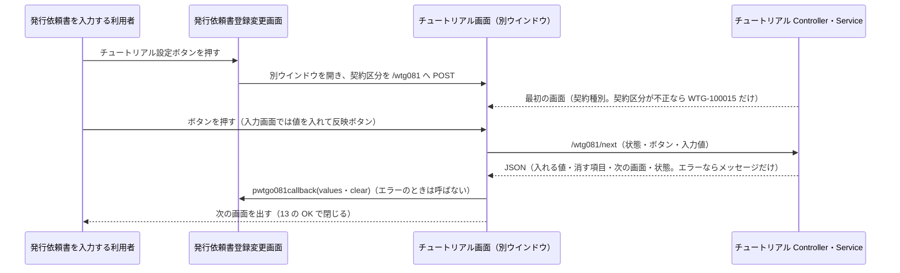
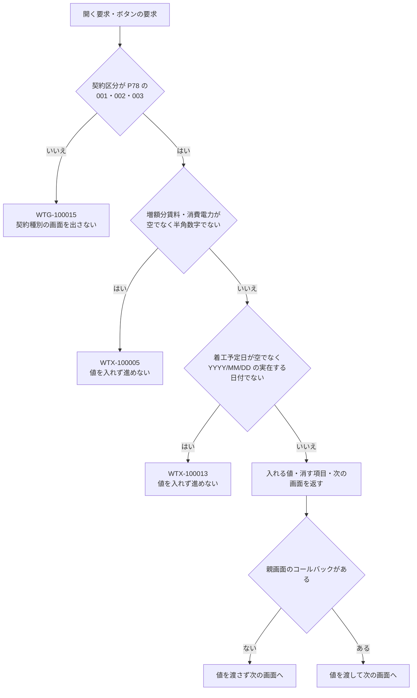

# 技術設計書

> このファイルは **「どう作るか」** を確定させる文書である。実装者ごとの解釈の食い違いを防ぎ、レビュー・実装・検証の共通の土台にする。\
> _分担_: 同一 feature の `requirements.md` が `status: approved` になるまで着手しない。本ファイルが `approved` になるまで `tasks.md` に進まない。`approved` は人間が付ける（エージェントは付けない）。

> _書き方_: 各節は結論から書き、検討の過程や調査ログは残さない。

> _出典の表記_: 「要件 N」「N.M」は `specs/issue-request-tutorial/requirements.md` の要件と受け入れ基準ID。「Q-DS-TU-xxx」は本 feature の design 作成中の質問への回答（回答者 Junichi Noumi、2026-10-08。原文は `.aidd/.engine/answer-ds-tu-20261008-1138.txt`）。「ir design」は `specs/issue-request/design.md`（approved）で、本書はその公開契約（チュートリアルとの受け渡し、`/wtg080/changeKeiyakuSyubetsuTutorial`）だけを前提にする。`_handoff/phase5-issue-request-tutorial-flow.md`（画面の分岐表と表示文言）と `_handoff/phase5-issue-request-tutorial-mapping.md`（選択・入力と項目の対応表）は回答者が回答の別ファイルとして渡したもので、回答者の指示で本書の正とする（Q-DS-TU-004〜006）。既存 wing のパスは、既存の実装から読み取った根拠を示す。今回の案件の成果物（正解）にあたるコードは根拠にしていない（作業ツリーに該当するコードは無い）。\
> _上流との関係_: 本書で「上流から意図して外れる」と書いた箇所は、人間の回答に従って書いたもので、上流（steering・requirements・ir design）は Phase 5 の最後にまとめて直す（upstream-carryover）。

## 概要（Overview）

> 実装者が最初に読む節。何を誰に提供し、既存の何が変わるかを示す。\
> _分担_: 要件そのものは `requirements.md`。ここには設計上の位置づけだけを書く。

> _書き方_: 設計用語を使わず、この設計書を初めて読む人に通じる言葉で書く。

- **目的（Purpose）**: 発行依頼書登録変更画面（GWTG080）で発行依頼書を入力する利用者 に 選択肢に答えながら転貸借の欄と KDDI転貸借契約書を順に入れられる別ウインドウ（チュートリアル GWTG081）と、答えた値を発行依頼書登録変更画面の項目へ入れる仕組み を提供する。
- **利用者（Users）**: 発行依頼書登録変更画面でチュートリアル設定ボタンを押せる利用者（ボタンを出す条件は ir design。`requirements.md` の概要）
- **影響（Impact）**: 現在の 転貸借の欄（契約種別・局種別・設置設備・電気料【月額】・賃料【月額】・着工予定日・転貸情報の有無）と KDDI転貸借契約書を利用者が 1 つずつ選ぶ・入力する形 を 画面ごとのボタンを押すたびに、その答えが発行依頼書登録変更画面の項目へ入る形 に変更する。

### 達成目標（Goals）
> このフィーチャーが成功したと言える状態を定める節。

> _書き方_: 1 項目 1 行。基準を明記して、達成したかどうかを後から判定できる書き方にする。

- チュートリアル設定ボタンで別ウインドウが開き、契約区分が P78 の 001・003 なら屋外の契約種別、002 なら屋内の契約種別の画面が最初に出る。それ以外（空を含む）なら `WTG-100015` だけが出る（1.1・1.4・1.11、Q-DS-TU-001〜003）
- 11 の画面が、`_handoff/phase5-issue-request-tutorial-flow.md` の 1・2 の表のとおりに出し分けられ、進む（1.3〜1.9、Q-DS-TU-004）
- ボタン・反映ボタンを押すたびに、`_handoff/phase5-issue-request-tutorial-mapping.md` の 2 の表の値が、発行依頼書登録変更画面にいま表示している契約局の項目へ入る（2.1〜2.3、Q-DS-TU-005）
- 増額月額賃料・au設備の消費電力・着工予定日の誤りは、値を入れず、画面を進めず、メッセージを出す（3.2〜3.4、Q-DS-TU-008）
- チュートリアルはデータベースの発行依頼書・契約局情報を読み書きしない（2.4、Q-DS-TU-002）

### やらないこと（Non-Goals）

> 達成目標に含めないことを先に宣言する節。`### 達成目標（Goals）` と対で読む。\
> _分担_: 実装として持たないものは `### このスペックが持たない責務（Out of Boundary）`。ここには目標の話だけを書く。

> _書き方_: 今回やらないだけのものと、今後もやらないものを書き分ける。

- 今後もやらない：設置設備のRRH数・設置設備のSystem構成・UPS工事の 3 画面（業務の見直しで廃止。Q-DS-TU-004）。requirements 1.3・1.9 から意図して外れる。上流は Phase 5 の最後にまとめて直す（upstream-carryover）
- 今後もやらない：ブラウザーの × でウインドウが閉じられることを防ぐこと（Q-DS-TU-001）。requirements 1.10 から意図して外れる。上流は Phase 5 の最後にまとめて直す（upstream-carryover）
- 今回やらない：本 feature 固有の性能目標値を設けること（`requirements.md` の非機能要件。既存 WiNG の水準に従う）
- 今回やらない：画面の配置と見た目を決めること。本書は画面ごとの見出し・説明・例・ボタンとその出し分けだけを書き、配置と見た目は Phase 8 の実装で決める（物件基本情報登録変更・発行依頼書登録変更と同じ）

## 責務境界（Boundary Commitments）

> 実装物として**どのスペックが何を持つか**を確定させる節。タスク分解と後工程の検証もここを基準にする。\
> _分担_: 何を作り何を作らないかは `requirements.md` の `## スコープの境界（Boundary Context）`。ここには所有するデータとインターフェース、依存してよい相手を書く。

### このスペックが持つ責務（This Spec Owns）

> このスペックが持ち主になるものを宣言する節。

> _書き方_: 各項目 1 行。他のスペックとの間で担当が曖昧になりやすいものから先に書く。振る舞いをどのコンポーネントが担うかは `## コンポーネントとインターフェース（Components and Interfaces）` に書く。

- **所有するデータ**:
  - <DSN_OWNS_DATA_N>（不要：チュートリアルはデータベースの表を持たず、読み書きもしない。参照するのはコードマスタ（`TWTZM040`）だけ — Q-DS-TU-002）
- **定義するインターフェース**:
  - チュートリアル画面（GWTG081）と、その入口（`/wtg081` が受け取る `FunctionID`・`keiyakuKbn`）と、画面の切替の口（`/wtg081/next`）（Q-DS-TU-001・Q-DS-TU-002）
  - 発行依頼書登録変更画面から開く部品（`pages/wtg/wtg081/pwtgo081ZoomForm.html`。ir design の公開契約にまだ無い。親画面は `pwtgo081ZoomForm.html` を読み込み、ウインドウ名 `pwtgo081` で開く）（Q-DS-TU-001）
  - 親画面へ値を入れる受け渡しの形（コールバックの名前と、渡す JSON の項目・値・「空にする」の印）（`### データ契約と外部連携（Data Contracts & Integration）`。ir design の受け渡しの口に合わせる）
  - 画面の分岐と表示文言（`_handoff/phase5-issue-request-tutorial-flow.md`）と、選択・入力と項目の対応（`_handoff/phase5-issue-request-tutorial-mapping.md`）（Q-DS-TU-004〜006）

### このスペックが持たない責務（Out of Boundary）

> 関連はするが、このスペックが持ち主にならないものを宣言する節。「ついでに」で実装範囲が広がるのを防ぐ。\
> _分担_: ここには持ち主が他にあるものだけを書く。目標として掲げないものと、今回やらないと決めただけのものは `### やらないこと（Non-Goals）`。

> _書き方_: 他に任せるものは委譲先を必ず添える。委譲先が決まっていないものは `## 設計判断（Design Decisions）` で扱う。

- **他に任せる範囲と、その委譲先**:
  - チュートリアル設定ボタンを出すかどうか（開ける人と状態。1.2）→ `specs/issue-request/design.md`（Q-DS-TU-002 の B）
  - 受け取った値を項目へ入れること、入れる先が入力できないときに入れないこと、契約種別を入れたときの局種別・設置設備・電気料のリストの入れ直し、表示の整形（賃料のカンマ、着工予定日の保存の形への変換）→ `specs/issue-request/design.md`（Q-DS-TU-005・Q-DS-TU-007）
  - 入れた値の保存（発行依頼書・契約局情報の登録・変更と変更履歴）→ `specs/issue-request/design.md`（2.4）
  - コードマスタ（`TWTZM040`）の P37・P41・P53・P54・P56・P59・P64・P78・P87・P88 の行と、`ZMENUAUTH` の PWTGO081 の行の投入 → 発注者（`### 移行方針（Migration Strategy）`、Q-DS-TU-002）
- **後のフェーズに回す作業**:
  - 画面の配置・見た目と、入力欄の属性（最大桁 12・10 のほかの IME など）：Phase 8 の実装で決める（物件基本情報登録変更と同じ）
  - 別ウインドウと親画面の受け渡しを含む画面の操作の確認：総合テスト（試験仕様書）に回す（物件基本情報登録変更と同じ。Q-DS-PBI-014）

### 依存してよい対象（Allowed Dependencies）

> このフィーチャーが前提にしてよい既存の仕組みを列挙する節。\
> _分担_: 要件として何に依存するかは `requirements.md` の `## 前提と依存（Dependencies / Assumptions）`。ここには実装が使ってよい範囲と守る制約を書く。

> _書き方_: 依存先は、システム名・コンポーネント名・共有基盤名など後から特定できる固有名で書く。制約には一方向性、循環の禁止、レイヤをまたぐ条件など、守るべき条件を書く。

- **依存先**:
  - 発行依頼書登録変更画面（ir design の公開契約）：チュートリアル設定ボタンと、親画面の受け取りのコールバック（`window.opener[ウインドウ名 + 'callback'](json)`）、`/wtg080/changeKeiyakuSyubetsuTutorial`（契約区分と契約種別から局種別・設置設備のリストを返す）
  - wing の共通基盤：`SessionCheckInterceptor`・`AccessControlInterceptor`（`@FuncID` と `ZMENUAUTH`）・`ExceptionResolver`・`LoginUserUtils`（`wing/src/main/java/jp/co/kccs/wt/common/`）
  - コードマスタ：`CodeMstService` と `TWTZM040`（WTG/PARAM の P37・P41・P53・P54・P56・P59・P64・P78・P87・P88。値は `_handoff/phase5-issue-request-tutorial-mapping.md` の 3）（`wing/src/main/java/jp/co/kccs/wt/common/service/CodeMstService.java`）
  - 別ウインドウの開き方：`/zoom/wait` と `createWindowFeatures`、フォームの `target` に指定した POST（`wing/src/main/webapp/WEB-INF/pages/common/zoomForm.html`）。ウインドウの大きさは `wing-web.properties` の `ZOOM_DEFINE.<id>`（`wing/src/main/resources/wing-web.properties:13`）
  - カレンダー：`calendar` クラスの入力欄の datepicker（`wing/src/main/webapp/static/vender/kccs/js/calendar.js`）と、`addSlash`／`removeSlash`（`wing/src/main/webapp/static/vender/kccs/js/custom.js`）
  - メッセージ：`wing/src/main/resources/messages.properties`
- **依存の制約**:
  - 画面は Controller → Service の向きだけで呼び、Mapper を持たない。ほかの機能パッケージ（`wtg080` ほか）の Controller・Service を呼ばない（`steering/architecture.md` の `## レイヤーと依存ルール`）
  - 発行依頼書登録変更画面とは、ウインドウ間の受け渡し（開くときの POST と親画面のコールバック）だけでつなぎ、互いの Java のクラスを参照しない（ir design の依存の制約）
  - 発行依頼書（`TWTGM100`）・契約局情報（`TWTGM140`）ほか業務の表を読み書きしない（2.4、Q-DS-TU-002）

### 再確認が必要になる変更（Revalidation Triggers）

> ここに挙げた変更が起きたら、依存するスペックや利用側に再確認を依頼する節。

> _書き方_: 1 項目 1 行（例: 契約の形（API・イベント・型の定義）の変更、データ所有権の移動、依存方向の変更、起動・実行時の前提条件の変更）。

- 親画面への受け渡しの形（コールバックの名前、JSON の項目名・値の形・「空にする」の印）の変更（issue-request が受け取る）
- 開くときに渡す値（`FunctionID`・`keiyakuKbn`）と、開く部品（`pwtgo081ZoomForm.html`）の変更（issue-request が読み込む）
- 発行依頼書登録変更画面の項目名・入力可否の制御・契約種別の変更時の処理（`/wtg080/changeKeiyakuSyubetsuTutorial`）の変更（チュートリアルの入れる先と順が変わる）
- コードマスタ P37・P41・P53・P54・P56・P59・P64・P78・P87・P88 のコード値・名称・文字項目の意味の変更（対応表と分岐が変わる）
- 画面の分岐表・表示文言（`_handoff/phase5-issue-request-tutorial-flow.md`）と対応表（`_handoff/phase5-issue-request-tutorial-mapping.md`）の変更

## アーキテクチャ（Architecture）

> このフィーチャーをどの構成に載せるかを決める節。\
> _分担_: レイヤ構成と依存のルールは `steering/architecture.md` の `## レイヤーと依存ルール`、命名とコード規約は `steering/tech.md` の `## 命名規則` と `## コード規約`。ここにはこのフィーチャー固有の構成だけを書く。

### 既存アーキテクチャの分析（Existing Architecture Analysis）

> 既存システムに手を入れる場合に、守るべき前提を確認する節。

> _書き方_: 今回の変更で壊してはいけないものを挙げる。現状の評価や改善案は書かない。

- **現行のパターンと制約**: wing の画面は Spring MVC の Controller（`@FuncID` でプログラムID を宣言）→ Service の作りで、別ウインドウは `/zoom/wait` を開いてからフォームの `target` に POST して表示し、値は子ウインドウが `window.opener[windowName + 'callback'](json)` で親画面の関数を呼んで渡す（`wing/src/main/webapp/WEB-INF/pages/common/zoomForm.html`・`zoomScript.html:44`）。画面内で JSON を返す口は `@ResponseBody` の Controller で作る（`wing/src/main/java/jp/co/kccs/wt/function/wte/wte020/controller/Pwteo020Dialog2Controller.java`）
- **守るべきドメイン境界**: 発行依頼書と契約局情報のデータとその保存は発行依頼書登録変更が持つ。チュートリアルは画面の項目へ値を渡すだけにする（2.4）
- **維持する統合ポイント**: ログインとセッション（`ZSESSION`）、メニュー権限（`ZMENUAUTH`）、コードマスタ（`TWTZM040`）、メッセージ（`wing/src/main/resources/messages.properties`）、ズームの大きさの定義（`wing-web.properties`）
- **解消 / 回避する技術的負債**: <DSN_EXISTING_DEBT>（不要：既存の構成（Spring MVC、既存の別ウインドウの作り）にそのまま乗せる新しい機能で既存のコードは直さないため、解消する技術的負債も、避けるために設計を変える技術的負債も無い — 回答者 Junichi Noumi、2026-10-07（物件基本情報登録変更と同じ））

### アーキテクチャ方式と境界図（Architecture Pattern & Boundary Map）

> 採用する構成とコンポーネント間の関係を、図と文で示す節。

> _書き方_: 図は例であり、大文字の名前はすべて実際のコンポーネント名に置き換えたり、ノードを追加したりして関係性を示すようにする。関係が複雑でない場合は図を省いて文だけでもよい。

```mermaid
flowchart LR
    PARENT[発行依頼書登録変更画面<br/>GWTG080<br/>pwtgo081ZoomForm を読み込む] -.window.open・POST keiyakuKbn.-> UI
    UI[チュートリアル画面<br/>GWTG081 別ウインドウ] -->|POST /wtg081/next JSON| CTL[チュートリアル Controller]
    CTL --> SVC[チュートリアル Service]
    SVC --> CMS[wing 共通<br/>CodeMstService]
    CMS --> DB[(Oracle<br/>TWTZM040)]
    UI -.window.opener の callback.-> PARENT
```

- **選択したパターン**: 別ウインドウの画面（テンプレートとスクリプト）と、ボタンを押すたびに呼ぶ JSON の口（Controller → Service）。画面の状態（いまの画面・経路・受電のみ選択済など）は別ウインドウのスクリプトが持ち、毎回サーバーへ送る。サーバーは状態を持たない（Q-DS-TU-001・Q-DS-TU-002・Q-DS-TU-008）
- **ドメイン / 機能の切り分け**: 次の画面の決定・出し分け・入れる値の決定・入力チェックはチュートリアル Service、画面の切替表示・カレンダー・今日の日付の初期値・親画面のコールバック呼出しはチュートリアル画面のスクリプト、値を項目へ入れることと入力可否・リストの入れ直しは発行依頼書登録変更画面
- **既存パターンとの整合**: 別ウインドウの開き方と値の返し方は既存のズームと同じ作りにする（`zoomForm.html`・`zoomScript.html`）。チュートリアルは独立した機能ID（WTG081、画面ID GWTG081、プログラムID PWTGO081）を持つので、親の `wtg080` ではなく自分のパッケージ `function/wtg/wtg081` に置く（Q-DS-TU-001。`steering/tech.md` の `## 命名規則`）
- **新規コンポーネントを置く理由**: チュートリアルは新しい画面で、既存の画面に同じ責務のものが無い（`requirements.md` の要件 1）
- **steering との整合**: 新しい技術・外部連携を持ち込まない（`steering/tech.md`）。権限は `AccessControlInterceptor` と `ZMENUAUTH` で判定する（`steering/security.md` の `#### 権限モデル`）。`/wtg081/next` は画面内の非同期の取得として JSON を返す口で、画面以外から呼ばれる API にしない。ただし `steering/api-standards.md` の「JSON を返すのは既存の 2 か所だけ」に口が 1 つ増える（Q-DS-TU-002・Q-DS-TU-008）。steering から意図して外れる。上流は Phase 5 の最後にまとめて直す（upstream-carryover）

### 技術スタック（Technology Stack）

> このフィーチャーで追加する、または例外的に採用する技術を書く節。\
> _分担_: プロジェクト共通のスタックは `steering/tech.md` の `## コアテクノロジ` と `## 主要ライブラリ`。ここには差分だけを書く。

> _書き方_: 1 行 1 技術。レイヤは Frontend / CLI、Backend / Service、Data / Storage、Messaging / Event、Infrastructure / Runtime などから選ぶ。

| レイヤ | 採用 / バージョン | このフィーチャーでの役割 | 備考 |
|---|---|---|---|
| Infrastructure / Runtime | 開発端末の JDK 1.8（`-source`/`-target` 1.7） | 開発端末でのコンパイルと自動テストの実行 | 本番は JDK 1.7（`steering/tech.md`）。物件基本情報登録変更と同じ（Q-DS-PBI-014）。steering/tech.md から意図して外れる。上流は Phase 5 の最後にまとめて直す（upstream-carryover） |

## データモデル（Data Models）

> このフィーチャーで変更するデータ構造を確定させる節。\
> _分担_: システム全体の ER 図・全体スキーマは `docs/architecture/data-model.md` の `## ER 図` に従う。命名と型の共通ルールは `steering/database.md` の `## 命名規則` と `## 型の指針`。

> _書き方_: このフィーチャーで変更するエンティティだけを書く。物理データモデルを変えたら `docs/architecture/data-model.md` との整合を確認する。

### ドメインモデル（Domain Model）

> 業務上の概念とその関係を、保存形式に依らない形で書く節。

> _書き方_: 実装の都合ではなく、業務としてどう成り立っているかで書く。集約は、一緒に更新しないと辻褄が合わなくなるデータのまとまり。値オブジェクトは、金額や住所のように、値が同じなら同じものとして扱ってよいもの。ドメインイベントは、「注文が確定した」のように業務で起きた出来事のうち、他に知らせる必要があるものを指す。不変条件は、いつ見ても成り立っていなければならない決まりを指す。

- **集約とトランザクション境界**: 「チュートリアルの進行」（1 回の別ウインドウの中での答えの並び）を 1 つのまとまりとする。進行は別ウインドウのスクリプトが持ち、保存しない。データベースのトランザクションは持たない（2.4）
- **エンティティ / 値オブジェクト / ドメインイベント**: 値オブジェクトは、契約区分（P78 のキー3）・経路（経路K・経路U・屋内）・契約種別（P53 または P37 のキー3）・画面（下の画面の番号）・受電のみ選択済の印・エントランス経由の印・KDDI転貸借契約書（P41 のキー3）。エンティティとドメインイベントは無い（保存も他への通知もしない）
- **ビジネスルール / 不変条件**:
  - **契約区分と最初の画面**（1.4・1.11、Q-DS-TU-003）：開くときに受け取った契約区分を P78 のキー3 で判定する。002（屋内）なら 2 契約種別（屋内）、001（ｵｰﾌﾟﾝ）・003（鉄道）なら 1 契約種別（屋外）を最初に出す。P78 に無い値（空を含む）なら、契約種別の画面を出さず `WTG-100015`（契約区分を入力してください）だけを出す。契約区分は発行依頼書登録変更画面にいま表示している値（未保存の変更を含む）を受け取る（Q-DS-TU-002）
  - **経路**（Q-DS-TU-004）：経路K＝屋外の KDDI⇒UQ転貸・OCT⇒UQ転貸の新設・増設・変更、経路U＝屋外の UQ⇒KDDI転貸・UQ⇒OCT転貸の新設・増設・変更、屋内＝契約区分 002。解約はどの経路でも契約種別から 12 着工予定日へ進む（1.7）
  - **画面と進む先**（1.3〜1.9、Q-DS-TU-004）：使う画面は 11（1 契約種別（屋外）・2 契約種別（屋内）・3 料金種別・4 局種別（1 回目と、経路K の 2 回目 4'）・5 設置設備・6 設置設備のSystem数・7 受電方法・9 賃料増額の有無・10 増額月額賃料・11 au設備の消費電力・12 着工予定日・13 転貸借契約書。番号は `_handoff/phase5-issue-request-tutorial-flow.md` の 1 の表の No。8 は欠番）。各画面の出す条件・ボタン・進む先は同ファイルの 1 の表、画面の中のボタンとラベルの出し分けは同ファイルの 2 の表を正とする。設置設備のRRH数・設置設備のSystem構成・UPS工事の 3 画面と、設置設備の WiMAX2・WiMAX1_2、System数の 3台は使わない（同ファイルの 3）。requirements 1.3・1.9 から意図して外れる。上流は Phase 5 の最後にまとめて直す（upstream-carryover）
  - **受電のみ選択済**（Q-DS-TU-004 の 1）：局種別（1 回目）の「受電のみ」を押したときに立てる。経路K では、設置設備の WiMAX の次と System数の次が 12 着工予定日になる（受電方法・増額月額賃料を飛ばす）。経路U では、局種別の次が 11 au設備の消費電力で、その次が 12 着工予定日になる。賃料増額の有無の「受電のみ」は進む先を 12 着工予定日にするだけで、この印は立てない（同ファイルの 1 の表）
  - **エントランス経由**：局種別（1 回目）の「エントランス増設工事・UPS工事のみ」を押したときに立てる。この印が立っていると、10 増額月額賃料に「賃料の増額無し」ボタンを出さない（同ファイルの 2 の表）
  - **局種別の出し分け**（1.8、Q-DS-TU-004）：「鋼管柱」は KDDI⇒UQ の新設・増設・変更のときだけ出す（OCT⇒UQ と経路U では出さない）。「エントランス増設工事・UPS工事のみ」は KDDI⇒UQ・OCT⇒UQ の増設のときだけ出す。2 回目（4'）はビル・コン柱・鉄塔だけ。requirements 1.8 から意図して外れる（鋼管柱を UQ⇒KDDI・UQ⇒OCT でも出さない）。上流は Phase 5 の最後にまとめて直す（upstream-carryover）
  - **入れる値**（2.1〜2.3、Q-DS-TU-005）：押したボタン・反映ボタンごとに入れる項目と値は `_handoff/phase5-issue-request-tutorial-mapping.md` の 2 の表を正とする。入れる先は 8 項目（契約種別・KDDI転貸借契約書・局種別・設置設備・電気料【月額】・賃料【月額】・着工予定日・転貸情報の有無）。requirements 2.1（7 項目）から意図して外れる（転貸情報の有無を足す）。上流は Phase 5 の最後にまとめて直す（upstream-carryover）
    - コードで入れる項目：契約種別（屋外 P53 の 01〜16、屋内 P37 の 1〜6）、KDDI転貸借契約書（P41。押した契約種別の P53・P37 の文字項目2 の値）、局種別（P54。屋内の料金種別では P64 の 01 個別精算）、設置設備（P56 の 01・05）、転貸情報の有無（P59 の 01 有。経路U の受電方法で「KDDI受電」を押したとき。UQ⇒OCT では発行依頼書登録変更画面で入力できないので入らない（Q-DS-TU-007））
    - 文字列で入れる項目：電気料【月額】は名称の文字列（P87 01「諸元の設備による」、P88 01・02「1台」「2台」、P64 01「個別精算」の名称）。au設備の消費電力は入力した数字の末尾に `W` を付けた文字列（例 `350W`）。後から入れたほうで上書きする（Q-DS-TU-005 のあわせて 2）
    - 入力値のまま入れる項目：賃料【月額】は入力した数字（カンマなし）、着工予定日は `YYYY/MM/DD`。表示の整形と保存の形への変換は発行依頼書登録変更画面が行う
  - **空にする**（Q-DS-TU-005）：対応表で「空にする」と書いた操作（経路U の局種別・受電方法で設置設備を、経路K の受電方法の「KDDI受電以外」と経路U の「KDDI受電」で電気料【月額】を消す）は、値を消す操作として親画面へ渡す。requirements 2.2（入れる値が空なら元の値を変えない）の例外で、2.2 から意図して外れる。上流は Phase 5 の最後にまとめて直す（upstream-carryover）
  - **入れる値が無いとき**（2.2・2.3・3.5）：対応表で「－」の項目は触らない。入力欄が空のまま反映ボタンを押したときと「賃料の増額無し」を押したときは、その項目を変えずに次へ進む
  - **転貸借契約書の画面**（1.10）：契約書名として、契約種別で入れた KDDI転貸借契約書のコードの P41 の名称を出す。OK だけを置き、戻るボタン・中止ボタン・ほかの閉じるボタンは置かない。OK で別ウインドウを閉じる（Q-DS-TU-001）

### 論理データモデル（Logical Data Model）
> ドメインモデルをデータ構造として整理する節。

> _書き方_: 保存先の製品には依存させない。製品固有の話は物理データモデルに書く

- **エンティティ間の多重度（カーディナリティ）**: <DSN_LOGICAL_CARDINALITY>（不要：チュートリアルは保存するデータを持たない — Q-DS-TU-002）
- **属性と型**: 進行の状態（別ウインドウのスクリプトが持ち、`/wtg081/next` へ毎回送る）は、契約区分（文字 3）・いまの画面の番号（文字）・経路（K・U・屋内）・契約種別（文字 2）・KDDI転貸借契約書（文字 2）・受電のみ選択済（真偽）・エントランス経由（真偽）。入力値は増額分賃料（半角数字 12 桁まで）・消費電力（半角数字 10 桁まで）・着工予定日（`YYYY/MM/DD`）（3.2〜3.4）
- **自然キー / 識別子**: <DSN_LOGICAL_KEY>（不要：保存するデータを持たない — Q-DS-TU-002）
- **参照整合性のルール**: <DSN_LOGICAL_INTEGRITY>（不要：保存するデータを持たない — Q-DS-TU-002）

### 物理データモデル（Physical Data Model）
> 論理データモデルを実際の保存形式に落とした定義を書く節。

> _書き方_: 種別は RDB / Document Store / Event Store / KV・Wide-column などから選ぶ。RDB ならテーブル定義・主キー・外部キー・インデックス・分割方針、Document Store ならコレクション構造・埋め込みと参照の使い分け・シャードキーを書く。

| 種別 | 記載 |
|---|---|
| <DSN_PHYSICAL_KIND_N>（不要：新しい表を作らず、既存の表も変えない — Q-DS-TU-002） | <DSN_PHYSICAL_DEFINITION_N>（不要：参照するのは既存のコードマスタ `TWTZM040` だけ — Q-DS-TU-002） |

### データ契約と外部連携（Data Contracts & Integration）

> 外部とやり取りするデータの形と、その互換性の方針を決める節。

> _書き方_: API はリクエスト / レスポンスの schema・検証・シリアライズ形式、イベントは schema・バージョニング・互換性、サービス間は分散トランザクション（Saga / 2PC など）と整合性の方針を書く。

- **API**: 画面以外から呼ばれる API は持たない（`steering/api-standards.md` の本プロジェクトでの扱い）。画面の要求は `##### API 契約（API Contract）` の、開く口（`/wtg081`）と、ボタンを押すたびの JSON の口（`/wtg081/next`）だけ
- **イベント**: 持たない。メッセージングを使わない（`steering/tech.md` の `## コアテクノロジ`）
- **サービス間**: <DSN_CONTRACT_CROSS_SERVICE>（不要：データベースの業務の表を読み書きせず、ほかのサービスと分けて整合を取るものが無い — Q-DS-TU-002）
- **発行依頼書登録変更画面との受け渡し**（ir design の「チュートリアル（GWTG081）との受け渡し」に合わせる）
  - 開き方（Q-DS-TU-001・Q-DS-TU-002）：発行依頼書登録変更画面のテンプレートが `pages/wtg/wtg081/pwtgo081ZoomForm.html` を読み込む。チュートリアル設定ボタンで、ウインドウ名 `pwtgo081` の別ウインドウを `/zoom/wait` で開き、`FunctionID=WTG081` と `keiyakuKbn`（画面にいま表示している契約区分）を `/wtg081` へ POST する。大きさは `ZOOM_DEFINE.pwtgo081=1000px,600px`
  - 値の返し方（2.1・2.2）：ボタン・反映ボタンを押すたびに、チュートリアルが `window.opener['pwtgo081callback'](json)` を呼ぶ。OK でまとめて返さない（Q-DS-TU-001）。`json` は入れる項目だけを持つ。項目名は ir design の受け渡しの名前（契約種別 `inputInfo.contractSyubetsu`・局種別 `kyokuSyubetsu`・設置設備 `sechiSetsubi`・賃料【月額】 `moveLeaseChinryo`・電気料【月額】 `moveLeaseDenkiryoFreeform`・着工予定日 `moveLeaseChakkoYoteiDate`・転貸情報の有無 `moveLeaseKind`・KDDI転貸借契約書 `kddiRentalContract`）。契約開始日（`moveLeaseContractStartDate`）は入れない（mapping の 1）
  - 「空にする」の印（Q-DS-TU-005）：消す項目は `json.clear`（項目名の配列）で渡す。値の空文字とは区別する（ir design は「値が空のものは入れない」ので、空文字では消えない）
  - 親画面がするとき（Q-DS-TU-007）：入れる先の項目が入力できない状態なら入れない（例：UQ⇒OCT・OCT⇒UQ の転貸情報の有無）。契約種別を受け取ったときは、契約種別の変更時の処理を先に動かし、そのあとで残りの値を入れる。契約種別の変更時の処理は、`/wtg080/changeKeiyakuSyubetsuTutorial` による局種別・設置設備のリストの入れ直し（ir design の公開契約の戻りはこの 2 つ）と、親画面の契約種別の変更時の処理による電気料のリスト・ラベル・入力可否の切替。賃料【月額】のカンマと着工予定日の保存の形への変換は親画面が行う。`json.clear` の印、入れる順、入力できない項目に入れないこと、契約種別の変更時の電気料のリスト・ラベル・入力可否の切替（`/wtg080/changeKeiyakuSyubetsuTutorial` の戻りにはまだ無い）、賃料・着工予定日の整形、親画面が開く部品 `pwtgo081ZoomForm.html` を読み込むこととウインドウ名 `pwtgo081` で開くことは、ir design の公開契約にまだ無い。ir design は Phase 5 の最後にまとめて直す（upstream-carryover）
  - 親画面が無いとき（Q-DS-TU-007 の 2）：`window.opener` が閉じられた、またはコールバックが無いときは、値を渡さず（何もしない）、次の画面へは進む。メッセージは出さない

## コンポーネントとインターフェース（Components and Interfaces）

> 各コンポーネントの責務と、外部に公開する契約を確定させる節。契約は 5 種類ある。
>
> - **サービスインターフェース**: 他のコンポーネントから呼ばれる口
> - **API 契約**: 外部から HTTP で呼ばれる口
> - **イベント契約**: 非同期にやり取りするイベントの発行・購読
> - **バッチ / ジョブ契約**: 定期実行や一括処理
> - **状態管理**: 状態の持ち方と守り方
>
> _分担_: 物理配置は `## ファイル配置計画（File Structure Plan）`。全 API 共通の形式は `steering/api-standards.md` の `## リクエスト / レスポンス形式`、エラー表現は同ファイルの `## エラーハンドリング（API 契約）`。ここには論理的な責務と、このフィーチャー固有の契約を書く。

> _書き方_: まず一覧で全体像を示し、そのあと新しい境界を持つコンポーネントだけ詳細を書く。契約の種類は該当するものにチェックを入れ、同じ名前の小節だけを書く。実装上の注意やリスクは、判断に関わるものは `## 設計判断（Design Decisions）`、確認方法は `## テスト戦略（Testing Strategy）` に書く。
>
> - **ドメイン / レイヤの見出し**: ドメイン名で切るかレイヤ名で切るかはプロジェクトで決め、この節の中で揃える。複数あれば同じ形で繰り返す。`_N` は繰り返す印であり、配下のコンポーネントの `_N` と番号が対応するわけではない。
> - **サービスインターフェース**: メソッドごとに 1 行。型名は設計上の名前でよく、実装の型と一致していなくてよい。事前条件は呼ぶ側が満たしておくこと、事後条件は呼び出しが成功したときに保証されること、不変条件は処理の前後どちらでも常に成り立つことを書く。
> - **API 契約**: 1 行 1 エンドポイント。エラー列には返しうるステータスコードを列挙する。
> - **イベント契約**: 到達保証・順序保証は at-least-once / FIFO などの方式名で書く。
> - **バッチ / ジョブ契約**: 冪等性（同じ処理を何度実行しても結果が変わらない性質）をどう担保するかと、失敗時の復旧手順を書く。
> - **状態管理**: 状態が同時に更新されうる場合は、並行制御の方式まで書く。

- **監視**: 本 feature 固有の監視項目は無い。既存の WiNG の監視に任せる（`steering/non-functional.md` の `### 監視 / ヘルス`）

### コンポーネント一覧（Summary）

> このフィーチャーのコンポーネントを 1 行ずつ並べ、詳細を書くものを選ぶための節。

> _書き方_: 各行は下の詳細と対応し、コンポーネント名・ドメイン / レイヤ・目的・受け入れ基準ID は同じ値を書く。依存には主なものだけ、契約にはチェックした種類名を書く。

| コンポーネント | ドメイン / レイヤ | 目的 | 受け入れ基準ID | 依存 | 契約 |
|---|---|---|---|---|---|
| チュートリアル Controller | チュートリアル / Controller | 開く要求で画面を返し、ボタンを押すたびの要求で Service の結果を JSON で返す | 1.1、1.4、1.11、2.1、3.2〜3.4 | チュートリアル Service | API 契約 |
| チュートリアル Service | チュートリアル / Service | 契約区分の判定、次の画面と出し分けの決定、入れる値と「空にする」項目の決定、入力チェック | 1.3〜1.9、1.11、2.1〜2.3、3.2〜3.5 | `CodeMstService` | サービスインターフェース、状態管理 |
| チュートリアル画面のテンプレートとスクリプト | 画面 / FE | 別ウインドウを開く部品、画面の切替表示と説明・例、カレンダーと今日の日付、親画面のコールバックの呼出し、OK で閉じる | 1.1、1.10、1.12、2.1、2.2、2.4、3.4 | Controller、発行依頼書登録変更画面 | — |

### チュートリアル

#### チュートリアル Controller

| 項目 | 内容 |
|---|---|
| 目的（Intent） | 開く要求で画面を返し、ボタンを押すたびの要求で Service の結果を JSON で返す |
| 受け入れ基準ID | 1.1、1.4、1.11、2.1、3.2〜3.4 |
| 担当 / レビュアー | <DSN_COMPONENT_OWNER>（不要：体制（担当・レビュアー）は案件の計画書で管理する — 回答者 Junichi Noumi、2026-10-07（物件基本情報登録変更と同じ）） |

**責務と制約**:
- **主たる責務**: `/wtg081` で契約区分を受け取り、Service の最初の画面の結果（または `WTG-100015`）を載せてチュートリアル画面（`pwtgo081.html`）を返す。`/wtg081/next` で状態・押したボタン・入力値を受け取り、Service の結果を JSON で返す（`@ResponseBody`。画面は再読込しない）。`@RequestMapping("/wtg081")`、`@FuncID("PWTGO081")` でプログラムID を宣言し、画面を使えるかの確認はインターセプタに任せる（Q-DS-TU-001・Q-DS-TU-002・Q-DS-TU-008）
- **ドメイン境界 / トランザクションの範囲**: トランザクションを持たない（データベースに書かない）
- **データ所有権 / 不変条件**: 状態をセッションに置かない。毎回、画面から送られた状態だけで答える

**依存関係**:
- **呼び出し元（Inbound）**:
  - チュートリアル画面のテンプレートとスクリプト — 開く POST と、ボタンを押すたびの非同期の要求（重要度: 高）
- **呼び出し先（Outbound）**:
  - チュートリアル Service — すべての判定（重要度: 高）
- **外部（External）**:
  - なし — 外部システムと通信しない（`steering/architecture.md` の `### 外部 API / 外部システム`）（重要度: —）

**契約の種類**（チェックリスト）
- [ ] サービスインターフェース（Service Interface）
- [x] API 契約（API Contract）
- [ ] イベント契約（Event Contract）
- [ ] バッチ / ジョブ契約（Batch / Job Contract）
- [ ] 状態管理（State Management）

##### API 契約（API Contract）

> 画面の表示と画面内の非同期の取得の口であり、画面以外から呼ばれる API ではない。URL は既存の規約どおり `/wtg081/<アクション>` の 1 段にする（`steering/tech.md` の `## 命名規則`）。`/wtg081` は `@FuncID` によるアクセス制御の対象（Q-DS-TU-002 の 3）。`/wtg081/next` はデータを変えない要求で、CSRF の照合（URL の末尾が `regist`・`update`・`delete`・`approved`・`reset`・`execute`・`upload` のものだけ）には乗らない。照合の設定は変えない（ir design の判断 5 と同じ）。

| Method | Endpoint | Request | Response | Errors |
|---|---|---|---|---|
| POST | `/wtg081` | `FunctionID`（`WTG081`）、`keiyakuKbn`（親画面に表示している契約区分） | チュートリアル画面（`pwtgo081.html`）。最初の画面（1 契約種別（屋外）か 2 契約種別（屋内））と、その出し分け・説明・例を載せる。契約区分が P78 に無いときは契約種別の画面を出さず、`WTG-100015` の文言だけを載せる（1.1・1.4・1.11） | 業務（`WTG-100015`。同じ画面の中に出す）。権限が無いときは既存の `AccessControlInterceptor` の扱い |
| POST | `/wtg081/next` | 状態（契約区分・いまの画面・経路・契約種別・KDDI転貸借契約書・受電のみ選択済・エントランス経由）、押したボタン、入力値（増額分賃料・消費電力・着工予定日のうち、その画面のもの） | JSON（`@ResponseBody`）：`result`（`ok` か `error`）、`messages`（文言の配列）、`values`（親画面へ入れる項目と値）、`clear`（消す項目名の配列）、`next`（次の画面の番号と、出すボタン・ラベル、13 の契約書名）、`state`（更新した状態）、`close`（OK のとき真）（Q-DS-TU-002・Q-DS-TU-008） | `result: error` と `messages`（`WTG-100015`・`WTX-100005`・`WTX-100013`）。HTTP は 200。エラーのときは `values`・`clear`・`next` を返さない |

- **他の画面への遷移**: なし。OK を押すと、スクリプトがウインドウを閉じる（`close` が真のとき）（1.10）
- **画面のスクリプトの動き**（Q-DS-TU-001・Q-DS-TU-007・Q-DS-TU-008）
  - ボタン・反映ボタンを押すと、状態と入力値を `/wtg081/next` へ送る。`result` が `ok` なら、`values` と `clear` を `window.opener['pwtgo081callback']` に渡し（親画面が無ければ渡さない）、`next` の画面に切り替え、`state` を持ち直す。`error` なら `messages` を別ウインドウの中に出し、値を渡さず、画面を進めない
  - `/wtg081/next` が失敗したとき（予期しない例外で既存の `ExceptionResolver` がエラー画面を返すとき）、スクリプトは親画面へ値を渡さず、画面を進めず、状態を変えない（横断確認 1 回目 #5。ir design・pbi design の口と同じ扱い）
  - 着工予定日の画面を出すときに、利用者の PC の今日の日付（`YYYY/MM/DD`）を入力欄に入れる。「日付」ボタンでカレンダーを開き、選んだ日付を `YYYY/MM/DD` で入力欄に入れる（3.4、Q-DS-TU-008 の 4）
  - 入力欄の最大桁は増額分賃料 12、消費電力 10 にし、それを超えて入力できないようにする（Q-DS-TU-008 の 2）

#### チュートリアル Service

| 項目 | 内容 |
|---|---|
| 目的（Intent） | 契約区分の判定、次の画面と出し分けの決定、入れる値と「空にする」項目の決定、入力チェック |
| 受け入れ基準ID | 1.3〜1.9、1.11、2.1〜2.3、3.2〜3.5 |
| 担当 / レビュアー | <DSN_COMPONENT_OWNER>（不要：体制（担当・レビュアー）は案件の計画書で管理する — 回答者 Junichi Noumi、2026-10-07（物件基本情報登録変更と同じ）） |

**責務と制約**:
- **主たる責務**: 開くときに契約区分から最初の画面を決める。ボタンを押すたびに、入力チェックを行い、`_handoff/phase5-issue-request-tutorial-mapping.md` の 2 の表で入れる値と消す項目を決め、`_handoff/phase5-issue-request-tutorial-flow.md` の 1・2 の表で次の画面と出すボタン・ラベルを決める。コードの名称（P41・P64・P87・P88）は `CodeMstService` で引く
- **ドメイン境界 / トランザクションの範囲**: トランザクションを持たない（`TWTZM040` を読むだけ）
- **データ所有権 / 不変条件**: 業務の表を読み書きしない（2.4）。同じ状態と同じボタン・入力値には、いつも同じ結果を返す

**依存関係**:
- **呼び出し元（Inbound）**:
  - チュートリアル Controller — すべての判定（重要度: 高）
- **呼び出し先（Outbound）**:
  - `CodeMstService` — P78 の判定と、P41・P64・P87・P88 の名称、P53・P37 の文字項目2（KDDI転貸借契約書のコード）（重要度: 高）
- **外部（External）**:
  - なし — 外部システムと通信しない（重要度: —）

**契約の種類**（チェックリスト）
- [x] サービスインターフェース（Service Interface）
- [ ] API 契約（API Contract）
- [ ] イベント契約（Event Contract）
- [ ] バッチ / ジョブ契約（Batch / Job Contract）
- [x] 状態管理（State Management）

##### サービスインターフェース（Service Interface）

| メソッド | 入力 | 出力 | エラー |
|---|---|---|---|
| 開く（`start`） | 会社コード、契約区分 | 最初の画面（1 か 2）と出すボタン・ラベル、初めの状態（契約区分・経路は未定） | 契約区分が P78 に無い（空を含む）→ `WTG-100015`（1.11、Q-DS-TU-003） |
| 次へ（`next`） | 会社コード、状態、押したボタン、入力値 | 入れる値（項目名と値）、消す項目名、次の画面と出すボタン・ラベル（13 なら契約書名＝P41 の名称）、更新した状態、閉じるか（13 の OK） | チェックの順は 契約区分（`WTG-100015`）→ 増額月額賃料・au設備の消費電力の数字（`WTX-100005`）→ 着工予定日の形と実在（`WTX-100013`）。最初のエラーで止め、入れる値・次の画面を返さない（Q-DS-TU-008） |

- **次の画面の決め方**（1.3〜1.9、Q-DS-TU-004。正は `_handoff/phase5-issue-request-tutorial-flow.md` の 1・2）
  - 1 契約種別（屋外）：解約 → 12。KDDI⇒UQ・OCT⇒UQ の新設・増設・変更 → 4（経路K）。UQ⇒KDDI・UQ⇒OCT の新設・増設・変更 → 4（経路U）
  - 2 契約種別（屋内）：新設・変更 → 3。解約 → 12
  - 3 料金種別：賃料・電気料、賃料のみ → 10。電気料のみ → 12
  - 4 局種別（1 回目）：経路K はビル・コン柱・鉄塔・鋼管柱・受電のみ → 5、エントランス増設工事・UPS工事のみ → 9。経路U はビル・コン柱・鉄塔 → 7、受電のみ → 11
  - 4' 局種別（2 回目）：→ 10
  - 5 設置設備：WiMAX → 受電のみ選択済なら 12、そうでなければ 7。無線ｴﾝﾄﾗﾝｽ_単独 → 6
  - 6 設置設備のSystem数：受電のみ選択済なら 12、そうでなければ 10
  - 7 受電方法：経路K はどちらも → 10。経路U は KDDI受電 → 10、KDDI受電以外 → 11
  - 9 賃料増額の有無：増額あり → 4'。増額なし・受電のみ → 12
  - 10 増額月額賃料：金額反映・賃料の増額無し → 12
  - 11 au設備の消費電力：受電のみ選択済なら 12、そうでなければ 10
  - 12 着工予定日：→ 13
  - 13 転貸借契約書：OK → 閉じる
- **事前条件（Preconditions）**: ログインユーザーの会社コードがセッションにある。`next` では、画面が前の応答で受け取った状態をそのまま送る
- **事後条件（Postconditions）**: `next` が `ok` を返したとき、入れる値・消す項目は押したボタンの対応表の行のとおりで、次の画面は分岐表のとおり。`error` のとき、状態は変わらない
- **不変条件（Invariants）**: データベースに書かない。画面の数は 11 で、廃止した 3 画面と、WiMAX2・WiMAX1_2・3台のボタンへは進まない

##### 状態管理（State Management）

- **状態モデル**: チュートリアルの進行（契約区分・いまの画面・経路・契約種別・KDDI転貸借契約書・受電のみ選択済・エントランス経由）。開いたときに作り、ボタンを押すたびに Service が新しい状態を返す。OK で閉じる、またはブラウザーの × で閉じると消える
- **永続化 / 一貫性**: 保存しない。状態は別ウインドウのスクリプトだけが持ち、サーバーのセッションにも置かない。ブラウザーの × で閉じた場合は、それまでに入れた値だけが親画面に残る（Q-DS-TU-001）。親画面の値は、利用者が発行依頼書登録変更画面で更新したときに保存される（2.4、ir design）
- **並行制御**: <DSN_STATE_CONCURRENCY>（不要：保存するデータが無く、1 つの別ウインドウの中だけで順に進むため、同時に更新されるものが無い — Q-DS-TU-002）

#### チュートリアル画面のテンプレートとスクリプト

| 項目 | 内容 |
|---|---|
| 目的（Intent） | 別ウインドウを開く部品、画面の切替表示と説明・例、カレンダーと今日の日付、親画面のコールバックの呼出し、OK で閉じる |
| 受け入れ基準ID | 1.1、1.10、1.12、2.1、2.2、2.4、3.4 |
| 担当 / レビュアー | <DSN_COMPONENT_OWNER>（不要：体制（担当・レビュアー）は案件の計画書で管理する — 回答者 Junichi Noumi、2026-10-07（物件基本情報登録変更と同じ）） |

**責務と制約**:
- **主たる責務**: `pwtgo081ZoomForm.html` は、発行依頼書登録変更画面のチュートリアル設定ボタンで別ウインドウ `pwtgo081` を開き、契約区分を POST する（1.1）。`pwtgo081.html`・`pwtgo081Script.html` は、画面ごとの見出し・説明・例（`_handoff/phase5-issue-request-tutorial-flow.md` の 4）を持ち、`/wtg081/next` の応答の `next` に従って 1 画面だけを出し、ボタン・ラベルを出し分ける（1.3・1.12、Q-DS-TU-006）。応答の `values`・`clear` を親画面のコールバックに渡す（2.1・2.2）。13 の OK で閉じる（1.10）
- **ドメイン境界 / トランザクションの範囲**: 親画面の項目を直接書き換えない。値はコールバックに渡すだけで、入れるのは親画面（ir design）
- **データ所有権 / 不変条件**: 戻るボタン・中止ボタン・OK 以外の閉じるボタンを置かない（1.10）。`WTG-100015` のときは契約種別の画面を出さず、利用者はブラウザーの × で閉じて終える（1.10・1.11、Q-DS-TU-001）

**依存関係**:
- **呼び出し元（Inbound）**:
  - 発行依頼書登録変更画面（GWTG080）— チュートリアル設定ボタンで開く（重要度: 高）
- **呼び出し先（Outbound）**:
  - チュートリアル Controller — `/wtg081`・`/wtg081/next`（重要度: 高）
  - 発行依頼書登録変更画面のコールバック `pwtgo081callback` — 値を入れる（重要度: 高）
- **外部（External）**:
  - なし — 外部システムと通信しない（重要度: —）

**契約の種類**（チェックリスト）
- [ ] サービスインターフェース（Service Interface）
- [ ] API 契約（API Contract）
- [ ] イベント契約（Event Contract）
- [ ] バッチ / ジョブ契約（Batch / Job Contract）
- [ ] 状態管理（State Management）

## 処理フロー（System Flows）

> このフィーチャーの主要な処理の流れを図で示す節。\
> _分担_: システム全体の主要ビジネスフローは `docs/architecture/system-overview.md` の `## 主要ビジネスフロー`。エラーコードの出し分けが複雑な場合は `## 機能固有のエラー処理（Error Handling）` の `### エラー時の分岐フロー`。

> _書き方_: プレースホルダは実際のコンポーネント名に置き換える。分岐・リトライ・例外時の扱いは、図に描くか図の下に文で補う。


**フロー上の主要な判断**: 次の画面と入れる値はサーバーの Service だけが決め、画面のスクリプトは応答に従って切り替えるだけにする（分岐の規則を 1 か所に持つ）。値はボタンを押すたびに親画面へ入れ、OK でまとめない（Q-DS-TU-001）。親画面が無ければ値を渡さずに進む（Q-DS-TU-007）。チュートリアルはデータベースに保存せず、保存は利用者が発行依頼書登録変更画面で更新したときだけ（2.4）。

## 機能固有のエラー処理（Error Handling）

> このフィーチャー固有のエラーコードと復旧の流れを決める節。\
> _分担_: API のエラー契約は `steering/api-standards.md` の `## エラーハンドリング（API 契約）`、例外処理の方針は `steering/tech.md` の `## 例外処理`、ログ・リトライ・監視は `steering/non-functional.md` の `## 信頼性・観測性`。

- **返し方**: 入力チェックの結果は、例外を投げず、`/wtg081/next` の JSON の `result: error` と `messages`（メッセージキーから引いた文言）で返す。画面を再読込しない非同期の要求なので、`BindingResult` で同じ画面へ戻す作りにはしない（Q-DS-TU-008 の 1）。予期しない例外は既存の `ExceptionResolver` に任せる。このとき画面のスクリプトは親画面へ値を渡さず、画面を進めず、状態を変えない（横断確認 1 回目 #5）
- **ログ**: 本 feature 固有のログ項目は無い。予期しない例外の ERROR は既存の `ExceptionResolver`、INFO は既存の `LoggingInterceptor` に任せる（`steering/non-functional.md` の `### ログ方針`）

### バリデーション設計

> 入力を受け付けるかどうかの判定条件を決める節。\
> _分担_: 入力検証と出力エスケープの全体方針は `steering/security.md` の `## 入力検証 / 出力エスケープ`、API 共通のバリデーション形式は `steering/api-standards.md` の `### 複数フィールドのバリデーション`。

> _書き方_: 全体方針と重複しない、このフィーチャー固有の条件だけを書く。

**チェックの時期と順**（Q-DS-TU-008）
- 開くとき（`/wtg081`）：契約区分だけを検査する（1.11）
- ボタンを押したとき（`/wtg081/next`）：契約区分 → 増額月額賃料・au設備の消費電力 → 着工予定日 の順に検査し、最初のエラーで止める。エラーなら値を入れず、画面を進めない（3.2〜3.4）
- 入力欄が空のときは検査しない（必須にしない。3.5）
- 桁は入力欄の最大桁（12・10）で止め、超えて入力できないので、検査とメッセージは持たない（Q-DS-TU-008 の 2）
- 着工予定日に過去の日付を入れてよい（検査しない。Q-DS-TU-008 の 3）
- 文言に項目名は付けない（Q-DS-TU-008 の 2）

| チェック対象 | 項目名 | 条件 / ルール | エラーコード | メッセージ例 | UI の対処 |
|---|---|---|---|---|---|
| 開くとき・各ボタン | 契約区分 | P78 のキー3 の 001・002・003 のどれか（空はエラー）（1.11、Q-DS-TU-003） | `WTG-100015`（新規） | 契約区分を入力してください | 別ウインドウの中に出し、契約種別の画面を出さない。利用者は × で閉じる |
| 増額月額賃料 | 増額分賃料 | 半角数字だけ（12 桁まで。桁は入力欄で止める）（3.2） | `WTX-100005`（新規。物件基本情報登録変更が追加する） | 数字で入力してください | 別ウインドウの中に出し、値を入れず、画面を進めない |
| au設備の消費電力 | 消費電力 | 半角数字だけ（10 桁まで。桁は入力欄で止める）（3.3） | `WTX-100005`（新規。物件基本情報登録変更が追加する） | 数字で入力してください | 同上 |
| 着工予定日 | 着工予定日 | `YYYY/MM/DD` の形で、厳密に日付として解釈できる（実在しない日付 例 2026/02/30 はエラー）（3.4、Q-DS-TU-008） | `WTX-100013`（既存） | 日付(例:2000/01/01)で入力してください | 同上 |

### 機能固有エラーコード

> このフィーチャーだけが返すエラーコードを一覧にする節。

> _書き方_: 例「`FEATURE_X_INVALID_STATE` / 409 / 状態遷移の不整合 / UI でステータスを取得し直す」「`FEATURE_X_DEPENDENCY_DOWN` / 503 / 外部依存が使えない / 自動リトライ後にフォールバック」。

新しいキーは、どれも種別 Warning で `messages.properties` に追加する（Q-DS-TU-008）。`WTX-100005` は物件基本情報登録変更の電話番号のチェックでも使い、Phase 8 で先に実装される物件基本情報登録変更が追加する（本 feature は追加しない。design-check 1 回目 #3 の判断）。pbi design は `WTX-100005` を既存のキーとして書いているので、「新規（Warning。チュートリアルと共通で 1 回だけ足す）」に直す。pbi design は Phase 5 の最後にまとめて直す（upstream-carryover）。

| エラーコード | HTTP | 意味 | 対応 |
|---|---|---|---|
| `WTG-100015`（新規） | 200（別ウインドウの中に出す） | 契約区分が P78 の 001・002・003 のどれでもない（空を含む）。文言「契約区分を入力してください」（1.11） | ウインドウを閉じ、発行依頼書登録変更画面で契約区分を入れてから開き直す |
| `WTX-100005`（新規。物件基本情報登録変更が追加する） | 200（JSON の `messages`） | 増額分賃料・消費電力が半角数字でない。文言「数字で入力してください」（3.2・3.3） | 半角数字で入れ直す |
| `WTX-100013`（既存） | 200（JSON の `messages`） | 着工予定日が `YYYY/MM/DD` の形でない、または実在しない日付。文言「日付(例:2000/01/01)で入力してください」（3.4） | 日付を入れ直すか、カレンダーで選ぶ |

### エラー時の分岐フロー

> `### 機能固有エラーコード` で定めたコードを、どの条件で返すかを図で示す節。分岐が多く、表だけでは追いにくい場合に書く。\
> _分担_: 処理の主要な流れは `## 処理フロー（System Flows）`。

> _書き方_: 図の中の大文字の名前は実際の処理名・エラーコードに置き換える。分岐のラベル（成立 / 不成立 / 成功 / 失敗）も判定内容に合わせて書き換える。



## ファイル配置計画（File Structure Plan）

> このフィーチャーで追加・変更するファイルを、どのディレクトリに置くかを示す節。\
> _分担_: ディレクトリ構成の規約は `steering/architecture.md` の `## ディレクトリ構成`、ファイルやディレクトリの命名規則は `steering/tech.md` の `## 命名規則`。論理的な責務は `## コンポーネントとインターフェース（Components and Interfaces）`。ここには規約に従って置く実際のファイルだけを書く。

> _書き方_: 繰り返し現れる構造はパターンを 1 度だけ書く。個別ファイルは責務が読み取りにくいときだけ挙げる。

```
wing/src/main/
├── java/jp/co/kccs/wt/function/wtg/wtg081/       # 機能ID WTG081（親の wtg080 には置かない。Q-DS-TU-001）
│   ├── controller/Pwtgo081Controller.java        # /wtg081・/wtg081/next、@FuncID("PWTGO081")
│   ├── service/Pwtgo081Service.java              # 契約区分の判定・次の画面・入れる値・入力チェック
│   ├── form/Pwtgo081Form.java                    # 状態・押したボタン・入力値
│   └── bean/                                     # 応答の Info（入れる値・次の画面・状態・メッセージ）
└── webapp/WEB-INF/pages/wtg/wtg081/
    ├── pwtgo081.html・pwtgo081Script.html        # 画面ごとの見出し・説明・例、切替表示、カレンダー、コールバック
    └── pwtgo081ZoomForm.html                     # 開く部品（発行依頼書登録変更画面のテンプレートが読み込む）
```

Mapper は持たない（データベースの業務の表を読み書きしない。コードマスタは `CodeMstService` で引く）。

### 変更する既存ファイル（Modified Files）

> 新規追加ではなく、既存ファイルに手を入れる箇所を挙げる節。

> _書き方_: 何をどう変えるか、なぜ変えるかを 1 行で書く。

- `wing/src/main/resources/wing-web.properties` — `ZOOM_DEFINE.pwtgo081=1000px,600px` を足す（チュートリアルの別ウインドウの大きさ。Q-DS-TU-001）
- `wing/src/main/resources/messages.properties` — `WTG-100015`（契約区分を入力してください）を種別 Warning で追加する（Q-DS-TU-008）。`WTX-100005`（数字で入力してください）は本 feature も使うが、物件基本情報登録変更が追加する（design-check 1 回目 #3 の判断）

## 追加検討事項（Additional Considerations）

> 機能の振る舞いそのものではないが、実装前に決めておくことをまとめる節。配下の見出しのうち、このフィーチャーに関係するものを書く。\
> _分担_: 選択肢を比べて選んだ判断は `## 設計判断（Design Decisions）`。要件としての目標値は `requirements.md` の `## 非機能要件（Non-Functional Requirements）`。

### セキュリティ上の考慮（Security Considerations）

> 認証・機密データ・外部連携・権限を扱うフィーチャーで書く節。\
> _分担_: 横断的な防御は `steering/security.md` の `## 基本方針`、認証・認可の標準は同ファイルの `## 認証・認可`。要件としてのセキュリティ目標は `requirements.md` の `## 非機能要件（Non-Functional Requirements）`。ここには実現手段だけを書く。

> _書き方_: 想定する攻撃者と守る対象を先に決めてから、対策を書く。

- **脅威と対策**:
  - メニュー権限の無い利用者が `/wtg081` を直接開く → `@FuncID("PWTGO081")` と `ZMENUAUTH` で既存の `AccessControlInterceptor` が拒否する（Q-DS-TU-002 の 3）
  - 開ける人と状態（1.2）でない利用者が、URL を直接開いてチュートリアルを使う → チュートリアルは業務のデータを読み書きせず、値は親画面の項目に入るだけで、保存は発行依頼書登録変更画面の更新の判定（ir design）を通る。開くときの判定は持たず、チュートリアル設定ボタンを出すかどうかだけで制御する（Q-DS-TU-002 の B）
  - 状態や入力値の書き換え（`/wtg081/next` に任意の値を送る）→ サーバーは状態を信じて分岐するだけで、データベースに書かず、親画面にも渡るのは対応表のコード・文字列と、チェックを通った入力値だけ。入れた値は保存のときに ir design の入力チェックを通る
  - 入力値による XSS → 文言・名称は `th:text` か、スクリプトでは文字列として入れる（HTML として入れない）（`steering/security.md` の `### 共通ルール`）
- **認証・認可**: 画面を使えるかは既存の `AccessControlInterceptor`（`ZMENUAUTH`）で判定する。PWTGO081 の行は、`PWTGO070` を登録するメニュー（［WTG070］と［WTG060］のメニュー。権限区分ごとに分かれていればそのすべて）すべてに、メニューID ごとに 1 行登録する（発行依頼書登録変更画面を開けるメニューから開くため。Q-DS-TU-002 の 3、横断確認 1 回目 #4）
- **データ保護 / プライバシー**: 個人情報を扱わない（`requirements.md` の非機能要件のプライバシー）。ログに出す固有の項目も無い

### 性能とスケーラビリティ（Performance & Scalability）

> 性能・高負荷・拡張に懸念があるフィーチャーで書く節。\
> _分担_: 目標値は `requirements.md` の `## 非機能要件（Non-Functional Requirements）` を参照する。

> _書き方_: 数値は再定義せず、参照元を示す。

- **目標値の参照元と計測方法**: `requirements.md` の非機能要件（`steering/non-functional.md` 準拠。本 feature 固有の目標値は無い）。総合テストで確かめる
- **拡張の方針（水平 / 垂直）**: 既存 WiNG の構成に従い、本 feature では変えない（`steering/non-functional.md` の `### 性能・容量運用（方針）`）
- **キャッシュ / 最適化**: キャッシュは持たない（`steering/tech.md` の `## コアテクノロジ`）。ボタンを押すたびの要求はコードマスタを数件引くだけ

### 移行方針（Migration Strategy）

> スキーマ移行やデータ移行が必要なフィーチャーで書く節。

> _書き方_: 各段階について、どこまで戻せるかを明記する。段階を図で示す場合は Mermaid のフローチャートを使う。

- **段階分け**:
  - `ZMENUAUTH` に PWTGO081 の行（会社コード・メニューID・プログラムID）を、`PWTGO070` を登録するメニュー（［WTG070］と［WTG060］のメニュー。権限区分ごとに分かれていればそのすべて）すべてに、メニューID ごとに 1 行、導入手順書に沿って発注者が投入する（Q-DS-TU-002 の 3、横断確認 1 回目 #4）
  - 本 feature が使うコードマスタ `TWTZM040` の行（P37・P41・P53・P54・P56・P59・P64・P78・P87・P88。値は `_handoff/phase5-issue-request-tutorial-mapping.md` の 3）が無いものは、導入手順書に沿って投入する。P56 の 02〜04（WiMAX2・WiMAX1_2・WiMAX1）は廃止で、チュートリアルは使わない
- **ロールバックを実施する条件**: <DSN_MIGRATION_ROLLBACK>（不要：既存データの移行は無く、追加するマスタの行は導入手順書に沿って発注者が投入する — Q-DS-PBI-015 と同じ）
- **検証チェックポイント**: <DSN_MIGRATION_CHECKPOINT>（不要：既存データの移行は無く、テストの詳細は試験仕様書に書く — Q-DS-PBI-015 と同じ）

#### 移行対象ファイル一覧

> 移行するファイル・テーブルを漏れなく数え上げる節。\
> _分担_: ファイルごとの詳細仕様は `## コンポーネントとインターフェース（Components and Interfaces）` のバッチ / ジョブ契約と `## データモデル（Data Models）`。

> _書き方_: 処理区分は 新規 / 更新 / 廃止。移行後の扱いは 削除 / アーカイブ / 引き継ぎ先 などを書く。

| ファイル / テーブル名 | 処理区分 | レコード数見込み | 移行方法 | 移行後の扱い |
|---|---|---|---|---|
| `ZMENUAUTH`（PWTGO081 の行） | 更新（行の追加） | `PWTGO070` を登録するメニューの数（メニューID ごとに 1 行） | 導入手順書に沿って投入（横断確認 1 回目 #4） | ― |
| `TWTZM040`（本 feature が使うコードの行） | 更新（行の追加） | `_handoff/phase5-issue-request-tutorial-mapping.md` の 3 の行のうち、まだ無いもの | 導入手順書に沿って投入 | ― |

### テスト体制 / テスト仕様

> 総合テストや受け入れテストで独立した仕様書が必要な場合に書く節。通常は `## テスト戦略（Testing Strategy）` で足りる。

> _書き方_: 連絡先は非機密の情報だけを書く。

- **テスト責任者 / 承認者**: <DSN_TEST_OWNER>（不要：体制・環境・期間・連絡先は案件の計画書で管理し、テストの詳細は試験仕様書に書くため。試験仕様書と計画書で扱う — Q-DS-PBI-015 と同じ）
- **テスト環境**: <DSN_TEST_ENVIRONMENT>（不要：体制・環境・期間・連絡先は案件の計画書で管理し、テストの詳細は試験仕様書に書くため。試験仕様書と計画書で扱う — Q-DS-PBI-015 と同じ）
- **テスト期間**: <DSN_TEST_PERIOD>（不要：体制・環境・期間・連絡先は案件の計画書で管理し、テストの詳細は試験仕様書に書くため。試験仕様書と計画書で扱う — Q-DS-PBI-015 と同じ）
- **問題発生時の連絡先**: <DSN_TEST_ESCALATION>（不要：体制・環境・期間・連絡先は案件の計画書で管理し、テストの詳細は試験仕様書に書くため。試験仕様書と計画書で扱う — Q-DS-PBI-015 と同じ）
- **詳細仕様書**: <DSN_TEST_SPEC_LINK>（不要：体制・環境・期間・連絡先は案件の計画書で管理し、テストの詳細は試験仕様書に書くため。試験仕様書と計画書で扱う — Q-DS-PBI-015 と同じ）

## テスト戦略（Testing Strategy）

> このフィーチャーで何をどの粒度で確認するかを決める節。\
> _分担_: 共通のテスト方針は `steering/tech.md` の `## テスト方針`。総合テストや受け入れテストで独立した仕様書が要る場合は `### テスト体制 / テスト仕様`。

> _書き方_: 各項目は外から確認できる期待結果とセットで書き、**受け入れ基準ID** と対応づける。受け入れ基準を確認できる分だけ書き、区分ごとに件数を揃えることは目的にしない。

- **単体（Unit）**:
  - 契約区分の判定：001・003 で 1、002 で 2 が最初の画面になり、P78 に無い値と空で `WTG-100015` になる（1.4・1.11）
  - 次の画面：`_handoff/phase5-issue-request-tutorial-flow.md` の 1 の表の全行（経路K・経路U・屋内、受電のみ選択済の有無、エントランス経由、解約）で、次の画面が表のとおりになり、廃止した 3 画面へは進まない（1.3・1.5〜1.9）
  - 出し分け：同ファイルの 2 の表のとおり、鋼管柱は KDDI⇒UQ の新設・増設・変更だけ、「エントランス増設工事・UPS工事のみ」は KDDI⇒UQ・OCT⇒UQ の増設だけ、「賃料の増額無し」はエントランス経由で出ない（1.8・2.3）
  - 入れる値：`_handoff/phase5-issue-request-tutorial-mapping.md` の 2 の表の全行で、入れる項目と値、消す項目が表のとおりになる。契約種別のボタンで KDDI転貸借契約書が P53・P37 の文字項目2 のコードになる。消費電力に `W` が付く。入力欄が空と「賃料の増額無し」で値を返さない（2.1〜2.3）
  - 入力チェック：数字でない増額分賃料・消費電力で `WTX-100005`、形の違う日付と実在しない日付（2026/02/30）で `WTX-100013`、過去の日付は通る、空は検査しない、チェックの順が契約区分 → 数字 → 日付になる。エラーのとき値と次の画面を返さない（3.2〜3.5）
  - 自動テストは JUnit 4.12 と spring-test で書き、`CodeMstService` の代わりは手書きの代替クラスにする。結果は Maven Surefire の XML・HTML を使い、カバレッジは取らない（`steering/tech.md` の `## テスト方針`。物件基本情報登録変更と同じ。Q-DS-PBI-014）
- **結合（Integration）**:
  - <DSN_TEST_INTEGRATION_N>（不要：データベースの業務の表を使わず、コードマスタは単体の代替クラスで確かめる。実際のコードマスタの値での確認は E2E と同じ総合テストで行う — Q-DS-TU-002）
- **E2E / UI**:
  - 画面の操作の確認（チュートリアル設定ボタンで開く、契約区分ごとの最初の画面と `WTG-100015`、全経路の画面の切替と説明・例、カレンダーと今日の日付、親画面の項目に値が入ること・入力できない項目に入らないこと・「空にする」で消えること、エラーで進まないこと、OK で閉じること、× で閉じたときにそれまでの値だけが残ること、保存されないこと）は自動テストにせず、総合テスト（試験仕様書）で行う（1.1〜1.12、2.1〜2.4、3.4。物件基本情報登録変更と同じ。Q-DS-PBI-014・Q-DS-PBI-015）
- **性能 / 負荷（Performance / Load）**:
  - <DSN_TEST_PERFORMANCE_N>（不要：本 feature 固有の性能目標値は無い — `requirements.md` の非機能要件。既存 WiNG の水準に従う）

## 設計判断（Design Decisions）

> このフィーチャーで下した技術判断を、結論とその理由で残す節。\
> _分担_: セキュリティ・性能・移行など、実装前に決めておく観点は `## 追加検討事項（Additional Considerations）`。比較表や調査資料そのものは `## 補足資料（Supporting References）`。ここには選択肢を比べて選んだことだけを書く。

> _書き方_: 1 つの判断につき 1 ブロック。判断 2 以降も同じ形で追加する。背景には「なぜ判断が必要になったか」を書く。判断は選んだ結論だけを言い切る。採用理由には、他の案ではなくこれを選んだ決め手だけを書く。代替案は実際に検討したものだけを不採用の理由とセットで挙げ、検討していない案は書かない。採用による影響には、引き受ける負担・残るリスク・後で見直す条件を書く。

### 判断 1: チュートリアルは別ウインドウで作り、自分のパッケージに置く

- **背景（Context）**: requirements 1.10 は OK 以外で閉じさせないことを求めるが、別ウインドウ（`window.open`）ではブラウザーの × を消せない。既存の画面に閉じる操作を止める処理は無く、画面の中のダイアログを使う画面も無い
- **判断（Decision）**: 既存のズームと同じ作りの別ウインドウにする。OK 以外の閉じるボタンは置かない。× で閉じた場合は、それまでに入れた値だけが親画面に残る。独立した機能ID WTG081 として `function/wtg/wtg081` に置く（Q-DS-TU-001 の A）
- **採用理由（Rationale）**: 回答者の決定に従う。既存の別ウインドウの開き方と値の返し方をそのまま使える
- **代替案（Alternatives）**: 発行依頼書登録変更画面の中のダイアログ（jQuery UI dialog）で作る案（Q-DS-TU-001 の B）— 回答者が A を選んだため採らない。親の `wtg080` パッケージに置く案 — チュートリアルは独立した機能ID を持つので、回答者が自分のパッケージに置くと決めたため採らない
- **採用による影響（Consequences）**: requirements 1.10 と食い違うため、上流を Phase 5 の最後にまとめて直す（upstream-carryover）。× で途中で閉じると、入れた値と入れていない値が親画面に混ざる

### 判断 2: ボタンを押すたびにサーバーで次の画面と入力チェックを決め、JSON で返す

- **背景（Context）**: チュートリアルは保存をしない（2.4）ので、ブラウザーの中だけでも作れる。一方、wing の画面はメッセージをサーバーの `BindingResult` で返しており、スクリプトでメッセージキーから文言を引く画面は無い
- **判断（Decision）**: ボタンを押すたびに `/wtg081/next` へ状態・ボタン・入力値を送り、Service が入力チェック・入れる値・次の画面を決めて JSON で返す。開くときに登録・変更できる人と状態かは確かめない（Q-DS-TU-002 の B、Q-DS-TU-008 の B）
- **採用理由（Rationale）**: 回答者の決定に従う。分岐と対応表と入力チェックの規則を Service の 1 か所に持て、メッセージは既存どおりサーバーの `messages.properties` から引ける
- **代替案（Alternatives）**: ブラウザーのスクリプトでチェックし、文言はテンプレートでメッセージキーから引いて渡す案（Q-DS-TU-008 の A）— 回答者が B を選んだため採らない。開くときに WTG 申請状態サービスで登録・変更できる人と状態かを確かめる案（Q-DS-TU-002 の A）— チュートリアルはデータベースを読み書きしないため、回答者が B を選んだため採らない
- **採用による影響（Consequences）**: ボタンを押すたびにサーバーへの要求が 1 回増える。画面内で JSON を返す口が増え、`steering/api-standards.md`（JSON を返すのは既存の 2 か所だけ）と食い違う。上流は Phase 5 の最後にまとめて直す（upstream-carryover）

### 判断 3: 消す操作は「空にする」の印で渡す

- **背景（Context）**: 対応表では、経路U の局種別・受電方法で設置設備を、受電方法で電気料【月額】を消す操作が決まっている。一方、requirements 2.2 と ir design の受け渡しは「入れる値が空なら元の値を変えない」としている
- **判断（Decision）**: 消す項目は、値の空文字ではなく `clear`（項目名の配列）で親画面へ渡す。2.2 の例外として扱う（Q-DS-TU-005）
- **採用理由（Rationale）**: 回答者の決定（消す操作は値が無いのとは別）に従う。空文字と分けることで、入力欄が空のときに元の値を変えない 2.2 と両立する
- **代替案（Alternatives）**: 消す項目に空文字を渡し、親画面が空文字で上書きする案 — 入力欄が空のときの「変えない」と区別できず 2.2 を満たせないため採らない
- **採用による影響（Consequences）**: requirements 2.2 と ir design の受け渡しの口に `clear` が無いため、上流（requirements・ir design）を Phase 5 の最後にまとめて直す（upstream-carryover）。直すまでは、発行依頼書登録変更画面が `clear` を受け取らない

## 補足資料（Supporting References）

> 本文に置くと長くなる資料の置き場所を示す節。\
> _分担_: 調査の結論は `## 設計判断（Design Decisions）` に要約だけを書く。ここには資料のありかだけを書く。

> _書き方_: 資料には巨大な型定義、製品比較、全カラム表などを挙げる。内容にはその資料を見ると何が分かるかを書く。参照先には変わりにくいパスまたは URL を書き、確定していなければ未定と書く。

| 資料 | 内容 | 参照先 |
|---|---|---|
| チュートリアルの画面の分岐表と表示文言 | 使う 11 画面の出す条件・ボタン・進む先（1）、画面の中のボタンとラベルの出し分け（2）、使わない画面（3）、画面ごとの見出し・説明・例（4）（Q-DS-TU-004・Q-DS-TU-006。回答者の指示で本書の正） | `_handoff/phase5-issue-request-tutorial-flow.md` |
| 選択・入力と項目の対応表 | 入れる先の 8 項目と形（1）、ボタン・反映ボタンごとの入れる値と「空にする」（2）、使うコードマスタの値（3）（Q-DS-TU-005。回答者の指示で本書の正） | `_handoff/phase5-issue-request-tutorial-mapping.md` |
| 別ウインドウの開き方と値の返し方 | `/zoom/wait`・`createWindowFeatures`・フォームの `target` での POST と、`window.opener[windowName + 'callback'](json)` | `wing/src/main/webapp/WEB-INF/pages/common/zoomForm.html`・`wing/src/main/webapp/WEB-INF/pages/common/zoomScript.html` |
| 画面内の JSON 取得 | `@ResponseBody` で JSON を返す Controller の例 | `wing/src/main/java/jp/co/kccs/wt/function/wte/wte020/controller/Pwteo020Dialog2Controller.java` |
| カレンダーと日付の表示 | datepicker の付け方と、`YYYY/MM/DD` への変換 | `wing/src/main/webapp/static/vender/kccs/js/calendar.js`・`wing/src/main/webapp/static/vender/kccs/js/custom.js` |
| 発行依頼書登録変更との受け渡し | チュートリアル設定ボタン、受け取りのコールバックと項目名、`/wtg080/changeKeiyakuSyubetsuTutorial` | `specs/issue-request/design.md` の `### データ契約と外部連携（Data Contracts & Integration）` |

---

_「どう作るか」を確定させる文書。_
