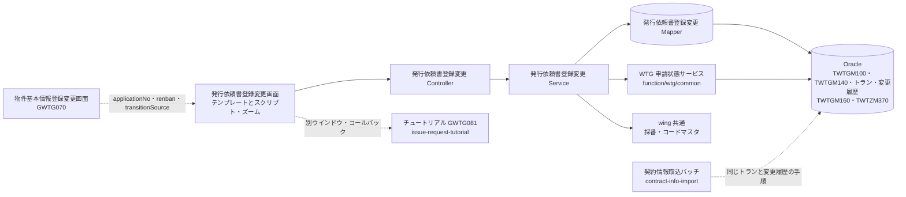
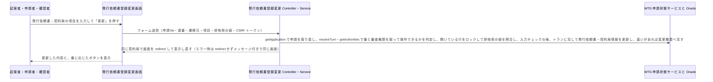
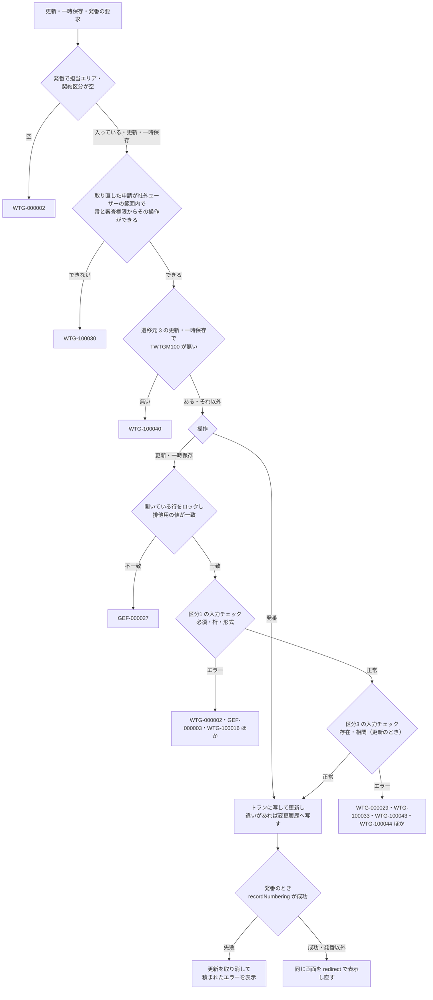

# 技術設計書

> このファイルは **「どう作るか」** を確定させる文書である。実装者ごとの解釈の食い違いを防ぎ、レビュー・実装・検証の共通の土台にする。\
> _分担_: 同一 feature の `requirements.md` が `status: approved` になるまで着手しない。本ファイルが `approved` になるまで `tasks.md` に進まない。`approved` は人間が付ける（エージェントは付けない）。

> _書き方_: 各節は結論から書き、検討の過程や調査ログは残さない。

> _出典の表記_: 「要件 N」「N.M」は `specs/issue-request/requirements.md` の要件と受け入れ基準ID。「Q-DS-IR-xxx」は本 feature の design 作成中の質問への回答（回答者 Junichi Noumi。Q-DS-IR-001〜015 は 2026-10-07、Q-DS-IR-016〜023 は 2026-10-08。原文は `.aidd/.engine/answer-ds-ir-20261007-1959.txt`・`.aidd/.engine/answer-ds-ir-20261008-0837-Q016-023.txt`）。Q-DS-IR-021 は Q-DS-IR-007 の 7.（`TWTGM080` の基地局番号を発行依頼書登録変更が書き換える）を取り消した。「pbi design」は `specs/property-basic-info/design.md`（approved）で、本書はその公開契約（WTG 申請状態サービスのメソッド、`TWTGM080`・`TWTGM140`・`TWTGM170`・`TWTGM180` の定義、遷移の口、エラーの返し方）だけを前提にする。各テーブルの DB レイアウト（`### 物理データモデル（Physical Data Model）` の `#### … の DB レイアウト`）と項目ごとの規則（`#### 項目ごとの規則（Q-DS-IR-006）`）は、回答者が回答の別ファイルとして渡したものを、本書に取り込んだもの。既存 wing のパスは、既存の実装から読み取った根拠を示す。今回の案件の成果物（正解）にあたるコードは根拠にしていない（作業ツリーに該当するコードは無い）。\
> _上流との関係_: 本書で「上流から意図して外れる」と書いた箇所は、人間の回答に従って書いたもので、上流（steering・requirements・pbi design）は Phase 5 の最後にまとめて直す（upstream-carryover）。

## 概要（Overview）

> 実装者が最初に読む節。何を誰に提供し、既存の何が変わるかを示す。\
> _分担_: 要件そのものは `requirements.md`。ここには設計上の位置づけだけを書く。

> _書き方_: 設計用語を使わず、この設計書を初めて読む人に通じる言葉で書く。

- **目的（Purpose）**: 発行依頼書を登録・変更する起案者・申請者・確認者と、契約書の発番を行う申請者 に 発行依頼書と契約局ごとの契約の内容を 1 つの画面（発行依頼書登録変更 GWTG080）で入力し、サンプル・税額計算で入力の手間を減らし、発番と変更の経過を残せる仕組み を提供する。
- **利用者（Users）**: 起案者（全員）、申請者・確認者（審査権限マスタ `TWTGM170` に登録された人）。社外ユーザー（ベンダー／施工会社）を含む（`requirements.md` の概要）
- **影響（Impact）**: 現在の Excel マクロツールでの契約書の作成 を 発行依頼書（`TWTGM100`）と契約局情報（`TWTGM140`）を WiNG の画面で登録し、受付No・稟議バーコードNo の発番と変更履歴を WiNG の DB で管理する形 に変更する。

### 達成目標（Goals）
> このフィーチャーが成功したと言える状態を定める節。

> _書き方_: 1 項目 1 行。基準を明記して、達成したかどうかを後から判定できる書き方にする。

- 発行依頼書は 1 申請に 1 行（`TWTGM100`）、契約局情報は契約局ごとに 1 行（`TWTGM140`）で登録され、更新・一時保存のあと同じ画面が同じ契約局で表示し直される（1.1・1.8・1.9、Q-DS-IR-002）
- 申請者が稟議依頼・修正稟議依頼の起案済・回覧中で発番すると、受付No（担当エリアごとの 6 桁）と、その申請No の全契約局の稟議バーコードNo が付き、申請が受付済・回覧中になり、承認履歴に判定 11 の行が 1 行増える（要件 3、Q-DS-IR-001・Q-DS-IR-012）
- 更新・発番で、比べる列に違いがあるときだけ、更新の前の版が変更履歴（`TWTGA130`・`TWTGA150`）に 1 件ずつ増える。一時保存と承認フローの操作では増えない（要件 7、Q-DS-IR-013）
- 税額と調整額が、税率マスタ（`TWTZM370`）と要件 6 の式どおりに計算される（要件 6、Q-DS-IR-011）
- ボタンと入力の可否が、番・遷移元・社内外の表（`#### 発行依頼書登録変更 Service`）のとおりに出し分けられ、サーバー側でも同じ判定で拒否される（要件 1・2・8）
- 入力チェックが `#### 項目ごとの規則（Q-DS-IR-006）` のとおりに働く（要件 9）

### やらないこと（Non-Goals）

> 達成目標に含めないことを先に宣言する節。`### 達成目標（Goals）` と対で読む。\
> _分担_: 実装として持たないものは `### このスペックが持たない責務（Out of Boundary）`。ここには目標の話だけを書く。

> _書き方_: 今回やらないだけのものと、今後もやらないものを書き分ける。

- 今後もやらない：発番の取消し（3.6）
- 今回やらない：本 feature 固有の性能目標値を設けること（`requirements.md` の非機能要件。既存 WiNG の水準に従う）
- 今回やらない：画面の項目の並び順・区画分けなどの配置と見た目を決めること。本書は画面に出す項目とその規則だけを書き、配置と見た目は Phase 8 の実装で決める（物件基本情報登録変更と同じ。回答者 Junichi Noumi、2026-10-07）
- 今回やらない：記入例の中身を作ること。中身は発注者から受け取り、Phase 8 で渡される。それまでは「記入例」と出すだけの仮のページにする（Q-DS-IR-010）

## 責務境界（Boundary Commitments）

> 実装物として**どのスペックが何を持つか**を確定させる節。タスク分解と後工程の検証もここを基準にする。\
> _分担_: 何を作り何を作らないかは `requirements.md` の `## スコープの境界（Boundary Context）`。ここには所有するデータとインターフェース、依存してよい相手を書く。

### このスペックが持つ責務（This Spec Owns）

> このスペックが持ち主になるものを宣言する節。

> _書き方_: 各項目 1 行。他のスペックとの間で担当が曖昧になりやすいものから先に書く。振る舞いをどのコンポーネントが担うかは `## コンポーネントとインターフェース（Components and Interfaces）` に書く。

- **所有するデータ**:
  - 発行依頼書情報（`TWTGM100`）のテーブル定義と、発行依頼書登録変更画面での行の登録・更新（申請の削除での物理削除と、修正稟議・再製本での複製は物件基本情報登録変更が行い、取込の洗替は契約情報取込が行う。`.aidd/feature-list.md` の注記）
  - 契約局情報（`TWTGM140`）の行のうち、発行依頼書登録変更画面の更新・一時保存での行の登録・更新（削除はしない。テーブルの定義は物件基本情報登録変更が持つ。`.aidd/feature-list.md` の注記）
  - 発行依頼書情報変更履歴（`TWTGA130`）・契約局情報変更履歴（`TWTGA150`）のテーブル定義（契約情報取込も同じ表に登録する。Q-DS-IR-013）
  - 発行依頼書情報ﾄﾗﾝ（`TWTGV030`）・契約局情報ﾄﾗﾝ（`TWTGV050`）のテーブル定義（契約情報取込も同じ表を使う。Q-DS-IR-013）
  - ｻﾝﾌﾟﾙ文設定ﾏｽﾀ（`TWTGM160`）のテーブル定義（値は移行で投入し、画面からの保守は無い。Q-DS-IR-009）
  - 税率ﾏｽﾀ（`TWTZM370`）のテーブル定義（WTZ 共通の表として今回新しく作る。使うのは本 feature だけ。Q-DS-IR-011）
- **定義するインターフェース**:
  - 発行依頼書登録変更画面（GWTG080）と、その入口（`/wtg080` が受け取る申請No・連番・遷移元）
  - 発行依頼書・契約局情報の変更履歴の手順（トランに写す → 更新する → 比べて違えば変更履歴へ写す）。契約情報取込（contract-info-import）が同じ手順で使う（Q-DS-IR-013）
  - 発行依頼書・契約局情報の項目ごとの入力チェック（`#### 項目ごとの規則（Q-DS-IR-006）`）。契約情報取込の行のチェックの元になる（Q-DS-IR の「他の feature に関わる点」）
  - 稟議バーコードNo の形（`### ドメインモデル（Domain Model）`）。印刷・閲覧用帳票の QR コードなどが使う（Q-DS-IR-012）
  - 修正稟議・再製本の複製で引き継ぐ項目と空にする項目の決まり（7.5・7.6）。複製は物件基本情報登録変更が行う（`.aidd/feature-list.md` の注記）
  - チュートリアル（GWTG081）との受け渡し（開き方と、値の返し方・入れる先）（Q-DS-IR の「他の feature に関わる点」）

### このスペックが持たない責務（Out of Boundary）

> 関連はするが、このスペックが持ち主にならないものを宣言する節。「ついでに」で実装範囲が広がるのを防ぐ。\
> _分担_: ここには持ち主が他にあるものだけを書く。目標として掲げないものと、今回やらないと決めただけのものは `### やらないこと（Non-Goals）`。

> _書き方_: 他に任せるものは委譲先を必ず添える。委譲先が決まっていないものは `## 設計判断（Design Decisions）` で扱う。

- **他に任せる範囲と、その委譲先**:
  - 審査フェーズ・状態の遷移、誰の番かの判定、審査権限の取得、承認履歴の登録、社外ユーザーの範囲の条件 → WTG 申請状態サービス（`specs/property-basic-info/design.md`）。本 feature は発番で `recordNumbering` を呼ぶ
  - 契約局情報（`TWTGM140`）のテーブル定義と、物件基本情報登録変更画面での行の登録・更新・削除・並替え → `specs/property-basic-info/design.md`
  - 申請の削除での発行依頼書の物理削除と、修正稟議・再製本での複製の実行 → `specs/property-basic-info/design.md`（複製の決まりは本書が持つ）
  - 単独局と複数局の切替（`TWTGM080` の単独複数局ﾌﾗｸﾞ）→ `specs/property-basic-info/design.md`
  - 物件申請情報（`TWTGM080`）の基地局番号・基地局名・エリアコードを契約局情報の連番 1 にそろえること（申請情報欄の初期表示と更新）→ `specs/property-basic-info/design.md`（Q-DS-IR-021）
  - チュートリアル（GWTG081）の画面と、そこで選ぶ値 → `specs/issue-request-tutorial/design.md`
  - CSV による発行依頼書と契約局情報の更新（洗替と、そのときの変更履歴の登録）→ `specs/contract-info-import/design.md`
  - 帳票の中身 → `specs/print-report/design.md`
  - コードマスタ（`TWTZM040`）・採番マスタ（`TWTZM050`）・メニュー権限（`ZMENUAUTH`。`PWTGO080` の行）の行と、`TWTGM160`・`TWTZM370` の値の投入、記入例の中身 → 発注者（`### 移行方針（Migration Strategy）`、Q-DS-IR-009・Q-DS-IR-010・Q-DS-IR-012、横断確認 1 回目 #4）
- **後のフェーズに回す作業**:
  - 画面の配置・見た目と、画面部品の属性（入力バイト数・IME など）：Phase 8 の実装で決める（物件基本情報登録変更と同じ。回答者 Junichi Noumi、2026-10-07）
  - 記入例の中身（`/static/manual/pwgto080Sample.html`）：Phase 8 で発注者から受け取る（Q-DS-IR-010）
  - Oracle を使う確認（Mapper XML の SQL）：総合テスト（試験仕様書）に回す（物件基本情報登録変更と同じ。Q-DS-PBI-014）

### 依存してよい対象（Allowed Dependencies）

> このフィーチャーが前提にしてよい既存の仕組みを列挙する節。\
> _分担_: 要件として何に依存するかは `requirements.md` の `## 前提と依存（Dependencies / Assumptions）`。ここには実装が使ってよい範囲と守る制約を書く。

> _書き方_: 依存先は、システム名・コンポーネント名・共有基盤名など後から特定できる固有名で書く。制約には一方向性、循環の禁止、レイヤをまたぐ条件など、守るべき条件を書く。

- **依存先**:
  - WTG 申請状態サービス（`function/wtg/common`。pbi design の公開契約）：`getApplication`・`resolveTurn`・`getAuthorities`・`getExternalScope`・`recordNumbering`。加えて、`getApplication` の出力に単独複数局ﾌﾗｸﾞ（`Tandoku_Fukusu_Flg`）と申請依頼日時（`Application_Req_DateTime`）があることと、読み取りの口 `getApplicantName`（入力：会社コード・申請No。出力：承認履歴（`TWTGM180`）の行のうち、審査回＝今の申請回数・判定 "02" で最終更新日時がいちばん新しい行の最終更新者名 `Last_UpdatedPerson_Name`。無ければ空。ユーザー管理マスタ（`ZM010`）とは結合しない）を前提にする（Q-DS-IR-022）。どちらも pbi design にまだ書かれていない。pbi design は Phase 5 の最後にまとめて直す（upstream-carryover）
  - 物件申請情報（`TWTGM080`）・審査権限マスタ（`TWTGM170`）・承認履歴（`TWTGM180`）・契約局情報（`TWTGM140`）の定義（pbi design の物理データモデル）
  - wing の共通基盤：`SessionCheckInterceptor`・`AccessControlInterceptor`・`CSRFTokenCheckInterceptor`・`ExceptionResolver`・`LoginUserUtils`（`wing/src/main/java/jp/co/kccs/wt/common/`）
  - 採番：`NumberingService` と採番マスタ `TWTZM050`（受付No。グループID `WTG080`。Q-DS-IR-012）（`wing/src/main/java/jp/co/kccs/wt/common/service/NumberingService.java`）
  - コードマスタ：`CodeMstService` と `TWTZM040`（WTG/PARAM の `P06`〜`P90`、WTG/CODE/`C02`、WTZ/MASTER/`M04`・`M05`・`M10`・`M11`。一覧は `#### 項目ごとの規則（Q-DS-IR-006）`）（`wing/src/main/java/jp/co/kccs/wt/common/service/CodeMstService.java`）
  - 計画マスタ（`TWTBM010`）・工事案件マスタ（`TWTBM080`）・郵便番号-住所マスタ（`TWTZM400`）（読むだけ。項目ごとの規則の 2・5・8）
  - 子ウインドウの共通部品 `openZoomDialog`（`wing/src/main/webapp/static/vender/kccs/js/common.js:86`）と、既存のズームの仕組み（`ZoomUtils`・`/zoom/wait`。`wing/src/main/java/jp/co/kccs/wt/common/utils/ZoomUtils.java`・`wing/src/main/java/jp/co/kccs/wt/common/controller/ZoomWaitController.java`）（Q-DS-IR-016）
  - 局種別の判定：共通部品 `WTKeikakuJudgeUtils.chkKichikyoku`（`wing/src/main/java/jp/co/kccs/wt/common/utils/WTKeikakuJudgeUtils.java:36`）。契約区分の自動設定で呼ぶ（項目ごとの規則の 8、Q-DS-IR-017）。`common/utils` はほかの機能のパッケージではないので、下の依存の制約には当たらない
- **依存の制約**:
  - 画面は Controller → Service → Mapper の向きだけで呼び、他の機能パッケージ（`wtg070`・`wtg081` ほか）の Service・Mapper を呼ばない。WTG 申請状態サービスは `function/wtg/common` の共通部品として呼ぶ（`steering/architecture.md` の `## レイヤーと依存ルール`）
  - 審査フェーズ・状態・承認履歴は WTG 申請状態サービスを通してだけ変える。本 feature の Mapper から `TWTGM080` の審査フェーズ・状態・申請回数・決裁日時と `TWTGM180` を書かない（pbi design の WTG 申請状態サービスの不変条件）。`TWTGM080` の基地局番号・基地局名・エリアコードも書かない。`TWTGM080` に書くのは、発番のときに `recordNumbering` を通して書くものだけ。更新・一時保存では `TWTGM080` をロックも照合もしない。申請の状態が変わったかどうかは、`getApplication` で申請を取り直し、本 feature の Service の操作の可否の判定（`#### 発行依頼書登録変更 Service` の「操作の可否の判定」）で確かめる（Q-DS-IR-021・Q-DS-IR-022、design-check 1 回目 #9・2 回目 #5 の判断）
  - チュートリアル（`wtg081`）とは画面のウインドウ間の受け渡しだけでつなぎ、互いの Java のクラスを参照しない（Q-DS-IR の「他の feature に関わる点」）

### 再確認が必要になる変更（Revalidation Triggers）

> ここに挙げた変更が起きたら、依存するスペックや利用側に再確認を依頼する節。

> _書き方_: 1 項目 1 行（例: 契約の形（API・イベント・型の定義）の変更、データ所有権の移動、依存方向の変更、起動・実行時の前提条件の変更）。

- `TWTGM100` の列の変更。特に物件基本情報登録変更が読む 9 列（受付No・契約区分・担当エリア・申請者・契約稟議起案者の会社コード・会社名・所属名①②・氏名）（pbi design の `### データ契約と外部連携（Data Contracts & Integration）`）
- `TWTGM100`・`TWTGM140` の列と、名称の列の入れ方（Q-DS-IR-004）の変更（印刷・閲覧用帳票、契約情報取込の洗替、契約情報ダウンロード、物件基本情報登録変更の出力 CSV（`specs/property-basic-info/csv-layout-wtg070.md` の 188 項目・228 項目）が読む）
- 変更履歴（`TWTGA130`・`TWTGA150`）・トラン（`TWTGV030`・`TWTGV050`）の列・一意キーと、トランに写して比べる手順・比べる列の範囲の変更（契約情報取込が同じ手順で使う）
- 項目ごとの入力チェック（`#### 項目ごとの規則（Q-DS-IR-006）`）とメッセージキーの変更（契約情報取込の行のチェックが合わせる）
- 稟議バーコードNo・受付No の形と採番の変更（物件基本情報登録変更の文書バーコード、印刷・閲覧用帳票の QR コードが使う）
- 修正稟議・再製本の複製で引き継ぐ項目・空にする項目の決まりの変更（物件基本情報登録変更が複製を行う）
- チュートリアルとの受け渡し（開く URL と渡す値、コールバックの名前、返す値と入れる先の項目名）の変更（issue-request-tutorial が合わせる）
- 物件基本情報登録変更との遷移の口（遷移元の値 1・2・3、`applicationNo`・`renban`・`transitionSource`、戻り先）の変更
- WTG 申請状態サービスのメソッドの入出力の変更（本 feature が呼ぶ。pbi design の再確認の対象）

## アーキテクチャ（Architecture）

> このフィーチャーをどの構成に載せるかを決める節。\
> _分担_: レイヤ構成と依存のルールは `steering/architecture.md` の `## レイヤーと依存ルール`、命名とコード規約は `steering/tech.md` の `## 命名規則` と `## コード規約`。ここにはこのフィーチャー固有の構成だけを書く。

### 既存アーキテクチャの分析（Existing Architecture Analysis）

> 既存システムに手を入れる場合に、守るべき前提を確認する節。

> _書き方_: 今回の変更で壊してはいけないものを挙げる。現状の評価や改善案は書かない。

- **現行のパターンと制約**: wing の画面は Spring MVC の Controller（`@FuncID` でプログラムID を宣言）→ Service（クラスに `@Transactional(readOnly = true)`、更新メソッドに `@Transactional`）→ MyBatis Mapper の 3 層で、入力チェックは Service の `checkXxx` が `BindingResult.rejectValue` に積む（`wing/src/main/java/jp/co/kccs/wt/function/wtg/wtg002/service/Pwtgo005Service.java:343`）。同時更新は申請単位の `ExclusiveFG` の照合で防ぐ（pbi design の `##### 状態管理（State Management）` の並行制御）
- **守るべきドメイン境界**: 既存の WTG の契約情報（`TWTGM010`〜`TWTGM070`）・変更履歴（`TWTGA010`〜`TWTGA070`）と既存画面（GWTG003〜GWTG050）には手を入れない（`steering/product.md` の既存 WTG 機能の保全）
- **維持する統合ポイント**: ログインとセッション（`ZSESSION`）、メニュー権限（`ZMENUAUTH`）、CSRF トークン、採番マスタ（`TWTZM050`）とコードマスタ（`TWTZM040`）、メッセージ（`wing/src/main/resources/messages.properties`）
- **解消 / 回避する技術的負債**: <DSN_EXISTING_DEBT>（不要：既存の構成（Spring MVC＋MyBatis、既存の共通部品）にそのまま乗せる新しい機能で既存のコードは直さないため、解消する技術的負債も、避けるために設計を変える技術的負債も無い — 回答者 Junichi Noumi、2026-10-07（物件基本情報登録変更と同じ））

### アーキテクチャ方式と境界図（Architecture Pattern & Boundary Map）

> 採用する構成とコンポーネント間の関係を、図と文で示す節。

> _書き方_: 図は例であり、大文字の名前はすべて実際のコンポーネント名に置き換えたり、ノードを追加したりして関係性を示すようにする。関係が複雑でない場合は図を省いて文だけでもよい。



- **選択したパターン**: 既存 wing の 3 層（Controller → Service → Mapper）。承認フローの判定と発番の状態の変更は WTG 申請状態サービスに任せる
- **ドメイン / 機能の切り分け**: 発行依頼書と契約局情報の表示・入力チェック・更新・一時保存・発番・税額計算・変更履歴は本画面の Service、関係者欄の並替え・削除と、サンプル文・記入例・契約者情報挿入・発送先追記の画面への入力は画面のスクリプトとズーム、審査フェーズ・状態・承認履歴は WTG 申請状態サービス
- **既存パターンとの整合**: 画面ごとに `function/wtg/<機能ID>/` の controller・service・mapper・form・bean を置く既存の置き方に従う（`steering/architecture.md` の `## 配置原則`）。機能ID は `WTG080`、プログラムID は `PWTGO080`（物件基本情報登録変更の回答「他の機能も今回と同じ規則」。`.aidd/.engine/answer-ds-pbi-20261006-1507-Q001-add.txt`）
- **新規コンポーネントを置く理由**: 発行依頼書登録変更は新しい画面で、既存の画面に同じ責務のものが無い（`requirements.md` の要件 1）
- **steering との整合**: 新しい技術・外部連携・メッセージングを持ち込まない（`steering/tech.md`）。画面内の非同期の取得（税額計算 `/wtg080/calcTaxAdjustment`、契約種別による選択肢 `/wtg080/changeKeiyakuSyubetsuTutorial`）は、既存の画面内の JSON 取得と同じ扱いで、画面以外から呼ばれる API にしない（`steering/api-standards.md` の本プロジェクトでの扱い）。権限は `AccessControlInterceptor` と `TWTGM170` で判定する（`steering/security.md` の `#### 権限モデル`）

### 技術スタック（Technology Stack）

> このフィーチャーで追加する、または例外的に採用する技術を書く節。\
> _分担_: プロジェクト共通のスタックは `steering/tech.md` の `## コアテクノロジ` と `## 主要ライブラリ`。ここには差分だけを書く。

> _書き方_: 1 行 1 技術。レイヤは Frontend / CLI、Backend / Service、Data / Storage、Messaging / Event、Infrastructure / Runtime などから選ぶ。

| レイヤ | 採用 / バージョン | このフィーチャーでの役割 | 備考 |
|---|---|---|---|
| Infrastructure / Runtime | 開発端末の JDK 1.8（`-source`/`-target` 1.7） | 開発端末でのコンパイルと自動テストの実行 | 本番は JDK 1.7（`steering/tech.md`）。物件基本情報登録変更と同じ（Q-DS-PBI-014）。steering/tech.md から意図して外れる。上流は Phase 5 の最後にまとめて直す（upstream-carryover） |

## データモデル（Data Models）

> このフィーチャーで変更するデータ構造を確定させる節。\
> _分担_: システム全体の ER 図・全体スキーマは `docs/architecture/data-model.md` の `## ER 図` に従う。命名と型の共通ルールは `steering/database.md` の `## 命名規則` と `## 型の指針`。

> _書き方_: このフィーチャーで変更するエンティティだけを書く。物理データモデルを変えたら `docs/architecture/data-model.md` との整合を確認する。

### ドメインモデル（Domain Model）

> 業務上の概念とその関係を、保存形式に依らない形で書く節。

> _書き方_: 実装の都合ではなく、業務としてどう成り立っているかで書く。集約は、一緒に更新しないと辻褄が合わなくなるデータのまとまり。値オブジェクトは、金額や住所のように、値が同じなら同じものとして扱ってよいもの。ドメインイベントは、「注文が確定した」のように業務で起きた出来事のうち、他に知らせる必要があるものを指す。不変条件は、いつ見ても成り立っていなければならない決まりを指す。

- **集約とトランザクション境界**: 「申請」を集約とする（pbi design と同じ）。発行依頼書（申請に 0..1）と契約局情報（申請に 0..n）は申請にぶら下がる。画面の 1 操作（更新・一時保存・発番）を 1 トランザクションとし、最初に WTG 申請状態サービスの `getApplication` で申請を取り直し、操作の可否の判定（`#### 発行依頼書登録変更 Service` の「操作の可否の判定」）で今もその操作ができるかを確かめる。更新・一時保存の排他は、開いている発行依頼書（`TWTGM100`）か契約局（`TWTGM140`）の行の排他用の値（`ExclusiveFG`）だけで行い、`TWTGM080` はロックも照合もしない。発番では `TWTGM080` の排他用の値を `recordNumbering` が照合する（`##### 状態管理（State Management）` の並行制御、design-check 1 回目 #9 の判断）。受付No の採番だけは `NumberingService` が別の接続で先に確定する（`steering/database.md` の採番のトランザクション）
- **エンティティ / 値オブジェクト / ドメインイベント**: エンティティは発行依頼書・契約局情報（行）・変更履歴（行）・サンプル文・税率。値オブジェクトは受付No・稟議バーコードNo・遷移元（1・2・3）・金額（数値または「無償」などの文字）・税区分。ドメインイベントは「発番が行われた」（WTG 申請状態サービスが承認履歴の 1 行として記録する。他のシステムへは知らせない）
- **ビジネスルール / 不変条件**:
  - **画面の開き方（遷移元）**：遷移元は `1`＝基地局番号リンク、`2`＝発行依頼書編集、`3`＝契約局情報追加（Q-DS-IR-002）。`2` では `TWTGM100` の値を表示し、更新で `TWTGM100` に入れる。`1`・`3` ではその連番の契約局（`TWTGM140`）の値を表示し、更新でその行に入れる。画面の中で契約局を切り替えたときと、`3` で更新・一時保存して表示し直したときは `1` と同じ扱いにする（Q-DS-IR-002・Q-DS-IR-005）
  - **単独局と複数局**：`TWTGM080` の単独複数局ﾌﾗｸﾞ（`Tandoku_Fukusu_Flg`。`getApplication` で取る申請の値）が "0" なら単独局、"1" なら複数局として表示する。この画面では切り替えさせない（5.1・5.2、pbi design の `TWTGM080` の列、Q-DS-IR-022）
  - **発行依頼書だけに持つ項目**：担当エリア・担当エリア名・契約区分・受付No・申請者・作成組織（会社コード・会社名・所属①②・氏名）は `TWTGM100` だけに持ち、`2` でだけ入力できる。`1`・`3` では入力不可で表示する（Q-DS-IR-005）
  - **単独局の更新**（`2`）：画面の値を `TWTGM100` に入れ、`TWTGM140` の連番 1 にも同じ値を入れる（行が無ければ作る）（Q-DS-IR-005）
  - **複数局の更新**（`2`）：画面の値を `TWTGM100` に入れ、`TWTGM140` は書かない。ただし担当エリア・契約区分が変わり、受付No があるときは、全契約局の稟議バーコードNo を付け直す（Q-DS-IR-005）。画面には全契約局の合計の金額が出るが、金額の項目は入力できるままにし、入力した値で `TWTGM100` の金額を上書きする（合計し直さない）。次に契約局（`1`・`3`）を更新したときに、全契約局の合計で入れ直される（Q-DS-IR-019）
  - **契約局の更新**（`1`・`3`）：その連番の `TWTGM140` の行に画面の値を入れ、続けて `TWTGM100` を入れ直す。単独局は画面の値をそのまま入れる。複数局は連番 1 の契約局の値を入れ、金額の 24 項目（支払内容①〜④の金額・税額・調整額、初回支払内容①〜④の金額・税額・調整額）だけは「全契約局の値の合計」を入れる。ほかの契約局の行は書き換えない（5.3、Q-DS-IR-005）
  - **金額の合計**：金額・調整額は文字で持つので、数値の値だけを足す。数値でない値（「無償」など）は足さず、足す相手がまだ空のときだけその文字を入れる（全部が文字なら最初の契約局の文字になる）。税額は数値なので足すだけ（Q-DS-IR-005）
  - **コードと (ﾌﾘｰﾌｫｰﾑ) の組の金額の項目**（例：電気料【月額】）：合計は (ﾌﾘｰﾌｫｰﾑ) の列に入れる。値は、画面の値とほかの契約局の (ﾌﾘｰﾌｫｰﾑ) 列の値を上の合計の規則で足したもので、対象がすべて文字なら連番 1 の値を入れる。コードの列には連番 1 の値をそのまま入れ、合計しない。組になっていない税額・調整額は、それぞれの列を同じ規則で合計する（Q-DS-IR-023）
  - **「〜他n局」**：複数局の申請を `2` で開いたとき、基地局名を「`TWTGM100` の基地局名」＋「他」＋（契約局の件数−1）＋「局」と表示する。表示だけで保存しない。`TWTGM100` の基地局名には代表局（連番 1）の基地局名を保存する（5.4、Q-DS-IR-005）
  - **新しい契約局**（`3`）：発行依頼書（`TWTGM100`）が登録済みの申請だけで登録できる（無ければ `WTG-100040`。`#### 発行依頼書登録変更 Service` の「照合する行が無いときの扱い」。requirements 1.9 から意図して外れる。上流は Phase 5 の最後にまとめて直す（upstream-carryover）。design-check 4 回目 #1 の判断）。連番は物件基本情報登録変更から受け取った連番（件数＋1）とし、更新でも一時保存でも登録する。行数に上限は設けない（5.8、Q-DS-IR-007）。UQ担当者欄（受付No・担当エリア・契約区分・代表局番号・枝番）と作成組織 4 項目は `TWTGM100`（代表局番号・稟議バーコードNo は連番 1）から写して入力不可で表示し、ほかの項目は空で開く（Q-DS-IR-007）
  - **新しい発行依頼書・契約局の初期値**：枝番 "00001"、所在地区分 "01"（住居表示）、KDDI転貸情報の有無 "02"、印紙 "02"、支社 "11"、添付資料(補足)① "置局交渉経過報告書"。契約稟議起案者_氏名と作成組織の会社名（社内）は空（Q-DS-IR-007・Q-DS-IR-014）
  - **基地局番号**：同じ申請No のほかの連番に同じ基地局番号があってはならない（`WTG-100043`）。計画基地局番号・計画基地局名・基地局名・基地局名ｶﾅは、入力した基地局番号で計画マスタ（`TWTBM010`）を引いて入れ、利用者は入力しない（Q-DS-IR-007）。連番 1 の基地局番号を物件申請情報と一致させるチェックと、変えさせない制限はしない（Q-DS-IR-007）。本 feature は物件申請情報（`TWTGM080`）の基地局番号・基地局名・エリアコードを書き換えない（Q-DS-IR-021。Q-DS-IR-007 の 7. を取り消した）。`TWTGM100` の基地局番号は、契約局（`1`・`3`）から更新したときに連番 1 の値で入れ直す（Q-DS-IR-005 の ③）。連番 1 と `TWTGM080` の基地局番号をそろえるのは物件基本情報登録変更の側で、発行依頼書（`TWTGM100`）がある申請では申請情報欄の基地局番号に連番 1 の基地局番号を初期表示し、利用者が物件基本情報登録変更で更新したときに `TWTGM080` が書き換わる（`WTG-100019` も通る）。それまで `TWTGM080` は古い値のままでよい（Q-DS-IR-021）。この初期表示は pbi design にまだ書かれていない。pbi design は Phase 5 の最後にまとめて直す（upstream-carryover）
  - **代表局番号・枝番**：UQ担当者欄で利用者が入力する（初期値は空）。`2` で入れた値を `TWTGM100` と（単独局は）連番 1 に入れる。`3` では連番 1 の値を写して新しい行に入れる（Q-DS-IR-007）
  - **申請者**（`TWTGM100.Application_Name`）：画面の申請者は、承認履歴（`TWTGM180`）の判定 "02"（申請）の最終更新者名を、WTG 申請状態サービスの `getApplicantName` で取って表示するだけ（Q-DS-IR-022）。更新・一時保存のとき、表示している申請者名を入れる（申請の前は空）。発番では入れない（Q-DS-IR-012）
  - **一時保存フラグ**（`Draft_Flg`。0:更新済 / 1:一時保存中）（Q-DS-IR-013）

    | 操作 | `TWTGM100` | `TWTGM140` |
    |---|---|---|
    | 一時保存（`2`） | "1" | 単独局は連番 1 を "1" |
    | 一時保存（`1`・`3`） | 変えない | 開いている契約局を "1" |
    | 更新（`2`） | "0" | 単独局は連番 1 を "0" |
    | 更新（`1`・`3`） | 変えない | 更新した行を "0" |
    | 発番 | 変えない | 変えない |

    発行依頼書が無い申請で一時保存したときは、`TWTGM100` の行を "1" で作る（単独局なら `TWTGM140` の連番 1 も作る）（Q-DS-IR-013）
  - **名称の列**：更新・一時保存のとき、コード列の値でコードマスタの名称を引いて「○○名」の列に入れる。例外は、契約者区分名は固定（1→"契約者"、2→"関係者"）、支払予定月の (ﾌﾘｰﾌｫｰﾑ) 列は `P23` の名称、転貸借の契約種別名・局種別名・設置設備名と案件大グループ名・案件小グループ名は入れない（空のまま）。データリストの項目は、手入力ならコード列を NULL にし、入力文字列が名称と一致すればコードを入れる（Q-DS-IR-004・Q-DS-IR-006）
  - **受付No**：採番マスタ `TWTZM050` で担当エリアごとに採番し、6 桁の 0 埋めにする。`NumberingService` に（担当エリアのコード, 会社コード, "WTG080", 1）を渡して次の値を取る。上限（999999）を超えたときは `NumberingService` の既存の動きに従う（3.1、Q-DS-IR-012）
  - **稟議バーコードNo**：その契約局の基地局番号（枝番なし）＋"-"＋担当エリアをキー3 にした `WTG/PARAM/P34` の文字項目1＋受付No＋"-"＋契約区分をキー3 にした `WTG/PARAM/P78` の文字項目1（ｵｰﾌﾟﾝ 241／屋内 141／鉄道 341）。`TWTGM100.Keiyaku_Kbn` の値（001〜003）そのものでも、`P78` の文字項目2 でもない。発番では、その申請No の全契約局の行に付ける。発番の後に追加・更新した契約局は、受付No があればその登録・更新のときに同じ形で付ける（3.2、Q-DS-IR-012）
  - **発番**：稟議依頼・修正稟議依頼の起案済・回覧中で、申請者だけが行える。発番で保存するのは担当エリア・担当エリア名・契約区分・代表局番号・枝番と受付No・稟議バーコードNo だけで、発行依頼書のほかの項目は保存しない（入力欄が開いていても無視する）。一時保存の状態は検査しない（3.1・3.5、Q-DS-IR-001・Q-DS-IR-012）。requirements の 1.3・1.5（起案済・回覧中の申請者は発行依頼書の登録・変更を受け付けない）から意図して外れる。上流は Phase 5 の最後にまとめて直す（upstream-carryover）
  - **変更履歴**：更新・発番のときだけ登録する。一時保存と承認フローの操作では登録しない。「更新の前」は、更新を押した時点の DB の内容（一時保存の後なら一時保存した内容。一時保存フラグも比べる列に入るので、一時保存の後の更新では必ず 1 件できる）。比べる列は、`TWTGM100` は No.7 `Keiyaku_Kbn`〜No.353 `Draft_Flg`（契約区分以降）、`TWTGM140` は No.7 `Application_No`〜No.345 `Draft_Flg`（申請No以降）。`TWTGM140` は、その申請No の全契約局を契約局ごとに比べ、違いがある契約局の分だけ登録する（発番や担当エリア・契約区分の変更で稟議バーコードNo を付け直した、開いていない契約局の変更も残す）。手順は `### データ契約と外部連携（Data Contracts & Integration）`（7.1〜7.4、Q-DS-IR-003・Q-DS-IR-004・Q-DS-IR-013・Q-DS-IR-020）
  - **修正稟議・再製本の複製**（物件基本情報登録変更が行う。決まりは本書が持つ）：元の発行依頼書を新しい申請No で全項目複製し、申請者（`Application_Name`）にはログインユーザーのユーザーID を入れる。再製本は受付No と稟議バーコードNo を元の申請から引き継ぎ、修正稟議は空にする。一時保存フラグは "0"（7.5・7.6、Q-DS-IR の「他の feature に関わる点」、pbi design の複製の行）。申請者にユーザーID を入れることは pbi design にまだ書かれていない。pbi design は Phase 5 の最後にまとめて直す（upstream-carryover）

### 論理データモデル（Logical Data Model）
> ドメインモデルをデータ構造として整理する節。

> _書き方_: 保存先の製品には依存させない。製品固有の話は物理データモデルに書く

- **エンティティ間の多重度（カーディナリティ）**: 申請 1 : 発行依頼書 0..1（申請No で結ぶ）、申請 1 : 契約局情報 0..n（連番の順。連番 1 が代表局）、発行依頼書 1 : 発行依頼書変更履歴 0..n（更新日時の順）、契約局情報 1 : 契約局情報変更履歴 0..n、申請 1 : 発行依頼書トラン 0..1、申請 1 : 契約局情報トラン 0..n（その申請No の全契約局。Q-DS-IR-020）（作業用。更新・発番のたびに入れ直す）。サンプル文と税率はほかのエンティティと結ばない
- **属性と型**: 各エンティティの属性と型は `### 物理データモデル（Physical Data Model）` の表と、その下の各テーブルの `#### … の DB レイアウト` のとおり。コード値で持つ属性はコードマスタの識別（`#### 項目ごとの規則（Q-DS-IR-006）` の「選択肢の元」）を使う。金額・調整額は文字（数値または「無償」などの文字）、税額は数値で持つ（Q-DS-IR-005・Q-DS-IR-006）。steering/database.md の型の指針（金額は数値）から意図して外れる。上流は Phase 5 の最後にまとめて直す（upstream-carryover）
- **自然キー / 識別子**: 発行依頼書は「会社コード＋申請No」、契約局情報は「会社コード＋申請No＋連番＋計画基地局番号」、発行依頼書変更履歴は「会社コード＋申請No＋更新日時」、契約局情報変更履歴は「会社コード＋申請No＋連番＋計画基地局番号＋更新日時」、サンプル文は「会社コード＋サンプル文コード」、税率は「会社コード＋適用税率」（Q-DS-IR-003・Q-DS-IR-004・Q-DS-IR-009・Q-DS-IR-011・Q-DS-IR-013）
- **参照整合性のルール**: DB の外部キーは張らず、既存 WiNG と同じくアプリ側で保つ（`steering/database.md` の `## 整合性`）。発行依頼書と契約局情報は申請No で物件申請情報に結ぶ。変更履歴は元の行が削除されても残す（申請の削除での変更履歴の扱いは pbi design が持つ）。同じ申請No の中で基地局番号は重複させない（`requirements.md` の前提、Q-DS-IR-007）

### 物理データモデル（Physical Data Model）
> 論理データモデルを実際の保存形式に落とした定義を書く節。

> _書き方_: 種別は RDB / Document Store / Event Store / KV・Wide-column などから選ぶ。RDB ならテーブル定義・主キー・外部キー・インデックス・分割方針、Document Store ならコレクション構造・埋め込みと参照の使い分け・シャードキーを書く。

| 種別 | 記載 |
|---|---|
| RDB | **`TWTGM100`（発行依頼書情報ﾏｽﾀ）**。主キーは持たず、一意キー `AK_TWTGM100_1`（`CompanyCD`, `Application_No`）。NOT NULL はこの 2 列だけ。役割は 1 申請 1 行の発行依頼書。主な列は契約区分 `Keiyaku_Kbn`・受付No `Uketsuke_No`・担当エリア `Area_Cd`／`Area_Name`・申請者 `Application_Name`・代表局番号 `Represent_SIteID_No`・枝番 `Represent_SiteID_Branch`・基地局番号 `Kichikyoku_No`・基地局名 `Kichikyoku_Name`・金額 `Payment_Fee1`〜`4`（`_Freeform`）・税額 `TAX1`〜`4`・調整額 `Tax_Adjustments1`〜`4`・初回支払の同じ列（`First_…`）・特記事項 `Tokki_Jiko`・案件グループ `Anken_Dai_Grp_Cd`／`Anken_Syo_Grp_Cd`・契約稟議起案者の 5 列・一時保存ﾌﾗｸﾞ `Draft_Flg`。全 353 列は `#### TWTGM100 の DB レイアウト（発行依頼書情報ﾏｽﾀ。Q-DS-IR-003）`（Q-DS-IR-003） |
| RDB | **`TWTGM140`（契約局情報ﾏｽﾀ）**。定義は物件基本情報登録変更が持つ（pbi design）。一意キー `AK_TWTGM140_1`（`CompanyCD`, `Application_No`, `Renban`, `Keikaku_Kichikyoku_No`）。`TWTGM100` との違いは、`TWTGM140` だけに稟議ﾊﾞｰｺｰﾄﾞNo `Ringi_Barcode_No` と連番 `Renban` があり、`TWTGM100` だけに契約区分・受付No・担当エリア・担当エリア名・申請者と契約稟議起案者の 5 列があること。ほかの列は同じ名前・同じ並び・同じ型と桁（金額2〜4 だけ桁が違う）。全 345 列は `#### TWTGM140 の DB レイアウト（契約局情報ﾏｽﾀ。Q-DS-IR-004）`（回答者が渡した DB レイアウト。Q-DS-IR-004） |
| RDB | **`TWTGA130`（発行依頼書情報変更履歴）**。列は `TWTGM100` とまったく同じ（353 列）で、伝票区分・計上日の列は持たない。主キーは持たず、一意キー `AK_TWTGA130_1`（`CompanyCD`, `Application_No`, `UpdatedDT`）。中身は更新の前の版で、`UpdatedDT` は更新の前の行の更新日時になる。全列は `#### TWTGA130 の DB レイアウト（発行依頼書情報変更履歴。Q-DS-IR-013）`（Q-DS-IR-013） |
| RDB | **`TWTGA150`（契約局情報変更履歴）**。列は `TWTGM140` とまったく同じ（345 列）。一意キー `AK_TWTGA150_1`（`CompanyCD`, `Application_No`, `Renban`, `Keikaku_Kichikyoku_No`, `UpdatedDT`）。全列は `#### TWTGA150 の DB レイアウト（契約局情報変更履歴。Q-DS-IR-013）`（Q-DS-IR-013） |
| RDB | **`TWTGV030`（発行依頼書情報ﾄﾗﾝ）**。列は `TWTGM100` と同じ。一意キー `AK_TWTGV030_1`（`CompanyCD`, `Application_No`）。更新・発番の直前に `TWTGM100` の行を写しておく作業用の表で、変更履歴の比較元。全列は `#### TWTGV030 の DB レイアウト（発行依頼書情報ﾄﾗﾝ。Q-DS-IR-013）`（Q-DS-IR-013） |
| RDB | **`TWTGV050`（契約局情報ﾄﾗﾝ）**。列は `TWTGM140` と同じ。一意キー `AK_TWTGV050_1`（`CompanyCD`, `Application_No`, `Renban`, `Keikaku_Kichikyoku_No`）。全列は `#### TWTGV050 の DB レイアウト（契約局情報ﾄﾗﾝ。Q-DS-IR-013）`（Q-DS-IR-013）。トランの表の種別は `V` とする（既存 wing にも `TWTDV021` 検収ﾄﾗﾝなどがある。Q-DS-IR-013）。steering/database.md の命名規則（トランは種別 `F`）から意図して外れる。上流は Phase 5 の最後にまとめて直す（upstream-carryover） |
| RDB | **`TWTGM160`（ｻﾝﾌﾟﾙ文設定ﾏｽﾀ）**。主キーは持たず、一意キー `AK_TWTGM160_1`（`CompanyCD`, `Sample_Cd`）。NOT NULL は `CompanyCD`・`Sample_Cd`・`Sample_Name`。列はｻﾝﾌﾟﾙ文ｺｰﾄﾞ `Sample_Cd`（3。表示順もこのコード順）・ｻﾝﾌﾟﾙ文名称 `Sample_Name`（100）・案件大ｸﾞﾙｰﾌﾟｺｰﾄﾞ `Anken_Dai_Grp_Cd`（`M10` のキー3）・案件小ｸﾞﾙｰﾌﾟｺｰﾄﾞ `Anken_Syo_Grp_Cd`（`M11` のキー3）・その他①〜④ `Sonota1`〜`4`（`P35` のキー3）・契約に関する特記事項 `Tokki_Jiko`（2000。改行は "\r\n" で持つ）と共通列。汎用の例を示す列は無く、サンプル文名称が「汎用例」で始まる行（001・002）が汎用の例。列と投入データ 25 件は `#### TWTGM160 の DB レイアウトと投入データ（ｻﾝﾌﾟﾙ文設定ﾏｽﾀ。Q-DS-IR-009）`（Q-DS-IR-009） |
| RDB | **`TWTZM370`（税率ﾏｽﾀ）**。主キーは持たず、一意キー `AK_TWTZM370_1`（`CompanyCD`, `Tax_Rate`）。列は適用税率 `Tax_Rate`（数値。整数部 1・小数部 2。10% は 0.10）・適用開始日 `Tax_Start_Date`（日時。月の初日）と共通列。終了日の列は無い。ある日の税率は「適用開始日 ≦ その日」の行のうち適用開始日がいちばん新しい行。投入する行は `### 移行方針（Migration Strategy）` の値の投入（Q-DS-IR-011） |

インデックスは、上の表の一意キーを DB レイアウト設計書のとおりに定義する（個々のインデックスは DB レイアウト設計書で定義する。`steering/database.md` の `## クエリパターン`）。

#### TWTGM100 の DB レイアウト（発行依頼書情報ﾏｽﾀ。Q-DS-IR-003）

- 主キー：持たない。一意キー AK_TWTGM100_1 ＝ CompanyCD ＋ Application_No（1 申請に 1 行）
- NOT NULL（必須○）は CompanyCD と Application_No だけ。ほかの列は NULL 可
- 型の表記は DB レイアウトのまま（1:String＝文字、3:DateTime＝日時、5:Currency＝数値。Java では String／Long で持つ）
- 「○○名」「○○名称」の列は、更新・一時保存のときにコードマスタの名称を入れる（例外は Q-DS-IR-004 の回答）。「(ﾌﾘｰﾌｫｰﾑ)」の列は、プルダウンで選んだときは表示文字列、手入力したときは入力文字列を入れ、対になるコード列は手入力なら NULL
- 7.1 の「契約区分以降の項目」は No.7（Keiyaku_Kbn）〜 No.353（Draft_Flg）
- 「必須」列の ○ は NOT NULL。「許可値」「備考」は DB レイアウトに書かれているものだけ（空欄は記載なし）

| No | 表示名 | 項目名 | 型 | 桁数 | 必須 | 許可値 | 備考 |
|---|---|---|---|---|---|---|---|
| 1 | 会社ｺｰﾄﾞ | CompanyCD | 1:String | 5 | ○ |  | Java-Kit共通 |
| 2 | 登録者 | RegisteredPerson | 1:String | 20 |  |  | Java-Kit共通 |
| 3 | 登録日時 | RegisteredDT | 3:DateTime | － |  |  | Java-Kit共通 |
| 4 | 更新者 | UpdatedPerson | 1:String | 20 |  |  | Java-Kit共通 |
| 5 | 更新日時 | UpdatedDT | 3:DateTime | － |  |  | Java-Kit共通 |
| 6 | 排他ﾌﾗｸﾞ | ExclusiveFG | 1:String | 32 |  |  | Java-Kit共通 |
| 7 | 契約区分 | Keiyaku_Kbn | 1:String | 20 |  |  |  |
| 8 | 受付No | Uketsuke_No | 1:String | 6 |  |  |  |
| 9 | 担当ｴﾘｱ | Area_Cd | 1:String | 20 |  |  |  |
| 10 | 担当ｴﾘｱ名 | Area_Name | 1:String | 50 |  |  |  |
| 11 | 申請者 | Application_Name | 1:String | 100 |  |  |  |
| 12 | 申請No | Application_No | 1:String | 11 | ○ |  |  |
| 13 | 代表局番号 | Represent_SIteID_No | 1:String | 9 |  |  |  |
| 14 | 枝番 | Represent_SiteID_Branch | 1:String | 5 |  |  |  |
| 15 | 基地局番号 | Kichikyoku_No | 1:String | 9 |  |  |  |
| 16 | 基地局番号_枝番 | Kichikyoku_No_Branch | 1:String | 5 |  |  |  |
| 17 | 基地局名 | Kichikyoku_Name | 1:String | 120 |  |  |  |
| 18 | 基地局名(ｶﾅ) | Kichikyoku_Name_Kana | 1:String | 120 |  |  |  |
| 19 | 計画基地局番号 | Keikaku_Kichikyoku_No | 1:String | 9 |  |  |  |
| 20 | 計画基地局名 | Keikaku_Kichikyoku_Name | 1:String | 120 |  |  |  |
| 21 | 所在地区分 | Address_Kbn | 1:String | 100 |  |  |  |
| 22 | 住所_都道府県ｺｰﾄﾞ | Todofuken_Cd | 1:String | 2 |  |  |  |
| 23 | 住所_都道府県名 | Todofuken_Name | 1:String | 50 |  |  |  |
| 24 | 住所_市区町村ｺｰﾄﾞ | Shikuchoson_Cd | 1:String | 5 |  |  |  |
| 25 | 住所_市区町村(ﾌﾘｰﾌｫｰﾑ) | Shikuchoson_Freeform | 1:String | 50 |  |  |  |
| 26 | 住所_字、番地 | Addr_Banch | 1:String | 500 |  |  |  |
| 27 | 登記_都道府県ｺｰﾄﾞ | Place_Address_Cd1 | 1:String | 2 |  |  |  |
| 28 | 登記_都道府県名 | Place_Address_Name1 | 1:String | 50 |  |  |  |
| 29 | 登記_市区町村ｺｰﾄﾞ | Place_Address_Cd2 | 1:String | 5 |  |  |  |
| 30 | 登記_市区町村(ﾌﾘｰﾌｫｰﾑ) | Place_Address_Freeform2 | 1:String | 50 |  |  |  |
| 31 | 登記_字、番地 | Place_Address3 | 1:String | 500 |  |  |  |
| 32 | 物件名 | Bukken_Name | 1:String | 100 |  |  |  |
| 33 | 借用面積 | Rented_Area | 1:String | 100 |  |  |  |
| 34 | ｱﾝﾃﾅ支持柱本数および管路引込部分等 | Antena_And_Conduit | 1:String | 100 |  |  |  |
| 35 | 契約事由 | Reason_Contract | 1:String | 20 |  |  |  |
| 36 | 契約事由(ﾌﾘｰﾌｫｰﾑ) | Reason_Contract_Freeform | 1:String | 256 |  |  |  |
| 37 | 賃貸借契約書 | Rental_Contract | 1:String | 20 |  |  |  |
| 38 | 賃貸借契約書(ﾌﾘｰﾌｫｰﾑ) | Rental_Contract_Freeform | 1:String | 50 |  |  |  |
| 39 | KDDI転貸借契約書 | KDDI_Rental_Contract | 1:String | 20 |  |  |  |
| 40 | KDDI転貸借契約書(ﾌﾘｰﾌｫｰﾑ) | KDDI_Rental_Contract_Freeform | 1:String | 50 |  |  |  |
| 41 | 電気使用量覚書 | Electricity_Usage_Memorandum | 1:String | 20 |  |  |  |
| 42 | 電気使用量覚書（ﾌﾘｰﾌｫｰﾑ） | Electricity_Usage_Memorandum_Freeform | 1:String | 50 |  |  |  |
| 43 | その他書類① | Sonota_Document1 | 1:String | 20 |  |  |  |
| 44 | その他書類①(ﾌﾘｰﾌｫｰﾑ) | Sonota_Document1_Freeform | 1:String | 100 |  |  |  |
| 45 | その他書類② | Sonota_Document2 | 1:String | 20 |  |  |  |
| 46 | その他書類②(ﾌﾘｰﾌｫｰﾑ) | Sonota_Document2_Freeform | 1:String | 100 |  |  |  |
| 47 | その他書類③ | Sonota_Document3 | 1:String | 20 |  |  |  |
| 48 | その他書類③(ﾌﾘｰﾌｫｰﾑ) | Sonota_Document3_Freeform | 1:String | 100 |  |  |  |
| 49 | 受電方法 | Elect_Kind | 1:String | 20 |  |  |  |
| 50 | 受電方法名 | Elect_Kind_Name | 1:String | 50 |  |  |  |
| 51 | 関係者1_契約者区分 | Kankeisha1_Contract_Kbn | 1:String | 20 |  |  |  |
| 52 | 関係者1_契約者区分名 | Kankeisha1_Contract_Name | 1:String | 50 |  |  |  |
| 53 | 関係者1_関係(地位) | Kankeisha1_Relation | 1:String | 20 |  |  |  |
| 54 | 関係者1_関係(地位)(ﾌﾘｰﾌｫｰﾑ) | Kankeisha1_Relation_Freeform | 1:String | 40 |  |  |  |
| 55 | 関係者1_法人個人区分 | Kankeisha1_Corp_Priv_Kbn | 1:String | 20 |  |  |  |
| 56 | 関係者1_法人個人区分名 | Kankeisha1_Corp_Priv_Name | 1:String | 50 |  |  |  |
| 57 | 関係者1_契約者番号 | Kankeisha1_Contract_CD | 1:String | 20 |  |  |  |
| 58 | 関係者1_氏名・法人名 | Kankeisha1_Person_Name | 1:String | 160 |  |  |  |
| 59 | 関係者1_氏名・法人ﾌﾘｶﾞﾅ | Kankeisha1_Name_Kana | 1:String | 160 |  |  |  |
| 60 | 関係者1_役職_氏名 | Kankeisha1_Post_Name | 1:String | 160 |  |  |  |
| 61 | 関係者1_役職氏名ﾌﾘｶﾞﾅ | Kankeisha1_Post_Name_Kana | 1:String | 160 |  |  |  |
| 62 | 関係者1_郵便番号 | Kankeisha1_Zip_CD | 1:String | 7 |  |  |  |
| 63 | 関係者1_都道府県 | Kankeisha1_Todofuken_Cd | 1:String | 2 |  |  |  |
| 64 | 関係者1_都道府県名 | Kankeisha1_Todofuken_Name | 1:String | 50 |  |  |  |
| 65 | 関係者1_市区町村 | Kankeisha1_Shikuchoson_Cd | 1:String | 5 |  |  |  |
| 66 | 関係者1_市区町村(ﾌﾘｰﾌｫｰﾑ) | Kankeisha1_Shikuchoson_Freeform | 1:String | 50 |  |  |  |
| 67 | 関係者1_字、番地 | Kankeisha1_Banchi | 1:String | 100 |  |  |  |
| 68 | 関係者1_建物、ﾋﾞﾙ | Kankeisha1_Address4 | 1:String | 100 |  |  |  |
| 69 | 関係者1_TEL(固定) | Kankeisha1_Tel1 | 1:String | 11 |  |  |  |
| 70 | 関係者1_TEL(携帯) | Kankeisha1_Tel2 | 1:String | 11 |  |  |  |
| 71 | 関係者1_Email | Kankeisha1_Mail | 1:String | 100 |  |  |  |
| 72 | 関係者1_FAX | Kankeisha1_Fax | 1:String | 11 |  |  |  |
| 73 | 関係者2_契約者区分 | Kankeisha2_Contract_Kbn | 1:String | 20 |  |  |  |
| 74 | 関係者2_契約者区分名 | Kankeisha2_Contract_Name | 1:String | 50 |  |  |  |
| 75 | 関係者2_関係(地位) | Kankeisha2_Relation | 1:String | 20 |  |  |  |
| 76 | 関係者2_関係(地位)(ﾌﾘｰﾌｫｰﾑ) | Kankeisha2_Relation_Freeform | 1:String | 40 |  |  |  |
| 77 | 関係者2_法人個人区分 | Kankeisha2_Corp_Priv_Kbn | 1:String | 20 |  |  |  |
| 78 | 関係者2_法人個人区分名 | Kankeisha2_Corp_Priv_Name | 1:String | 50 |  |  |  |
| 79 | 関係者2_契約者番号 | Kankeisha2_Contract_CD | 1:String | 20 |  |  |  |
| 80 | 関係者2_氏名・法人名 | Kankeisha2_Person_Name | 1:String | 160 |  |  |  |
| 81 | 関係者2_氏名・法人ﾌﾘｶﾞﾅ | Kankeisha2_Name_Kana | 1:String | 160 |  |  |  |
| 82 | 関係者2_役職_氏名 | Kankeisha2_Post_Name | 1:String | 160 |  |  |  |
| 83 | 関係者2_役職氏名ﾌﾘｶﾞﾅ | Kankeisha2_Post_Name_Kana | 1:String | 160 |  |  |  |
| 84 | 関係者2_郵便番号 | Kankeisha2_Zip_CD | 1:String | 7 |  |  |  |
| 85 | 関係者2_都道府県 | Kankeisha2_Todofuken_Cd | 1:String | 2 |  |  |  |
| 86 | 関係者2_都道府県名 | Kankeisha2_Todofuken_Name | 1:String | 50 |  |  |  |
| 87 | 関係者2_市区町村 | Kankeisha2_Shikuchoson_Cd | 1:String | 5 |  |  |  |
| 88 | 関係者2_市区町村(ﾌﾘｰﾌｫｰﾑ) | Kankeisha2_Shikuchoson_Freeform | 1:String | 50 |  |  |  |
| 89 | 関係者2_字、番地 | Kankeisha2_Banchi | 1:String | 100 |  |  |  |
| 90 | 関係者2_建物、ﾋﾞﾙ | Kankeisha2_Address4 | 1:String | 100 |  |  |  |
| 91 | 関係者2_TEL(固定) | Kankeisha2_Tel1 | 1:String | 11 |  |  |  |
| 92 | 関係者2_TEL(携帯) | Kankeisha2_Tel2 | 1:String | 11 |  |  |  |
| 93 | 関係者2_Email | Kankeisha2_Mail | 1:String | 100 |  |  |  |
| 94 | 関係者2_FAX | Kankeisha2_Fax | 1:String | 11 |  |  |  |
| 95 | 関係者3_契約者区分 | Kankeisha3_Contract_Kbn | 1:String | 20 |  |  |  |
| 96 | 関係者3_契約者区分名 | Kankeisha3_Contract_Name | 1:String | 50 |  |  |  |
| 97 | 関係者3_関係(地位) | Kankeisha3_Relation | 1:String | 20 |  |  |  |
| 98 | 関係者3_関係(地位)(ﾌﾘｰﾌｫｰﾑ) | Kankeisha3_Relation_Freeform | 1:String | 40 |  |  |  |
| 99 | 関係者3_法人個人区分 | Kankeisha3_Corp_Priv_Kbn | 1:String | 20 |  |  |  |
| 100 | 関係者3_法人個人区分名 | Kankeisha3_Corp_Priv_Name | 1:String | 50 |  |  |  |
| 101 | 関係者3_契約者番号 | Kankeisha3_Contract_CD | 1:String | 20 |  |  |  |
| 102 | 関係者3_氏名・法人名 | Kankeisha3_Person_Name | 1:String | 160 |  |  |  |
| 103 | 関係者3_氏名・法人ﾌﾘｶﾞﾅ | Kankeisha3_Name_Kana | 1:String | 160 |  |  |  |
| 104 | 関係者3_役職_氏名 | Kankeisha3_Post_Name | 1:String | 160 |  |  |  |
| 105 | 関係者3_役職氏名ﾌﾘｶﾞﾅ | Kankeisha3_Post_Name_Kana | 1:String | 160 |  |  |  |
| 106 | 関係者3_郵便番号 | Kankeisha3_Zip_CD | 1:String | 7 |  |  |  |
| 107 | 関係者3_都道府県 | Kankeisha3_Todofuken_Cd | 1:String | 2 |  |  |  |
| 108 | 関係者3_都道府県名 | Kankeisha3_Todofuken_Name | 1:String | 50 |  |  |  |
| 109 | 関係者3_市区町村 | Kankeisha3_Shikuchoson_Cd | 1:String | 5 |  |  |  |
| 110 | 関係者3_市区町村(ﾌﾘｰﾌｫｰﾑ) | Kankeisha3_Shikuchoson_Freeform | 1:String | 50 |  |  |  |
| 111 | 関係者3_字、番地 | Kankeisha3_Banchi | 1:String | 100 |  |  |  |
| 112 | 関係者3_建物、ﾋﾞﾙ | Kankeisha3_Address4 | 1:String | 100 |  |  |  |
| 113 | 関係者3_TEL(固定) | Kankeisha3_Tel1 | 1:String | 11 |  |  |  |
| 114 | 関係者3_TEL(携帯) | Kankeisha3_Tel2 | 1:String | 11 |  |  |  |
| 115 | 関係者3_Email | Kankeisha3_Mail | 1:String | 100 |  |  |  |
| 116 | 関係者3_FAX | Kankeisha3_Fax | 1:String | 11 |  |  |  |
| 117 | 関係者4_契約者区分 | Kankeisha4_Contract_Kbn | 1:String | 20 |  |  |  |
| 118 | 関係者4_契約者区分名 | Kankeisha4_Contract_Name | 1:String | 50 |  |  |  |
| 119 | 関係者4_関係(地位) | Kankeisha4_Relation | 1:String | 20 |  |  |  |
| 120 | 関係者4_関係(地位)(ﾌﾘｰﾌｫｰﾑ) | Kankeisha4_Relation_Freeform | 1:String | 40 |  |  |  |
| 121 | 関係者4_法人個人区分 | Kankeisha4_Corp_Priv_Kbn | 1:String | 20 |  |  |  |
| 122 | 関係者4_法人個人区分名 | Kankeisha4_Corp_Priv_Name | 1:String | 50 |  |  |  |
| 123 | 関係者4_契約者番号 | Kankeisha4_Contract_CD | 1:String | 20 |  |  |  |
| 124 | 関係者4_氏名・法人名 | Kankeisha4_Person_Name | 1:String | 160 |  |  |  |
| 125 | 関係者4_氏名・法人ﾌﾘｶﾞﾅ | Kankeisha4_Name_Kana | 1:String | 160 |  |  |  |
| 126 | 関係者4_役職_氏名 | Kankeisha4_Post_Name | 1:String | 160 |  |  |  |
| 127 | 関係者4_役職氏名ﾌﾘｶﾞﾅ | Kankeisha4_Post_Name_Kana | 1:String | 160 |  |  |  |
| 128 | 関係者4_郵便番号 | Kankeisha4_Zip_CD | 1:String | 7 |  |  |  |
| 129 | 関係者4_都道府県 | Kankeisha4_Todofuken_Cd | 1:String | 2 |  |  |  |
| 130 | 関係者4_都道府県名 | Kankeisha4_Todofuken_Name | 1:String | 50 |  |  |  |
| 131 | 関係者4_市区町村 | Kankeisha4_Shikuchoson_Cd | 1:String | 5 |  |  |  |
| 132 | 関係者4_市区町村(ﾌﾘｰﾌｫｰﾑ) | Kankeisha4_Shikuchoson_Freeform | 1:String | 50 |  |  |  |
| 133 | 関係者4_字、番地 | Kankeisha4_Banchi | 1:String | 100 |  |  |  |
| 134 | 関係者4_建物、ﾋﾞﾙ | Kankeisha4_Address4 | 1:String | 100 |  |  |  |
| 135 | 関係者4_TEL(固定) | Kankeisha4_Tel1 | 1:String | 11 |  |  |  |
| 136 | 関係者4_TEL(携帯) | Kankeisha4_Tel2 | 1:String | 11 |  |  |  |
| 137 | 関係者4_Email | Kankeisha4_Mail | 1:String | 100 |  |  |  |
| 138 | 関係者4_FAX | Kankeisha4_Fax | 1:String | 11 |  |  |  |
| 139 | 関係者5_契約者区分 | Kankeisha5_Contract_Kbn | 1:String | 20 |  |  |  |
| 140 | 関係者5_契約者区分名 | Kankeisha5_Contract_Name | 1:String | 50 |  |  |  |
| 141 | 関係者5_関係(地位) | Kankeisha5_Relation | 1:String | 20 |  |  |  |
| 142 | 関係者5_関係(地位)(ﾌﾘｰﾌｫｰﾑ) | Kankeisha5_Relation_Freeform | 1:String | 40 |  |  |  |
| 143 | 関係者5_法人個人区分 | Kankeisha5_Corp_Priv_Kbn | 1:String | 20 |  |  |  |
| 144 | 関係者5_法人個人区分名 | Kankeisha5_Corp_Priv_Name | 1:String | 50 |  |  |  |
| 145 | 関係者5_契約者番号 | Kankeisha5_Contract_CD | 1:String | 20 |  |  |  |
| 146 | 関係者5_氏名・法人名 | Kankeisha5_Person_Name | 1:String | 160 |  |  |  |
| 147 | 関係者5_氏名・法人ﾌﾘｶﾞﾅ | Kankeisha5_Name_Kana | 1:String | 160 |  |  |  |
| 148 | 関係者5_役職_氏名 | Kankeisha5_Post_Name | 1:String | 160 |  |  |  |
| 149 | 関係者5_役職氏名ﾌﾘｶﾞﾅ | Kankeisha5_Post_Name_Kana | 1:String | 160 |  |  |  |
| 150 | 関係者5_郵便番号 | Kankeisha5_Zip_CD | 1:String | 7 |  |  |  |
| 151 | 関係者5_都道府県 | Kankeisha5_Todofuken_Cd | 1:String | 2 |  |  |  |
| 152 | 関係者5_都道府県名 | Kankeisha5_Todofuken_Name | 1:String | 50 |  |  |  |
| 153 | 関係者5_市区町村 | Kankeisha5_Shikuchoson_Cd | 1:String | 5 |  |  |  |
| 154 | 関係者5_市区町村(ﾌﾘｰﾌｫｰﾑ) | Kankeisha5_Shikuchoson_Freeform | 1:String | 50 |  |  |  |
| 155 | 関係者5_字、番地 | Kankeisha5_Banchi | 1:String | 100 |  |  |  |
| 156 | 関係者5_建物、ﾋﾞﾙ | Kankeisha5_Address4 | 1:String | 100 |  |  |  |
| 157 | 関係者5_TEL(固定) | Kankeisha5_Tel1 | 1:String | 11 |  |  |  |
| 158 | 関係者5_TEL(携帯) | Kankeisha5_Tel2 | 1:String | 11 |  |  |  |
| 159 | 関係者5_Email | Kankeisha5_Mail | 1:String | 100 |  |  |  |
| 160 | 関係者5_FAX | Kankeisha5_Fax | 1:String | 11 |  |  |  |
| 161 | 契約開始日 | Contract_Start_Date | 1:String | 8 |  |  |  |
| 162 | 契約終了日 | Contract_Finish_Date | 1:String | 8 |  |  |  |
| 163 | 更新の有無 | Update_Kind | 1:String | 20 |  |  |  |
| 164 | 更新の有無_名称 | Update_Kind_Name | 1:String | 50 |  |  |  |
| 165 | 更新方法 | Update_Way | 1:String | 20 |  |  |  |
| 166 | 更新方法_名称 | Update_Way_Name | 1:String | 50 |  |  |  |
| 167 | 更新年数 | Update_Year | 1:String | 20 |  |  |  |
| 168 | 更新通知日(ヶ月前まで) | Update_Notice | 1:String | 20 |  |  |  |
| 169 | 更新通知日(ヶ月前まで)(ﾌﾘｰﾌｫｰﾑ) | Update_Notice_Freeform | 1:String | 50 |  |  |  |
| 170 | 支払内容1 | Fee_Manage_Kind1 | 1:String | 20 |  |  |  |
| 171 | 支払内容1(ﾌﾘｰﾌｫｰﾑ) | Fee_Manage_Kind1_Freeform | 1:String | 60 |  |  |  |
| 172 | 支払方法1 | Payment_Division1 | 1:String | 20 |  |  |  |
| 173 | 支払方法名1 | Payment_Division_Name1 | 1:String | 50 |  |  |  |
| 174 | 支払予定月1 | Shiharai_Yotei_Month1 | 1:String | 20 |  |  |  |
| 175 | 支払予定月1(ﾌﾘｰﾌｫｰﾑ) | Shiharai_Yotei_Month1_Freeform | 1:String | 50 |  |  |  |
| 176 | 支払日1 | Payment_Day1 | 1:String | 20 |  |  |  |
| 177 | 金額1 | Payment_Fee1 | 1:String | 20 |  |  |  |
| 178 | 金額1(ﾌﾘｰﾌｫｰﾑ) | Payment_Fee1_Freeform | 1:String | 50 |  |  |  |
| 179 | 税区分1 | TAX_KBN1 | 1:String | 20 |  |  |  |
| 180 | 税区分名1 | TAX_KBN_Name1 | 1:String | 50 |  |  |  |
| 181 | 税額1 | TAX1 | 5:Currency | 11 |  |  |  |
| 182 | 調整額1 | Tax_Adjustments1 | 1:String | 11 |  |  |  |
| 183 | 調整理由1 | Tax_Adjustments_Reason1 | 1:String | 20 |  |  |  |
| 184 | 調整理由名1 | Tax_Adjustments_Reason_Name1 | 1:String | 50 |  |  |  |
| 185 | 支払内容2 | Fee_Manage_Kind2 | 1:String | 20 |  |  |  |
| 186 | 支払内容2(ﾌﾘｰﾌｫｰﾑ) | Fee_Manage_Kind2_Freeform | 1:String | 60 |  |  |  |
| 187 | 支払方法2 | Payment_Division2 | 1:String | 20 |  |  |  |
| 188 | 支払方法名2 | Payment_Division_Name2 | 1:String | 50 |  |  |  |
| 189 | 支払予定月2 | Shiharai_Yotei_Month2 | 1:String | 20 |  |  |  |
| 190 | 支払予定月2(ﾌﾘｰﾌｫｰﾑ) | Shiharai_Yotei_Month2_Freeform | 1:String | 50 |  |  |  |
| 191 | 支払日2 | Payment_Day2 | 1:String | 20 |  |  |  |
| 192 | 金額2 | Payment_Fee2 | 1:String | 20 |  |  |  |
| 193 | 金額2(ﾌﾘｰﾌｫｰﾑ) | Payment_Fee2_Freeform | 1:String | 50 |  |  |  |
| 194 | 税区分2 | TAX_KBN2 | 1:String | 20 |  |  |  |
| 195 | 税区分名2 | TAX_KBN_Name2 | 1:String | 50 |  |  |  |
| 196 | 税額2 | TAX2 | 5:Currency | 11 |  |  |  |
| 197 | 調整額2 | Tax_Adjustments2 | 1:String | 11 |  |  |  |
| 198 | 調整理由2 | Tax_Adjustments_Reason2 | 1:String | 20 |  |  |  |
| 199 | 調整理由名2 | Tax_Adjustments_Reason_Name2 | 1:String | 50 |  |  |  |
| 200 | 支払内容3 | Fee_Manage_Kind3 | 1:String | 20 |  |  |  |
| 201 | 支払内容3(ﾌﾘｰﾌｫｰﾑ) | Fee_Manage_Kind3_Freeform | 1:String | 60 |  |  |  |
| 202 | 支払方法3 | Payment_Division3 | 1:String | 20 |  |  |  |
| 203 | 支払方法名3 | Payment_Division_Name3 | 1:String | 50 |  |  |  |
| 204 | 支払予定月3 | Shiharai_Yotei_Month3 | 1:String | 20 |  |  |  |
| 205 | 支払予定月3(ﾌﾘｰﾌｫｰﾑ) | Shiharai_Yotei_Month3_Freeform | 1:String | 50 |  |  |  |
| 206 | 支払日3 | Payment_Day3 | 1:String | 20 |  |  |  |
| 207 | 金額3 | Payment_Fee3 | 1:String | 20 |  |  |  |
| 208 | 金額3(ﾌﾘｰﾌｫｰﾑ) | Payment_Fee3_Freeform | 1:String | 50 |  |  |  |
| 209 | 税区分3 | TAX_KBN3 | 1:String | 20 |  |  |  |
| 210 | 税区分名3 | TAX_KBN_Name3 | 1:String | 50 |  |  |  |
| 211 | 税額3 | TAX3 | 5:Currency | 11 |  |  |  |
| 212 | 調整額3 | Tax_Adjustments3 | 1:String | 11 |  |  |  |
| 213 | 調整理由3 | Tax_Adjustments_Reason3 | 1:String | 20 |  |  |  |
| 214 | 調整理由名3 | Tax_Adjustments_Reason_Name3 | 1:String | 50 |  |  |  |
| 215 | 支払内容4 | Fee_Manage_Kind4 | 1:String | 20 |  |  |  |
| 216 | 支払内容4(ﾌﾘｰﾌｫｰﾑ) | Fee_Manage_Kind4_Freeform | 1:String | 60 |  |  |  |
| 217 | 支払方法4 | Payment_Division4 | 1:String | 20 |  |  |  |
| 218 | 支払方法名4 | Payment_Division_Name4 | 1:String | 50 |  |  |  |
| 219 | 支払予定月4 | Shiharai_Yotei_Month4 | 1:String | 20 |  |  |  |
| 220 | 支払予定月4(ﾌﾘｰﾌｫｰﾑ) | Shiharai_Yotei_Month4_Freeform | 1:String | 50 |  |  |  |
| 221 | 支払日4 | Payment_Day4 | 1:String | 20 |  |  |  |
| 222 | 金額4 | Payment_Fee4 | 1:String | 20 |  |  |  |
| 223 | 金額4(ﾌﾘｰﾌｫｰﾑ) | Payment_Fee4_Freeform | 1:String | 50 |  |  |  |
| 224 | 税区分4 | TAX_KBN4 | 1:String | 20 |  |  |  |
| 225 | 税区分名4 | TAX_KBN_Name4 | 1:String | 50 |  |  |  |
| 226 | 税額4 | TAX4 | 5:Currency | 11 |  |  |  |
| 227 | 調整額4 | Tax_Adjustments4 | 1:String | 11 |  |  |  |
| 228 | 調整理由4 | Tax_Adjustments_Reason4 | 1:String | 20 |  |  |  |
| 229 | 調整理由名4 | Tax_Adjustments_Reason_Name4 | 1:String | 50 |  |  |  |
| 230 | 初回支払1_対象期間FROM | First_Pay_From1 | 1:String | 8 |  |  |  |
| 231 | 初回支払1_対象期間TO | First_Pay_To1 | 1:String | 8 |  |  |  |
| 232 | 初回支払1_初回支払日 | First_Pay_Day1 | 1:String | 8 |  |  |  |
| 233 | 初回支払1_納付書等受領状況 | First_Nofu_Juryo_Jokyo1 | 1:String | 20 |  |  |  |
| 234 | 初回支払1_納付書等受領状況_名称 | First_Nofu_Juryo_Jokyo_Name1 | 1:String | 50 |  |  |  |
| 235 | 初回支払1_金額 | First_Payment_Fee1 | 1:String | 20 |  |  |  |
| 236 | 初回支払1_金額(ﾌﾘｰﾌｫｰﾑ) | First_Payment_Fee1_Freeform | 1:String | 50 |  |  |  |
| 237 | 初回支払1_税区分 | First_TAX_KBN1 | 1:String | 20 |  |  |  |
| 238 | 初回支払1_税区分名 | First_TAX_KBN_Name1 | 1:String | 50 |  |  |  |
| 239 | 初回支払1_税額 | First_TAX1 | 5:Currency | 11 |  |  |  |
| 240 | 初回支払1_調整額 | First_Tax_Adjustments1 | 1:String | 11 |  |  |  |
| 241 | 初回支払1_調整理由 | First_Tax_Adjustments_Reason1 | 1:String | 20 |  |  |  |
| 242 | 初回支払1_調整理由名称 | First_Tax_Adjustments_Reason_Name1 | 1:String | 50 |  |  |  |
| 243 | 初回支払2_対象期間FROM | First_Pay_From2 | 1:String | 8 |  |  |  |
| 244 | 初回支払2_対象期間TO | First_Pay_To2 | 1:String | 8 |  |  |  |
| 245 | 初回支払2_初回支払日 | First_Pay_Day2 | 1:String | 8 |  |  |  |
| 246 | 初回支払2_納付書等受領状況 | First_Nofu_Juryo_Jokyo2 | 1:String | 20 |  |  |  |
| 247 | 初回支払2_納付書等受領状況_名称 | First_Nofu_Juryo_Jokyo_Name2 | 1:String | 50 |  |  |  |
| 248 | 初回支払2_金額 | First_Payment_Fee2 | 1:String | 20 |  |  |  |
| 249 | 初回支払2_金額(ﾌﾘｰﾌｫｰﾑ) | First_Payment_Fee2_Freeform | 1:String | 50 |  |  |  |
| 250 | 初回支払2_税区分 | First_TAX_KBN2 | 1:String | 20 |  |  |  |
| 251 | 初回支払2_税区分名 | First_TAX_KBN_Name2 | 1:String | 50 |  |  |  |
| 252 | 初回支払2_税額 | First_TAX2 | 5:Currency | 11 |  |  |  |
| 253 | 初回支払2_調整額 | First_Tax_Adjustments2 | 1:String | 11 |  |  |  |
| 254 | 初回支払2_調整理由 | First_Tax_Adjustments_Reason2 | 1:String | 20 |  |  |  |
| 255 | 初回支払2_調整理由名称 | First_Tax_Adjustments_Reason_Name2 | 1:String | 50 |  |  |  |
| 256 | 初回支払3_対象期間FROM | First_Pay_From3 | 1:String | 8 |  |  |  |
| 257 | 初回支払3_対象期間TO | First_Pay_To3 | 1:String | 8 |  |  |  |
| 258 | 初回支払3_初回支払日 | First_Pay_Day3 | 1:String | 8 |  |  |  |
| 259 | 初回支払3_納付書等受領状況 | First_Nofu_Juryo_Jokyo3 | 1:String | 20 |  |  |  |
| 260 | 初回支払3_納付書等受領状況_名称 | First_Nofu_Juryo_Jokyo_Name3 | 1:String | 50 |  |  |  |
| 261 | 初回支払3_金額 | First_Payment_Fee3 | 1:String | 20 |  |  |  |
| 262 | 初回支払3_金額(ﾌﾘｰﾌｫｰﾑ) | First_Payment_Fee3_Freeform | 1:String | 50 |  |  |  |
| 263 | 初回支払3_税区分 | First_TAX_KBN3 | 1:String | 20 |  |  |  |
| 264 | 初回支払3_税区分名 | First_TAX_KBN_Name3 | 1:String | 50 |  |  |  |
| 265 | 初回支払3_税額 | First_TAX3 | 5:Currency | 11 |  |  |  |
| 266 | 初回支払3_調整額 | First_Tax_Adjustments3 | 1:String | 11 |  |  |  |
| 267 | 初回支払3_調整理由 | First_Tax_Adjustments_Reason3 | 1:String | 20 |  |  |  |
| 268 | 初回支払3_調整理由名称 | First_Tax_Adjustments_Reason_Name3 | 1:String | 50 |  |  |  |
| 269 | 初回支払4_対象期間FROM | First_Pay_From4 | 1:String | 8 |  |  |  |
| 270 | 初回支払4_対象期間TO | First_Pay_To4 | 1:String | 8 |  |  |  |
| 271 | 初回支払4_初回支払日 | First_Pay_Day4 | 1:String | 8 |  |  |  |
| 272 | 初回支払4_納付書等受領状況 | First_Nofu_Juryo_Jokyo4 | 1:String | 20 |  |  |  |
| 273 | 初回支払4_納付書等受領状況_名称 | First_Nofu_Juryo_Jokyo_Name4 | 1:String | 50 |  |  |  |
| 274 | 初回支払4_金額 | First_Payment_Fee4 | 1:String | 20 |  |  |  |
| 275 | 初回支払4_金額(ﾌﾘｰﾌｫｰﾑ) | First_Payment_Fee4_Freeform | 1:String | 50 |  |  |  |
| 276 | 初回支払4_税区分 | First_TAX_KBN4 | 1:String | 20 |  |  |  |
| 277 | 初回支払4_税区分名 | First_TAX_KBN_Name4 | 1:String | 50 |  |  |  |
| 278 | 初回支払4_税額 | First_TAX4 | 5:Currency | 11 |  |  |  |
| 279 | 初回支払4_調整額 | First_Tax_Adjustments4 | 1:String | 11 |  |  |  |
| 280 | 初回支払4_調整理由 | First_Tax_Adjustments_Reason4 | 1:String | 20 |  |  |  |
| 281 | 初回支払4_調整理由名称 | First_Tax_Adjustments_Reason_Name4 | 1:String | 50 |  |  |  |
| 282 | 転貸借_TK基地局番号 | TK_Site_No | 1:String | 50 |  |  |  |
| 283 | 転貸借_TK基地局名 | TK_Kyoku_Name | 1:String | 120 |  |  |  |
| 284 | 転貸借_au基地局番号 | Au_Kyoku_No | 1:String | 50 |  |  |  |
| 285 | 転貸借_au基地局名 | Au_Kyoku_Name | 1:String | 120 |  |  |  |
| 286 | 転貸借_契約種別 | Contract_Syubetsu | 1:String | 20 |  |  |  |
| 287 | 転貸借_契約種別名 | Contract_Syubetsu_Name | 1:String | 50 |  |  |  |
| 288 | 転貸借_局種別 | Kyoku_Syubetsu | 1:String | 20 |  |  |  |
| 289 | 転貸借_局種別名 | Kyoku_Syubetsu_Name | 1:String | 50 |  |  |  |
| 290 | 転貸借_設置設備 | Sechi_Setsubi | 1:String | 20 |  |  |  |
| 291 | 転貸借_設置設備名 | Sechi_Setsubi_Name | 1:String | 50 |  |  |  |
| 292 | 転貸借_賃料【月額】 | Move_Lease_Chinryo | 5:Currency | 12 |  |  |  |
| 293 | 転貸借_電気料【月額】 | Move_Lease_Denkiryo | 1:String | 20 |  |  |  |
| 294 | 転貸借_電気料【月額】(ﾌﾘｰﾌｫｰﾑ) | Move_Lease_Denkiryo_Freeform | 1:String | 256 |  |  |  |
| 295 | 転貸借_契約開始日 | Move_Lease_Contract_Start_Date | 1:String | 8 |  |  |  |
| 296 | 転貸借_着工予定日 | Move_Lease_Chakko_Yotei_Date | 1:String | 8 |  |  |  |
| 297 | 転貸借_KDDI転貸情報の有無 | Move_Lease_Kind | 1:String | 20 |  |  |  |
| 298 | 転貸借_KDDI転貸情報の有無_名称 | Move_Lease_Kind_Name | 1:String | 50 |  |  |  |
| 299 | 契約に関する特記事項 | Tokki_Jiko | 1:String | 4000 |  |  |  |
| 300 | 備考 | Biko | 1:String | 2000 |  |  |  |
| 301 | 製本種別 | Book_Kind | 1:String | 20 |  |  |  |
| 302 | 製本種別名 | Book_Kind_Name | 1:String | 50 |  |  |  |
| 303 | UQ押印種別 | UQ_Sealer_Kind | 1:String | 20 |  |  |  |
| 304 | UQ押印種別名 | UQ_Sealer_Kind_Name | 1:String | 50 |  |  |  |
| 305 | 印紙 | Copy_Kind | 1:String | 20 |  |  |  |
| 306 | 印紙名 | Copy_Kind_Name | 1:String | 50 |  |  |  |
| 307 | 部数 | Copy_Number | 1:String | 10 |  |  |  |
| 308 | 部数(ﾌﾘｰﾌｫｰﾑ) | Copy_Number_Freeform | 1:String | 10 |  |  |  |
| 309 | 振込口座通知書 | Transfer_Account_Notice | 1:String | 20 |  |  |  |
| 310 | 振込口座通知書名 | Transfer_Account_Notice_Name | 1:String | 50 |  |  |  |
| 311 | 発送先 | Hasso_Branch_Office | 1:String | 20 |  |  |  |
| 312 | 発送先名 | Hasso_Branch_Office_Name | 1:String | 50 |  |  |  |
| 313 | 支社 | Shisya | 1:String | 20 |  |  |  |
| 314 | 支社(ﾌﾘｰﾌｫｰﾑ) | Shisya_Freeform | 1:String | 100 |  |  |  |
| 315 | その他の製本事項等 | Book_Sonota | 1:String | 3100 |  |  |  |
| 316 | 案件大ｸﾞﾙｰﾌﾟｺｰﾄﾞ | Anken_Dai_Grp_Cd | 1:String | 10 |  |  |  |
| 317 | 案件大ｸﾞﾙｰﾌﾟ名 | Anken_Dai_Grp_Name | 1:String | 50 |  |  |  |
| 318 | 案件小ｸﾞﾙｰﾌﾟｺｰﾄﾞ | Anken_Syo_Grp_Cd | 1:String | 10 |  |  |  |
| 319 | 案件小ｸﾞﾙｰﾌﾟ名 | Anken_Syo_Grp_Name | 1:String | 50 |  |  |  |
| 320 | その他① | Sonota1 | 1:String | 20 |  |  |  |
| 321 | その他①(ﾌﾘｰﾌｫｰﾑ) | Sonota1_Freeform | 1:String | 50 |  |  |  |
| 322 | その他② | Sonota2 | 1:String | 20 |  |  |  |
| 323 | その他②(ﾌﾘｰﾌｫｰﾑ) | Sonota2_Freeform | 1:String | 50 |  |  |  |
| 324 | その他③ | Sonota3 | 1:String | 20 |  |  |  |
| 325 | その他③(ﾌﾘｰﾌｫｰﾑ) | Sonota3_Freeform | 1:String | 50 |  |  |  |
| 326 | その他④ | Sonota4 | 1:String | 20 |  |  |  |
| 327 | その他④(ﾌﾘｰﾌｫｰﾑ) | Sonota4_Freeform | 1:String | 50 |  |  |  |
| 328 | 添付資料(契約書)① | Attached_Document_Contract1 | 1:String | 20 |  |  |  |
| 329 | 添付資料(契約書)①(ﾌﾘｰﾌｫｰﾑ) | Attached_Document_Contract1_Freeform | 1:String | 200 |  |  |  |
| 330 | 添付資料(契約書)② | Attached_Document_Contract2 | 1:String | 20 |  |  |  |
| 331 | 添付資料(契約書)②(ﾌﾘｰﾌｫｰﾑ) | Attached_Document_Contract2_Freeform | 1:String | 200 |  |  |  |
| 332 | 添付資料(契約書)③ | Attached_Document_Contract3 | 1:String | 20 |  |  |  |
| 333 | 添付資料(契約書)③(ﾌﾘｰﾌｫｰﾑ) | Attached_Document_Contract3_Freeform | 1:String | 200 |  |  |  |
| 334 | 添付資料(契約書)④ | Attached_Document_Contract4 | 1:String | 20 |  |  |  |
| 335 | 添付資料(契約書)④(ﾌﾘｰﾌｫｰﾑ) | Attached_Document_Contract4_Freeform | 1:String | 200 |  |  |  |
| 336 | 添付資料(契約書)⑤ | Attached_Document_Contract5 | 1:String | 20 |  |  |  |
| 337 | 添付資料(契約書)⑤(ﾌﾘｰﾌｫｰﾑ) | Attached_Document_Contract5_Freeform | 1:String | 200 |  |  |  |
| 338 | 添付資料(補足)① | Attached_Document_Hosoku1 | 1:String | 20 |  |  |  |
| 339 | 添付資料(補足)①(ﾌﾘｰﾌｫｰﾑ) | Attached_Document_Hosoku1_Freeform | 1:String | 200 |  |  |  |
| 340 | 添付資料(補足)② | Attached_Document_Hosoku2 | 1:String | 20 |  |  |  |
| 341 | 添付資料(補足)②(ﾌﾘｰﾌｫｰﾑ) | Attached_Document_Hosoku2_Freeform | 1:String | 200 |  |  |  |
| 342 | 添付資料(補足)③ | Attached_Document_Hosoku3 | 1:String | 20 |  |  |  |
| 343 | 添付資料(補足)③(ﾌﾘｰﾌｫｰﾑ) | Attached_Document_Hosoku3_Freeform | 1:String | 200 |  |  |  |
| 344 | 添付資料(補足)④ | Attached_Document_Hosoku4 | 1:String | 20 |  |  |  |
| 345 | 添付資料(補足)④(ﾌﾘｰﾌｫｰﾑ) | Attached_Document_Hosoku4_Freeform | 1:String | 200 |  |  |  |
| 346 | 添付資料(補足)⑤ | Attached_Document_Hosoku5 | 1:String | 20 |  |  |  |
| 347 | 添付資料(補足)⑤(ﾌﾘｰﾌｫｰﾑ) | Attached_Document_Hosoku5_Freeform | 1:String | 200 |  |  |  |
| 348 | 契約稟議起案者_会社ｺｰﾄﾞ | Keiyaku_Ringi_Kiansha_Kaisha_Cd | 1:String | 20 |  |  |  |
| 349 | 契約稟議起案者_会社名 | Keiyaku_Ringi_Kiansha_Kaisha_Name | 1:String | 50 |  |  |  |
| 350 | 契約稟議起案者_所属名① | Keiyaku_Ringi_Kiansha_Shozoku1 | 1:String | 100 |  |  |  |
| 351 | 契約稟議起案者_所属名② | Keiyaku_Ringi_Kiansha_Shozoku2 | 1:String | 100 |  |  |  |
| 352 | 契約稟議起案者_氏名 | Keiyaku_Ringi_Kiansha_Name | 1:String | 100 |  |  |  |
| 353 | 一時保存ﾌﾗｸﾞ | Draft_Flg | 1:String | 1 |  | 0：更新済 / 1：一時保存中 |  |

#### TWTGM140 の DB レイアウト（契約局情報ﾏｽﾀ。Q-DS-IR-004）

- 主キー：持たない。一意キー AK_TWTGM140_1 ＝ CompanyCD ＋ Application_No ＋ Renban ＋ Keikaku_Kichikyoku_No
- NOT NULL（必須○）は CompanyCD・Application_No・Renban・Keikaku_Kichikyoku_No
- TWTGM100 との違い：TWTGM140 だけにある列は Ringi_Barcode_No（No.8）と Renban（No.9）。TWTGM100 だけにある列は Keiyaku_Kbn・Uketsuke_No・Area_Cd・Area_Name・Application_Name・契約稟議起案者の 5 列（会社ｺｰﾄﾞ・会社名・所属名①②・氏名）。ほかの列は同じ名前・同じ並び・同じ型と桁（ただし金額2〜4 Payment_Fee2〜4 だけは TWTGM100 が 20、TWTGM140 が 50。DB レイアウトのまま）
- 7.2 の「申請No以降の項目」は No.7（Application_No）〜 No.345（Draft_Flg）
- 「必須」列の ○ は NOT NULL。「許可値」「備考」は DB レイアウトに書かれているものだけ（空欄は記載なし）

| No | 表示名 | 項目名 | 型 | 桁数 | 必須 | 許可値 | 備考 |
|---|---|---|---|---|---|---|---|
| 1 | 会社ｺｰﾄﾞ | CompanyCD | 1:String | 5 | ○ |  | Java-Kit共通 |
| 2 | 登録者 | RegisteredPerson | 1:String | 20 |  |  | Java-Kit共通 |
| 3 | 登録日時 | RegisteredDT | 3:DateTime | － |  |  | Java-Kit共通 |
| 4 | 更新者 | UpdatedPerson | 1:String | 20 |  |  | Java-Kit共通 |
| 5 | 更新日時 | UpdatedDT | 3:DateTime | － |  |  | Java-Kit共通 |
| 6 | 排他ﾌﾗｸﾞ | ExclusiveFG | 1:String | 32 |  |  | Java-Kit共通 |
| 7 | 申請No | Application_No | 1:String | 11 | ○ |  |  |
| 8 | 稟議ﾊﾞｰｺｰﾄﾞNo | Ringi_Barcode_No | 1:String | 25 |  |  |  |
| 9 | 連番 | Renban | 0:Int | 4 | ○ |  |  |
| 10 | 代表局番号 | Represent_SIteID_No | 1:String | 9 |  |  |  |
| 11 | 枝番 | Represent_SiteID_Branch | 1:String | 5 |  |  |  |
| 12 | 基地局番号 | Kichikyoku_No | 1:String | 9 |  |  |  |
| 13 | 基地局番号_枝番 | Kichikyoku_No_Branch | 1:String | 5 |  |  |  |
| 14 | 基地局名 | Kichikyoku_Name | 1:String | 120 |  |  |  |
| 15 | 基地局名(ｶﾅ) | Kichikyoku_Name_Kana | 1:String | 120 |  |  |  |
| 16 | 計画基地局番号 | Keikaku_Kichikyoku_No | 1:String | 9 | ○ |  |  |
| 17 | 計画基地局名 | Keikaku_Kichikyoku_Name | 1:String | 120 |  |  |  |
| 18 | 所在地区分 | Address_Kbn | 1:String | 100 |  |  |  |
| 19 | 住所_都道府県ｺｰﾄﾞ | Todofuken_Cd | 1:String | 2 |  |  |  |
| 20 | 住所_都道府県名 | Todofuken_Name | 1:String | 50 |  |  |  |
| 21 | 住所_市区町村ｺｰﾄﾞ | Shikuchoson_Cd | 1:String | 5 |  |  |  |
| 22 | 住所_市区町村(ﾌﾘｰﾌｫｰﾑ) | Shikuchoson_Freeform | 1:String | 50 |  |  |  |
| 23 | 住所_字、番地 | Addr_Banch | 1:String | 500 |  |  |  |
| 24 | 登記_都道府県ｺｰﾄﾞ | Place_Address_Cd1 | 1:String | 2 |  |  |  |
| 25 | 登記_都道府県名 | Place_Address_Name1 | 1:String | 50 |  |  |  |
| 26 | 登記_市区町村ｺｰﾄﾞ | Place_Address_Cd2 | 1:String | 5 |  |  |  |
| 27 | 登記_市区町村(ﾌﾘｰﾌｫｰﾑ) | Place_Address_Freeform2 | 1:String | 50 |  |  |  |
| 28 | 登記_字、番地 | Place_Address3 | 1:String | 500 |  |  |  |
| 29 | 物件名 | Bukken_Name | 1:String | 100 |  |  |  |
| 30 | 借用面積 | Rented_Area | 1:String | 100 |  |  |  |
| 31 | ｱﾝﾃﾅ支持柱本数および管路引込部分等 | Antena_And_Conduit | 1:String | 100 |  |  |  |
| 32 | 契約事由 | Reason_Contract | 1:String | 20 |  |  |  |
| 33 | 契約事由(ﾌﾘｰﾌｫｰﾑ) | Reason_Contract_Freeform | 1:String | 256 |  |  |  |
| 34 | 賃貸借契約書 | Rental_Contract | 1:String | 20 |  |  |  |
| 35 | 賃貸借契約書(ﾌﾘｰﾌｫｰﾑ) | Rental_Contract_Freeform | 1:String | 50 |  |  |  |
| 36 | KDDI転貸借契約書 | KDDI_Rental_Contract | 1:String | 20 |  |  |  |
| 37 | KDDI転貸借契約書(ﾌﾘｰﾌｫｰﾑ) | KDDI_Rental_Contract_Freeform | 1:String | 50 |  |  |  |
| 38 | 電気使用量覚書 | Electricity_Usage_Memorandum | 1:String | 20 |  |  |  |
| 39 | 電気使用量覚書（ﾌﾘｰﾌｫｰﾑ） | Electricity_Usage_Memorandum_Freeform | 1:String | 50 |  |  |  |
| 40 | その他書類① | Sonota_Document1 | 1:String | 20 |  |  |  |
| 41 | その他書類①(ﾌﾘｰﾌｫｰﾑ) | Sonota_Document1_Freeform | 1:String | 100 |  |  |  |
| 42 | その他書類② | Sonota_Document2 | 1:String | 20 |  |  |  |
| 43 | その他書類②(ﾌﾘｰﾌｫｰﾑ) | Sonota_Document2_Freeform | 1:String | 100 |  |  |  |
| 44 | その他書類③ | Sonota_Document3 | 1:String | 20 |  |  |  |
| 45 | その他書類③(ﾌﾘｰﾌｫｰﾑ) | Sonota_Document3_Freeform | 1:String | 100 |  |  |  |
| 46 | 受電方法 | Elect_Kind | 1:String | 20 |  |  |  |
| 47 | 受電方法名 | Elect_Kind_Name | 1:String | 50 |  |  |  |
| 48 | 関係者1_契約者区分 | Kankeisha1_Contract_Kbn | 1:String | 20 |  |  |  |
| 49 | 関係者1_契約者区分名 | Kankeisha1_Contract_Name | 1:String | 50 |  |  |  |
| 50 | 関係者1_関係(地位) | Kankeisha1_Relation | 1:String | 20 |  |  |  |
| 51 | 関係者1_関係(地位)(ﾌﾘｰﾌｫｰﾑ) | Kankeisha1_Relation_Freeform | 1:String | 40 |  |  |  |
| 52 | 関係者1_法人個人区分 | Kankeisha1_Corp_Priv_Kbn | 1:String | 20 |  |  |  |
| 53 | 関係者1_法人個人区分名 | Kankeisha1_Corp_Priv_Name | 1:String | 50 |  |  |  |
| 54 | 関係者1_契約者番号 | Kankeisha1_Contract_CD | 1:String | 20 |  |  |  |
| 55 | 関係者1_氏名・法人名 | Kankeisha1_Person_Name | 1:String | 160 |  |  |  |
| 56 | 関係者1_氏名・法人ﾌﾘｶﾞﾅ | Kankeisha1_Name_Kana | 1:String | 160 |  |  |  |
| 57 | 関係者1_役職_氏名 | Kankeisha1_Post_Name | 1:String | 160 |  |  |  |
| 58 | 関係者1_役職氏名ﾌﾘｶﾞﾅ | Kankeisha1_Post_Name_Kana | 1:String | 160 |  |  |  |
| 59 | 関係者1_郵便番号 | Kankeisha1_Zip_CD | 1:String | 7 |  |  |  |
| 60 | 関係者1_都道府県 | Kankeisha1_Todofuken_Cd | 1:String | 2 |  |  |  |
| 61 | 関係者1_都道府県名 | Kankeisha1_Todofuken_Name | 1:String | 50 |  |  |  |
| 62 | 関係者1_市区町村 | Kankeisha1_Shikuchoson_Cd | 1:String | 5 |  |  |  |
| 63 | 関係者1_市区町村(ﾌﾘｰﾌｫｰﾑ) | Kankeisha1_Shikuchoson_Freeform | 1:String | 50 |  |  |  |
| 64 | 関係者1_字、番地 | Kankeisha1_Banchi | 1:String | 100 |  |  |  |
| 65 | 関係者1_建物、ﾋﾞﾙ | Kankeisha1_Address4 | 1:String | 100 |  |  |  |
| 66 | 関係者1_TEL(固定) | Kankeisha1_Tel1 | 1:String | 11 |  |  |  |
| 67 | 関係者1_TEL(携帯) | Kankeisha1_Tel2 | 1:String | 11 |  |  |  |
| 68 | 関係者1_Email | Kankeisha1_Mail | 1:String | 100 |  |  |  |
| 69 | 関係者1_FAX | Kankeisha1_Fax | 1:String | 11 |  |  |  |
| 70 | 関係者2_契約者区分 | Kankeisha2_Contract_Kbn | 1:String | 20 |  |  |  |
| 71 | 関係者2_契約者区分名 | Kankeisha2_Contract_Name | 1:String | 50 |  |  |  |
| 72 | 関係者2_関係(地位) | Kankeisha2_Relation | 1:String | 20 |  |  |  |
| 73 | 関係者2_関係(地位)(ﾌﾘｰﾌｫｰﾑ) | Kankeisha2_Relation_Freeform | 1:String | 40 |  |  |  |
| 74 | 関係者2_法人個人区分 | Kankeisha2_Corp_Priv_Kbn | 1:String | 20 |  |  |  |
| 75 | 関係者2_法人個人区分名 | Kankeisha2_Corp_Priv_Name | 1:String | 50 |  |  |  |
| 76 | 関係者2_契約者番号 | Kankeisha2_Contract_CD | 1:String | 20 |  |  |  |
| 77 | 関係者2_氏名・法人名 | Kankeisha2_Person_Name | 1:String | 160 |  |  |  |
| 78 | 関係者2_氏名・法人ﾌﾘｶﾞﾅ | Kankeisha2_Name_Kana | 1:String | 160 |  |  |  |
| 79 | 関係者2_役職_氏名 | Kankeisha2_Post_Name | 1:String | 160 |  |  |  |
| 80 | 関係者2_役職氏名ﾌﾘｶﾞﾅ | Kankeisha2_Post_Name_Kana | 1:String | 160 |  |  |  |
| 81 | 関係者2_郵便番号 | Kankeisha2_Zip_CD | 1:String | 7 |  |  |  |
| 82 | 関係者2_都道府県 | Kankeisha2_Todofuken_Cd | 1:String | 2 |  |  |  |
| 83 | 関係者2_都道府県名 | Kankeisha2_Todofuken_Name | 1:String | 50 |  |  |  |
| 84 | 関係者2_市区町村 | Kankeisha2_Shikuchoson_Cd | 1:String | 5 |  |  |  |
| 85 | 関係者2_市区町村(ﾌﾘｰﾌｫｰﾑ) | Kankeisha2_Shikuchoson_Freeform | 1:String | 50 |  |  |  |
| 86 | 関係者2_字、番地 | Kankeisha2_Banchi | 1:String | 100 |  |  |  |
| 87 | 関係者2_建物、ﾋﾞﾙ | Kankeisha2_Address4 | 1:String | 100 |  |  |  |
| 88 | 関係者2_TEL(固定) | Kankeisha2_Tel1 | 1:String | 11 |  |  |  |
| 89 | 関係者2_TEL(携帯) | Kankeisha2_Tel2 | 1:String | 11 |  |  |  |
| 90 | 関係者2_Email | Kankeisha2_Mail | 1:String | 100 |  |  |  |
| 91 | 関係者2_FAX | Kankeisha2_Fax | 1:String | 11 |  |  |  |
| 92 | 関係者3_契約者区分 | Kankeisha3_Contract_Kbn | 1:String | 20 |  |  |  |
| 93 | 関係者3_契約者区分名 | Kankeisha3_Contract_Name | 1:String | 50 |  |  |  |
| 94 | 関係者3_関係(地位) | Kankeisha3_Relation | 1:String | 20 |  |  |  |
| 95 | 関係者3_関係(地位)(ﾌﾘｰﾌｫｰﾑ) | Kankeisha3_Relation_Freeform | 1:String | 40 |  |  |  |
| 96 | 関係者3_法人個人区分 | Kankeisha3_Corp_Priv_Kbn | 1:String | 20 |  |  |  |
| 97 | 関係者3_法人個人区分名 | Kankeisha3_Corp_Priv_Name | 1:String | 50 |  |  |  |
| 98 | 関係者3_契約者番号 | Kankeisha3_Contract_CD | 1:String | 20 |  |  |  |
| 99 | 関係者3_氏名・法人名 | Kankeisha3_Person_Name | 1:String | 160 |  |  |  |
| 100 | 関係者3_氏名・法人ﾌﾘｶﾞﾅ | Kankeisha3_Name_Kana | 1:String | 160 |  |  |  |
| 101 | 関係者3_役職_氏名 | Kankeisha3_Post_Name | 1:String | 160 |  |  |  |
| 102 | 関係者3_役職氏名ﾌﾘｶﾞﾅ | Kankeisha3_Post_Name_Kana | 1:String | 160 |  |  |  |
| 103 | 関係者3_郵便番号 | Kankeisha3_Zip_CD | 1:String | 7 |  |  |  |
| 104 | 関係者3_都道府県 | Kankeisha3_Todofuken_Cd | 1:String | 2 |  |  |  |
| 105 | 関係者3_都道府県名 | Kankeisha3_Todofuken_Name | 1:String | 50 |  |  |  |
| 106 | 関係者3_市区町村 | Kankeisha3_Shikuchoson_Cd | 1:String | 5 |  |  |  |
| 107 | 関係者3_市区町村(ﾌﾘｰﾌｫｰﾑ) | Kankeisha3_Shikuchoson_Freeform | 1:String | 50 |  |  |  |
| 108 | 関係者3_字、番地 | Kankeisha3_Banchi | 1:String | 100 |  |  |  |
| 109 | 関係者3_建物、ﾋﾞﾙ | Kankeisha3_Address4 | 1:String | 100 |  |  |  |
| 110 | 関係者3_TEL(固定) | Kankeisha3_Tel1 | 1:String | 11 |  |  |  |
| 111 | 関係者3_TEL(携帯) | Kankeisha3_Tel2 | 1:String | 11 |  |  |  |
| 112 | 関係者3_Email | Kankeisha3_Mail | 1:String | 100 |  |  |  |
| 113 | 関係者3_FAX | Kankeisha3_Fax | 1:String | 11 |  |  |  |
| 114 | 関係者4_契約者区分 | Kankeisha4_Contract_Kbn | 1:String | 20 |  |  |  |
| 115 | 関係者4_契約者区分名 | Kankeisha4_Contract_Name | 1:String | 50 |  |  |  |
| 116 | 関係者4_関係(地位) | Kankeisha4_Relation | 1:String | 20 |  |  |  |
| 117 | 関係者4_関係(地位)(ﾌﾘｰﾌｫｰﾑ) | Kankeisha4_Relation_Freeform | 1:String | 40 |  |  |  |
| 118 | 関係者4_法人個人区分 | Kankeisha4_Corp_Priv_Kbn | 1:String | 20 |  |  |  |
| 119 | 関係者4_法人個人区分名 | Kankeisha4_Corp_Priv_Name | 1:String | 50 |  |  |  |
| 120 | 関係者4_契約者番号 | Kankeisha4_Contract_CD | 1:String | 20 |  |  |  |
| 121 | 関係者4_氏名・法人名 | Kankeisha4_Person_Name | 1:String | 160 |  |  |  |
| 122 | 関係者4_氏名・法人ﾌﾘｶﾞﾅ | Kankeisha4_Name_Kana | 1:String | 160 |  |  |  |
| 123 | 関係者4_役職_氏名 | Kankeisha4_Post_Name | 1:String | 160 |  |  |  |
| 124 | 関係者4_役職氏名ﾌﾘｶﾞﾅ | Kankeisha4_Post_Name_Kana | 1:String | 160 |  |  |  |
| 125 | 関係者4_郵便番号 | Kankeisha4_Zip_CD | 1:String | 7 |  |  |  |
| 126 | 関係者4_都道府県 | Kankeisha4_Todofuken_Cd | 1:String | 2 |  |  |  |
| 127 | 関係者4_都道府県名 | Kankeisha4_Todofuken_Name | 1:String | 50 |  |  |  |
| 128 | 関係者4_市区町村 | Kankeisha4_Shikuchoson_Cd | 1:String | 5 |  |  |  |
| 129 | 関係者4_市区町村(ﾌﾘｰﾌｫｰﾑ) | Kankeisha4_Shikuchoson_Freeform | 1:String | 50 |  |  |  |
| 130 | 関係者4_字、番地 | Kankeisha4_Banchi | 1:String | 100 |  |  |  |
| 131 | 関係者4_建物、ﾋﾞﾙ | Kankeisha4_Address4 | 1:String | 100 |  |  |  |
| 132 | 関係者4_TEL(固定) | Kankeisha4_Tel1 | 1:String | 11 |  |  |  |
| 133 | 関係者4_TEL(携帯) | Kankeisha4_Tel2 | 1:String | 11 |  |  |  |
| 134 | 関係者4_Email | Kankeisha4_Mail | 1:String | 100 |  |  |  |
| 135 | 関係者4_FAX | Kankeisha4_Fax | 1:String | 11 |  |  |  |
| 136 | 関係者5_契約者区分 | Kankeisha5_Contract_Kbn | 1:String | 20 |  |  |  |
| 137 | 関係者5_契約者区分名 | Kankeisha5_Contract_Name | 1:String | 50 |  |  |  |
| 138 | 関係者5_関係(地位) | Kankeisha5_Relation | 1:String | 20 |  |  |  |
| 139 | 関係者5_関係(地位)(ﾌﾘｰﾌｫｰﾑ) | Kankeisha5_Relation_Freeform | 1:String | 40 |  |  |  |
| 140 | 関係者5_法人個人区分 | Kankeisha5_Corp_Priv_Kbn | 1:String | 20 |  |  |  |
| 141 | 関係者5_法人個人区分名 | Kankeisha5_Corp_Priv_Name | 1:String | 50 |  |  |  |
| 142 | 関係者5_契約者番号 | Kankeisha5_Contract_CD | 1:String | 20 |  |  |  |
| 143 | 関係者5_氏名・法人名 | Kankeisha5_Person_Name | 1:String | 160 |  |  |  |
| 144 | 関係者5_氏名・法人ﾌﾘｶﾞﾅ | Kankeisha5_Name_Kana | 1:String | 160 |  |  |  |
| 145 | 関係者5_役職_氏名 | Kankeisha5_Post_Name | 1:String | 160 |  |  |  |
| 146 | 関係者5_役職氏名ﾌﾘｶﾞﾅ | Kankeisha5_Post_Name_Kana | 1:String | 160 |  |  |  |
| 147 | 関係者5_郵便番号 | Kankeisha5_Zip_CD | 1:String | 7 |  |  |  |
| 148 | 関係者5_都道府県 | Kankeisha5_Todofuken_Cd | 1:String | 2 |  |  |  |
| 149 | 関係者5_都道府県名 | Kankeisha5_Todofuken_Name | 1:String | 50 |  |  |  |
| 150 | 関係者5_市区町村 | Kankeisha5_Shikuchoson_Cd | 1:String | 5 |  |  |  |
| 151 | 関係者5_市区町村(ﾌﾘｰﾌｫｰﾑ) | Kankeisha5_Shikuchoson_Freeform | 1:String | 50 |  |  |  |
| 152 | 関係者5_字、番地 | Kankeisha5_Banchi | 1:String | 100 |  |  |  |
| 153 | 関係者5_建物、ﾋﾞﾙ | Kankeisha5_Address4 | 1:String | 100 |  |  |  |
| 154 | 関係者5_TEL(固定) | Kankeisha5_Tel1 | 1:String | 11 |  |  |  |
| 155 | 関係者5_TEL(携帯) | Kankeisha5_Tel2 | 1:String | 11 |  |  |  |
| 156 | 関係者5_Email | Kankeisha5_Mail | 1:String | 100 |  |  |  |
| 157 | 関係者5_FAX | Kankeisha5_Fax | 1:String | 11 |  |  |  |
| 158 | 契約開始日 | Contract_Start_Date | 1:String | 8 |  |  |  |
| 159 | 契約終了日 | Contract_Finish_Date | 1:String | 8 |  |  |  |
| 160 | 更新の有無 | Update_Kind | 1:String | 20 |  |  |  |
| 161 | 更新の有無_名称 | Update_Kind_Name | 1:String | 50 |  |  |  |
| 162 | 更新方法 | Update_Way | 1:String | 20 |  |  |  |
| 163 | 更新方法_名称 | Update_Way_Name | 1:String | 50 |  |  |  |
| 164 | 更新年数 | Update_Year | 1:String | 20 |  |  |  |
| 165 | 更新通知日(ヶ月前まで) | Update_Notice | 1:String | 20 |  |  |  |
| 166 | 更新通知日(ヶ月前まで)(ﾌﾘｰﾌｫｰﾑ) | Update_Notice_Freeform | 1:String | 50 |  |  |  |
| 167 | 支払内容1 | Fee_Manage_Kind1 | 1:String | 20 |  |  |  |
| 168 | 支払内容1(ﾌﾘｰﾌｫｰﾑ) | Fee_Manage_Kind1_Freeform | 1:String | 60 |  |  |  |
| 169 | 支払方法1 | Payment_Division1 | 1:String | 20 |  |  |  |
| 170 | 支払方法名1 | Payment_Division_Name1 | 1:String | 50 |  |  |  |
| 171 | 支払予定月1 | Shiharai_Yotei_Month1 | 1:String | 20 |  |  |  |
| 172 | 支払予定月1(ﾌﾘｰﾌｫｰﾑ) | Shiharai_Yotei_Month1_Freeform | 1:String | 50 |  |  |  |
| 173 | 支払日1 | Payment_Day1 | 1:String | 20 |  |  |  |
| 174 | 金額1 | Payment_Fee1 | 1:String | 20 |  |  |  |
| 175 | 金額1(ﾌﾘｰﾌｫｰﾑ) | Payment_Fee1_Freeform | 1:String | 50 |  |  |  |
| 176 | 税区分1 | TAX_KBN1 | 1:String | 20 |  |  |  |
| 177 | 税区分名1 | TAX_KBN_Name1 | 1:String | 50 |  |  |  |
| 178 | 税額1 | TAX1 | 5:Currency | 11 |  |  |  |
| 179 | 調整額1 | Tax_Adjustments1 | 1:String | 11 |  |  |  |
| 180 | 調整理由1 | Tax_Adjustments_Reason1 | 1:String | 20 |  |  |  |
| 181 | 調整理由名1 | Tax_Adjustments_Reason_Name1 | 1:String | 50 |  |  |  |
| 182 | 支払内容2 | Fee_Manage_Kind2 | 1:String | 20 |  |  |  |
| 183 | 支払内容2(ﾌﾘｰﾌｫｰﾑ) | Fee_Manage_Kind2_Freeform | 1:String | 60 |  |  |  |
| 184 | 支払方法2 | Payment_Division2 | 1:String | 20 |  |  |  |
| 185 | 支払方法名2 | Payment_Division_Name2 | 1:String | 50 |  |  |  |
| 186 | 支払予定月2 | Shiharai_Yotei_Month2 | 1:String | 20 |  |  |  |
| 187 | 支払予定月2(ﾌﾘｰﾌｫｰﾑ) | Shiharai_Yotei_Month2_Freeform | 1:String | 50 |  |  |  |
| 188 | 支払日2 | Payment_Day2 | 1:String | 20 |  |  |  |
| 189 | 金額2 | Payment_Fee2 | 1:String | 50 |  |  |  |
| 190 | 金額2(ﾌﾘｰﾌｫｰﾑ) | Payment_Fee2_Freeform | 1:String | 50 |  |  |  |
| 191 | 税区分2 | TAX_KBN2 | 1:String | 20 |  |  |  |
| 192 | 税区分名2 | TAX_KBN_Name2 | 1:String | 50 |  |  |  |
| 193 | 税額2 | TAX2 | 5:Currency | 11 |  |  |  |
| 194 | 調整額2 | Tax_Adjustments2 | 1:String | 11 |  |  |  |
| 195 | 調整理由2 | Tax_Adjustments_Reason2 | 1:String | 20 |  |  |  |
| 196 | 調整理由名2 | Tax_Adjustments_Reason_Name2 | 1:String | 50 |  |  |  |
| 197 | 支払内容3 | Fee_Manage_Kind3 | 1:String | 20 |  |  |  |
| 198 | 支払内容3(ﾌﾘｰﾌｫｰﾑ) | Fee_Manage_Kind3_Freeform | 1:String | 60 |  |  |  |
| 199 | 支払方法3 | Payment_Division3 | 1:String | 20 |  |  |  |
| 200 | 支払方法名3 | Payment_Division_Name3 | 1:String | 50 |  |  |  |
| 201 | 支払予定月3 | Shiharai_Yotei_Month3 | 1:String | 20 |  |  |  |
| 202 | 支払予定月3(ﾌﾘｰﾌｫｰﾑ) | Shiharai_Yotei_Month3_Freeform | 1:String | 50 |  |  |  |
| 203 | 支払日3 | Payment_Day3 | 1:String | 20 |  |  |  |
| 204 | 金額3 | Payment_Fee3 | 1:String | 50 |  |  |  |
| 205 | 金額3(ﾌﾘｰﾌｫｰﾑ) | Payment_Fee3_Freeform | 1:String | 50 |  |  |  |
| 206 | 税区分3 | TAX_KBN3 | 1:String | 20 |  |  |  |
| 207 | 税区分名3 | TAX_KBN_Name3 | 1:String | 50 |  |  |  |
| 208 | 税額3 | TAX3 | 5:Currency | 11 |  |  |  |
| 209 | 調整額3 | Tax_Adjustments3 | 1:String | 11 |  |  |  |
| 210 | 調整理由3 | Tax_Adjustments_Reason3 | 1:String | 20 |  |  |  |
| 211 | 調整理由名3 | Tax_Adjustments_Reason_Name3 | 1:String | 50 |  |  |  |
| 212 | 支払内容4 | Fee_Manage_Kind4 | 1:String | 20 |  |  |  |
| 213 | 支払内容4(ﾌﾘｰﾌｫｰﾑ) | Fee_Manage_Kind4_Freeform | 1:String | 60 |  |  |  |
| 214 | 支払方法4 | Payment_Division4 | 1:String | 20 |  |  |  |
| 215 | 支払方法名4 | Payment_Division_Name4 | 1:String | 50 |  |  |  |
| 216 | 支払予定月4 | Shiharai_Yotei_Month4 | 1:String | 20 |  |  |  |
| 217 | 支払予定月4(ﾌﾘｰﾌｫｰﾑ) | Shiharai_Yotei_Month4_Freeform | 1:String | 50 |  |  |  |
| 218 | 支払日4 | Payment_Day4 | 1:String | 20 |  |  |  |
| 219 | 金額4 | Payment_Fee4 | 1:String | 50 |  |  |  |
| 220 | 金額4(ﾌﾘｰﾌｫｰﾑ) | Payment_Fee4_Freeform | 1:String | 50 |  |  |  |
| 221 | 税区分4 | TAX_KBN4 | 1:String | 20 |  |  |  |
| 222 | 税区分名4 | TAX_KBN_Name4 | 1:String | 50 |  |  |  |
| 223 | 税額4 | TAX4 | 5:Currency | 11 |  |  |  |
| 224 | 調整額4 | Tax_Adjustments4 | 1:String | 11 |  |  |  |
| 225 | 調整理由4 | Tax_Adjustments_Reason4 | 1:String | 20 |  |  |  |
| 226 | 調整理由名4 | Tax_Adjustments_Reason_Name4 | 1:String | 50 |  |  |  |
| 227 | 初回支払1_対象期間FROM | First_Pay_From1 | 1:String | 8 |  |  |  |
| 228 | 初回支払1_対象期間TO | First_Pay_To1 | 1:String | 8 |  |  |  |
| 229 | 初回支払1_初回支払日 | First_Pay_Day1 | 1:String | 8 |  |  |  |
| 230 | 初回支払1_納付書等受領状況 | First_Nofu_Juryo_Jokyo1 | 1:String | 20 |  |  |  |
| 231 | 初回支払1_納付書等受領状況_名称 | First_Nofu_Juryo_Jokyo_Name1 | 1:String | 50 |  |  |  |
| 232 | 初回支払1_金額 | First_Payment_Fee1 | 1:String | 20 |  |  |  |
| 233 | 初回支払1_金額(ﾌﾘｰﾌｫｰﾑ) | First_Payment_Fee1_Freeform | 1:String | 50 |  |  |  |
| 234 | 初回支払1_税区分 | First_TAX_KBN1 | 1:String | 20 |  |  |  |
| 235 | 初回支払1_税区分名 | First_TAX_KBN_Name1 | 1:String | 50 |  |  |  |
| 236 | 初回支払1_税額 | First_TAX1 | 5:Currency | 11 |  |  |  |
| 237 | 初回支払1_調整額 | First_Tax_Adjustments1 | 1:String | 11 |  |  |  |
| 238 | 初回支払1_調整理由 | First_Tax_Adjustments_Reason1 | 1:String | 20 |  |  |  |
| 239 | 初回支払1_調整理由名称 | First_Tax_Adjustments_Reason_Name1 | 1:String | 50 |  |  |  |
| 240 | 初回支払2_対象期間FROM | First_Pay_From2 | 1:String | 8 |  |  |  |
| 241 | 初回支払2_対象期間TO | First_Pay_To2 | 1:String | 8 |  |  |  |
| 242 | 初回支払2_初回支払日 | First_Pay_Day2 | 1:String | 8 |  |  |  |
| 243 | 初回支払2_納付書等受領状況 | First_Nofu_Juryo_Jokyo2 | 1:String | 20 |  |  |  |
| 244 | 初回支払2_納付書等受領状況_名称 | First_Nofu_Juryo_Jokyo_Name2 | 1:String | 50 |  |  |  |
| 245 | 初回支払2_金額 | First_Payment_Fee2 | 1:String | 20 |  |  |  |
| 246 | 初回支払2_金額(ﾌﾘｰﾌｫｰﾑ) | First_Payment_Fee2_Freeform | 1:String | 50 |  |  |  |
| 247 | 初回支払2_税区分 | First_TAX_KBN2 | 1:String | 20 |  |  |  |
| 248 | 初回支払2_税区分名 | First_TAX_KBN_Name2 | 1:String | 50 |  |  |  |
| 249 | 初回支払2_税額 | First_TAX2 | 5:Currency | 11 |  |  |  |
| 250 | 初回支払2_調整額 | First_Tax_Adjustments2 | 1:String | 11 |  |  |  |
| 251 | 初回支払2_調整理由 | First_Tax_Adjustments_Reason2 | 1:String | 20 |  |  |  |
| 252 | 初回支払2_調整理由名称 | First_Tax_Adjustments_Reason_Name2 | 1:String | 50 |  |  |  |
| 253 | 初回支払3_対象期間FROM | First_Pay_From3 | 1:String | 8 |  |  |  |
| 254 | 初回支払3_対象期間TO | First_Pay_To3 | 1:String | 8 |  |  |  |
| 255 | 初回支払3_初回支払日 | First_Pay_Day3 | 1:String | 8 |  |  |  |
| 256 | 初回支払3_納付書等受領状況 | First_Nofu_Juryo_Jokyo3 | 1:String | 20 |  |  |  |
| 257 | 初回支払3_納付書等受領状況_名称 | First_Nofu_Juryo_Jokyo_Name3 | 1:String | 50 |  |  |  |
| 258 | 初回支払3_金額 | First_Payment_Fee3 | 1:String | 20 |  |  |  |
| 259 | 初回支払3_金額(ﾌﾘｰﾌｫｰﾑ) | First_Payment_Fee3_Freeform | 1:String | 50 |  |  |  |
| 260 | 初回支払3_税区分 | First_TAX_KBN3 | 1:String | 20 |  |  |  |
| 261 | 初回支払3_税区分名 | First_TAX_KBN_Name3 | 1:String | 50 |  |  |  |
| 262 | 初回支払3_税額 | First_TAX3 | 5:Currency | 11 |  |  |  |
| 263 | 初回支払3_調整額 | First_Tax_Adjustments3 | 1:String | 11 |  |  |  |
| 264 | 初回支払3_調整理由 | First_Tax_Adjustments_Reason3 | 1:String | 20 |  |  |  |
| 265 | 初回支払3_調整理由名称 | First_Tax_Adjustments_Reason_Name3 | 1:String | 50 |  |  |  |
| 266 | 初回支払4_対象期間FROM | First_Pay_From4 | 1:String | 8 |  |  |  |
| 267 | 初回支払4_対象期間TO | First_Pay_To4 | 1:String | 8 |  |  |  |
| 268 | 初回支払4_初回支払日 | First_Pay_Day4 | 1:String | 8 |  |  |  |
| 269 | 初回支払4_納付書等受領状況 | First_Nofu_Juryo_Jokyo4 | 1:String | 20 |  |  |  |
| 270 | 初回支払4_納付書等受領状況_名称 | First_Nofu_Juryo_Jokyo_Name4 | 1:String | 50 |  |  |  |
| 271 | 初回支払4_金額 | First_Payment_Fee4 | 1:String | 20 |  |  |  |
| 272 | 初回支払4_金額(ﾌﾘｰﾌｫｰﾑ) | First_Payment_Fee4_Freeform | 1:String | 50 |  |  |  |
| 273 | 初回支払4_税区分 | First_TAX_KBN4 | 1:String | 20 |  |  |  |
| 274 | 初回支払4_税区分名 | First_TAX_KBN_Name4 | 1:String | 50 |  |  |  |
| 275 | 初回支払4_税額 | First_TAX4 | 5:Currency | 11 |  |  |  |
| 276 | 初回支払4_調整額 | First_Tax_Adjustments4 | 1:String | 11 |  |  |  |
| 277 | 初回支払4_調整理由 | First_Tax_Adjustments_Reason4 | 1:String | 20 |  |  |  |
| 278 | 初回支払4_調整理由名称 | First_Tax_Adjustments_Reason_Name4 | 1:String | 50 |  |  |  |
| 279 | 転貸借_TK基地局番号 | TK_Site_No | 1:String | 50 |  |  |  |
| 280 | 転貸借_TK基地局名 | TK_Kyoku_Name | 1:String | 120 |  |  |  |
| 281 | 転貸借_au基地局番号 | Au_Kyoku_No | 1:String | 50 |  |  |  |
| 282 | 転貸借_au基地局名 | Au_Kyoku_Name | 1:String | 120 |  |  |  |
| 283 | 転貸借_契約種別 | Contract_Syubetsu | 1:String | 20 |  |  |  |
| 284 | 転貸借_契約種別名 | Contract_Syubetsu_Name | 1:String | 50 |  |  |  |
| 285 | 転貸借_局種別 | Kyoku_Syubetsu | 1:String | 20 |  |  |  |
| 286 | 転貸借_局種別名 | Kyoku_Syubetsu_Name | 1:String | 50 |  |  |  |
| 287 | 転貸借_設置設備 | Sechi_Setsubi | 1:String | 20 |  |  |  |
| 288 | 転貸借_設置設備名 | Sechi_Setsubi_Name | 1:String | 50 |  |  |  |
| 289 | 転貸借_賃料【月額】 | Move_Lease_Chinryo | 5:Currency | 12 |  |  |  |
| 290 | 転貸借_電気料【月額】 | Move_Lease_Denkiryo | 1:String | 20 |  |  |  |
| 291 | 転貸借_電気料【月額】(ﾌﾘｰﾌｫｰﾑ) | Move_Lease_Denkiryo_Freeform | 1:String | 256 |  |  |  |
| 292 | 転貸借_契約開始日 | Move_Lease_Contract_Start_Date | 1:String | 8 |  |  |  |
| 293 | 転貸借_着工予定日 | Move_Lease_Chakko_Yotei_Date | 1:String | 8 |  |  |  |
| 294 | 転貸借_KDDI転貸情報の有無 | Move_Lease_Kind | 1:String | 20 |  |  |  |
| 295 | 転貸借_KDDI転貸情報の有無_名称 | Move_Lease_Kind_Name | 1:String | 50 |  |  |  |
| 296 | 契約に関する特記事項 | Tokki_Jiko | 1:String | 4000 |  |  |  |
| 297 | 備考 | Biko | 1:String | 2000 |  |  |  |
| 298 | 製本種別 | Book_Kind | 1:String | 20 |  |  |  |
| 299 | 製本種別名 | Book_Kind_Name | 1:String | 50 |  |  |  |
| 300 | UQ押印種別 | UQ_Sealer_Kind | 1:String | 20 |  |  |  |
| 301 | UQ押印種別名 | UQ_Sealer_Kind_Name | 1:String | 50 |  |  |  |
| 302 | 印紙 | Copy_Kind | 1:String | 20 |  | - / 要 |  |
| 303 | 印紙名 | Copy_Kind_Name | 1:String | 50 |  |  |  |
| 304 | 部数 | Copy_Number | 1:String | 10 |  |  |  |
| 305 | 部数(ﾌﾘｰﾌｫｰﾑ) | Copy_Number_Freeform | 1:String | 10 |  |  |  |
| 306 | 振込口座通知書 | Transfer_Account_Notice | 1:String | 20 |  |  |  |
| 307 | 振込口座通知書名 | Transfer_Account_Notice_Name | 1:String | 50 |  |  |  |
| 308 | 発送先 | Hasso_Branch_Office | 1:String | 20 |  |  |  |
| 309 | 発送先名 | Hasso_Branch_Office_Name | 1:String | 50 |  |  |  |
| 310 | 支社 | Shisya | 1:String | 20 |  |  |  |
| 311 | 支社(ﾌﾘｰﾌｫｰﾑ) | Shisya_Freeform | 1:String | 100 |  |  |  |
| 312 | その他の製本事項等 | Book_Sonota | 1:String | 3100 |  |  |  |
| 313 | 案件大ｸﾞﾙｰﾌﾟｺｰﾄﾞ | Anken_Dai_Grp_Cd | 1:String | 10 |  |  |  |
| 314 | 案件大ｸﾞﾙｰﾌﾟ名 | Anken_Dai_Grp_Name | 1:String | 50 |  |  |  |
| 315 | 案件小ｸﾞﾙｰﾌﾟｺｰﾄﾞ | Anken_Syo_Grp_Cd | 1:String | 10 |  |  |  |
| 316 | 案件小ｸﾞﾙｰﾌﾟ名 | Anken_Syo_Grp_Name | 1:String | 50 |  |  |  |
| 317 | その他① | Sonota1 | 1:String | 20 |  |  |  |
| 318 | その他①(ﾌﾘｰﾌｫｰﾑ) | Sonota1_Freeform | 1:String | 50 |  |  |  |
| 319 | その他② | Sonota2 | 1:String | 20 |  |  |  |
| 320 | その他②(ﾌﾘｰﾌｫｰﾑ) | Sonota2_Freeform | 1:String | 50 |  |  |  |
| 321 | その他③ | Sonota3 | 1:String | 20 |  |  |  |
| 322 | その他③(ﾌﾘｰﾌｫｰﾑ) | Sonota3_Freeform | 1:String | 50 |  |  |  |
| 323 | その他④ | Sonota4 | 1:String | 20 |  |  |  |
| 324 | その他④(ﾌﾘｰﾌｫｰﾑ) | Sonota4_Freeform | 1:String | 50 |  |  |  |
| 325 | 添付資料(契約書)① | Attached_Document_Contract1 | 1:String | 20 |  |  |  |
| 326 | 添付資料(契約書)①(ﾌﾘｰﾌｫｰﾑ) | Attached_Document_Contract1_Freeform | 1:String | 200 |  |  |  |
| 327 | 添付資料(契約書)② | Attached_Document_Contract2 | 1:String | 20 |  |  |  |
| 328 | 添付資料(契約書)②(ﾌﾘｰﾌｫｰﾑ) | Attached_Document_Contract2_Freeform | 1:String | 200 |  |  |  |
| 329 | 添付資料(契約書)③ | Attached_Document_Contract3 | 1:String | 20 |  |  |  |
| 330 | 添付資料(契約書)③(ﾌﾘｰﾌｫｰﾑ) | Attached_Document_Contract3_Freeform | 1:String | 200 |  |  |  |
| 331 | 添付資料(契約書)④ | Attached_Document_Contract4 | 1:String | 20 |  |  |  |
| 332 | 添付資料(契約書)④(ﾌﾘｰﾌｫｰﾑ) | Attached_Document_Contract4_Freeform | 1:String | 200 |  |  |  |
| 333 | 添付資料(契約書)⑤ | Attached_Document_Contract5 | 1:String | 20 |  |  |  |
| 334 | 添付資料(契約書)⑤(ﾌﾘｰﾌｫｰﾑ) | Attached_Document_Contract5_Freeform | 1:String | 200 |  |  |  |
| 335 | 添付資料(補足)① | Attached_Document_Hosoku1 | 1:String | 20 |  |  |  |
| 336 | 添付資料(補足)①(ﾌﾘｰﾌｫｰﾑ) | Attached_Document_Hosoku1_Freeform | 1:String | 200 |  |  |  |
| 337 | 添付資料(補足)② | Attached_Document_Hosoku2 | 1:String | 20 |  |  |  |
| 338 | 添付資料(補足)②(ﾌﾘｰﾌｫｰﾑ) | Attached_Document_Hosoku2_Freeform | 1:String | 200 |  |  |  |
| 339 | 添付資料(補足)③ | Attached_Document_Hosoku3 | 1:String | 20 |  |  |  |
| 340 | 添付資料(補足)③(ﾌﾘｰﾌｫｰﾑ) | Attached_Document_Hosoku3_Freeform | 1:String | 200 |  |  |  |
| 341 | 添付資料(補足)④ | Attached_Document_Hosoku4 | 1:String | 20 |  |  |  |
| 342 | 添付資料(補足)④(ﾌﾘｰﾌｫｰﾑ) | Attached_Document_Hosoku4_Freeform | 1:String | 200 |  |  |  |
| 343 | 添付資料(補足)⑤ | Attached_Document_Hosoku5 | 1:String | 20 |  |  |  |
| 344 | 添付資料(補足)⑤(ﾌﾘｰﾌｫｰﾑ) | Attached_Document_Hosoku5_Freeform | 1:String | 200 |  |  |  |
| 345 | 一時保存ﾌﾗｸﾞ | Draft_Flg | 1:String | 1 |  | 0：更新済 / 1：一時保存中 |  |

#### TWTGA130 の DB レイアウト（発行依頼書情報変更履歴。Q-DS-IR-013）

- 列は TWTGM100 とまったく同じ（353 列。名前・型・桁が同じ）。伝票区分・計上日の列は無い。ただし No.353 の項目名は DRAFT_FLG（DB レイアウトのまま）。変更履歴・トランの許可値は書かれていない（意味は TWTGM100 と同じ）
- 主キー：持たない。一意キー AK_TWTGA130_1 ＝ CompanyCD ＋ Application_No ＋ UpdatedDT
- 中身は「更新の前の版」。トラン TWTGV030 の行をそのまま INSERT … SELECT * で写す（UpdatedDT は更新前の行の更新日時になる）
- 「必須」列の ○ は NOT NULL。「許可値」「備考」は DB レイアウトに書かれているものだけ（空欄は記載なし）

| No | 表示名 | 項目名 | 型 | 桁数 | 必須 | 許可値 | 備考 |
|---|---|---|---|---|---|---|---|
| 1 | 会社ｺｰﾄﾞ | CompanyCD | 1:String | 5 | ○ |  | Java-Kit共通 |
| 2 | 登録者 | RegisteredPerson | 1:String | 20 |  |  | Java-Kit共通 |
| 3 | 登録日時 | RegisteredDT | 3:DateTime | － |  |  | Java-Kit共通 |
| 4 | 更新者 | UpdatedPerson | 1:String | 20 |  |  | Java-Kit共通 |
| 5 | 更新日時 | UpdatedDT | 3:DateTime | － |  |  | Java-Kit共通 |
| 6 | 排他ﾌﾗｸﾞ | ExclusiveFG | 1:String | 32 |  |  | Java-Kit共通 |
| 7 | 契約区分 | Keiyaku_Kbn | 1:String | 20 |  |  |  |
| 8 | 受付No | Uketsuke_No | 1:String | 6 |  |  |  |
| 9 | 担当ｴﾘｱ | Area_Cd | 1:String | 20 |  |  |  |
| 10 | 担当ｴﾘｱ名 | Area_Name | 1:String | 50 |  |  |  |
| 11 | 申請者 | Application_Name | 1:String | 100 |  |  |  |
| 12 | 申請No | Application_No | 1:String | 11 | ○ |  |  |
| 13 | 代表局番号 | Represent_SIteID_No | 1:String | 9 |  |  |  |
| 14 | 枝番 | Represent_SiteID_Branch | 1:String | 5 |  |  |  |
| 15 | 基地局番号 | Kichikyoku_No | 1:String | 9 |  |  |  |
| 16 | 基地局番号_枝番 | Kichikyoku_No_Branch | 1:String | 5 |  |  |  |
| 17 | 基地局名 | Kichikyoku_Name | 1:String | 120 |  |  |  |
| 18 | 基地局名(ｶﾅ) | Kichikyoku_Name_Kana | 1:String | 120 |  |  |  |
| 19 | 計画基地局番号 | Keikaku_Kichikyoku_No | 1:String | 9 |  |  |  |
| 20 | 計画基地局名 | Keikaku_Kichikyoku_Name | 1:String | 120 |  |  |  |
| 21 | 所在地区分 | Address_Kbn | 1:String | 100 |  |  |  |
| 22 | 住所_都道府県ｺｰﾄﾞ | Todofuken_Cd | 1:String | 2 |  |  |  |
| 23 | 住所_都道府県名 | Todofuken_Name | 1:String | 50 |  |  |  |
| 24 | 住所_市区町村ｺｰﾄﾞ | Shikuchoson_Cd | 1:String | 5 |  |  |  |
| 25 | 住所_市区町村(ﾌﾘｰﾌｫｰﾑ) | Shikuchoson_Freeform | 1:String | 50 |  |  |  |
| 26 | 住所_字、番地 | Addr_Banch | 1:String | 500 |  |  |  |
| 27 | 登記_都道府県ｺｰﾄﾞ | Place_Address_Cd1 | 1:String | 2 |  |  |  |
| 28 | 登記_都道府県名 | Place_Address_Name1 | 1:String | 50 |  |  |  |
| 29 | 登記_市区町村ｺｰﾄﾞ | Place_Address_Cd2 | 1:String | 5 |  |  |  |
| 30 | 登記_市区町村(ﾌﾘｰﾌｫｰﾑ) | Place_Address_Freeform2 | 1:String | 50 |  |  |  |
| 31 | 登記_字、番地 | Place_Address3 | 1:String | 500 |  |  |  |
| 32 | 物件名 | Bukken_Name | 1:String | 100 |  |  |  |
| 33 | 借用面積 | Rented_Area | 1:String | 100 |  |  |  |
| 34 | ｱﾝﾃﾅ支持柱本数および管路引込部分等 | Antena_And_Conduit | 1:String | 100 |  |  |  |
| 35 | 契約事由 | Reason_Contract | 1:String | 20 |  |  |  |
| 36 | 契約事由(ﾌﾘｰﾌｫｰﾑ) | Reason_Contract_Freeform | 1:String | 256 |  |  |  |
| 37 | 賃貸借契約書 | Rental_Contract | 1:String | 20 |  |  |  |
| 38 | 賃貸借契約書(ﾌﾘｰﾌｫｰﾑ) | Rental_Contract_Freeform | 1:String | 50 |  |  |  |
| 39 | KDDI転貸借契約書 | KDDI_Rental_Contract | 1:String | 20 |  |  |  |
| 40 | KDDI転貸借契約書(ﾌﾘｰﾌｫｰﾑ) | KDDI_Rental_Contract_Freeform | 1:String | 50 |  |  |  |
| 41 | 電気使用量覚書 | Electricity_Usage_Memorandum | 1:String | 20 |  |  |  |
| 42 | 電気使用量覚書（ﾌﾘｰﾌｫｰﾑ） | Electricity_Usage_Memorandum_Freeform | 1:String | 50 |  |  |  |
| 43 | その他書類① | Sonota_Document1 | 1:String | 20 |  |  |  |
| 44 | その他書類①(ﾌﾘｰﾌｫｰﾑ) | Sonota_Document1_Freeform | 1:String | 100 |  |  |  |
| 45 | その他書類② | Sonota_Document2 | 1:String | 20 |  |  |  |
| 46 | その他書類②(ﾌﾘｰﾌｫｰﾑ) | Sonota_Document2_Freeform | 1:String | 100 |  |  |  |
| 47 | その他書類③ | Sonota_Document3 | 1:String | 20 |  |  |  |
| 48 | その他書類③(ﾌﾘｰﾌｫｰﾑ) | Sonota_Document3_Freeform | 1:String | 100 |  |  |  |
| 49 | 受電方法 | Elect_Kind | 1:String | 20 |  |  |  |
| 50 | 受電方法名 | Elect_Kind_Name | 1:String | 50 |  |  |  |
| 51 | 関係者1_契約者区分 | Kankeisha1_Contract_Kbn | 1:String | 20 |  |  |  |
| 52 | 関係者1_契約者区分名 | Kankeisha1_Contract_Name | 1:String | 50 |  |  |  |
| 53 | 関係者1_関係(地位) | Kankeisha1_Relation | 1:String | 20 |  |  |  |
| 54 | 関係者1_関係(地位)(ﾌﾘｰﾌｫｰﾑ) | Kankeisha1_Relation_Freeform | 1:String | 40 |  |  |  |
| 55 | 関係者1_法人個人区分 | Kankeisha1_Corp_Priv_Kbn | 1:String | 20 |  |  |  |
| 56 | 関係者1_法人個人区分名 | Kankeisha1_Corp_Priv_Name | 1:String | 50 |  |  |  |
| 57 | 関係者1_契約者番号 | Kankeisha1_Contract_CD | 1:String | 20 |  |  |  |
| 58 | 関係者1_氏名・法人名 | Kankeisha1_Person_Name | 1:String | 160 |  |  |  |
| 59 | 関係者1_氏名・法人ﾌﾘｶﾞﾅ | Kankeisha1_Name_Kana | 1:String | 160 |  |  |  |
| 60 | 関係者1_役職_氏名 | Kankeisha1_Post_Name | 1:String | 160 |  |  |  |
| 61 | 関係者1_役職氏名ﾌﾘｶﾞﾅ | Kankeisha1_Post_Name_Kana | 1:String | 160 |  |  |  |
| 62 | 関係者1_郵便番号 | Kankeisha1_Zip_CD | 1:String | 7 |  |  |  |
| 63 | 関係者1_都道府県 | Kankeisha1_Todofuken_Cd | 1:String | 2 |  |  |  |
| 64 | 関係者1_都道府県名 | Kankeisha1_Todofuken_Name | 1:String | 50 |  |  |  |
| 65 | 関係者1_市区町村 | Kankeisha1_Shikuchoson_Cd | 1:String | 5 |  |  |  |
| 66 | 関係者1_市区町村(ﾌﾘｰﾌｫｰﾑ) | Kankeisha1_Shikuchoson_Freeform | 1:String | 50 |  |  |  |
| 67 | 関係者1_字、番地 | Kankeisha1_Banchi | 1:String | 100 |  |  |  |
| 68 | 関係者1_建物、ﾋﾞﾙ | Kankeisha1_Address4 | 1:String | 100 |  |  |  |
| 69 | 関係者1_TEL(固定) | Kankeisha1_Tel1 | 1:String | 11 |  |  |  |
| 70 | 関係者1_TEL(携帯) | Kankeisha1_Tel2 | 1:String | 11 |  |  |  |
| 71 | 関係者1_Email | Kankeisha1_Mail | 1:String | 100 |  |  |  |
| 72 | 関係者1_FAX | Kankeisha1_Fax | 1:String | 11 |  |  |  |
| 73 | 関係者2_契約者区分 | Kankeisha2_Contract_Kbn | 1:String | 20 |  |  |  |
| 74 | 関係者2_契約者区分名 | Kankeisha2_Contract_Name | 1:String | 50 |  |  |  |
| 75 | 関係者2_関係(地位) | Kankeisha2_Relation | 1:String | 20 |  |  |  |
| 76 | 関係者2_関係(地位)(ﾌﾘｰﾌｫｰﾑ) | Kankeisha2_Relation_Freeform | 1:String | 40 |  |  |  |
| 77 | 関係者2_法人個人区分 | Kankeisha2_Corp_Priv_Kbn | 1:String | 20 |  |  |  |
| 78 | 関係者2_法人個人区分名 | Kankeisha2_Corp_Priv_Name | 1:String | 50 |  |  |  |
| 79 | 関係者2_契約者番号 | Kankeisha2_Contract_CD | 1:String | 20 |  |  |  |
| 80 | 関係者2_氏名・法人名 | Kankeisha2_Person_Name | 1:String | 160 |  |  |  |
| 81 | 関係者2_氏名・法人ﾌﾘｶﾞﾅ | Kankeisha2_Name_Kana | 1:String | 160 |  |  |  |
| 82 | 関係者2_役職_氏名 | Kankeisha2_Post_Name | 1:String | 160 |  |  |  |
| 83 | 関係者2_役職氏名ﾌﾘｶﾞﾅ | Kankeisha2_Post_Name_Kana | 1:String | 160 |  |  |  |
| 84 | 関係者2_郵便番号 | Kankeisha2_Zip_CD | 1:String | 7 |  |  |  |
| 85 | 関係者2_都道府県 | Kankeisha2_Todofuken_Cd | 1:String | 2 |  |  |  |
| 86 | 関係者2_都道府県名 | Kankeisha2_Todofuken_Name | 1:String | 50 |  |  |  |
| 87 | 関係者2_市区町村 | Kankeisha2_Shikuchoson_Cd | 1:String | 5 |  |  |  |
| 88 | 関係者2_市区町村(ﾌﾘｰﾌｫｰﾑ) | Kankeisha2_Shikuchoson_Freeform | 1:String | 50 |  |  |  |
| 89 | 関係者2_字、番地 | Kankeisha2_Banchi | 1:String | 100 |  |  |  |
| 90 | 関係者2_建物、ﾋﾞﾙ | Kankeisha2_Address4 | 1:String | 100 |  |  |  |
| 91 | 関係者2_TEL(固定) | Kankeisha2_Tel1 | 1:String | 11 |  |  |  |
| 92 | 関係者2_TEL(携帯) | Kankeisha2_Tel2 | 1:String | 11 |  |  |  |
| 93 | 関係者2_Email | Kankeisha2_Mail | 1:String | 100 |  |  |  |
| 94 | 関係者2_FAX | Kankeisha2_Fax | 1:String | 11 |  |  |  |
| 95 | 関係者3_契約者区分 | Kankeisha3_Contract_Kbn | 1:String | 20 |  |  |  |
| 96 | 関係者3_契約者区分名 | Kankeisha3_Contract_Name | 1:String | 50 |  |  |  |
| 97 | 関係者3_関係(地位) | Kankeisha3_Relation | 1:String | 20 |  |  |  |
| 98 | 関係者3_関係(地位)(ﾌﾘｰﾌｫｰﾑ) | Kankeisha3_Relation_Freeform | 1:String | 40 |  |  |  |
| 99 | 関係者3_法人個人区分 | Kankeisha3_Corp_Priv_Kbn | 1:String | 20 |  |  |  |
| 100 | 関係者3_法人個人区分名 | Kankeisha3_Corp_Priv_Name | 1:String | 50 |  |  |  |
| 101 | 関係者3_契約者番号 | Kankeisha3_Contract_CD | 1:String | 20 |  |  |  |
| 102 | 関係者3_氏名・法人名 | Kankeisha3_Person_Name | 1:String | 160 |  |  |  |
| 103 | 関係者3_氏名・法人ﾌﾘｶﾞﾅ | Kankeisha3_Name_Kana | 1:String | 160 |  |  |  |
| 104 | 関係者3_役職_氏名 | Kankeisha3_Post_Name | 1:String | 160 |  |  |  |
| 105 | 関係者3_役職氏名ﾌﾘｶﾞﾅ | Kankeisha3_Post_Name_Kana | 1:String | 160 |  |  |  |
| 106 | 関係者3_郵便番号 | Kankeisha3_Zip_CD | 1:String | 7 |  |  |  |
| 107 | 関係者3_都道府県 | Kankeisha3_Todofuken_Cd | 1:String | 2 |  |  |  |
| 108 | 関係者3_都道府県名 | Kankeisha3_Todofuken_Name | 1:String | 50 |  |  |  |
| 109 | 関係者3_市区町村 | Kankeisha3_Shikuchoson_Cd | 1:String | 5 |  |  |  |
| 110 | 関係者3_市区町村(ﾌﾘｰﾌｫｰﾑ) | Kankeisha3_Shikuchoson_Freeform | 1:String | 50 |  |  |  |
| 111 | 関係者3_字、番地 | Kankeisha3_Banchi | 1:String | 100 |  |  |  |
| 112 | 関係者3_建物、ﾋﾞﾙ | Kankeisha3_Address4 | 1:String | 100 |  |  |  |
| 113 | 関係者3_TEL(固定) | Kankeisha3_Tel1 | 1:String | 11 |  |  |  |
| 114 | 関係者3_TEL(携帯) | Kankeisha3_Tel2 | 1:String | 11 |  |  |  |
| 115 | 関係者3_Email | Kankeisha3_Mail | 1:String | 100 |  |  |  |
| 116 | 関係者3_FAX | Kankeisha3_Fax | 1:String | 11 |  |  |  |
| 117 | 関係者4_契約者区分 | Kankeisha4_Contract_Kbn | 1:String | 20 |  |  |  |
| 118 | 関係者4_契約者区分名 | Kankeisha4_Contract_Name | 1:String | 50 |  |  |  |
| 119 | 関係者4_関係(地位) | Kankeisha4_Relation | 1:String | 20 |  |  |  |
| 120 | 関係者4_関係(地位)(ﾌﾘｰﾌｫｰﾑ) | Kankeisha4_Relation_Freeform | 1:String | 40 |  |  |  |
| 121 | 関係者4_法人個人区分 | Kankeisha4_Corp_Priv_Kbn | 1:String | 20 |  |  |  |
| 122 | 関係者4_法人個人区分名 | Kankeisha4_Corp_Priv_Name | 1:String | 50 |  |  |  |
| 123 | 関係者4_契約者番号 | Kankeisha4_Contract_CD | 1:String | 20 |  |  |  |
| 124 | 関係者4_氏名・法人名 | Kankeisha4_Person_Name | 1:String | 160 |  |  |  |
| 125 | 関係者4_氏名・法人ﾌﾘｶﾞﾅ | Kankeisha4_Name_Kana | 1:String | 160 |  |  |  |
| 126 | 関係者4_役職_氏名 | Kankeisha4_Post_Name | 1:String | 160 |  |  |  |
| 127 | 関係者4_役職氏名ﾌﾘｶﾞﾅ | Kankeisha4_Post_Name_Kana | 1:String | 160 |  |  |  |
| 128 | 関係者4_郵便番号 | Kankeisha4_Zip_CD | 1:String | 7 |  |  |  |
| 129 | 関係者4_都道府県 | Kankeisha4_Todofuken_Cd | 1:String | 2 |  |  |  |
| 130 | 関係者4_都道府県名 | Kankeisha4_Todofuken_Name | 1:String | 50 |  |  |  |
| 131 | 関係者4_市区町村 | Kankeisha4_Shikuchoson_Cd | 1:String | 5 |  |  |  |
| 132 | 関係者4_市区町村(ﾌﾘｰﾌｫｰﾑ) | Kankeisha4_Shikuchoson_Freeform | 1:String | 50 |  |  |  |
| 133 | 関係者4_字、番地 | Kankeisha4_Banchi | 1:String | 100 |  |  |  |
| 134 | 関係者4_建物、ﾋﾞﾙ | Kankeisha4_Address4 | 1:String | 100 |  |  |  |
| 135 | 関係者4_TEL(固定) | Kankeisha4_Tel1 | 1:String | 11 |  |  |  |
| 136 | 関係者4_TEL(携帯) | Kankeisha4_Tel2 | 1:String | 11 |  |  |  |
| 137 | 関係者4_Email | Kankeisha4_Mail | 1:String | 100 |  |  |  |
| 138 | 関係者4_FAX | Kankeisha4_Fax | 1:String | 11 |  |  |  |
| 139 | 関係者5_契約者区分 | Kankeisha5_Contract_Kbn | 1:String | 20 |  |  |  |
| 140 | 関係者5_契約者区分名 | Kankeisha5_Contract_Name | 1:String | 50 |  |  |  |
| 141 | 関係者5_関係(地位) | Kankeisha5_Relation | 1:String | 20 |  |  |  |
| 142 | 関係者5_関係(地位)(ﾌﾘｰﾌｫｰﾑ) | Kankeisha5_Relation_Freeform | 1:String | 40 |  |  |  |
| 143 | 関係者5_法人個人区分 | Kankeisha5_Corp_Priv_Kbn | 1:String | 20 |  |  |  |
| 144 | 関係者5_法人個人区分名 | Kankeisha5_Corp_Priv_Name | 1:String | 50 |  |  |  |
| 145 | 関係者5_契約者番号 | Kankeisha5_Contract_CD | 1:String | 20 |  |  |  |
| 146 | 関係者5_氏名・法人名 | Kankeisha5_Person_Name | 1:String | 160 |  |  |  |
| 147 | 関係者5_氏名・法人ﾌﾘｶﾞﾅ | Kankeisha5_Name_Kana | 1:String | 160 |  |  |  |
| 148 | 関係者5_役職_氏名 | Kankeisha5_Post_Name | 1:String | 160 |  |  |  |
| 149 | 関係者5_役職氏名ﾌﾘｶﾞﾅ | Kankeisha5_Post_Name_Kana | 1:String | 160 |  |  |  |
| 150 | 関係者5_郵便番号 | Kankeisha5_Zip_CD | 1:String | 7 |  |  |  |
| 151 | 関係者5_都道府県 | Kankeisha5_Todofuken_Cd | 1:String | 2 |  |  |  |
| 152 | 関係者5_都道府県名 | Kankeisha5_Todofuken_Name | 1:String | 50 |  |  |  |
| 153 | 関係者5_市区町村 | Kankeisha5_Shikuchoson_Cd | 1:String | 5 |  |  |  |
| 154 | 関係者5_市区町村(ﾌﾘｰﾌｫｰﾑ) | Kankeisha5_Shikuchoson_Freeform | 1:String | 50 |  |  |  |
| 155 | 関係者5_字、番地 | Kankeisha5_Banchi | 1:String | 100 |  |  |  |
| 156 | 関係者5_建物、ﾋﾞﾙ | Kankeisha5_Address4 | 1:String | 100 |  |  |  |
| 157 | 関係者5_TEL(固定) | Kankeisha5_Tel1 | 1:String | 11 |  |  |  |
| 158 | 関係者5_TEL(携帯) | Kankeisha5_Tel2 | 1:String | 11 |  |  |  |
| 159 | 関係者5_Email | Kankeisha5_Mail | 1:String | 100 |  |  |  |
| 160 | 関係者5_FAX | Kankeisha5_Fax | 1:String | 11 |  |  |  |
| 161 | 契約開始日 | Contract_Start_Date | 1:String | 8 |  |  |  |
| 162 | 契約終了日 | Contract_Finish_Date | 1:String | 8 |  |  |  |
| 163 | 更新の有無 | Update_Kind | 1:String | 20 |  |  |  |
| 164 | 更新の有無_名称 | Update_Kind_Name | 1:String | 50 |  |  |  |
| 165 | 更新方法 | Update_Way | 1:String | 20 |  |  |  |
| 166 | 更新方法_名称 | Update_Way_Name | 1:String | 50 |  |  |  |
| 167 | 更新年数 | Update_Year | 1:String | 20 |  |  |  |
| 168 | 更新通知日(ヶ月前まで) | Update_Notice | 1:String | 20 |  |  |  |
| 169 | 更新通知日(ヶ月前まで)(ﾌﾘｰﾌｫｰﾑ) | Update_Notice_Freeform | 1:String | 50 |  |  |  |
| 170 | 支払内容1 | Fee_Manage_Kind1 | 1:String | 20 |  |  |  |
| 171 | 支払内容1(ﾌﾘｰﾌｫｰﾑ) | Fee_Manage_Kind1_Freeform | 1:String | 60 |  |  |  |
| 172 | 支払方法1 | Payment_Division1 | 1:String | 20 |  |  |  |
| 173 | 支払方法名1 | Payment_Division_Name1 | 1:String | 50 |  |  |  |
| 174 | 支払予定月1 | Shiharai_Yotei_Month1 | 1:String | 20 |  |  |  |
| 175 | 支払予定月1(ﾌﾘｰﾌｫｰﾑ) | Shiharai_Yotei_Month1_Freeform | 1:String | 50 |  |  |  |
| 176 | 支払日1 | Payment_Day1 | 1:String | 20 |  |  |  |
| 177 | 金額1 | Payment_Fee1 | 1:String | 20 |  |  |  |
| 178 | 金額1(ﾌﾘｰﾌｫｰﾑ) | Payment_Fee1_Freeform | 1:String | 50 |  |  |  |
| 179 | 税区分1 | TAX_KBN1 | 1:String | 20 |  |  |  |
| 180 | 税区分名1 | TAX_KBN_Name1 | 1:String | 50 |  |  |  |
| 181 | 税額1 | TAX1 | 5:Currency | 11 |  |  |  |
| 182 | 調整額1 | Tax_Adjustments1 | 1:String | 11 |  |  |  |
| 183 | 調整理由1 | Tax_Adjustments_Reason1 | 1:String | 20 |  |  |  |
| 184 | 調整理由名1 | Tax_Adjustments_Reason_Name1 | 1:String | 50 |  |  |  |
| 185 | 支払内容2 | Fee_Manage_Kind2 | 1:String | 20 |  |  |  |
| 186 | 支払内容2(ﾌﾘｰﾌｫｰﾑ) | Fee_Manage_Kind2_Freeform | 1:String | 60 |  |  |  |
| 187 | 支払方法2 | Payment_Division2 | 1:String | 20 |  |  |  |
| 188 | 支払方法名2 | Payment_Division_Name2 | 1:String | 50 |  |  |  |
| 189 | 支払予定月2 | Shiharai_Yotei_Month2 | 1:String | 20 |  |  |  |
| 190 | 支払予定月2(ﾌﾘｰﾌｫｰﾑ) | Shiharai_Yotei_Month2_Freeform | 1:String | 50 |  |  |  |
| 191 | 支払日2 | Payment_Day2 | 1:String | 20 |  |  |  |
| 192 | 金額2 | Payment_Fee2 | 1:String | 20 |  |  |  |
| 193 | 金額2(ﾌﾘｰﾌｫｰﾑ) | Payment_Fee2_Freeform | 1:String | 50 |  |  |  |
| 194 | 税区分2 | TAX_KBN2 | 1:String | 20 |  |  |  |
| 195 | 税区分名2 | TAX_KBN_Name2 | 1:String | 50 |  |  |  |
| 196 | 税額2 | TAX2 | 5:Currency | 11 |  |  |  |
| 197 | 調整額2 | Tax_Adjustments2 | 1:String | 11 |  |  |  |
| 198 | 調整理由2 | Tax_Adjustments_Reason2 | 1:String | 20 |  |  |  |
| 199 | 調整理由名2 | Tax_Adjustments_Reason_Name2 | 1:String | 50 |  |  |  |
| 200 | 支払内容3 | Fee_Manage_Kind3 | 1:String | 20 |  |  |  |
| 201 | 支払内容3(ﾌﾘｰﾌｫｰﾑ) | Fee_Manage_Kind3_Freeform | 1:String | 60 |  |  |  |
| 202 | 支払方法3 | Payment_Division3 | 1:String | 20 |  |  |  |
| 203 | 支払方法名3 | Payment_Division_Name3 | 1:String | 50 |  |  |  |
| 204 | 支払予定月3 | Shiharai_Yotei_Month3 | 1:String | 20 |  |  |  |
| 205 | 支払予定月3(ﾌﾘｰﾌｫｰﾑ) | Shiharai_Yotei_Month3_Freeform | 1:String | 50 |  |  |  |
| 206 | 支払日3 | Payment_Day3 | 1:String | 20 |  |  |  |
| 207 | 金額3 | Payment_Fee3 | 1:String | 20 |  |  |  |
| 208 | 金額3(ﾌﾘｰﾌｫｰﾑ) | Payment_Fee3_Freeform | 1:String | 50 |  |  |  |
| 209 | 税区分3 | TAX_KBN3 | 1:String | 20 |  |  |  |
| 210 | 税区分名3 | TAX_KBN_Name3 | 1:String | 50 |  |  |  |
| 211 | 税額3 | TAX3 | 5:Currency | 11 |  |  |  |
| 212 | 調整額3 | Tax_Adjustments3 | 1:String | 11 |  |  |  |
| 213 | 調整理由3 | Tax_Adjustments_Reason3 | 1:String | 20 |  |  |  |
| 214 | 調整理由名3 | Tax_Adjustments_Reason_Name3 | 1:String | 50 |  |  |  |
| 215 | 支払内容4 | Fee_Manage_Kind4 | 1:String | 20 |  |  |  |
| 216 | 支払内容4(ﾌﾘｰﾌｫｰﾑ) | Fee_Manage_Kind4_Freeform | 1:String | 60 |  |  |  |
| 217 | 支払方法4 | Payment_Division4 | 1:String | 20 |  |  |  |
| 218 | 支払方法名4 | Payment_Division_Name4 | 1:String | 50 |  |  |  |
| 219 | 支払予定月4 | Shiharai_Yotei_Month4 | 1:String | 20 |  |  |  |
| 220 | 支払予定月4(ﾌﾘｰﾌｫｰﾑ) | Shiharai_Yotei_Month4_Freeform | 1:String | 50 |  |  |  |
| 221 | 支払日4 | Payment_Day4 | 1:String | 20 |  |  |  |
| 222 | 金額4 | Payment_Fee4 | 1:String | 20 |  |  |  |
| 223 | 金額4(ﾌﾘｰﾌｫｰﾑ) | Payment_Fee4_Freeform | 1:String | 50 |  |  |  |
| 224 | 税区分4 | TAX_KBN4 | 1:String | 20 |  |  |  |
| 225 | 税区分名4 | TAX_KBN_Name4 | 1:String | 50 |  |  |  |
| 226 | 税額4 | TAX4 | 5:Currency | 11 |  |  |  |
| 227 | 調整額4 | Tax_Adjustments4 | 1:String | 11 |  |  |  |
| 228 | 調整理由4 | Tax_Adjustments_Reason4 | 1:String | 20 |  |  |  |
| 229 | 調整理由名4 | Tax_Adjustments_Reason_Name4 | 1:String | 50 |  |  |  |
| 230 | 初回支払1_対象期間FROM | First_Pay_From1 | 1:String | 8 |  |  |  |
| 231 | 初回支払1_対象期間TO | First_Pay_To1 | 1:String | 8 |  |  |  |
| 232 | 初回支払1_初回支払日 | First_Pay_Day1 | 1:String | 8 |  |  |  |
| 233 | 初回支払1_納付書等受領状況 | First_Nofu_Juryo_Jokyo1 | 1:String | 20 |  |  |  |
| 234 | 初回支払1_納付書等受領状況_名称 | First_Nofu_Juryo_Jokyo_Name1 | 1:String | 50 |  |  |  |
| 235 | 初回支払1_金額 | First_Payment_Fee1 | 1:String | 20 |  |  |  |
| 236 | 初回支払1_金額(ﾌﾘｰﾌｫｰﾑ) | First_Payment_Fee1_Freeform | 1:String | 50 |  |  |  |
| 237 | 初回支払1_税区分 | First_TAX_KBN1 | 1:String | 20 |  |  |  |
| 238 | 初回支払1_税区分名 | First_TAX_KBN_Name1 | 1:String | 50 |  |  |  |
| 239 | 初回支払1_税額 | First_TAX1 | 5:Currency | 11 |  |  |  |
| 240 | 初回支払1_調整額 | First_Tax_Adjustments1 | 1:String | 11 |  |  |  |
| 241 | 初回支払1_調整理由 | First_Tax_Adjustments_Reason1 | 1:String | 20 |  |  |  |
| 242 | 初回支払1_調整理由名称 | First_Tax_Adjustments_Reason_Name1 | 1:String | 50 |  |  |  |
| 243 | 初回支払2_対象期間FROM | First_Pay_From2 | 1:String | 8 |  |  |  |
| 244 | 初回支払2_対象期間TO | First_Pay_To2 | 1:String | 8 |  |  |  |
| 245 | 初回支払2_初回支払日 | First_Pay_Day2 | 1:String | 8 |  |  |  |
| 246 | 初回支払2_納付書等受領状況 | First_Nofu_Juryo_Jokyo2 | 1:String | 20 |  |  |  |
| 247 | 初回支払2_納付書等受領状況_名称 | First_Nofu_Juryo_Jokyo_Name2 | 1:String | 50 |  |  |  |
| 248 | 初回支払2_金額 | First_Payment_Fee2 | 1:String | 20 |  |  |  |
| 249 | 初回支払2_金額(ﾌﾘｰﾌｫｰﾑ) | First_Payment_Fee2_Freeform | 1:String | 50 |  |  |  |
| 250 | 初回支払2_税区分 | First_TAX_KBN2 | 1:String | 20 |  |  |  |
| 251 | 初回支払2_税区分名 | First_TAX_KBN_Name2 | 1:String | 50 |  |  |  |
| 252 | 初回支払2_税額 | First_TAX2 | 5:Currency | 11 |  |  |  |
| 253 | 初回支払2_調整額 | First_Tax_Adjustments2 | 1:String | 11 |  |  |  |
| 254 | 初回支払2_調整理由 | First_Tax_Adjustments_Reason2 | 1:String | 20 |  |  |  |
| 255 | 初回支払2_調整理由名称 | First_Tax_Adjustments_Reason_Name2 | 1:String | 50 |  |  |  |
| 256 | 初回支払3_対象期間FROM | First_Pay_From3 | 1:String | 8 |  |  |  |
| 257 | 初回支払3_対象期間TO | First_Pay_To3 | 1:String | 8 |  |  |  |
| 258 | 初回支払3_初回支払日 | First_Pay_Day3 | 1:String | 8 |  |  |  |
| 259 | 初回支払3_納付書等受領状況 | First_Nofu_Juryo_Jokyo3 | 1:String | 20 |  |  |  |
| 260 | 初回支払3_納付書等受領状況_名称 | First_Nofu_Juryo_Jokyo_Name3 | 1:String | 50 |  |  |  |
| 261 | 初回支払3_金額 | First_Payment_Fee3 | 1:String | 20 |  |  |  |
| 262 | 初回支払3_金額(ﾌﾘｰﾌｫｰﾑ) | First_Payment_Fee3_Freeform | 1:String | 50 |  |  |  |
| 263 | 初回支払3_税区分 | First_TAX_KBN3 | 1:String | 20 |  |  |  |
| 264 | 初回支払3_税区分名 | First_TAX_KBN_Name3 | 1:String | 50 |  |  |  |
| 265 | 初回支払3_税額 | First_TAX3 | 5:Currency | 11 |  |  |  |
| 266 | 初回支払3_調整額 | First_Tax_Adjustments3 | 1:String | 11 |  |  |  |
| 267 | 初回支払3_調整理由 | First_Tax_Adjustments_Reason3 | 1:String | 20 |  |  |  |
| 268 | 初回支払3_調整理由名称 | First_Tax_Adjustments_Reason_Name3 | 1:String | 50 |  |  |  |
| 269 | 初回支払4_対象期間FROM | First_Pay_From4 | 1:String | 8 |  |  |  |
| 270 | 初回支払4_対象期間TO | First_Pay_To4 | 1:String | 8 |  |  |  |
| 271 | 初回支払4_初回支払日 | First_Pay_Day4 | 1:String | 8 |  |  |  |
| 272 | 初回支払4_納付書等受領状況 | First_Nofu_Juryo_Jokyo4 | 1:String | 20 |  |  |  |
| 273 | 初回支払4_納付書等受領状況_名称 | First_Nofu_Juryo_Jokyo_Name4 | 1:String | 50 |  |  |  |
| 274 | 初回支払4_金額 | First_Payment_Fee4 | 1:String | 20 |  |  |  |
| 275 | 初回支払4_金額(ﾌﾘｰﾌｫｰﾑ) | First_Payment_Fee4_Freeform | 1:String | 50 |  |  |  |
| 276 | 初回支払4_税区分 | First_TAX_KBN4 | 1:String | 20 |  |  |  |
| 277 | 初回支払4_税区分名 | First_TAX_KBN_Name4 | 1:String | 50 |  |  |  |
| 278 | 初回支払4_税額 | First_TAX4 | 5:Currency | 11 |  |  |  |
| 279 | 初回支払4_調整額 | First_Tax_Adjustments4 | 1:String | 11 |  |  |  |
| 280 | 初回支払4_調整理由 | First_Tax_Adjustments_Reason4 | 1:String | 20 |  |  |  |
| 281 | 初回支払4_調整理由名称 | First_Tax_Adjustments_Reason_Name4 | 1:String | 50 |  |  |  |
| 282 | 転貸借_TK基地局番号 | TK_Site_No | 1:String | 50 |  |  |  |
| 283 | 転貸借_TK基地局名 | TK_Kyoku_Name | 1:String | 120 |  |  |  |
| 284 | 転貸借_au基地局番号 | Au_Kyoku_No | 1:String | 50 |  |  |  |
| 285 | 転貸借_au基地局名 | Au_Kyoku_Name | 1:String | 120 |  |  |  |
| 286 | 転貸借_契約種別 | Contract_Syubetsu | 1:String | 20 |  |  |  |
| 287 | 転貸借_契約種別名 | Contract_Syubetsu_Name | 1:String | 50 |  |  |  |
| 288 | 転貸借_局種別 | Kyoku_Syubetsu | 1:String | 20 |  |  |  |
| 289 | 転貸借_局種別名 | Kyoku_Syubetsu_Name | 1:String | 50 |  |  |  |
| 290 | 転貸借_設置設備 | Sechi_Setsubi | 1:String | 20 |  |  |  |
| 291 | 転貸借_設置設備名 | Sechi_Setsubi_Name | 1:String | 50 |  |  |  |
| 292 | 転貸借_賃料【月額】 | Move_Lease_Chinryo | 5:Currency | 12 |  |  |  |
| 293 | 転貸借_電気料【月額】 | Move_Lease_Denkiryo | 1:String | 20 |  |  |  |
| 294 | 転貸借_電気料【月額】(ﾌﾘｰﾌｫｰﾑ) | Move_Lease_Denkiryo_Freeform | 1:String | 256 |  |  |  |
| 295 | 転貸借_契約開始日 | Move_Lease_Contract_Start_Date | 1:String | 8 |  |  |  |
| 296 | 転貸借_着工予定日 | Move_Lease_Chakko_Yotei_Date | 1:String | 8 |  |  |  |
| 297 | 転貸借_KDDI転貸情報の有無 | Move_Lease_Kind | 1:String | 20 |  |  |  |
| 298 | 転貸借_KDDI転貸情報の有無_名称 | Move_Lease_Kind_Name | 1:String | 50 |  |  |  |
| 299 | 契約に関する特記事項 | Tokki_Jiko | 1:String | 4000 |  |  |  |
| 300 | 備考 | Biko | 1:String | 2000 |  |  |  |
| 301 | 製本種別 | Book_Kind | 1:String | 20 |  |  |  |
| 302 | 製本種別名 | Book_Kind_Name | 1:String | 50 |  |  |  |
| 303 | UQ押印種別 | UQ_Sealer_Kind | 1:String | 20 |  |  |  |
| 304 | UQ押印種別名 | UQ_Sealer_Kind_Name | 1:String | 50 |  |  |  |
| 305 | 印紙 | Copy_Kind | 1:String | 20 |  |  |  |
| 306 | 印紙名 | Copy_Kind_Name | 1:String | 50 |  |  |  |
| 307 | 部数 | Copy_Number | 1:String | 10 |  |  |  |
| 308 | 部数(ﾌﾘｰﾌｫｰﾑ) | Copy_Number_Freeform | 1:String | 10 |  |  |  |
| 309 | 振込口座通知書 | Transfer_Account_Notice | 1:String | 20 |  |  |  |
| 310 | 振込口座通知書名 | Transfer_Account_Notice_Name | 1:String | 50 |  |  |  |
| 311 | 発送先 | Hasso_Branch_Office | 1:String | 20 |  |  |  |
| 312 | 発送先名 | Hasso_Branch_Office_Name | 1:String | 50 |  |  |  |
| 313 | 支社 | Shisya | 1:String | 20 |  |  |  |
| 314 | 支社(ﾌﾘｰﾌｫｰﾑ) | Shisya_Freeform | 1:String | 100 |  |  |  |
| 315 | その他の製本事項等 | Book_Sonota | 1:String | 3100 |  |  |  |
| 316 | 案件大ｸﾞﾙｰﾌﾟｺｰﾄﾞ | Anken_Dai_Grp_Cd | 1:String | 10 |  |  |  |
| 317 | 案件大ｸﾞﾙｰﾌﾟ名 | Anken_Dai_Grp_Name | 1:String | 50 |  |  |  |
| 318 | 案件小ｸﾞﾙｰﾌﾟｺｰﾄﾞ | Anken_Syo_Grp_Cd | 1:String | 10 |  |  |  |
| 319 | 案件小ｸﾞﾙｰﾌﾟ名 | Anken_Syo_Grp_Name | 1:String | 50 |  |  |  |
| 320 | その他① | Sonota1 | 1:String | 20 |  |  |  |
| 321 | その他①(ﾌﾘｰﾌｫｰﾑ) | Sonota1_Freeform | 1:String | 50 |  |  |  |
| 322 | その他② | Sonota2 | 1:String | 20 |  |  |  |
| 323 | その他②(ﾌﾘｰﾌｫｰﾑ) | Sonota2_Freeform | 1:String | 50 |  |  |  |
| 324 | その他③ | Sonota3 | 1:String | 20 |  |  |  |
| 325 | その他③(ﾌﾘｰﾌｫｰﾑ) | Sonota3_Freeform | 1:String | 50 |  |  |  |
| 326 | その他④ | Sonota4 | 1:String | 20 |  |  |  |
| 327 | その他④(ﾌﾘｰﾌｫｰﾑ) | Sonota4_Freeform | 1:String | 50 |  |  |  |
| 328 | 添付資料(契約書)① | Attached_Document_Contract1 | 1:String | 20 |  |  |  |
| 329 | 添付資料(契約書)①(ﾌﾘｰﾌｫｰﾑ) | Attached_Document_Contract1_Freeform | 1:String | 200 |  |  |  |
| 330 | 添付資料(契約書)② | Attached_Document_Contract2 | 1:String | 20 |  |  |  |
| 331 | 添付資料(契約書)②(ﾌﾘｰﾌｫｰﾑ) | Attached_Document_Contract2_Freeform | 1:String | 200 |  |  |  |
| 332 | 添付資料(契約書)③ | Attached_Document_Contract3 | 1:String | 20 |  |  |  |
| 333 | 添付資料(契約書)③(ﾌﾘｰﾌｫｰﾑ) | Attached_Document_Contract3_Freeform | 1:String | 200 |  |  |  |
| 334 | 添付資料(契約書)④ | Attached_Document_Contract4 | 1:String | 20 |  |  |  |
| 335 | 添付資料(契約書)④(ﾌﾘｰﾌｫｰﾑ) | Attached_Document_Contract4_Freeform | 1:String | 200 |  |  |  |
| 336 | 添付資料(契約書)⑤ | Attached_Document_Contract5 | 1:String | 20 |  |  |  |
| 337 | 添付資料(契約書)⑤(ﾌﾘｰﾌｫｰﾑ) | Attached_Document_Contract5_Freeform | 1:String | 200 |  |  |  |
| 338 | 添付資料(補足)① | Attached_Document_Hosoku1 | 1:String | 20 |  |  |  |
| 339 | 添付資料(補足)①(ﾌﾘｰﾌｫｰﾑ) | Attached_Document_Hosoku1_Freeform | 1:String | 200 |  |  |  |
| 340 | 添付資料(補足)② | Attached_Document_Hosoku2 | 1:String | 20 |  |  |  |
| 341 | 添付資料(補足)②(ﾌﾘｰﾌｫｰﾑ) | Attached_Document_Hosoku2_Freeform | 1:String | 200 |  |  |  |
| 342 | 添付資料(補足)③ | Attached_Document_Hosoku3 | 1:String | 20 |  |  |  |
| 343 | 添付資料(補足)③(ﾌﾘｰﾌｫｰﾑ) | Attached_Document_Hosoku3_Freeform | 1:String | 200 |  |  |  |
| 344 | 添付資料(補足)④ | Attached_Document_Hosoku4 | 1:String | 20 |  |  |  |
| 345 | 添付資料(補足)④(ﾌﾘｰﾌｫｰﾑ) | Attached_Document_Hosoku4_Freeform | 1:String | 200 |  |  |  |
| 346 | 添付資料(補足)⑤ | Attached_Document_Hosoku5 | 1:String | 20 |  |  |  |
| 347 | 添付資料(補足)⑤(ﾌﾘｰﾌｫｰﾑ) | Attached_Document_Hosoku5_Freeform | 1:String | 200 |  |  |  |
| 348 | 契約稟議起案者_会社ｺｰﾄﾞ | Keiyaku_Ringi_Kiansha_Kaisha_Cd | 1:String | 20 |  |  |  |
| 349 | 契約稟議起案者_会社名 | Keiyaku_Ringi_Kiansha_Kaisha_Name | 1:String | 50 |  |  |  |
| 350 | 契約稟議起案者_所属名① | Keiyaku_Ringi_Kiansha_Shozoku1 | 1:String | 100 |  |  |  |
| 351 | 契約稟議起案者_所属名② | Keiyaku_Ringi_Kiansha_Shozoku2 | 1:String | 100 |  |  |  |
| 352 | 契約稟議起案者_氏名 | Keiyaku_Ringi_Kiansha_Name | 1:String | 100 |  |  |  |
| 353 | 一時保存ﾌﾗｸﾞ | DRAFT_FLG | 1:String | 1 |  |  |  |

#### TWTGA150 の DB レイアウト（契約局情報変更履歴。Q-DS-IR-013）

- 列は TWTGM140 とまったく同じ（345 列）。伝票区分・計上日の列は無い
- 主キー：持たない。一意キー AK_TWTGA150_1 ＝ CompanyCD ＋ Application_No ＋ Renban ＋ Keikaku_Kichikyoku_No ＋ UpdatedDT
- 中身は「更新の前の版」。トラン TWTGV050 の行をそのまま写す
- 「必須」列の ○ は NOT NULL。「許可値」「備考」は DB レイアウトに書かれているものだけ（空欄は記載なし）

| No | 表示名 | 項目名 | 型 | 桁数 | 必須 | 許可値 | 備考 |
|---|---|---|---|---|---|---|---|
| 1 | 会社ｺｰﾄﾞ | CompanyCD | 1:String | 5 | ○ |  | Java-Kit共通 |
| 2 | 登録者 | RegisteredPerson | 1:String | 20 |  |  | Java-Kit共通 |
| 3 | 登録日時 | RegisteredDT | 3:DateTime | － |  |  | Java-Kit共通 |
| 4 | 更新者 | UpdatedPerson | 1:String | 20 |  |  | Java-Kit共通 |
| 5 | 更新日時 | UpdatedDT | 3:DateTime | － |  |  | Java-Kit共通 |
| 6 | 排他ﾌﾗｸﾞ | ExclusiveFG | 1:String | 32 |  |  | Java-Kit共通 |
| 7 | 申請No | Application_No | 1:String | 11 | ○ |  |  |
| 8 | 稟議ﾊﾞｰｺｰﾄﾞNo | Ringi_Barcode_No | 1:String | 25 |  |  |  |
| 9 | 連番 | Renban | 0:Int | 4 | ○ |  |  |
| 10 | 代表局番号 | Represent_SIteID_No | 1:String | 9 |  |  |  |
| 11 | 枝番 | Represent_SiteID_Branch | 1:String | 5 |  |  |  |
| 12 | 基地局番号 | Kichikyoku_No | 1:String | 9 |  |  |  |
| 13 | 基地局番号_枝番 | Kichikyoku_No_Branch | 1:String | 5 |  |  |  |
| 14 | 基地局名 | Kichikyoku_Name | 1:String | 120 |  |  |  |
| 15 | 基地局名(ｶﾅ) | Kichikyoku_Name_Kana | 1:String | 120 |  |  |  |
| 16 | 計画基地局番号 | Keikaku_Kichikyoku_No | 1:String | 9 | ○ |  |  |
| 17 | 計画基地局名 | Keikaku_Kichikyoku_Name | 1:String | 120 |  |  |  |
| 18 | 所在地区分 | Address_Kbn | 1:String | 100 |  |  |  |
| 19 | 住所_都道府県ｺｰﾄﾞ | Todofuken_Cd | 1:String | 2 |  |  |  |
| 20 | 住所_都道府県名 | Todofuken_Name | 1:String | 50 |  |  |  |
| 21 | 住所_市区町村ｺｰﾄﾞ | Shikuchoson_Cd | 1:String | 5 |  |  |  |
| 22 | 住所_市区町村(ﾌﾘｰﾌｫｰﾑ) | Shikuchoson_Freeform | 1:String | 50 |  |  |  |
| 23 | 住所_字、番地 | Addr_Banch | 1:String | 500 |  |  |  |
| 24 | 登記_都道府県ｺｰﾄﾞ | Place_Address_Cd1 | 1:String | 2 |  |  |  |
| 25 | 登記_都道府県名 | Place_Address_Name1 | 1:String | 50 |  |  |  |
| 26 | 登記_市区町村ｺｰﾄﾞ | Place_Address_Cd2 | 1:String | 5 |  |  |  |
| 27 | 登記_市区町村(ﾌﾘｰﾌｫｰﾑ) | Place_Address_Freeform2 | 1:String | 50 |  |  |  |
| 28 | 登記_字、番地 | Place_Address3 | 1:String | 500 |  |  |  |
| 29 | 物件名 | Bukken_Name | 1:String | 100 |  |  |  |
| 30 | 借用面積 | Rented_Area | 1:String | 100 |  |  |  |
| 31 | ｱﾝﾃﾅ支持柱本数および管路引込部分等 | Antena_And_Conduit | 1:String | 100 |  |  |  |
| 32 | 契約事由 | Reason_Contract | 1:String | 20 |  |  |  |
| 33 | 契約事由(ﾌﾘｰﾌｫｰﾑ) | Reason_Contract_Freeform | 1:String | 256 |  |  |  |
| 34 | 賃貸借契約書 | Rental_Contract | 1:String | 20 |  |  |  |
| 35 | 賃貸借契約書(ﾌﾘｰﾌｫｰﾑ) | Rental_Contract_Freeform | 1:String | 50 |  |  |  |
| 36 | KDDI転貸借契約書 | KDDI_Rental_Contract | 1:String | 20 |  |  |  |
| 37 | KDDI転貸借契約書(ﾌﾘｰﾌｫｰﾑ) | KDDI_Rental_Contract_Freeform | 1:String | 50 |  |  |  |
| 38 | 電気使用量覚書 | Electricity_Usage_Memorandum | 1:String | 20 |  |  |  |
| 39 | 電気使用量覚書（ﾌﾘｰﾌｫｰﾑ） | Electricity_Usage_Memorandum_Freeform | 1:String | 50 |  |  |  |
| 40 | その他書類① | Sonota_Document1 | 1:String | 20 |  |  |  |
| 41 | その他書類①(ﾌﾘｰﾌｫｰﾑ) | Sonota_Document1_Freeform | 1:String | 100 |  |  |  |
| 42 | その他書類② | Sonota_Document2 | 1:String | 20 |  |  |  |
| 43 | その他書類②(ﾌﾘｰﾌｫｰﾑ) | Sonota_Document2_Freeform | 1:String | 100 |  |  |  |
| 44 | その他書類③ | Sonota_Document3 | 1:String | 20 |  |  |  |
| 45 | その他書類③(ﾌﾘｰﾌｫｰﾑ) | Sonota_Document3_Freeform | 1:String | 100 |  |  |  |
| 46 | 受電方法 | Elect_Kind | 1:String | 20 |  |  |  |
| 47 | 受電方法名 | Elect_Kind_Name | 1:String | 50 |  |  |  |
| 48 | 関係者1_契約者区分 | Kankeisha1_Contract_Kbn | 1:String | 20 |  |  |  |
| 49 | 関係者1_契約者区分名 | Kankeisha1_Contract_Name | 1:String | 50 |  |  |  |
| 50 | 関係者1_関係(地位) | Kankeisha1_Relation | 1:String | 20 |  |  |  |
| 51 | 関係者1_関係(地位)(ﾌﾘｰﾌｫｰﾑ) | Kankeisha1_Relation_Freeform | 1:String | 40 |  |  |  |
| 52 | 関係者1_法人個人区分 | Kankeisha1_Corp_Priv_Kbn | 1:String | 20 |  |  |  |
| 53 | 関係者1_法人個人区分名 | Kankeisha1_Corp_Priv_Name | 1:String | 50 |  |  |  |
| 54 | 関係者1_契約者番号 | Kankeisha1_Contract_CD | 1:String | 20 |  |  |  |
| 55 | 関係者1_氏名・法人名 | Kankeisha1_Person_Name | 1:String | 160 |  |  |  |
| 56 | 関係者1_氏名・法人ﾌﾘｶﾞﾅ | Kankeisha1_Name_Kana | 1:String | 160 |  |  |  |
| 57 | 関係者1_役職_氏名 | Kankeisha1_Post_Name | 1:String | 160 |  |  |  |
| 58 | 関係者1_役職氏名ﾌﾘｶﾞﾅ | Kankeisha1_Post_Name_Kana | 1:String | 160 |  |  |  |
| 59 | 関係者1_郵便番号 | Kankeisha1_Zip_CD | 1:String | 7 |  |  |  |
| 60 | 関係者1_都道府県 | Kankeisha1_Todofuken_Cd | 1:String | 2 |  |  |  |
| 61 | 関係者1_都道府県名 | Kankeisha1_Todofuken_Name | 1:String | 50 |  |  |  |
| 62 | 関係者1_市区町村 | Kankeisha1_Shikuchoson_Cd | 1:String | 5 |  |  |  |
| 63 | 関係者1_市区町村(ﾌﾘｰﾌｫｰﾑ) | Kankeisha1_Shikuchoson_Freeform | 1:String | 50 |  |  |  |
| 64 | 関係者1_字、番地 | Kankeisha1_Banchi | 1:String | 100 |  |  |  |
| 65 | 関係者1_建物、ﾋﾞﾙ | Kankeisha1_Address4 | 1:String | 100 |  |  |  |
| 66 | 関係者1_TEL(固定) | Kankeisha1_Tel1 | 1:String | 11 |  |  |  |
| 67 | 関係者1_TEL(携帯) | Kankeisha1_Tel2 | 1:String | 11 |  |  |  |
| 68 | 関係者1_Email | Kankeisha1_Mail | 1:String | 100 |  |  |  |
| 69 | 関係者1_FAX | Kankeisha1_Fax | 1:String | 11 |  |  |  |
| 70 | 関係者2_契約者区分 | Kankeisha2_Contract_Kbn | 1:String | 20 |  |  |  |
| 71 | 関係者2_契約者区分名 | Kankeisha2_Contract_Name | 1:String | 50 |  |  |  |
| 72 | 関係者2_関係(地位) | Kankeisha2_Relation | 1:String | 20 |  |  |  |
| 73 | 関係者2_関係(地位)(ﾌﾘｰﾌｫｰﾑ) | Kankeisha2_Relation_Freeform | 1:String | 40 |  |  |  |
| 74 | 関係者2_法人個人区分 | Kankeisha2_Corp_Priv_Kbn | 1:String | 20 |  |  |  |
| 75 | 関係者2_法人個人区分名 | Kankeisha2_Corp_Priv_Name | 1:String | 50 |  |  |  |
| 76 | 関係者2_契約者番号 | Kankeisha2_Contract_CD | 1:String | 20 |  |  |  |
| 77 | 関係者2_氏名・法人名 | Kankeisha2_Person_Name | 1:String | 160 |  |  |  |
| 78 | 関係者2_氏名・法人ﾌﾘｶﾞﾅ | Kankeisha2_Name_Kana | 1:String | 160 |  |  |  |
| 79 | 関係者2_役職_氏名 | Kankeisha2_Post_Name | 1:String | 160 |  |  |  |
| 80 | 関係者2_役職氏名ﾌﾘｶﾞﾅ | Kankeisha2_Post_Name_Kana | 1:String | 160 |  |  |  |
| 81 | 関係者2_郵便番号 | Kankeisha2_Zip_CD | 1:String | 7 |  |  |  |
| 82 | 関係者2_都道府県 | Kankeisha2_Todofuken_Cd | 1:String | 2 |  |  |  |
| 83 | 関係者2_都道府県名 | Kankeisha2_Todofuken_Name | 1:String | 50 |  |  |  |
| 84 | 関係者2_市区町村 | Kankeisha2_Shikuchoson_Cd | 1:String | 5 |  |  |  |
| 85 | 関係者2_市区町村(ﾌﾘｰﾌｫｰﾑ) | Kankeisha2_Shikuchoson_Freeform | 1:String | 50 |  |  |  |
| 86 | 関係者2_字、番地 | Kankeisha2_Banchi | 1:String | 100 |  |  |  |
| 87 | 関係者2_建物、ﾋﾞﾙ | Kankeisha2_Address4 | 1:String | 100 |  |  |  |
| 88 | 関係者2_TEL(固定) | Kankeisha2_Tel1 | 1:String | 11 |  |  |  |
| 89 | 関係者2_TEL(携帯) | Kankeisha2_Tel2 | 1:String | 11 |  |  |  |
| 90 | 関係者2_Email | Kankeisha2_Mail | 1:String | 100 |  |  |  |
| 91 | 関係者2_FAX | Kankeisha2_Fax | 1:String | 11 |  |  |  |
| 92 | 関係者3_契約者区分 | Kankeisha3_Contract_Kbn | 1:String | 20 |  |  |  |
| 93 | 関係者3_契約者区分名 | Kankeisha3_Contract_Name | 1:String | 50 |  |  |  |
| 94 | 関係者3_関係(地位) | Kankeisha3_Relation | 1:String | 20 |  |  |  |
| 95 | 関係者3_関係(地位)(ﾌﾘｰﾌｫｰﾑ) | Kankeisha3_Relation_Freeform | 1:String | 40 |  |  |  |
| 96 | 関係者3_法人個人区分 | Kankeisha3_Corp_Priv_Kbn | 1:String | 20 |  |  |  |
| 97 | 関係者3_法人個人区分名 | Kankeisha3_Corp_Priv_Name | 1:String | 50 |  |  |  |
| 98 | 関係者3_契約者番号 | Kankeisha3_Contract_CD | 1:String | 20 |  |  |  |
| 99 | 関係者3_氏名・法人名 | Kankeisha3_Person_Name | 1:String | 160 |  |  |  |
| 100 | 関係者3_氏名・法人ﾌﾘｶﾞﾅ | Kankeisha3_Name_Kana | 1:String | 160 |  |  |  |
| 101 | 関係者3_役職_氏名 | Kankeisha3_Post_Name | 1:String | 160 |  |  |  |
| 102 | 関係者3_役職氏名ﾌﾘｶﾞﾅ | Kankeisha3_Post_Name_Kana | 1:String | 160 |  |  |  |
| 103 | 関係者3_郵便番号 | Kankeisha3_Zip_CD | 1:String | 7 |  |  |  |
| 104 | 関係者3_都道府県 | Kankeisha3_Todofuken_Cd | 1:String | 2 |  |  |  |
| 105 | 関係者3_都道府県名 | Kankeisha3_Todofuken_Name | 1:String | 50 |  |  |  |
| 106 | 関係者3_市区町村 | Kankeisha3_Shikuchoson_Cd | 1:String | 5 |  |  |  |
| 107 | 関係者3_市区町村(ﾌﾘｰﾌｫｰﾑ) | Kankeisha3_Shikuchoson_Freeform | 1:String | 50 |  |  |  |
| 108 | 関係者3_字、番地 | Kankeisha3_Banchi | 1:String | 100 |  |  |  |
| 109 | 関係者3_建物、ﾋﾞﾙ | Kankeisha3_Address4 | 1:String | 100 |  |  |  |
| 110 | 関係者3_TEL(固定) | Kankeisha3_Tel1 | 1:String | 11 |  |  |  |
| 111 | 関係者3_TEL(携帯) | Kankeisha3_Tel2 | 1:String | 11 |  |  |  |
| 112 | 関係者3_Email | Kankeisha3_Mail | 1:String | 100 |  |  |  |
| 113 | 関係者3_FAX | Kankeisha3_Fax | 1:String | 11 |  |  |  |
| 114 | 関係者4_契約者区分 | Kankeisha4_Contract_Kbn | 1:String | 20 |  |  |  |
| 115 | 関係者4_契約者区分名 | Kankeisha4_Contract_Name | 1:String | 50 |  |  |  |
| 116 | 関係者4_関係(地位) | Kankeisha4_Relation | 1:String | 20 |  |  |  |
| 117 | 関係者4_関係(地位)(ﾌﾘｰﾌｫｰﾑ) | Kankeisha4_Relation_Freeform | 1:String | 40 |  |  |  |
| 118 | 関係者4_法人個人区分 | Kankeisha4_Corp_Priv_Kbn | 1:String | 20 |  |  |  |
| 119 | 関係者4_法人個人区分名 | Kankeisha4_Corp_Priv_Name | 1:String | 50 |  |  |  |
| 120 | 関係者4_契約者番号 | Kankeisha4_Contract_CD | 1:String | 20 |  |  |  |
| 121 | 関係者4_氏名・法人名 | Kankeisha4_Person_Name | 1:String | 160 |  |  |  |
| 122 | 関係者4_氏名・法人ﾌﾘｶﾞﾅ | Kankeisha4_Name_Kana | 1:String | 160 |  |  |  |
| 123 | 関係者4_役職_氏名 | Kankeisha4_Post_Name | 1:String | 160 |  |  |  |
| 124 | 関係者4_役職氏名ﾌﾘｶﾞﾅ | Kankeisha4_Post_Name_Kana | 1:String | 160 |  |  |  |
| 125 | 関係者4_郵便番号 | Kankeisha4_Zip_CD | 1:String | 7 |  |  |  |
| 126 | 関係者4_都道府県 | Kankeisha4_Todofuken_Cd | 1:String | 2 |  |  |  |
| 127 | 関係者4_都道府県名 | Kankeisha4_Todofuken_Name | 1:String | 50 |  |  |  |
| 128 | 関係者4_市区町村 | Kankeisha4_Shikuchoson_Cd | 1:String | 5 |  |  |  |
| 129 | 関係者4_市区町村(ﾌﾘｰﾌｫｰﾑ) | Kankeisha4_Shikuchoson_Freeform | 1:String | 50 |  |  |  |
| 130 | 関係者4_字、番地 | Kankeisha4_Banchi | 1:String | 100 |  |  |  |
| 131 | 関係者4_建物、ﾋﾞﾙ | Kankeisha4_Address4 | 1:String | 100 |  |  |  |
| 132 | 関係者4_TEL(固定) | Kankeisha4_Tel1 | 1:String | 11 |  |  |  |
| 133 | 関係者4_TEL(携帯) | Kankeisha4_Tel2 | 1:String | 11 |  |  |  |
| 134 | 関係者4_Email | Kankeisha4_Mail | 1:String | 100 |  |  |  |
| 135 | 関係者4_FAX | Kankeisha4_Fax | 1:String | 11 |  |  |  |
| 136 | 関係者5_契約者区分 | Kankeisha5_Contract_Kbn | 1:String | 20 |  |  |  |
| 137 | 関係者5_契約者区分名 | Kankeisha5_Contract_Name | 1:String | 50 |  |  |  |
| 138 | 関係者5_関係(地位) | Kankeisha5_Relation | 1:String | 20 |  |  |  |
| 139 | 関係者5_関係(地位)(ﾌﾘｰﾌｫｰﾑ) | Kankeisha5_Relation_Freeform | 1:String | 40 |  |  |  |
| 140 | 関係者5_法人個人区分 | Kankeisha5_Corp_Priv_Kbn | 1:String | 20 |  |  |  |
| 141 | 関係者5_法人個人区分名 | Kankeisha5_Corp_Priv_Name | 1:String | 50 |  |  |  |
| 142 | 関係者5_契約者番号 | Kankeisha5_Contract_CD | 1:String | 20 |  |  |  |
| 143 | 関係者5_氏名・法人名 | Kankeisha5_Person_Name | 1:String | 160 |  |  |  |
| 144 | 関係者5_氏名・法人ﾌﾘｶﾞﾅ | Kankeisha5_Name_Kana | 1:String | 160 |  |  |  |
| 145 | 関係者5_役職_氏名 | Kankeisha5_Post_Name | 1:String | 160 |  |  |  |
| 146 | 関係者5_役職氏名ﾌﾘｶﾞﾅ | Kankeisha5_Post_Name_Kana | 1:String | 160 |  |  |  |
| 147 | 関係者5_郵便番号 | Kankeisha5_Zip_CD | 1:String | 7 |  |  |  |
| 148 | 関係者5_都道府県 | Kankeisha5_Todofuken_Cd | 1:String | 2 |  |  |  |
| 149 | 関係者5_都道府県名 | Kankeisha5_Todofuken_Name | 1:String | 50 |  |  |  |
| 150 | 関係者5_市区町村 | Kankeisha5_Shikuchoson_Cd | 1:String | 5 |  |  |  |
| 151 | 関係者5_市区町村(ﾌﾘｰﾌｫｰﾑ) | Kankeisha5_Shikuchoson_Freeform | 1:String | 50 |  |  |  |
| 152 | 関係者5_字、番地 | Kankeisha5_Banchi | 1:String | 100 |  |  |  |
| 153 | 関係者5_建物、ﾋﾞﾙ | Kankeisha5_Address4 | 1:String | 100 |  |  |  |
| 154 | 関係者5_TEL(固定) | Kankeisha5_Tel1 | 1:String | 11 |  |  |  |
| 155 | 関係者5_TEL(携帯) | Kankeisha5_Tel2 | 1:String | 11 |  |  |  |
| 156 | 関係者5_Email | Kankeisha5_Mail | 1:String | 100 |  |  |  |
| 157 | 関係者5_FAX | Kankeisha5_Fax | 1:String | 11 |  |  |  |
| 158 | 契約開始日 | Contract_Start_Date | 1:String | 8 |  |  |  |
| 159 | 契約終了日 | Contract_Finish_Date | 1:String | 8 |  |  |  |
| 160 | 更新の有無 | Update_Kind | 1:String | 20 |  |  |  |
| 161 | 更新の有無_名称 | Update_Kind_Name | 1:String | 50 |  |  |  |
| 162 | 更新方法 | Update_Way | 1:String | 20 |  |  |  |
| 163 | 更新方法_名称 | Update_Way_Name | 1:String | 50 |  |  |  |
| 164 | 更新年数 | Update_Year | 1:String | 20 |  |  |  |
| 165 | 更新通知日(ヶ月前まで) | Update_Notice | 1:String | 20 |  |  |  |
| 166 | 更新通知日(ヶ月前まで)(ﾌﾘｰﾌｫｰﾑ) | Update_Notice_Freeform | 1:String | 50 |  |  |  |
| 167 | 支払内容1 | Fee_Manage_Kind1 | 1:String | 20 |  |  |  |
| 168 | 支払内容1(ﾌﾘｰﾌｫｰﾑ) | Fee_Manage_Kind1_Freeform | 1:String | 60 |  |  |  |
| 169 | 支払方法1 | Payment_Division1 | 1:String | 20 |  |  |  |
| 170 | 支払方法名1 | Payment_Division_Name1 | 1:String | 50 |  |  |  |
| 171 | 支払予定月1 | Shiharai_Yotei_Month1 | 1:String | 20 |  |  |  |
| 172 | 支払予定月1(ﾌﾘｰﾌｫｰﾑ) | Shiharai_Yotei_Month1_Freeform | 1:String | 50 |  |  |  |
| 173 | 支払日1 | Payment_Day1 | 1:String | 20 |  |  |  |
| 174 | 金額1 | Payment_Fee1 | 1:String | 20 |  |  |  |
| 175 | 金額1(ﾌﾘｰﾌｫｰﾑ) | Payment_Fee1_Freeform | 1:String | 50 |  |  |  |
| 176 | 税区分1 | TAX_KBN1 | 1:String | 20 |  |  |  |
| 177 | 税区分名1 | TAX_KBN_Name1 | 1:String | 50 |  |  |  |
| 178 | 税額1 | TAX1 | 5:Currency | 11 |  |  |  |
| 179 | 調整額1 | Tax_Adjustments1 | 1:String | 11 |  |  |  |
| 180 | 調整理由1 | Tax_Adjustments_Reason1 | 1:String | 20 |  |  |  |
| 181 | 調整理由名1 | Tax_Adjustments_Reason_Name1 | 1:String | 50 |  |  |  |
| 182 | 支払内容2 | Fee_Manage_Kind2 | 1:String | 20 |  |  |  |
| 183 | 支払内容2(ﾌﾘｰﾌｫｰﾑ) | Fee_Manage_Kind2_Freeform | 1:String | 60 |  |  |  |
| 184 | 支払方法2 | Payment_Division2 | 1:String | 20 |  |  |  |
| 185 | 支払方法名2 | Payment_Division_Name2 | 1:String | 50 |  |  |  |
| 186 | 支払予定月2 | Shiharai_Yotei_Month2 | 1:String | 20 |  |  |  |
| 187 | 支払予定月2(ﾌﾘｰﾌｫｰﾑ) | Shiharai_Yotei_Month2_Freeform | 1:String | 50 |  |  |  |
| 188 | 支払日2 | Payment_Day2 | 1:String | 20 |  |  |  |
| 189 | 金額2 | Payment_Fee2 | 1:String | 50 |  |  |  |
| 190 | 金額2(ﾌﾘｰﾌｫｰﾑ) | Payment_Fee2_Freeform | 1:String | 50 |  |  |  |
| 191 | 税区分2 | TAX_KBN2 | 1:String | 20 |  |  |  |
| 192 | 税区分名2 | TAX_KBN_Name2 | 1:String | 50 |  |  |  |
| 193 | 税額2 | TAX2 | 5:Currency | 11 |  |  |  |
| 194 | 調整額2 | Tax_Adjustments2 | 1:String | 11 |  |  |  |
| 195 | 調整理由2 | Tax_Adjustments_Reason2 | 1:String | 20 |  |  |  |
| 196 | 調整理由名2 | Tax_Adjustments_Reason_Name2 | 1:String | 50 |  |  |  |
| 197 | 支払内容3 | Fee_Manage_Kind3 | 1:String | 20 |  |  |  |
| 198 | 支払内容3(ﾌﾘｰﾌｫｰﾑ) | Fee_Manage_Kind3_Freeform | 1:String | 60 |  |  |  |
| 199 | 支払方法3 | Payment_Division3 | 1:String | 20 |  |  |  |
| 200 | 支払方法名3 | Payment_Division_Name3 | 1:String | 50 |  |  |  |
| 201 | 支払予定月3 | Shiharai_Yotei_Month3 | 1:String | 20 |  |  |  |
| 202 | 支払予定月3(ﾌﾘｰﾌｫｰﾑ) | Shiharai_Yotei_Month3_Freeform | 1:String | 50 |  |  |  |
| 203 | 支払日3 | Payment_Day3 | 1:String | 20 |  |  |  |
| 204 | 金額3 | Payment_Fee3 | 1:String | 50 |  |  |  |
| 205 | 金額3(ﾌﾘｰﾌｫｰﾑ) | Payment_Fee3_Freeform | 1:String | 50 |  |  |  |
| 206 | 税区分3 | TAX_KBN3 | 1:String | 20 |  |  |  |
| 207 | 税区分名3 | TAX_KBN_Name3 | 1:String | 50 |  |  |  |
| 208 | 税額3 | TAX3 | 5:Currency | 11 |  |  |  |
| 209 | 調整額3 | Tax_Adjustments3 | 1:String | 11 |  |  |  |
| 210 | 調整理由3 | Tax_Adjustments_Reason3 | 1:String | 20 |  |  |  |
| 211 | 調整理由名3 | Tax_Adjustments_Reason_Name3 | 1:String | 50 |  |  |  |
| 212 | 支払内容4 | Fee_Manage_Kind4 | 1:String | 20 |  |  |  |
| 213 | 支払内容4(ﾌﾘｰﾌｫｰﾑ) | Fee_Manage_Kind4_Freeform | 1:String | 60 |  |  |  |
| 214 | 支払方法4 | Payment_Division4 | 1:String | 20 |  |  |  |
| 215 | 支払方法名4 | Payment_Division_Name4 | 1:String | 50 |  |  |  |
| 216 | 支払予定月4 | Shiharai_Yotei_Month4 | 1:String | 20 |  |  |  |
| 217 | 支払予定月4(ﾌﾘｰﾌｫｰﾑ) | Shiharai_Yotei_Month4_Freeform | 1:String | 50 |  |  |  |
| 218 | 支払日4 | Payment_Day4 | 1:String | 20 |  |  |  |
| 219 | 金額4 | Payment_Fee4 | 1:String | 50 |  |  |  |
| 220 | 金額4(ﾌﾘｰﾌｫｰﾑ) | Payment_Fee4_Freeform | 1:String | 50 |  |  |  |
| 221 | 税区分4 | TAX_KBN4 | 1:String | 20 |  |  |  |
| 222 | 税区分名4 | TAX_KBN_Name4 | 1:String | 50 |  |  |  |
| 223 | 税額4 | TAX4 | 5:Currency | 11 |  |  |  |
| 224 | 調整額4 | Tax_Adjustments4 | 1:String | 11 |  |  |  |
| 225 | 調整理由4 | Tax_Adjustments_Reason4 | 1:String | 20 |  |  |  |
| 226 | 調整理由名4 | Tax_Adjustments_Reason_Name4 | 1:String | 50 |  |  |  |
| 227 | 初回支払1_対象期間FROM | First_Pay_From1 | 1:String | 8 |  |  |  |
| 228 | 初回支払1_対象期間TO | First_Pay_To1 | 1:String | 8 |  |  |  |
| 229 | 初回支払1_初回支払日 | First_Pay_Day1 | 1:String | 8 |  |  |  |
| 230 | 初回支払1_納付書等受領状況 | First_Nofu_Juryo_Jokyo1 | 1:String | 20 |  |  |  |
| 231 | 初回支払1_納付書等受領状況_名称 | First_Nofu_Juryo_Jokyo_Name1 | 1:String | 50 |  |  |  |
| 232 | 初回支払1_金額 | First_Payment_Fee1 | 1:String | 20 |  |  |  |
| 233 | 初回支払1_金額(ﾌﾘｰﾌｫｰﾑ) | First_Payment_Fee1_Freeform | 1:String | 50 |  |  |  |
| 234 | 初回支払1_税区分 | First_TAX_KBN1 | 1:String | 20 |  |  |  |
| 235 | 初回支払1_税区分名 | First_TAX_KBN_Name1 | 1:String | 50 |  |  |  |
| 236 | 初回支払1_税額 | First_TAX1 | 5:Currency | 11 |  |  |  |
| 237 | 初回支払1_調整額 | First_Tax_Adjustments1 | 1:String | 11 |  |  |  |
| 238 | 初回支払1_調整理由 | First_Tax_Adjustments_Reason1 | 1:String | 20 |  |  |  |
| 239 | 初回支払1_調整理由名称 | First_Tax_Adjustments_Reason_Name1 | 1:String | 50 |  |  |  |
| 240 | 初回支払2_対象期間FROM | First_Pay_From2 | 1:String | 8 |  |  |  |
| 241 | 初回支払2_対象期間TO | First_Pay_To2 | 1:String | 8 |  |  |  |
| 242 | 初回支払2_初回支払日 | First_Pay_Day2 | 1:String | 8 |  |  |  |
| 243 | 初回支払2_納付書等受領状況 | First_Nofu_Juryo_Jokyo2 | 1:String | 20 |  |  |  |
| 244 | 初回支払2_納付書等受領状況_名称 | First_Nofu_Juryo_Jokyo_Name2 | 1:String | 50 |  |  |  |
| 245 | 初回支払2_金額 | First_Payment_Fee2 | 1:String | 20 |  |  |  |
| 246 | 初回支払2_金額(ﾌﾘｰﾌｫｰﾑ) | First_Payment_Fee2_Freeform | 1:String | 50 |  |  |  |
| 247 | 初回支払2_税区分 | First_TAX_KBN2 | 1:String | 20 |  |  |  |
| 248 | 初回支払2_税区分名 | First_TAX_KBN_Name2 | 1:String | 50 |  |  |  |
| 249 | 初回支払2_税額 | First_TAX2 | 5:Currency | 11 |  |  |  |
| 250 | 初回支払2_調整額 | First_Tax_Adjustments2 | 1:String | 11 |  |  |  |
| 251 | 初回支払2_調整理由 | First_Tax_Adjustments_Reason2 | 1:String | 20 |  |  |  |
| 252 | 初回支払2_調整理由名称 | First_Tax_Adjustments_Reason_Name2 | 1:String | 50 |  |  |  |
| 253 | 初回支払3_対象期間FROM | First_Pay_From3 | 1:String | 8 |  |  |  |
| 254 | 初回支払3_対象期間TO | First_Pay_To3 | 1:String | 8 |  |  |  |
| 255 | 初回支払3_初回支払日 | First_Pay_Day3 | 1:String | 8 |  |  |  |
| 256 | 初回支払3_納付書等受領状況 | First_Nofu_Juryo_Jokyo3 | 1:String | 20 |  |  |  |
| 257 | 初回支払3_納付書等受領状況_名称 | First_Nofu_Juryo_Jokyo_Name3 | 1:String | 50 |  |  |  |
| 258 | 初回支払3_金額 | First_Payment_Fee3 | 1:String | 20 |  |  |  |
| 259 | 初回支払3_金額(ﾌﾘｰﾌｫｰﾑ) | First_Payment_Fee3_Freeform | 1:String | 50 |  |  |  |
| 260 | 初回支払3_税区分 | First_TAX_KBN3 | 1:String | 20 |  |  |  |
| 261 | 初回支払3_税区分名 | First_TAX_KBN_Name3 | 1:String | 50 |  |  |  |
| 262 | 初回支払3_税額 | First_TAX3 | 5:Currency | 11 |  |  |  |
| 263 | 初回支払3_調整額 | First_Tax_Adjustments3 | 1:String | 11 |  |  |  |
| 264 | 初回支払3_調整理由 | First_Tax_Adjustments_Reason3 | 1:String | 20 |  |  |  |
| 265 | 初回支払3_調整理由名称 | First_Tax_Adjustments_Reason_Name3 | 1:String | 50 |  |  |  |
| 266 | 初回支払4_対象期間FROM | First_Pay_From4 | 1:String | 8 |  |  |  |
| 267 | 初回支払4_対象期間TO | First_Pay_To4 | 1:String | 8 |  |  |  |
| 268 | 初回支払4_初回支払日 | First_Pay_Day4 | 1:String | 8 |  |  |  |
| 269 | 初回支払4_納付書等受領状況 | First_Nofu_Juryo_Jokyo4 | 1:String | 20 |  |  |  |
| 270 | 初回支払4_納付書等受領状況_名称 | First_Nofu_Juryo_Jokyo_Name4 | 1:String | 50 |  |  |  |
| 271 | 初回支払4_金額 | First_Payment_Fee4 | 1:String | 20 |  |  |  |
| 272 | 初回支払4_金額(ﾌﾘｰﾌｫｰﾑ) | First_Payment_Fee4_Freeform | 1:String | 50 |  |  |  |
| 273 | 初回支払4_税区分 | First_TAX_KBN4 | 1:String | 20 |  |  |  |
| 274 | 初回支払4_税区分名 | First_TAX_KBN_Name4 | 1:String | 50 |  |  |  |
| 275 | 初回支払4_税額 | First_TAX4 | 5:Currency | 11 |  |  |  |
| 276 | 初回支払4_調整額 | First_Tax_Adjustments4 | 1:String | 11 |  |  |  |
| 277 | 初回支払4_調整理由 | First_Tax_Adjustments_Reason4 | 1:String | 20 |  |  |  |
| 278 | 初回支払4_調整理由名称 | First_Tax_Adjustments_Reason_Name4 | 1:String | 50 |  |  |  |
| 279 | 転貸借_TK基地局番号 | TK_Site_No | 1:String | 50 |  |  |  |
| 280 | 転貸借_TK基地局名 | TK_Kyoku_Name | 1:String | 120 |  |  |  |
| 281 | 転貸借_au基地局番号 | Au_Kyoku_No | 1:String | 50 |  |  |  |
| 282 | 転貸借_au基地局名 | Au_Kyoku_Name | 1:String | 120 |  |  |  |
| 283 | 転貸借_契約種別 | Contract_Syubetsu | 1:String | 20 |  |  |  |
| 284 | 転貸借_契約種別名 | Contract_Syubetsu_Name | 1:String | 50 |  |  |  |
| 285 | 転貸借_局種別 | Kyoku_Syubetsu | 1:String | 20 |  |  |  |
| 286 | 転貸借_局種別名 | Kyoku_Syubetsu_Name | 1:String | 50 |  |  |  |
| 287 | 転貸借_設置設備 | Sechi_Setsubi | 1:String | 20 |  |  |  |
| 288 | 転貸借_設置設備名 | Sechi_Setsubi_Name | 1:String | 50 |  |  |  |
| 289 | 転貸借_賃料【月額】 | Move_Lease_Chinryo | 5:Currency | 12 |  |  |  |
| 290 | 転貸借_電気料【月額】 | Move_Lease_Denkiryo | 1:String | 20 |  |  |  |
| 291 | 転貸借_電気料【月額】(ﾌﾘｰﾌｫｰﾑ) | Move_Lease_Denkiryo_Freeform | 1:String | 256 |  |  |  |
| 292 | 転貸借_契約開始日 | Move_Lease_Contract_Start_Date | 1:String | 8 |  |  |  |
| 293 | 転貸借_着工予定日 | Move_Lease_Chakko_Yotei_Date | 1:String | 8 |  |  |  |
| 294 | 転貸借_KDDI転貸情報の有無 | Move_Lease_Kind | 1:String | 20 |  |  |  |
| 295 | 転貸借_KDDI転貸情報の有無_名称 | Move_Lease_Kind_Name | 1:String | 50 |  |  |  |
| 296 | 契約に関する特記事項 | Tokki_Jiko | 1:String | 4000 |  |  |  |
| 297 | 備考 | Biko | 1:String | 2000 |  |  |  |
| 298 | 製本種別 | Book_Kind | 1:String | 20 |  |  |  |
| 299 | 製本種別名 | Book_Kind_Name | 1:String | 50 |  |  |  |
| 300 | UQ押印種別 | UQ_Sealer_Kind | 1:String | 20 |  |  |  |
| 301 | UQ押印種別名 | UQ_Sealer_Kind_Name | 1:String | 50 |  |  |  |
| 302 | 印紙 | Copy_Kind | 1:String | 20 |  | - / 要 |  |
| 303 | 印紙名 | Copy_Kind_Name | 1:String | 50 |  |  |  |
| 304 | 部数 | Copy_Number | 1:String | 10 |  |  |  |
| 305 | 部数(ﾌﾘｰﾌｫｰﾑ) | Copy_Number_Freeform | 1:String | 10 |  |  |  |
| 306 | 振込口座通知書 | Transfer_Account_Notice | 1:String | 20 |  |  |  |
| 307 | 振込口座通知書名 | Transfer_Account_Notice_Name | 1:String | 50 |  |  |  |
| 308 | 発送先 | Hasso_Branch_Office | 1:String | 20 |  |  |  |
| 309 | 発送先名 | Hasso_Branch_Office_Name | 1:String | 50 |  |  |  |
| 310 | 支社 | Shisya | 1:String | 20 |  |  |  |
| 311 | 支社(ﾌﾘｰﾌｫｰﾑ) | Shisya_Freeform | 1:String | 100 |  |  |  |
| 312 | その他の製本事項等 | Book_Sonota | 1:String | 3100 |  |  |  |
| 313 | 案件大ｸﾞﾙｰﾌﾟｺｰﾄﾞ | Anken_Dai_Grp_Cd | 1:String | 10 |  |  |  |
| 314 | 案件大ｸﾞﾙｰﾌﾟ名 | Anken_Dai_Grp_Name | 1:String | 50 |  |  |  |
| 315 | 案件小ｸﾞﾙｰﾌﾟｺｰﾄﾞ | Anken_Syo_Grp_Cd | 1:String | 10 |  |  |  |
| 316 | 案件小ｸﾞﾙｰﾌﾟ名 | Anken_Syo_Grp_Name | 1:String | 50 |  |  |  |
| 317 | その他① | Sonota1 | 1:String | 20 |  |  |  |
| 318 | その他①(ﾌﾘｰﾌｫｰﾑ) | Sonota1_Freeform | 1:String | 50 |  |  |  |
| 319 | その他② | Sonota2 | 1:String | 20 |  |  |  |
| 320 | その他②(ﾌﾘｰﾌｫｰﾑ) | Sonota2_Freeform | 1:String | 50 |  |  |  |
| 321 | その他③ | Sonota3 | 1:String | 20 |  |  |  |
| 322 | その他③(ﾌﾘｰﾌｫｰﾑ) | Sonota3_Freeform | 1:String | 50 |  |  |  |
| 323 | その他④ | Sonota4 | 1:String | 20 |  |  |  |
| 324 | その他④(ﾌﾘｰﾌｫｰﾑ) | Sonota4_Freeform | 1:String | 50 |  |  |  |
| 325 | 添付資料(契約書)① | Attached_Document_Contract1 | 1:String | 20 |  |  |  |
| 326 | 添付資料(契約書)①(ﾌﾘｰﾌｫｰﾑ) | Attached_Document_Contract1_Freeform | 1:String | 200 |  |  |  |
| 327 | 添付資料(契約書)② | Attached_Document_Contract2 | 1:String | 20 |  |  |  |
| 328 | 添付資料(契約書)②(ﾌﾘｰﾌｫｰﾑ) | Attached_Document_Contract2_Freeform | 1:String | 200 |  |  |  |
| 329 | 添付資料(契約書)③ | Attached_Document_Contract3 | 1:String | 20 |  |  |  |
| 330 | 添付資料(契約書)③(ﾌﾘｰﾌｫｰﾑ) | Attached_Document_Contract3_Freeform | 1:String | 200 |  |  |  |
| 331 | 添付資料(契約書)④ | Attached_Document_Contract4 | 1:String | 20 |  |  |  |
| 332 | 添付資料(契約書)④(ﾌﾘｰﾌｫｰﾑ) | Attached_Document_Contract4_Freeform | 1:String | 200 |  |  |  |
| 333 | 添付資料(契約書)⑤ | Attached_Document_Contract5 | 1:String | 20 |  |  |  |
| 334 | 添付資料(契約書)⑤(ﾌﾘｰﾌｫｰﾑ) | Attached_Document_Contract5_Freeform | 1:String | 200 |  |  |  |
| 335 | 添付資料(補足)① | Attached_Document_Hosoku1 | 1:String | 20 |  |  |  |
| 336 | 添付資料(補足)①(ﾌﾘｰﾌｫｰﾑ) | Attached_Document_Hosoku1_Freeform | 1:String | 200 |  |  |  |
| 337 | 添付資料(補足)② | Attached_Document_Hosoku2 | 1:String | 20 |  |  |  |
| 338 | 添付資料(補足)②(ﾌﾘｰﾌｫｰﾑ) | Attached_Document_Hosoku2_Freeform | 1:String | 200 |  |  |  |
| 339 | 添付資料(補足)③ | Attached_Document_Hosoku3 | 1:String | 20 |  |  |  |
| 340 | 添付資料(補足)③(ﾌﾘｰﾌｫｰﾑ) | Attached_Document_Hosoku3_Freeform | 1:String | 200 |  |  |  |
| 341 | 添付資料(補足)④ | Attached_Document_Hosoku4 | 1:String | 20 |  |  |  |
| 342 | 添付資料(補足)④(ﾌﾘｰﾌｫｰﾑ) | Attached_Document_Hosoku4_Freeform | 1:String | 200 |  |  |  |
| 343 | 添付資料(補足)⑤ | Attached_Document_Hosoku5 | 1:String | 20 |  |  |  |
| 344 | 添付資料(補足)⑤(ﾌﾘｰﾌｫｰﾑ) | Attached_Document_Hosoku5_Freeform | 1:String | 200 |  |  |  |
| 345 | 一時保存ﾌﾗｸﾞ | Draft_Flg | 1:String | 1 |  |  |  |

#### TWTGV030 の DB レイアウト（発行依頼書情報ﾄﾗﾝ。Q-DS-IR-013）

- 列は TWTGM100 とまったく同じ（353 列）
- 主キー：持たない。一意キー AK_TWTGV030_1 ＝ CompanyCD ＋ Application_No
- 用途：更新・発番の直前に、その申請No の TWTGM100 の行を写しておく作業用の表（DELETE してから INSERT … SELECT *）。変更履歴の比較元
- 「必須」列の ○ は NOT NULL。「許可値」「備考」は DB レイアウトに書かれているものだけ（空欄は記載なし）

| No | 表示名 | 項目名 | 型 | 桁数 | 必須 | 許可値 | 備考 |
|---|---|---|---|---|---|---|---|
| 1 | 会社ｺｰﾄﾞ | CompanyCD | 1:String | 5 | ○ |  | Java-Kit共通 |
| 2 | 登録者 | RegisteredPerson | 1:String | 20 |  |  | Java-Kit共通 |
| 3 | 登録日時 | RegisteredDT | 3:DateTime | － |  |  | Java-Kit共通 |
| 4 | 更新者 | UpdatedPerson | 1:String | 20 |  |  | Java-Kit共通 |
| 5 | 更新日時 | UpdatedDT | 3:DateTime | － |  |  | Java-Kit共通 |
| 6 | 排他ﾌﾗｸﾞ | ExclusiveFG | 1:String | 32 |  |  | Java-Kit共通 |
| 7 | 契約区分 | Keiyaku_Kbn | 1:String | 20 |  |  |  |
| 8 | 受付No | Uketsuke_No | 1:String | 6 |  |  |  |
| 9 | 担当ｴﾘｱ | Area_Cd | 1:String | 20 |  |  |  |
| 10 | 担当ｴﾘｱ名 | Area_Name | 1:String | 50 |  |  |  |
| 11 | 申請者 | Application_Name | 1:String | 100 |  |  |  |
| 12 | 申請No | Application_No | 1:String | 11 | ○ |  |  |
| 13 | 代表局番号 | Represent_SIteID_No | 1:String | 9 |  |  |  |
| 14 | 枝番 | Represent_SiteID_Branch | 1:String | 5 |  |  |  |
| 15 | 基地局番号 | Kichikyoku_No | 1:String | 9 |  |  |  |
| 16 | 基地局番号_枝番 | Kichikyoku_No_Branch | 1:String | 5 |  |  |  |
| 17 | 基地局名 | Kichikyoku_Name | 1:String | 120 |  |  |  |
| 18 | 基地局名(ｶﾅ) | Kichikyoku_Name_Kana | 1:String | 120 |  |  |  |
| 19 | 計画基地局番号 | Keikaku_Kichikyoku_No | 1:String | 9 |  |  |  |
| 20 | 計画基地局名 | Keikaku_Kichikyoku_Name | 1:String | 120 |  |  |  |
| 21 | 所在地区分 | Address_Kbn | 1:String | 100 |  |  |  |
| 22 | 住所_都道府県ｺｰﾄﾞ | Todofuken_Cd | 1:String | 2 |  |  |  |
| 23 | 住所_都道府県名 | Todofuken_Name | 1:String | 50 |  |  |  |
| 24 | 住所_市区町村ｺｰﾄﾞ | Shikuchoson_Cd | 1:String | 5 |  |  |  |
| 25 | 住所_市区町村(ﾌﾘｰﾌｫｰﾑ) | Shikuchoson_Freeform | 1:String | 50 |  |  |  |
| 26 | 住所_字、番地 | Addr_Banch | 1:String | 500 |  |  |  |
| 27 | 登記_都道府県ｺｰﾄﾞ | Place_Address_Cd1 | 1:String | 2 |  |  |  |
| 28 | 登記_都道府県名 | Place_Address_Name1 | 1:String | 50 |  |  |  |
| 29 | 登記_市区町村ｺｰﾄﾞ | Place_Address_Cd2 | 1:String | 5 |  |  |  |
| 30 | 登記_市区町村(ﾌﾘｰﾌｫｰﾑ) | Place_Address_Freeform2 | 1:String | 50 |  |  |  |
| 31 | 登記_字、番地 | Place_Address3 | 1:String | 500 |  |  |  |
| 32 | 物件名 | Bukken_Name | 1:String | 100 |  |  |  |
| 33 | 借用面積 | Rented_Area | 1:String | 100 |  |  |  |
| 34 | ｱﾝﾃﾅ支持柱本数および管路引込部分等 | Antena_And_Conduit | 1:String | 100 |  |  |  |
| 35 | 契約事由 | Reason_Contract | 1:String | 20 |  |  |  |
| 36 | 契約事由(ﾌﾘｰﾌｫｰﾑ) | Reason_Contract_Freeform | 1:String | 256 |  |  |  |
| 37 | 賃貸借契約書 | Rental_Contract | 1:String | 20 |  |  |  |
| 38 | 賃貸借契約書(ﾌﾘｰﾌｫｰﾑ) | Rental_Contract_Freeform | 1:String | 50 |  |  |  |
| 39 | KDDI転貸借契約書 | KDDI_Rental_Contract | 1:String | 20 |  |  |  |
| 40 | KDDI転貸借契約書(ﾌﾘｰﾌｫｰﾑ) | KDDI_Rental_Contract_Freeform | 1:String | 50 |  |  |  |
| 41 | 電気使用量覚書 | Electricity_Usage_Memorandum | 1:String | 20 |  |  |  |
| 42 | 電気使用量覚書（ﾌﾘｰﾌｫｰﾑ） | Electricity_Usage_Memorandum_Freeform | 1:String | 50 |  |  |  |
| 43 | その他書類① | Sonota_Document1 | 1:String | 20 |  |  |  |
| 44 | その他書類①(ﾌﾘｰﾌｫｰﾑ) | Sonota_Document1_Freeform | 1:String | 100 |  |  |  |
| 45 | その他書類② | Sonota_Document2 | 1:String | 20 |  |  |  |
| 46 | その他書類②(ﾌﾘｰﾌｫｰﾑ) | Sonota_Document2_Freeform | 1:String | 100 |  |  |  |
| 47 | その他書類③ | Sonota_Document3 | 1:String | 20 |  |  |  |
| 48 | その他書類③(ﾌﾘｰﾌｫｰﾑ) | Sonota_Document3_Freeform | 1:String | 100 |  |  |  |
| 49 | 受電方法 | Elect_Kind | 1:String | 20 |  |  |  |
| 50 | 受電方法名 | Elect_Kind_Name | 1:String | 50 |  |  |  |
| 51 | 関係者1_契約者区分 | Kankeisha1_Contract_Kbn | 1:String | 20 |  |  |  |
| 52 | 関係者1_契約者区分名 | Kankeisha1_Contract_Name | 1:String | 50 |  |  |  |
| 53 | 関係者1_関係(地位) | Kankeisha1_Relation | 1:String | 20 |  |  |  |
| 54 | 関係者1_関係(地位)(ﾌﾘｰﾌｫｰﾑ) | Kankeisha1_Relation_Freeform | 1:String | 40 |  |  |  |
| 55 | 関係者1_法人個人区分 | Kankeisha1_Corp_Priv_Kbn | 1:String | 20 |  |  |  |
| 56 | 関係者1_法人個人区分名 | Kankeisha1_Corp_Priv_Name | 1:String | 50 |  |  |  |
| 57 | 関係者1_契約者番号 | Kankeisha1_Contract_CD | 1:String | 20 |  |  |  |
| 58 | 関係者1_氏名・法人名 | Kankeisha1_Person_Name | 1:String | 160 |  |  |  |
| 59 | 関係者1_氏名・法人ﾌﾘｶﾞﾅ | Kankeisha1_Name_Kana | 1:String | 160 |  |  |  |
| 60 | 関係者1_役職_氏名 | Kankeisha1_Post_Name | 1:String | 160 |  |  |  |
| 61 | 関係者1_役職氏名ﾌﾘｶﾞﾅ | Kankeisha1_Post_Name_Kana | 1:String | 160 |  |  |  |
| 62 | 関係者1_郵便番号 | Kankeisha1_Zip_CD | 1:String | 7 |  |  |  |
| 63 | 関係者1_都道府県 | Kankeisha1_Todofuken_Cd | 1:String | 2 |  |  |  |
| 64 | 関係者1_都道府県名 | Kankeisha1_Todofuken_Name | 1:String | 50 |  |  |  |
| 65 | 関係者1_市区町村 | Kankeisha1_Shikuchoson_Cd | 1:String | 5 |  |  |  |
| 66 | 関係者1_市区町村(ﾌﾘｰﾌｫｰﾑ) | Kankeisha1_Shikuchoson_Freeform | 1:String | 50 |  |  |  |
| 67 | 関係者1_字、番地 | Kankeisha1_Banchi | 1:String | 100 |  |  |  |
| 68 | 関係者1_建物、ﾋﾞﾙ | Kankeisha1_Address4 | 1:String | 100 |  |  |  |
| 69 | 関係者1_TEL(固定) | Kankeisha1_Tel1 | 1:String | 11 |  |  |  |
| 70 | 関係者1_TEL(携帯) | Kankeisha1_Tel2 | 1:String | 11 |  |  |  |
| 71 | 関係者1_Email | Kankeisha1_Mail | 1:String | 100 |  |  |  |
| 72 | 関係者1_FAX | Kankeisha1_Fax | 1:String | 11 |  |  |  |
| 73 | 関係者2_契約者区分 | Kankeisha2_Contract_Kbn | 1:String | 20 |  |  |  |
| 74 | 関係者2_契約者区分名 | Kankeisha2_Contract_Name | 1:String | 50 |  |  |  |
| 75 | 関係者2_関係(地位) | Kankeisha2_Relation | 1:String | 20 |  |  |  |
| 76 | 関係者2_関係(地位)(ﾌﾘｰﾌｫｰﾑ) | Kankeisha2_Relation_Freeform | 1:String | 40 |  |  |  |
| 77 | 関係者2_法人個人区分 | Kankeisha2_Corp_Priv_Kbn | 1:String | 20 |  |  |  |
| 78 | 関係者2_法人個人区分名 | Kankeisha2_Corp_Priv_Name | 1:String | 50 |  |  |  |
| 79 | 関係者2_契約者番号 | Kankeisha2_Contract_CD | 1:String | 20 |  |  |  |
| 80 | 関係者2_氏名・法人名 | Kankeisha2_Person_Name | 1:String | 160 |  |  |  |
| 81 | 関係者2_氏名・法人ﾌﾘｶﾞﾅ | Kankeisha2_Name_Kana | 1:String | 160 |  |  |  |
| 82 | 関係者2_役職_氏名 | Kankeisha2_Post_Name | 1:String | 160 |  |  |  |
| 83 | 関係者2_役職氏名ﾌﾘｶﾞﾅ | Kankeisha2_Post_Name_Kana | 1:String | 160 |  |  |  |
| 84 | 関係者2_郵便番号 | Kankeisha2_Zip_CD | 1:String | 7 |  |  |  |
| 85 | 関係者2_都道府県 | Kankeisha2_Todofuken_Cd | 1:String | 2 |  |  |  |
| 86 | 関係者2_都道府県名 | Kankeisha2_Todofuken_Name | 1:String | 50 |  |  |  |
| 87 | 関係者2_市区町村 | Kankeisha2_Shikuchoson_Cd | 1:String | 5 |  |  |  |
| 88 | 関係者2_市区町村(ﾌﾘｰﾌｫｰﾑ) | Kankeisha2_Shikuchoson_Freeform | 1:String | 50 |  |  |  |
| 89 | 関係者2_字、番地 | Kankeisha2_Banchi | 1:String | 100 |  |  |  |
| 90 | 関係者2_建物、ﾋﾞﾙ | Kankeisha2_Address4 | 1:String | 100 |  |  |  |
| 91 | 関係者2_TEL(固定) | Kankeisha2_Tel1 | 1:String | 11 |  |  |  |
| 92 | 関係者2_TEL(携帯) | Kankeisha2_Tel2 | 1:String | 11 |  |  |  |
| 93 | 関係者2_Email | Kankeisha2_Mail | 1:String | 100 |  |  |  |
| 94 | 関係者2_FAX | Kankeisha2_Fax | 1:String | 11 |  |  |  |
| 95 | 関係者3_契約者区分 | Kankeisha3_Contract_Kbn | 1:String | 20 |  |  |  |
| 96 | 関係者3_契約者区分名 | Kankeisha3_Contract_Name | 1:String | 50 |  |  |  |
| 97 | 関係者3_関係(地位) | Kankeisha3_Relation | 1:String | 20 |  |  |  |
| 98 | 関係者3_関係(地位)(ﾌﾘｰﾌｫｰﾑ) | Kankeisha3_Relation_Freeform | 1:String | 40 |  |  |  |
| 99 | 関係者3_法人個人区分 | Kankeisha3_Corp_Priv_Kbn | 1:String | 20 |  |  |  |
| 100 | 関係者3_法人個人区分名 | Kankeisha3_Corp_Priv_Name | 1:String | 50 |  |  |  |
| 101 | 関係者3_契約者番号 | Kankeisha3_Contract_CD | 1:String | 20 |  |  |  |
| 102 | 関係者3_氏名・法人名 | Kankeisha3_Person_Name | 1:String | 160 |  |  |  |
| 103 | 関係者3_氏名・法人ﾌﾘｶﾞﾅ | Kankeisha3_Name_Kana | 1:String | 160 |  |  |  |
| 104 | 関係者3_役職_氏名 | Kankeisha3_Post_Name | 1:String | 160 |  |  |  |
| 105 | 関係者3_役職氏名ﾌﾘｶﾞﾅ | Kankeisha3_Post_Name_Kana | 1:String | 160 |  |  |  |
| 106 | 関係者3_郵便番号 | Kankeisha3_Zip_CD | 1:String | 7 |  |  |  |
| 107 | 関係者3_都道府県 | Kankeisha3_Todofuken_Cd | 1:String | 2 |  |  |  |
| 108 | 関係者3_都道府県名 | Kankeisha3_Todofuken_Name | 1:String | 50 |  |  |  |
| 109 | 関係者3_市区町村 | Kankeisha3_Shikuchoson_Cd | 1:String | 5 |  |  |  |
| 110 | 関係者3_市区町村(ﾌﾘｰﾌｫｰﾑ) | Kankeisha3_Shikuchoson_Freeform | 1:String | 50 |  |  |  |
| 111 | 関係者3_字、番地 | Kankeisha3_Banchi | 1:String | 100 |  |  |  |
| 112 | 関係者3_建物、ﾋﾞﾙ | Kankeisha3_Address4 | 1:String | 100 |  |  |  |
| 113 | 関係者3_TEL(固定) | Kankeisha3_Tel1 | 1:String | 11 |  |  |  |
| 114 | 関係者3_TEL(携帯) | Kankeisha3_Tel2 | 1:String | 11 |  |  |  |
| 115 | 関係者3_Email | Kankeisha3_Mail | 1:String | 100 |  |  |  |
| 116 | 関係者3_FAX | Kankeisha3_Fax | 1:String | 11 |  |  |  |
| 117 | 関係者4_契約者区分 | Kankeisha4_Contract_Kbn | 1:String | 20 |  |  |  |
| 118 | 関係者4_契約者区分名 | Kankeisha4_Contract_Name | 1:String | 50 |  |  |  |
| 119 | 関係者4_関係(地位) | Kankeisha4_Relation | 1:String | 20 |  |  |  |
| 120 | 関係者4_関係(地位)(ﾌﾘｰﾌｫｰﾑ) | Kankeisha4_Relation_Freeform | 1:String | 40 |  |  |  |
| 121 | 関係者4_法人個人区分 | Kankeisha4_Corp_Priv_Kbn | 1:String | 20 |  |  |  |
| 122 | 関係者4_法人個人区分名 | Kankeisha4_Corp_Priv_Name | 1:String | 50 |  |  |  |
| 123 | 関係者4_契約者番号 | Kankeisha4_Contract_CD | 1:String | 20 |  |  |  |
| 124 | 関係者4_氏名・法人名 | Kankeisha4_Person_Name | 1:String | 160 |  |  |  |
| 125 | 関係者4_氏名・法人ﾌﾘｶﾞﾅ | Kankeisha4_Name_Kana | 1:String | 160 |  |  |  |
| 126 | 関係者4_役職_氏名 | Kankeisha4_Post_Name | 1:String | 160 |  |  |  |
| 127 | 関係者4_役職氏名ﾌﾘｶﾞﾅ | Kankeisha4_Post_Name_Kana | 1:String | 160 |  |  |  |
| 128 | 関係者4_郵便番号 | Kankeisha4_Zip_CD | 1:String | 7 |  |  |  |
| 129 | 関係者4_都道府県 | Kankeisha4_Todofuken_Cd | 1:String | 2 |  |  |  |
| 130 | 関係者4_都道府県名 | Kankeisha4_Todofuken_Name | 1:String | 50 |  |  |  |
| 131 | 関係者4_市区町村 | Kankeisha4_Shikuchoson_Cd | 1:String | 5 |  |  |  |
| 132 | 関係者4_市区町村(ﾌﾘｰﾌｫｰﾑ) | Kankeisha4_Shikuchoson_Freeform | 1:String | 50 |  |  |  |
| 133 | 関係者4_字、番地 | Kankeisha4_Banchi | 1:String | 100 |  |  |  |
| 134 | 関係者4_建物、ﾋﾞﾙ | Kankeisha4_Address4 | 1:String | 100 |  |  |  |
| 135 | 関係者4_TEL(固定) | Kankeisha4_Tel1 | 1:String | 11 |  |  |  |
| 136 | 関係者4_TEL(携帯) | Kankeisha4_Tel2 | 1:String | 11 |  |  |  |
| 137 | 関係者4_Email | Kankeisha4_Mail | 1:String | 100 |  |  |  |
| 138 | 関係者4_FAX | Kankeisha4_Fax | 1:String | 11 |  |  |  |
| 139 | 関係者5_契約者区分 | Kankeisha5_Contract_Kbn | 1:String | 20 |  |  |  |
| 140 | 関係者5_契約者区分名 | Kankeisha5_Contract_Name | 1:String | 50 |  |  |  |
| 141 | 関係者5_関係(地位) | Kankeisha5_Relation | 1:String | 20 |  |  |  |
| 142 | 関係者5_関係(地位)(ﾌﾘｰﾌｫｰﾑ) | Kankeisha5_Relation_Freeform | 1:String | 40 |  |  |  |
| 143 | 関係者5_法人個人区分 | Kankeisha5_Corp_Priv_Kbn | 1:String | 20 |  |  |  |
| 144 | 関係者5_法人個人区分名 | Kankeisha5_Corp_Priv_Name | 1:String | 50 |  |  |  |
| 145 | 関係者5_契約者番号 | Kankeisha5_Contract_CD | 1:String | 20 |  |  |  |
| 146 | 関係者5_氏名・法人名 | Kankeisha5_Person_Name | 1:String | 160 |  |  |  |
| 147 | 関係者5_氏名・法人ﾌﾘｶﾞﾅ | Kankeisha5_Name_Kana | 1:String | 160 |  |  |  |
| 148 | 関係者5_役職_氏名 | Kankeisha5_Post_Name | 1:String | 160 |  |  |  |
| 149 | 関係者5_役職氏名ﾌﾘｶﾞﾅ | Kankeisha5_Post_Name_Kana | 1:String | 160 |  |  |  |
| 150 | 関係者5_郵便番号 | Kankeisha5_Zip_CD | 1:String | 7 |  |  |  |
| 151 | 関係者5_都道府県 | Kankeisha5_Todofuken_Cd | 1:String | 2 |  |  |  |
| 152 | 関係者5_都道府県名 | Kankeisha5_Todofuken_Name | 1:String | 50 |  |  |  |
| 153 | 関係者5_市区町村 | Kankeisha5_Shikuchoson_Cd | 1:String | 5 |  |  |  |
| 154 | 関係者5_市区町村(ﾌﾘｰﾌｫｰﾑ) | Kankeisha5_Shikuchoson_Freeform | 1:String | 50 |  |  |  |
| 155 | 関係者5_字、番地 | Kankeisha5_Banchi | 1:String | 100 |  |  |  |
| 156 | 関係者5_建物、ﾋﾞﾙ | Kankeisha5_Address4 | 1:String | 100 |  |  |  |
| 157 | 関係者5_TEL(固定) | Kankeisha5_Tel1 | 1:String | 11 |  |  |  |
| 158 | 関係者5_TEL(携帯) | Kankeisha5_Tel2 | 1:String | 11 |  |  |  |
| 159 | 関係者5_Email | Kankeisha5_Mail | 1:String | 100 |  |  |  |
| 160 | 関係者5_FAX | Kankeisha5_Fax | 1:String | 11 |  |  |  |
| 161 | 契約開始日 | Contract_Start_Date | 1:String | 8 |  |  |  |
| 162 | 契約終了日 | Contract_Finish_Date | 1:String | 8 |  |  |  |
| 163 | 更新の有無 | Update_Kind | 1:String | 20 |  |  |  |
| 164 | 更新の有無_名称 | Update_Kind_Name | 1:String | 50 |  |  |  |
| 165 | 更新方法 | Update_Way | 1:String | 20 |  |  |  |
| 166 | 更新方法_名称 | Update_Way_Name | 1:String | 50 |  |  |  |
| 167 | 更新年数 | Update_Year | 1:String | 20 |  |  |  |
| 168 | 更新通知日(ヶ月前まで) | Update_Notice | 1:String | 20 |  |  |  |
| 169 | 更新通知日(ヶ月前まで)(ﾌﾘｰﾌｫｰﾑ) | Update_Notice_Freeform | 1:String | 50 |  |  |  |
| 170 | 支払内容1 | Fee_Manage_Kind1 | 1:String | 20 |  |  |  |
| 171 | 支払内容1(ﾌﾘｰﾌｫｰﾑ) | Fee_Manage_Kind1_Freeform | 1:String | 60 |  |  |  |
| 172 | 支払方法1 | Payment_Division1 | 1:String | 20 |  |  |  |
| 173 | 支払方法名1 | Payment_Division_Name1 | 1:String | 50 |  |  |  |
| 174 | 支払予定月1 | Shiharai_Yotei_Month1 | 1:String | 20 |  |  |  |
| 175 | 支払予定月1(ﾌﾘｰﾌｫｰﾑ) | Shiharai_Yotei_Month1_Freeform | 1:String | 50 |  |  |  |
| 176 | 支払日1 | Payment_Day1 | 1:String | 20 |  |  |  |
| 177 | 金額1 | Payment_Fee1 | 1:String | 20 |  |  |  |
| 178 | 金額1(ﾌﾘｰﾌｫｰﾑ) | Payment_Fee1_Freeform | 1:String | 50 |  |  |  |
| 179 | 税区分1 | TAX_KBN1 | 1:String | 20 |  |  |  |
| 180 | 税区分名1 | TAX_KBN_Name1 | 1:String | 50 |  |  |  |
| 181 | 税額1 | TAX1 | 5:Currency | 11 |  |  |  |
| 182 | 調整額1 | Tax_Adjustments1 | 1:String | 11 |  |  |  |
| 183 | 調整理由1 | Tax_Adjustments_Reason1 | 1:String | 20 |  |  |  |
| 184 | 調整理由名1 | Tax_Adjustments_Reason_Name1 | 1:String | 50 |  |  |  |
| 185 | 支払内容2 | Fee_Manage_Kind2 | 1:String | 20 |  |  |  |
| 186 | 支払内容2(ﾌﾘｰﾌｫｰﾑ) | Fee_Manage_Kind2_Freeform | 1:String | 60 |  |  |  |
| 187 | 支払方法2 | Payment_Division2 | 1:String | 20 |  |  |  |
| 188 | 支払方法名2 | Payment_Division_Name2 | 1:String | 50 |  |  |  |
| 189 | 支払予定月2 | Shiharai_Yotei_Month2 | 1:String | 20 |  |  |  |
| 190 | 支払予定月2(ﾌﾘｰﾌｫｰﾑ) | Shiharai_Yotei_Month2_Freeform | 1:String | 50 |  |  |  |
| 191 | 支払日2 | Payment_Day2 | 1:String | 20 |  |  |  |
| 192 | 金額2 | Payment_Fee2 | 1:String | 20 |  |  |  |
| 193 | 金額2(ﾌﾘｰﾌｫｰﾑ) | Payment_Fee2_Freeform | 1:String | 50 |  |  |  |
| 194 | 税区分2 | TAX_KBN2 | 1:String | 20 |  |  |  |
| 195 | 税区分名2 | TAX_KBN_Name2 | 1:String | 50 |  |  |  |
| 196 | 税額2 | TAX2 | 5:Currency | 11 |  |  |  |
| 197 | 調整額2 | Tax_Adjustments2 | 1:String | 11 |  |  |  |
| 198 | 調整理由2 | Tax_Adjustments_Reason2 | 1:String | 20 |  |  |  |
| 199 | 調整理由名2 | Tax_Adjustments_Reason_Name2 | 1:String | 50 |  |  |  |
| 200 | 支払内容3 | Fee_Manage_Kind3 | 1:String | 20 |  |  |  |
| 201 | 支払内容3(ﾌﾘｰﾌｫｰﾑ) | Fee_Manage_Kind3_Freeform | 1:String | 60 |  |  |  |
| 202 | 支払方法3 | Payment_Division3 | 1:String | 20 |  |  |  |
| 203 | 支払方法名3 | Payment_Division_Name3 | 1:String | 50 |  |  |  |
| 204 | 支払予定月3 | Shiharai_Yotei_Month3 | 1:String | 20 |  |  |  |
| 205 | 支払予定月3(ﾌﾘｰﾌｫｰﾑ) | Shiharai_Yotei_Month3_Freeform | 1:String | 50 |  |  |  |
| 206 | 支払日3 | Payment_Day3 | 1:String | 20 |  |  |  |
| 207 | 金額3 | Payment_Fee3 | 1:String | 20 |  |  |  |
| 208 | 金額3(ﾌﾘｰﾌｫｰﾑ) | Payment_Fee3_Freeform | 1:String | 50 |  |  |  |
| 209 | 税区分3 | TAX_KBN3 | 1:String | 20 |  |  |  |
| 210 | 税区分名3 | TAX_KBN_Name3 | 1:String | 50 |  |  |  |
| 211 | 税額3 | TAX3 | 5:Currency | 11 |  |  |  |
| 212 | 調整額3 | Tax_Adjustments3 | 1:String | 11 |  |  |  |
| 213 | 調整理由3 | Tax_Adjustments_Reason3 | 1:String | 20 |  |  |  |
| 214 | 調整理由名3 | Tax_Adjustments_Reason_Name3 | 1:String | 50 |  |  |  |
| 215 | 支払内容4 | Fee_Manage_Kind4 | 1:String | 20 |  |  |  |
| 216 | 支払内容4(ﾌﾘｰﾌｫｰﾑ) | Fee_Manage_Kind4_Freeform | 1:String | 60 |  |  |  |
| 217 | 支払方法4 | Payment_Division4 | 1:String | 20 |  |  |  |
| 218 | 支払方法名4 | Payment_Division_Name4 | 1:String | 50 |  |  |  |
| 219 | 支払予定月4 | Shiharai_Yotei_Month4 | 1:String | 20 |  |  |  |
| 220 | 支払予定月4(ﾌﾘｰﾌｫｰﾑ) | Shiharai_Yotei_Month4_Freeform | 1:String | 50 |  |  |  |
| 221 | 支払日4 | Payment_Day4 | 1:String | 20 |  |  |  |
| 222 | 金額4 | Payment_Fee4 | 1:String | 20 |  |  |  |
| 223 | 金額4(ﾌﾘｰﾌｫｰﾑ) | Payment_Fee4_Freeform | 1:String | 50 |  |  |  |
| 224 | 税区分4 | TAX_KBN4 | 1:String | 20 |  |  |  |
| 225 | 税区分名4 | TAX_KBN_Name4 | 1:String | 50 |  |  |  |
| 226 | 税額4 | TAX4 | 5:Currency | 11 |  |  |  |
| 227 | 調整額4 | Tax_Adjustments4 | 1:String | 11 |  |  |  |
| 228 | 調整理由4 | Tax_Adjustments_Reason4 | 1:String | 20 |  |  |  |
| 229 | 調整理由名4 | Tax_Adjustments_Reason_Name4 | 1:String | 50 |  |  |  |
| 230 | 初回支払1_対象期間FROM | First_Pay_From1 | 1:String | 8 |  |  |  |
| 231 | 初回支払1_対象期間TO | First_Pay_To1 | 1:String | 8 |  |  |  |
| 232 | 初回支払1_初回支払日 | First_Pay_Day1 | 1:String | 8 |  |  |  |
| 233 | 初回支払1_納付書等受領状況 | First_Nofu_Juryo_Jokyo1 | 1:String | 20 |  |  |  |
| 234 | 初回支払1_納付書等受領状況_名称 | First_Nofu_Juryo_Jokyo_Name1 | 1:String | 50 |  |  |  |
| 235 | 初回支払1_金額 | First_Payment_Fee1 | 1:String | 20 |  |  |  |
| 236 | 初回支払1_金額(ﾌﾘｰﾌｫｰﾑ) | First_Payment_Fee1_Freeform | 1:String | 50 |  |  |  |
| 237 | 初回支払1_税区分 | First_TAX_KBN1 | 1:String | 20 |  |  |  |
| 238 | 初回支払1_税区分名 | First_TAX_KBN_Name1 | 1:String | 50 |  |  |  |
| 239 | 初回支払1_税額 | First_TAX1 | 5:Currency | 11 |  |  |  |
| 240 | 初回支払1_調整額 | First_Tax_Adjustments1 | 1:String | 11 |  |  |  |
| 241 | 初回支払1_調整理由 | First_Tax_Adjustments_Reason1 | 1:String | 20 |  |  |  |
| 242 | 初回支払1_調整理由名称 | First_Tax_Adjustments_Reason_Name1 | 1:String | 50 |  |  |  |
| 243 | 初回支払2_対象期間FROM | First_Pay_From2 | 1:String | 8 |  |  |  |
| 244 | 初回支払2_対象期間TO | First_Pay_To2 | 1:String | 8 |  |  |  |
| 245 | 初回支払2_初回支払日 | First_Pay_Day2 | 1:String | 8 |  |  |  |
| 246 | 初回支払2_納付書等受領状況 | First_Nofu_Juryo_Jokyo2 | 1:String | 20 |  |  |  |
| 247 | 初回支払2_納付書等受領状況_名称 | First_Nofu_Juryo_Jokyo_Name2 | 1:String | 50 |  |  |  |
| 248 | 初回支払2_金額 | First_Payment_Fee2 | 1:String | 20 |  |  |  |
| 249 | 初回支払2_金額(ﾌﾘｰﾌｫｰﾑ) | First_Payment_Fee2_Freeform | 1:String | 50 |  |  |  |
| 250 | 初回支払2_税区分 | First_TAX_KBN2 | 1:String | 20 |  |  |  |
| 251 | 初回支払2_税区分名 | First_TAX_KBN_Name2 | 1:String | 50 |  |  |  |
| 252 | 初回支払2_税額 | First_TAX2 | 5:Currency | 11 |  |  |  |
| 253 | 初回支払2_調整額 | First_Tax_Adjustments2 | 1:String | 11 |  |  |  |
| 254 | 初回支払2_調整理由 | First_Tax_Adjustments_Reason2 | 1:String | 20 |  |  |  |
| 255 | 初回支払2_調整理由名称 | First_Tax_Adjustments_Reason_Name2 | 1:String | 50 |  |  |  |
| 256 | 初回支払3_対象期間FROM | First_Pay_From3 | 1:String | 8 |  |  |  |
| 257 | 初回支払3_対象期間TO | First_Pay_To3 | 1:String | 8 |  |  |  |
| 258 | 初回支払3_初回支払日 | First_Pay_Day3 | 1:String | 8 |  |  |  |
| 259 | 初回支払3_納付書等受領状況 | First_Nofu_Juryo_Jokyo3 | 1:String | 20 |  |  |  |
| 260 | 初回支払3_納付書等受領状況_名称 | First_Nofu_Juryo_Jokyo_Name3 | 1:String | 50 |  |  |  |
| 261 | 初回支払3_金額 | First_Payment_Fee3 | 1:String | 20 |  |  |  |
| 262 | 初回支払3_金額(ﾌﾘｰﾌｫｰﾑ) | First_Payment_Fee3_Freeform | 1:String | 50 |  |  |  |
| 263 | 初回支払3_税区分 | First_TAX_KBN3 | 1:String | 20 |  |  |  |
| 264 | 初回支払3_税区分名 | First_TAX_KBN_Name3 | 1:String | 50 |  |  |  |
| 265 | 初回支払3_税額 | First_TAX3 | 5:Currency | 11 |  |  |  |
| 266 | 初回支払3_調整額 | First_Tax_Adjustments3 | 1:String | 11 |  |  |  |
| 267 | 初回支払3_調整理由 | First_Tax_Adjustments_Reason3 | 1:String | 20 |  |  |  |
| 268 | 初回支払3_調整理由名称 | First_Tax_Adjustments_Reason_Name3 | 1:String | 50 |  |  |  |
| 269 | 初回支払4_対象期間FROM | First_Pay_From4 | 1:String | 8 |  |  |  |
| 270 | 初回支払4_対象期間TO | First_Pay_To4 | 1:String | 8 |  |  |  |
| 271 | 初回支払4_初回支払日 | First_Pay_Day4 | 1:String | 8 |  |  |  |
| 272 | 初回支払4_納付書等受領状況 | First_Nofu_Juryo_Jokyo4 | 1:String | 20 |  |  |  |
| 273 | 初回支払4_納付書等受領状況_名称 | First_Nofu_Juryo_Jokyo_Name4 | 1:String | 50 |  |  |  |
| 274 | 初回支払4_金額 | First_Payment_Fee4 | 1:String | 20 |  |  |  |
| 275 | 初回支払4_金額(ﾌﾘｰﾌｫｰﾑ) | First_Payment_Fee4_Freeform | 1:String | 50 |  |  |  |
| 276 | 初回支払4_税区分 | First_TAX_KBN4 | 1:String | 20 |  |  |  |
| 277 | 初回支払4_税区分名 | First_TAX_KBN_Name4 | 1:String | 50 |  |  |  |
| 278 | 初回支払4_税額 | First_TAX4 | 5:Currency | 11 |  |  |  |
| 279 | 初回支払4_調整額 | First_Tax_Adjustments4 | 1:String | 11 |  |  |  |
| 280 | 初回支払4_調整理由 | First_Tax_Adjustments_Reason4 | 1:String | 20 |  |  |  |
| 281 | 初回支払4_調整理由名称 | First_Tax_Adjustments_Reason_Name4 | 1:String | 50 |  |  |  |
| 282 | 転貸借_TK基地局番号 | TK_Site_No | 1:String | 50 |  |  |  |
| 283 | 転貸借_TK基地局名 | TK_Kyoku_Name | 1:String | 120 |  |  |  |
| 284 | 転貸借_au基地局番号 | Au_Kyoku_No | 1:String | 50 |  |  |  |
| 285 | 転貸借_au基地局名 | Au_Kyoku_Name | 1:String | 120 |  |  |  |
| 286 | 転貸借_契約種別 | Contract_Syubetsu | 1:String | 20 |  |  |  |
| 287 | 転貸借_契約種別名 | Contract_Syubetsu_Name | 1:String | 50 |  |  |  |
| 288 | 転貸借_局種別 | Kyoku_Syubetsu | 1:String | 20 |  |  |  |
| 289 | 転貸借_局種別名 | Kyoku_Syubetsu_Name | 1:String | 50 |  |  |  |
| 290 | 転貸借_設置設備 | Sechi_Setsubi | 1:String | 20 |  |  |  |
| 291 | 転貸借_設置設備名 | Sechi_Setsubi_Name | 1:String | 50 |  |  |  |
| 292 | 転貸借_賃料【月額】 | Move_Lease_Chinryo | 5:Currency | 12 |  |  |  |
| 293 | 転貸借_電気料【月額】 | Move_Lease_Denkiryo | 1:String | 20 |  |  |  |
| 294 | 転貸借_電気料【月額】(ﾌﾘｰﾌｫｰﾑ) | Move_Lease_Denkiryo_Freeform | 1:String | 256 |  |  |  |
| 295 | 転貸借_契約開始日 | Move_Lease_Contract_Start_Date | 1:String | 8 |  |  |  |
| 296 | 転貸借_着工予定日 | Move_Lease_Chakko_Yotei_Date | 1:String | 8 |  |  |  |
| 297 | 転貸借_KDDI転貸情報の有無 | Move_Lease_Kind | 1:String | 20 |  |  |  |
| 298 | 転貸借_KDDI転貸情報の有無_名称 | Move_Lease_Kind_Name | 1:String | 50 |  |  |  |
| 299 | 契約に関する特記事項 | Tokki_Jiko | 1:String | 4000 |  |  |  |
| 300 | 備考 | Biko | 1:String | 2000 |  |  |  |
| 301 | 製本種別 | Book_Kind | 1:String | 20 |  |  |  |
| 302 | 製本種別名 | Book_Kind_Name | 1:String | 50 |  |  |  |
| 303 | UQ押印種別 | UQ_Sealer_Kind | 1:String | 20 |  |  |  |
| 304 | UQ押印種別名 | UQ_Sealer_Kind_Name | 1:String | 50 |  |  |  |
| 305 | 印紙 | Copy_Kind | 1:String | 20 |  |  |  |
| 306 | 印紙名 | Copy_Kind_Name | 1:String | 50 |  |  |  |
| 307 | 部数 | Copy_Number | 1:String | 10 |  |  |  |
| 308 | 部数(ﾌﾘｰﾌｫｰﾑ) | Copy_Number_Freeform | 1:String | 10 |  |  |  |
| 309 | 振込口座通知書 | Transfer_Account_Notice | 1:String | 20 |  |  |  |
| 310 | 振込口座通知書名 | Transfer_Account_Notice_Name | 1:String | 50 |  |  |  |
| 311 | 発送先 | Hasso_Branch_Office | 1:String | 20 |  |  |  |
| 312 | 発送先名 | Hasso_Branch_Office_Name | 1:String | 50 |  |  |  |
| 313 | 支社 | Shisya | 1:String | 20 |  |  |  |
| 314 | 支社(ﾌﾘｰﾌｫｰﾑ) | Shisya_Freeform | 1:String | 100 |  |  |  |
| 315 | その他の製本事項等 | Book_Sonota | 1:String | 3100 |  |  |  |
| 316 | 案件大ｸﾞﾙｰﾌﾟｺｰﾄﾞ | Anken_Dai_Grp_Cd | 1:String | 10 |  |  |  |
| 317 | 案件大ｸﾞﾙｰﾌﾟ名 | Anken_Dai_Grp_Name | 1:String | 50 |  |  |  |
| 318 | 案件小ｸﾞﾙｰﾌﾟｺｰﾄﾞ | Anken_Syo_Grp_Cd | 1:String | 10 |  |  |  |
| 319 | 案件小ｸﾞﾙｰﾌﾟ名 | Anken_Syo_Grp_Name | 1:String | 50 |  |  |  |
| 320 | その他① | Sonota1 | 1:String | 20 |  |  |  |
| 321 | その他①(ﾌﾘｰﾌｫｰﾑ) | Sonota1_Freeform | 1:String | 50 |  |  |  |
| 322 | その他② | Sonota2 | 1:String | 20 |  |  |  |
| 323 | その他②(ﾌﾘｰﾌｫｰﾑ) | Sonota2_Freeform | 1:String | 50 |  |  |  |
| 324 | その他③ | Sonota3 | 1:String | 20 |  |  |  |
| 325 | その他③(ﾌﾘｰﾌｫｰﾑ) | Sonota3_Freeform | 1:String | 50 |  |  |  |
| 326 | その他④ | Sonota4 | 1:String | 20 |  |  |  |
| 327 | その他④(ﾌﾘｰﾌｫｰﾑ) | Sonota4_Freeform | 1:String | 50 |  |  |  |
| 328 | 添付資料(契約書)① | Attached_Document_Contract1 | 1:String | 20 |  |  |  |
| 329 | 添付資料(契約書)①(ﾌﾘｰﾌｫｰﾑ) | Attached_Document_Contract1_Freeform | 1:String | 200 |  |  |  |
| 330 | 添付資料(契約書)② | Attached_Document_Contract2 | 1:String | 20 |  |  |  |
| 331 | 添付資料(契約書)②(ﾌﾘｰﾌｫｰﾑ) | Attached_Document_Contract2_Freeform | 1:String | 200 |  |  |  |
| 332 | 添付資料(契約書)③ | Attached_Document_Contract3 | 1:String | 20 |  |  |  |
| 333 | 添付資料(契約書)③(ﾌﾘｰﾌｫｰﾑ) | Attached_Document_Contract3_Freeform | 1:String | 200 |  |  |  |
| 334 | 添付資料(契約書)④ | Attached_Document_Contract4 | 1:String | 20 |  |  |  |
| 335 | 添付資料(契約書)④(ﾌﾘｰﾌｫｰﾑ) | Attached_Document_Contract4_Freeform | 1:String | 200 |  |  |  |
| 336 | 添付資料(契約書)⑤ | Attached_Document_Contract5 | 1:String | 20 |  |  |  |
| 337 | 添付資料(契約書)⑤(ﾌﾘｰﾌｫｰﾑ) | Attached_Document_Contract5_Freeform | 1:String | 200 |  |  |  |
| 338 | 添付資料(補足)① | Attached_Document_Hosoku1 | 1:String | 20 |  |  |  |
| 339 | 添付資料(補足)①(ﾌﾘｰﾌｫｰﾑ) | Attached_Document_Hosoku1_Freeform | 1:String | 200 |  |  |  |
| 340 | 添付資料(補足)② | Attached_Document_Hosoku2 | 1:String | 20 |  |  |  |
| 341 | 添付資料(補足)②(ﾌﾘｰﾌｫｰﾑ) | Attached_Document_Hosoku2_Freeform | 1:String | 200 |  |  |  |
| 342 | 添付資料(補足)③ | Attached_Document_Hosoku3 | 1:String | 20 |  |  |  |
| 343 | 添付資料(補足)③(ﾌﾘｰﾌｫｰﾑ) | Attached_Document_Hosoku3_Freeform | 1:String | 200 |  |  |  |
| 344 | 添付資料(補足)④ | Attached_Document_Hosoku4 | 1:String | 20 |  |  |  |
| 345 | 添付資料(補足)④(ﾌﾘｰﾌｫｰﾑ) | Attached_Document_Hosoku4_Freeform | 1:String | 200 |  |  |  |
| 346 | 添付資料(補足)⑤ | Attached_Document_Hosoku5 | 1:String | 20 |  |  |  |
| 347 | 添付資料(補足)⑤(ﾌﾘｰﾌｫｰﾑ) | Attached_Document_Hosoku5_Freeform | 1:String | 200 |  |  |  |
| 348 | 契約稟議起案者_会社ｺｰﾄﾞ | Keiyaku_Ringi_Kiansha_Kaisha_Cd | 1:String | 20 |  |  |  |
| 349 | 契約稟議起案者_会社名 | Keiyaku_Ringi_Kiansha_Kaisha_Name | 1:String | 50 |  |  |  |
| 350 | 契約稟議起案者_所属名① | Keiyaku_Ringi_Kiansha_Shozoku1 | 1:String | 100 |  |  |  |
| 351 | 契約稟議起案者_所属名② | Keiyaku_Ringi_Kiansha_Shozoku2 | 1:String | 100 |  |  |  |
| 352 | 契約稟議起案者_氏名 | Keiyaku_Ringi_Kiansha_Name | 1:String | 100 |  |  |  |
| 353 | 一時保存ﾌﾗｸﾞ | Draft_Flg | 1:String | 1 |  |  |  |

#### TWTGV050 の DB レイアウト（契約局情報ﾄﾗﾝ。Q-DS-IR-013）

- 列は TWTGM140 とまったく同じ（345 列）
- 主キー：持たない。一意キー AK_TWTGV050_1 ＝ CompanyCD ＋ Application_No ＋ Renban ＋ Keikaku_Kichikyoku_No
- 用途：更新・発番の直前に、その契約局の TWTGM140 の行を写しておく作業用の表。変更履歴の比較元
- 「必須」列の ○ は NOT NULL。「許可値」「備考」は DB レイアウトに書かれているものだけ（空欄は記載なし）

| No | 表示名 | 項目名 | 型 | 桁数 | 必須 | 許可値 | 備考 |
|---|---|---|---|---|---|---|---|
| 1 | 会社ｺｰﾄﾞ | CompanyCD | 1:String | 5 | ○ |  | Java-Kit共通 |
| 2 | 登録者 | RegisteredPerson | 1:String | 20 |  |  | Java-Kit共通 |
| 3 | 登録日時 | RegisteredDT | 3:DateTime | － |  |  | Java-Kit共通 |
| 4 | 更新者 | UpdatedPerson | 1:String | 20 |  |  | Java-Kit共通 |
| 5 | 更新日時 | UpdatedDT | 3:DateTime | － |  |  | Java-Kit共通 |
| 6 | 排他ﾌﾗｸﾞ | ExclusiveFG | 1:String | 32 |  |  | Java-Kit共通 |
| 7 | 申請No | Application_No | 1:String | 11 | ○ |  |  |
| 8 | 稟議ﾊﾞｰｺｰﾄﾞNo | Ringi_Barcode_No | 1:String | 25 |  |  |  |
| 9 | 連番 | Renban | 0:Int | 4 | ○ |  |  |
| 10 | 代表局番号 | Represent_SIteID_No | 1:String | 9 |  |  |  |
| 11 | 枝番 | Represent_SiteID_Branch | 1:String | 5 |  |  |  |
| 12 | 基地局番号 | Kichikyoku_No | 1:String | 9 |  |  |  |
| 13 | 基地局番号_枝番 | Kichikyoku_No_Branch | 1:String | 5 |  |  |  |
| 14 | 基地局名 | Kichikyoku_Name | 1:String | 120 |  |  |  |
| 15 | 基地局名(ｶﾅ) | Kichikyoku_Name_Kana | 1:String | 120 |  |  |  |
| 16 | 計画基地局番号 | Keikaku_Kichikyoku_No | 1:String | 9 | ○ |  |  |
| 17 | 計画基地局名 | Keikaku_Kichikyoku_Name | 1:String | 120 |  |  |  |
| 18 | 所在地区分 | Address_Kbn | 1:String | 100 |  |  |  |
| 19 | 住所_都道府県ｺｰﾄﾞ | Todofuken_Cd | 1:String | 2 |  |  |  |
| 20 | 住所_都道府県名 | Todofuken_Name | 1:String | 50 |  |  |  |
| 21 | 住所_市区町村ｺｰﾄﾞ | Shikuchoson_Cd | 1:String | 5 |  |  |  |
| 22 | 住所_市区町村(ﾌﾘｰﾌｫｰﾑ) | Shikuchoson_Freeform | 1:String | 50 |  |  |  |
| 23 | 住所_字、番地 | Addr_Banch | 1:String | 500 |  |  |  |
| 24 | 登記_都道府県ｺｰﾄﾞ | Place_Address_Cd1 | 1:String | 2 |  |  |  |
| 25 | 登記_都道府県名 | Place_Address_Name1 | 1:String | 50 |  |  |  |
| 26 | 登記_市区町村ｺｰﾄﾞ | Place_Address_Cd2 | 1:String | 5 |  |  |  |
| 27 | 登記_市区町村(ﾌﾘｰﾌｫｰﾑ) | Place_Address_Freeform2 | 1:String | 50 |  |  |  |
| 28 | 登記_字、番地 | Place_Address3 | 1:String | 500 |  |  |  |
| 29 | 物件名 | Bukken_Name | 1:String | 100 |  |  |  |
| 30 | 借用面積 | Rented_Area | 1:String | 100 |  |  |  |
| 31 | ｱﾝﾃﾅ支持柱本数および管路引込部分等 | Antena_And_Conduit | 1:String | 100 |  |  |  |
| 32 | 契約事由 | Reason_Contract | 1:String | 20 |  |  |  |
| 33 | 契約事由(ﾌﾘｰﾌｫｰﾑ) | Reason_Contract_Freeform | 1:String | 256 |  |  |  |
| 34 | 賃貸借契約書 | Rental_Contract | 1:String | 20 |  |  |  |
| 35 | 賃貸借契約書(ﾌﾘｰﾌｫｰﾑ) | Rental_Contract_Freeform | 1:String | 50 |  |  |  |
| 36 | KDDI転貸借契約書 | KDDI_Rental_Contract | 1:String | 20 |  |  |  |
| 37 | KDDI転貸借契約書(ﾌﾘｰﾌｫｰﾑ) | KDDI_Rental_Contract_Freeform | 1:String | 50 |  |  |  |
| 38 | 電気使用量覚書 | Electricity_Usage_Memorandum | 1:String | 20 |  |  |  |
| 39 | 電気使用量覚書（ﾌﾘｰﾌｫｰﾑ） | Electricity_Usage_Memorandum_Freeform | 1:String | 50 |  |  |  |
| 40 | その他書類① | Sonota_Document1 | 1:String | 20 |  |  |  |
| 41 | その他書類①(ﾌﾘｰﾌｫｰﾑ) | Sonota_Document1_Freeform | 1:String | 100 |  |  |  |
| 42 | その他書類② | Sonota_Document2 | 1:String | 20 |  |  |  |
| 43 | その他書類②(ﾌﾘｰﾌｫｰﾑ) | Sonota_Document2_Freeform | 1:String | 100 |  |  |  |
| 44 | その他書類③ | Sonota_Document3 | 1:String | 20 |  |  |  |
| 45 | その他書類③(ﾌﾘｰﾌｫｰﾑ) | Sonota_Document3_Freeform | 1:String | 100 |  |  |  |
| 46 | 受電方法 | Elect_Kind | 1:String | 20 |  |  |  |
| 47 | 受電方法名 | Elect_Kind_Name | 1:String | 50 |  |  |  |
| 48 | 関係者1_契約者区分 | Kankeisha1_Contract_Kbn | 1:String | 20 |  |  |  |
| 49 | 関係者1_契約者区分名 | Kankeisha1_Contract_Name | 1:String | 50 |  |  |  |
| 50 | 関係者1_関係(地位) | Kankeisha1_Relation | 1:String | 20 |  |  |  |
| 51 | 関係者1_関係(地位)(ﾌﾘｰﾌｫｰﾑ) | Kankeisha1_Relation_Freeform | 1:String | 40 |  |  |  |
| 52 | 関係者1_法人個人区分 | Kankeisha1_Corp_Priv_Kbn | 1:String | 20 |  |  |  |
| 53 | 関係者1_法人個人区分名 | Kankeisha1_Corp_Priv_Name | 1:String | 50 |  |  |  |
| 54 | 関係者1_契約者番号 | Kankeisha1_Contract_CD | 1:String | 20 |  |  |  |
| 55 | 関係者1_氏名・法人名 | Kankeisha1_Person_Name | 1:String | 160 |  |  |  |
| 56 | 関係者1_氏名・法人ﾌﾘｶﾞﾅ | Kankeisha1_Name_Kana | 1:String | 160 |  |  |  |
| 57 | 関係者1_役職_氏名 | Kankeisha1_Post_Name | 1:String | 160 |  |  |  |
| 58 | 関係者1_役職氏名ﾌﾘｶﾞﾅ | Kankeisha1_Post_Name_Kana | 1:String | 160 |  |  |  |
| 59 | 関係者1_郵便番号 | Kankeisha1_Zip_CD | 1:String | 7 |  |  |  |
| 60 | 関係者1_都道府県 | Kankeisha1_Todofuken_Cd | 1:String | 2 |  |  |  |
| 61 | 関係者1_都道府県名 | Kankeisha1_Todofuken_Name | 1:String | 50 |  |  |  |
| 62 | 関係者1_市区町村 | Kankeisha1_Shikuchoson_Cd | 1:String | 5 |  |  |  |
| 63 | 関係者1_市区町村(ﾌﾘｰﾌｫｰﾑ) | Kankeisha1_Shikuchoson_Freeform | 1:String | 50 |  |  |  |
| 64 | 関係者1_字、番地 | Kankeisha1_Banchi | 1:String | 100 |  |  |  |
| 65 | 関係者1_建物、ﾋﾞﾙ | Kankeisha1_Address4 | 1:String | 100 |  |  |  |
| 66 | 関係者1_TEL(固定) | Kankeisha1_Tel1 | 1:String | 11 |  |  |  |
| 67 | 関係者1_TEL(携帯) | Kankeisha1_Tel2 | 1:String | 11 |  |  |  |
| 68 | 関係者1_Email | Kankeisha1_Mail | 1:String | 100 |  |  |  |
| 69 | 関係者1_FAX | Kankeisha1_Fax | 1:String | 11 |  |  |  |
| 70 | 関係者2_契約者区分 | Kankeisha2_Contract_Kbn | 1:String | 20 |  |  |  |
| 71 | 関係者2_契約者区分名 | Kankeisha2_Contract_Name | 1:String | 50 |  |  |  |
| 72 | 関係者2_関係(地位) | Kankeisha2_Relation | 1:String | 20 |  |  |  |
| 73 | 関係者2_関係(地位)(ﾌﾘｰﾌｫｰﾑ) | Kankeisha2_Relation_Freeform | 1:String | 40 |  |  |  |
| 74 | 関係者2_法人個人区分 | Kankeisha2_Corp_Priv_Kbn | 1:String | 20 |  |  |  |
| 75 | 関係者2_法人個人区分名 | Kankeisha2_Corp_Priv_Name | 1:String | 50 |  |  |  |
| 76 | 関係者2_契約者番号 | Kankeisha2_Contract_CD | 1:String | 20 |  |  |  |
| 77 | 関係者2_氏名・法人名 | Kankeisha2_Person_Name | 1:String | 160 |  |  |  |
| 78 | 関係者2_氏名・法人ﾌﾘｶﾞﾅ | Kankeisha2_Name_Kana | 1:String | 160 |  |  |  |
| 79 | 関係者2_役職_氏名 | Kankeisha2_Post_Name | 1:String | 160 |  |  |  |
| 80 | 関係者2_役職氏名ﾌﾘｶﾞﾅ | Kankeisha2_Post_Name_Kana | 1:String | 160 |  |  |  |
| 81 | 関係者2_郵便番号 | Kankeisha2_Zip_CD | 1:String | 7 |  |  |  |
| 82 | 関係者2_都道府県 | Kankeisha2_Todofuken_Cd | 1:String | 2 |  |  |  |
| 83 | 関係者2_都道府県名 | Kankeisha2_Todofuken_Name | 1:String | 50 |  |  |  |
| 84 | 関係者2_市区町村 | Kankeisha2_Shikuchoson_Cd | 1:String | 5 |  |  |  |
| 85 | 関係者2_市区町村(ﾌﾘｰﾌｫｰﾑ) | Kankeisha2_Shikuchoson_Freeform | 1:String | 50 |  |  |  |
| 86 | 関係者2_字、番地 | Kankeisha2_Banchi | 1:String | 100 |  |  |  |
| 87 | 関係者2_建物、ﾋﾞﾙ | Kankeisha2_Address4 | 1:String | 100 |  |  |  |
| 88 | 関係者2_TEL(固定) | Kankeisha2_Tel1 | 1:String | 11 |  |  |  |
| 89 | 関係者2_TEL(携帯) | Kankeisha2_Tel2 | 1:String | 11 |  |  |  |
| 90 | 関係者2_Email | Kankeisha2_Mail | 1:String | 100 |  |  |  |
| 91 | 関係者2_FAX | Kankeisha2_Fax | 1:String | 11 |  |  |  |
| 92 | 関係者3_契約者区分 | Kankeisha3_Contract_Kbn | 1:String | 20 |  |  |  |
| 93 | 関係者3_契約者区分名 | Kankeisha3_Contract_Name | 1:String | 50 |  |  |  |
| 94 | 関係者3_関係(地位) | Kankeisha3_Relation | 1:String | 20 |  |  |  |
| 95 | 関係者3_関係(地位)(ﾌﾘｰﾌｫｰﾑ) | Kankeisha3_Relation_Freeform | 1:String | 40 |  |  |  |
| 96 | 関係者3_法人個人区分 | Kankeisha3_Corp_Priv_Kbn | 1:String | 20 |  |  |  |
| 97 | 関係者3_法人個人区分名 | Kankeisha3_Corp_Priv_Name | 1:String | 50 |  |  |  |
| 98 | 関係者3_契約者番号 | Kankeisha3_Contract_CD | 1:String | 20 |  |  |  |
| 99 | 関係者3_氏名・法人名 | Kankeisha3_Person_Name | 1:String | 160 |  |  |  |
| 100 | 関係者3_氏名・法人ﾌﾘｶﾞﾅ | Kankeisha3_Name_Kana | 1:String | 160 |  |  |  |
| 101 | 関係者3_役職_氏名 | Kankeisha3_Post_Name | 1:String | 160 |  |  |  |
| 102 | 関係者3_役職氏名ﾌﾘｶﾞﾅ | Kankeisha3_Post_Name_Kana | 1:String | 160 |  |  |  |
| 103 | 関係者3_郵便番号 | Kankeisha3_Zip_CD | 1:String | 7 |  |  |  |
| 104 | 関係者3_都道府県 | Kankeisha3_Todofuken_Cd | 1:String | 2 |  |  |  |
| 105 | 関係者3_都道府県名 | Kankeisha3_Todofuken_Name | 1:String | 50 |  |  |  |
| 106 | 関係者3_市区町村 | Kankeisha3_Shikuchoson_Cd | 1:String | 5 |  |  |  |
| 107 | 関係者3_市区町村(ﾌﾘｰﾌｫｰﾑ) | Kankeisha3_Shikuchoson_Freeform | 1:String | 50 |  |  |  |
| 108 | 関係者3_字、番地 | Kankeisha3_Banchi | 1:String | 100 |  |  |  |
| 109 | 関係者3_建物、ﾋﾞﾙ | Kankeisha3_Address4 | 1:String | 100 |  |  |  |
| 110 | 関係者3_TEL(固定) | Kankeisha3_Tel1 | 1:String | 11 |  |  |  |
| 111 | 関係者3_TEL(携帯) | Kankeisha3_Tel2 | 1:String | 11 |  |  |  |
| 112 | 関係者3_Email | Kankeisha3_Mail | 1:String | 100 |  |  |  |
| 113 | 関係者3_FAX | Kankeisha3_Fax | 1:String | 11 |  |  |  |
| 114 | 関係者4_契約者区分 | Kankeisha4_Contract_Kbn | 1:String | 20 |  |  |  |
| 115 | 関係者4_契約者区分名 | Kankeisha4_Contract_Name | 1:String | 50 |  |  |  |
| 116 | 関係者4_関係(地位) | Kankeisha4_Relation | 1:String | 20 |  |  |  |
| 117 | 関係者4_関係(地位)(ﾌﾘｰﾌｫｰﾑ) | Kankeisha4_Relation_Freeform | 1:String | 40 |  |  |  |
| 118 | 関係者4_法人個人区分 | Kankeisha4_Corp_Priv_Kbn | 1:String | 20 |  |  |  |
| 119 | 関係者4_法人個人区分名 | Kankeisha4_Corp_Priv_Name | 1:String | 50 |  |  |  |
| 120 | 関係者4_契約者番号 | Kankeisha4_Contract_CD | 1:String | 20 |  |  |  |
| 121 | 関係者4_氏名・法人名 | Kankeisha4_Person_Name | 1:String | 160 |  |  |  |
| 122 | 関係者4_氏名・法人ﾌﾘｶﾞﾅ | Kankeisha4_Name_Kana | 1:String | 160 |  |  |  |
| 123 | 関係者4_役職_氏名 | Kankeisha4_Post_Name | 1:String | 160 |  |  |  |
| 124 | 関係者4_役職氏名ﾌﾘｶﾞﾅ | Kankeisha4_Post_Name_Kana | 1:String | 160 |  |  |  |
| 125 | 関係者4_郵便番号 | Kankeisha4_Zip_CD | 1:String | 7 |  |  |  |
| 126 | 関係者4_都道府県 | Kankeisha4_Todofuken_Cd | 1:String | 2 |  |  |  |
| 127 | 関係者4_都道府県名 | Kankeisha4_Todofuken_Name | 1:String | 50 |  |  |  |
| 128 | 関係者4_市区町村 | Kankeisha4_Shikuchoson_Cd | 1:String | 5 |  |  |  |
| 129 | 関係者4_市区町村(ﾌﾘｰﾌｫｰﾑ) | Kankeisha4_Shikuchoson_Freeform | 1:String | 50 |  |  |  |
| 130 | 関係者4_字、番地 | Kankeisha4_Banchi | 1:String | 100 |  |  |  |
| 131 | 関係者4_建物、ﾋﾞﾙ | Kankeisha4_Address4 | 1:String | 100 |  |  |  |
| 132 | 関係者4_TEL(固定) | Kankeisha4_Tel1 | 1:String | 11 |  |  |  |
| 133 | 関係者4_TEL(携帯) | Kankeisha4_Tel2 | 1:String | 11 |  |  |  |
| 134 | 関係者4_Email | Kankeisha4_Mail | 1:String | 100 |  |  |  |
| 135 | 関係者4_FAX | Kankeisha4_Fax | 1:String | 11 |  |  |  |
| 136 | 関係者5_契約者区分 | Kankeisha5_Contract_Kbn | 1:String | 20 |  |  |  |
| 137 | 関係者5_契約者区分名 | Kankeisha5_Contract_Name | 1:String | 50 |  |  |  |
| 138 | 関係者5_関係(地位) | Kankeisha5_Relation | 1:String | 20 |  |  |  |
| 139 | 関係者5_関係(地位)(ﾌﾘｰﾌｫｰﾑ) | Kankeisha5_Relation_Freeform | 1:String | 40 |  |  |  |
| 140 | 関係者5_法人個人区分 | Kankeisha5_Corp_Priv_Kbn | 1:String | 20 |  |  |  |
| 141 | 関係者5_法人個人区分名 | Kankeisha5_Corp_Priv_Name | 1:String | 50 |  |  |  |
| 142 | 関係者5_契約者番号 | Kankeisha5_Contract_CD | 1:String | 20 |  |  |  |
| 143 | 関係者5_氏名・法人名 | Kankeisha5_Person_Name | 1:String | 160 |  |  |  |
| 144 | 関係者5_氏名・法人ﾌﾘｶﾞﾅ | Kankeisha5_Name_Kana | 1:String | 160 |  |  |  |
| 145 | 関係者5_役職_氏名 | Kankeisha5_Post_Name | 1:String | 160 |  |  |  |
| 146 | 関係者5_役職氏名ﾌﾘｶﾞﾅ | Kankeisha5_Post_Name_Kana | 1:String | 160 |  |  |  |
| 147 | 関係者5_郵便番号 | Kankeisha5_Zip_CD | 1:String | 7 |  |  |  |
| 148 | 関係者5_都道府県 | Kankeisha5_Todofuken_Cd | 1:String | 2 |  |  |  |
| 149 | 関係者5_都道府県名 | Kankeisha5_Todofuken_Name | 1:String | 50 |  |  |  |
| 150 | 関係者5_市区町村 | Kankeisha5_Shikuchoson_Cd | 1:String | 5 |  |  |  |
| 151 | 関係者5_市区町村(ﾌﾘｰﾌｫｰﾑ) | Kankeisha5_Shikuchoson_Freeform | 1:String | 50 |  |  |  |
| 152 | 関係者5_字、番地 | Kankeisha5_Banchi | 1:String | 100 |  |  |  |
| 153 | 関係者5_建物、ﾋﾞﾙ | Kankeisha5_Address4 | 1:String | 100 |  |  |  |
| 154 | 関係者5_TEL(固定) | Kankeisha5_Tel1 | 1:String | 11 |  |  |  |
| 155 | 関係者5_TEL(携帯) | Kankeisha5_Tel2 | 1:String | 11 |  |  |  |
| 156 | 関係者5_Email | Kankeisha5_Mail | 1:String | 100 |  |  |  |
| 157 | 関係者5_FAX | Kankeisha5_Fax | 1:String | 11 |  |  |  |
| 158 | 契約開始日 | Contract_Start_Date | 1:String | 8 |  |  |  |
| 159 | 契約終了日 | Contract_Finish_Date | 1:String | 8 |  |  |  |
| 160 | 更新の有無 | Update_Kind | 1:String | 20 |  |  |  |
| 161 | 更新の有無_名称 | Update_Kind_Name | 1:String | 50 |  |  |  |
| 162 | 更新方法 | Update_Way | 1:String | 20 |  |  |  |
| 163 | 更新方法_名称 | Update_Way_Name | 1:String | 50 |  |  |  |
| 164 | 更新年数 | Update_Year | 1:String | 20 |  |  |  |
| 165 | 更新通知日(ヶ月前まで) | Update_Notice | 1:String | 20 |  |  |  |
| 166 | 更新通知日(ヶ月前まで)(ﾌﾘｰﾌｫｰﾑ) | Update_Notice_Freeform | 1:String | 50 |  |  |  |
| 167 | 支払内容1 | Fee_Manage_Kind1 | 1:String | 20 |  |  |  |
| 168 | 支払内容1(ﾌﾘｰﾌｫｰﾑ) | Fee_Manage_Kind1_Freeform | 1:String | 60 |  |  |  |
| 169 | 支払方法1 | Payment_Division1 | 1:String | 20 |  |  |  |
| 170 | 支払方法名1 | Payment_Division_Name1 | 1:String | 50 |  |  |  |
| 171 | 支払予定月1 | Shiharai_Yotei_Month1 | 1:String | 20 |  |  |  |
| 172 | 支払予定月1(ﾌﾘｰﾌｫｰﾑ) | Shiharai_Yotei_Month1_Freeform | 1:String | 50 |  |  |  |
| 173 | 支払日1 | Payment_Day1 | 1:String | 20 |  |  |  |
| 174 | 金額1 | Payment_Fee1 | 1:String | 20 |  |  |  |
| 175 | 金額1(ﾌﾘｰﾌｫｰﾑ) | Payment_Fee1_Freeform | 1:String | 50 |  |  |  |
| 176 | 税区分1 | TAX_KBN1 | 1:String | 20 |  |  |  |
| 177 | 税区分名1 | TAX_KBN_Name1 | 1:String | 50 |  |  |  |
| 178 | 税額1 | TAX1 | 5:Currency | 11 |  |  |  |
| 179 | 調整額1 | Tax_Adjustments1 | 1:String | 11 |  |  |  |
| 180 | 調整理由1 | Tax_Adjustments_Reason1 | 1:String | 20 |  |  |  |
| 181 | 調整理由名1 | Tax_Adjustments_Reason_Name1 | 1:String | 50 |  |  |  |
| 182 | 支払内容2 | Fee_Manage_Kind2 | 1:String | 20 |  |  |  |
| 183 | 支払内容2(ﾌﾘｰﾌｫｰﾑ) | Fee_Manage_Kind2_Freeform | 1:String | 60 |  |  |  |
| 184 | 支払方法2 | Payment_Division2 | 1:String | 20 |  |  |  |
| 185 | 支払方法名2 | Payment_Division_Name2 | 1:String | 50 |  |  |  |
| 186 | 支払予定月2 | Shiharai_Yotei_Month2 | 1:String | 20 |  |  |  |
| 187 | 支払予定月2(ﾌﾘｰﾌｫｰﾑ) | Shiharai_Yotei_Month2_Freeform | 1:String | 50 |  |  |  |
| 188 | 支払日2 | Payment_Day2 | 1:String | 20 |  |  |  |
| 189 | 金額2 | Payment_Fee2 | 1:String | 50 |  |  |  |
| 190 | 金額2(ﾌﾘｰﾌｫｰﾑ) | Payment_Fee2_Freeform | 1:String | 50 |  |  |  |
| 191 | 税区分2 | TAX_KBN2 | 1:String | 20 |  |  |  |
| 192 | 税区分名2 | TAX_KBN_Name2 | 1:String | 50 |  |  |  |
| 193 | 税額2 | TAX2 | 5:Currency | 11 |  |  |  |
| 194 | 調整額2 | Tax_Adjustments2 | 1:String | 11 |  |  |  |
| 195 | 調整理由2 | Tax_Adjustments_Reason2 | 1:String | 20 |  |  |  |
| 196 | 調整理由名2 | Tax_Adjustments_Reason_Name2 | 1:String | 50 |  |  |  |
| 197 | 支払内容3 | Fee_Manage_Kind3 | 1:String | 20 |  |  |  |
| 198 | 支払内容3(ﾌﾘｰﾌｫｰﾑ) | Fee_Manage_Kind3_Freeform | 1:String | 60 |  |  |  |
| 199 | 支払方法3 | Payment_Division3 | 1:String | 20 |  |  |  |
| 200 | 支払方法名3 | Payment_Division_Name3 | 1:String | 50 |  |  |  |
| 201 | 支払予定月3 | Shiharai_Yotei_Month3 | 1:String | 20 |  |  |  |
| 202 | 支払予定月3(ﾌﾘｰﾌｫｰﾑ) | Shiharai_Yotei_Month3_Freeform | 1:String | 50 |  |  |  |
| 203 | 支払日3 | Payment_Day3 | 1:String | 20 |  |  |  |
| 204 | 金額3 | Payment_Fee3 | 1:String | 50 |  |  |  |
| 205 | 金額3(ﾌﾘｰﾌｫｰﾑ) | Payment_Fee3_Freeform | 1:String | 50 |  |  |  |
| 206 | 税区分3 | TAX_KBN3 | 1:String | 20 |  |  |  |
| 207 | 税区分名3 | TAX_KBN_Name3 | 1:String | 50 |  |  |  |
| 208 | 税額3 | TAX3 | 5:Currency | 11 |  |  |  |
| 209 | 調整額3 | Tax_Adjustments3 | 1:String | 11 |  |  |  |
| 210 | 調整理由3 | Tax_Adjustments_Reason3 | 1:String | 20 |  |  |  |
| 211 | 調整理由名3 | Tax_Adjustments_Reason_Name3 | 1:String | 50 |  |  |  |
| 212 | 支払内容4 | Fee_Manage_Kind4 | 1:String | 20 |  |  |  |
| 213 | 支払内容4(ﾌﾘｰﾌｫｰﾑ) | Fee_Manage_Kind4_Freeform | 1:String | 60 |  |  |  |
| 214 | 支払方法4 | Payment_Division4 | 1:String | 20 |  |  |  |
| 215 | 支払方法名4 | Payment_Division_Name4 | 1:String | 50 |  |  |  |
| 216 | 支払予定月4 | Shiharai_Yotei_Month4 | 1:String | 20 |  |  |  |
| 217 | 支払予定月4(ﾌﾘｰﾌｫｰﾑ) | Shiharai_Yotei_Month4_Freeform | 1:String | 50 |  |  |  |
| 218 | 支払日4 | Payment_Day4 | 1:String | 20 |  |  |  |
| 219 | 金額4 | Payment_Fee4 | 1:String | 50 |  |  |  |
| 220 | 金額4(ﾌﾘｰﾌｫｰﾑ) | Payment_Fee4_Freeform | 1:String | 50 |  |  |  |
| 221 | 税区分4 | TAX_KBN4 | 1:String | 20 |  |  |  |
| 222 | 税区分名4 | TAX_KBN_Name4 | 1:String | 50 |  |  |  |
| 223 | 税額4 | TAX4 | 5:Currency | 11 |  |  |  |
| 224 | 調整額4 | Tax_Adjustments4 | 1:String | 11 |  |  |  |
| 225 | 調整理由4 | Tax_Adjustments_Reason4 | 1:String | 20 |  |  |  |
| 226 | 調整理由名4 | Tax_Adjustments_Reason_Name4 | 1:String | 50 |  |  |  |
| 227 | 初回支払1_対象期間FROM | First_Pay_From1 | 1:String | 8 |  |  |  |
| 228 | 初回支払1_対象期間TO | First_Pay_To1 | 1:String | 8 |  |  |  |
| 229 | 初回支払1_初回支払日 | First_Pay_Day1 | 1:String | 8 |  |  |  |
| 230 | 初回支払1_納付書等受領状況 | First_Nofu_Juryo_Jokyo1 | 1:String | 20 |  |  |  |
| 231 | 初回支払1_納付書等受領状況_名称 | First_Nofu_Juryo_Jokyo_Name1 | 1:String | 50 |  |  |  |
| 232 | 初回支払1_金額 | First_Payment_Fee1 | 1:String | 20 |  |  |  |
| 233 | 初回支払1_金額(ﾌﾘｰﾌｫｰﾑ) | First_Payment_Fee1_Freeform | 1:String | 50 |  |  |  |
| 234 | 初回支払1_税区分 | First_TAX_KBN1 | 1:String | 20 |  |  |  |
| 235 | 初回支払1_税区分名 | First_TAX_KBN_Name1 | 1:String | 50 |  |  |  |
| 236 | 初回支払1_税額 | First_TAX1 | 5:Currency | 11 |  |  |  |
| 237 | 初回支払1_調整額 | First_Tax_Adjustments1 | 1:String | 11 |  |  |  |
| 238 | 初回支払1_調整理由 | First_Tax_Adjustments_Reason1 | 1:String | 20 |  |  |  |
| 239 | 初回支払1_調整理由名称 | First_Tax_Adjustments_Reason_Name1 | 1:String | 50 |  |  |  |
| 240 | 初回支払2_対象期間FROM | First_Pay_From2 | 1:String | 8 |  |  |  |
| 241 | 初回支払2_対象期間TO | First_Pay_To2 | 1:String | 8 |  |  |  |
| 242 | 初回支払2_初回支払日 | First_Pay_Day2 | 1:String | 8 |  |  |  |
| 243 | 初回支払2_納付書等受領状況 | First_Nofu_Juryo_Jokyo2 | 1:String | 20 |  |  |  |
| 244 | 初回支払2_納付書等受領状況_名称 | First_Nofu_Juryo_Jokyo_Name2 | 1:String | 50 |  |  |  |
| 245 | 初回支払2_金額 | First_Payment_Fee2 | 1:String | 20 |  |  |  |
| 246 | 初回支払2_金額(ﾌﾘｰﾌｫｰﾑ) | First_Payment_Fee2_Freeform | 1:String | 50 |  |  |  |
| 247 | 初回支払2_税区分 | First_TAX_KBN2 | 1:String | 20 |  |  |  |
| 248 | 初回支払2_税区分名 | First_TAX_KBN_Name2 | 1:String | 50 |  |  |  |
| 249 | 初回支払2_税額 | First_TAX2 | 5:Currency | 11 |  |  |  |
| 250 | 初回支払2_調整額 | First_Tax_Adjustments2 | 1:String | 11 |  |  |  |
| 251 | 初回支払2_調整理由 | First_Tax_Adjustments_Reason2 | 1:String | 20 |  |  |  |
| 252 | 初回支払2_調整理由名称 | First_Tax_Adjustments_Reason_Name2 | 1:String | 50 |  |  |  |
| 253 | 初回支払3_対象期間FROM | First_Pay_From3 | 1:String | 8 |  |  |  |
| 254 | 初回支払3_対象期間TO | First_Pay_To3 | 1:String | 8 |  |  |  |
| 255 | 初回支払3_初回支払日 | First_Pay_Day3 | 1:String | 8 |  |  |  |
| 256 | 初回支払3_納付書等受領状況 | First_Nofu_Juryo_Jokyo3 | 1:String | 20 |  |  |  |
| 257 | 初回支払3_納付書等受領状況_名称 | First_Nofu_Juryo_Jokyo_Name3 | 1:String | 50 |  |  |  |
| 258 | 初回支払3_金額 | First_Payment_Fee3 | 1:String | 20 |  |  |  |
| 259 | 初回支払3_金額(ﾌﾘｰﾌｫｰﾑ) | First_Payment_Fee3_Freeform | 1:String | 50 |  |  |  |
| 260 | 初回支払3_税区分 | First_TAX_KBN3 | 1:String | 20 |  |  |  |
| 261 | 初回支払3_税区分名 | First_TAX_KBN_Name3 | 1:String | 50 |  |  |  |
| 262 | 初回支払3_税額 | First_TAX3 | 5:Currency | 11 |  |  |  |
| 263 | 初回支払3_調整額 | First_Tax_Adjustments3 | 1:String | 11 |  |  |  |
| 264 | 初回支払3_調整理由 | First_Tax_Adjustments_Reason3 | 1:String | 20 |  |  |  |
| 265 | 初回支払3_調整理由名称 | First_Tax_Adjustments_Reason_Name3 | 1:String | 50 |  |  |  |
| 266 | 初回支払4_対象期間FROM | First_Pay_From4 | 1:String | 8 |  |  |  |
| 267 | 初回支払4_対象期間TO | First_Pay_To4 | 1:String | 8 |  |  |  |
| 268 | 初回支払4_初回支払日 | First_Pay_Day4 | 1:String | 8 |  |  |  |
| 269 | 初回支払4_納付書等受領状況 | First_Nofu_Juryo_Jokyo4 | 1:String | 20 |  |  |  |
| 270 | 初回支払4_納付書等受領状況_名称 | First_Nofu_Juryo_Jokyo_Name4 | 1:String | 50 |  |  |  |
| 271 | 初回支払4_金額 | First_Payment_Fee4 | 1:String | 20 |  |  |  |
| 272 | 初回支払4_金額(ﾌﾘｰﾌｫｰﾑ) | First_Payment_Fee4_Freeform | 1:String | 50 |  |  |  |
| 273 | 初回支払4_税区分 | First_TAX_KBN4 | 1:String | 20 |  |  |  |
| 274 | 初回支払4_税区分名 | First_TAX_KBN_Name4 | 1:String | 50 |  |  |  |
| 275 | 初回支払4_税額 | First_TAX4 | 5:Currency | 11 |  |  |  |
| 276 | 初回支払4_調整額 | First_Tax_Adjustments4 | 1:String | 11 |  |  |  |
| 277 | 初回支払4_調整理由 | First_Tax_Adjustments_Reason4 | 1:String | 20 |  |  |  |
| 278 | 初回支払4_調整理由名称 | First_Tax_Adjustments_Reason_Name4 | 1:String | 50 |  |  |  |
| 279 | 転貸借_TK基地局番号 | TK_Site_No | 1:String | 50 |  |  |  |
| 280 | 転貸借_TK基地局名 | TK_Kyoku_Name | 1:String | 120 |  |  |  |
| 281 | 転貸借_au基地局番号 | Au_Kyoku_No | 1:String | 50 |  |  |  |
| 282 | 転貸借_au基地局名 | Au_Kyoku_Name | 1:String | 120 |  |  |  |
| 283 | 転貸借_契約種別 | Contract_Syubetsu | 1:String | 20 |  |  |  |
| 284 | 転貸借_契約種別名 | Contract_Syubetsu_Name | 1:String | 50 |  |  |  |
| 285 | 転貸借_局種別 | Kyoku_Syubetsu | 1:String | 20 |  |  |  |
| 286 | 転貸借_局種別名 | Kyoku_Syubetsu_Name | 1:String | 50 |  |  |  |
| 287 | 転貸借_設置設備 | Sechi_Setsubi | 1:String | 20 |  |  |  |
| 288 | 転貸借_設置設備名 | Sechi_Setsubi_Name | 1:String | 50 |  |  |  |
| 289 | 転貸借_賃料【月額】 | Move_Lease_Chinryo | 5:Currency | 12 |  |  |  |
| 290 | 転貸借_電気料【月額】 | Move_Lease_Denkiryo | 1:String | 20 |  |  |  |
| 291 | 転貸借_電気料【月額】(ﾌﾘｰﾌｫｰﾑ) | Move_Lease_Denkiryo_Freeform | 1:String | 256 |  |  |  |
| 292 | 転貸借_契約開始日 | Move_Lease_Contract_Start_Date | 1:String | 8 |  |  |  |
| 293 | 転貸借_着工予定日 | Move_Lease_Chakko_Yotei_Date | 1:String | 8 |  |  |  |
| 294 | 転貸借_KDDI転貸情報の有無 | Move_Lease_Kind | 1:String | 20 |  |  |  |
| 295 | 転貸借_KDDI転貸情報の有無_名称 | Move_Lease_Kind_Name | 1:String | 50 |  |  |  |
| 296 | 契約に関する特記事項 | Tokki_Jiko | 1:String | 4000 |  |  |  |
| 297 | 備考 | Biko | 1:String | 2000 |  |  |  |
| 298 | 製本種別 | Book_Kind | 1:String | 20 |  |  |  |
| 299 | 製本種別名 | Book_Kind_Name | 1:String | 50 |  |  |  |
| 300 | UQ押印種別 | UQ_Sealer_Kind | 1:String | 20 |  |  |  |
| 301 | UQ押印種別名 | UQ_Sealer_Kind_Name | 1:String | 50 |  |  |  |
| 302 | 印紙 | Copy_Kind | 1:String | 20 |  | - / 要 |  |
| 303 | 印紙名 | Copy_Kind_Name | 1:String | 50 |  |  |  |
| 304 | 部数 | Copy_Number | 1:String | 10 |  |  |  |
| 305 | 部数(ﾌﾘｰﾌｫｰﾑ) | Copy_Number_Freeform | 1:String | 10 |  |  |  |
| 306 | 振込口座通知書 | Transfer_Account_Notice | 1:String | 20 |  |  |  |
| 307 | 振込口座通知書名 | Transfer_Account_Notice_Name | 1:String | 50 |  |  |  |
| 308 | 発送先 | Hasso_Branch_Office | 1:String | 20 |  |  |  |
| 309 | 発送先名 | Hasso_Branch_Office_Name | 1:String | 50 |  |  |  |
| 310 | 支社 | Shisya | 1:String | 20 |  |  |  |
| 311 | 支社(ﾌﾘｰﾌｫｰﾑ) | Shisya_Freeform | 1:String | 100 |  |  |  |
| 312 | その他の製本事項等 | Book_Sonota | 1:String | 3100 |  |  |  |
| 313 | 案件大ｸﾞﾙｰﾌﾟｺｰﾄﾞ | Anken_Dai_Grp_Cd | 1:String | 10 |  |  |  |
| 314 | 案件大ｸﾞﾙｰﾌﾟ名 | Anken_Dai_Grp_Name | 1:String | 50 |  |  |  |
| 315 | 案件小ｸﾞﾙｰﾌﾟｺｰﾄﾞ | Anken_Syo_Grp_Cd | 1:String | 10 |  |  |  |
| 316 | 案件小ｸﾞﾙｰﾌﾟ名 | Anken_Syo_Grp_Name | 1:String | 50 |  |  |  |
| 317 | その他① | Sonota1 | 1:String | 20 |  |  |  |
| 318 | その他①(ﾌﾘｰﾌｫｰﾑ) | Sonota1_Freeform | 1:String | 50 |  |  |  |
| 319 | その他② | Sonota2 | 1:String | 20 |  |  |  |
| 320 | その他②(ﾌﾘｰﾌｫｰﾑ) | Sonota2_Freeform | 1:String | 50 |  |  |  |
| 321 | その他③ | Sonota3 | 1:String | 20 |  |  |  |
| 322 | その他③(ﾌﾘｰﾌｫｰﾑ) | Sonota3_Freeform | 1:String | 50 |  |  |  |
| 323 | その他④ | Sonota4 | 1:String | 20 |  |  |  |
| 324 | その他④(ﾌﾘｰﾌｫｰﾑ) | Sonota4_Freeform | 1:String | 50 |  |  |  |
| 325 | 添付資料(契約書)① | Attached_Document_Contract1 | 1:String | 20 |  |  |  |
| 326 | 添付資料(契約書)①(ﾌﾘｰﾌｫｰﾑ) | Attached_Document_Contract1_Freeform | 1:String | 200 |  |  |  |
| 327 | 添付資料(契約書)② | Attached_Document_Contract2 | 1:String | 20 |  |  |  |
| 328 | 添付資料(契約書)②(ﾌﾘｰﾌｫｰﾑ) | Attached_Document_Contract2_Freeform | 1:String | 200 |  |  |  |
| 329 | 添付資料(契約書)③ | Attached_Document_Contract3 | 1:String | 20 |  |  |  |
| 330 | 添付資料(契約書)③(ﾌﾘｰﾌｫｰﾑ) | Attached_Document_Contract3_Freeform | 1:String | 200 |  |  |  |
| 331 | 添付資料(契約書)④ | Attached_Document_Contract4 | 1:String | 20 |  |  |  |
| 332 | 添付資料(契約書)④(ﾌﾘｰﾌｫｰﾑ) | Attached_Document_Contract4_Freeform | 1:String | 200 |  |  |  |
| 333 | 添付資料(契約書)⑤ | Attached_Document_Contract5 | 1:String | 20 |  |  |  |
| 334 | 添付資料(契約書)⑤(ﾌﾘｰﾌｫｰﾑ) | Attached_Document_Contract5_Freeform | 1:String | 200 |  |  |  |
| 335 | 添付資料(補足)① | Attached_Document_Hosoku1 | 1:String | 20 |  |  |  |
| 336 | 添付資料(補足)①(ﾌﾘｰﾌｫｰﾑ) | Attached_Document_Hosoku1_Freeform | 1:String | 200 |  |  |  |
| 337 | 添付資料(補足)② | Attached_Document_Hosoku2 | 1:String | 20 |  |  |  |
| 338 | 添付資料(補足)②(ﾌﾘｰﾌｫｰﾑ) | Attached_Document_Hosoku2_Freeform | 1:String | 200 |  |  |  |
| 339 | 添付資料(補足)③ | Attached_Document_Hosoku3 | 1:String | 20 |  |  |  |
| 340 | 添付資料(補足)③(ﾌﾘｰﾌｫｰﾑ) | Attached_Document_Hosoku3_Freeform | 1:String | 200 |  |  |  |
| 341 | 添付資料(補足)④ | Attached_Document_Hosoku4 | 1:String | 20 |  |  |  |
| 342 | 添付資料(補足)④(ﾌﾘｰﾌｫｰﾑ) | Attached_Document_Hosoku4_Freeform | 1:String | 200 |  |  |  |
| 343 | 添付資料(補足)⑤ | Attached_Document_Hosoku5 | 1:String | 20 |  |  |  |
| 344 | 添付資料(補足)⑤(ﾌﾘｰﾌｫｰﾑ) | Attached_Document_Hosoku5_Freeform | 1:String | 200 |  |  |  |
| 345 | 一時保存ﾌﾗｸﾞ | Draft_Flg | 1:String | 1 |  |  |  |

#### TWTGM160 の DB レイアウトと投入データ（ｻﾝﾌﾟﾙ文設定ﾏｽﾀ。Q-DS-IR-009）

- 主キー：持たない。一意キー AK_TWTGM160_1 ＝ CompanyCD ＋ Sample_Cd
- NOT NULL（必須○）は CompanyCD・Sample_Cd・Sample_Name
- 画面からの保守は無い（参照だけ）。値は移行で投入する
- 「汎用の例」を示す列は無い。サンプル文名称が「汎用例」で始まる行（001・002）が汎用の例

##### 列

| No | 表示名 | 項目名 | 型 | 桁数 | 必須 | 許可値 | 備考 |
|---|---|---|---|---|---|---|---|
| 1 | 会社ｺｰﾄﾞ | CompanyCD | 1:String | 5 | ○ |  | Java-Kit共通 |
| 2 | 登録者 | RegisteredPerson | 1:String | 20 |  |  | Java-Kit共通 |
| 3 | 登録日時 | RegisteredDT | 3:DateTime | － |  |  | Java-Kit共通 |
| 4 | 更新者 | UpdatedPerson | 1:String | 20 |  |  | Java-Kit共通 |
| 5 | 更新日時 | UpdatedDT | 3:DateTime | － |  |  | Java-Kit共通 |
| 6 | 排他ﾌﾗｸﾞ | ExclusiveFG | 1:String | 32 |  |  | Java-Kit共通 |
| 7 | ｻﾝﾌﾟﾙ文ｺｰﾄﾞ | Sample_Cd | 1:String | 3 | ○ |  | 表示順もこのコード順 |
| 8 | ｻﾝﾌﾟﾙ文名称 | Sample_Name | 1:String | 100 | ○ |  |  |
| 9 | 案件大ｸﾞﾙｰﾌﾟｺｰﾄﾞ | Anken_Dai_Grp_Cd | 1:String | 10 |  |  | コードマスタ WTZ/MASTER/M10 のキー3 |
| 10 | 案件小ｸﾞﾙｰﾌﾟｺｰﾄﾞ | Anken_Syo_Grp_Cd | 1:String | 10 |  |  | コードマスタ WTZ/MASTER/M11 のキー3 |
| 11 | その他① | Sonota1 | 1:String | 20 |  |  | コードマスタ WTG/PARAM/P35 のキー3 |
| 12 | その他② | Sonota2 | 1:String | 20 |  |  | 同上 |
| 13 | その他③ | Sonota3 | 1:String | 20 |  |  | 同上 |
| 14 | その他④ | Sonota4 | 1:String | 20 |  |  | 同上 |
| 15 | 契約に関する特記事項 | Tokki_Jiko | 2:Nstring | 2000 |  |  | 改行は「\r\n」で持つ |

（DB レイアウトの No.11〜14 の桁は 20。改訂履歴に「その他①～④：桁数を3⇒2に変更」とあるが、ColumnInfo シートの値は 20）

##### 投入データ（25 件。DB レイアウトの「設定値シート」）

- 案件小グループ・その他①は、設定値シートでは名称（その他①は「キー3：名称」）で書かれている。投入するときは、案件小グループは M11 のキー3、その他①は P35 のキー3（「13：…」の 13 の部分）に置き換える。案件大グループは設定値シートに無い（M11 の行の文字項目1＝大グループのキー3 から決まる）
- 特記事項の「\r\n」は改行
- その他②〜④は 25 件とも空

| ｻﾝﾌﾟﾙ文ｺｰﾄﾞ | ｻﾝﾌﾟﾙ文名称 | 案件小グループ（名称） | その他①（キー3：名称） | 契約に関する特記事項 |
|---|---|---|---|---|
| 001 | 汎用例（変更覚書） |  |  | ■●●案件\r\n・●●の為、変更覚書を締結する。\r\n・賃料：●●●,●●●円/年（税別）⇒●●●,●●●円/年（税別）（●●,●●●円/月減額or増額）\r\n・電気料：●●●,●●●円/年（税別）⇒●●●,●●●円/年（税別）（●●,●●●円/月減額or増額）\r\n・借用面積：●.●●㎡⇒●.●●㎡\r\n※減額の場合\r\n・賃料、電気料減額は20●●年●月●日から適用。\r\n　⇒差額は20●●年度支払に充当し、20●●年4月末（継続支払日）は以下金額を支払う。\r\n　賃料：（〈変更後〉●●●,●●●円/年-〈変更前〉●●●,●●●円/年）÷12×●ヶ月=▲●●,●●●円\r\n　●●●,●●●円/年-●●,●●●円=●●●,●●●円（税別）\r\n　電気料：（〈変更後〉●●●,●●●円/年-〈変更前〉●●●,●●●円/年）÷12×●ヶ月=▲●●,●●●円\r\n　●●●,●●●円/年-●●,●●●円=●●●,●●●円（税別）\r\n |
| 002 | 汎用例（通知文）　※UQが指定した案件のみ使用可 |  |  | ■●●案件\r\n・●●の為、変更通知書を差し入れる。\r\n・賃料：変更無し\r\n・借用面積：変更無し |
| 003 | 新設（土地） | WiMAX2＋新設工事 |  | ■WiMAX2+新設案件\r\n・WiMAX2+新設工事の為、土地賃貸借契約書を締結する。\r\n・賃料：●●●,●●●円/年（非課税）（●,●●●円/月）\r\n・借用面積：●.●●㎡ |
| 004 | 新設（建物） | WiMAX2＋新設工事 |  | ■WiMAX2+新設案件\r\n・WiMAX2+新設工事の為、建物賃貸借契約書を締結する。\r\n・賃料：●●●,●●●円/年（税別）（●,●●●円/月）\r\n・電気使用料：●●●,●●●円/年（税別）（●●,●●●円/月）\r\n・借用面積：●.●●㎡ |
| 005 | WiMAX2＋オムニ3セクタ化（土地） | オムニ3セクタ化（2＋既設設備変更）  |  | ■オムニ３セクタ化案件\r\n・オムニ３セクタ化工事に伴い、変更覚書を締結する。\r\n･賃料：●●●,●●●円/年（非課税）⇒●●●,●●●円/年（非課税）（●●,●●●円/月増額）\r\n・借用面積：●.●●㎡⇒●.●●㎡ |
| 006 | WiMAX2＋オムニ3セクタ化（建物） | オムニ3セクタ化（2＋既設設備変更）  |  | ■オムニ３セクタ化案件\r\n・オムニ３セクタ化工事に伴い、変更覚書を締結する。\r\n･賃料：●●●,●●●円/年（税別）⇒●●●,●●●円/年（税別）（●●,●●●円/月増額）\r\n・電気使用料：●●●,●●●円/年（税別）⇒●●●,●●●円/年（税別）（●●,●●●円/月増額）\r\n・借用面積：●.●●㎡⇒●.●●㎡\r\n・アンテナ支持柱：●本⇒●本 |
| 007 | バッテリー設置（土地） | バッテリー設置 |  | ■バッテリー設置案件\r\n・バッテリー設置工事に伴い、変更覚書を締結する。\r\n･賃料：●●●,●●●円/年（非課税）⇒●●●,●●●円/年（非課税）（●●,●●●円/月増額）\r\n・借用面積：●.●●㎡⇒●.●●㎡ |
| 008 | バッテリー設置（建物） | バッテリー設置 |  | ■バッテリー設置案件\r\n・バッテリー設置工事に伴い、変更覚書を締結する。\r\n･賃料：●●●,●●●円/年（税別）⇒●●●,●●●円/年（税別）（●●,●●●円/月増額）\r\n・電気使用料：●●●,●●●円/年（税別）⇒●●●,●●●円/年（税別）（●●,●●●円/月増額）\r\n・借用面積：●.●●㎡⇒●.●●㎡ |
| 009 | アンテナ交換（2＋既設設備変更） （土地） | アンテナ交換（2＋既設設備変更）  |  | ■アンテナ交換案件\r\n・アンテナ交換工事に伴い、変更覚書を締結する。\r\n･賃料：●●●,●●●円/年（非課税）⇒●●●,●●●円/年（非課税）（●●,●●●円/月増額）\r\n・借用面積：●.●●㎡⇒●.●●㎡ |
| 010 | アンテナ交換（2＋既設設備変更） （建物） | アンテナ交換（2＋既設設備変更）  |  | ■アンテナ交換案件\r\n・アンテナ交換工事に伴い、変更覚書を締結する。\r\n･賃料：●●●,●●●円/年（税別）⇒●●●,●●●円/年（税別）（●●,●●●円/月増額）\r\n・電気使用料：●●●,●●●円/年（税別）⇒●●●,●●●円/年（税別）（●●,●●●円/月増額）\r\n・借用面積：●.●●㎡⇒●.●●㎡ |
| 011 | Massive-MIMO化（受電方法の変更なし） | Massive-MIMO化 |  | ■Massive-MIMO化案件\r\n・Massive-MIMO化工事の為、変更覚書を締結する。\r\n・賃料：●●●,●●●円/年（税別）⇒●●●,●●●円/年（税別）　（●●,●●●円/月増額）\r\n・電気使用料：●●●,●●●円/年（税別）⇒●●●,●●●円/年（税別）（●●,●●●円/月増額）\r\n・借用面積：●.●●㎡⇒●.●●㎡\r\n・アンテナ支持柱：●本⇒●本 |
| 012 | Massive-MIMO化（テナント受電(固定)⇒スマメ検針） | Massive-MIMO化 | 13：受電変更（スマメ検針） | ■Massive-MIMO化案件\r\n・Massive-MIMO化工事の為、変更覚書を締結する。\r\n・賃料：●●●,●●●円/年（税別）⇒●●●,●●●円/年（税別）　（●●,●●●円/月増額）\r\n・電気使用料：●●●,●●●円/年（税別）⇒基準金額：●●●,●●●円/年（税別）\r\n・借用面積：●.●●㎡⇒●.●●㎡\r\n・アンテナ支持柱：●本⇒●本\r\n・受電方法：テナント受電（固定）⇒テナント受電（変動）※スマメ検針による変動制\r\n　毎年支払日（●月末）までに前年度検針結果に基づく減額電気使用料、確定支払金額を書面にて通知する。\r\n　（確定支払金額算出式）基準金額●●●,●●●円-減額電気使用料（基準金額-前年度実測電気使用料） |
| 013 | 16e撤去（図面変更のみ） | WiMAX 撤去工事 |  | ■WiMAX 撤去案件\r\n・WiMAX撤去工事の為、変更通知書を差し入れる。\r\n・賃料：変更無し\r\n・借用面積：変更無し\r\n・撤去予定日：●●●●/●/● |
| 014 | 16e撤去（賃料、電気料減額） | WiMAX 撤去工事 |  | ■WiMAX 撤去案件\r\n・WiMAX撤去工事の為、変更覚書を締結する。\r\n・賃料：●●●,●●●円/年（税別）⇒●●●,●●●円/年（税別）（●●,●●●円/月減額）\r\n・電気料：●●●,●●●円/年（税別）⇒●●●,●●●円/年（税別）（●●,●●●円/月減額）\r\n・借用面積：●.●●㎡⇒●.●●㎡\r\n・撤去予定日：●●●●/●/●\r\n・賃料、電気料減額は20●●年●月●日から適用。\r\n　⇒差額は20●●年度支払に充当し、20●●年4月末（継続支払日）は以下金額を支払う。\r\n　賃料：（〈変更後〉●●●,●●●円/年-〈変更前〉●●●,●●●円/年）÷12×●ヶ月=▲●●,●●●円\r\n　●●●,●●●円/年-●●,●●●円=●●●,●●●円（税別）\r\n　電気料：（〈変更後〉●●●,●●●円/年-〈変更前〉●●●,●●●円/年）÷12×●ヶ月=▲●●,●●●円 |
| 015 | 地域BWA併設 |  | 27：地域BWA併設 | ■地域BWA案件（C○○○○_C＿▲▲▲局と合わせて1契約）\r\n・WiMAX2+新設工事に伴い、変更覚書を締結する。\r\n･賃料：●●●,●●●円/年（税別）⇒●●●,●●●円/年（税別）（●●,●●●円/月増額）\r\n・電気使用料：●●●,●●●円/年（税別）⇒●●●,●●●円/年（税別）（●●,●●●円/月増額）\r\n・借用面積：●.●●㎡⇒●.●●㎡ |
| 016 | 行政_新設（申請時） | WiMAX2＋新設工事 |  | ■WiMAX2+新設案件（行政）\r\n・WiMAX2+新設工事に伴い、●●申請書を提出する。\r\n･●●使用料：●●●,●●●円/年（非課税）\r\n・借用面積：●.●●㎡\r\n・更新について：●●● |
| 017 | 行政_新設（許可時） | WiMAX2＋新設工事 |  | ■WiMAX2+新設案件（行政）（修正）\r\n・●●許可書が発行されたため、修正稟議を起案する。\r\n･●●使用料：●●●,●●●円/年（非課税）\r\n・更新について：●●● |
| 018 | KDDI転貸（新設） | WiMAX2＋新設工事 |  | ■WiMAX2+新設案件（KDDI転貸局）\r\n・賃料増額あり。●●●,●●●円/月 |
| 019 | LTE併設（賃料・電気料増額） |  | 33：LTE併設（●●G） | ■au-LTE併設案件（●●G）\r\n・au-LTE併設工事に伴い、変更覚書を締結する。\r\n･賃料：●●●,●●●円/年（税別）⇒●●●,●●●円/年（税別）（●●,●●●円/月増額）\r\n･電気料：●●●,●●●円/年（税別）⇒●●●,●●●円/年（税別）（●●,●●●円/月増額）\r\n・借用面積：●.●●㎡⇒●.●●㎡\r\n・アンテナ支持柱：●本⇒●本\r\n・au設備内訳：サムスン3.5G BBU×●台、サムスン3.5G RRH×●台、■■×●台 |
| 020 | LTE併設（電気のみUQ転貸） |  | 33：LTE併設（●●G） | ■au-LTE併設案件（●●G）\r\n・KDDI設備への電源分岐の為、変更覚書を締結する。\r\n・賃貸契約はKDDIにて行う為、賃料変更なし（電気料のみUQ転貸）\r\n･電気料：●●●,●●●円/年（税別）⇒●●●,●●●円/年（税別）（●●,●●●円/月増額）\r\n・賃料、借用面積、アンテナ支持柱変更なし\r\n・au設備内訳：サムスン3.5G BBU×●台、サムスン3.5G RRH×●台、■■×●台 |
| 021 | C-RAN化（電気料減額・翌年度充当） | C-RAN化切替工事 |  | ■C-RAN化案件\r\n・C-RAN化工事の為、変更覚書を締結する。\r\n・賃料変更無し\r\n・借用面積変更無し\r\n・無線機の実測値見直しに了承頂く。/・無線機の実測値見直し不可。（予備消費電力〇Wとして充当。）/（予備消費電力への切り出し不可。）\r\n･電気料：●●●,●●●円/年（税別）⇒●●●,●●●円/年（税別）（●●,●●●円/月減額）\r\n・電気料減額は20●●年●月●日から適用。\r\n　⇒差額は20●●年度支払に充当し、20●●年4月末（継続支払日）は以下金額を支払う。\r\n　（〈変更後〉●●●,●●●円/年-〈変更前〉●●●,●●●円/年）÷12×●ヶ月=▲●●,●●●円\r\n　●●●,●●●円/年-●●,●●●円=●●●,●●●円（税別） |
| 022 | C-RAN化（図面変更のみ） | C-RAN化切替工事 |  | ■C-RAN化案件\r\n・C-RAN化工事の為、変更覚書を締結する。\r\n・賃料変更無し\r\n・借用面積変更無し |
| 023 | Pico撤去（賃料減額） |  | 32：LTE併設（撤去） | ■au-LTEPico撤去案件\r\n・KDDIのLTEPico撤去に伴い、変更覚書を締結する。\r\n･賃料：●●●,●●●円/年（税別）⇒●●●,●●●円/年（税別）\r\n　（LTEPico併設時増額分●●,●●●円/月の減額に了承頂く。）\r\n・借用面積：●.●●㎡⇒●.●●㎡\r\n・アンテナ支持柱変更：●本⇒●本\r\n・賃料減額は20●●年●月●日から適用。\r\n　⇒差額は20●●年度支払に充当し、20●●年4月末（継続支払日）は以下金額を支払う。\r\n　（〈変更後〉●●●,●●●円/年-〈変更前〉●●●,●●●円/年）÷12×●ヶ月=▲●●,●●●円\r\n　●●●,●●●円/年-●●,●●●円=●●●,●●●円（税別）\r\n・au設備の資産譲渡あり。（または　au設備の残置あり。） |
| 024 | Pico撤去（賃料減額不可） |  | 32：LTE併設（撤去） | ■au-LTEPico撤去案件\r\n・KDDIのLTEPico撤去に伴い、変更覚書を締結する。\r\n・賃料：変更なし（減額不可の為、高額賃料承認済み。）\r\n・借用面積：●.●●㎡⇒●.●●㎡\r\n・アンテナ支持柱変更：●本⇒●本\r\n・au設備の資産譲渡あり。（または　au設備の残置あり。）\r\n・UQ転貸は解約となる。 |
| 025 | Pico撤去（図面変更のみ） |  | 32：LTE併設（撤去） | ■au-LTEPico撤去案件\r\n・KDDIのLTEPico撤去に伴い、変更覚書を締結する。\r\n・賃料変更なし\r\n・借用面積変更なし\r\n・アンテナ支持柱変更なし\r\n・au設備の資産譲渡あり。（または　au設備の残置あり。）\r\n・UQ転貸は解約となる。 |

### データ契約と外部連携（Data Contracts & Integration）

> 外部とやり取りするデータの形と、その互換性の方針を決める節。

> _書き方_: API はリクエスト / レスポンスの schema・検証・シリアライズ形式、イベントは schema・バージョニング・互換性、サービス間は分散トランザクション（Saga / 2PC など）と整合性の方針を書く。

- **API**: 画面以外から呼ばれる API は持たない（`steering/api-standards.md` の本プロジェクトでの扱い）。画面の要求は `##### API 契約（API Contract）` のフォーム送信と、画面内で値を返す非同期の口 `/wtg080/calcTaxAdjustment`（税額計算）・`/wtg080/changeKeiyakuSyubetsuTutorial`（契約種別による選択肢）だけ。口が失敗したとき（予期しない例外で既存の `ExceptionResolver` がエラー画面を返すとき）、画面のスクリプトは、税額計算では金額・税額・調整額に値を入れず入力済みの値を変えない。契約種別による選択肢では局種別と設置設備のプルダウンの選択肢を入れ直さず、今の選択肢と値を変えない（横断確認 1 回目 #5。エラーの返し方の規約は steering に置かず、口ごとに書く）
- **イベント**: 持たない。メッセージングを使わない（`steering/tech.md` の `## コアテクノロジ`）
- **サービス間**: wing の画面と契約情報取込バッチは同じ DB を共有する。取込中（06）の申請は WTG 申請状態サービスの番の判定で「番なし」になり、本画面でも更新・一時保存・発番を受け付けない（pbi design の番の表）。画面の更新・一時保存は開いている `TWTGM100`・`TWTGM140` の行の `ExclusiveFG` を照合し、取込が行を書き換えた後の古い画面からの更新を排他エラーにする（取込が書き換えた行の `ExclusiveFG` を新しい値にすることを前提にする）
- **変更履歴の手順**（更新・発番のとき。一時保存では行わない。契約情報取込も同じ手順で使う。Q-DS-IR-013）
  1. その申請No のトラン（`TWTGV030`・`TWTGV050`）を申請No をキーに DELETE し、今の `TWTGM100`（申請No）と、その申請No の**全契約局**の `TWTGM140` の行を INSERT … SELECT * で写す（開いている連番だけではない。Q-DS-IR-020）
  2. `TWTGM100`・`TWTGM140` を更新する
  3. `TWTGM100` とトランを「契約区分以降」（No.7〜No.353）の全列で比べ、1 つでも違えばトランの行を `TWTGA130` へ写す。`TWTGM140` は契約局ごとに（会社コード・申請No・連番・計画基地局番号で結んで）トランと「申請No以降」（No.7〜No.345）の全列で比べ、違いがある契約局の分だけトランの行を `TWTGA150` へ写す。写すのは INSERT … SELECT *。更新の前の行が無いとき（新規の発行依頼書・新しい契約局）は写さない（Q-DS-IR-020）
  - 発番のときも、更新でトランに写すときも、担当エリア・契約区分の変更で稟議バーコードNo を付け直すときも、同じ手順にする（Q-DS-IR-020）
- **物件基本情報登録変更との口**（Q-DS-IR-002）
  - 入口：物件基本情報登録変更の契約局情報追加ボタン・発行依頼書編集ボタン・基地局番号リンクから、GET で `/wtg080?applicationNo={申請No}&renban={連番}&transitionSource={遷移元}` を受け取る。遷移元は `1`＝基地局番号リンク、`2`＝発行依頼書編集、`3`＝契約局情報追加
  - 戻り：戻るボタンの確認「編集中の内容を破棄して戻ります。よろしいですか？」のあと、`/wtg080/return` から物件基本情報登録変更の初期表示（`/wtg070/`）へ申請No だけを渡して forward する
  - pbi design は「遷移元を渡す」とだけ書いており、遷移元の値・GET の形・申請No を受け取る初期表示の入口は書かれていない。pbi design は Phase 5 の最後にまとめて直す（upstream-carryover）
  - 発番の記録：`recordNumbering`（会社コード・申請No・排他用の値・ログインユーザー）を呼ぶ。`recordNumbering` は受付済・回覧中への変更と同じ `TWTGM080` の更新で、発番日時（`Hatsuban_Uketsuke_DateTime`）＝システム日時、更新者名（`UpdatedPerson_Name`）＝ログインユーザー名も入れ、承認履歴に審査回＝申請回数、通番＝その審査回の最大＋1（無ければ 1）、判定 "11"、審査権限 "02"、コメント空、最終更新者・最終更新者名＝ログインユーザーの行を 1 行登録する（Q-DS-IR-012）。入出力は pbi design のまま。発番日時と更新者名を入れることは pbi design にまだ書かれていない。pbi design は Phase 5 の最後にまとめて直す（upstream-carryover）
  - 申請の値と申請者：`getApplication` の出力の単独複数局ﾌﾗｸﾞ（`Tandoku_Fukusu_Flg`）・申請依頼日時（`Application_Req_DateTime`）と、`getApplicantName` の最終更新者名を使う（Q-DS-IR-022。口は `### 依存してよい対象（Allowed Dependencies）`）
  - 基地局番号の初期表示：発行依頼書（`TWTGM100`）がある申請では、物件基本情報登録変更が申請情報欄の基地局番号に契約局情報の連番 1 の基地局番号を表示する（Q-DS-IR-021）
- **チュートリアル（GWTG081）との受け渡し**（Q-DS-IR の「他の feature に関わる点」）
  - チュートリアルはプログラムID `PWTGO081`、パッケージ `function/wtg/wtg081`（`wtg080` の下には置かない）、URL `/wtg081`
  - チュートリアル設定ボタンで別ウインドウを開き、`/wtg081?FunctionID=WTG081&keiyakuKbn={画面の契約区分}` を POST で表示する。開けるのは、更新ボタンを出す条件のときだけ（チュートリアルの requirements 1.2）
  - 値の返し方：チュートリアルが `window.opener[ウインドウ名 + 'callback'](json)` を呼び、本画面がそのコールバックで項目に入れる（入れるだけで保存しない）。返す値と入れる先は、契約種別（`inputInfo.contractSyubetsu`）・局種別（`kyokuSyubetsu`）・設置設備（`sechiSetsubi`）・賃料【月額】（`moveLeaseChinryo`）・電気料【月額】（`moveLeaseDenkiryo`・`moveLeaseDenkiryoFreeform`）・契約開始日（`moveLeaseContractStartDate`）・KDDI転貸情報の有無（`moveLeaseKind`）・着工予定日（`moveLeaseChakkoYoteiDate`）・KDDI転貸借契約書（`kddiRentalContract`）。値が空のものは入れない。入れた後、本画面が `/wtg080/changeKeiyakuSyubetsuTutorial` に契約区分と契約種別を渡し、返ってきた局種別と設置設備のプルダウンの選択肢（2 つのリスト）で入れ直す（Q-DS-IR-016）
- **下流が読む形**：`TWTGM100`・`TWTGM140` の全列（`#### TWTGM100 の DB レイアウト（発行依頼書情報ﾏｽﾀ。Q-DS-IR-003）`・`#### TWTGM140 の DB レイアウト（契約局情報ﾏｽﾀ。Q-DS-IR-004）`）。CSV の「コードと名称の 2 列」の名称の列は、本画面が更新・一時保存のときに入れる（Q-DS-IR-004）。項目ごとの入力チェックは `#### 項目ごとの規則（Q-DS-IR-006）` を正とし、契約情報取込の行のチェックはこれに合わせる

## コンポーネントとインターフェース（Components and Interfaces）

> 各コンポーネントの責務と、外部に公開する契約を確定させる節。契約は 5 種類ある。
>
> - **サービスインターフェース**: 他のコンポーネントから呼ばれる口
> - **API 契約**: 外部から HTTP で呼ばれる口
> - **イベント契約**: 非同期にやり取りするイベントの発行・購読
> - **バッチ / ジョブ契約**: 定期実行や一括処理
> - **状態管理**: 状態の持ち方と守り方
>
> _分担_: 物理配置は `## ファイル配置計画（File Structure Plan）`。全 API 共通の形式は `steering/api-standards.md` の `## リクエスト / レスポンス形式`、エラー表現は同ファイルの `## エラーハンドリング（API 契約）`。ここには論理的な責務と、このフィーチャー固有の契約を書く。

> _書き方_: まず一覧で全体像を示し、そのあと新しい境界を持つコンポーネントだけ詳細を書く。契約の種類は該当するものにチェックを入れ、同じ名前の小節だけを書く。実装上の注意やリスクは、判断に関わるものは `## 設計判断（Design Decisions）`、確認方法は `## テスト戦略（Testing Strategy）` に書く。
>
> - **ドメイン / レイヤの見出し**: ドメイン名で切るかレイヤ名で切るかはプロジェクトで決め、この節の中で揃える。複数あれば同じ形で繰り返す。`_N` は繰り返す印であり、配下のコンポーネントの `_N` と番号が対応するわけではない。
> - **サービスインターフェース**: メソッドごとに 1 行。型名は設計上の名前でよく、実装の型と一致していなくてよい。事前条件は呼ぶ側が満たしておくこと、事後条件は呼び出しが成功したときに保証されること、不変条件は処理の前後どちらでも常に成り立つことを書く。
> - **API 契約**: 1 行 1 エンドポイント。エラー列には返しうるステータスコードを列挙する。
> - **イベント契約**: 到達保証・順序保証は at-least-once / FIFO などの方式名で書く。
> - **バッチ / ジョブ契約**: 冪等性（同じ処理を何度実行しても結果が変わらない性質）をどう担保するかと、失敗時の復旧手順を書く。
> - **状態管理**: 状態が同時に更新されうる場合は、並行制御の方式まで書く。

- **監視**: 本 feature 固有の監視項目は無い。既存の WiNG の監視に任せる（`steering/non-functional.md` の `### 監視 / ヘルス`）

### コンポーネント一覧（Summary）

> このフィーチャーのコンポーネントを 1 行ずつ並べ、詳細を書くものを選ぶための節。

> _書き方_: 各行は下の詳細と対応し、コンポーネント名・ドメイン / レイヤ・目的・受け入れ基準ID は同じ値を書く。依存には主なものだけ、契約にはチェックした種類名を書く。

| コンポーネント | ドメイン / レイヤ | 目的 | 受け入れ基準ID | 依存 | 契約 |
|---|---|---|---|---|---|
| 発行依頼書登録変更 Controller | 発行依頼書登録変更 / Controller | 画面の要求を受け、Service を呼んで同じ画面または遷移先を返す | 1.1〜9.7 のうち画面操作のすべて | 発行依頼書登録変更 Service | API 契約 |
| 発行依頼書登録変更 Service | 発行依頼書登録変更 / Service | 表示・入力可否の判定・入力チェック・契約区分の自動設定・更新・一時保存・発番・税額計算・変更履歴 | 1.1〜1.9、2.1〜2.5、3.1〜3.6、5.1〜5.4、5.8、6.1〜6.9、7.1〜7.4、8.1〜8.4、9.1〜9.7 | WTG 申請状態サービス、発行依頼書登録変更 Mapper、`NumberingService`、`CodeMstService`、`WTKeikakuJudgeUtils` | サービスインターフェース、状態管理 |
| 発行依頼書登録変更 Mapper | 発行依頼書登録変更 / Mapper | `TWTGM100`・`TWTGM140`・`TWTGV030`・`TWTGV050`・`TWTGA130`・`TWTGA150`・`TWTZM370` の読み書き（`TWTGM100`・`TWTGM140` の行のロックと排他用の値の照合を含む。`TWTGM080` は読みも書きもしない）、計画マスタ・工事案件マスタ・郵便番号-住所マスタの読取り | 1.1、3.1〜3.4、6.2、7.1〜7.4 | Oracle | — |
| 発行依頼書登録変更画面のテンプレートとスクリプト | 画面 / FE | 項目とボタンの表示・入力可否、契約局の切替、関係者欄の並替え・削除、サンプル文設定・記入例・契約者情報挿入のズームを開くことと戻り値の入力、発送先追記・チュートリアル設定、税額計算の呼出し、戻る確認 | 1.6、1.7、4.1〜4.8、5.1、5.2、5.4〜5.7、6.1 | Controller | — |
| サンプル文設定ズーム（ZWTZ076） | ズーム / Controller・Service・Mapper・画面 | `TWTGM160` の全行を出して 1 件を選ばせ、発行依頼書登録変更画面へ値を戻す | 4.2・4.3 | `TWTGM160`、`CodeMstService` | — （URL は `#### 発行依頼書登録変更 Controller` の `##### API 契約（API Contract）` に併記） |
| KDDI契約者情報挿入ズーム（ZWTZ074）・OCT契約者情報挿入ズーム（ZWTZ075） | ズーム / Controller・Service・画面 | ボタンを出し、押したボタンのコード（`P73`〜`P77`）のキー3 01〜17 の文字項目1 を発行依頼書登録変更画面へ戻す | 4.4・4.5 | `CodeMstService` | — （URL は `#### 発行依頼書登録変更 Controller` の `##### API 契約（API Contract）` に併記） |

### 発行依頼書登録変更

#### 発行依頼書登録変更 Controller

| 項目 | 内容 |
|---|---|
| 目的（Intent） | 画面の要求を受け、Service を呼んで同じ画面または遷移先を返す |
| 受け入れ基準ID | 1.1〜9.7 のうち画面操作のすべて |
| 担当 / レビュアー | <DSN_COMPONENT_OWNER>（不要：体制（担当・レビュアー）は案件の計画書で管理する — 回答者 Junichi Noumi、2026-10-07（物件基本情報登録変更と同じ）） |

**責務と制約**:
- **主たる責務**: フォームを受け取り、Service の入力チェックの結果でエラーなら redirect せずに同じ画面へ戻し、成功なら同じ画面を同じ契約局で表示し直す（`redirect:/wtg080?applicationNo=…&renban=…&transitionSource=…`）。`3` から更新・一時保存したときは、登録した連番と遷移元 `1` で表示し直す（Q-DS-IR-002）。`@FuncID("PWTGO080")` でプログラムID を宣言し、画面を使えるかの確認はインターセプタに任せる
- **ドメイン境界 / トランザクションの範囲**: トランザクションを持たない（Service が持つ）
- **データ所有権 / 不変条件**: Mapper を直接呼ばない

**依存関係**:
- **呼び出し元（Inbound）**:
  - 発行依頼書登録変更画面のテンプレートとスクリプト — フォーム送信と、税額計算・契約種別による選択肢の非同期の取得（重要度: 高）
  - 物件基本情報登録変更画面（GWTG070）— 契約局情報追加・発行依頼書編集・基地局番号リンクから画面を開く（重要度: 高）
- **呼び出し先（Outbound）**:
  - 発行依頼書登録変更 Service — すべての処理（重要度: 高）
- **外部（External）**:
  - なし — 外部システムと通信しない（`steering/architecture.md` の `### 外部 API / 外部システム`）（重要度: —）

**契約の種類**（チェックリスト）
- [ ] サービスインターフェース（Service Interface）
- [x] API 契約（API Contract）
- [ ] イベント契約（Event Contract）
- [ ] バッチ / ジョブ契約（Batch / Job Contract）
- [ ] 状態管理（State Management）

##### API 契約（API Contract）

> 画面のフォーム送信と画面内の非同期の取得の口であり、画面以外から呼ばれる API ではない。URL は既存の規約どおり `/wtg080/<アクション>` の 1 段にする（`steering/tech.md` の `## 命名規則`）。CSRF の照合は既存の `servlet-context.xml` の設定（URL の末尾が `regist`・`update`・`delete`・`approved`・`reset`・`execute`・`upload` に一致するものだけ）のままとし、設定は変えない。一時保存（`/wtg080/tempSave`）・発番（`/wtg080/issue`）は照合の対象外のままにする（pbi design の判断 4 と同じ。`### 判断 5`、Q-DS-IR-016）。ズーム（`/zoom/**`）は既存の設定でアクセス制御とトークン作成の対象外（Q-DS-IR-016）。Response の「画面」は発行依頼書登録変更画面（`pwtgo080.html`）を表示し直すこと。Errors の「入力」は同じ画面にメッセージを表示、「業務」は `WTG-100030` などを同じ画面に表示、「排他」は既存の `GEF-000027` を表し、どれも HTTP 200 で同じ画面に戻す。

| Method | Endpoint | Request | Response | Errors |
|---|---|---|---|---|
| GET | `/wtg080` | `applicationNo`（申請No）、`renban`（連番）、`transitionSource`（遷移元 1・2・3） | 画面。発行依頼書が無ければ新規の登録として開く（1.9）。契約局の切替は、選んだ連番と遷移元 `1` でこの口を開き直す（1.7、Q-DS-IR-007） | 業務（社外ユーザーの範囲外・存在しない申請） |
| POST | `/wtg080/update` | 申請No、連番、遷移元、画面の項目、排他用の値 | 画面を redirect で表示し直す（1.1・1.9） | 入力（`### バリデーション設計`）、業務（`WTG-100030`、遷移元 3 で発行依頼書が無いとき `WTG-100040`）、排他（`GEF-000027`） |
| POST | `/wtg080/tempSave` | 申請No、連番、遷移元、画面の項目、排他用の値 | 画面を redirect で表示し直す（1.8、Q-DS-IR-016） | 入力（基地局番号の必須と数値の形式だけ。9.7）、業務（`WTG-100030`、遷移元 3 で発行依頼書が無いとき `WTG-100040`）、排他（`GEF-000027`） |
| POST | `/wtg080/issue` | 申請No、連番、遷移元、担当エリア、契約区分、代表基地局番号、枝番、排他用の値 | 画面を redirect で表示し直す（受付No・稟議バーコードNo を表示。要件 3、Q-DS-IR-016）。確認は画面で「発番します。よろしいですか？」 | 入力（担当エリア・契約区分の必須 `WTG-000002`。9.3）、業務（`WTG-100030`）、排他（`GEF-000027`） |
| POST | `/wtg080/calcTaxAdjustment` | 申請No、支払内容か初回支払内容かと番号（1〜4）、変えた項目、金額、税区分、税額、調整額、対象期間FROM・TO | 金額・税額・調整額を JSON で返す（`@ResponseBody`。画面は再読込しない）（要件 6、Q-DS-IR-011・Q-DS-IR-016） | なし（計算できないときは税額をそのまま、調整額を空で返す）。口が失敗したとき（予期しない例外で既存の `ExceptionResolver` がエラー画面を返すとき）は、画面のスクリプトは金額・税額・調整額に値を入れず、入力済みの値を変えない（横断確認 1 回目 #5） |
| POST | `/wtg080/changeKeiyakuSyubetsuTutorial` | 契約区分、契約種別 | 局種別と設置設備のプルダウンの選択肢（2 つのリスト）を JSON で返す（`@ResponseBody`。画面は再読込しない）（Q-DS-IR-016） | なし。口が失敗したとき（予期しない例外で既存の `ExceptionResolver` がエラー画面を返すとき）は、画面のスクリプトは選択肢を入れ直さず、今の選択肢と値を変えない（横断確認 1 回目 #5） |
| GET・POST | `/zoom/zwtz076` | なし | サンプル文設定ズーム（ZWTZ076）。既存のズームの仕組み（`ZoomUtils`・`/zoom/wait`）で開き、選んだサンプル文を本画面へ戻す（4.2・4.3、Q-DS-IR-016） | なし |
| GET・POST | `/zoom/zwtz074`・`/zoom/zwtz075` | なし | KDDI契約者情報挿入ズーム（ZWTZ074）・OCT契約者情報挿入ズーム（ZWTZ075）。押したボタンの契約者情報を本画面へ戻す（4.4・4.5、Q-DS-IR-016） | なし |
| GET・POST | `/wtg080/return` | 申請No | 物件基本情報登録変更の初期表示（`/wtg070/`）へ申請No を渡して forward（確認は画面で「編集中の内容を破棄して戻ります。よろしいですか？」）（Q-DS-IR-002） | なし |
| GET | `/static/manual/pwgto080Sample.html` | なし | 記入例を別ウインドウで開く（4.7、Q-DS-IR-010） | なし |

- **他の画面への遷移**: チュートリアル設定ボタンは、別ウインドウで `/wtg081?FunctionID=WTG081&keiyakuKbn={画面の契約区分}` を POST で開く（4.8。受け渡しは `### データ契約と外部連携（Data Contracts & Integration）`）
- **画面のスクリプトとズームの動き**（値は画面に入れるだけで、保存は更新・一時保存のとき）
  - **契約局の切替**（1.7、Q-DS-IR-007）：ヘッダーの「切替先契約局」プルダウン（表示「[連番]基地局番号:基地局名」、連番の昇順、空白行なし）と「契約局の切替」ボタン。押すと「編集中の内容は破棄されます。よろしいですか？」を出し、はいなら保存せずに選んだ連番と遷移元 `1` で表示し直し、いいえなら何もしない
  - **関係者欄**（5.5〜5.7、Q-DS-IR-008）：5 行固定で表示する。各行のチェックボックスで選ぶ（並替え・削除・発送先追記で共通）。並替え・削除は画面のスクリプトだけで行い、サーバーへは送らない。並替えは確認のあと、ちょうど 2 行のときだけその 2 行の全項目を入れ替えてチェックを外し、2 行以外ならアラート（`WTG-100014` の文言）で止める。削除は確認のあと、チェックした行を消して残りの行を前に詰め、空いた行を空にする。0 行で削除を押したときはメッセージを出さず何もしない
  - **サンプル文設定**（4.2・4.3、Q-DS-IR-009・Q-DS-IR-016）：別ウインドウ（サンプル文設定ズーム ZWTZ076、`/zoom/zwtz076`）を開き、`TWTGM160` の 25 件からプルダウンで 1 件を選ばせ、「ｻﾝﾌﾟﾙ引用」ボタンで戻す。戻すのは案件大グループ（コード・名称）・案件小グループ（コード・名称）・その他①〜④・契約に関する特記事項（"\r\n" は改行に変える）で、画面の値を上書きする。汎用例（サンプル文名称が「汎用例」で始まる行）のときは特記事項だけを入れる。上書きの確認ダイアログは出さず、ズームに「既に入力済みの特記事項は上書きされますのでご注意ください。汎用例以外は案件ｸﾞﾙｰﾌﾟ・その他契約内容も選択した案件へ上書きされますのでご注意ください。」と書いておく
  - **記入例**（4.7、Q-DS-IR-010）：決まった HTML（`/static/manual/pwgto080Sample.html`）を別ウインドウで開くだけで、発行依頼書の項目の値は変えない
  - **KDDI・OCT契約者情報挿入**（4.4・4.5、Q-DS-IR-010・Q-DS-IR-016）：別ウインドウ（KDDI契約者情報挿入ズーム ZWTZ074 `/zoom/zwtz074`、OCT契約者情報挿入ズーム ZWTZ075 `/zoom/zwtz075`）にボタンを出し、押したボタンでコードを決める。KDDI は「賃貸人」→`P73`、「所有者」→`P74`、「転貸先(貸借人)」→`P75`。OCT は「賃貸人」→`P76`、「所有者」→`P77`。そのコードのキー3 01〜17 の文字項目1 を、関係者欄の 01 契約者区分、02 関係(地位)（データリストの文字列）、03 法人個人区分、04 契約者番号、05 氏名(法人名)、06 氏名ﾌﾘｶﾞﾅ、07 役職 氏名、08 役職 氏名ﾌﾘｶﾞﾅ、09 郵便番号、10 都道府県（コード）、11 市区町村（文字列）、12 字番地、13 建物ビル、14 TEL(固定)、15 TEL(携帯)、16 Email、17 FAX に入れる。入れる行は氏名(法人名)が空の最初の行（1 行目から順に見る）で、その行の全項目を上書きし、郵便番号と住所の警告を出し直す。5 行とも氏名(法人名)が入っているときは、何も入れず、メッセージも出さない
  - **発送先追記**（4.6、Q-DS-IR-010）：確認のあと、関係者欄でチェックした行ごとに、次の文字列をその他の製本事項等の末尾に足す。チェック 0 行か、確認でいいえなら足さない。その他の製本事項等が空のときは先頭の改行を入れない。桁（3100 バイト）を超えても足すときは止めず、更新のときの桁数チェック（`GEF-000003`）で止める

    ```
    （改行）【送付先】
    〒{郵便番号}
    {都道府県名}{市区町村}{字、番地}{建物、ビル}
    {氏名(法人名)}
    {役職 氏名}　← 役職氏名があるときだけこの行を入れる
     様　← 直前の行の末尾に半角スペース＋「様」
    ```
  - **税額計算の呼出し**（6.1、Q-DS-IR-011）：支払内容①〜④・初回支払内容①〜④の金額・税区分・税額・対象期間FROM/TO を変えたときに `/wtg080/calcTaxAdjustment` を呼び、返ってきた金額・税額・調整額を画面に入れる

#### 発行依頼書登録変更 Service

| 項目 | 内容 |
|---|---|
| 目的（Intent） | 表示・入力可否の判定・入力チェック・契約区分の自動設定・更新・一時保存・発番・税額計算・変更履歴 |
| 受け入れ基準ID | 1.1〜1.9、2.1〜2.5、3.1〜3.6、5.1〜5.4、5.8、6.1〜6.9、7.1〜7.4、8.1〜8.4、9.1〜9.7 |
| 担当 / レビュアー | <DSN_COMPONENT_OWNER>（不要：体制（担当・レビュアー）は案件の計画書で管理する — 回答者 Junichi Noumi、2026-10-07（物件基本情報登録変更と同じ）） |

**責務と制約**:
- **主たる責務**: 遷移元と番・権限・社内外から、ボタンと項目の入力可否を決める。入力チェックを `#### 項目ごとの規則（Q-DS-IR-006）` の順で行う。契約区分を自動で設定する（項目ごとの規則の 8）。更新・一時保存・発番で `TWTGM100`・`TWTGM140` を書き、更新・発番では変更履歴の手順を行う。税額を計算する。サンプル文と契約者情報挿入の値はズーム（ZWTZ074〜076）が返し、本 Service は持たない（Q-DS-IR-016）
- **ドメイン境界 / トランザクションの範囲**: 更新・一時保存・発番をそれぞれ 1 トランザクション（`@Transactional`）とする。最初に `getApplication` で申請を取り直して操作の可否を判定し、更新・一時保存では開いている `TWTGM100` か `TWTGM140` の行をロックして排他用の値を照合してから書く（`TWTGM080` はロックも照合もしない。発番では `recordNumbering` が `TWTGM080` の排他用の値を照合する）。発番では、受付No の採番だけが別の接続で先に確定する（採番した後で取り消されると番号は欠番になる）
- **データ所有権 / 不変条件**: 審査フェーズ・状態・承認履歴は自分で書かず、`recordNumbering` に任せる。1 つの契約局を更新したとき、ほかの契約局の行は書き換えない（稟議バーコードNo を付ける・付け直すときを除く）

**ボタンと入力可否**（番は `resolveTurn`、権限は `getAuthorities` で決める。審査権限マスタの権限ID は 1:稟議依頼-申請者、2:稟議依頼-確認者（pbi design の `TWTGM170`））

| ボタン | 出す条件 | 根拠 |
|---|---|---|
| 更新 | 稟議依頼・修正稟議依頼で、起案者（未起案・下書き、受付済・差戻し）、申請者（受付済・回覧中、受付済・確認中、申請済・差戻し。権限ID 1）、確認者（申請済・回覧中、確認済・差戻し。権限ID 2）が自分の番のとき。再製本依頼・承認者・番でない人、取下げ・取込中には出さない | 1.2〜1.5 |
| 一時保存 | 稟議依頼・修正稟議依頼の起案者が自分の番のとき（未起案・下書き、受付済・差戻し） | 1.8、Q-DS-IR-001 |
| 発番 | 稟議依頼・修正稟議依頼の起案済・回覧中で、ログインユーザーが申請者（権限ID 1）のとき。このとき更新・一時保存は出さない | 3.1・3.5、Q-DS-IR-001 |
| サンプル文設定・記入例・KDDI契約者情報挿入・OCT契約者情報挿入・発送先追記・チュートリアル設定 | 出し分けない（誰にでも表示）。値は画面に入れるだけで、保存は更新・一時保存を押せる人だけができる。チュートリアルを開けるのは更新ボタンを出す条件のときだけ | 4.1、Q-DS-IR-010、チュートリアルの requirements 1.2 |
| 切替先契約局のプルダウンと「契約局の切替」 | 遷移元が `1` のとき（`3` から更新・一時保存して表示し直したときを含む）。`2`・`3` から来たときは出さない | 1.7、Q-DS-IR-007 |

| 項目 | 入力できない場合 | 根拠 |
|---|---|---|
| 担当エリア・代表基地局番号・枝番・契約区分 | 遷移元が `1`・`3`（切替の後を含む） | 2.2、Q-DS-IR-005・Q-DS-IR-007 |
| 担当エリア・契約区分 | 発番の後（稟議依頼・修正稟議依頼は審査フェーズが受付済以降。受付済・差戻しを含む）。依頼内容が再製本 | 2.3、項目ごとの規則の 1 |
| 作成組織（会社名・所属①②・氏名） | 遷移元が `1`・`3` | 2.4、Q-DS-IR-005 |
| 作成組織の会社名 | 社外ユーザー（`P71` の文字項目2 で自動設定） | 2.5・8.3 |
| 作成組織の所属①② | 社外ユーザー（空のまま） | 2.5・8.4 |
| 受付No・申請者・稟議バーコードNo・基地局名・基地局名ｶﾅ・調整額 | 常に表示だけ | 項目ごとの規則の 1・2・4 |
| ほかの項目 | 項目ごとの規則の「入力できない場合」の列（製本種別・支払方法・法人個人区分・発送先・契約種別による入力不可） | 項目ごとの規則の 2〜4 |

更新・一時保存を受け付けない利用者が送った項目の値は保存しない（発番で保存する担当エリア・契約区分・代表局番号・枝番を除く。1.5、Q-DS-IR-001）。入力できない項目は、サーバー側でも受け取った値を保存しない（`steering/security.md` の禁止「画面の表示だけで制御せず、サーバー側でも権限を判定する」）。社外ユーザーにも、作成組織のほかの項目は社内ユーザーと同じく表示する（2.5）。

**作成組織**（要件 8、Q-DS-IR-014）
- 社外ユーザーの判定：ログインユーザーの権限区分（`LoginUserUtils.getAuthority()`）をキー3 にしてコードマスタ `WTG/PARAM/P71` を 1 行引き、文字項目1 が "1" なら社外、行が無ければ社内とする（8.1）。requirements の「ログインユーザーのグループ」は、pbi design の組織の判定と同じく権限区分と読む。steering/security.md の「ログインユーザーのグループ」から意図して外れる読み方で、上流は Phase 5 の最後にまとめて直す（upstream-carryover）
- 社内：会社名は `P26` を「キー3:名称」で表示するプルダウン（初期値は空）で選ばせ、会社コード列にキー3、会社名列に `P26` の名称を入れる。所属①②は各 100 バイトの自由入力（8.2・8.4）
- 社外：会社コード列に `P71` の文字項目2 を入れて入力不可にし、会社名列に `P26` をキー3＝その会社コードで引いた名称を入れる（8.3）
- 発行依頼書に値があるときは、その値を表示する。契約稟議起案者_氏名の初期値は空

**依存関係**:
- **呼び出し元（Inbound）**:
  - 発行依頼書登録変更 Controller — すべての処理（重要度: 高）
- **呼び出し先（Outbound）**:
  - WTG 申請状態サービス — 申請の取得・番の判定（`resolveTurn`）・審査権限の取得・社外ユーザーの範囲・発番の記録（重要度: 高）
  - 発行依頼書登録変更 Mapper — 本 feature の表の読み書き（重要度: 高）
  - `NumberingService` — 受付No の採番（重要度: 高）
  - `CodeMstService` — 選択肢・名称・`P34`・`P71`・`P78` などの参照（重要度: 中）
  - `WTKeikakuJudgeUtils.chkKichikyoku` — 契約区分の自動設定での局種別の判定（重要度: 中）
- **外部（External）**:
  - なし — 外部システムと通信しない（重要度: —）

**契約の種類**（チェックリスト）
- [x] サービスインターフェース（Service Interface）
- [ ] API 契約（API Contract）
- [ ] イベント契約（Event Contract）
- [ ] バッチ / ジョブ契約（Batch / Job Contract）
- [x] 状態管理（State Management）

##### サービスインターフェース（Service Interface）

| メソッド | 入力 | 出力 | エラー |
|---|---|---|---|
| 画面の表示（`initDisplay`） | 会社コード、申請No、連番、遷移元、ログインユーザー | 画面の値（`2` は `TWTGM100`、`1`・`3` はその連番の `TWTGM140`。`3` の新しい連番は `### ドメインモデル（Domain Model）` の写す値と初期値）、ボタンと項目の入力可否、切替先契約局の一覧（「[連番]基地局番号:基地局名」、連番の昇順）、申請者名、複数局の `2` では基地局名「〜他n局」。一時保存中なら警告（`2` で `TWTGM100` が "1" なら `WTG-100038`、契約局で `TWTGM140` が "1" なら `WTG-100039`） | 業務（社外ユーザーの範囲外・存在しない申請） |
| 更新（`update`） | 会社コード、申請No、連番、遷移元、画面の項目、排他用の値、ログインユーザー | 更新した後の申請No・連番・遷移元 | 例外を投げず `BindingResult` に積む。操作の可否の判定で更新できない（更新ボタンを出す条件を満たさない）→ `result.reject("WTG-100030", …)`。開いている行の排他用の値の不一致 → `GEF-000027` を `rejectValue`。遷移元 3 で `TWTGM100` が無い → `WTG-100040`。遷移元 1・3 で `TWTGM100` の排他用の値の不一致 → `GEF-000027`。入力チェック → `### バリデーション設計` |
| 一時保存（`saveDraft`） | 更新と同じ | 更新と同じ | 操作の可否の判定で一時保存できない → `WTG-100030`。開いている行の排他（行が見つからないときを含む）→ `GEF-000027`。遷移元 3 で `TWTGM100` が無い → `WTG-100040`。遷移元 1・3 で `TWTGM100` の排他用の値の不一致 → `GEF-000027`。入力チェックは 9.7 だけ |
| 発番（`issueNumber`） | 会社コード、申請No、連番、遷移元、担当エリア、契約区分、代表基地局番号、枝番、排他用の値、ログインユーザー | 発番した後の申請No・連番・遷移元 | 担当エリア・契約区分が空 → `WTG-000002`。操作の可否の判定で発番できない → `WTG-100030`。`TWTGM080` の排他（`recordNumbering` が照合）→ `GEF-000027`。`recordNumbering` が積んだエラーはそのまま返し、同じトランザクションの更新を取り消す |
| 税額計算（`calcTaxAdjustment`） | 会社コード、申請No、変えた項目、金額、税区分、税額、調整額、対象期間FROM・TO | 金額・税額・調整額 | なし（計算しないときは税額をそのまま、調整額を空で返す） |
| 契約種別による選択肢（`changeKeiyakuSyubetsuTutorial`） | 会社コード、契約区分、契約種別 | 局種別と設置設備のプルダウンの選択肢（2 つのリスト）（Q-DS-IR-016） | なし |
| 契約区分の自動設定（`judgeKeiyakuKbn`） | 会社コード、計画基地局番号 | 契約区分（`P78` のキー3）。工事案件マスタ（`TWTBM080`）に「その計画基地局番号・主幹部署 "B02"」の行があれば 003（鉄道）。無ければ `WTKeikakuJudgeUtils.chkKichikyoku` を呼び、"S" か "D" なら 001（ｵｰﾌﾟﾝ）、それ以外と判定できない（空）ときは 002（屋内）（項目ごとの規則の 8、Q-DS-IR-017 とその確認への回答） | なし。判定できないとき `chkKichikyoku` が積む `WTZ-000013` は画面に出さない（作業用の `BindingResult` に積ませて捨てる。自動設定は利用者の入力を止めない） |

- **操作の可否の判定**（更新・一時保存・発番の処理の最初。1.2〜1.5・1.8・3.5、design-check 2 回目 #5 の判断）：WTG 申請状態サービスの `canOperate` は使わず、本 Service で判定する（pbi の公開契約に口を足さない）
  1. `getApplication` で申請を取り直し、`resolveTurn` で番を、`getAuthorities` でログインユーザーの審査権限を取る
  2. 画面を開いたときのボタンと入力可否と同じ規則（上の表。requirements 1.2〜1.4）で、今もその操作ができるかを判定する。一時保存は、さらに起案者の番のときだけ。発番は、起案済・回覧中で申請者の番のときだけ
  3. できなければ `WTG-100030` を `BindingResult` に積んで同じ画面に戻す。発番の最後の確定は `recordNumbering` の状態の検査に任せる
- **照合する行が無いときの扱い**（design-check 2 回目 #6 の判断。どれも例外を投げず `BindingResult` に積んで同じ画面に戻す）
  - 開いていた行（`TWTGM100` か `TWTGM140`）が見つからないとき（画面を開いた後に削除・並替え・取込で消えたとき）は `GEF-000027` にする
  - 契約局情報追加（遷移元 `3` の新しい連番の登録）では、`TWTGM100` の行を `SELECT … FOR UPDATE` でロックし、その `ExclusiveFG` を画面の値と照合する。これで同じ申請への追加・更新は 1 本ずつになる。そのうえで、登録しようとする連番が既にあれば `GEF-000027` にする
  - `TWTGM100` が無い申請では、遷移元 `3` の更新・一時保存を受け付けず、`WTG-100040`（発行依頼書がありません。先に発行依頼書を登録してください。）を積んで同じ画面に戻す。契約局情報追加は、発行依頼書が登録済みの申請だけで使える。複数局の申請は、契約局取込か、単独局のまま発行依頼書編集で発行依頼書を登録してから複数局へ切り替える（物件基本情報登録変更の `WTG-100022` の文言「(契約局取込または発行依頼書情報編集)」と同じ案内）（design-check 3 回目 #1・4 回目 #1 の判断）。requirements 1.9（発行依頼書が無い申請では新規の登録として開く）から意図して外れる。上流は Phase 5 の最後にまとめて直す（upstream-carryover）
  - 発行依頼書の新規登録（`TWTGM100` がまだ無い）では、登録の直前に同じ申請No の行があれば `GEF-000027` にする。同時に登録されて一意キー違反になったときも `GEF-000027` にする
- **発番の手順**（1 トランザクション。3.1〜3.4・7.1・7.2、Q-DS-IR-001）
  1. 担当エリア・契約区分が空なら `WTG-000002`。`getApplication` で申請を取り直し、操作の可否の判定で発番できるかを確かめる（できなければ `WTG-100030`）。`TWTGM080` の排他用の値は自分では照合せず、手順 5 の `recordNumbering` に任せる（design-check 1 回目 #9 の判断）
  2. 変更履歴の手順の 1.（トランに写す）
  3. 受付No を採番し、`TWTGM100` の受付No・担当エリア・担当エリア名・契約区分・代表局番号・枝番を更新する
  4. その申請No のすべての契約局の稟議バーコードNo を付ける
  5. `recordNumbering` で受付済・回覧中にし、発番日時を入れ、承認履歴（判定 11・審査権限 "02"）を 1 行登録する。`TWTGM080` の排他用の値の照合と変更は `recordNumbering` の中で行われるので、手順 1〜4 で `TWTGM080` の `ExclusiveFG` を変えない
  6. 変更履歴の手順の 3.（受付No が変わるので `TWTGA130` には必ず 1 件できる。稟議バーコードNo が変わった契約局の分だけ `TWTGA150` にできる。Q-DS-IR-020）
- **更新の手順**（1 トランザクション）：`getApplication` で申請を取り直し、操作の可否の判定で今も更新できるかを確かめる（できなければ `WTG-100030`）→ 契約局（`1`・`3`）では先に `TWTGM100` の行をロックして `ExclusiveFG` を照合（`TWTGM100` が無い申請の `3` は `WTG-100040`）→ 開いている `TWTGM100` か `TWTGM140` の行をロックして `ExclusiveFG` を照合 → 入力チェック → 変更履歴の手順の 1. → `TWTGM140` と `TWTGM100` の更新（`### ドメインモデル（Domain Model）` の分け方・合計・名称の列・稟議バーコードNo。書いた行の `ExclusiveFG` を新しい値にする）→ 変更履歴の手順の 3.。`TWTGM080` はロック・照合・書込みのどれもしない（Q-DS-IR-021・Q-DS-IR-022 の確認への回答、design-check 1 回目 #9 の判断）
- **一時保存の手順**：更新と同じ順で、入力チェックは 9.7 だけ、変更履歴の手順は行わない。一時保存フラグは `### ドメインモデル（Domain Model）` の表のとおり
- **税額の計算**（要件 6、Q-DS-IR-011）
  - 税区分（`P10`）が 0:非課税または未選択なら計算せず、税額に 0 を入れ、調整額を空にする。金額が数値でないときは計算せず、調整額を空にする（エラーにしない）
  - 税率は `TWTZM370` から計算のたびに引く。初回支払内容で対象期間FROM・TO があるときは、FROM の月から TO の月まで 1 か月ずつ、その月の 1 日時点の税率を決め（日は見ない）、平均税率＝Σ(税率×月数)÷総月数 とする。FROM と TO が同じ税率の期間ならその税率をそのまま使う。マスタのいちばん古い行より前の月は税率 0 として数える。FROM＞TO なら計算しない（6.3）
  - それ以外（継続の支払内容と、対象期間の無い初回支払内容）は、起案日＝`TWTGM080` の申請依頼日時（`Application_Req_DateTime`。`getApplication` で取る。Q-DS-IR-022）の日付の税率を使い、空（未起案）なら当日の税率を使う（6.4）
  - 課税(消費税別)は 税額＝金額×税率、課税(消費税込)は 税額＝金額÷(1＋税率)×税率。端数は切り上げる（6.5〜6.7）
  - 対象日の税率がマスタに無いときは、メッセージを出さずに計算をやめる（税額はそのまま、調整額は空）
  - 金額・税区分・対象期間を変えたとき：税額を計算値で上書きし、調整額を空にする。税込のときは金額を「金額−税額」に置き換える。税額が空のときも計算値を入れる（6.8）
  - 税額を手で変えたとき：税額はそのまま、調整額＝計算した税額−画面の税額。差が 0 なら空（6.9）
  - エラーで画面を表示し直すときは、サーバーで金額をカンマ付きの表示に整える
- **事前条件（Preconditions）**: ログインユーザーの会社コードとユーザーID・権限区分がセッションにある。更新・一時保存では、画面を表示したときの開いている行（`TWTGM100` か `TWTGM140`）の排他用の値と、遷移元 `1`・`3` では `TWTGM100` の排他用の値（隠し項目）を、発番では `TWTGM080` の排他用の値（`recordNumbering` に渡す）を画面から受け取る
- **事後条件（Postconditions）**: 更新の成功後、`TWTGM100`（と単独局・契約局では `TWTGM140`）が画面の値になり、比べる列に違いがあれば変更履歴が 1 件ずつ増えている。発番の成功後、受付No と全契約局の稟議バーコードNo が付き、申請は受付済・回覧中で、承認履歴に判定 11 の行が 1 行増えている。一時保存の後、変更履歴は増えていない
- **不変条件（Invariants）**: 同じ申請No の中で基地局番号が重複しない。発番の後、受付No は変わらない（3.6）。変更履歴の行は更新・削除しない

##### 状態管理（State Management）

- **状態モデル**: 発行依頼書と契約局ごとの一時保存フラグ（0:更新済 / 1:一時保存中。`### ドメインモデル（Domain Model）` の表）と、発番済みか（受付No があるか）。審査フェーズ・状態は WTG 申請状態サービスの状態モデル（pbi design）に従い、本 feature は発番での起案済・回覧中 → 受付済・回覧中だけを `recordNumbering` で起こす
- **永続化 / 一貫性**: 発行依頼書・契約局情報・トラン・変更履歴と、`recordNumbering` による審査フェーズ・状態・承認履歴の変更を同じトランザクションで保存する
- **並行制御**: 画面を表示したときの、開いている発行依頼書（`2` は `TWTGM100`）か契約局（`1` はその連番の `TWTGM140`。`3` は行がまだ無い）の行の `ExclusiveFG`、遷移元 `1`・`3` では `TWTGM100` の `ExclusiveFG`（隠し項目）と、`TWTGM080.ExclusiveFG`（発番で `recordNumbering` に渡す）を画面に持たせる。更新・一時保存・発番の処理の最初に `getApplication` で申請を取り直し、操作の可否の判定で今もその操作ができるかを確かめ、できなければ `WTG-100030` を積んで同じ画面に戻す（申請の状態の変化はこれで止める。発番の最後の確定は `recordNumbering` の状態の検査に任せる）。更新・一時保存の排他は `TWTGM100`・`TWTGM140` の `ExclusiveFG` だけで行う。開いている行を `SELECT … FOR UPDATE` でロックして照合し（行がまだ無い新規の登録と、開いていた行が見つからないとき・契約局情報追加は上の「照合する行が無いときの扱い」のとおり）、一致しなければ例外を投げず、`GEF-000027`（他のﾕｰｻﾞｰが更新しています）を `rejectValue` で積んで同じ画面に戻す。書いた `TWTGM100`・`TWTGM140` の行の `ExclusiveFG` を新しいランダム値にする。`TWTGM080` はロックも照合もしない。発番では `TWTGM080.ExclusiveFG` の照合と変更を `recordNumbering` が行う（Q-DS-IR-022 の確認への回答、design-check 1 回目 #9 の判断。pbi の公開契約に口は足さない）。契約局（遷移元 `1`・`3`）の更新・一時保存では、最初に同じ申請No の `TWTGM100` の行を `SELECT … FOR UPDATE` でロックし、その `ExclusiveFG` を画面の隠し項目の値と照合する（違えば `GEF-000027`）。そのうえで合計を読み、合計を入れ直した `TWTGM100` の `ExclusiveFG` を新しい値にする。これで同じ申請への契約局の更新は 1 本ずつになり、合計が古い値のまま残らない。同じ申請の別々の契約局を 2 人が同時に開いて順に更新すると、後の人は排他エラーになる（それでよい。design-check 3 回目 #2 の判断）

## 処理フロー（System Flows）

> このフィーチャーの主要な処理の流れを図で示す節。\
> _分担_: システム全体の主要ビジネスフローは `docs/architecture/system-overview.md` の `## 主要ビジネスフロー`。エラーコードの出し分けが複雑な場合は `## 機能固有のエラー処理（Error Handling）` の `### エラー時の分岐フロー`。

> _書き方_: プレースホルダは実際のコンポーネント名に置き換える。分岐・リトライ・例外時の扱いは、図に描くか図の下に文で補う。


**フロー上の主要な判断**: 操作の可否は画面のボタンの表示に頼らず、サーバー側で毎回「取下げ・取込中でない → その番の担当の権限を持つ → その状態でその操作ができる（更新・一時保存・発番の条件）」の順に判定する（1.5・3.5・`steering/security.md` の禁止）。発番は更新とは別の要求で、担当エリア・契約区分・代表局番号・枝番と受付No・稟議バーコードNo だけを保存して `recordNumbering` を呼ぶ。一時保存は入力チェックを 9.7 に絞り、変更履歴を作らない。入力中の値は、エラーのときだけ同じ画面に残す。

## 機能固有のエラー処理（Error Handling）

> このフィーチャー固有のエラーコードと復旧の流れを決める節。\
> _分担_: API のエラー契約は `steering/api-standards.md` の `## エラーハンドリング（API 契約）`、例外処理の方針は `steering/tech.md` の `## 例外処理`、ログ・リトライ・監視は `steering/non-functional.md` の `## 信頼性・観測性`。

- **ログ**: 本 feature 固有のログ項目は無い。予期しない例外の ERROR は既存の `ExceptionResolver`、INFO は既存の `LoggingInterceptor` に任せる。契約者（関係者）の氏名・住所・連絡先と担当者の氏名はログに出さない（`steering/non-functional.md` の `#### 出力しない`、`steering/security.md` の `## 機密データ`）

### バリデーション設計

> 入力を受け付けるかどうかの判定条件を決める節。\
> _分担_: 入力検証と出力エスケープの全体方針は `steering/security.md` の `## 入力検証 / 出力エスケープ`、API 共通のバリデーション形式は `steering/api-standards.md` の `### 複数フィールドのバリデーション`。

> _書き方_: 全体方針と重複しない、このフィーチャー固有の条件だけを書く。

**チェックの時期と順**（`#### 項目ごとの規則（Q-DS-IR-006）` の 0・7。全項目の必須・桁・形式・選択肢の元・相関・メッセージは `#### 項目ごとの規則（Q-DS-IR-006）` を正とする）
- 「更新」：全項目の必須・桁数・形式（区分1）を検査し、1 件でもエラーがあれば止める。次に存在・相関（区分3）を検査する。1 つの項目で複数の検査をするときは、最初のエラーで止める（9.1〜9.6）
- 「一時保存」：必須は基地局番号だけ。形式は金額①〜④の数値、税額①〜④・初回税額①〜④・初回調整額①〜④・賃料【月額】の数値（負数可）だけを検査する。桁数・存在・相関は検査しない（9.7）
- 「発番」：担当エリアと契約区分の必須だけを検査する（9.3）
- 必須は `WTG-000002`（{0}:入力して下さい）、桁数はバイトで数えて `GEF-000003`（{0}:桁数が制限を超えています）、日付は `WTG-000003`（{0}:日付が不正です）、マスタに無いは `WTG-000029`（{0}:ﾏｽﾀに存在しません）、数値は `GEF-000014`（{0}:数値を入力して下さい）、半角カナは `WTG-000019`（{0}:半角ｶﾅ以外が入力されています）。いずれも既存の wing の `messages.properties` のキー
- 関係者欄の行ごとのチェックは `_M` のキーを使わず、{0} に「関係者2_氏名(法人名)」のように行番号を入れた項目名を渡す。関係者の 2〜5 行目は必須を検査しない（Q-DS-IR-006・Q-DS-IR-015）
- 郵便番号と住所の不一致（`WTG-100017`）と、所在地・登記・関係者の都道府県＋市区町村がマスタに無いこと（`WTG-000029`）は警告で、更新を止めない。項目を離れたときと更新ボタンのときに検査する（項目ごとの規則の 6）
- 9.3 の「起案済の申請を更新するとき」は「起案済の申請で発番するとき」と読む（起案済で更新できる人はいない）。担当エリア・契約区分を必須にするのは、審査フェーズ起案済での発番と受付済以降の更新で、未起案（と再製本）では必須にしない（Q-DS-IR-001）。requirements の 9.3 の文言から意図して外れる読み方で、上流は Phase 5 の最後にまとめて直す（upstream-carryover）

| チェック対象 | 項目名 | 条件 / ルール | エラーコード | メッセージ例 | UI の対処 |
|---|---|---|---|---|---|
| 基本情報 | 親番(基地局番号)・枝番・基地局名・基地局名ﾌﾘｶﾞﾅ・物件名・契約事由・受電方法・契約稟議起案者の会社名と氏名 | 更新時に必須。基地局名・基地局名ﾌﾘｶﾞﾅは計画マスタから入った値で検査する（9.2・9.5、Q-DS-IR-007） | `WTG-000002`（既存） | {0}:入力して下さい | 同じ画面にメッセージを表示し、更新しない |
| 関係者情報 | 1 行目の契約者区分・関係(地位)・法人個人区分・契約者番号・氏名(法人名) | 更新時に必須（9.2） | `WTG-000002`（既存） | 関係者1_氏名(法人名):入力して下さい | 同上 |
| 担当者入力欄 | 担当エリア・契約区分 | 起案済での発番、受付済以降の更新で必須（9.3、Q-DS-IR-001） | `WTG-000002`（既存） | {0}:入力して下さい | 同じ画面にメッセージを表示し、更新・発番しない |
| 案件G | 案件小グループ・その他① | どちらも空ならエラー（9.4） | `WTG-000002`（既存） | 案件小グループまたはその他①:入力して下さい | 同じ画面にメッセージを表示し、更新しない |
| 所在地 | 所在地（都道府県・市区町村・字番地）と登記表示（同じ 3 項目） | どちらも 1 つも入っていなければエラー（9.4） | `WTG-000002`（既存） | 所在地(住所または住居表示)または登記表示:入力して下さい | 同上 |
| 所在地 | 所在地・登記表示の組 | どちらかの組が 1〜2 項目だけ入っていれば、その組の 3 項目を全部入れさせる（Q-DS-IR-006） | `WTG-100033`（新規） | 所在地を入力する場合、都道府県、市区町村、字、番地を全てを入力してください | 同上 |
| 作成組織 | 所属①・所属② | 社内ユーザー（かつ選んだ会社が社内）で空ならエラー（9.6、項目ごとの規則の 5）。「選んだ会社が社内」の条件は requirements の 9.6 から意図して外れる。上流は Phase 5 の最後にまとめて直す（upstream-carryover） | `WTG-100033`（新規） | 社内ユーザの場合、{1}を入力してください | 同上 |
| 基本情報 | 親番(基地局番号) | 計画マスタ（`TWTBM010`）にある（Q-DS-IR-007） | `WTG-000029`（既存） | 親番(基地局番号):ﾏｽﾀに存在しません | 同上 |
| 基本情報 | 親番(基地局番号) | 同じ申請No のほかの連番に同じ基地局番号が無い（Q-DS-IR-007） | `WTG-100043`（新規） | 親番(基地局番号):同一発行依頼書の中で基地局番号が重複しています。 | 同上 |
| 案件G | 案件小グループ | その基地局の計画基地局番号の工事案件（`TWTBM080`）で使われている（項目ごとの規則の 5） | `WTG-100044`（新規） | 案件小グループ:{0}は{1}では使用できません。 | 同上 |
| 支払内容 | 金額①〜④・初回金額①〜④・部数 | `P72`（部数は `P62`）の名称か、11 バイト（部数は 10 バイト）以内の数値（Q-DS-IR-006） | `WTG-100016`（新規） | {0}:入力が不正です。ﾌﾟﾙﾀﾞｳﾝの値または数値を入力してください | 同上 |
| 支払内容 | 調整理由①〜④ | 調整額があれば必須（Q-DS-IR-015） | `WTG-100033`（新規） | 調整額が発生する場合、支払内容1_調整理由を入力してください | 同上 |
| 支払内容・転貸借・製本 | 支払内容・KDDI転貸借契約書・TK/au基地局名・契約種別・着工予定日・UQ押印種別・部数 | 項目ごとの規則の条件付きの必須 | `WTG-100033`（新規） | {0}、{1}を入力してください | 同上 |
| 関係者情報 | 契約者区分・関係(地位) | 契約者区分は 1・2 だけ。関係(地位)は契約種別・受電方法・役職氏名との整合（項目ごとの規則の 5） | `WTG-100020`（新規） | 関係(地位)1:賃貸人または所有者を入力してください | 同上 |
| 関係者情報 | TEL(固定)・TEL(携帯) | 10 か 11 桁の数値（項目ごとの規則の 3） | `WTG-100023`（新規） | 関係者1_TEL(固定):10～11桁で入力してください | 同上 |
| 転貸借 | KDDI転貸借契約書・契約種別 | `P53`／`P37` の文字項目2 と KDDI転貸借契約書の組合せが合う（項目ごとの規則の 2） | `WTG-100036`（新規） | KDDI転貸借契約書、契約種別の組み合わせが不正です。KDDI転貸借契約書：{0}、契約種別：{1} | 同上 |
| 関係者情報 | 郵便番号と住所 | 郵便番号-住所マスタ（`TWTZM400`）と都道府県・市区町村・町域名が合う（警告。項目ごとの規則の 6） | `WTG-100017`（新規） | 郵便番号と住所情報が一致しません。関係者情報{0} | 画面上部の警告欄に出し、更新ボタンではアラートで出す。更新は止めない |
| 一時保存 | 親番(基地局番号) | 一時保存のときの必須（9.7） | `WTG-000002`（既存） | 親番(基地局番号):入力して下さい | 同じ画面にメッセージを表示し、一時保存しない |
| 関係者欄 | 並替えの対象 | ちょうど 2 行を選ぶ（5.6。画面のスクリプトで判定し、サーバーへは送らない。Q-DS-IR-008） | `WTG-100014`（新規。文言を画面のアラートに出す） | 並替える関係者は2か所のみ選んでください | アラートで止め、並べ替えない |

#### 項目ごとの規則（Q-DS-IR-006）

##### 規則 0. 読み方

- 必須：「更新」は更新ボタンのとき、「一時保存」は一時保存ボタンのとき、「発番」は発番ボタンのとき。― は検査しない
- 桁はバイト数（全角 2 バイト）。超えたら桁数エラー `GEF-000003`（物件基本情報登録変更と同じ）。必須は `WTG-000002`、日付は `WTG-000003`。TEL の 10 か 11 桁は `WTG-100023`「{0}:{1}桁で入力してください」（{1}＝"10～11"）。関係者の行は {0} に「関係者2_氏名(法人名)」のように行番号を入れた項目名を渡す
- 形式：半角英数／半角カナ／数値（負数許容など）／日付（yyyy/MM/dd）。画面では「/」付きで入力し、DB には「/」を除いた 8 桁で入れる
- 選択肢の元：コードマスタ（`TWTZM040`）の「種別ｺｰﾄﾞ/ｷｰ1/ｷｰ2」。プルダウンにはキー3 の値で名称を出す（作成組織だけ「キー3:名称」）。「存在」欄が ○ の項目は、更新のときに選んだ値がその元にあるかを確かめ、無ければ `WTG-000029`「{0}:ﾏｽﾀに存在しません」
- 「データリスト」はプルダウンから選ぶことも手入力もできる項目。選んだときはコード列にキー3、(ﾌﾘｰﾌｫｰﾑ)列に表示文字列を入れる。手入力のときはコード列を NULL、(ﾌﾘｰﾌｫｰﾑ)列に入力文字列を入れる（更新時、入力文字列がその元の名称と一致すればコード列にそのキー3 を入れる）
- 検査の順：区分ごとにすべての項目を検査し、1 件でもエラーがあれば次の区分に進まない。1 つの項目で複数の検査をするときは、最初のエラーで止める
  - 区分1（単項目：必須・桁・数値・文字種・日付）→ 区分3（存在・相関）。並替えは区分2、郵便番号の警告は別（下の 6.）

##### 規則 1. UQ担当者入力欄・ヘッダー

| 画面の項目 | 列 | 必須（更新／一時保存／発番） | 桁・形式 | 選択肢の元・存在 | 入力できない場合 |
|---|---|---|---|---|---|
| 受付No | GM100.Uketsuke_No | ―（表示だけ） | 6 | ― | 常に表示だけ。発番済みのとき、または発番を押したときに表示 |
| 担当エリア | GM100.Area_Cd（名称は Area_Name） | 審査フェーズが起案済の更新・発番、受付済以降の更新で必須／―／○ | ― | WTG/PARAM/P34（空白行あり）・○ | 基地局番号リンク・契約局情報追加・契約局の切替から来たとき。受付済・申請済・確認済・承認済のとき。依頼内容が再製本のとき |
| 申請者 | （表示だけ） | ― | 表示 100 | 承認履歴の判定"02"(申請) の最終更新者名 | 常に表示だけ |
| 代表基地局番号 | Represent_SIteID_No | ― | 9・半角英数 | ― | 基地局番号リンク等から来たとき |
| 代表局の枝番 | Represent_SiteID_Branch | ― | 5（数字なら 5 桁に前 0 埋め） | ― | 同上 |
| 稟議バーコードNo | GM140.Ringi_Barcode_No | ―（表示だけ） | 25 | ― | 常に表示だけ |
| 契約区分 | GM100.Keiyaku_Kbn | 担当エリアと同じ | ― | WTG/PARAM/P78（001 ｵｰﾌﾟﾝ／002 屋内／003 鉄道） | 基地局番号リンク等から来たとき。受付済以降（受付済・差戻しを含む）。基地局番号を入れたとき自動設定（規則 8） |
| 切替先契約局 | （表示だけ） | ― | 表示「[連番]基地局番号:基地局名」 | その申請No の契約局（連番の昇順、空白行なし） | 発行依頼書編集ボタン・契約局情報追加ボタンから来たときは出さない（追加のあと更新・一時保存して再表示したら出す） |

##### 規則 2. 案件G・基本情報・作成組織・契約形態

| 画面の項目 | 列 | 必須（更新／一時保存） | 桁・形式 | 選択肢の元・存在 | 入力できない場合・自動設定 |
|---|---|---|---|---|---|
| 案件大グループ | Anken_Dai_Grp_Cd | ― | 10・半角英数 | 案件グループのズーム（WTZ/MASTER/M10）。存在は「大＋小」の組で検査（M11 の文字項目1＝大のキー3） | ― |
| 案件小グループ | Anken_Syo_Grp_Cd | ○（案件小グループかその他①のどちらか）／― | 10・半角英数 | WTZ/MASTER/M11。存在○。さらに、その基地局の計画基地局番号の工事案件（TWTBM080）で使われている小グループであること（`WTG-100044`） | ― |
| その他①〜④ | Sonota1〜4・Sonota1〜4_Freeform | ①は上と同じ／― | 50 | データリスト WTG/PARAM/P35 | ― |
| 親番(基地局番号) | Kichikyoku_No | ○／○ | 9・半角英数（全角→半角、小文字→大文字、前後空白除去） | 計画マスタ（TWTBM010）に存在○。同じ申請No のほかの契約局と重複したらエラー（`WTG-100043`） | 基地局ズームあり |
| 枝番 | Kichikyoku_No_Branch | ○／― | 5・半角英数（5 桁前 0 埋め、初期値 00001） | ― | ― |
| 基地局名 | Kichikyoku_Name | ○／― | 120 | 計画マスタから自動設定（ラベル） | 利用者は入力しない |
| 基地局名ﾌﾘｶﾞﾅ | Kichikyoku_Name_Kana | ○／― | 120・半角カナ | 計画マスタから自動設定（ラベル） | 利用者は入力しない |
| 契約稟議起案者 会社名 | Keiyaku_Ringi_Kiansha_Kaisha_Cd（名称は _Name） | ○／― | ― | WTG/PARAM/P26（「キー3:名称」で表示）。社外は P71 の文字項目2 を自動設定 | 社外ユーザー。基地局番号リンク・契約局情報追加から来たとき |
| 契約稟議起案者 所属①② | Keiyaku_Ringi_Kiansha_Shozoku1・2 | 社内ユーザーなら○／― | 100（強制全角） | ― | 社外ユーザー（空のまま）。基地局番号リンク・契約局情報追加から来たとき |
| 契約稟議起案者 氏名 | Keiyaku_Ringi_Kiansha_Name | ○／― | 100（強制全角）。初期値は空 | ― | 基地局番号リンク・契約局情報追加から来たとき |
| 所在地（所在地区分） | Address_Kbn | ― | ― | WTG/PARAM/P38（空白行なし、初期値 01＝住居表示）・○ | ― |
| 所在地 都道府県・市区町村・字番地 | Todofuken_Cd・Shikuchoson_Cd／_Freeform・Addr_Banch | 所在地か登記のどちらかの組を全部（下の 5.）／― | 市区町村 50、字番地 500 | 都道府県 WTZ/MASTER/M05、市区町村はデータリスト WTZ/MASTER/M04（都道府県を選ぶと絞って入れ直し、入力済みをクリア） | ― |
| 登記表示 都道府県・市区町村・字番地 | Place_Address_Cd1・Cd2／Freeform2・Place_Address3 | 同上 | 同上 | 同上 | ― |
| 物件名 | Bukken_Name | ○／― | 100 | ― | ― |
| 借用面積 | Rented_Area | ― | 100 | データリスト WTG/PARAM/P68 | ― |
| 契約事由 | Reason_Contract・_Freeform | ○／― | 256 | データリスト WTG/PARAM/P39 | ― |
| ｱﾝﾃﾅ支持柱本数及び管路引込部分等 | Antena_And_Conduit | ― | 100 | データリスト WTG/PARAM/P90 | ― |
| 賃貸借契約書 | Rental_Contract（名称は _Freeform） | ― | ― | WTG/PARAM/P40・○ | 選ぶと添付資料(契約書)①②へ自動転記（画面設計の転記ルール） |
| KDDI転貸借契約書 | KDDI_Rental_Contract（名称は _Freeform） | 契約種別を入れたら○／― | ― | WTG/PARAM/P41・○。契約種別との組合せ（P53／P37 の文字項目2＝KDDI転貸借契約書）を検査（`WTG-100036`） | 同上 |
| 電気使用料覚書 | Electricity_Usage_Memorandum（名称は _Freeform） | ― | ― | WTG/PARAM/P42・○ | 同上 |
| その他書類①〜③ | Sonota_Document1〜3・_Freeform | ― | 100 | データリスト WTG/PARAM/P36 | 同上 |
| 受電方法 | Elect_Kind（名称は Elect_Kind_Name） | ○／― | ― | WTG/PARAM/P43・○ | ― |

##### 規則 3. 関係者情報（1〜5 行。5 行固定）

| 画面の項目 | 列（n＝1〜5） | 必須（更新） | 桁・形式 | 選択肢の元・存在 | 入力できない場合・自動変換 |
|---|---|---|---|---|---|
| 契約者区分 | Kankeishan_Contract_Kbn（名称は _Contract_Name に 1→"契約者"、2→"関係者"） | 1 行目だけ○ | ― | 固定の選択肢 1:契約者／2:関係者。それ以外は `WTG-100020`「{0}:{1}を入力してください」（{1}＝契約者または関係者） | ― |
| 関係(地位) | Kankeishan_Relation・_Relation_Freeform | 1 行目だけ○ | 40 | データリスト WTG/PARAM/P45。契約種別・受電方法との整合（下の 5.） | ― |
| 法人個人区分 | Kankeishan_Corp_Priv_Kbn（名称は _Corp_Priv_Name） | 1 行目だけ○ | ― | WTG/PARAM/P06・○ | ― |
| 契約者番号 | Kankeishan_Contract_CD | 1 行目だけ○ | 20・半角英数（ハイフン可） | ― | ― |
| 氏名(法人名) | Kankeishan_Person_Name | 1 行目だけ○ | 160 | ― | ― |
| 氏名ﾌﾘｶﾞﾅ | Kankeishan_Name_Kana | ― | 160・半角カナ（全角英数→半角、全角カナ→半角、全角スペース→半角） | ― | ― |
| 役職 氏名 | Kankeishan_Post_Name | ― | 160 | ― | 法人個人区分が「個人」ならクリアして入力不可 |
| 役職 氏名ﾌﾘｶﾞﾅ | Kankeishan_Post_Name_Kana | ― | 160・半角カナ | ― | 同上 |
| 郵便番号 | Kankeishan_Zip_CD（DB は「-」を除いた 7 桁） | ― | 8・半角数字（ハイフン可）。表示 XXX-XXXX | 郵便番号ズームあり。入れたとき、都道府県・市区町村・字番地・建物が空なら郵便番号-住所マスタ（TWTZM400）から自動設定 | ― |
| 都道府県 | Kankeishan_Todofuken_Cd（名称は _Todofuken_Name） | ― | ― | WTZ/MASTER/M05 | ― |
| 市区町村 | Kankeishan_Shikuchoson_Cd・_Freeform | ― | 50 | データリスト WTZ/MASTER/M04 | ― |
| 字、番地 | Kankeishan_Banchi | ― | 100 | ― | ― |
| 建物、ビル | Kankeishan_Address4 | ― | 100 | ― | ― |
| TEL(固定)・TEL(携帯) | Kankeishan_Tel1・Tel2 | ― | 10 か 11 桁・数値 | ― | ― |
| Email | Kankeishan_Mail | ― | 100・半角英数記号 | ― | ― |
| FAX | Kankeishan_Fax | ― | 11・半角英数 | ― | ― |

- 2〜5 行目は必須を検査しない（何か入れた行だけ必須にする、という規則も無い）

##### 規則 4. 契約内容・支払内容・初回支払内容・転貸借・その他事項

| 画面の項目 | 列 | 必須（更新／一時保存） | 桁・形式 | 選択肢の元・存在 | 入力できない場合・自動設定 |
|---|---|---|---|---|---|
| 契約開始日・契約終了日 | Contract_Start_Date・Contract_Finish_Date | ― | 日付 | 両方あるとき 開始＞終了 なら `WTG-000003` | ― |
| 更新の有無 | Update_Kind（名称 _Name） | ― | ― | WTG/PARAM/P46・○ | ― |
| 更新方法 | Update_Way（名称 _Name） | ― | ― | WTG/PARAM/P07・○ | ― |
| 更新年数 | Update_Year | ― | 2・数値 | ― | ― |
| 更新通知日(カ月前まで) | Update_Notice・_Freeform | ― | 2・数値 | データリスト WTG/PARAM/P47 | ― |
| 支払内容[1-4] | Fee_Manage_Kindn・_Freeform | 同じ番号の支払内容の他の項目、または同じ番号の初回支払内容のどれかを入れたら○／― | 60 | データリスト WTG/CODE/C02 のうち文字項目5＝"1" | ― |
| 支払方法[1-4] | Payment_Divisionn（名称 Payment_Division_Namen） | ― | ― | WTG/PARAM/P08・○ | ― |
| 支払予定月[1-4] | Shiharai_Yotei_Monthn・_Freeform | ― | 50 | WTG/PARAM/P23 のうち文字項目2＝"1"・○ | 支払方法が「複数月払い」「複数月払い(後払い)」「納付書払い」「請求書払い」以外ならクリアして入力不可 |
| 支払日[1-4] | Payment_Dayn | ― | ― | WTG/PARAM/P50・○ | ― |
| 金額[1-4] | Payment_Feen（P72 のキー3）・Payment_Feen_Freeform（表示文字列・数値） | ―／数値（数値以外も可：下の注） | 11・表示 ##,###,###,##9 | データリスト WTG/PARAM/P72（無償・賃料に含む・納付書による・請求書による・代表局払い）。P72 の名称でも 11 バイト以内の数値でもない値は `WTG-100016` | ― |
| 税区分[1-4] | TAX_KBNn（名称 TAX_KBN_Namen） | ― | ― | WTG/PARAM/P10（0 非課税／1 課税(消費税別)／2 課税(消費税込)）・○ | ― |
| 税額[1-4] | TAXn（数値） | ―／数値（負数可） | 11・数値（負数可） | ― | 金額・税区分を変えると自動設定（税額計算） |
| 調整額[1-4] | Tax_Adjustmentsn | ― | 表示だけ（ラベル） | ― | 税額計算で自動設定。利用者は入力しない |
| 調整理由[1-4] | Tax_Adjustments_Reasonn（名称 _Reason_Namen） | 調整額があれば○ | ― | WTG/PARAM/P16 のうち文字項目2＝"1"・○ | ― |
| 初回 対象期間FROM・TO[1-4] | First_Pay_Fromn・First_Pay_Ton | 片方だけは不可（`WTG-000002`「対象期間FROM+対象期間TO:入力して下さい」）。FROM＞TO は `WTG-000003` | 日付 | ― | ― |
| 初回支払日[1-4] | First_Pay_Dayn | ― | 日付 | ― | ― |
| 納付書等受領状況[1-4] | First_Nofu_Juryo_Jokyon（名称 _Namen） | ― | ― | WTG/PARAM/P52・○ | ― |
| 初回 金額・税区分・税額・調整額・調整理由[1-4] | First_Payment_Feen・_Freeform、First_TAX_KBNn、First_TAXn、First_Tax_Adjustmentsn、First_Tax_Adjustments_Reasonn | 支払内容と同じ（調整理由は調整額があれば○） | 支払内容と同じ（税額・調整額は 11・数値負数可） | 支払内容と同じ | 初回の金額を入れたとき初回の税区分が空なら、同じ番号の支払内容の税区分を写す |
| TK基地局番号 | TK_Site_No | ― | 50・半角英数 | ― | ― |
| TK基地局名・au基地局名 | TK_Kyoku_Name・Au_Kyoku_Name | 契約種別を入れたらどちらか○ | 120 | ― | ― |
| au基地局番号 | Au_Kyoku_No | ― | 50・半角英数 | ― | ― |
| 契約種別 | Contract_Syubetsu | 転貸借のほかの項目を入れたら○ | ― | 契約区分がｵｰﾌﾟﾝ・鉄道なら WTG/PARAM/P53、屋内なら P37・○ | ― |
| 局種別 | Kyoku_Syubetsu | ― | ― | ｵｰﾌﾟﾝ・鉄道：P54（契約種別の冒頭 KDDI→文字項目1＝"1"、KDDI/UQ→文字項目2＝"1"、OCT→文字項目3＝"1"）。それ以外で契約種別あり：P64・○ | 上のどれにも当たらないとき、NULL にして入力不可 |
| 設置設備 | Sechi_Setsubi | ― | ― | ｵｰﾌﾟﾝ・鉄道：P56（契約種別 KDDI→文字項目1、OCT→文字項目2）。ｵｰﾌﾟﾝで UQ⇒K・UQ⇒O→P67・○ | 当たらないとき NULL にして入力不可 |
| 賃料【月額】 | Move_Lease_Chinryo（数値） | ―／数値（負数可） | 12・数値（負数可） | ― | ― |
| 電気料【月額】(System選択 or W数) | Move_Lease_Denkiryo・_Freeform | ― | 256 | 設置設備・契約種別で P83〜P88・P58・P64 から選ぶ（画面設計の備考どおり）。数値を手入力したら末尾に W を付け、先頭 0 を除き、全角→半角・小文字→大文字 | ― |
| 契約開始日（転貸借） | Move_Lease_Contract_Start_Date | ― | ラベル | 着工予定日を入れたら、契約種別に「解約」を含むならその月末日、含まないならその月初日を自動設定。「解約」を含むときラベルを「契約終了日」 | 入力しない |
| 着工予定日 | Move_Lease_Chakko_Yotei_Date | 契約種別を入れたら○ | 日付 | ― | 「解約」を含むときラベルを「解約予定日」 |
| KDDI転貸情報の有無 | Move_Lease_Kind（名称 _Name） | ― | ― | WTG/PARAM/P59（空白行なし、初期値 02＝"-"）・○ | 契約種別（P53）の文字項目1 が "2"・"3" ならクリアして入力不可。ラベルは "0"・"2"→UQ転貸情報の有無、"1"→KDDI転貸情報の有無、"3"→OCT転貸情報の有無 |
| 契約に関する特記事項 | Tokki_Jiko | ― | 3000（DB は 4000） | ― | ― |
| 備考 | Biko | ― | 2000（画面の入力と DB は 2000。チェック表の 3000 は DB に入らないので 2000 で検査する） | ― | ― |
| 製本種別 | Book_Kind（名称 _Name） | ― | ― | WTG/PARAM/P60・○ | ― |
| UQ押印種別 | UQ_Sealer_Kind（名称 _Name） | 製本種別が 01 UQ製本・02 オーナー製本・04 申請書等押印のみなら○ | ― | WTG/PARAM/P31・○ | 製本種別が「製本なし」ならクリアして入力不可 |
| 印紙 | Copy_Kind（名称 _Name） | ― | ― | WTG/PARAM/P61（空白行なし、初期値 02＝"-"）・○ | 同上 |
| 部数 | Copy_Number・_Freeform | UQ押印種別と同じ | 10 | データリスト WTG/PARAM/P62。P62 の名称でも 10 バイト以内の数値でもなければ `WTG-100016` | 同上 |
| 振込口座通知書 | Transfer_Account_Notice（名称 _Name） | ― | ― | WTG/PARAM/P66・○ | ― |
| 発送先 | Hasso_Branch_Office（名称 _Name） | ― | ― | WTG/PARAM/P63・○ | ― |
| 支社 | Shisya・Shisya_Freeform | 発送先が「元請各社」なら「-」以外を必須（`WTG-000002`） | ― | WTG/PARAM/P65（空白行なし、初期値 11＝"-"）・○ | 発送先が元請各社以外なら入力不可・クリア |
| その他の製本事項等 | Book_Sonota | ― | 3100 | ― | 発送先追記ボタンで書き足す |
| 添付資料(契約書)①〜⑤ | Attached_Document_Contractn・_Freeform | ― | 200 | データリスト WTG/PARAM/P69 | ①②は契約形態の項目を選ぶと自動転記 |
| 添付資料(補足)①〜⑤ | Attached_Document_Hosokun・_Freeform | ― | 200 | データリスト WTG/PARAM/P70 | ①の初期値「置局交渉経過報告書」 |

- 注（金額）：金額は文字で持つ。プルダウンの値（「無償」など）か、11 バイト以内の数値なら受け付ける。数値でない値のときは税額を計算しない（調整額を空にする）。エラーにはしない
- 画面設計の備考に "WTZ","PARAM","Pxx" と書かれている箇所があるが、正しくは "WTG","PARAM","Pxx"（P41 は設計書で訂正済み。ほかも同じ誤記）

##### 規則 5. 相関の検査（更新のとき。区分3）

| 検査 | 内容 | メッセージ |
|---|---|---|
| 案件小グループまたはその他① | どちらも空ならエラー | `WTG-000002`（{0}＝"案件小グループまたはその他①"） |
| 所在地と登記（9.4） | 所在地（都道府県・市区町村・字番地）も登記表示（同じ 3 項目）も 1 つも入っていない → エラー | `WTG-000002`（{0}＝"所在地(住所または住居表示)または登記表示"） |
|  | どちらかの組が 1〜2 項目だけ入っている → その組の 3 項目を全部入れさせる | `WTG-100033`「{0}、{1}を入力してください」（{0}＝"所在地を入力する場合"／"登記表示を入力する場合"、{1}＝"都道府県、市区町村、字、番地を全て"） |
| 作成組織の所属①②（9.6） | 社内ユーザー（かつ選んだ会社が社内）で空ならエラー | `WTG-100033`（{0}＝"社内ユーザの場合"） |
| 関係(地位)の整合 | 契約種別の P53 文字項目1＝"0"(KDDI⇒UQ転貸)・受電方法＝KDDI受電・役職氏名＝"KDDI株式会社" の行は「賃貸人」か「所有者」。文字項目1＝"1"(UQ⇒KDDI転貸)・受電方法≠KDDI受電・役職氏名＝"KDDI株式会社" の行は「転貸先(賃借人)」 | `WTG-100020`（{0}＝"関係(地位)[n]"、{1}＝"賃貸人または所有者"／"転貸先(賃借人)"） |
| 条件付きの必須 | 支払内容・調整理由・KDDI転貸借契約書・TK/au基地局名・契約種別・着工予定日・UQ押印種別・部数（上の表の条件） | `WTG-100033`（{0}＝条件、{1}＝項目名） |
| 基地局番号の重複 | 同じ申請No のほかの連番に同じ基地局番号がある | `WTG-100043` |
| 案件小グループと基地局 | 基地局番号から計画マスタの計画基地局番号を引き、工事案件マスタ（TWTBM080）にその案件小グループの行が無い | `WTG-100044`（{0}＝案件小グループ、{1}＝親番(基地局番号)） |

##### 規則 6. 郵便番号と住所の警告（止めない）

- 関係者の郵便番号・住所、所在地・登記の都道府県と市区町村を入れて項目を離れたときに検査し、画面上部の警告欄に出す。全部合えば警告を消す。更新ボタンでも同じ検査をし、残っていればアラートで出す（色は警告と変える）。更新は止めない
  - 所在地・登記・関係者の「都道府県＋市区町村」がコードマスタ（M05・M04）に無い → `WTG-000029`
  - 関係者の郵便番号で郵便番号-住所マスタ（TWTZM400）を引き、都道府県・市区町村が一致しない、または町域名が字番地の前方と一致しない → `WTG-100017`
- 一時保存中の警告（止めない）：発行依頼書編集で開いたとき GM100 の一時保存フラグが "1" なら `WTG-100038`、契約局（リンク・追加後の再表示・切替）を開いたとき GM140 の一時保存フラグが "1" なら `WTG-100039`

##### 規則 7. 一時保存・発番のときの検査

- 一時保存（9.7）：必須は親番(基地局番号)だけ。形式は、金額[1-4] の数値、税額[1-4]・初回税額[1-4]・初回調整額[1-4]・賃料【月額】の数値（負数可）だけを検査する。桁数・存在・相関は検査しない
- 発番：担当エリアと契約区分の必須だけを検査する（`WTG-000002`）。ほかの項目は検査しない（発番では画面のほかの項目を保存しないため）

##### 規則 8. 契約区分の自動設定（基地局番号を入れたとき）

- 審査フェーズが未起案・起案済で、依頼内容が再製本でなく、契約区分を変えられるとき（基地局番号リンク等から来ていないとき）だけ行う
- 計画マスタ（TWTBM010）で計画基地局番号を引き、工事案件マスタ（TWTBM080）に「その計画基地局番号・主幹部署 B02（建設2部）」の行があれば 003 鉄道。無ければ、計画基地局番号を WTE の業務ルール X-11 に渡し、戻り値が "S" か "D" なら 001 ｵｰﾌﾟﾝ、それ以外は 002 屋内
- あわせて基地局名・基地局名ﾌﾘｶﾞﾅを計画マスタの値にする

### 機能固有エラーコード

> このフィーチャーだけが返すエラーコードを一覧にする節。

> _書き方_: 例「`FEATURE_X_INVALID_STATE` / 409 / 状態遷移の不整合 / UI でステータスを取得し直す」「`FEATURE_X_DEPENDENCY_DOWN` / 503 / 外部依存が使えない / 自動リトライ後にフォールバック」。

新しいキーは、どれも種別 1:Warning で `messages.properties` に追加する（Q-DS-IR-015）。番号は物件基本情報登録変更のキーと重ならない。`WTG-100015`（契約区分を入力してください）はチュートリアルが使う。

| エラーコード | HTTP | 意味 | 対応 |
|---|---|---|---|
| `WTG-100014`（新規） | —（画面のアラート） | 関係者欄の並替えで 2 行以外を選んだ。文言「並替える関係者は2か所のみ選んでください」（5.6、Q-DS-IR-008） | 2 行だけ選び直す |
| `WTG-100016`（新規） | 200（同じ画面に戻す） | 金額・部数がプルダウンの値でも数値でもない。文言「{0}:入力が不正です。ﾌﾟﾙﾀﾞｳﾝの値または数値を入力してください」 | 値を入れ直す |
| `WTG-100017`（新規） | 200（警告。止めない） | 郵便番号と住所が合わない。文言「郵便番号と住所情報が一致しません。関係者情報{0}」 | 確かめて必要なら直す |
| `WTG-100020`（新規） | 200（同じ画面に戻す） | 契約者区分の値、関係(地位)の整合が合わない。文言「{0}:{1}を入力してください」 | 値を入れ直す |
| `WTG-100023`（新規） | 200（同じ画面に戻す） | TEL が 10 か 11 桁でない。文言「{0}:{1}桁で入力してください」 | 値を入れ直す |
| `WTG-100033`（新規） | 200（同じ画面に戻す） | 条件付きの必須を満たさない（所在地・登記の組、社内ユーザーの所属①②、調整理由ほか）。文言「{0}、{1}を入力してください」（{0}＝条件、{1}＝項目名） | 項目を入れる |
| `WTG-100036`（新規） | 200（同じ画面に戻す） | KDDI転貸借契約書と契約種別の組合せが不正。文言「KDDI転貸借契約書、契約種別の組み合わせが不正です。KDDI転貸借契約書：{0}、契約種別：{1}」 | 組合せを直す |
| `WTG-100038`（新規） | 200（警告。止めない） | 一時保存中の発行依頼書を開いた。文言「表示中の発行依頼書情報は一時保存中です」 | 更新して一時保存を解く |
| `WTG-100039`（新規） | 200（警告。止めない） | 一時保存中の契約局を開いた。文言「表示中の契約局情報は一時保存中です」 | 更新して一時保存を解く |
| `WTG-100040`（物件基本情報登録変更が追加） | 200（同じ画面に戻す） | 発行依頼書（`TWTGM100`）が無い申請で、契約局情報追加（遷移元 `3`）から更新・一時保存した。文言「発行依頼書がありません。先に発行依頼書を登録してください。」（design-check 3 回目 #1 の判断） | 複数局の申請は、契約局取込か、単独局のまま発行依頼書編集で発行依頼書を登録してから複数局へ切り替える（物件基本情報登録変更の `WTG-100022` の文言「(契約局取込または発行依頼書情報編集)」と同じ案内） |
| `WTG-100043`（新規） | 200（同じ画面に戻す） | 同じ申請No の中で基地局番号が重複した。文言「{0}:同一発行依頼書の中で基地局番号が重複しています。」 | 基地局番号を入れ直す |
| `WTG-100044`（新規） | 200（同じ画面に戻す） | 案件小グループがその基地局の工事案件で使われていない。文言「案件小グループ:{0}は{1}では使用できません。」 | 案件小グループを選び直す |
| `WTG-100030`（物件基本情報登録変更が追加） | 200（同じ画面に戻す） | 更新・一時保存・発番を、その状態・人では行えない。ふだんはボタンを出さないので、古い画面から押されたときに出る（1.5・3.5） | 画面を開き直して最新の状態とボタンを確かめる |
| `GEF-000027`（既存。排他エラー） | 200（同じ画面に戻す。`BindingResult` に積む） | 画面を開いた後に、別の利用者・別の画面・取込が開いている発行依頼書・契約局の行を更新した（発番では申請を更新した） | 画面を開き直してから操作し直す |

業務エラーと排他エラーは例外を投げず、Service の `checkXxx` で `BindingResult` に積んで同じ画面に戻す。pbi design と同じ扱いで、`steering/tech.md` の方式（業務エラーは `ApplicationException`、排他は `ExclusiveException` を投げる）から意図して外れる。上流は Phase 5 の最後にまとめて直す（upstream-carryover）。例外を投げると入力中の内容が画面から消えるが、この画面は項目が多く、入力を残す必要があるため（`### 判断 4`）。

確認ダイアログ（更新・発番「発番します。よろしいですか？」・戻る・契約局の切替「編集中の内容は破棄されます。よろしいですか？」・関係者の並替え「チェックされている関係者情報の順番を入替えます。よろしいですか？」・削除「チェックされている関係者情報を削除します。よろしいですか？」・発送先追記「チェックされている関係者情報を送付先として追記します。よろしいですか？」）はメッセージキーを持たず、文言を画面に直接書く（pbi design と同じ。Q-DS-IR-002・Q-DS-IR-007・Q-DS-IR-008・Q-DS-IR-010・Q-DS-IR-012）

### エラー時の分岐フロー

> `### 機能固有エラーコード` で定めたコードを、どの条件で返すかを図で示す節。分岐が多く、表だけでは追いにくい場合に書く。\
> _分担_: 処理の主要な流れは `## 処理フロー（System Flows）`。

> _書き方_: 図の中の大文字の名前は実際の処理名・エラーコードに置き換える。分岐のラベル（成立 / 不成立 / 成功 / 失敗）も判定内容に合わせて書き換える。



## ファイル配置計画（File Structure Plan）

> このフィーチャーで追加・変更するファイルを、どのディレクトリに置くかを示す節。\
> _分担_: ディレクトリ構成の規約は `steering/architecture.md` の `## ディレクトリ構成`、ファイルやディレクトリの命名規則は `steering/tech.md` の `## 命名規則`。論理的な責務は `## コンポーネントとインターフェース（Components and Interfaces）`。ここには規約に従って置く実際のファイルだけを書く。

> _書き方_: 繰り返し現れる構造はパターンを 1 度だけ書く。個別ファイルは責務が読み取りにくいときだけ挙げる。

```
wing/src/main/
├── java/jp/co/kccs/wt/function/wtg/wtg080/       # 機能ID WTG080
│   ├── controller/Pwtgo080Controller.java        # 発行依頼書登録変更（/wtg080）
│   ├── service/Pwtgo080Service.java              # 表示・入力チェック・更新・一時保存・発番・税額計算・変更履歴
│   ├── mapper/Pwtgo080Mapper.java
│   ├── form/Pwtgo080Form.java
│   └── bean/                                     # 表示用の Info（発行依頼書・契約局情報・関係者・支払内容・サンプル文）
├── java/jp/co/kccs/wt/function/zoom/
│   ├── zwtz076/{controller,service,mapper,form,bean}/  # サンプル文設定ズーム（/zoom/zwtz076。TWTGM160 を読む）
│   ├── zwtz074/{controller,service,form}/              # KDDI契約者情報挿入ズーム（/zoom/zwtz074）
│   └── zwtz075/{controller,service,form}/              # OCT契約者情報挿入ズーム（/zoom/zwtz075）
├── resources/jp/co/kccs/wt/function/
│   ├── wtg/wtg080/Pwtgo080Mapper.xml
│   └── zoom/zwtz076/Zwtz076Mapper.xml
└── webapp/
    ├── WEB-INF/pages/wtg/wtg080/
    │   └── pwtgo080.html・pwtgo080Script.html    # 画面と、関係者欄・ボタン・税額計算の呼出し・ズームとチュートリアルのコールバック
    ├── WEB-INF/pages/zoom/zwtz074/・zwtz075/・zwtz076/   # 3 つのズームの画面
    └── static/manual/pwgto080Sample.html         # 記入例（中身は Phase 8 で発注者から受け取る。Q-DS-IR-010）
```

ズームは既存のズーム（`wing/src/main/java/jp/co/kccs/wt/function/zoom/zwtz002/` ほか）と同じ置き方にする。3 つとも今回新しく作る（Q-DS-IR-016）。

### 変更する既存ファイル（Modified Files）

> 新規追加ではなく、既存ファイルに手を入れる箇所を挙げる節。

> _書き方_: 何をどう変えるか、なぜ変えるかを 1 行で書く。

- `wing/src/main/resources/messages.properties` — `WTG-100014`・`WTG-100016`・`WTG-100017`・`WTG-100020`・`WTG-100023`・`WTG-100033`・`WTG-100036`・`WTG-100038`・`WTG-100039`・`WTG-100043`・`WTG-100044` を種別 1:Warning で追加する（文言は `### 機能固有エラーコード`。今の wing には `WTG-100001`〜`WTG-100004` しかない。Q-DS-IR-015）

## 追加検討事項（Additional Considerations）

> 機能の振る舞いそのものではないが、実装前に決めておくことをまとめる節。配下の見出しのうち、このフィーチャーに関係するものを書く。\
> _分担_: 選択肢を比べて選んだ判断は `## 設計判断（Design Decisions）`。要件としての目標値は `requirements.md` の `## 非機能要件（Non-Functional Requirements）`。

### セキュリティ上の考慮（Security Considerations）

> 認証・機密データ・外部連携・権限を扱うフィーチャーで書く節。\
> _分担_: 横断的な防御は `steering/security.md` の `## 基本方針`、認証・認可の標準は同ファイルの `## 認証・認可`。要件としてのセキュリティ目標は `requirements.md` の `## 非機能要件（Non-Functional Requirements）`。ここには実現手段だけを書く。

> _書き方_: 想定する攻撃者と守る対象を先に決めてから、対策を書く。

- **脅威と対策**:
  - 番でない利用者・権限の無い利用者が、ボタンを出さない更新・一時保存・発番の要求を直接送る → 操作のたびにサーバー側で `resolveTurn`・`getAuthorities` と状態で判定し、`WTG-100030` で拒否する（1.5・3.5・`steering/security.md` の禁止）
  - 遷移元を書き換えて入力不可の項目（担当エリア・契約区分・作成組織など）を送る → 入力可否はサーバー側でも遷移元・状態・社内外で決め、入力できない項目は受け取った値を保存しない（2.2〜2.5）
  - 社外ユーザーが他社の申請No を指定して開く・操作する → `getExternalScope` の条件で絞る。発行依頼書がある申請は「契約稟議起案会社（`TWTGM100.Keiyaku_Ringi_Kiansha_Kaisha_Cd`）が自社、または申請の登録者（`TWTGM080.RegisteredPerson`）が本人」、発行依頼書がまだ無い申請は物件申請情報の範囲（pbi design の 6.5）で見る。範囲外は無いものとして扱う（2.1、Q-DS-IR-014）。requirements の 2.1「その社外ユーザー本人が登録した発行依頼書」を、申請の登録者で比べる読み方にしている。requirements の文言から意図して外れる読み方で、上流は Phase 5 の最後にまとめて直す（upstream-carryover）
  - 更新系の要求のなりすまし（CSRF） → CSRF の照合は既存の `servlet-context.xml` の設定のままで、照合に乗るのは `/wtg080/update` だけ。一時保存（`/wtg080/tempSave`）・発番（`/wtg080/issue`）は照合なしで（Q-DS-IR-016）、`steering/security.md` の `## 攻撃対策（主要パターン）` から意図して外れる（理由は `### 判断 5`）。上流は Phase 5 の最後にまとめて直す（upstream-carryover）
  - 入力値による XSS・SQL インジェクション → 出力は `th:text`、SQL は `#{}` だけを使う（`steering/security.md` の `### 共通ルール`）。サンプル文の特記事項の改行は、画面の入力欄に入れる値として "\r\n" を改行に変え、HTML として出さない
- **認証・認可**: 画面を使えるかは既存の `AccessControlInterceptor`（`ZMENUAUTH`）で判定する。番と審査権限は WTG 申請状態サービスで判定し、承認フローの番の判定を独自に作らない（`steering/security.md` の `#### 権限モデル`）。社外ユーザーの判定は `#### 発行依頼書登録変更 Service` の作成組織のとおり（8.1）
- **データ保護 / プライバシー**: 契約者（関係者）の氏名・住所・連絡先と担当者の氏名・連絡先は、画面を開ける利用者にだけ表示し、ログに出さない（`steering/security.md` の `## 機密データ`、`requirements.md` の非機能要件のプライバシー）

### 性能とスケーラビリティ（Performance & Scalability）

> 性能・高負荷・拡張に懸念があるフィーチャーで書く節。\
> _分担_: 目標値は `requirements.md` の `## 非機能要件（Non-Functional Requirements）` を参照する。

> _書き方_: 数値は再定義せず、参照元を示す。

- **目標値の参照元と計測方法**: `requirements.md` の非機能要件（`steering/non-functional.md` 準拠。本 feature 固有の目標値は無い）。総合テストで確かめる
- **拡張の方針（水平 / 垂直）**: 既存 WiNG の構成に従い、本 feature では変えない（`steering/non-functional.md` の `### 性能・容量運用（方針）`）
- **キャッシュ / 最適化**: キャッシュは持たない（`steering/tech.md` の `## コアテクノロジ`）。税率は計算のたびにサーバーで引く（Q-DS-IR-011）。変更履歴の比較とコピーは、`TWTGM100`・`TWTGM140` の 300 を超える列を Java に読み込まず、SQL の INSERT … SELECT * と列の比較で行う（Q-DS-IR-013）

### 移行方針（Migration Strategy）

> スキーマ移行やデータ移行が必要なフィーチャーで書く節。

> _書き方_: 各段階について、どこまで戻せるかを明記する。段階を図で示す場合は Mermaid のフローチャートを使う。

- **段階分け**:
  - 新しいテーブル（`TWTGM100`・`TWTGA130`・`TWTGA150`・`TWTGV030`・`TWTGV050`・`TWTGM160`・`TWTZM370`）は DB レイアウトから DDL を作り、導入手順書に沿って発注者が適用する。既存データの移行は無い（どれも新しいテーブル）（`steering/database.md` の `## マイグレーション`）
  - 値の投入：`TWTGM160` の 25 件（案件小グループは `M11` のキー3、その他①は `P35` のキー3 に置き換えて投入する）、`TWTZM370` の 4 行（0.03 1989/04/01、0.05 1997/04/01、0.08 2014/04/01、0.10 2019/10/01。Q-DS-IR-018）、採番マスタ `TWTZM050` の受付No の行（グループID `WTG080`、識別コード＝担当エリアのコード（`P34` のキー3。01〜12 の 12 行）、プレフィックス 空、最小値 1、現在値 0、最大値 999999、採番区分 01、MAX区分 "0"）、本 feature が使うコードマスタ `TWTZM040` の行（`#### 項目ごとの規則（Q-DS-IR-006）` の選択肢の元）は、導入手順書に沿って投入する（Q-DS-IR-009・Q-DS-IR-011・Q-DS-IR-012）
  - 物件基本情報登録変更の design の採番マスタの申請No の行は「MAX区分 1（ローテーションなし）」と書いているが、`NumberingService` では "0" がローテーション無し（`wing/src/main/java/jp/co/kccs/wt/common/service/NumberingService.java:56`〜`60`）。申請No の行も "0" にする（Q-DS-IR-012）。pbi design は Phase 5 の最後にまとめて直す（upstream-carryover）
  - `ZMENUAUTH`：`PWTGO080` の行を、`PWTGO070` と同じ［WTG070］物件契約情報登録と［WTG060］物件契約情報申請状況検索/一覧のメニュー（権限区分ごとに分かれていれば、そのすべて）に、メニューID ごとに 1 行登録する。投入の文と手順は tasks で作り、投入は発注者が導入手順書に沿って行う（横断確認 1 回目 #4）
- **ロールバックを実施する条件**: <DSN_MIGRATION_ROLLBACK>（不要：既存データの移行は無く、新しいテーブルと追加するマスタの行は導入手順書に沿って発注者が適用・投入する — Q-DS-PBI-015 と同じ）
- **検証チェックポイント**: <DSN_MIGRATION_CHECKPOINT>（不要：既存データの移行は無く、テストの詳細は試験仕様書に書く — Q-DS-PBI-015 と同じ）

#### 移行対象ファイル一覧

> 移行するファイル・テーブルを漏れなく数え上げる節。\
> _分担_: ファイルごとの詳細仕様は `## コンポーネントとインターフェース（Components and Interfaces）` のバッチ / ジョブ契約と `## データモデル（Data Models）`。

> _書き方_: 処理区分は 新規 / 更新 / 廃止。移行後の扱いは 削除 / アーカイブ / 引き継ぎ先 などを書く。

| ファイル / テーブル名 | 処理区分 | レコード数見込み | 移行方法 | 移行後の扱い |
|---|---|---|---|---|
| `TWTGM100`・`TWTGA130`・`TWTGA150`・`TWTGV030`・`TWTGV050` | 新規 | 0 件（移行なし） | DDL を発注者が適用 | ― |
| `TWTGM160` | 新規 | 25 件 | DDL を発注者が適用し、`#### TWTGM160 の DB レイアウトと投入データ（ｻﾝﾌﾟﾙ文設定ﾏｽﾀ。Q-DS-IR-009）` の投入データを導入手順書に沿って投入 | ― |
| `TWTZM370` | 新規 | 4 件（`### 移行方針（Migration Strategy）` の値の投入の 4 行。Q-DS-IR-018） | DDL を発注者が適用し、行を導入手順書に沿って投入 | ― |
| `TWTZM050`（`WTG080` の行）・`TWTZM040`（本 feature が使うコードの行） | 更新（行の追加） | `TWTZM050` は 12 行、`TWTZM040` は本 feature が使うコード値の数 | 導入手順書に沿って投入 | ― |
| `ZMENUAUTH`（`PWTGO080` の行） | 更新（行の追加） | `PWTGO070` を登録するメニューの数（［WTG070］と［WTG060］のメニュー。権限区分ごとに分かれていればそのすべて）と同じ行数 | 導入手順書に沿って投入（横断確認 1 回目 #4） | ― |

### テスト体制 / テスト仕様

> 総合テストや受け入れテストで独立した仕様書が必要な場合に書く節。通常は `## テスト戦略（Testing Strategy）` で足りる。

> _書き方_: 連絡先は非機密の情報だけを書く。

- **テスト責任者 / 承認者**: <DSN_TEST_OWNER>（不要：体制・環境・期間・連絡先は案件の計画書で管理し、テストの詳細は試験仕様書に書くため。試験仕様書と計画書で扱う — Q-DS-PBI-015 と同じ）
- **テスト環境**: <DSN_TEST_ENVIRONMENT>（不要：体制・環境・期間・連絡先は案件の計画書で管理し、テストの詳細は試験仕様書に書くため。試験仕様書と計画書で扱う — Q-DS-PBI-015 と同じ）
- **テスト期間**: <DSN_TEST_PERIOD>（不要：体制・環境・期間・連絡先は案件の計画書で管理し、テストの詳細は試験仕様書に書くため。試験仕様書と計画書で扱う — Q-DS-PBI-015 と同じ）
- **問題発生時の連絡先**: <DSN_TEST_ESCALATION>（不要：体制・環境・期間・連絡先は案件の計画書で管理し、テストの詳細は試験仕様書に書くため。試験仕様書と計画書で扱う — Q-DS-PBI-015 と同じ）
- **詳細仕様書**: <DSN_TEST_SPEC_LINK>（不要：体制・環境・期間・連絡先は案件の計画書で管理し、テストの詳細は試験仕様書に書くため。試験仕様書と計画書で扱う — Q-DS-PBI-015 と同じ）

## テスト戦略（Testing Strategy）

> このフィーチャーで何をどの粒度で確認するかを決める節。\
> _分担_: 共通のテスト方針は `steering/tech.md` の `## テスト方針`。総合テストや受け入れテストで独立した仕様書が要る場合は `### テスト体制 / テスト仕様`。

> _書き方_: 各項目は外から確認できる期待結果とセットで書き、**受け入れ基準ID** と対応づける。受け入れ基準を確認できる分だけ書き、区分ごとに件数を揃えることは目的にしない。

- **単体（Unit）**:
  - 税額計算：税区分（非課税・未選択／別／込）、数値でない金額、対象期間あり（同じ税率・税率をまたぐ・マスタより前の月・FROM＞TO）、起案日あり／なし、マスタに税率が無い、税額を手で変えたときの調整額（計算値−画面の税額、差 0 で空）で、税額・調整額・金額が期待どおりになる（6.1〜6.9）
  - 稟議バーコードNo の組立て：基地局番号（枝番なし）・`P34` の文字項目1・受付No・`P78` の文字項目1 から期待どおりの値になる。受付No が 6 桁の 0 埋めになる（3.1・3.2）
  - 金額の合計：数値だけを足し、文字は足す相手が空のときだけ入る。コードと (ﾌﾘｰﾌｫｰﾑ) の組は (ﾌﾘｰﾌｫｰﾑ) の列に合計が入り、コードの列は連番 1 の値になる。「〜他n局」が契約局の件数−1 になる（5.3・5.4、Q-DS-IR-023）
  - 契約区分の自動設定：工事案件マスタに主幹部署 "B02" の行がある・`chkKichikyoku` が "S"・"D"・それ以外・空を返す組ごとに、003・001・002 になり、`WTZ-000013` が画面に出ない（項目ごとの規則の 8、Q-DS-IR-017）
  - 変更履歴：発番・担当エリアや契約区分の変更で稟議バーコードNo を付け直したとき、開いていない契約局の分も `TWTGA150` に 1 件ずつでき、違いの無い契約局の分はできない（7.2、Q-DS-IR-020）
  - ボタンと入力可否：依頼内容・審査フェーズ・状態・権限・遷移元・社内外の組ごとに、更新・一時保存・発番のボタンと入力不可の項目が表のとおりになり、条件を満たさない要求は `WTG-100030` になる（1.2〜1.5、1.8、2.2〜2.5、3.5、8.1〜8.4）
  - 入力チェック：更新・一時保存・発番の時期ごとに、項目ごとの規則の必須・形式・相関で期待どおりのキーが積まれる（9.1〜9.7）
  - 自動テストは JUnit 4.12 と spring-test で書き、Mapper の代わりは手書きの代替クラスにする。結果は Maven Surefire の XML・HTML を使い、カバレッジは取らない（`steering/tech.md` の `## テスト方針`。物件基本情報登録変更と同じ。Q-DS-PBI-014）
- **結合（Integration）**:
  - Oracle を使う確認（トランへの写し・変更履歴の比較と写し・名称の列・`recordNumbering` を含む発番の 1 トランザクション）は開発端末では動かせないため、総合テスト（試験仕様書）で行う（1.1、3.3、3.4、7.1〜7.4。物件基本情報登録変更と同じ。Q-DS-PBI-014）
- **E2E / UI**:
  - 画面の操作の確認（遷移元ごとの表示、契約局の切替、関係者欄の並替え・削除、サンプル文・記入例・契約者情報挿入・発送先追記・チュートリアルとの受け渡し、戻る）は自動テストにせず、総合テスト（試験仕様書）で行う（1.6、1.7、4.1〜4.8、5.5〜5.7。物件基本情報登録変更と同じ。Q-DS-PBI-014・Q-DS-PBI-015）
- **性能 / 負荷（Performance / Load）**:
  - <DSN_TEST_PERFORMANCE_N>（不要：本 feature 固有の性能目標値は無い — `requirements.md` の非機能要件。既存 WiNG の水準に従う）

## 設計判断（Design Decisions）

> このフィーチャーで下した技術判断を、結論とその理由で残す節。\
> _分担_: セキュリティ・性能・移行など、実装前に決めておく観点は `## 追加検討事項（Additional Considerations）`。比較表や調査資料そのものは `## 補足資料（Supporting References）`。ここには選択肢を比べて選んだことだけを書く。

> _書き方_: 1 つの判断につき 1 ブロック。判断 2 以降も同じ形で追加する。背景には「なぜ判断が必要になったか」を書く。判断は選んだ結論だけを言い切る。採用理由には、他の案ではなくこれを選んだ決め手だけを書く。代替案は実際に検討したものだけを不採用の理由とセットで挙げ、検討していない案は書かない。採用による影響には、引き受ける負担・残るリスク・後で見直す条件を書く。

### 判断 1: 発番では担当エリア・契約区分・代表局番号・枝番だけを保存する

- **背景（Context）**: 申請者は稟議依頼・修正稟議依頼の起案済・回覧中で発番する。requirements の 1.3・1.5 はこの状態の申請者に登録・変更を認めていない一方、9.3 と 7.1 は発番のときに項目が変わる前提で書かれていた
- **判断（Decision）**: 起案済・回覧中の申請者には更新・一時保存のボタンを出さず、発番ボタンだけを出す。発番では担当エリア・契約区分・代表局番号・枝番だけを画面から受け取って保存し、ほかの項目は保存しない（Q-DS-IR-001 の C）
- **採用理由（Rationale）**: 回答者の決定に従う。受付No と稟議バーコードNo を作るのに担当エリアと契約区分が要り、それ以外を発番で変える必要は無い
- **代替案（Alternatives）**: 申請者は項目を変えられず、担当エリア・契約区分は起案者が入れておく案（Q-DS-IR-001 の A）— 回答者が C を選んだため採らない。発番の前に画面の入力をすべて保存する案（同 B）— 1.3 を変える必要があり、回答者が C を選んだため採らない
- **採用による影響（Consequences）**: requirements の 1.3・1.5・9.3 と食い違うため、上流を Phase 5 の最後にまとめて直す（upstream-carryover）。基地局番号リンクから来た申請者は担当エリア・契約区分を変えられないので、空なら発行依頼書編集から入り直す必要がある

### 判断 2: 変更履歴はトランに写してから SQL で比べて作る

- **背景（Context）**: 7.1・7.2 は、更新・発番のときに項目が 1 つでも違えば、更新の前の全項目を変更履歴に残すことを求める。`TWTGM100` は 353 列、`TWTGM140` は 345 列ある。契約情報取込も同じ変更履歴を作る
- **判断（Decision）**: 更新の前にトラン（`TWTGV030`・`TWTGV050`）へ INSERT … SELECT * で写し、更新の後に全列で比べ、違えばトランから変更履歴へ INSERT … SELECT * で写す。変更履歴とトランは元の表とまったく同じ列にする（Q-DS-IR-013）
- **採用理由（Rationale）**: 回答者の決定に従う。画面と取込バッチが同じ表と同じ手順を使えるので、どちらから更新しても同じ形の履歴が残る
- **代替案（Alternatives）**: 既存の変更履歴（`TWTGA040`〜`TWTGA070`）と同じく、伝票区分・計上日を足した形にする案 — 回答者が元の表と同じ列にすると決めたため採らない。トランを作らず、更新の前に元の表を読んで比べる案 — 回答者がトランを作ると決めたため採らない
- **採用による影響（Consequences）**: トランの表の種別を `V` にするため、steering/database.md の命名規則（トランは `F`）と食い違う。上流は Phase 5 の最後にまとめて直す（upstream-carryover）。元の表の列を変えるときは、トランと変更履歴の 4 つの表も同じに変える必要がある

### 判断 3: 税額の計算はサーバーで行い、画面のスクリプトから非同期で呼ぶ

- **背景（Context）**: 6.1 は金額などを変えたときに税額を計算することを求め、6.2〜6.4 は税率を税率マスタから日付で選ぶことを求める
- **判断（Decision）**: 金額・税区分・税額・対象期間FROM/TO を変えたときに、画面のスクリプトが `/wtg080/calcTaxAdjustment` を呼び、サーバーが税率を引いて計算し、返ってきた金額・税額・調整額を画面に入れる（Q-DS-IR-011）
- **採用理由（Rationale）**: 回答者の決定に従う。税率は計算のたびにマスタから引くので、マスタの変更がすぐに計算に反映される
- **代替案（Alternatives）**: 既存の画面（`wing/src/main/webapp/WEB-INF/pages/wtg/wtg005/pwtgo010Script.html:143` の `doCalculate`）と同じく、画面のスクリプトだけで計算する案 — 回答者がサーバーで計算すると決めたため採らない
- **採用による影響（Consequences）**: 値を変えるたびにサーバーへの要求が 1 回増える。計算の規則は Service だけに持つ

### 判断 4: 業務エラーと排他エラーは例外を投げず同じ画面に戻す

- **背景（Context）**: `steering/tech.md` は業務エラーを `ApplicationException`、排他を `ExclusiveException` で投げる方式を定めている。例外を投げると `ExceptionResolver` からエラー画面へ移り、入力中の内容が消える
- **判断（Decision）**: `WTG-100030` と `GEF-000027` を含め、Service の `checkXxx` で `BindingResult` に積んで同じ画面に戻す（pbi design の WTG 申請状態サービスのエラーの返し方と同じ）
- **採用理由（Rationale）**: 本画面は項目が多く、失敗したときに入力を残す必要がある。WTG 申請状態サービスの `recordNumbering` も例外を投げずに `BindingResult` に積むので、同じ返し方にそろえる
- **代替案（Alternatives）**: steering のとおり例外を投げる案 — 入力が消えるため採らない
- **採用による影響（Consequences）**: steering/tech.md から意図して外れる。上流は Phase 5 の最後にまとめて直す（upstream-carryover）。例外を投げないので、発番で `recordNumbering` がエラーを積んだときは、同じトランザクションの更新を明示して取り消す必要がある

### 判断 5: URL は既存の規約にそろえ、CSRF の照合の設定は変えない

- **背景（Context）**: wing の CSRF の照合は、URL の末尾が `regist`・`update`・`delete`・`approved`・`reset`・`execute`・`upload` の要求にだけ掛かる（`wing/src/main/resources/servlet-context.xml`）。本画面には更新のほかに一時保存・発番の更新系の操作がある
- **判断（Decision）**: URL は `/wtg080/<アクション>` の 1 段にそろえ（一時保存は `/wtg080/tempSave`、発番は `/wtg080/issue`）、`servlet-context.xml` の設定は変えない。照合に乗るのは `/wtg080/update` だけとする（pbi design の判断 4 と同じ。Q-DS-IR-016）
- **採用理由（Rationale）**: `servlet-context.xml` は wing 全体の設定で、物件基本情報登録変更でも変えないと決めている（pbi design の判断 4）
- **代替案（Alternatives）**: `servlet-context.xml` に本画面の URL を足す案 — wing 全体の設定を変えるため採らない
- **採用による影響（Consequences）**: `steering/security.md` の攻撃対策（更新系の要求で CSRF トークンを照合する）と食い違い、照合に乗らない更新系の URL が残る。上流は Phase 5 の最後にまとめて直す（upstream-carryover）

## 補足資料（Supporting References）

> 本文に置くと長くなる資料の置き場所を示す節。\
> _分担_: 調査の結論は `## 設計判断（Design Decisions）` に要約だけを書く。ここには資料のありかだけを書く。

> _書き方_: 資料には巨大な型定義、製品比較、全カラム表などを挙げる。内容にはその資料を見ると何が分かるかを書く。参照先には変わりにくいパスまたは URL を書き、確定していなければ未定と書く。

| 資料 | 内容 | 参照先 |
|---|---|---|
| 発行依頼書情報ﾏｽﾀの DB レイアウト | `TWTGM100` の全 353 列（表示名・項目名・型・桁・必須・許可値）と、名称の列・(ﾌﾘｰﾌｫｰﾑ) の列の入れ方（Q-DS-IR-003） | `#### TWTGM100 の DB レイアウト（発行依頼書情報ﾏｽﾀ。Q-DS-IR-003）` |
| 契約局情報ﾏｽﾀの DB レイアウト | `TWTGM140` の全 345 列と、`TWTGM100` との列の違い（Q-DS-IR-004） | `#### TWTGM140 の DB レイアウト（契約局情報ﾏｽﾀ。Q-DS-IR-004）` |
| 変更履歴の DB レイアウト | `TWTGA130`（353 列）・`TWTGA150`（345 列）の全列と一意キー（Q-DS-IR-013） | `#### TWTGA130 の DB レイアウト（発行依頼書情報変更履歴。Q-DS-IR-013）`・`#### TWTGA150 の DB レイアウト（契約局情報変更履歴。Q-DS-IR-013）` |
| トランの DB レイアウト | `TWTGV030`・`TWTGV050` の全列と一意キー（Q-DS-IR-013） | `#### TWTGV030 の DB レイアウト（発行依頼書情報ﾄﾗﾝ。Q-DS-IR-013）`・`#### TWTGV050 の DB レイアウト（契約局情報ﾄﾗﾝ。Q-DS-IR-013）` |
| ｻﾝﾌﾟﾙ文設定ﾏｽﾀの DB レイアウトと投入データ | `TWTGM160` の列と 25 件の中身、投入のときの置き換え（Q-DS-IR-009） | `#### TWTGM160 の DB レイアウトと投入データ（ｻﾝﾌﾟﾙ文設定ﾏｽﾀ。Q-DS-IR-009）` |
| 税率ﾏｽﾀの DB レイアウト | `TWTZM370` の列と投入する行（Q-DS-IR-011）。資料で「案」としている 4 行は、Q-DS-IR-018 で確定した | `### 物理データモデル（Physical Data Model）` の `TWTZM370` の行と、`### 移行方針（Migration Strategy）` の値の投入 |
| 項目ごとの規則 | 画面の全項目の必須（更新／一時保存／発番）・桁・形式・選択肢の元・入力できない場合・自動設定、相関の検査、郵便番号の警告、契約区分の自動設定（Q-DS-IR-006）。契約情報取込の行のチェックの元。8 の「WTE の業務ルール X-11」は共通部品 `WTKeikakuJudgeUtils.chkKichikyoku` のことで、判定できないときは 002 屋内にする（Q-DS-IR-017。本書の `#### 発行依頼書登録変更 Service` の `judgeKeiyakuKbn`） | `#### 項目ごとの規則（Q-DS-IR-006）` |
| 進捗管理DB インポート用 CSV の項目定義 | 物件基本情報登録変更の出力 CSV が読む `TWTGM100`（188 項目）・`TWTGM140`（228 項目）の列 | `specs/property-basic-info/csv-layout-wtg070.md` |
| 既存の画面の手本 | Controller・Service・Mapper の書き方、関係者の複数行のチェック、住所のコードマスタ（`M04`・`M05`）の確認 | `wing/src/main/java/jp/co/kccs/wt/function/wtg/wtg002/service/Pwtgo005Service.java` |
| 採番 | 採番区分と MAX区分、別接続での確定 | `wing/src/main/java/jp/co/kccs/wt/common/service/NumberingService.java` |
| 子ウインドウと画面内の JSON 取得 | `openZoomDialog` と、画面内で JSON を返す Controller の例 | `wing/src/main/webapp/static/vender/kccs/js/common.js`・`wing/src/main/java/jp/co/kccs/wt/function/wte/wte020/controller/Pwteo020Dialog2Controller.java` |
| ズームの仕組みと手本 | `ZoomUtils`・`/zoom/wait` と、既存のズームの Controller・Service・画面の置き方（Q-DS-IR-016） | `wing/src/main/java/jp/co/kccs/wt/common/utils/ZoomUtils.java`・`wing/src/main/java/jp/co/kccs/wt/common/controller/ZoomWaitController.java`・`wing/src/main/java/jp/co/kccs/wt/function/zoom/zwtz002/` |
| 局種別の判定 | 計画基地局番号から局種別（S・D・N・R・W）を返す共通部品（契約区分の自動設定で使う。Q-DS-IR-017） | `wing/src/main/java/jp/co/kccs/wt/common/utils/WTKeikakuJudgeUtils.java` |

---

_「どう作るか」を確定させる文書。_
