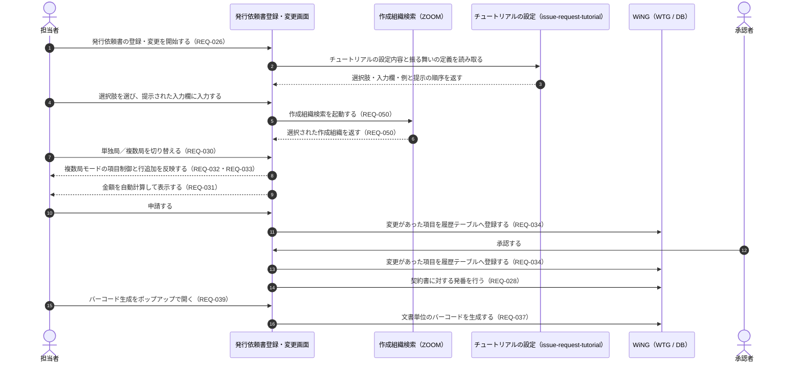

# 要件定義書

> このファイルは **「何を作るか」「完了の判定基準は何か」** の正です。
> 自律エージェントが解釈ぶれを起こさないよう、受け入れ基準は **EARS 形式** で記述してください。
> このフィーチャーが承認 (`status: approved`) されてから `design.md` の作成に進みます。
>
> **テンプレート**: 山括弧で囲んだ大文字の項目は、プロジェクト確定時に実値へ置換する。

## Introduction（概要）

> このフィーチャーが何のために、誰のためにあるかを 2〜3 段落で書く。`背景` はなぜ今このフィーチャーが必要か、`対象ユーザー` は想定する利用者像、`期待する変化` はこのフィーチャーがあると何が変わるか。

発行依頼書登録・変更は、契約書の発行を依頼するための発行依頼書を WiNG 上で登録・変更し、契約書に対する発番を行う機能である（REQ-026 / REQ-028）。入力の負担を下げるための補助として、チュートリアルによる誘導（`issue-request-tutorial` が定義した設定に従う）、設定内容をサンプルより入力できるボタン（REQ-029）、金額の自動計算（REQ-031）を備える。

発行依頼書は単独局と複数局の 2 つのモードを持ち、切替（REQ-030）に応じて項目の制御（REQ-032）と複数局欄・関係者欄の行追加（REQ-033）が変わる。申請・承認の際に項目に変更があれば履歴として残す（REQ-034）。あわせて、文書単位のバーコードをポップアップ画面で生成し（REQ-037 / REQ-039）、削除は論理削除として画面には表示したまま編集を制御する（REQ-038）。

担当者が発行依頼書を登録・変更し、発番まで終えられるため User Feature である（`.aidd/feature-list.md`）。`organization-search-zoom`（作成組織検索の呼び出し先 — REQ-050）と `issue-request-tutorial`（チュートリアルの設定 — REQ-035）に依存するため、優先度 4 に置かれている。

- **背景**: 契約書発行依頼業務は WiNG の WTG 機能で管理されておらず（REQ-001）、入力項目が多すぎるとの指摘があり（REQ-002）、誤入力による不備指摘のやり取りが契約書発行までの納期を延ばしている（REQ-003）
- **対象ユーザー**: 契約書発行依頼業務を担当する社員（`steering/product.md` の対象ユーザー。業務委託費削減の一環として社員対応の体制へ変更済み — REQ-005）、および権限制御の対象となるベンダー・施工会社（REQ-046）
- **期待する変化**: 発行依頼書の作成と契約書の発番が WiNG 上で完結し、チュートリアル・サンプル入力・金額の自動計算・複数局モードの項目制御によって入力の負担と誤入力が減る（REQ-002 / REQ-003 / REQ-029 / REQ-031 / REQ-032 / REQ-035）

> プロダクトレベルの目的・価値は steering の `product.md` を参照。ここではこのフィーチャー固有の文脈を書く。

## 業務フロー（任意）

> 業務システムなど人とシステムの責務境界を整理する必要がある場合のみ記述する。
> 承認フロー・今まで紙で行っていた作業をシステムが担う場合など、人の判断が介在するステップを明示したいときに有効。
> 不要なフィーチャーではこのセクションごと削除してよい。
> `対象業務` はこのフィーチャーが自動化・支援する業務名、`Before` は現在の手順（紙・口頭・別システムでの対応方法を含む）、`After` はシステム稼働後の手順、`人が介在するステップ` は承認・確認・例外処理などシステム外の人的操作。

- **対象業務**: 契約書の発行依頼（発行依頼書の作成・申請・承認と、契約書に対する発番）（REQ-026 / REQ-028 / REQ-034）
- **Before（現状の業務手順）**: 契約書発行依頼業務は WiNG の WTG 機能で管理されていない（REQ-001）。入力項目が多く担当者の負担になっており（REQ-002）、誤入力があると不備指摘のやり取りが発生して契約書発行までの納期が延びる（REQ-003）。**現状、誰がどの様式で発行依頼を起こし、どの順で確認・承認しているか（未確定事項 ②・⑩）、および契約書番号を誰がどう採番しているか（未確定事項 ④）は要求一覧に記載が無い**
- **After（システム導入後）**: 担当者が発行依頼書登録・変更画面で入力する。入力時はチュートリアルが選択肢に応じて入力欄と例を順番に提示し（`issue-request-tutorial` が定義した設定に従う）、サンプル入力ボタン（REQ-029）と金額の自動計算（REQ-031）が入力を補助する。単独局／複数局の切替（REQ-030）に応じて項目が制御され（REQ-032）、複数局欄・関係者欄は行を追加できる（REQ-033）。申請・承認の際に項目に変更があれば履歴として登録される（REQ-034）。契約書に対する発番はシステムが行う（REQ-028）。文書単位のバーコードはポップアップ画面で生成し（REQ-037 / REQ-039）、不要になったものは論理削除して画面には表示したまま編集を制御する（REQ-038）
- **人が介在するステップ**: 発行依頼書の入力と申請（REQ-026）、単独局／複数局の切替の判断（REQ-030）、サンプルを使うかどうかの判断（REQ-029）、承認者による承認（REQ-034 の「各申請・承認時」）、バーコードを生成・削除する判断（REQ-037 / REQ-038）

> **記法**: Mermaid `sequenceDiagram`（スイムレーン形式）。人とシステムの責務境界が図で追える形にする。図が不要なら本スロットを残して直後に不要理由を書く。

<!-- 図に載せていない振る舞い: サンプル入力ボタン（REQ-029）とバーコードの論理削除（REQ-038）は担当者の任意の操作であり、上図の一連の流れの中で位置が一意に決まらないため図に含めていない。発番の契機（登録時・申請時・承認時のいずれか）は未確定事項 ④ であり、図では承認後に置いているが確定した内容ではない。 -->

> システム全体の主要ビジネスフローは `docs/architecture/system-overview.md §主要ビジネスフロー` を参照。

## Boundary Context（境界文脈）

> スコープの誤読が起こりやすい場合や、隣接するシステム / スペックに影響する場合は必ず記述する。
> `_N` の行を項目の数だけ増やす。`Out of Scope` は扱わない振る舞いに加えて理由または委譲先を書く。`Adjacent` は前提として動いている他フィーチャー / API / バッチ、およびこのフィーチャーが依頼している外部側の責務を書く。

- **In Scope（このフィーチャーで扱う）**:
  - 発行依頼書登録・変更画面を新規に作成する（REQ-026）
  - 権限による画面制御を行う（REQ-027）
  - 契約書に対する発番を行う（REQ-028）
  - 設定内容をサンプルより入力できるボタンを複数設ける（REQ-029）
  - 単独局／複数局の切替（REQ-030）、複数局モード時の項目制御（REQ-032）、複数局欄・関係者欄の行追加（REQ-033）
  - 金額の自動計算（REQ-031）
  - **発行依頼書の申請・承認の操作を本画面で受け付ける**（REQ-034 が述べる「各申請・承認時」の契機を本フィーチャーが持つため）。段階の数・各段階の承認者・スキップの扱いといった**フローの定義は本フィーチャーで定めない**（未確定事項 ⑩）
  - **発行依頼書自身の申請・承認の進行状態を表すステータスの保持と表示**（REQ-034 の「各申請・承認時」の契機を判定するために必要。`property-basic-info` が物件基本情報に対して持つステータス（REQ-019）とは別のもの）
  - 各申請・承認時に項目に変更があれば履歴テーブルへ登録する（REQ-034）
  - 文書単位のバーコード生成をポップアップ画面で提供し（REQ-037 / REQ-039）、削除は論理削除として画面には表示して編集を制御する（REQ-038）
  - **`issue-request-tutorial` が定義したチュートリアルの設定内容と振る舞いの定義を、発行依頼書登録・変更画面へ組み込む（画面側の実装）**（REQ-026。`specs/issue-request-tutorial/requirements.md` の `Out of Scope` からの委譲）
  - 作成組織検索（ZOOM）の呼び出しと返却値の受け取り（REQ-050 の呼び出し元としての振る舞い）
  - ログインユーザーの会社コードによるデータ範囲の絞り込み（`steering/security.md` の所有権・エンティティ境界）
- **Out of Scope（扱わない）**:
  - **チュートリアル設定画面と、チュートリアルで何をどの順に提示するかの定義**。`issue-request-tutorial` が持つ（REQ-035 / REQ-036）。REQ-026 の「想定される構成」にはチュートリアル設定画面が含まれるが、`.aidd/feature-list.md` は当該画面を `issue-request-tutorial` に割り当てている
  - 物件基本情報の登録・変更、**承認フローの段階と承認者の定義**、**物件基本情報のステータスの定義**（REQ-019）、契約稟議に関するファイル登録、稟議資料の帳票出力・PDF 表示。`property-basic-info` が持つ（REQ-015〜REQ-025）。**対象外にしているのはフローの定義と物件基本情報側のステータスであり、発行依頼書に対する申請・承認の操作を本画面で受け付けることと、発行依頼書自身のステータスを持つことは `In Scope` である**（REQ-034）
  - 物件契約情報申請状況の検索・一覧・CSV 出力。`contract-application-status` が持つ（REQ-012 / REQ-013 / REQ-014）
  - 作成組織検索（ZOOM）画面そのものの実装。`organization-search-zoom` が持つ（REQ-048 / REQ-049）
  - 採番の仕組みそのものの実装。採番マスタ（`TWTZM050`）と `NumberingService` は既存 WiNG の共通基盤であり、本フィーチャーは発番をこの仕組みに載せる（REQ-053 / `steering/database.md` の採番の設計ルール）
  - 権限制御の方式そのものの定義。方式の正は `steering/security.md` であり、本フィーチャーはそれに従う（REQ-046 は `制約` 分類のため feature 割当の分母外 — `.aidd/feature-list.md`）
- **Adjacent（隣接システム / 隣接スペックへの期待）**:
  - `organization-search-zoom`: 本フィーチャーの画面から起動され、選択された作成組織を返す（REQ-050 / `.aidd/feature-list.md` の `依存` 列）
  - `issue-request-tutorial`: チュートリアルの設定内容（選択肢・入力欄・例）と、何をどの順に提示するかの振る舞いの定義を、本フィーチャーから参照できる形で保持する（`specs/issue-request-tutorial/requirements.md` の Requirement 3 / `.aidd/feature-list.md` の `依存` 列）
  - `property-basic-info`: 契約稟議の側で物件基本情報を管理する。発行依頼書が物件基本情報と紐づくかどうかは本書では確定していない（未確定事項 ⑬）。また、**本フィーチャーのバーコード（REQ-037）が同 feature の表紙情報に印字する QR コード（REQ-024）と同じ対象を指すかどうかを、基本設計で同 feature 側と突き合わせる**（未確定事項 ⑪）。同 feature の承認フロー（REQ-018）の定義が、発行依頼書の申請・承認にも適用されるかは未確定事項 ⑩ で確定する
  - `contract-application-status`: 本フィーチャーが登録した発行依頼書のデータを、申請状況として検索・一覧表示する側である（`.aidd/feature-list.md` の `依存` 列で同 feature が本 feature に依存する）
  - 既存 WiNG の共通基盤: 認証・セッション（`LoginService` / `SessionCheckInterceptor`）、権限制御（`AccessControlInterceptor` + `@FuncID`）、採番（`NumberingService`）、コードマスタ取得（`CodeMstService`）を提供する（`steering/architecture.md` の共通基盤 / `steering/security.md`）

## Requirements（要件）

> 要件 ID は **数値**（`1`, `1.1`, `2`, `2.1` ...）のみ。`A`, `B` などのアルファベット ID は使わない。
> 各要件は **User Story** + **Acceptance Criteria（EARS 形式）** で構成する。
> **`### Requirement` のブロックを要件の数だけ複製する。** 要件領域名は、その要件がどの範囲を扱うかが分かる名前にする。

### Requirement 1: 発行依頼書登録・変更画面の提供

> 由来する要求ID: REQ-026（受入基準 5 は REQ-050 の呼び出し元としての振る舞い）

**User Story**: 契約書発行依頼業務の担当者として、発行依頼書を WiNG 上で登録・変更したい。なぜなら契約書の発行依頼を紙や別の様式ではなくシステムで完結させたいから。

#### Acceptance Criteria（EARS 形式）

> 1 項目 = 1 基準。`_N` の行を基準の数だけ増やす。下の早見表のいずれかのパターンに当てはめて書く。

1. The system shall 発行依頼書を登録・変更する画面を新規に作成し、画面ID・PGID を既存の体系（`GWTG` + 3 桁 / `PWTGO` + 3 桁）に従って採番する（REQ-051 / `steering/tech.md` の命名規則）。採番の具体値と、画面を何本のプログラムに分割するかは基本設計で確定する（未確定事項 ①）。
2. When 担当者が発行依頼書を新規に登録したとき、the system shall 入力された内容を保存し、以降の表示・変更の対象にする。
3. When 担当者が既存の発行依頼書を変更して保存したとき、the system shall 排他フラグ（`ExclusiveFG`）を `WHERE` 条件に含めて更新し、更新件数が 0 件の場合は排他エラー（`ExclusiveException`）として処理する（`steering/database.md` のクエリパターン）。
4. If ログインしていないセッションから本画面のリクエストが行われた場合、then the system shall 画面を表示せずログイン画面へ遷移させる（`steering/security.md` の認証フロー）。
5. When 担当者が作成組織の入力欄から作成組織検索の起動操作を行ったとき、the system shall 作成組織検索（ZOOM）画面を起動し、返された値を当該入力欄に設定する（REQ-050。呼び出し先は `organization-search-zoom`）。
6. The system shall 発行依頼書の検索・更新の SQL の `WHERE` 条件に、ログインユーザーの会社コードを必ず含める（`steering/security.md` の所有権・エンティティ境界 / `steering/database.md` のクエリパターン）。
7. If 入力チェックでエラーが検出された場合、then the system shall 元の画面を再表示し、`BindingResult` に積んだ全件のエラーを該当項目の近くに表示する（`steering/api-standards.md` のエラーハンドリング）。入力項目の一覧・桁・必須の定義は基本設計で確定する（未確定事項 ②）。
8. The system shall 発行依頼書を保持するテーブルを、既存の命名規則と共通カラム（`CompanyCD` / `RegisteredPerson` / `RegisteredDT` / `UpdatedPerson` / `UpdatedDT` / `ExclusiveFG`）の規約に沿って追加する（`steering/database.md` の命名規則）。

### Requirement 2: 権限による画面制御

> 由来する要求ID: REQ-027

**User Story**: 契約書発行依頼業務の担当者・承認者として、自分の権限で扱える範囲だけが操作できる状態にしたい。なぜなら契約金額・契約先などの契約情報を権限の無い利用者に見せたくないから。

#### Acceptance Criteria（EARS 形式）

1. If ログインユーザーが本画面の機能ID（PGID）に対する権限を持たない場合、then the system shall 画面を表示せずエラー画面にメッセージIDに対応する文言を表示する（`steering/security.md` の認可 / `InvalidAccessErrorException`）。
2. The system shall 権限に応じて画面要素の活性・非活性・非表示を制御する（REQ-027）。制御の対象となる画面要素と、`steering/security.md` の権限モデル（メニューID × 機能ID）との対応は基本設計で確定する（未確定事項 ③）。
3. The system shall 画面での制御だけを根拠とせず、登録・変更・発番・バーコード生成の各処理でサーバ側でも権限を判定する（`steering/security.md` の二重防御）。
4. The system shall ベンダー／施工会社に対するデータ範囲の制御を、既存 WTB（計画・工程管理）と同様の方式に従って行う（REQ-046 / `steering/security.md` の認可）。**「既存 WTB と同様の方式」が具体的にどのような制御であるかは要求一覧・steering のいずれからも決まらないため、基本設計で確定する**（未確定事項 ⑯）。
5. If 権限の無いアクセスを検出した場合、then the system shall ユーザーID・メニューID・機能IDをログに記録する（`steering/security.md` のセキュリティログ）。
6. The system shall バーコード生成のポップアップ画面（Requirement 10）を、本要件と同じ権限判定の対象とする（REQ-027 / REQ-039）。
7. The system shall 本フィーチャーの更新系リクエスト（発行依頼書の登録・変更の保存（Requirement 1 の受入基準 2・3）、申請・承認（Requirement 9 の受入基準 1）、発番（Requirement 3）、バーコード生成（Requirement 10）、バーコードの論理削除（Requirement 11））を**すべて** `CSRFTokenCheckInterceptor` によるトークン検証の対象にする。**共通処理が効く既定のアクション名（`regist` / `update` / `delete` / `approved` / `reset` / `execute` / `upload`）以外を用いる場合は、`servlet-context.xml` の interceptor マッピングとの整合を確認し、更新系が CSRF 検証から漏れない形にする**（`steering/api-standards.md` のエンドポイントのパターン / `steering/security.md` の攻撃対策）。

### Requirement 3: 契約書に対する発番

> 由来する要求ID: REQ-028

**User Story**: 担当者として、契約書に対する番号をシステムに採番させたい。なぜなら番号の重複や採番漏れを人手の管理で防ぐのは負担が大きいから。

#### Acceptance Criteria（EARS 形式）

1. The system shall 契約書に対する発番を、既存の採番マスタ（`TWTZM050`）と `NumberingService` の仕組みに載せて行う（`steering/database.md` の採番の設計ルール / `steering/tech.md` の共通処理の再利用）。機能ごとに独自の採番処理を作らない。
2. The system shall 採番時に `SELECT ... FOR UPDATE` で採番行を固定してから更新し、同時実行で同じ番号を払い出さない（`steering/database.md` の採番の直列化）。
3. When 発番が行われたとき、the system shall 採番した番号を当該の発行依頼書に保存し、画面に表示する。
4. If 採番に失敗した場合、then the system shall 発行依頼書を確定させず、業務エラー（`ApplicationException` 系）としてメッセージIDに対応する文言を表示する（`steering/api-standards.md` の分類の業務エラー）。
5. The system shall 発番の採番定義（グループID・識別コード・プレフィックス・連番の範囲・採番区分）、発番を行う契機、および再発番・取消の扱いを、基本設計で確定した内容に従う（未確定事項 ④）。

### Requirement 4: サンプルによる入力補助

> 由来する要求ID: REQ-029

**User Story**: 担当者として、よく使う入力内容をサンプルから一括で入れたい。なぜなら入力項目が多く、毎回すべてを手で入力する負担が大きいから。

#### Acceptance Criteria（EARS 形式）

1. The system shall 設定内容をサンプルより入力できるボタンを、発行依頼書登録・変更画面に**複数**設ける（REQ-029）。
2. When 担当者がサンプル入力のボタンを操作したとき、the system shall 対応するサンプルの内容を該当する入力欄に設定する。
3. The system shall サンプルによって設定した内容を、担当者が保存の操作を行うまで確定させない。
4. The system shall サンプル入力の後も、担当者が当該の入力欄を変更できる状態にする。
5. The system shall サンプルの内容、ボタンの数、各ボタンが対象とする入力欄の範囲を、基本設計で確定した内容に従う（未確定事項 ⑤）。

### Requirement 5: 単独局／複数局の切替

> 由来する要求ID: REQ-030

**User Story**: 担当者として、1 局分の依頼と複数局分の依頼を同じ画面で切り替えて作りたい。なぜなら依頼の対象が 1 局か複数局かで入力する内容が変わるから。

#### Acceptance Criteria（EARS 形式）

1. The system shall 発行依頼書に単独局モードと複数局モードの 2 つの状態を持たせ、画面で切り替えられるようにする（REQ-030）。
2. When モードが切り替えられたとき、the system shall 切替後のモードに応じた項目制御（Requirement 7）を画面に反映する。
3. The system shall 現在どちらのモードであるかを画面上で判別できる形で表示する。
4. The system shall 保存された発行依頼書を再表示するとき、保存時のモードで表示する。
5. The system shall モードの切替を行える契機（新規登録時のみか、保存後の変更時も可か）と、切替によって対象外になった入力済みの内容の扱い（保持するか破棄するか）を、基本設計で確定した内容に従う（未確定事項 ⑥）。

### Requirement 6: 金額の自動計算

> 由来する要求ID: REQ-031

**User Story**: 担当者として、金額をシステムに計算させたい。なぜなら手計算による誤りが不備指摘のやり取りにつながるから。

#### Acceptance Criteria（EARS 形式）

1. When 計算の元になる項目が入力・変更されたとき、the system shall 金額を自動的に計算して画面に反映する（REQ-031）。
2. The system shall 自動計算した金額を、保存時にサーバ側でも算出して検証し、画面から送られた値をそのまま採用しない（`steering/security.md` の基本方針「画面は補助、サーバが正」）。
3. The system shall 金額を `NUMBER` 型で保持する（`steering/database.md` の型の指針）。
4. The system shall 金額の算式、計算の対象となる項目、桁と丸めの扱いを、基本設計で確定した内容に従う（REQ-031 / `steering/database.md` の型の指針 / 未確定事項 ⑦）。

### Requirement 7: 複数局モード時の項目制御

> 由来する要求ID: REQ-032

**User Story**: 担当者として、複数局モードのときは必要な項目だけが入力できる状態にしたい。なぜならモードによって不要になる項目に入力してしまうと誤入力になるから。

#### Acceptance Criteria（EARS 形式）

1. While 発行依頼書が複数局モードである間、the system shall 対象となる項目の入力可否・必須・表示を、単独局モードとは異なる制御に切り替える（REQ-032）。
2. The system shall モードに応じた必須・相関のチェックを Service で行い、結果を `BindingResult` に積む（`steering/api-standards.md` の複数フィールドのバリデーション 3）。
3. The system shall 画面での制御だけを根拠とせず、保存時にサーバ側でもモードに応じた妥当性を判定する（`steering/security.md` の基本方針）。
4. The system shall 複数局モードで制御する項目と、その制御の内容（必須・活性・非表示の別）を、基本設計で確定した内容に従う（未確定事項 ⑧）。

### Requirement 8: 複数局欄・関係者欄の行追加

> 由来する要求ID: REQ-033

**User Story**: 担当者として、局や関係者の数だけ行を増やして入力したい。なぜなら件数が依頼ごとに変わるから。

#### Acceptance Criteria（EARS 形式）

1. When 担当者が複数局欄または関係者欄で行追加の操作を行ったとき、the system shall 入力欄の行を追加する（REQ-033）。
2. The system shall 追加された行の入力値を、他の入力項目と同じ保存の操作で保存する。
3. The system shall 明細行の入力チェックのエラーを、どの行のどの項目かが分かる形で表示する（`steering/api-standards.md` の複数フィールドのバリデーション 2）。
4. If 行数が受け付けられる上限を超えた場合、then the system shall 行を追加せずエラーとして扱う（`AddRowInvalidException` / `steering/tech.md` の例外クラス命名規約）。配列・明細行のバインド上限は既存設定（`ControllerBase` の 1024）に従う（`steering/api-standards.md` のパラメータ配置）。
5. The system shall 複数局欄・関係者欄それぞれの行数の上限と、行の削除を行えるかどうかを、基本設計で確定した内容に従う（REQ-033 の「行追加等」/ 未確定事項 ⑨）。

### Requirement 9: 申請・承認時の履歴管理

> 由来する要求ID: REQ-034

**User Story**: 担当者および承認者として、発行依頼書が何をいつ変えられたかを追いたい。なぜなら申請・承認の過程での変更の経緯を残す必要があるから。

#### Acceptance Criteria（EARS 形式）

1. When 担当者が申請の操作を、または承認者が承認の操作を本画面で行ったとき、the system shall 当該の発行依頼書の申請・承認の状態を次の段階へ進め、その結果を画面に表示する（REQ-034 の「各申請・承認時」）。**段階の数・各段階の承認者・スキップの扱いといったフローの定義は本要件で定めず**、未確定事項 ⑩ で確定した内容に従う。
2. If 申請・承認の操作を行った利用者が当該段階の操作を行える者でない場合、then the system shall 状態を進めず、業務エラー（`ApplicationException` 系）としてメッセージIDに対応する文言を表示する（`steering/api-standards.md` の分類の業務エラー）。当該段階の操作を行える者であるかはデータに依存する業務判断であり、機能ID（PGID）に対する認可の判定（Requirement 2）とは区別する。
3. The system shall **発行依頼書自身の申請・承認の進行状態を表すステータスを、発行依頼書のデータとして保持し、画面に表示する**。これは `property-basic-info` が物件基本情報に対して持つステータス（REQ-019）とは別のものであり、本フィーチャーが持つ。ステータスの値の一覧と遷移は未確定事項 ⑩ で確定する。
4. When 申請または承認の操作により発行依頼書の項目に変更があったとき、the system shall 変更内容を履歴テーブルへ登録する（REQ-034）。
5. The system shall 項目に変更が無い申請・承認では履歴を登録しない（REQ-034 の「項目に変更があれば」）。
6. The system shall 現在値の更新と履歴の登録を同一トランザクション内で行い、片方だけが反映された状態を作らない（`steering/database.md` の整合性）。
7. The system shall 履歴を変更履歴のテーブル（テーブル名の種別 `A`）として、現在値（種別 `M` または `D`）と分けて保持する（`steering/database.md` の設計思想・命名規則）。
8. The system shall 登録済みの履歴を物理削除しない（`steering/database.md` の設計思想）。
9. The system shall 発行依頼書の申請・承認の段階の定義（`property-basic-info` の承認フロー（REQ-018）と同一のものか、独立したものか）、**ステータスの値の一覧と遷移**、および履歴に残す項目の範囲を、基本設計で確定した内容に従う（未確定事項 ⑩）。

### Requirement 10: 文書単位のバーコード生成

> 由来する要求ID: REQ-037 / REQ-039

**User Story**: 担当者として、文書単位のバーコードを発行依頼書の画面から生成したい。なぜなら文書を個別に識別できる形にする必要があるから。

#### Acceptance Criteria（EARS 形式）

1. The system shall 文書単位でバーコードを生成する（REQ-037）。
2. The system shall バーコード生成を**ポップアップ画面**で表示する（REQ-039）。ポップアップ画面の画面ID・PGID は既存の体系に従って採番する（REQ-051 / `steering/tech.md` の命名規則。採番の具体値は未確定事項 ①）。
3. When 担当者がバーコードの生成操作を行ったとき、the system shall 生成したバーコードを保存し、以降の表示の対象にする。
4. The system shall 生成したバーコードを、ログインユーザーの会社コードの範囲で扱う（`steering/security.md` の所有権・エンティティ境界）。
5. The system shall バーコードの対象となる「文書」の単位と、バーコードの規格・桁を、基本設計で確定した内容に従う（未確定事項 ⑪）。

### Requirement 11: バーコードの論理削除と編集制御

> 由来する要求ID: REQ-038

**User Story**: 担当者として、不要になったバーコードを消しつつ、消した事実は画面で分かるようにしたい。なぜなら過去に発行したバーコードの存在自体は追えなくなると困るから。

#### Acceptance Criteria（EARS 形式）

1. When バーコードの削除が行われたとき、the system shall 当該のバーコードを物理削除せず論理削除として扱う（REQ-038 / `steering/database.md` の設計思想）。
2. The system shall 論理削除したバーコードを画面に表示したままにする（REQ-038）。
3. While バーコードが論理削除の状態である間、the system shall 当該のバーコードに対する編集を行わせない（REQ-038）。
4. When 削除の操作で更新を行うとき、the system shall 排他フラグ（`ExclusiveFG`）を `WHERE` 条件に含めて更新し、更新件数が 0 件の場合は排他エラー（`ExclusiveException`）として処理する（`steering/database.md` のクエリパターン）。
5. The system shall 論理削除の状態を保持するフラグを `VARCHAR2(1)`（`1` = ON / `0` = OFF）で表す（`steering/database.md` の型の指針）。
6. The system shall 論理削除したバーコードの画面での見え方（表示位置・状態の示し方）と、編集を制御する範囲を、基本設計で確定した内容に従う（未確定事項 ⑫）。

### Requirement 12: チュートリアルの画面への組み込み

> 由来する要求ID: REQ-026（`issue-request-tutorial` の `Out of Scope` からの委譲）
>
> **要求IDの割当についての注記**: 本要件は REQ-035（「チュートリアルでは、選択肢により順番に入力欄と例が表示される」）が述べる**表示側の振る舞いの受け手**である。しかし REQ-035 は `.aidd/feature-list.md` の本 feature の `対応要求ID` に含まれておらず、**要求一覧上の割当と、実体としての受け手が一致していない**。`feature-list.md` の割当を変更するには Phase 3 への差戻しが必要になるため、**割当を更新しないまま進めることを人間が承知したうえで本要件を置いている**。**この不一致は横断スコープの要求ID突合では検出されない**（REQ-035 は `issue-request-tutorial` 側で被覆済みと判定されるため）。

**User Story**: 担当者として、発行依頼書の入力時にチュートリアルの誘導を受けたい。なぜなら入力項目が多く、何をどの順で入力すればよいかが分かりにくいから。

#### Acceptance Criteria（EARS 形式）

1. The system shall `issue-request-tutorial` が定義したチュートリアルの設定内容（選択肢・入力欄・例）と振る舞いの定義を読み取り、発行依頼書登録・変更画面に組み込む（`specs/issue-request-tutorial/requirements.md` の Requirement 3 の受入基準 5）。
2. When 担当者がチュートリアルの選択肢を選んだとき、the system shall 当該の選択肢に対応する入力欄と例を、定義された順序に従って提示する。
3. The system shall 何を表示するか・どの順で表示するかを本フィーチャー側で新たに決めず、`issue-request-tutorial` の定義に従う（`specs/issue-request-tutorial/requirements.md` の `Adjacent`）。
4. The system shall チュートリアルによる誘導を入力補助として扱い、検証の正とはしない。入力チェックは Requirement 1 の受入基準 7 に従ってサーバ側で行う（`steering/security.md` の入り口 — 入力検証）。
5. If チュートリアルの設定が存在しない場合、then the system shall 誘導を行わずに発行依頼書の入力を継続できる状態にする。
6. The system shall チュートリアルの設定を読み取る経路を、`steering/architecture.md` の依存ルール（機能パッケージ間の直接依存を禁止し、共有が必要な処理は `common` に置く）に反しない形とする。具体的な経路は基本設計で確定する（未確定事項 ⑭）。

## Non-Functional Requirements（非機能要件）

> 当該フィーチャーで成立させるべき非機能要件のみ記述（steering で固定済みのものは引用に留める）。
> 共通 SLO・障害フロー・当番は `non-functional.md`、ログ・監視の実装標準は `non-functional.md`（観測部）を参照。
> `要件` は steering の該当ファイルへの準拠を示したうえで、このフィーチャー固有の値を書く（例: パフォーマンスなら `non-functional.md` 準拠 + p95 200ms、アクセシビリティなら WCAG 2.1 AA、プライバシーなら扱う PII と保持期間）。`計測 / 検証方法` は負荷試験・SLO ダッシュボード・スキャン・監査ログなど、その要件を確認する手段を書く。区分の行は増減してよい。

| 区分 | 要件 | 計測 / 検証方法 |
|---|---|---|
| パフォーマンス | <NFR_PERFORMANCE_REQUIREMENT>（不要 / 人間 2026-09-11: `non-functional.md` に準拠し、feature 固有の値を設けない） | <NFR_PERFORMANCE_VERIFICATION>（不要 / 人間 2026-09-11: 同区分の要件を設けないため検証方法も設けない） |
| 可用性 | <NFR_AVAILABILITY_REQUIREMENT>（不要 / 人間 2026-09-11: `non-functional.md` に準拠し、feature 固有の値を設けない） | <NFR_AVAILABILITY_VERIFICATION>（不要 / 人間 2026-09-11: 同区分の要件を設けないため検証方法も設けない） |
| 運用・監視 | <NFR_OPERATIONS_REQUIREMENT>（不要 / 人間 2026-09-11: `non-functional.md` に準拠し、feature 固有の値を設けない） | <NFR_OPERATIONS_VERIFICATION>（不要 / 人間 2026-09-11: 同区分の要件を設けないため検証方法も設けない） |
| セキュリティ | `steering/security.md` 準拠。`@FuncID` と `AccessControlInterceptor` による毎リクエストの権限判定（REQ-027）、ベンダー／施工会社に対する既存 WTB と同様のデータ範囲の制御（REQ-046）、ログインユーザーの会社コードによるデータ範囲の絞り込み、更新系リクエスト（発番・バーコード生成・論理削除を含む）の CSRF トークン検証、Thymeleaf の自動エスケープによる出力（サンプル・チュートリアルの例の文言を画面に表示するため）、MyBatis の `#{...}` による SQL 組み立て | 権限を持たないユーザーでのアクセス確認（登録・変更画面とバーコード生成ポップアップの双方）、他社の会社コードの発行依頼書・バーコードが画面に現れないことの確認、**ベンダー／施工会社の利用者で、既存 WTB と同様の方式で制御されるデータ範囲の外の発行依頼書が画面に現れないことの確認（方式の実体は未確定事項 ⑯ の確定後に定める）**、設定した文言に含めたスクリプトがそのまま実行されないことの確認、権限エラー時にユーザーID・メニューID・機能IDがログに記録されることの確認 |
| アクセシビリティ | <NFR_ACCESSIBILITY_REQUIREMENT>（不要 / 人間 2026-09-11: `non-functional.md` に準拠し、feature 固有の値を設けない） | <NFR_ACCESSIBILITY_VERIFICATION>（不要 / 人間 2026-09-11: 同区分の要件を設けないため検証方法も設けない） |
| i18n / l10n | <NFR_I18N_REQUIREMENT>（不要 / 人間 2026-09-11: `non-functional.md` に準拠し、feature 固有の値を設けない） | <NFR_I18N_VERIFICATION>（不要 / 人間 2026-09-11: 同区分の要件を設けないため検証方法も設けない） |
| プライバシー | <NFR_PRIVACY_REQUIREMENT>（不要 / 人間 2026-09-11: `non-functional.md` に準拠し、feature 固有の値を設けない） | <NFR_PRIVACY_VERIFICATION>（不要 / 人間 2026-09-11: 同区分の要件を設けないため検証方法も設けない） |
| 監査 | <NFR_AUDIT_REQUIREMENT>（不要 / 人間 2026-09-11: `non-functional.md` に準拠し、feature 固有の値を設けない） | <NFR_AUDIT_VERIFICATION>（不要 / 人間 2026-09-11: 同区分の要件を設けないため検証方法も設けない） |

## Out of Scope（明示的に対象外）

> Boundary Context だけで誤読を防ぎきれないとき、追加でここに書く。
> 1 項目 = 1 件。`_N` の行を件数だけ増やす。対象外にするものと、なぜ対象外か、どこで扱う予定かを書く。

- 既存 WTG 機能（契約情報変更・参照、支払実績データ作成／変更／参照、電力会社直受支払実績変更、契約支払情報インポート、契約基本情報インポート、インボイス情報インポート）の仕様変更。デグレードを発生させない対象であり、新規の Controller / Service / Mapper / Form を追加する形で実装する（REQ-052 / REQ-073 / `steering/tech.md` の新規機能の追加方針）
- 発行依頼書の内容を稟議資料として出力する帳票（表紙情報・発行依頼書・契約局情報、QR コードの印字、別ウインドウでの PDF 表示）。`property-basic-info` が持つ（REQ-023 / REQ-024 / REQ-025）
- 既存データの移行。移行を行うかどうかと方式は本書では確定しない（未確定事項 ⑮）。データ移行のテストは発注者にて実施する前提である（REQ-054）
- 契約情報の取込・ダウンロード。`contract-info-import` / `contract-info-download` が持つ（REQ-040〜REQ-045 / REQ-047）

## Dependencies / Assumptions（前提と依存）

> `前提` はこのフィーチャーが成立するために真でなければならない事項、`依存` は他フィーチャー / 既存システム / 外部 API / データ、`未確定事項` は調査・確認待ちのトピック（design に進む前に解消する）。

- **前提**: 既存 WiNG の認証・セッション・権限制御の仕組み（`LoginService` / `SessionCheckInterceptor` / `AccessControlInterceptor`）がそのまま利用できること（REQ-009 / REQ-053）。採番マスタ（`TWTZM050`）と `NumberingService` による採番の仕組みが、契約書に対する発番にも利用できること（REQ-028 / `steering/database.md` の採番の設計ルール）。現行の発行依頼業務の様式と手順が確認できること（REQ-026）。**現行の様式・手順の入手元は要求一覧から決まらないため、未確定事項 ② に含める**
- **依存**: `.aidd/feature-list.md` の `依存` 列は `organization-search-zoom`・`issue-request-tutorial`。作成組織検索の呼び出し先として前者（REQ-050）、チュートリアルの設定の提供元として後者（`specs/issue-request-tutorial/requirements.md` の Requirement 3）に依存する。既存 WiNG の共通基盤（認証・セッション・権限制御・採番・コードマスタ）にも依存する。なお `contract-application-status` は本フィーチャーに依存する側であり、本フィーチャーからの依存ではない
- **未確定事項**: 次の 16 件は **いずれも基本設計で確定する**（REQ-010。Phase 4 の共通の扱いとして人間が確定 / 2026-09-11）。
  - ① **画面ID・PGID の採番の具体値**と、発行依頼書登録・変更画面とバーコード生成ポップアップ画面を何本のプログラムに分割するか（REQ-010 / REQ-051）
  - ② **発行依頼書の入力項目の一覧・桁・必須と、入力チェックの内容**（REQ-026）。あわせて現行の様式・手順の入手元（付録A の現行システム機能一覧で足りるか、現行業務の調査や発注者への確認を要するか）を確定する（REQ-073）
  - ③ **権限に応じて制御する画面要素と、`steering/security.md` の権限モデル（メニューID × 機能ID）との対応**（REQ-027）
  - ④ **発番の採番定義**（グループID・識別コード・プレフィックス・連番の範囲・採番区分）、**発番を行う契機**（登録時・申請時・承認時のいずれか）、および**再発番・取消の扱い**（REQ-028）
  - ⑤ **サンプルの内容、サンプル入力ボタンの数、各ボタンが対象とする入力欄の範囲**（REQ-029）
  - ⑥ **単独局／複数局の切替を行える契機**（新規登録時のみか、保存後の変更時も可か）と、**切替によって対象外になった入力済みの内容の扱い**（保持か破棄か）（REQ-030）
  - ⑦ **金額の算式、計算の対象となる項目、桁と丸めの扱い**（REQ-031 / `steering/database.md` の型の指針）
  - ⑧ **複数局モードで制御する項目と、その制御の内容**（必須・活性・非表示の別）（REQ-032）
  - ⑨ **複数局欄・関係者欄それぞれの行数の上限と、行の削除を行えるかどうか**（REQ-033 の「行追加等」）
  - ⑩ **発行依頼書の申請・承認の段階の定義**（`property-basic-info` の承認フロー（REQ-018）と同一のものか、独立したものか）、**発行依頼書自身のステータスの値の一覧と遷移**、および**履歴に残す項目の範囲**（REQ-034）。**「`property-basic-info` の承認フローと同一のもの」に確定した場合は、`.aidd/feature-list.md`（依存の SSoT）の本 feature の `依存` 列に `property-basic-info` を加える必要が生じる。その変更は Phase 3 への差戻しとして扱う**（⑬ と同じ扱い）
  - ⑪ **バーコードの対象となる「文書」の単位**（発行依頼書 1 件か、契約書か、帳票の 1 出力か）と、**バーコードの規格・桁**（REQ-037）。あわせて、**本フィーチャーのバーコード（REQ-037）と `property-basic-info` が表紙情報に印字する QR コード（REQ-024）の関係**（別物か、同じ識別子を異なる形式で表すものか）を確定する。「文書」が帳票の 1 出力を指す場合は両者が同じ対象を指しうるため、`property-basic-info` 側と突き合わせる
  - ⑫ **論理削除したバーコードの画面での見え方**（表示位置・状態の示し方）と、**編集を制御する範囲**（REQ-038）
  - ⑬ **発行依頼書が `property-basic-info` の物件基本情報と紐づくかどうか**、紐づく場合のキーと、物件基本情報のステータスが発行依頼書の登録・変更の可否に影響するか（REQ-015 / REQ-026）。**「紐づく」に確定した場合は、`.aidd/feature-list.md`（依存の SSoT）の本 feature の `依存` 列に `property-basic-info` を加える必要が生じる。その変更は Phase 3 への差戻しとして扱う**（`.claude/skills/aidd-flow/references/status-protocol.md` §3）
  - ⑭ **チュートリアルの設定を読み取る経路**（`issue-request-tutorial` の新規テーブルを直接参照するか、`jp.co.kccs.wt.common` に共通サービスを置くか）（`steering/architecture.md` のレイヤーと依存ルール）
  - ⑮ **既存の発行依頼データの移行の要否と方式**（REQ-054 は移行テストの実施主体を定めるに留まり、移行そのものの要否を定めていない）
  - ⑯ **「既存 WTB（計画・工程管理）と同様の権限制御方式」の実体**（ベンダー／施工会社に対してどのデータ範囲をどう制御するか）（REQ-046 / `steering/security.md` の認可）。要求一覧は方式を既存 WTB に合わせるとだけ述べ、steering も同じ表現に留まっているため、既存 WTB の実装を調査して確定する（REQ-073）

---

_「何を作るか」を契約する正のドキュメントです。実装方法 / コンポーネント設計は `design.md`、タスクの分解は `tasks.md` に書いてください。_
