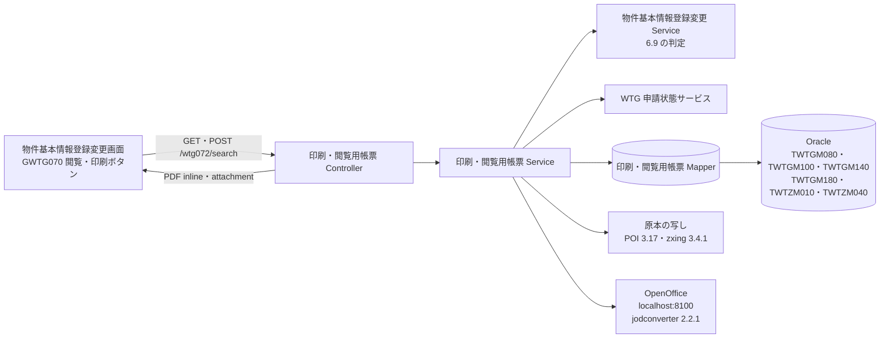
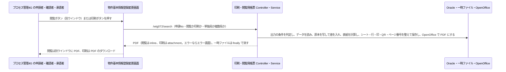

# 技術設計書

> このファイルは **「どう作るか」** を確定させる文書である。実装者ごとの解釈の食い違いを防ぎ、レビュー・実装・検証の共通の土台にする。\
> _分担_: 同一 feature の `requirements.md` が `status: approved` になるまで着手しない。本ファイルが `approved` になるまで `tasks.md` に進まない。`approved` は人間が付ける（エージェントは付けない）。

> _書き方_: 各節は結論から書き、検討の過程や調査ログは残さない。

> _出典の表記_: 「要件 N」「N.M」は `specs/print-report/requirements.md` の要件と受け入れ基準ID。「Q-DS-PR-xxx」は本 feature の design 作成中の質問への回答（回答者 Junichi Noumi、2026-10-08。原文は `.aidd/.engine/answer-ds-pr-20261008-1225.txt`）。「項目一覧」は回答者が渡した帳票の項目一覧（`_handoff/phase5-print-report-items.md`）で、回答者の指示で本書の正とする。「原本」は回答者が渡した原本の Excel（`_handoff/BaseStationRentContractIssuingOrderForm.xlsm`。利用者が今使っている Excel マクロツール）で、セルの位置は原本から読み取った。「pbi design」は `specs/property-basic-info/design.md`、「ir design」は `specs/issue-request/design.md`（どちらも approved）。既存 wing のパスは、既存の実装から読み取った根拠を示す。\
> _上流との関係_: 本書で「上流から意図して外れる」と書いた箇所は、人間の回答に従って書いたもので、上流（steering・requirements・pbi design）は Phase 5 の最後にまとめて直す（upstream-carryover）。

## 概要（Overview）

> 実装者が最初に読む節。何を誰に提供し、既存の何が変わるかを示す。\
> _分担_: 要件そのものは `requirements.md`。ここには設計上の位置づけだけを書く。

> _書き方_: 設計用語を使わず、この設計書を初めて読む人に通じる言葉で書く。

- **目的（Purpose）**: 発番の後の申請者・確認者・承認者（再製本依頼では起案者も）で、組織がプロセス管理4G の利用者 に 物件基本情報登録変更画面の閲覧・印刷ボタンから、表紙・発行依頼書・契約局情報の帳票を PDF で表示・ダウンロードする仕組み を提供する。
- **利用者（Users）**: 組織がプロセス管理4G（権限区分 "G6"）の申請者・確認者・承認者、再製本依頼では起案者・申請者・承認者（`requirements.md` の概要、Q-DS-PR-011）
- **影響（Impact）**: 現在の 利用者が Excel マクロツール（原本）に値を入れて表紙と発行依頼書を作る形 を WiNG のデータから原本の写しに値を入れ、PDF にして出す形 に変更する。

### 達成目標（Goals）
> このフィーチャーが成功したと言える状態を定める節。

> _書き方_: 1 項目 1 行。基準を明記して、達成したかどうかを後から判定できる書き方にする。

- 閲覧で別ウインドウに、印刷でダウンロードに、`<代表局の稟議バーコードNo>.pdf` の PDF が出る（3.1〜3.3、Q-DS-PR-010）
- PDF のページが、閲覧・単独局は表紙と発行依頼書、閲覧・複数局は表紙・発行依頼書・契約局情報、印刷・単独局は表紙、印刷・複数局は表紙と契約局情報になる。契約局情報は 40 局ごとに 1 ページで、右のフッターに「n/総ページ」が付く（1.4〜1.8、Q-DS-PR-002）
- 表紙と発行依頼書のページの項目が、項目一覧の 2・3 章のとおりに出る。表紙の右下に代表局の稟議バーコードNo の QR コードが出る（1.9・1.10・2.1・2.2、Q-DS-PR-003〜008）
- 出力の条件（6.9）に合わない要求は `WTG-100030` で止まる（3.4・3.5、Q-DS-PR-011）
- 作った Excel・PDF・QR の画像は、成功でも失敗でもサーバーに残らない（3.6、Q-DS-PR-012）

### やらないこと（Non-Goals）

> 達成目標に含めないことを先に宣言する節。`### 達成目標（Goals）` と対で読む。\
> _分担_: 実装として持たないものは `### このスペックが持たない責務（Out of Boundary）`。ここには目標の話だけを書く。

> _書き方_: 今回やらないだけのものと、今後もやらないものを書き分ける。

- 今後もやらない：帳票を出したことの記録（4.3）
- 今後もやらない：OpenOffice での変換を順に並べること（同時に変換しない制御）と、待ち時間の上限（Q-DS-PR-013）
- 今回やらない：本 feature 固有の性能目標値を設けること（`requirements.md` の非機能要件。既存 WiNG の水準に従う）
- 今回やらない：帳票のフォントを新しく指定すること。原本のフォントのままにし、サーバーの OpenOffice のフォントは本番の環境に従う（Q-DS-PR-001）

## 責務境界（Boundary Commitments）

> 実装物として**どのスペックが何を持つか**を確定させる節。タスク分解と後工程の検証もここを基準にする。\
> _分担_: 何を作り何を作らないかは `requirements.md` の `## スコープの境界（Boundary Context）`。ここには所有するデータとインターフェース、依存してよい相手を書く。

### このスペックが持つ責務（This Spec Owns）

> このスペックが持ち主になるものを宣言する節。

> _書き方_: 各項目 1 行。他のスペックとの間で担当が曖昧になりやすいものから先に書く。振る舞いをどのコンポーネントが担うかは `## コンポーネントとインターフェース（Components and Interfaces）` に書く。

- **所有するデータ**:
  - 原本の Excel（`BaseStationRentContractIssuingOrderForm.xlsm`）の配置と、その置き場のプロパティ（`ORIGINAL_EXCEL_FILE_DIR`・`ORIGINAL_EXCEL_FILE_NAME`）（Q-DS-PR-001）
  - 帳票を作るときの一時ファイル（編集用 Excel・PDF・QR の画像）と、その置き場のコードマスタの行（`WTG/PARAM/P89` キー3 "01"）（Q-DS-PR-012）
  - リリースのデータ投入（INSERT 文。tasks で作る）：`ZMENUAUTH` の `PWTGO072`・`PWTGO073` の行と、`TWTZM040` の P89 の行。原本の配備の手順（tasks で作る）（Q-DS-PR-011 の 4、design-check 1 回目 #5 の判断）
- **定義するインターフェース**:
  - 印刷・閲覧用帳票の出力の口（`/wtg072/search`。入力 `hdnApplicationNo`・`hdnBrowseBtnClickFlag`・`hdnSingleDepSwitchClickFlag`、GET と POST）（Q-DS-PR-009）
  - 帳票 RWTG070（表紙）・RWTG071（発行依頼書）・RWTG072（契約局情報）の中身と、入力フォームのセルの対応（`### ドメインモデル（Domain Model）`、項目一覧）

### このスペックが持たない責務（Out of Boundary）

> 関連はするが、このスペックが持ち主にならないものを宣言する節。「ついでに」で実装範囲が広がるのを防ぐ。\
> _分担_: ここには持ち主が他にあるものだけを書く。目標として掲げないものと、今回やらないと決めただけのものは `### やらないこと（Non-Goals）`。

> _書き方_: 他に任せるものは委譲先を必ず添える。委譲先が決まっていないものは `## 設計判断（Design Decisions）` で扱う。

- **他に任せる範囲と、その委譲先**:
  - 閲覧・印刷ボタンの表示と、出力できる人・状態の判定（6.9）、別ウインドウの開き方（閲覧は `/zoom/wait` を "zoom" のウインドウで開いて target 指定で送る。印刷は target なしで送る）→ `specs/property-basic-info/design.md`（Q-DS-PR-009・Q-DS-PR-011）
  - 申請・承認履歴・契約局情報のデータ → `specs/property-basic-info/design.md`、発行依頼書と稟議バーコードNo（発番）→ `specs/issue-request/design.md`
  - PDF への変換 → サーバー上の OpenOffice（`steering/tech.md` の `## 主要ライブラリ`）
  - INSERT 文（`P89`・`ZMENUAUTH` の `PWTGO072`・`PWTGO073`）の投入と、原本の配備の実施 → 発注者が導入手順書に沿って行う。INSERT 文と配備の手順は本 feature が作る（`### 移行方針（Migration Strategy）`、design-check 1 回目 #5 の判断）
- **後のフェーズに回す作業**:
  - PDF の見た目（フォント・改行・はみ出し）と、本番の Java の版で zxing 3.4.1 が動くかの確認：総合テスト（試験仕様書）に回す（Q-DS-PR-001・Q-DS-PR-015）

### 依存してよい対象（Allowed Dependencies）

> このフィーチャーが前提にしてよい既存の仕組みを列挙する節。\
> _分担_: 要件として何に依存するかは `requirements.md` の `## 前提と依存（Dependencies / Assumptions）`。ここには実装が使ってよい範囲と守る制約を書く。

> _書き方_: 依存先は、システム名・コンポーネント名・共有基盤名など後から特定できる固有名で書く。制約には一方向性、循環の禁止、レイヤをまたぐ条件など、守るべき条件を書く。

- **依存先**:
  - 物件基本情報登録変更 Service（同じ `wtg070` パッケージ）の、閲覧・印刷ボタンを出す判定（6.9）。pbi design は変えない（Q-DS-PR-011）
  - WTG 申請状態サービス（`function/wtg/common`。pbi design の公開契約）：`getApplication`・`getExternalScope`
  - 物件申請情報（`TWTGM080`）・承認履歴（`TWTGM180`）・契約局情報（`TWTGM140`）の定義（pbi design）、発行依頼書（`TWTGM100`）の定義（ir design）。本 feature は読むだけ
  - ユーザー管理マスタ（`TWTZM010`）・コードマスタ（`TWTZM040`）（読むだけ）
  - ライブラリ：Apache POI 3.17（poi と poi-ooxml）・zxing 3.4.1（core と javase）・jodconverter 2.2.1（`steering/tech.md` の `## 主要ライブラリ`）
  - wing の共通基盤：`SessionCheckInterceptor`・`AccessControlInterceptor`・`ExceptionResolver`・`ApplicationException`・`LoginUserUtils`（`wing/src/main/java/jp/co/kccs/wt/common/`）、ファイルの返し方（`wing/src/main/java/jp/co/kccs/wt/common/service/ServiceBase.java:261`〜`:264`）
- **依存の制約**:
  - Controller → Service → Mapper の向きだけで呼ぶ。物件基本情報登録変更 Service は同じ `wtg070` パッケージの部品として呼び、ほかの機能パッケージの Service・Mapper は呼ばない（`steering/architecture.md` の `## レイヤーと依存ルール`）
  - 業務の表を書かない（4.3。帳票を出したことも記録しない）

### 再確認が必要になる変更（Revalidation Triggers）

> ここに挙げた変更が起きたら、依存するスペックや利用側に再確認を依頼する節。

> _書き方_: 1 項目 1 行（例: 契約の形（API・イベント・型の定義）の変更、データ所有権の移動、依存方向の変更、起動・実行時の前提条件の変更）。

- 原本の Excel のシート・セル・図形・数式・印刷範囲の変更（入力フォームのセルの対応と、表紙の作り方が変わる）
- `TWTGM100`・`TWTGM140`・`TWTGM080`・`TWTGM180` の列の変更（ir design・pbi design）
- 閲覧・印刷ボタンを出す判定（6.9）と、`/wtg072/search` に渡す 3 つの値の変更（pbi design）
- コードマスタの識別（項目一覧の 4.1）と `P89` の変更
- OpenOffice・jodconverter・POI・zxing の版の変更

## アーキテクチャ（Architecture）

> このフィーチャーをどの構成に載せるかを決める節。\
> _分担_: レイヤ構成と依存のルールは `steering/architecture.md` の `## レイヤーと依存ルール`、命名とコード規約は `steering/tech.md` の `## 命名規則` と `## コード規約`。ここにはこのフィーチャー固有の構成だけを書く。

### 既存アーキテクチャの分析（Existing Architecture Analysis）

> 既存システムに手を入れる場合に、守るべき前提を確認する節。

> _書き方_: 今回の変更で壊してはいけないものを挙げる。現状の評価や改善案は書かない。

- **現行のパターンと制約**: wing の画面は Spring MVC の Controller（`@FuncID`）→ Service → MyBatis Mapper の 3 層。ファイルはサーバーの一時ファイルを `response` に書き出して返し、ファイル名は Windows-31J から ISO-8859-1 に変えてヘッダに付ける（`wing/src/main/java/jp/co/kccs/wt/common/service/ServiceBase.java:261`〜`:264`）。画面を持たない URL のエラーは `ApplicationException` を投げて `ExceptionResolver` のエラー画面に出す
- **守るべきドメイン境界**: 申請・承認履歴・契約局情報は物件基本情報登録変更、発行依頼書は発行依頼書登録変更が持つ。本 feature は読むだけ（4.3）
- **維持する統合ポイント**: ログインとセッション、メニュー権限（`ZMENUAUTH`）、コードマスタ（`TWTZM040`）、メッセージ（`wing/src/main/resources/messages.properties`）、プロパティ（`wing/src/main/resources/wing-web.properties`）、サーバー上の OpenOffice（localhost の 8100 番）
- **解消 / 回避する技術的負債**: <DSN_EXISTING_DEBT>（不要：既存の構成（Spring MVC＋MyBatis、既存の共通部品）にそのまま乗せる新しい機能で既存のコードは直さないため、解消する技術的負債も、避けるために設計を変える技術的負債も無い — 回答者 Junichi Noumi、2026-10-07（物件基本情報登録変更と同じ））

### アーキテクチャ方式と境界図（Architecture Pattern & Boundary Map）

> 採用する構成とコンポーネント間の関係を、図と文で示す節。

> _書き方_: 図は例であり、大文字の名前はすべて実際のコンポーネント名に置き換えたり、ノードを追加したりして関係性を示すようにする。関係が複雑でない場合は図を省いて文だけでもよい。



- **選択したパターン**: 既存 wing の 3 層（Controller → Service → Mapper）。Service が原本の写しに値を入れ、OpenOffice で PDF にし、Controller がその PDF を返す
- **ドメイン / 機能の切り分け**: 出力できるかの判定は物件基本情報登録変更 Service（6.9）、データの取得は本 feature の Mapper、帳票の作成（値の入れ方・シートの出し分け・印・QR・ページ番号）と変換・一時ファイルの後始末は本 feature の Service
- **既存パターンとの整合**: プログラムID は `PWTGO072`、クラスは `wtg070` パッケージに置き、URL は `/wtg072`（文書バーコードの `PWTGO073`・`/wtg073` と同じ規則。pbi design）。画面を持たない URL のエラーは `ApplicationException` でエラー画面に出す（Q-DS-PR-011・Q-DS-PR-014）
- **新規コンポーネントを置く理由**: wing に帳票を PDF で出す部品は無い（`requirements.md` の要件 1）
- **steering との整合**: POI・zxing・jodconverter・OpenOffice は `steering/tech.md` の `## 主要ライブラリ` のとおり。原本は .xlsm で、`steering/tech.md` の「テンプレートは .xlsx」から意図して外れる（Q-DS-PR-001）。上流は Phase 5 の最後にまとめて直す（upstream-carryover）

### 技術スタック（Technology Stack）

> このフィーチャーで追加する、または例外的に採用する技術を書く節。\
> _分担_: プロジェクト共通のスタックは `steering/tech.md` の `## コアテクノロジ` と `## 主要ライブラリ`。ここには差分だけを書く。

> _書き方_: 1 行 1 技術。レイヤは Frontend / CLI、Backend / Service、Data / Storage、Messaging / Event、Infrastructure / Runtime などから選ぶ。

| レイヤ | 採用 / バージョン | このフィーチャーでの役割 | 備考 |
|---|---|---|---|
| Backend / Service | 原本の Excel を .xlsm のまま POI 3.17 で開いて保存する | 原本の写しへの値の入れ込み | `steering/tech.md` は「テンプレートは .xlsx」。原本は利用者が今使っている .xlsm（Q-DS-PR-001）。steering から意図して外れる。上流は Phase 5 の最後にまとめて直す（upstream-carryover） |
| Infrastructure / Runtime | 開発端末の JDK 1.8（`-source`/`-target` 1.7） | 開発端末でのコンパイルと自動テストの実行 | 本番は JDK 1.7（`steering/tech.md`）。物件基本情報登録変更と同じ（Q-DS-PBI-014）。zxing 3.4.1 が本番の Java の版で動くかは導入のときに発注者の環境で確かめる（Q-DS-PR-015）。steering/tech.md から意図して外れる。上流は Phase 5 の最後にまとめて直す（upstream-carryover） |

## データモデル（Data Models）

> このフィーチャーで変更するデータ構造を確定させる節。\
> _分担_: システム全体の ER 図・全体スキーマは `docs/architecture/data-model.md` の `## ER 図` に従う。命名と型の共通ルールは `steering/database.md` の `## 命名規則` と `## 型の指針`。

> _書き方_: このフィーチャーで変更するエンティティだけを書く。物理データモデルを変えたら `docs/architecture/data-model.md` との整合を確認する。

### ドメインモデル（Domain Model）

> 業務上の概念とその関係を、保存形式に依らない形で書く節。

> _書き方_: 実装の都合ではなく、業務としてどう成り立っているかで書く。集約は、一緒に更新しないと辻褄が合わなくなるデータのまとまり。値オブジェクトは、金額や住所のように、値が同じなら同じものとして扱ってよいもの。ドメインイベントは、「注文が確定した」のように業務で起きた出来事のうち、他に知らせる必要があるものを指す。不変条件は、いつ見ても成り立っていなければならない決まりを指す。

- **集約とトランザクション境界**: 「申請」の読み取り専用の写し（申請・発行依頼書・契約局情報・承認履歴）を 1 回の出力でまとめて読む。データベースに書かないので、トランザクションは読み取りだけ（`@Transactional(readOnly = true)`）
- **エンティティ / 値オブジェクト / ドメインイベント**: 値オブジェクトは帳票（RWTG070 表紙・RWTG071 発行依頼書・RWTG072 契約局情報）・出力の種類（閲覧・印刷）・単独局か複数局か・印（申請者・確認者・決裁者の姓と決裁日）・QR コード。エンティティとドメインイベントは無い（4.3）
- **ビジネスルール / 不変条件**:
  - **出すページ**（1.4〜1.7、Q-DS-PR-002）：単独局か複数局かは `hdnSingleDepSwitchClickFlag`（画面が申請の `TWTGM080.Tandoku_Fukusu_Flg` を渡す。"0"＝単独局、"1"＝複数局）で決め、契約局の件数では決めない。閲覧か印刷かは `hdnBrowseBtnClickFlag`（"1"＝閲覧、それ以外＝印刷）で決める

    | 出力 | 表紙（RWTG070） | 発行依頼書（RWTG071） | 契約局情報（RWTG072） |
    |---|---|---|---|
    | 閲覧・単独局 | ○ | ○ | － |
    | 閲覧・複数局 | ○ | ○ | ○（40 局ごとに 1 ページ） |
    | 印刷・単独局 | ○ | － | － |
    | 印刷・複数局 | ○ | － | ○（40 局ごとに 1 ページ） |

  - **原本のシートの扱い**（Q-DS-PR-002）：原本のシートは消さない。PDF に出すシートだけを表示にし、出さないシートは非表示のままにする（OpenOffice は非表示のシートを PDF に出さない）。どのシートも A4 縦

    | 原本のシート | 原本での状態 | 帳票での扱い |
    |---|---|---|
    | `【UQ決裁用】表紙` | 非表示 | 計算用。表示にしない |
    | `【UQ決裁用】表紙_PDF出力用` | 表示 | 表紙（RWTG070）。印刷範囲は原本の A2:W86 |
    | `入力フォーム` | 非表示 | DB の値を入れる先。閲覧では表示にして発行依頼書（RWTG071）にする |
    | `複数局用入力フォーム` | 非表示 | 複数局で表示にして契約局情報（RWTG072）にする |
    | `プルダウン設定` | 非表示 | コード値と消費税の基準日。表示にしない |

  - **値の入れ方**（Q-DS-PR-003、項目一覧の 2 章・4 章）：DB の値を原本の写しの `入力フォーム` に入れ、表紙は原本の数式で `入力フォーム` の値から作る。原本では、計算用の `【UQ決裁用】表紙` の値の欄が数式で、PDF 用の `【UQ決裁用】表紙_PDF出力用` は同じ配置で値の欄が空になっている（計算用に数式があり PDF 用が空のセルは 141 個。ラベルと罫線は同じ位置）。そのため、計算用の表紙の数式を計算し、その結果の値を PDF 用の表紙の同じ番地のセルへ写す（`### 判断 2`）。PDF 用の表紙に元からある数式（チェック欄の □／■ と税の計算の欄）はそのまま計算する。表紙にプログラムが直接入れるのは、印・決済日・QR と、下の提出日の空のときだけ。表紙・入力フォームの値はどれも発行依頼書（`TWTGM100`）から取り、契約局情報（`TWTGM140`）から取るのは代表局（連番 1）の稟議バーコードNo だけ（複数局でも同じ）。コード値はコードマスタの名称を入れる（項目一覧の 4.1）。入れる値の元と書式は項目一覧の 2 章を正とする。表紙の項目と原本の数式の結果は項目一覧の 3 章「【UQ決裁用】表紙」を正とし、項目一覧から変わる点は次のとおり（Q-DS-PR-003）
    - 代表局番号：「（代表局番号：　<代表局番号>_<枝番>　）」
    - 決裁日：`TWTGM080` の決裁日時は使わず、承認履歴の承認の行の最終更新日（下の印）
    - 基地局番号・基地局名：発行依頼書の値。基地局名に「　他n局」が含まれていれば 2 行に分ける
    - 所在地：住居表示（住所）と登記表示の両方
    - 起案の部署と氏名：上＝会社名＋所属名①＋所属名②、中＝所属名①＋" "＋所属名②、下＝氏名
    - 案件グループ：大・小グループの両方（それぞれコードと名称）
    - 締結者：契約者区分が「契約者」の関係者から、原本の数式の順で並べた 1 番目と 2 番目（左右の欄）。郵便番号・住所・名前
    - 支払の内容：継続支払は支払内容1〜4、初回支払は初回支払1〜4。合計しない
    - 受電方法・製本種別・押印種別・部数など：コードマスタの名称。添付資料：契約書①〜⑤と補足①〜⑤の 10 件
  - **入力フォームのセル**（原本から読み取った位置。1 始まりの行番号。値の元は項目一覧の 2 章の No）
    - 上段・UQ担当者入力欄：申請日 AL4（No.8）、受付No H5（No.9）、担当エリア T5（No.10）、申請者 AF5（No.11）、代表局番号 H6（No.13）、枝番 P6（No.14）、稟議ﾊﾞｰｺｰﾄﾞNo AF6（No.15）、契約区分 H7（No.16）、確認者 T7（No.17）、決裁者 AF7（No.18）、決済日 AL7（No.19）。社員番号（No.12）は入れない（項目一覧のとおり値なし）
    - 元請担当者入力欄（案件G）：案件大グループのコード J10・名称 J11、案件小グループのコード J12・名称 J13（No.20〜23）、その他①〜④ AD10〜AD13（No.24〜27）
    - 基本情報：親番（基地局番号）I14・枝番 R14・基地局名(ｶﾅ) I15・基地局名 I16（No.28〜31）、契約稟議起案担当部署・氏名 AE14・AE15・AE16（No.32〜34）、所在地区分 C18（No.35）、住居表示 都道府県 I18・市区町村 N18・字番地 W18（No.36〜38）、登記表示 I19・N19・W19（No.39〜41）、物件名 I20（No.42）、借用面積 I21（No.43）、契約事由 AJ21（No.44）、ｱﾝﾃﾅ支持柱本数および管路引込部分等 Q22（No.45）
    - 契約形態：賃貸借契約書 I23・KDDI転貸借契約書 I24・電気使用料覚書 I25（No.46〜48）、その他書類①〜③ AC23〜AC25（No.49〜51）、受電方法 AC26（No.52）
    - 関係者①〜⑤（k＝1〜5、先頭行 r＝28＋8×(k−1)。r は 28・36・44・52・60。No は関係者①が 53〜69、以降 17 ずつ）：契約者区分 I{r}、関係（地位）P{r}、法人個人区分 Y{r}、契約者番号 AK{r}、法人名ﾌﾘｶﾞﾅ／氏名ﾌﾘｶﾞﾅ I{r+1}、役職 氏名ﾌﾘｶﾞﾅ AC{r+1}、法人名／氏名 I{r+2}、役職 氏名 AC{r+2}、郵便番号 I{r+5}、都道府県 M{r+5}、市区町村 Q{r+5}、字番地 W{r+5}、建物ビル AG{r+5}、TEL（固定）I{r+6}、TEL（携帯）AC{r+6}、Email I{r+7}、FAX AC{r+7}。ラベルの「法人名／氏名」は原本の数式が法人個人区分で切り替える
    - 契約内容：契約開始日 J69・契約終了日 J70（No.138・139）、更新の有無 W69・更新年数 AL69・更新方法 W70・更新通知日 AL70（No.140〜143）
    - 支払内容①〜④（n＝1〜4、行 71＋n）：支払内容 F、支払方法 K、支払予定月 Q、支払日 V、金額 Y、税区分 AD、税額 AH、調整額 AK、調整理由 AM（No.144〜179）
    - 初回支払内容①〜④（n＝1〜4、行 76＋n）：対象期間 FROM F、TO K、初回支払日 P、納付書等受領状況 T、金額 Y、税区分 AD、税額 AH、調整額 AK、調整理由 AM（No.180〜215）
    - 転貸借：TK基地局番号 F81・TK基地局名 N81・au基地局番号 Z81・au基地局名 AH81（No.216〜219）、契約種別 H82・局種別 U82・設置設備 AH82（No.220〜222）、賃料【月額】H83・電気料【月額】Y83（No.223・224）、転貸借_契約開始日 H84・転貸情報有無 W84（No.225・226）、着工予定日 H85（No.227）
    - その他事項：契約に関する特記事項 D86（D86:AE102。No.228）、製本種別 AK86・UQ押印種別 AK87・印紙 AK88・部数 AK89・振込口座通知書 AK90・発送先 AK91・支社 AK92（No.229〜235）、その他の製本事項等 AG94（AG94:AP102。No.236）、備考 D103（D103:AA106。No.237）
    - 添付資料：契約書①〜⑤ D108〜D112（No.238〜242）、補足①〜⑤ X108〜X112（No.243〜247）
  - **書式**（Q-DS-PR-007）：日付は文字列の yyyy/m/d（月日の 0 埋めなし。申請日・契約開始日・契約終了日・初回支払の対象期間・初回支払日・着工予定日）。受付No は 6 桁の 0 埋め。入力フォームの金額は数値なら数値で入れて 3 桁ごとのカンマ、マイナスは赤字にし、「無償」などの文字はそのまま入れる。表紙の金額（「\」＋カンマ、マイナスは「▲\」＋カンマで赤字）は原本の数式と書式に任せる。値が空なら空のセルのまま（表紙の □／■ などは原本の数式のとおり）。長い文字列はプログラムで切らず、原本のセルの設定に任せる
  - **発行依頼書のページ（RWTG071。閲覧だけ）**（1.10、Q-DS-PR-002・Q-DS-PR-005）：`入力フォーム` を表示にし、印刷範囲を A1:AQ113 にして、基本情報から下（項目一覧の 2 章の No.28〜237）を出す。隠す行の番号は原本から読み取った 1 始まりの行番号。項目一覧 3 章の特記事項の行番号のうち、85〜101・106〜111・27〜66・26／31／39／55／63／67 は原本の行より 1 小さい（帳票設計の資料の数え方）。1・2 行目は原本と同じ。4〜12 行目は、Q-DS-PR-002 の 2（UQ担当者入力欄から案件G まで）に従い原本の 4〜13 行とした。原本の隠し行 48 は項目一覧に無いが、原本のとおり隠したままにする（design-check 1 回目 #6・2 回目 #1）。次の行は隠す：タイトルの行 2、UQ担当者入力欄から案件G までの行 4〜13、その他事項（契約に関する特記事項と製本の情報）の行 86〜102、添付資料の行 107〜112。原本で隠してある行 1（B1「契約情報」。隠しタイトル）は表示にする（項目一覧 3 章の特記事項「1行目：隠しタイトル表示」。design-check 3 回目 #1）。ほかの原本で隠してある行（27・32・40・48・56・64・68）は隠したまま。契約者区分が空の関係者の欄（行 r〜r＋7）も隠す。製本の情報と添付資料は発行依頼書のページに出さず、表紙に出す。requirements 1.10 から意図して外れる。上流は Phase 5 の最後にまとめて直す（upstream-carryover）。複数局でも 1 ページ。右のフッターは「1/1」
  - **契約局情報のページ（RWTG072。複数局だけ）**（1.8、Q-DS-PR-002・Q-DS-PR-006）：その申請の契約局情報（`TWTGM140`）の全行を連番の昇順で、`複数局用入力フォーム` の行 11 から 1 行に 1 局ずつ入れる。列は No（D。1 からの通し番号。連番は出さない）、基地局番号（E。契約局情報の基地局番号だけで枝番は付けない）、基地局名（J）、物件名（O）。物件名の列は、担当エリアの名称が「光インフラ」のときだけ出し、それ以外は隠す。見出しは原本のまま（プログラムで値を入れない）。1 ページに 40 局（行 11〜50）まで入れ、41 局目からはシートをコピーして 40 局ずつ入れる（印刷範囲は各シート A1:X70）。右のフッターに「n/総ページ」を入れる（数えるのは契約局情報のページだけ）。複数局なら契約局が 1 件でも出す。単独局では出さない
  - **印と決裁日・提出日**（1.9、Q-DS-PR-004、項目一覧の 4.2）
    - 稟議依頼・修正稟議依頼：今の審査回（`TWTGM080` の申請回数）の承認履歴（`TWTGM180`）から、通番の降順で最新の 1 件を取る。申請者＝審査権限 "02"・判定 "02"（その後に確認者の差戻し＝審査権限 "03"・判定 "05" がある行は除く）、確認者＝審査権限 "03"・判定 "03"（その後に承認者の差戻し＝審査権限 "04"・判定 "05" がある行は除く）、決裁者＝審査権限 "04"・判定 "04"。決裁日は決裁者の行の最終更新日
    - 再製本依頼：元申請（`TWTGM080.Moto_Application_No`）の、元申請の申請回数の承認履歴から、審査権限 "02"・"03"・"04" ごとに最新の 1 件を取る（判定の条件は付けない）。確認者の欄も元申請の確認者で埋める
    - 名前は、承認履歴の最終更新者（ユーザーID）でユーザー管理マスタ（`TWTZM010`）を引いたユーザー名。承認履歴の最終更新者名は使わない。入力フォームの申請者 AF5・確認者 T7・決裁者 AF7・決済日 AL7 に入れる
    - 表紙の印は、原本の図形（文字が「申請」「確認」「決裁」「決済日」のもの）の文字を置き換える。印には姓（ユーザー名を空白で分けた先頭）を出し、決済日は MM/dd にする。名前が無い印は、図形の線を白にして見せない
    - 提出日：申請日時（`TWTGM080.Application_Date`）を yyyy/m/d にして入力フォームの申請日 AL4 に入れ、表紙は原本の数式（計算用の U4）で「提出日　　<日付>」になる。値が無ければ「提出日　　」だけにする（原本の数式は AL4 が空なら空にするので、AL4 が空のときは PDF 用の表紙の U4 に「提出日　　」を入れる）
  - **QR コード**（2.1・2.2、Q-DS-PR-008）：中身は代表局（連番 1）の稟議バーコードNo の文字列だけ。zxing の `QRCodeWriter.encode` と `MatrixToImageWriter.toBufferedImage` で 60×60 ピクセルの PNG にし（誤り訂正と余白は既定のまま）、`【UQ決裁用】表紙_PDF出力用` の V78 から X80 の手前まで（0 始まりで列 21〜23、行 77〜79）に貼る。稟議バーコードNo が空なら貼らず、その場所は空白のまま
  - **ファイル名**（3.3、Q-DS-PR-010）：利用者に見せるファイル名は `<代表局の稟議バーコードNo>.pdf`。代表局の稟議バーコードNo が万一空なら `<申請No>.pdf`。requirements 3.3 から意図して外れる。上流は Phase 5 の最後にまとめて直す（upstream-carryover）

### 論理データモデル（Logical Data Model）
> ドメインモデルをデータ構造として整理する節。

> _書き方_: 保存先の製品には依存させない。製品固有の話は物理データモデルに書く

- **エンティティ間の多重度（カーディナリティ）**: 申請 1 : 発行依頼書 1（出力の条件。無ければ出さない）、申請 1 : 契約局情報 1..n（連番 1 が代表局。無ければ出さない）、申請 1 : 承認履歴 0..n。再製本依頼は申請 1 : 元申請 1（`Moto_Application_No`）
- **属性と型**: 読むだけ。各属性と型は pbi design・ir design の物理データモデルと、`specs/issue-request/design.md` の `#### TWTGM100 の DB レイアウト（発行依頼書情報ﾏｽﾀ。Q-DS-IR-003）`・`#### TWTGM140 の DB レイアウト（契約局情報ﾏｽﾀ。Q-DS-IR-004）` のとおり
- **自然キー / 識別子**: 申請は「会社コード＋申請No」（ログインユーザーの会社コードと `hdnApplicationNo`）。契約局情報の代表局は「会社コード＋申請No＋連番 1」
- **参照整合性のルール**: <DSN_LOGICAL_INTEGRITY>（不要：本 feature は読むだけで、整合を保つ責任は持ち主の feature にある — pbi design・ir design）

### 物理データモデル（Physical Data Model）
> 論理データモデルを実際の保存形式に落とした定義を書く節。

> _書き方_: 種別は RDB / Document Store / Event Store / KV・Wide-column などから選ぶ。RDB ならテーブル定義・主キー・外部キー・インデックス・分割方針、Document Store ならコレクション構造・埋め込みと参照の使い分け・シャードキーを書く。

| 種別 | 記載 |
|---|---|
| RDB | 表は作らず変えない。読むのは `TWTGM100`（会社コード＋申請No）を元に、`TWTGM080`（会社コード＋申請No で内部結合）と `TWTGM140`（会社コード＋申請No＋連番 1 で内部結合）、コード値の名称の `TWTZM040`（外部結合。識別は項目一覧の 4.1）。契約局情報のページは `TWTGM140` の申請の全行（連番の昇順）。印は `TWTGM180`（会社コード＋申請No＋審査回）と `TWTZM010`（最終更新者のユーザーID）。一時ファイルの置き場は `TWTZM040` の WTG/PARAM/P89 キー3 "01" の文字項目1（Q-DS-PR-012） |
| ファイル | 原本：`ORIGINAL_EXCEL_FILE_DIR`＋`ORIGINAL_EXCEL_FILE_NAME`（`wing-web.properties`。開発機は `C:\\format\\`・`BaseStationRentContractIssuingOrderForm.xlsm`）。一時ファイル：P89 の場所に、編集用 Excel `<yyyyMMddHHmmssSSS>_<ユーザーID>_<申請No>_編集用_<原本のファイル名>`、PDF はその名前＋".pdf"、QR の画像を一時ファイルにするときも同じ頭の名前（Q-DS-PR-001・Q-DS-PR-012） |

### データ契約と外部連携（Data Contracts & Integration）

> 外部とやり取りするデータの形と、その互換性の方針を決める節。

> _書き方_: API はリクエスト / レスポンスの schema・検証・シリアライズ形式、イベントは schema・バージョニング・互換性、サービス間は分散トランザクション（Saga / 2PC など）と整合性の方針を書く。

- **API**: 画面以外から呼ばれる API は持たない（`steering/api-standards.md` の本プロジェクトでの扱い）。物件基本情報登録変更画面の閲覧・印刷ボタンから呼ばれる `/wtg072/search` だけ
- **イベント**: 持たない。メッセージングを使わない（`steering/tech.md` の `## コアテクノロジ`）
- **サービス間**: OpenOffice とは jodconverter 2.2.1 の `SocketOpenOfficeConnection(8100)`（localhost の 8100 番。接続先はプロパティに持たずプログラムに書く）でつなぐ。要求ごとに接続し、変換が終わったら `finally` で切る。順に並べる仕組みと待ち時間の上限は持たない（Q-DS-PR-013）。入力は .xlsm、出力は PDF で、変換の形式は呼ぶ側で明示して渡す
- **物件基本情報登録変更との口**（Q-DS-PR-009）：`/wtg072/search` に `hdnApplicationNo`（申請No）・`hdnBrowseBtnClickFlag`（"1"＝閲覧、それ以外（"0"）＝印刷）・`hdnSingleDepSwitchClickFlag`（申請の単独複数局フラグ。"0"＝単独局、"1"＝複数局）を URL のクエリに付けて送る。GET と POST の両方を受ける。閲覧は物件基本情報登録変更画面のスクリプトが `/zoom/wait` を名前 "zoom" のウインドウで開き（`ZOOM_DEFINE.zwtz072=1100px,600px`。スクロールとサイズ変更はできる）、そのウインドウを target にして送る。印刷は target を付けずに画面のフォームを送る。pbi design の API 契約は入力が申請No だけで、この形にまだ直っていない。pbi design は Phase 5 の最後にまとめて直す（upstream-carryover）

## コンポーネントとインターフェース（Components and Interfaces）

> 各コンポーネントの責務と、外部に公開する契約を確定させる節。契約は 5 種類ある。
>
> - **サービスインターフェース**: 他のコンポーネントから呼ばれる口
> - **API 契約**: 外部から HTTP で呼ばれる口
> - **イベント契約**: 非同期にやり取りするイベントの発行・購読
> - **バッチ / ジョブ契約**: 定期実行や一括処理
> - **状態管理**: 状態の持ち方と守り方
>
> _分担_: 物理配置は `## ファイル配置計画（File Structure Plan）`。全 API 共通の形式は `steering/api-standards.md` の `## リクエスト / レスポンス形式`、エラー表現は同ファイルの `## エラーハンドリング（API 契約）`。ここには論理的な責務と、このフィーチャー固有の契約を書く。

> _書き方_: まず一覧で全体像を示し、そのあと新しい境界を持つコンポーネントだけ詳細を書く。契約の種類は該当するものにチェックを入れ、同じ名前の小節だけを書く。実装上の注意やリスクは、判断に関わるものは `## 設計判断（Design Decisions）`、確認方法は `## テスト戦略（Testing Strategy）` に書く。
>
> - **ドメイン / レイヤの見出し**: ドメイン名で切るかレイヤ名で切るかはプロジェクトで決め、この節の中で揃える。複数あれば同じ形で繰り返す。`_N` は繰り返す印であり、配下のコンポーネントの `_N` と番号が対応するわけではない。
> - **サービスインターフェース**: メソッドごとに 1 行。型名は設計上の名前でよく、実装の型と一致していなくてよい。事前条件は呼ぶ側が満たしておくこと、事後条件は呼び出しが成功したときに保証されること、不変条件は処理の前後どちらでも常に成り立つことを書く。
> - **API 契約**: 1 行 1 エンドポイント。エラー列には返しうるステータスコードを列挙する。
> - **イベント契約**: 到達保証・順序保証は at-least-once / FIFO などの方式名で書く。
> - **バッチ / ジョブ契約**: 冪等性（同じ処理を何度実行しても結果が変わらない性質）をどう担保するかと、失敗時の復旧手順を書く。
> - **状態管理**: 状態が同時に更新されうる場合は、並行制御の方式まで書く。

- **監視**: 本 feature 固有の監視項目は無い。既存の WiNG の監視に任せる（`steering/non-functional.md` の `### 監視 / ヘルス`）

### コンポーネント一覧（Summary）

> このフィーチャーのコンポーネントを 1 行ずつ並べ、詳細を書くものを選ぶための節。

> _書き方_: 各行は下の詳細と対応し、コンポーネント名・ドメイン / レイヤ・目的・受け入れ基準ID は同じ値を書く。依存には主なものだけ、契約にはチェックした種類名を書く。

| コンポーネント | ドメイン / レイヤ | 目的 | 受け入れ基準ID | 依存 | 契約 |
|---|---|---|---|---|---|
| 印刷・閲覧用帳票 Controller | 印刷・閲覧用帳票 / Controller | 要求を受け、Service が作った PDF を閲覧は inline、印刷は attachment で返す | 3.1〜3.3 | 印刷・閲覧用帳票 Service | API 契約 |
| 印刷・閲覧用帳票 Service | 印刷・閲覧用帳票 / Service | 出力できるかの判定、データの取得、原本の写しへの値の入れ込み、シート・行の出し分け、印・QR・ページ番号、PDF への変換、一時ファイルの後始末 | 1.1〜1.10、2.1、2.2、3.3〜3.6、4.1〜4.3 | 物件基本情報登録変更 Service、WTG 申請状態サービス、印刷・閲覧用帳票 Mapper、POI・zxing・jodconverter | サービスインターフェース |
| 印刷・閲覧用帳票 Mapper | 印刷・閲覧用帳票 / Mapper | 発行依頼書・申請・代表局の稟議バーコードNo、契約局情報の全行、承認履歴の印、コードマスタの名称と P89 の読取り | 1.5、1.7〜1.10、2.1、4.2 | Oracle | — |

### 印刷・閲覧用帳票

#### 印刷・閲覧用帳票 Controller

| 項目 | 内容 |
|---|---|
| 目的（Intent） | 要求を受け、Service が作った PDF を閲覧は inline、印刷は attachment で返す |
| 受け入れ基準ID | 3.1〜3.3 |
| 担当 / レビュアー | <DSN_COMPONENT_OWNER>（不要：体制（担当・レビュアー）は案件の計画書で管理する — 回答者 Junichi Noumi、2026-10-07（物件基本情報登録変更と同じ）） |

**責務と制約**:
- **主たる責務**: `@RequestMapping("/wtg072")`・`@FuncID("PWTGO072")` で、`/search` の GET と POST を受ける。Service が作った PDF を、`Content-Type: application/pdf` と、閲覧は `Content-Disposition: inline; filename="<ファイル名>"`、印刷は `attachment; filename="<ファイル名>"` で返す。ファイル名は既存のダウンロードと同じく Windows-31J から ISO-8859-1 に変えて付ける。`Cache-Control` は足さない（Q-DS-PR-010）。エラーは Service が投げる `ApplicationException` をそのまま `ExceptionResolver` に任せる（Q-DS-PR-014）
- **ドメイン境界 / トランザクションの範囲**: トランザクションを持たない（Service が持つ）
- **データ所有権 / 不変条件**: Mapper を直接呼ばない。`createReport` が成功したら、PDF を応答に書き出す処理を try で囲み、finally で Service の `deleteTempFiles`（PDF・編集用 Excel・QR の画像のパス）を呼ぶ（Q-DS-PR-012、design-check 1 回目 #1 の判断）

**依存関係**:
- **呼び出し元（Inbound）**:
  - 物件基本情報登録変更画面（GWTG070）— 閲覧ボタン（別ウインドウ）・印刷ボタン（重要度: 高）
- **呼び出し先（Outbound）**:
  - 印刷・閲覧用帳票 Service — 判定・作成・変換・後始末（重要度: 高）
- **外部（External）**:
  - なし — 外部システムと通信しない（OpenOffice は同じサーバーの部品として Service が使う）（重要度: —）

**契約の種類**（チェックリスト）
- [ ] サービスインターフェース（Service Interface）
- [x] API 契約（API Contract）
- [ ] イベント契約（Event Contract）
- [ ] バッチ / ジョブ契約（Batch / Job Contract）
- [ ] 状態管理（State Management）

##### API 契約（API Contract）

> 画面のボタンから呼ばれる口であり、画面以外から呼ばれる API ではない。URL は既存の規約どおり `/wtg072/<アクション>` の 1 段にする（`steering/tech.md` の `## 命名規則`）。`/wtg072` は `@FuncID("PWTGO072")` によるアクセス制御の対象。データを変えない要求で、CSRF の照合（URL の末尾が `regist`・`update`・`delete`・`approved`・`reset`・`execute`・`upload` のものだけ）には乗らない。照合の設定は変えない（pbi design の判断 4 と同じ）。エラーは HTTP 200 で既存のエラー画面（`ExceptionResolver`）を返す。

| Method | Endpoint | Request | Response | Errors |
|---|---|---|---|---|
| GET・POST | `/wtg072/search` | `hdnApplicationNo`（申請No）、`hdnBrowseBtnClickFlag`（"1"＝閲覧、それ以外＝印刷）、`hdnSingleDepSwitchClickFlag`（"0"＝単独局、"1"＝複数局）。URL のクエリで受ける（Q-DS-PR-009） | `application/pdf`。閲覧は `inline`、印刷は `attachment`。ファイル名は `<代表局の稟議バーコードNo>.pdf`（空なら `<申請No>.pdf`）（3.1〜3.3、Q-DS-PR-010） | エラー画面：`WTG-100030`（出力の条件に合わない・申請が無い・社外ユーザーの範囲外・発行依頼書か契約局情報の 1 行目が無い）、`DS-000084`（原本のフォルダ・一時ファイルの置き場が無い）、`GEF-000058`（原本のファイルが無い）、`DS-100015`（変換・接続の失敗）（Q-DS-PR-011・Q-DS-PR-014） |

- **エラーの出る先**（Q-DS-PR-014）：閲覧は別ウインドウにエラー画面が出る。印刷は物件基本情報登録変更画面のウインドウがエラー画面に替わる。利用者は物件基本情報登録変更画面を開き直して、閲覧・印刷を押し直す（4.1 のやり直し）

#### 印刷・閲覧用帳票 Service

| 項目 | 内容 |
|---|---|
| 目的（Intent） | 出力できるかの判定、データの取得、原本の写しへの値の入れ込み、シート・行の出し分け、印・QR・ページ番号、PDF への変換、一時ファイルの後始末 |
| 受け入れ基準ID | 1.1〜1.10、2.1、2.2、3.3〜3.6、4.1〜4.3 |
| 担当 / レビュアー | <DSN_COMPONENT_OWNER>（不要：体制（担当・レビュアー）は案件の計画書で管理する — 回答者 Junichi Noumi、2026-10-07（物件基本情報登録変更と同じ）） |

**責務と制約**:
- **主たる責務**: 出力できるかを判定し、原本を一時ファイルの置き場へ写して値を入れ、表紙の数式を計算し、出すシートと行を決め、印・QR・ページ番号を入れて保存し、OpenOffice で PDF に変換して返す。作った一時ファイルは必ず消す
- **ドメイン境界 / トランザクションの範囲**: 読み取りだけ（クラスに `@Transactional(readOnly = true)`）。データベースに書かない（4.3）
- **データ所有権 / 不変条件**: 原本そのものは開いて写すだけで変えない。一時ファイルは要求ごとに別の名前で作り、ほかの要求のファイルに触れない

**依存関係**:
- **呼び出し元（Inbound）**:
  - 印刷・閲覧用帳票 Controller — 出力の要求（重要度: 高）
- **呼び出し先（Outbound）**:
  - 物件基本情報登録変更 Service — 閲覧・印刷ボタンを出す判定（6.9）（重要度: 高）
  - WTG 申請状態サービス — `getApplication`（申請の取得）・`getExternalScope`（社外ユーザーの範囲）（重要度: 高）
  - 印刷・閲覧用帳票 Mapper — 帳票に出すデータ（重要度: 高）
  - POI 3.17・zxing 3.4.1・jodconverter 2.2.1 — Excel の編集・QR の画像・PDF への変換（重要度: 高）
- **外部（External）**:
  - なし — 外部システムと通信しない（重要度: —）

**契約の種類**（チェックリスト）
- [x] サービスインターフェース（Service Interface）
- [ ] API 契約（API Contract）
- [ ] イベント契約（Event Contract）
- [ ] バッチ / ジョブ契約（Batch / Job Contract）
- [ ] 状態管理（State Management）

##### サービスインターフェース（Service Interface）

| メソッド | 入力 | 出力 | エラー |
|---|---|---|---|
| 帳票の作成（`createReport`） | 会社コード、ログインユーザー、申請No、閲覧か印刷か、単独局か複数局か | 成功したら PDF・編集用 Excel・QR の画像のパスと、利用者に見せるファイル名。途中で失敗したら、作ったファイルをすべて消してから例外を投げる | `ApplicationException` を投げる：`WTG-100030`・`DS-000084`・`GEF-000058`（{0}＝「原本エクセルファイル」）・`DS-100015`（`### 機能固有エラーコード`） |
| 一時ファイルの削除（`deleteTempFiles`） | 作った編集用 Excel・PDF・QR の画像のパス | なし。Controller が PDF を応答に書き出したあとの finally で呼ぶ | なし（消すのに失敗したら ERROR でファイルのパスをログに出し、処理は止めず、利用者には知らせない） |

- **帳票の作成の手順**（1 要求の中で、上から順に。途中のエラーで止める）
  1. **出力の条件**（3.4・3.5、Q-DS-PR-011）：`getApplication` で申請を取り、`getExternalScope` で社外ユーザーの範囲を確かめ、物件基本情報登録変更 Service の閲覧・印刷ボタンを出す判定（6.9：組織がプロセス管理4G（権限区分 "G6"）、稟議依頼・修正稟議依頼では申請者・確認者・承認者、再製本依頼では起案者・申請者・承認者、契約局情報と発行依頼書が登録済、発番済（稟議依頼・修正稟議依頼はステータスが受付済（02）以降、再製本依頼は常に発番済））を呼ぶ。申請が無い・範囲外・判定に合わない・発行依頼書か契約局情報の 1 行目が無いときは `WTG-100030`。文言の {0} に審査フェーズの名称、{1} に状態の名称（申請が無ければどちらも空）、{2} に「閲覧」か「印刷」を入れる（物件基本情報登録変更の `WTG-100030` と同じ並び。design-check 1 回目 #2 の判断）
  2. **原本と置き場**（1.2・4.2、Q-DS-PR-001・Q-DS-PR-012）：原本のフォルダ（`ORIGINAL_EXCEL_FILE_DIR`）が無ければ `DS-000084`、原本のファイルが無ければ `GEF-000058`（{0}＝「原本エクセルファイル」）。一時ファイルの置き場（P89 の文字項目1）が空か、フォルダが無ければ `DS-000084`。フォルダは自動で作らない
  3. **データの取得**：Mapper で発行依頼書・申請・代表局の稟議バーコードNo・コードの名称、印（承認履歴とユーザー名）、複数局なら契約局情報の全行を読む
  4. **値の入れ込み**（1.1・1.9・1.10）：原本を一時ファイルの置き場へ編集用 Excel の名前で写し、POI で開いて `入力フォーム` のセルに値を入れる（`### ドメインモデル（Domain Model）` のセルと書式）。原本の写しに失敗したら `DS-100015`、POI での原本の読込みに失敗したら `GEF-000058`（{0}＝「原本エクセルファイル」。1.2 と同じ扱い）（design-check 1 回目 #4 の判断）
  5. **表紙の数式の計算と写し**：POI で数式のセルを計算し直し、計算用の `【UQ決裁用】表紙` で数式があり PDF 用の `【UQ決裁用】表紙_PDF出力用` で空のセルの値を、PDF 用の同じ番地へ写す（`### 判断 2`）
  6. **シートと行**（1.4〜1.8）：出すシートだけを表示にし、発行依頼書のページの印刷範囲・隠す行、契約局情報のページの行とシートのコピー、物件名の列の出し分け、右のフッターのページ番号を設定する
  7. **印と QR**（1.9・2.1・2.2）：表紙の図形の印と決済日を置き換え（名前が無い印は線を白にする）、稟議バーコードNo があれば QR の画像を貼る。QR の生成に失敗したら `DS-100015`
  8. **保存と変換**（1.1・4.1、Q-DS-PR-013）：保存し（保存に失敗したら `DS-100015`）、OpenOffice に接続して PDF に変換する。接続や変換に失敗したら、ログに ERROR とスタックトレースを出し、`DS-100015` にする（接続の失敗と変換の失敗を分けない）。接続は `finally` で切る
  9. **後始末**（3.6、Q-DS-PR-012、design-check 1 回目 #1 の判断）：途中で失敗したときは、`createReport` の中の `finally` で、作った編集用 Excel・PDF・QR の画像を `Files.deleteIfExists` で消してから例外を投げる。成功したときは、ファイルのパスを Controller に返し、Controller が PDF を応答に書き出したあとの finally で `deleteTempFiles` を呼んで消す
- **事前条件（Preconditions）**: ログインユーザーの会社コード・ユーザーID・権限区分がセッションにある。原本が `ORIGINAL_EXCEL_FILE_DIR` に配備されている。OpenOffice が localhost の 8100 番で待ち受けている
- **事後条件（Postconditions）**: 成功のとき、出力の種類と単独局・複数局に合ったページの PDF が返り、サーバーに一時ファイルが残らない。失敗のとき、PDF は返らず、エラー画面が出て、一時ファイルが残らない（消すのに失敗した場合を除く。その場合はログに出る）
- **不変条件（Invariants）**: データベースに書かない（4.3）。原本を変えない。同じ申請を同時に出しても、一時ファイルの名前が重ならない（ミリ秒の時刻とユーザーID と申請No を頭に付ける）

## 処理フロー（System Flows）

> このフィーチャーの主要な処理の流れを図で示す節。\
> _分担_: システム全体の主要ビジネスフローは `docs/architecture/system-overview.md` の `## 主要ビジネスフロー`。エラーコードの出し分けが複雑な場合は `## 機能固有のエラー処理（Error Handling）` の `### エラー時の分岐フロー`。

> _書き方_: プレースホルダは実際のコンポーネント名に置き換える。分岐・リトライ・例外時の扱いは、図に描くか図の下に文で補う。


**フロー上の主要な判断**: 出力できるかの判定は物件基本情報登録変更 Service の 6.9 の判定を呼び、本 feature で別の判定を作らない。表紙は原本の数式で作り、プログラムは入力フォームに値を入れることと、印・QR・ページ番号・シートの出し分けだけを行う。エラーはどれも PDF を出さずにエラー画面に出し、やり直しは利用者が画面を開き直して押し直す（4.1）。

## 機能固有のエラー処理（Error Handling）

> このフィーチャー固有のエラーコードと復旧の流れを決める節。\
> _分担_: API のエラー契約は `steering/api-standards.md` の `## エラーハンドリング（API 契約）`、例外処理の方針は `steering/tech.md` の `## 例外処理`、ログ・リトライ・監視は `steering/non-functional.md` の `## 信頼性・観測性`。

- **返し方**: 画面を持たない URL なので、どのエラーも `ApplicationException`（メッセージキー付き）を投げ、既存の `ExceptionResolver` のエラー画面に出す（`steering/tech.md` の `### 例外処理フロー`、Q-DS-PR-011・Q-DS-PR-014）
- **ログ**（design-check 1 回目 #3・#4 の判断）：OpenOffice への接続・PDF への変換の失敗は、`DS-100015` の文言とスタックトレースを ERROR で出す（4.1、Q-DS-PR-013）。原本の読込みの失敗は `GEF-000058` の文言、原本の写し・保存・QR の生成の失敗は `DS-100015` の文言を、どちらもスタックトレースとともに ERROR で出す。一時ファイルを消すのに失敗したときは、ERROR でそのファイルのパスを出し、処理は止めない（個人情報を含むファイルが残るので、運用で気づけるようにする。Q-DS-PR-012）。帳票に載る関係者・担当者の氏名・住所・連絡先はログに出さない（`steering/non-functional.md` の `#### 出力しない`、`steering/security.md` の `## 機密データ`）

### バリデーション設計

> 入力を受け付けるかどうかの判定条件を決める節。\
> _分担_: 入力検証と出力エスケープの全体方針は `steering/security.md` の `## 入力検証 / 出力エスケープ`、API 共通のバリデーション形式は `steering/api-standards.md` の `### 複数フィールドのバリデーション`。

> _書き方_: 全体方針と重複しない、このフィーチャー固有の条件だけを書く。

| チェック対象 | 項目名 | 条件 / ルール | エラーコード | メッセージ例 | UI の対処 |
|---|---|---|---|---|---|
| 出力の条件 | 申請No・ログインユーザー | 申請があり、社外ユーザーの範囲内で、閲覧・印刷ボタンを出す判定（6.9）に合い、発行依頼書と契約局情報の 1 行目がある（3.4・3.5、Q-DS-PR-011） | `WTG-100030`（物件基本情報登録変更が追加） | ステータス、状態区分、操作の組み合わせが不正です。ステータス：{0}… （{0}＝審査フェーズの名称、{1}＝状態の名称、{2}＝「閲覧」か「印刷」。申請が無ければ {0}・{1} は空） | エラー画面に出し、PDF を出さない |
| 原本 | 原本のフォルダ | `ORIGINAL_EXCEL_FILE_DIR` のフォルダがある（1.2） | `DS-000084`（既存） | ファイル名(ファイルパス)が存在しません | 同上 |
| 原本 | 原本のファイル | フォルダ＋`ORIGINAL_EXCEL_FILE_NAME` のファイルがあり、POI で読み込める（1.2） | `GEF-000058`（既存。{0}＝「原本エクセルファイル」） | 原本エクセルファイル:指定されたﾌｧｲﾙが何らかの理由により処理出来ません（空ﾌｧｲﾙ、正しくﾌｧｲﾙ指定がされていないなど） | 同上 |
| 一時ファイル | 置き場 | P89 の文字項目1 が空でなく、そのフォルダがある（4.2） | `DS-000084`（既存） | ファイル名(ファイルパス)が存在しません | 同上 |

### 機能固有エラーコード

> このフィーチャーだけが返すエラーコードを一覧にする節。

> _書き方_: 例「`FEATURE_X_INVALID_STATE` / 409 / 状態遷移の不整合 / UI でステータスを取得し直す」「`FEATURE_X_DEPENDENCY_DOWN` / 503 / 外部依存が使えない / 自動リトライ後にフォールバック」。

新しいキーは足さない。どれも wing に既にあるキーか、物件基本情報登録変更が追加するキーを使う（Q-DS-PR-011・Q-DS-PR-014）。

| エラーコード | HTTP | 意味 | 対応 |
|---|---|---|---|
| `WTG-100030`（物件基本情報登録変更が追加） | 200（エラー画面） | 出力の条件（6.9）に合わない、申請が無い、社外ユーザーの範囲外、発行依頼書か契約局情報の 1 行目が無い（3.4・3.5） | 物件基本情報登録変更画面を開き直して状態とボタンを確かめる |
| `DS-000084`（既存） | 200（エラー画面） | 原本のフォルダ、または一時ファイルの置き場（P89）が無い・空（1.2・4.2） | 運用者がフォルダとコードマスタを直し、利用者が押し直す |
| `GEF-000058`（既存） | 200（エラー画面） | 原本のファイルが無い、または POI で原本を読み込めない（1.2。design-check 1 回目 #4 の判断） | 運用者が原本を配備し、利用者が押し直す |
| `DS-100015`（既存） | 200（エラー画面） | PDF への変換、または OpenOffice への接続に失敗した（4.1）。原本の写し・保存・QR の生成に失敗した（design-check 1 回目 #4 の判断） | 利用者が画面を開き直して押し直す（作成をやり直す） |

### エラー時の分岐フロー

> `### 機能固有エラーコード` で定めたコードを、どの条件で返すかを図で示す節。分岐が多く、表だけでは追いにくい場合に書く。\
> _分担_: 処理の主要な流れは `## 処理フロー（System Flows）`。

> _書き方_: 図の中の大文字の名前は実際の処理名・エラーコードに置き換える。分岐のラベル（成立 / 不成立 / 成功 / 失敗）も判定内容に合わせて書き換える。

```mermaid
flowchart TD
    A[/wtg072/search の要求] --> B{申請があり範囲内で<br/>6.9 の判定に合い<br/>発行依頼書と代表局がある}
    B -- いいえ --> X1[WTG-100030]
    B -- はい --> C{原本のフォルダがある}
    C -- いいえ --> X2[DS-000084]
    C -- はい --> D{原本のファイルがある}
    D -- いいえ --> X3[GEF-000058]
    D -- はい --> E{P89 の置き場が空でなく<br/>フォルダがある}
    E -- いいえ --> X4[DS-000084]
    E -- はい --> F0{原本を写し POI で読み込めた}
    F0 -- 写しの失敗 --> X6[DS-100015]
    F0 -- 読込みの失敗 --> X7[GEF-000058]
    F0 -- できた --> F[値を入れ表紙を計算し<br/>シート・印・QR を整えて保存]
    F --> F1{QR の生成と保存が成功}
    F1 -- 失敗 --> X8[DS-100015]
    F1 -- 成功 --> G{OpenOffice への接続と<br/>PDF への変換が成功}
    G -- 失敗 --> X5[ERROR ログと DS-100015]
    G -- 成功 --> H[PDF を返す]
    X5 --> Z[finally で一時ファイルを消す<br/>失敗は ERROR でパスを出し止めない]
    X6 --> Z
    X7 --> Z
    X8 --> Z
    H --> Z
```

## ファイル配置計画（File Structure Plan）

> このフィーチャーで追加・変更するファイルを、どのディレクトリに置くかを示す節。\
> _分担_: ディレクトリ構成の規約は `steering/architecture.md` の `## ディレクトリ構成`、ファイルやディレクトリの命名規則は `steering/tech.md` の `## 命名規則`。論理的な責務は `## コンポーネントとインターフェース（Components and Interfaces）`。ここには規約に従って置く実際のファイルだけを書く。

> _書き方_: 繰り返し現れる構造はパターンを 1 度だけ書く。個別ファイルは責務が読み取りにくいときだけ挙げる。

```
wing/src/main/
├── java/jp/co/kccs/wt/function/wtg/wtg070/       # 物件基本情報登録変更と同じパッケージ（PWTGO072。Q-DS-PR-011）
│   ├── controller/Pwtgo072Controller.java        # /wtg072/search、@FuncID("PWTGO072")
│   ├── service/Pwtgo072Service.java              # 判定・値の入れ込み・シートの出し分け・印・QR・変換・後始末
│   ├── mapper/Pwtgo072Mapper.java
│   ├── form/Pwtgo072Form.java                    # hdnApplicationNo・hdnBrowseBtnClickFlag・hdnSingleDepSwitchClickFlag
│   └── bean/                                     # 帳票の値の Info（発行依頼書・契約局情報の行・印）
├── resources/jp/co/kccs/wt/function/wtg/wtg070/Pwtgo072Mapper.xml
└── webapp/static/manual/BaseStationRentContractIssuingOrderForm.xlsm   # 原本（配備のときに ORIGINAL_EXCEL_FILE_DIR へ写す。Q-DS-PR-001）
```

### 変更する既存ファイル（Modified Files）

> 新規追加ではなく、既存ファイルに手を入れる箇所を挙げる節。

> _書き方_: 何をどう変えるか、なぜ変えるかを 1 行で書く。

- `wing/src/main/resources/wing-web.properties` — `ORIGINAL_EXCEL_FILE_DIR`（原本のフォルダ。末尾に区切り文字。開発機は `C:\\format\\`）と `ORIGINAL_EXCEL_FILE_NAME`（`BaseStationRentContractIssuingOrderForm.xlsm`）を足す（Q-DS-PR-001）。閲覧の別ウインドウの大きさ `ZOOM_DEFINE.zwtz072=1100px,600px` は物件基本情報登録変更の画面が使う（Q-DS-PR-009。足すのは pbi design の作業に合わせる）
- `wing/pom.xml` — POI 3.17（poi・poi-ooxml）・zxing 3.4.1（core・javase）・jodconverter 2.2.1 を足す（`steering/tech.md` の `## 主要ライブラリ`。ほかの feature が先に足していれば足さない）

## 追加検討事項（Additional Considerations）

> 機能の振る舞いそのものではないが、実装前に決めておくことをまとめる節。配下の見出しのうち、このフィーチャーに関係するものを書く。\
> _分担_: 選択肢を比べて選んだ判断は `## 設計判断（Design Decisions）`。要件としての目標値は `requirements.md` の `## 非機能要件（Non-Functional Requirements）`。

### セキュリティ上の考慮（Security Considerations）

> 認証・機密データ・外部連携・権限を扱うフィーチャーで書く節。\
> _分担_: 横断的な防御は `steering/security.md` の `## 基本方針`、認証・認可の標準は同ファイルの `## 認証・認可`。要件としてのセキュリティ目標は `requirements.md` の `## 非機能要件（Non-Functional Requirements）`。ここには実現手段だけを書く。

> _書き方_: 想定する攻撃者と守る対象を先に決めてから、対策を書く。

- **脅威と対策**:
  - メニュー権限の無い利用者が `/wtg072/search` を直接開く → `@FuncID("PWTGO072")` と `ZMENUAUTH` で既存の `AccessControlInterceptor` が拒否する（Q-DS-PR-011 の 4）
  - 出力できない人・状態の利用者が、URL を直接開いて帳票を出す → 要求のたびにサーバーで 6.9 の判定と社外ユーザーの範囲を確かめ、`WTG-100030` で止める（3.4・3.5、`steering/security.md` の禁止「画面の表示だけで制御せず、サーバー側でも権限を判定する」）
  - 申請No の書き換えで他社・他人の申請を出す → 同上（`getExternalScope` と 6.9 の判定）
  - 閲覧か印刷か・単独局か複数局かの書き換え → ページの組合せが変わるだけで、出せる申請の範囲は変わらない
  - 一時ファイルの残り（個人情報を含む Excel・PDF）→ 成功でも失敗でも `finally` で消す。名前にユーザーID と申請No とミリ秒の時刻を付け、ほかの要求のファイルと重ねない（3.6、Q-DS-PR-012）
- **認証・認可**: 画面を使えるかは既存の `AccessControlInterceptor`（`ZMENUAUTH`）で判定する。`PWTGO072` の行は、`PWTGO070` を登録するメニュー（［WTG070］と［WTG060］のメニュー。権限区分ごとに分かれていればそのすべて）すべてに、メニューID ごとに 1 行足す（Q-DS-PR-011 の 4、横断確認 1 回目 #4）。出力の条件は物件基本情報登録変更 Service の 6.9 の判定と、WTG 申請状態サービスの社外ユーザーの範囲で決める
- **データ保護 / プライバシー**: 帳票に関係者①〜⑤の氏名・住所・電話番号・メールアドレス・FAX、起案者の氏名、申請者・確認者・決裁者の氏名を載せる。出せるのは 6.9 の判定に合う利用者だけで、サーバーには残さず、ログにも出さない（`requirements.md` の非機能要件のプライバシー、`steering/security.md` の `## 機密データ`）

### 性能とスケーラビリティ（Performance & Scalability）

> 性能・高負荷・拡張に懸念があるフィーチャーで書く節。\
> _分担_: 目標値は `requirements.md` の `## 非機能要件（Non-Functional Requirements）` を参照する。

> _書き方_: 数値は再定義せず、参照元を示す。

- **目標値の参照元と計測方法**: `requirements.md` の非機能要件（`steering/non-functional.md` 準拠。本 feature 固有の目標値は無い）。総合テストで確かめる
- **拡張の方針（水平 / 垂直）**: 既存 WiNG の構成に従い、本 feature では変えない（`steering/non-functional.md` の `### 性能・容量運用（方針）`）。OpenOffice は Tomcat と同じサーバーに 1 つ常駐する（`steering/architecture.md`）
- **キャッシュ / 最適化**: キャッシュは持たない。OpenOffice への変換は要求ごとに接続し、順に並べる仕組みと待ち時間の上限は持たない（Q-DS-PR-013）。同時に多く出されたときの待ちは OpenOffice の処理に任せる

### 移行方針（Migration Strategy）

> スキーマ移行やデータ移行が必要なフィーチャーで書く節。

> _書き方_: 各段階について、どこまで戻せるかを明記する。段階を図で示す場合は Mermaid のフローチャートを使う。

- **段階分け**:
  - 原本 `BaseStationRentContractIssuingOrderForm.xlsm` を、リポジトリの `wing/src/main/webapp/static/manual/` から、配備のときに `ORIGINAL_EXCEL_FILE_DIR` のフォルダへ写す。配備の手順は本 feature の tasks で作り、実施は導入手順書に沿って発注者が行う（Q-DS-PR-001、design-check 1 回目 #5 の判断）
  - コードマスタ `TWTZM040` に WTG/PARAM/P89 キー3 "01"（名称「ファイル一時出力ディレクトリ」、文字項目1 は本番 `/home/const/temp/download/`）の行を足す。INSERT 文は本 feature の tasks で作り、投入は導入手順書に沿って発注者が行う。そのフォルダは発注者が作っておく（自動で作らない）（Q-DS-PR-012）
  - `ZMENUAUTH` に `PWTGO072` の行（会社コード・メニューID・プログラムID）を、`PWTGO070` を登録するメニュー（［WTG070］と［WTG060］のメニュー。権限区分ごとに分かれていればそのすべて）すべてに、メニューID ごとに 1 行、リリースのデータ投入（INSERT 文）として足す。`PWTGO073` も同じ扱い（横断確認 1 回目 #4）。INSERT 文は本 feature の tasks で作り、投入は導入手順書に沿って発注者が行う（Q-DS-PR-011 の 4、design-check 1 回目 #5 の判断）
- **ロールバックを実施する条件**: <DSN_MIGRATION_ROLLBACK>（不要：既存データの移行は無く、追加するマスタの行と原本は導入手順書に沿って発注者が投入・配備する — Q-DS-PBI-015 と同じ）
- **検証チェックポイント**: <DSN_MIGRATION_CHECKPOINT>（不要：既存データの移行は無く、テストの詳細は試験仕様書に書く — Q-DS-PBI-015 と同じ）

#### 移行対象ファイル一覧

> 移行するファイル・テーブルを漏れなく数え上げる節。\
> _分担_: ファイルごとの詳細仕様は `## コンポーネントとインターフェース（Components and Interfaces）` のバッチ / ジョブ契約と `## データモデル（Data Models）`。

> _書き方_: 処理区分は 新規 / 更新 / 廃止。移行後の扱いは 削除 / アーカイブ / 引き継ぎ先 などを書く。

| ファイル / テーブル名 | 処理区分 | レコード数見込み | 移行方法 | 移行後の扱い |
|---|---|---|---|---|
| 原本 `BaseStationRentContractIssuingOrderForm.xlsm` | 新規 | 1 ファイル | 配備のときに `ORIGINAL_EXCEL_FILE_DIR` へ写す | ― |
| `TWTZM040`（WTG/PARAM/P89 キー3 "01"） | 更新（行の追加） | 1 行 | 導入手順書に沿って投入 | ― |
| `ZMENUAUTH`（`PWTGO072`・`PWTGO073` の行） | 更新（行の追加） | `PWTGO070` を登録するメニューの数 × 2（メニューID ごとに `PWTGO072`・`PWTGO073` を 1 行ずつ。横断確認 1 回目 #4） | リリースのデータ投入（INSERT 文） | ― |

### テスト体制 / テスト仕様

> 総合テストや受け入れテストで独立した仕様書が必要な場合に書く節。通常は `## テスト戦略（Testing Strategy）` で足りる。

> _書き方_: 連絡先は非機密の情報だけを書く。

- **テスト責任者 / 承認者**: <DSN_TEST_OWNER>（不要：体制・環境・期間・連絡先は案件の計画書で管理し、テストの詳細は試験仕様書に書くため。試験仕様書と計画書で扱う — Q-DS-PBI-015 と同じ）
- **テスト環境**: <DSN_TEST_ENVIRONMENT>（不要：体制・環境・期間・連絡先は案件の計画書で管理し、テストの詳細は試験仕様書に書くため。試験仕様書と計画書で扱う — Q-DS-PBI-015 と同じ）
- **テスト期間**: <DSN_TEST_PERIOD>（不要：体制・環境・期間・連絡先は案件の計画書で管理し、テストの詳細は試験仕様書に書くため。試験仕様書と計画書で扱う — Q-DS-PBI-015 と同じ）
- **問題発生時の連絡先**: <DSN_TEST_ESCALATION>（不要：体制・環境・期間・連絡先は案件の計画書で管理し、テストの詳細は試験仕様書に書くため。試験仕様書と計画書で扱う — Q-DS-PBI-015 と同じ）
- **詳細仕様書**: <DSN_TEST_SPEC_LINK>（不要：体制・環境・期間・連絡先は案件の計画書で管理し、テストの詳細は試験仕様書に書くため。試験仕様書と計画書で扱う — Q-DS-PBI-015 と同じ）

## テスト戦略（Testing Strategy）

> このフィーチャーで何をどの粒度で確認するかを決める節。\
> _分担_: 共通のテスト方針は `steering/tech.md` の `## テスト方針`。総合テストや受け入れテストで独立した仕様書が要る場合は `### テスト体制 / テスト仕様`。

> _書き方_: 各項目は外から確認できる期待結果とセットで書き、**受け入れ基準ID** と対応づける。受け入れ基準を確認できる分だけ書き、区分ごとに件数を揃えることは目的にしない。

- **単体（Unit）**:
  - 出力の条件：6.9 の判定・社外ユーザーの範囲・発行依頼書と代表局の有無の組ごとに、合わないとき `WTG-100030` の `ApplicationException` になる（3.4・3.5）
  - 原本と置き場：原本のフォルダ・ファイル・P89 の値・置き場のフォルダが無いときに、`DS-000084`・`GEF-000058`（{0}＝「原本エクセルファイル」）・`DS-000084` になる（1.2・4.2）
  - 値の入れ込み：テスト用の原本の写しに入れたあと、入力フォームのセル（`### ドメインモデル（Domain Model）` の位置）に項目一覧の 2 章の値と書式（yyyy/m/d、6 桁の受付No、金額のカンマ、コードの名称）が入る（1.9・1.10）
  - シートと行：閲覧・印刷 × 単独局・複数局の 4 通りで、表示のシートが表のとおりになり、発行依頼書のページの隠す行、契約者区分が空の関係者の欄、物件名の列の出し分け、41 局でシートが 2 枚になりフッターが「1/2」「2/2」になる（1.4〜1.8）
  - 印：稟議依頼の差戻しを挟む承認履歴と、再製本依頼の元申請の承認履歴で、申請者・確認者・決裁者の姓と決済日（MM/dd）が条件どおりになり、名前が無い印の線が白になる（1.9）
  - QR とファイル名：稟議バーコードNo があれば V78〜X80 の位置に画像が貼られ、空なら貼られない。ファイル名が `<稟議バーコードNo>.pdf`、空なら `<申請No>.pdf` になる（2.1・2.2・3.3）
  - 後始末：変換の失敗を起こしたときも、編集用 Excel・PDF・QR の画像が消える。消すのに失敗しても例外にならない（3.6・4.1）
  - 自動テストは JUnit 4.12 と spring-test で書き、Mapper と OpenOffice への接続の代わりは手書きの代替クラスにする。結果は Maven Surefire の XML・HTML を使い、カバレッジは取らない（`steering/tech.md` の `## テスト方針`。物件基本情報登録変更と同じ。Q-DS-PBI-014）
- **結合（Integration）**:
  - Oracle を使う確認（Mapper XML の SQL、承認履歴の条件）と、OpenOffice での実際の PDF への変換は開発端末では動かせないため、総合テスト（試験仕様書）で行う（物件基本情報登録変更と同じ。Q-DS-PBI-014）
- **E2E / UI**:
  - 閲覧で別ウインドウに PDF が出ること、印刷でダウンロードになること、エラーがエラー画面に出ること、PDF の見た目（原本のフォントでの改行・はみ出し、表紙の数式の結果、印と QR の位置）は、総合テスト（試験仕様書）で行う（1.1〜1.10、2.1、3.1〜3.3、4.1。Q-DS-PR-001・Q-DS-PBI-014）
  - 本番の実行環境（Java の版）で zxing 3.4.1 が動くことを、導入のときに発注者の環境で確かめる（総合テストの確認事項。Q-DS-PR-015）
- **性能 / 負荷（Performance / Load）**:
  - <DSN_TEST_PERFORMANCE_N>（不要：本 feature 固有の性能目標値は無い — `requirements.md` の非機能要件。既存 WiNG の水準に従う）

## 設計判断（Design Decisions）

> このフィーチャーで下した技術判断を、結論とその理由で残す節。\
> _分担_: セキュリティ・性能・移行など、実装前に決めておく観点は `## 追加検討事項（Additional Considerations）`。比較表や調査資料そのものは `## 補足資料（Supporting References）`。ここには選択肢を比べて選んだことだけを書く。

> _書き方_: 1 つの判断につき 1 ブロック。判断 2 以降も同じ形で追加する。背景には「なぜ判断が必要になったか」を書く。判断は選んだ結論だけを言い切る。採用理由には、他の案ではなくこれを選んだ決め手だけを書く。代替案は実際に検討したものだけを不採用の理由とセットで挙げ、検討していない案は書かない。採用による影響には、引き受ける負担・残るリスク・後で見直す条件を書く。

### 判断 1: 利用者が今使っている Excel マクロツールを原本にし、シートは消さずに表示・非表示で出し分ける

- **背景（Context）**: requirements 1.1 は原本の Excel テンプレートを写して値を入れ PDF にすることを求める。原本の候補は、利用者が今使っている .xlsm のツールで、表紙は入力フォームから数式で作られている。`steering/tech.md` は「テンプレートは .xlsx」としている
- **判断（Decision）**: 原本は `BaseStationRentContractIssuingOrderForm.xlsm` のまま使う。シートは消さず、PDF に出すシートだけを表示にする。複数局は 40 局ごとにシートをコピーする（Q-DS-PR-001・Q-DS-PR-002 の A）
- **採用理由（Rationale）**: 回答者の決定に従う。表紙の作り方（数式）を原本のまま使え、利用者が見慣れた帳票と同じ形になる
- **代替案（Alternatives）**: 帳票用の .xlsx を新しく作る案 — 回答者が今のツールを原本にすると決めたため採らない。1 シートに全局を入れて改ページで分ける案（Q-DS-PR-002 の B）— 回答者が A を選んだため採らない
- **採用による影響（Consequences）**: `steering/tech.md`（.xlsx）と食い違うため、上流を Phase 5 の最後にまとめて直す（upstream-carryover）。原本の数式・図形・印刷範囲が変わると、本書の入力フォームのセルの対応を見直す必要がある

### 判断 2: 表紙は計算用のシートの数式を POI で計算し、その値を PDF 用のシートへ写す

- **背景（Context）**: 表紙は、計算用の `【UQ決裁用】表紙`（非表示）の数式で入力フォームの値から作られる。PDF に出す `【UQ決裁用】表紙_PDF出力用` は同じ配置で、値の欄（141 セル）が空になっている（原本から読み取った）。また、POI で値を入れただけでは数式の結果は原本の古い値のままで、OpenOffice が読み込みのときに計算し直すかは OpenOffice の設定による
- **判断（Decision）**: 値を入れたあと、POI で数式のセルを計算し直し、計算用の表紙で数式があり PDF 用の表紙で空のセルの値を、PDF 用の同じ番地へ写してから保存する。計算用のシートは非表示のまま PDF に出さない（Q-DS-PR-002）
- **採用理由（Rationale）**: 回答者の決定（表紙は入力フォームの値から作る、PDF に出すのは `_PDF出力用` のシート）に合わせ、表紙の作り方を原本の数式のまま使える。PDF の値をサーバーの OpenOffice の設定に左右させない
- **代替案（Alternatives）**: OpenOffice の読み込みのときの再計算に任せる案 — 写す元の値が古いままになり、設定によって表紙に古い値が出るおそれがあるため採らない。表紙の値をプログラムで 1 つずつ組み立てる案 — 原本の数式と同じ規則を 2 か所に持つことになるため採らない
- **採用による影響（Consequences）**: POI 3.17 が計算できない関数が表紙の数式にあると、その値は正しく出ない。原本の数式で使う関数と、写したあとの表紙の見た目は、総合テストの PDF で確かめる。原本の表紙のシートの配置を変えるときは、2 つのシートの配置をそろえる必要がある

### 判断 3: 出力の条件は物件基本情報登録変更 Service の 6.9 の判定を呼ぶ

- **背景（Context）**: 3.4・3.5 の出力の条件は、物件基本情報登録変更の閲覧・印刷ボタンを出す条件（6.9）と同じ
- **判断（Decision）**: 同じ `wtg070` パッケージの物件基本情報登録変更 Service の 6.9 の判定を呼び、本 feature で別の判定を作らない。pbi design は変えない（Q-DS-PR-011 の A）
- **採用理由（Rationale）**: 回答者の決定に従う。ボタンを出す条件と出力の条件が同じ規則になり、ずれない
- **代替案（Alternatives）**: 本 feature で同じ判定を書く案 — 判定が 2 か所になり、回答者が A を選んだため採らない
- **採用による影響（Consequences）**: 6.9 の判定を変えると、本 feature の出力の条件も変わる（`### 再確認が必要になる変更（Revalidation Triggers）`）

## 補足資料（Supporting References）

> 本文に置くと長くなる資料の置き場所を示す節。\
> _分担_: 調査の結論は `## 設計判断（Design Decisions）` に要約だけを書く。ここには資料のありかだけを書く。

> _書き方_: 資料には巨大な型定義、製品比較、全カラム表などを挙げる。内容にはその資料を見ると何が分かるかを書く。参照先には変わりにくいパスまたは URL を書き、確定していなければ未定と書く。

| 資料 | 内容 | 参照先 |
|---|---|---|
| 回答者が渡した帳票の項目一覧 | 帳票の構成（1）、入力フォームに入れる値の元と書式（2。No.1〜247）、表紙・発行依頼書・契約局情報の出力項目と隠す行（3）、値の取り方（4：コードマスタの識別、印と決裁日、契約局情報のページ、一時ファイルの置き場）、原本について（5）（回答者の指示で本書の正） | `_handoff/phase5-print-report-items.md` |
| 原本の Excel | 5 つのシート、入力フォームのセル（`### ドメインモデル（Domain Model）` の位置の元）、表紙の数式・図形・印刷範囲、複数局用入力フォームの行 | `_handoff/BaseStationRentContractIssuingOrderForm.xlsm`（リポジトリでは `wing/src/main/webapp/static/manual/BaseStationRentContractIssuingOrderForm.xlsm` に置く） |
| 既存のファイルの返し方 | 一時ファイルを `response` に書き出す作りと、ファイル名の文字コードの変換 | `wing/src/main/java/jp/co/kccs/wt/common/service/ServiceBase.java` |
| 閲覧・印刷ボタンの条件と申請・承認履歴 | 6.9 の判定、`TWTGM080`・`TWTGM140`・`TWTGM180` の定義、`/wtg072/search` の口 | `specs/property-basic-info/design.md` |
| 発行依頼書の列 | `TWTGM100`・`TWTGM140` の全列 | `specs/issue-request/design.md` の `#### TWTGM100 の DB レイアウト（発行依頼書情報ﾏｽﾀ。Q-DS-IR-003）`・`#### TWTGM140 の DB レイアウト（契約局情報ﾏｽﾀ。Q-DS-IR-004）` |

---

_「どう作るか」を確定させる文書。_
