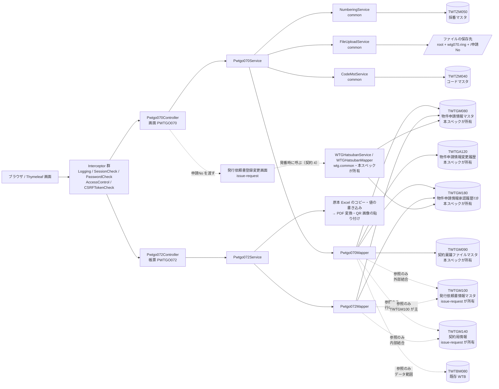
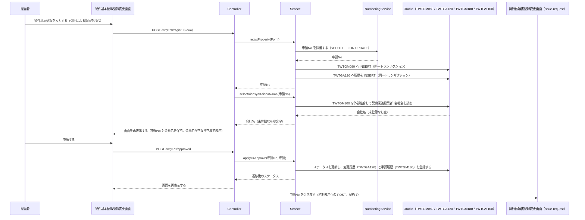
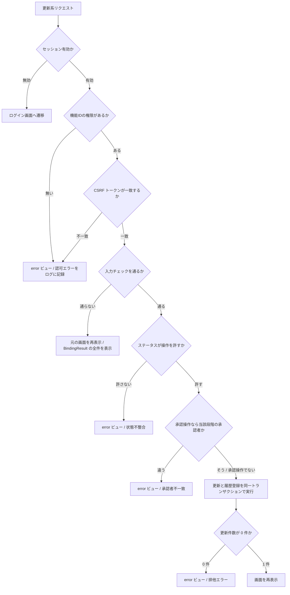

# 技術設計書

> このファイルは **「どう作るか」** を確定させる文書である。実装者ごとの解釈の食い違いを防ぎ、レビュー・実装・検証の共通の土台にする。\
> _分担_: 同一 feature の `requirements.md` が `status: approved` になるまで着手しない。本ファイルが `approved` になるまで `tasks.md` に進まない。`approved` は人間が付ける（エージェントは付けない）。

> **本ファイルの記入根拠**: 本改修は既存 WiNG への機能追加であり、既存のアーキテクチャ・フレームワーク・コーディング規約に従う（REQ-053）。既存の WTG 機能にデグレードを発生させない（REQ-052）。したがってレイヤ構成・命名・共通部品の利用・画面遷移の方式は、既存実装（`wing` の `jp.co.kccs.wt.function.wtg.wtg002`〜`wtg050`、`jp.co.kccs.wt.common` の共通部品、`servlet-context.xml` の interceptor マッピング）の実体を根拠として記入している。**値が上流から決まらない箇所は断定せず、`requirements.md` の未確定事項への参照を添えてプレースホルダーを残している。**

## 概要（Overview）

- **目的（Purpose）**: 契約書発行依頼業務を担当する社員（および権限制御の対象となるベンダー・施工会社）に、物件基本情報の登録・変更から承認・帳票出力までを WiNG 上で完結させる手段を提供する。
- **利用者（Users）**: 契約書発行依頼業務の担当者、各段階の承認者、ベンダー・施工会社（`steering/product.md` の対象ユーザー / REQ-005 / REQ-046）
- **影響（Impact）**: 現在の **紙に印刷して回覧する稟議と、WiNG 外で管理されている物件基本情報** を **WTG の画面上での登録・申請・承認と、帳票・PDF による出力** に変更する。

### 達成目標（Goals）

- 物件基本情報を `TWTGM080`（新規テーブル）に登録・変更でき、同一の画面から申請できる。
- 申請No が採番され、その申請No で物件基本情報と発行依頼書（`issue-request` が扱う）が結びつく。
- 承認フローが段階的に進み、各段階の進行状態がステータスとして画面から追える。
- 項目の変更が履歴として残り、マスタと履歴が同一トランザクションで整合する。
- 稟議資料が帳票（3 種）として出力でき、印刷せずに PDF で閲覧できる。
- 権限を持たない利用者に、契約金額・契約先・契約稟議ファイルが露出しない。

### やらないこと（Non-Goals）

- 発行依頼書そのものの登録・変更・発番。今回も今後も本スペックの目標にしない（`issue-request` が持つ）。
- 物件契約情報の申請状況の検索・一覧・CSV 出力（`contract-application-status` が持つ）。
- 進捗管理DB（UQ 様社内システム）側の改修。本スペックはインポート用 CSV を出力するところまでを目標とする（REQ-006 / REQ-008 / REQ-021）。
- 既存 WTG 画面（`wtg002`〜`wtg050`）の機能追加。今回やらない（REQ-008 / REQ-052）。

## 責務境界（Boundary Commitments）

### このスペックが持つ責務（This Spec Owns）

- **所有するデータ**:
  - **`TWTGM080`（物件申請情報マスタ / 新規テーブル）** — 物件基本情報の現在値。本スペックが定義し、書き込む唯一のスペックである。
  - **`TWTGA120`（物件申請情報変更履歴 / 新規テーブル）** — 物件基本情報の変更履歴（`steering/database.md` の種別 `A`）。
  - **`TWTGM180`（物件申請情報承認履歴ﾏｽﾀ / 新規テーブル）** — 申請・承認の判定とコメントの履歴。
  - **申請No（`Application_No`。11 桁）の値とその採番** — 採番マスタ `TWTZM050` に本スペック用の採番定義を 1 件追加して払い出す。
  - **`TWTGM090`（契約稟議ファイルマスタ / 新規テーブル）** — 物件申請に紐づく契約稟議ファイルの保存先パス・ファイル名・確定区分。ファイル本体は DB に持たず、サーバ上の保存先に置く（REQ-020 / 受入基準 6-1 / 6-2。③ の判断 / 2026-09-25）。
- **定義するインターフェース**:
  - 物件基本情報の登録・変更・申請・承認・PDF 閲覧・CSV 出力を行う画面（**画面ID `GWTG070` / PGID `PWTGO070`**）。**帳票の出力は別プログラム（PGID `PWTGO072` / 帳票ID `RWTG070`）** とする（③ の確定 / 2026-09-24。根拠: WT_機能一覧 PJ45.0_20240417。**未確定事項 ① はこれで解消した**）。帳票プログラムは `wtg070` パッケージ内に置き、`@RequestMapping("/wtg070/report")` / `@FuncID("PWTGO072")` とする（`### 判断 8`）。
  - **申請No の引き渡し** — 発行依頼書登録変更画面へ申請No を渡す（受入基準 12-4）。経路は契約 1。
  - **発番時の物件申請の状態更新** — `issue-request` の発番の処理から呼ばれ、`TWTGM080` の発番日時・ステータスの更新と `TWTGM180` への登録を行う公開メソッド（契約 4）。
  - **`TWTGM100` / `TWTGM140` に対する読み取り契約**（下記 `### データ契約と外部連携` の契約 2）。本スペックは契約を宣言するだけであり、テーブルそのものは `issue-request` が定義する。

### このスペックが持たない責務（Out of Boundary）

- **他に任せる範囲と、その委譲先**:
  - `TWTGM100`（発行依頼書情報マスタ / 新規テーブル）の**定義と書き込み** — `issue-request`（REQ-049 / 同 feature の Requirement 13）。本スペックは参照のみ行う。
  - **帳票「発行依頼書」の元データの保持** — `issue-request`（`TWTGM100`）。本スペックの帳票は読むだけである（**未確定事項 ⑬ は本設計で確定した** — `### 判断 7`）。
  - `TWTGM140`（契約局情報）の**定義と書き込み** — `issue-request`。本スペックは帳票のために参照のみ行う（契約 2）。
  - 発行依頼書の登録・変更・契約書に対する発番・バーコード生成 — `issue-request`（REQ-026 / REQ-028 / REQ-037）。**発番に伴う `TWTGM080` / `TWTGM180` の更新は本スペックが契約 4 で行い、`issue-request` はそれを呼ぶだけである。**
  - 物件契約情報申請状況の検索・一覧・CSV 出力 — `contract-application-status`（REQ-012 / REQ-013 / REQ-014）。
  - 契約情報の取込・ダウンロード — `contract-info-import` / `contract-info-download`（REQ-040 / REQ-044）。
  - 認証・セッション・権限制御・採番・コードマスタ取得・ファイルアップロード・例外の一括処理 — 既存 WiNG の共通基盤（`steering/architecture.md` の `### 共通基盤（shared）` / `steering/tech.md` の `## 主要ライブラリ`）。
- **後のフェーズに回す作業**:
  - 物件基本情報の**業務項目**の**必須の別と入力チェックの内容**（未確定事項 ② の残り）。**項目の一覧と桁は `#### TWTGM080 の列定義` で確定した。**
  - 権限と画面要素の対応（③）、引用の対象項目（④）、承認フローの段階数・承認者・スキップ条件（⑤）、発番以外の遷移の細部・履歴に残す項目（⑥ の残り。`Status` 6 値・`JOTAI_KBN` 7 値の値の一覧、発番の遷移、判定 `"11"`・審査権限 `"02"` は確定済み）、ファイルの種類・件数・形式・サイズ上限（⑦）、CSV の出力項目・並び順・ファイル名・起動契機（⑧）、「編集中」の判定条件と促し方（⑨）、帳票 3 種の出力項目とレイアウト・QR の内容（⑩）、閲覧と印刷の出力経路（⑪）、申請No の採番定義（⑭）、再製本・修正稟議の判定条件・採番失敗時のメッセージID（⑮。引き渡し経路は契約 1 で確定）。

### 依存してよい対象（Allowed Dependencies）

- **依存先**:
  - `jp.co.kccs.wt.common.service.LoginService` / `SessionService` — 認証・セッション。
  - `jp.co.kccs.wt.common.utils.LoginUserUtils` — ログインユーザー情報（ユーザーID・会社コード・グループ）の取得。**Controller / Service から `HttpSession` を直接読まない**（`steering/tech.md` の `## コード規約` / `steering/security.md` の `### 認証 → 認可の契約（AuthContext）`）。
  - `jp.co.kccs.wt.common.interceptor`（`LoggingInterceptor` / `SessionCheckInterceptor` / `PasswordCheckInterceptor` / `AccessControlInterceptor` / `CSRFTokenCheckInterceptor`）— 毎リクエストのログ文脈（ユーザーID・グループIDを MDC に載せる — `steering/non-functional.md` の `#### トレース ID / リクエスト ID の伝播`）・認証・認可・CSRF 検証。
  - `jp.co.kccs.wt.common.service.NumberingService` と採番マスタ `TWTZM050` — 申請No の採番。
  - `jp.co.kccs.wt.common.service.CodeMstService` と コードマスタ `TWTZM040` — 区分値の取得。
  - `jp.co.kccs.wt.common.service.FileUploadService` と `jp.co.kccs.wt.common.bean.DownLoadFileInfo` — 契約稟議ファイルの登録と、CSV・帳票の受け渡し。
  - `jp.co.kccs.wt.common.handler.ExceptionResolver` / `jp.co.kccs.wt.common.controller.ControllerBase` — 例外の一括処理と Controller 共通の前処理。
  - **Excel を扱うライブラリ（未確定 — wing に無く、技術スタックへの追加が要る）** — 原本 Excel への値の書き込みと PDF への変換（`### 判断 9`）。
  - zxing core 3.2.1 — QR コード画像の生成。
  - **`TWTGM100` / `TWTGM140`（`issue-request` が定義）— 下記の読み取り契約（契約 2）の範囲に限る。**
  - `TWTBM080`（既存 WTB のテーブル）— ベンダー／施工会社のデータ範囲の判定のために `Bs_Vendor_Cd` / `Motouke_Kaisya_Cd` / `Keikaku_Kichikyoku_No` を読むだけで、更新しない（受入基準 2-4）。
- **依存の制約**:
  - `.aidd/feature-list.md` の `依存` 列は `なし`。**他 feature の完成を前提にしない。** 帳票の SQL の列（契約 2-b）は `issue-request` の design で決まるが、依存は宣言せず契約と `### 再確認が必要になる変更` で受ける（宣言すると `issue-request` → 本スペックと循環する。③ の判断 / 2026-09-24）。 `TWTGM100` / `TWTGM140` については `### データ契約と外部連携` で宣言する契約のみを前提とし、`issue-request` の内部設計（`design.md` の設計判断・ファイル配置・実装方針）に依存しない。
  - `TWTGM100` / `TWTGM140` へ INSERT / UPDATE / DELETE を発行しない（受入基準 11-5）。参照は契約 2 の範囲の `SELECT` のみとする（画面は外部結合、帳票は `TWTGM100` を主とする内部結合）。
  - 依存の向きは `controller` → `service` → `mapper` の一方向とし、逆方向および `controller` からの `mapper` 直接呼び出しを行わない（`steering/architecture.md` の `## レイヤーと依存ルール`）。
  - 機能パッケージ間の直接依存を持たない。`issue-request` のクラスを直接呼び出さない（同上）。
  - 共通基盤（`jp.co.kccs.wt.common`）を呼ぶ側にはなるが、共通基盤から本機能パッケージへ依存させない（同上）。契約 4 の `WTGHatsubanService` / `WTGHatsubanMapper` は `jp.co.kccs.wt.function.wtg.common` に置き、`wtg070` のクラスを呼ばない。

### 再確認が必要になる変更（Revalidation Triggers）

- `TWTGM080` の主キー（`CompanyCD` + `Application_No`）および `Application_No` の桁（11 桁）の変更。`issue-request` の `TWTGM100` との結合条件が成立しなくなる。
- 申請No の**採番主体**の変更（本スペック以外が採番するようになる）。`issue-request` の受入基準 13-5 / 13-6 の前提が崩れる。
- 再製本・修正稟議で申請No を新規採番する方針の変更。`issue-request` の受入基準 13-8（行の作り直し）の前提が崩れる。
- `### データ契約と外部連携` で宣言した `TWTGM100` / `TWTGM140` の読み取り契約（キー・列名。帳票用の列の範囲は `issue-request` の design で確定した値）の変更。
- 申請No の引き渡し経路（発行依頼書登録変更画面の初期表示への `POST`）の変更。発行依頼書登録変更画面の受け口が変わる。
- 契約 4（発番時の状態更新）のメソッドの置き場・受け取る値・更新内容の変更、および状態遷移表の「発番」の行の変更。`issue-request` の発番ボタンの処理が呼ぶ先と前提が変わる。
- 履歴テーブルを分ける方針（`TWTGA120` の変更履歴と `TWTGM180` の承認履歴）の変更。
- `Moto_Application_No` による元申請との関連づけの廃止。再製本の連鎖を遡れなくなる。

## アーキテクチャ（Architecture）

### 既存アーキテクチャの分析（Existing Architecture Analysis）

- **現行のパターンと制約**: 既存 WTG（`wtg002`〜`wtg050`）は、画面（PGID）単位のパッケージに `controller` / `form` / `service`（必要に応じて `mapper` / `bean`）を置き、Controller → Service → Mapper の 3 層で構成されている。画面遷移は `ModelAndView` によるサーバサイドレンダリングで、検索条件・並び順は Form の値として POST で送る。この構成と遷移方式を変えない（REQ-053）。
- **守るべきドメイン境界**: 契約・管財管理（WTG）の中に閉じる。WTB（計画・工程管理）・WTE・WTI など他サブシステムのテーブル・クラスを本機能から直接更新しない。UQ 様社内システムとは CSV の受け渡しのみで連携する（REQ-006 / REQ-008）。
- **維持する統合ポイント**: `servlet-context.xml` の interceptor マッピング（セッション確認・パスワード有効期限・権限制御・CSRF）、`ZMenuAuth` を引く `AccessControlInterceptor` + `@FuncID`、`ExceptionResolver` による例外の一括処理、`FileUploadService` / `DownLoadFileInfo` によるファイルの入出力。**新規機能のためにこれらへ分岐を足さない**（`steering/tech.md` の `### グローバルハンドラ` ルール 1）。
- **解消 / 回避する技術的負債**: <DSN_EXISTING_DEBT> — **不要（記入者: 人間 / 2026-09-24）**: 本スペックは新規画面と新規テーブルの追加であり、既存資産の負債に手を入れない（REQ-052）。

### アーキテクチャ方式と境界図（Architecture Pattern & Boundary Map）



- **選択したパターン**: 既存 WTG と同じ Controller → Service → Mapper の 3 層。画面ID 単位のパッケージ（`wtg070`）に閉じる。ただし `issue-request` から呼ばれる発番時の状態更新（契約 4）だけは、サブシステム WTG の共通パッケージ `jp.co.kccs.wt.function.wtg.common` に置く。
- **ドメイン / 機能の切り分け**: 物件申請（`TWTGM080` / `TWTGA120`）を本スペックの集約とし、発行依頼書（`TWTGM100`）は `issue-request` の集約とする。両者は**申請No を介して結合するのみ**で、互いの集約を直接更新しない。
- **既存パターンとの整合**: パッケージ名は `jp.co.kccs.wt.function.wtg.wtg070`、クラス名は PGID の先頭大文字 + `Controller` / `Service` / `Form` / `Mapper`（`Pwtgo070Controller` 等）、テンプレートは `/WEB-INF/pages/wtg/wtg070/pwtgo070.html` と同ディレクトリの `pwtgo070Script.html`（`steering/tech.md` の `## 命名規則`）。
- **新規コンポーネントを置く理由**: 物件基本情報の登録・変更は既存 WTG のどの画面も担っていない新規の業務であり（REQ-011 / REQ-015）、既存画面への機能追加はデグレードの経路になる（REQ-052）。したがって新規の画面パッケージを追加する。**帳票は画面（PGID `PWTGO070`）とは別のプログラム（PGID `PWTGO072` / 帳票ID `RWTG070`）に分ける**（③ の確定 / 2026-09-24。根拠: WT_機能一覧 PJ45.0_20240417）。REQ-010 が求める「画面・帳票を何本のプログラムに分割するか」の判断にあたる。
- **steering との整合**: `steering/architecture.md` の `## 配置原則`（画面単位のパッケージ）・`## レイヤーと依存ルール`（一方向の依存、`controller` からの `mapper` 直接呼び出しの禁止、機能パッケージ間の直接依存の禁止）に従う。共通で使う処理は本パッケージに閉じる。他画面から呼ばれる処理（契約 4）は、物件申請に固有の業務ロジックであるため共通基盤（`jp.co.kccs.wt.common`）には置かず、`jp.co.kccs.wt.function.wtg.common` に置く（契約 4 の注記）。

### 技術スタック（Technology Stack）

| レイヤ | 採用 / バージョン | このフィーチャーでの役割 | 備考 |
|---|---|---|---|
| Frontend | Thymeleaf 3 | 画面描画、入力補助、権限による活性・非活性の表示制御 | `steering/tech.md` のコアテクノロジ。本スペックで追加する技術は無い |
| Backend / Service | Spring MVC 4.3.5 | Controller / Service / Interceptor | 同上 |
| Data / Storage | MyBatis 3.4.5 + Oracle | `TWTGM080` / `TWTGA120` / `TWTGM180` / `TWTGM090` の永続化、`TWTGM100` / `TWTGM140` / `TWTBM080` の参照 | 同上 |
| 帳票 | **Excel テンプレート方式**。Excel を扱うライブラリ: <DSN_TECH_EXCEL_LIBRARY> — **未確定**: wing に無い。原本 Excel のコピー・値の書き込み・PDF への変換ができ、**Java 1.7 で動く**ものを選ぶ（`steering/tech.md` のコンパイルターゲット） | 稟議資料 3 種の生成と PDF 出力 | **追加が要る**（`### 判断 9`。REQ-023 / REQ-025） |
| QR コード | zxing core 3.2.1 | 表紙情報に貼る QR コード画像の生成 | `steering/tech.md` の `## 主要ライブラリ` |

> **本スペックで新規に追加が要るのは、Excel を扱うライブラリ 1 つである**（何を使うかは未確定）。それ以外は `steering/tech.md` で確定済みのスタックのうち本スペックが用いるものの再掲である。帳票の方式は `steering/tech.md` の `## 主要ライブラリ`（2026-09-25 に `### 判断 9` に合わせて改訂）と一致する。

## データモデル（Data Models）

### ドメインモデル（Domain Model）

- **集約とトランザクション境界**: **物件申請**を集約ルートとする。集約に含まれるのは、物件基本情報の現在値・ステータス・承認段階・契約稟議ファイルの関連付けである。**変更履歴は同一トランザクションで登録するが、集約の外側に置く**（追記専用で、現在値の整合には関与しないため）。トランザクション境界は Service クラスのメソッド（`steering/database.md` の `## 接続 / トランザクション`）。
- **エンティティ / 値オブジェクト / ドメインイベント**:
  - エンティティ: **物件申請**（識別子 = 会社コード + 申請No）、**物件申請変更履歴**（識別子 = 会社コード + 申請No + 通番）、**物件申請承認履歴**（識別子 = 会社コード + 申請No + 審査回 + 通番）。
  - 値オブジェクト: **申請No**（採番で払い出される不変の識別子）、**審査フェーズ**（`Status`）、**審査結果**（`JOTAI_KBN`）、**元申請No**（再製本・修正稟議のときに元の申請を指す）。
  - ドメインイベント: **申請された / 承認された / 差し戻された**。**本スペックではイベントを他コンポーネントへ配信しない**（同期処理で完結する。`### イベント契約` を参照）。
  - **作成組織の会社名は本集約に属さない。** `TWTGM100` が持つ値を表示のために読むだけであり、本集約の状態には含めない（受入基準 11-1 / 11-5）。
- **ビジネスルール / 不変条件**:
  - 会社コードは全レコードに必ず入る。検索・更新の `WHERE` に必ず含める（`steering/security.md` の `#### 所有権・エンティティ境界`）。
  - 申請No は 1 つの物件申請に対して 1 つで、**払い出した後は変更しない**。再製本・修正稟議では新しい申請No を採番して**別の物件申請**を作り、**元の申請No を `Moto_Application_No` に保持する**（受入基準 12-3）。
  - ステータスが「変更を許さない状態」のとき、物件基本情報の項目を更新しない（受入基準 1-8。どの状態が該当するかは未確定事項 ⑥）。
  - 現在値の更新と履歴の登録は必ず同時に成立する。片方だけが反映された状態を作らない（受入基準 5-3）。**対象は物件基本情報の項目を変える操作（更新）であり、発番による状態更新（契約 4）と契約稟議ファイルの確定（`updateRingiFileKakutei`）は含まない**（受入基準 5-3 / 5-4 の対象範囲。③ の判断 / 2026-09-25）。
  - 履歴は物理削除しない（受入基準 5-5）。
  - 承認は当該段階の承認者だけが行える（受入基準 4-5）。

### 論理データモデル（Logical Data Model）

- **エンティティ間の多重度（カーディナリティ）**:
  - 物件申請 (1) — (0..N) 物件申請変更履歴
  - 物件申請 (1) — (0..N) 物件申請承認履歴
  - 物件申請 (0..1) — (0..N) 物件申請（**元申請 — 再製本後の申請**。`Moto_Application_No` による自己参照）
  - 物件申請 (1) — (0..N) 契約稟議ファイル（`TWTGM090`。会社コード + 申請No + `Seq` で一意）
  - 物件申請 (1) — (0..1) 発行依頼書（`issue-request` が所有。**外部結合であり、存在しないことを正常とする** — 受入基準 11-6）
- **属性と型**: 会社コードは固定長のコード（`String`）。申請No は採番で払い出される 11 桁の文字列（`String`）。ステータス（`Status` / `JOTAI_KBN`）は各 20 桁の区分値（`String`。コードマスタで管理する — `steering/database.md` の `### 業務コード・区分値・採番の設計ルール`）。登録日時・更新日時は DB レイアウト上 `3:DateTime`、`wing` の Java 側は `String`（`steering/database.md` の `## 型の指針`）。**業務項目の一覧と桁は下記 `### 物理データモデル` で確定した**（2026-09-24 に ③ が DB レイアウトから提示。未確定事項 ② のうち「一覧と桁」は解消し、**必須の別と入力チェックの内容が残る**）。
- **自然キー / 識別子**: **会社コード + 申請No** を物件申請の識別子とする。変更履歴はこれに**通番**を加えた 3 項目、承認履歴は**審査回 + 通番**を加えた 4 項目を識別子とする（既存 `TWTGA010` が `会社コード + 業務キー + 通番` の形を採っていることに合わせる）。代理キー（連番の ID 列）は設けない。
- **参照整合性のルール**: 物件申請変更履歴・物件申請承認履歴は物件申請を参照する。`Moto_Application_No` は同じテーブル内の別の申請No を指す自己参照であり、**元の申請が存在しないこと（新規の申請）を正常とする**（空値を許す）。**`TWTGM100` への参照整合性制約（外部キー）は設けない** — 発行依頼書は物件申請より後に作られ、存在しない期間があるため（受入基準 11-6）。整合はアプリケーション側の外部結合で扱う。

### 物理データモデル（Physical Data Model）

| 種別 | 記載 |
|---|---|
| RDB（Oracle） — `TWTGM080`（物件申請情報マスタ / **新規**） | 下表 `#### TWTGM080 の列定義` を参照。**インデックス**: 主キーの一意索引。検索条件が確定した時点（未確定事項 ②）で追加の索引を検討する。**分割方針**: 設けない（既存 WTG のテーブルが分割を用いていないため） |
| RDB（Oracle） — `TWTGA120`（物件申請情報変更履歴 / **新規**） | 下表 `#### TWTGA120 の列定義` を参照。**履歴に残す項目の範囲は未確定事項 ⑥**。**インデックス**: 主キーの一意索引。**物理削除を行わない**（受入基準 5-5）。※ `TWTGA080` は既存の**経費実績履歴**であり本スペックでは使えないため、`TWTGA120` を採る（③ の指摘 / 2026-09-24） |
| RDB（Oracle） — `TWTGM180`（物件申請情報承認履歴ﾏｽﾀ / **新規**） | 下表 `#### TWTGM180 の列定義` を参照。**インデックス**: 主キーの一意索引。**物理削除を行わない**（受入基準 5-5）。**テーブル名の種別 1 文字 `M` は `steering/database.md` の `## 命名規則`（`M` = マスタ / `A` = 変更履歴）の例外である** — 正解の DB レイアウトで決まっている名前であり、本設計で改名しない（③ の判断 / 2026-09-24）。受入基準 5-4 が種別 `A` で分けて持つと定める「項目の変更履歴」は `TWTGA120` が担い、`TWTGM180` は申請・承認の判定とコメントの記録である |
| RDB（Oracle） — `TWTGM090`（契約稟議ファイルマスタ / **新規**） | 下表 `#### TWTGM090 の列定義` を参照。**インデックス**: 主キー（`CompanyCD` + `Application_No` + `Seq`）の一意索引。ファイル本体は持たず、保存先のパスとファイル名を持つ（③ の判断 / 2026-09-25） |
| RDB（Oracle） — `TWTZM050`（採番マスタ / **既存**） | 本スペック用の採番定義を **1 行追加**する（グループID・識別コード・プレフィックス・最小値 / 現在値 / 最大値・採番区分）。**値は未確定（未確定事項 ⑭）。** 既存の列定義は変更しない（REQ-052） |
| RDB（Oracle） — `TWTGM100`（発行依頼書情報マスタ / **新規。`issue-request` が定義**） | 本スペックは定義しない。読む範囲は `### データ契約と外部連携` の契約 2 に限る |
| RDB（Oracle） — `TWTGM140`（契約局情報 / **`issue-request` が定義**） | 本スペックは定義しない。帳票のために読む範囲は契約 2 に限る |
| ファイル | 契約稟議ファイルの本体は DB に格納しない（受入基準 6-2 / `steering/database.md` の `## 型の指針`）。`FileUploadService` で受け取り、**「`swf.upload.directory.root` の値 + `swf.upload.directory.wtg070.ring` の値 + `/{申請No}`」** に保存する。`swf.upload.directory.wtg070.ring` は本スペックで `wing-web.properties` に新しく足すキーで、値は `/wtg/wtg070/ringi` とする（③ の判断 / 2026-09-25）。保存先のパスとファイル名は `TWTGM090` に記録する |

#### `TWTGM080` の列定義

> 列名・桁は **2026-09-24 に ③ が DB レイアウトから提示した値**である（未確定事項 ② のうち「一覧と桁」はこれで確定し、**必須の別と入力チェックの内容が残る**）。型は `steering/database.md` の `## 型の指針` に従い、日時は DB レイアウト上 `3:DateTime`（`wing` の Java 側は `String`）とする。

| 区分 | 列名 | 論理名 | 型 / 桁 |
|---|---|---|---|
| 主キー | `CompanyCD` | 会社コード | `VARCHAR2(5)`（正解の DB レイアウト。③ の確定 / 2026-09-24） |
| 主キー | `Application_No` | 申請No | `VARCHAR2(11)` |
| 共通 | `RegisteredPerson` / `RegisteredDT` / `UpdatedPerson` / `UpdatedDT` / `ExclusiveFG` | 登録者 / 登録日時 / 更新者 / 更新日時 / 排他ﾌﾗｸﾞ | `steering/database.md` の共通カラムに従う |
| 管理 | `Status` | ステータス | `VARCHAR2(20)` |
| 管理 | `JOTAI_KBN` | 状態区分 | `VARCHAR2(20)` |
| 管理 | `Moto_Application_No` | 元申請No | `VARCHAR2(11)`（再製本・修正稟議で元の申請を指す。新規の申請では空） |
| 業務 | `Keikaku_Kichikyoku_No` | 計画基地局番号 | `VARCHAR2(9)` |
| 業務 | `Keikaku_Kichikyoku_Name` | 計画基地局名 | `VARCHAR2(120)` |
| 業務 | `Kichikyoku_No` | 基地局番号 | `VARCHAR2(9)` |
| 業務 | `Kichikyoku_Name` | 基地局名 | `VARCHAR2(120)` |
| 業務 | `Kichikyoku_Name_Kana` | 基地局名(ｶﾅ) | `VARCHAR2(120)` |
| 業務 | `Area_Cd` | ｴﾘｱｺｰﾄﾞ | `VARCHAR2(20)` |
| 業務 | `SHISAKU_CD` | 施策ｺｰﾄﾞ | `VARCHAR2(10)` |
| 業務 | `Hasso_Kibo_Date` | 発送希望日 | `VARCHAR2(8)`（`YYYYMMDD`） |
| 業務 | `Irai_Naiyo` | 依頼内容 | `VARCHAR2(256)` |
| 業務 | `Application_Req_DateTime` | 申請依頼日時 | `3:DateTime` |
| 業務 | `First_Application_Req_DateTime` | 初回申請依頼日時 | `3:DateTime` |
| 業務 | `Kessai_DateTime_From` | 決裁日時 | `3:DateTime` |
| 業務 | `Check_DateTime_From` | 確認日時 | `3:DateTime` |
| 業務 | `Application_Date` | 申請日時 | `3:DateTime` |
| 業務 | `Application_Count` | 申請回数 | `NUMBER(2)`（Int） |
| 業務 | `Moshiokuri_Jiko` | 申送り事項 | `VARCHAR2(1000)` |
| 業務 | `Hasso_Shorui_Umu_Flg` | 発送書類有無ﾌﾗｸﾞ | `VARCHAR2(1)` |
| 業務 | `Tandoku_Fukusu_Flg` | 単独複数局ﾌﾗｸﾞ | `VARCHAR2(1)` |
| 業務 | `Mail` | 連絡先ﾒｰﾙｱﾄﾞﾚｽ | `VARCHAR2(150)` |
| 業務 | `Tel` | 電話番号 | `VARCHAR2(11)` |
| 業務 | `Hatsuban_Uketsuke_DateTime` | 発番日時 | `3:DateTime` |
| 業務 | `UpdatedPerson_Name` | 更新者名 | `VARCHAR2(20)` |

> **列名 `SHISAKU_CD` / `JOTAI_KBN` の全大文字表記は `steering/database.md` の `## 命名規則`（語ごとに先頭大文字）の例外である** — 正解の DB レイアウトで決まっている名前であり、本設計で改名しない（`TWTGM180` の種別と同じ扱い）。
>
> **`Status` は審査フェーズ、`JOTAI_KBN` は審査結果を表す**（値の一覧は `### 判断 6` に置く。実体はコードマスタ `TWTZM040` が持つ）。承認の状況は 2 列の組み合わせで判断する。**許される組み合わせと遷移は WTG070 機能定義書「別紙_承認機能制御」の状態遷移表が正である。本設計に取り込んだのは発番の遷移（「起案済・回覧中」→「受付済・回覧中」）とそのコード値（判定 `"11"`・審査権限 `"02"`）だけで、これは ③ の判断（2026-09-25）で確定した（契約 4）。それ以外の遷移は未確定である**（未確定事項 ⑥ の残り）。

#### `TWTGA120` の列定義

> 列構成は既存 `TWTGA010`（`jp.co.kccs.wt.common.domain.TWTGA010`）に合わせ、業務キーの `Keikaku_Kichikyoku_No` + `PlanSiteID_Branch` を `Application_No` に置き換える。**桁は `TWTGA010` の DB レイアウトにそろえる（値は未確定）。** `Upd_Date` の Java 側の型は、`steering/database.md` の `## 型の指針` に合わせて共通カラムの日時と同じ `String` とする（既存 `TWTGA010` の domain は `java.util.Date` で受けているが、それには合わせない。③ の判断 / 2026-09-25）。

| 区分 | 列名 | 論理名 | 型 / 桁 |
|---|---|---|---|
| 主キー | `CompanyCD` | 会社コード | `VARCHAR2(5)` |
| 主キー | `Application_No` | 申請No | `VARCHAR2(11)` |
| 主キー | `Branch_Id` | 通番 | <DSN_TWTGA120_BRANCH_ID_TYPE> — **未確定**: `TWTGA010` の DB レイアウトの桁にそろえるが、その値が上流から得られていない |
| 共通 | `RegisteredPerson` / `RegisteredDT` / `UpdatedPerson` / `UpdatedDT` / `ExclusiveFG` | 登録者 / 登録日時 / 更新者 / 更新日時 / 排他ﾌﾗｸﾞ | `steering/database.md` の共通カラムに従う |
| 項目 | `Upd_Date` | 変更日時 | `3:DateTime`（Java 側は `String`） |
| 項目 | `Upd_User` | 更新者ユーザーID | <DSN_TWTGA120_UPD_USER_TYPE> — **未確定**: 同上 |
| 項目 | `History_Title` | タイトル | <DSN_TWTGA120_HISTORY_TITLE_TYPE> — **未確定**: 同上 |
| 項目 | `History_Body` | 本文 | <DSN_TWTGA120_HISTORY_BODY_TYPE> — **未確定**: 同上 |

#### `TWTGM180` の列定義

> 列名・桁は **2026-09-24 に ③ が提示した値**である。**共通カラム 6 列に加えて、DB レイアウトが `Last_UpdatedDT` / `Last_UpdatedPerson` / `Last_UpdatedPerson_Name` を定めている。** 本テーブルは追記で登録し、登録済みの行を物理削除しない。3 列を共通カラムとどう使い分けるか（登録後に行を更新する操作があるか）は DB レイアウトと WTG070 機能定義書に従い、本設計では意味を断定しない。列名は DB レイアウトのものをそのまま採る。

| 区分 | 列名 | 論理名 | 型 / 桁 |
|---|---|---|---|
| 主キー / 共通 | `CompanyCD` | 会社コード | `VARCHAR2(5)` |
| 主キー | `Application_No` | 申請No | `VARCHAR2(11)` |
| 主キー | `Shinsa_Count` | 審査回 | `NUMBER(5)`（Int） |
| 主キー | `Tsuban` | 通番 | `NUMBER(5)`（Int） |
| 共通 | `RegisteredPerson` / `RegisteredDT` / `UpdatedPerson` / `UpdatedDT` / `ExclusiveFG` | 登録者 / 登録日時 / 更新者 / 更新日時 / 排他ﾌﾗｸﾞ | `steering/database.md` の共通カラムに従う |
| 項目 | `Last_UpdatedDT` | 最終更新日 | `3:DateTime` |
| 項目 | `Last_UpdatedPerson` | 最終更新者 | `VARCHAR2(20)` |
| 項目 | `Last_UpdatedPerson_Name` | 最終更新者名 | `VARCHAR2(20)` |
| 項目 | `Hantei` | 判定 | `VARCHAR2(2)` |
| 項目 | `Hantei_Comment` | コメント | `VARCHAR2(1000)` |
| 項目 | `Shinsa_Kengen` | 審査権限 | `VARCHAR2(10)` |

> **`Shinsa_Count`（審査回）は承認の履歴の回数であり、承認の段階ではない**（判断 6）。段階は `TWTGM080` の `Status` が表す。

#### `TWTGM090` の列定義

> 列名・桁は **2026-09-25 に ③ が提示した値**である。本スペックが所有する。

| 区分 | 列名 | 論理名 | 型 / 桁 |
|---|---|---|---|
| 主キー / 共通 | `CompanyCD` | 会社コード | `VARCHAR2(5)` |
| 主キー | `Application_No` | 申請No | `VARCHAR2(11)` |
| 主キー | `Seq` | 連番 | `NUMBER(3)`（会社コード・申請No とあわせて一意） |
| 共通 | `RegisteredPerson` / `RegisteredDT` / `UpdatedPerson` / `UpdatedDT` / `ExclusiveFG` | 登録者 / 登録日時 / 更新者 / 更新日時 / 排他ﾌﾗｸﾞ | `steering/database.md` の共通カラムに従う |
| 項目 | `File_Path` | ファイルパス | `VARCHAR2(256)` |
| 項目 | `File_Name` | ファイル名 | `VARCHAR2(256)` |
| 項目 | `Kakute_Flg` | 確定ﾌﾗｸﾞ | `VARCHAR2(2)`（`0`: 未確定 / `1`: 確定） |
| 項目 | `RegisteredPerson_Name` | 登録者名 | `VARCHAR2(20)` |

> **`Kakute_Flg` の `VARCHAR2(2)` は `steering/database.md` のフラグ規約（`VARCHAR2(1)`）の例外である** — ③ が提示した確定値であり、本設計で変えない（③ の判断 / 2026-09-25）。**「確定」に変わる操作は、契約稟議ファイル欄の確定ボタンである。** 確定チェックに変更があるレコードだけを更新する（`POST /wtg070/file/update`）。

### データ契約と外部連携（Data Contracts & Integration）

- **API**: <DSN_CONTRACT_API> — **不要（記入者: 人間 / 2026-09-24）**: 本スペックは外部公開 API を持たない。画面と同一の WAR 内でサーバサイドレンダリングにより完結する（`steering/api-standards.md` の `## バージョン管理`「外部公開 API を持たない」/ REQ-008）。
- **イベント**: <DSN_CONTRACT_EVENT> — **不要（記入者: 人間 / 2026-09-24）**: 申請・承認は同期処理で完結し、他コンポーネントへイベントを配信しない。非同期の連携はバッチ経由（`contract-info-import` が担う）であり、本スペックからは発行しない。
- **サービス間**: 本スペックと `issue-request` のあいだの契約は契約 1・契約 2・契約 4 の 3 つ、外部システムとの契約は契約 3 の 1 つである。**分散トランザクションは用いない**（同一 DB・同一 WAR であり、各画面のトランザクションで閉じる）。

#### 契約 1: 申請No の引き渡し（本スペックが提供）

| 項目 | 内容 |
|---|---|
| 提供元 | 本スペック（物件基本情報登録変更画面） |
| 利用側 | `issue-request`（発行依頼書登録変更画面） |
| 渡す値 | **申請No（`Application_No`。11 桁）**。会社コードは渡さない（利用側がログインユーザーのものを用いる — `steering/security.md` の `#### 所有権・エンティティ境界`） |
| 保証すること | 引き渡す申請No は、ログインユーザーの会社コードで `TWTGM080` に行が存在するものである |
| 引き渡し経路 | **発行依頼書登録変更画面の初期表示（空パスの `POST`）へ、申請No をフォームのパラメータとして送る**（`steering/api-standards.md` の `## HTTP メソッド`「遷移元から業務キーを受け取って開く場合を POST」/ ③ / 2026-09-24）。`steering/security.md` の `## セッション / トークンの保管・転送` ルール 3 の `PARAM_SESSION_KEY_PERIOD` は、ヘッダ `wing_session_key` でセッションキーを持ち回る場合の有効時間であり（`SessionCheckInterceptor`）、申請No の受け渡し方式を定めるものではない。未確定事項 ⑮ に残るのは再製本・修正稟議の判定条件と採番失敗時のメッセージIDである |
| 利用側の義務 | 受け取った申請No を、ログインユーザーの会社コードで `TWTGM080` に存在することを確認してから使う（`issue-request` の受入基準 13-6） |

#### 契約 2: `TWTGM100` / `TWTGM140` の読み取り（本スペックが要求。`issue-request` が満たす）

> **読み取りを「画面表示用」と「帳票用」の 2 段に分ける**（③ の判断 / 2026-09-24。未確定事項 ⑬ の確定 — `### 判断 7`）。

| 項目 | 2-a: 画面表示用（`PWTGO070`） | 2-b: 帳票用（`PWTGO072`） |
|---|---|---|
| 定義する側 | `issue-request`（`TWTGM100` の所有者） | `issue-request`（`TWTGM100` / `TWTGM140` の所有者） |
| 読む側 | 本スペックの画面（受入基準 11-1、閲覧・印刷ボタンの表示判定） | 本スペックの帳票（受入基準 9-1 / 9-6 / 10-2） |
| 要求するキー | `TWTGM100` が **`CompanyCD`** と **`Application_No`（11 桁）** を持ち、`TWTGM080.CompanyCD` + `TWTGM080.Application_No` と結合できること。**列名は `TWTGM080` と同じ `Application_No` を用いる**（③ の指示 / 2026-09-24） | 2-a と同じキーで `TWTGM100` と `TWTGM080` が結合できること。`TWTGM140` と `TWTGM100` の結合キーは `issue-request` の design で確定する |
| 要求する列 | `TWTGM100` の `Keiyaku_Ringi_Kiansha_Kaisha_Name`（契約稟議起案者_会社名）の **1 列のみ**。加えて、閲覧・印刷ボタンの表示判定のために **`TWTGM100` と `TWTGM140` の行の有無**を読む（`TWTGM140` の結合キーは `issue-request` の design で確定する） | 帳票「発行依頼書」「契約局情報」の出力に要る `TWTGM100` / `TWTGM140` の列。**列の範囲は `issue-request` の design で確定する**（本スペックは列を指定しない） |
| 結合方式 | **外部結合**（`TWTGM100` 側に行が無いことを正常とする）。`TWTGM100.CompanyCD = TWTGM080.CompanyCD AND TWTGM100.Application_No = TWTGM080.Application_No`。根拠: WTG070 機能定義書の転送仕様「発行依頼書情報ﾏｽﾀ＜外部結合＞ GM100．会社ｺｰﾄﾞ＝GM080．会社ｺｰﾄﾞ AND GM100．申請No＝GM080．申請No」 | **`TWTGM100` を主**とし、`TWTGM080`・`TWTGM140` を**内部結合**、`TWTGM180` とコードマスタ `TWTZM040` を結合して読む。根拠: WTG070 機能定義書_印刷・閲覧用帳票「発行依頼書情報ﾏｽﾀ＜ﾒｲﾝ＞ GM100」、GM080・GM140 を内部結合 |
| 本スペックの義務 | `TWTGM100` / `TWTGM140` へ INSERT / UPDATE / DELETE を発行しない（受入基準 11-5） | `TWTGM100` / `TWTGM140` へ INSERT / UPDATE / DELETE を発行しない（受入基準 11-5） |
| 契約が破れる条件 | `TWTGM100` のキーまたは当該列名が変わること。`issue-request` の design で当該列を持たない設計が採られること | `TWTGM100` / `TWTGM140` のキーが変わること。`issue-request` の design が確定した帳票用の列の範囲が変わること |

> **本契約は `issue-request` の design が満たすべき要求である。** 同 feature の design 作成時に、`TWTGM100` が 2-a のキーと列を持つこと、および 2-b の帳票用の列の範囲を確定させること。満たされない場合は本スペックの受入基準 11-1 / 9-1 が成立しないため、両 feature の design を見直す。
> **2-b は内部結合であるため、`TWTGM100` に行が無い物件申請（発行依頼書がまだ作られていない）では帳票を出力できない。** その場合は「対象なし」の業務エラーとする（画面の 2-a が空欄で正常表示するのとは扱いが異なる）。

#### 契約 3: 進捗管理DB（UQ 様社内システム）向けインポート用 CSV（本スペックが提供）

| 項目 | 内容 |
|---|---|
| 提供元 | 本スペック（`exportProgressCsv`） |
| 利用側 | 進捗管理DB（UQ 様社内システム。**本プロジェクトの改修範囲外** — REQ-006 / REQ-008） |
| 受け渡し方式 | 利用者が画面からダウンロードしたファイルを、利用側のインポート機能に取り込む（システム間の直接連携を持たない — REQ-021） |
| 文字コード | `wing-web.properties` の `CHARSET` に従う（受入基準 7-3） |
| 出力項目・並び順・ファイル名・起動契機 | <DSN_CONTRACT_CSV_SPEC> — **未確定（未確定事項 ⑧）**: 利用側のインポート仕様が上流から決まらない。**利用側の仕様書を入手して確定させる** |
| 契約が破れる条件 | 利用側のインポート仕様の変更。本スペックの側では検出できないため、変更時は利用側から通知を受ける必要がある |

#### 契約 4: 発番時の物件申請の状態更新（本スペックが提供。`issue-request` が呼ぶ）

> **`TWTGM080` / `TWTGM180` の書き込み元は本スペックのままとし、発番に伴う更新は本スペックが公開するメソッドで行う**（③ の判断 / 2026-09-25）。公開メソッドは、画面パッケージ（`wtg070`）どうしの直接依存を避け、かつ物件申請に固有の業務ロジックを共通基盤（`jp.co.kccs.wt.common`）に置かないため、**サブシステム WTG の共通パッケージ `jp.co.kccs.wt.function.wtg.common` に置く**（③ の判断 / 2026-09-25。`steering/architecture.md` の `## レイヤーと依存ルール` と `### 共通基盤（shared）`。既存の `jp.co.kccs.wt.function.wte.common`（`WTECommonService` / `WTEHistoryService` ほか）と同じ形で、クラス名も「サブシステム + 用途」にならう）。

| 項目 | 内容 |
|---|---|
| 提供元 | 本スペック（`jp.co.kccs.wt.function.wtg.common.service.WTGHatsubanService` と `jp.co.kccs.wt.function.wtg.common.mapper.WTGHatsubanMapper`） |
| 利用側 | `issue-request`（発行依頼書登録変更画面の**発番ボタン**の処理。発行依頼書情報マスタ `TWTGM100` を更新した後に呼ぶ） |
| 受け取る値 | 申請No（`Application_No`）。会社コード・更新者・更新者名はログインユーザーのものを提供元が `LoginUserUtils` から取得する |
| `TWTGM080` の UPDATE | 最初に当該行（`Status` / `JOTAI_KBN` / `ExclusiveFG`）を読み、更新前の状態を確かめる。そのうえで `Hatsuban_Uketsuke_DateTime`（発番日時）= システム日時、更新者・更新日時・`UpdatedPerson_Name`（更新者名）を更新し、`Status` / `JOTAI_KBN` を **「起案済・回覧中」→「受付済・回覧中」** にする。`WHERE CompanyCD = <ログインユーザーの会社コード> AND Application_No = <申請No> AND ExclusiveFG = <読んだ ExclusiveFG>`。**更新件数が 0 件なら既存の排他エラー（`ExclusiveException`）と同じ扱いにする**（`steering/database.md` の排他制御。③ の判断 / 2026-09-25） |
| `TWTGM180` の INSERT | `Hantei`（判定）= `"11"`（発番 / 受付）、`Shinsa_Kengen`（審査権限）= `"02"`（申請者）、`Shinsa_Count`（審査回）= `TWTGM080` の `Application_Count`（申請回数）、`Tsuban`（通番）= 同じ申請No・審査回の `MAX(Tsuban) + 1`（行が無ければ `1`）、`Hantei_Comment`（コメント）= `NULL`。審査回と通番の決め方は `Pwtgo070Mapper` の「承認履歴の登録」と同じである |
| コード値の持ち方 | 遷移前後の `Status` / `JOTAI_KBN` の値と、判定 `"11"`・審査権限 `"02"` は、使う各クラスの中の定数（`private static final String`）で持つ。本契約では `WTGHatsubanService` の中に持ち、同じ値を使う他のクラスもそれぞれのクラスの中に持つ。機能固有の値として扱い、既存の `Constants` には足さず、新しい定数クラスも作らない（③ の判断 / 2026-09-25）（既存例: `wtg002/service/Pwtgo003Service.java` の `KEY2_C02` ほか）。**これらは ③ の判断（2026-09-25）で確定した値であり、未確定事項 ⑥ のうち発番の遷移だけが確定している**（`### 判断 6`） |
| 変更履歴 | **発番では `TWTGM080` の更新と `TWTGM180` の登録だけを行い、`TWTGA120`（変更履歴）には登録しない**（状態管理の例外。③ の判断 / 2026-09-25） |
| 保証すること | 2 つの更新を同時に成立させる。更新前の状態が「起案済・回覧中」でない場合は更新せず業務エラー（`ApplicationException`）を返す（状態遷移表に無い遷移を作らない — `### 判断 6`） |
| トランザクション | 呼び出し元（`issue-request` の Service）のトランザクションに参加する。`TWTGM100` の更新と本契約の 2 つの更新は同じトランザクションで確定する |
| 利用側の義務 | `TWTGM080` / `TWTGM180` へ直接 SQL を発行せず、本契約のメソッドだけを呼ぶ |
| 契約が破れる条件 | 状態遷移表の「発番」の行（遷移前後の `Status` / `JOTAI_KBN`）、判定・審査権限のコード値、`TWTGM080` / `TWTGM180` の該当列の変更 |

## コンポーネントとインターフェース（Components and Interfaces）

### コンポーネント一覧（Summary）

| コンポーネント | ドメイン / レイヤ | 目的 | 受け入れ基準ID | 依存 | 契約 |
|---|---|---|---|---|---|
| `Pwtgo070Controller` | 物件申請 / controller | HTTP の入口。画面遷移とフォームのバインド、CSRF・権限の通過後の処理振り分け | 1-1, 1-2, 1-3, 1-4, 1-7, 2-1, 3-1, 4-4, 6-1, 7-1, 8-1, 11-1, 12-4 | `Pwtgo070Service` | API 契約 |
| `Pwtgo070Service` | 物件申請 / service | 業務ロジックとトランザクション境界。登録・変更・申請・承認・履歴登録・採番・CSV | 1-2, 1-3, 1-5, 1-6, 1-8, 2-3, 2-4, 2-5, 3-2, 3-3, 3-4, 3-5, 4-1, 4-2, 4-3, 4-4, 4-5, 4-6, 5-1, 5-2, 5-3, 5-4, 5-5, 5-6, 6-1, 6-2, 6-3, 6-4, 6-5, 7-1, 7-2, 7-3, 7-4, 7-5, 8-1, 8-2, 8-3, 8-4, 11-1, 11-2, 11-5, 11-6, 11-7, 12-1, 12-2, 12-3, 12-4, 12-5, 12-6 | `Pwtgo070Mapper`, `NumberingService`, `FileUploadService`, `CodeMstService` | サービスインターフェース, 状態管理 |
| `Pwtgo070Mapper` | 物件申請 / mapper | `TWTGM080` / `TWTGA120` / `TWTGM180` / `TWTGM090` の永続化と、`TWTGM100` / `TWTGM140` の参照（契約 2-a。外部結合）、`TWTBM080` の参照（データ範囲） | 1-3, 1-5, 1-6, 2-4, 5-3, 5-4, 6-1, 11-1, 11-2, 11-5, 11-7 | Oracle（`TWTGM080` / `TWTGA120` / `TWTGM180` / `TWTGM090` / `TWTGM100` / `TWTGM140` / `TWTBM080`） | — |
| `Pwtgo070Form` | 物件申請 / form | 画面の入力値のバインドと宣言的な入力チェック | 1-7 | — | — |
| `pwtgo070.html` / `pwtgo070Script.html` | 物件申請 / 画面（Thymeleaf） | 画面の描画。権限・状態による画面要素の活性・非活性・非表示、ステータスの表示、作成組織の会社名のラベル表示、閲覧・印刷ボタンの表示制御と別ウインドウでの呼び出し | 2-2, 5-1, 10-1, 11-1, 11-3, 11-4 | `Pwtgo070Controller`（モデル属性）、`Pwtgo072Controller`（帳票の呼び出し先） | — |
| `Pwtgo072Controller`（帳票 / PGID `PWTGO072`） | 帳票 / controller | 帳票出力の入口。`@RequestMapping("/wtg070/report")` / `@FuncID("PWTGO072")`。画面とは別プログラム | 9-1, 9-3, 9-5, 10-1, 10-3 | `Pwtgo072Service` | API 契約 |
| `Pwtgo072Service`（帳票 / PGID `PWTGO072`） | 帳票 / service | 帳票 3 種（帳票ID `RWTG070`）を原本 Excel から生成し PDF で出力 | 9-1, 9-2, 9-3, 9-4, 9-5, 9-6, 10-1, 10-2, 10-3, 10-4 | `Pwtgo072Mapper`, Excel を扱うライブラリ（未確定）, zxing | サービスインターフェース |
| `Pwtgo072Mapper`（帳票 / PGID `PWTGO072`） | 帳票 / mapper | 帳票の元データの参照（契約 2-b。`TWTGM100` を主とする結合） | 9-1, 9-6, 10-2, 11-5 | Oracle（`TWTGM100` / `TWTGM080` / `TWTGM140` / `TWTGM180` / `TWTZM040`） | — |
| `WTGHatsubanService` / `WTGHatsubanMapper`（`jp.co.kccs.wt.function.wtg.common`） | 物件申請 / wtg 共通の service・mapper | 発番時の `TWTGM080` の状態更新と `TWTGM180` への登録（契約 4）。`issue-request` の発番の処理から呼ばれる | — （`issue-request` の発番の処理に付随する更新。本スペックの受入基準には対応しない） | Oracle（`TWTGM080` / `TWTGM180`）、`LoginUserUtils` | 契約 4 |
| `TWTGM080` / `TWTGA120` / `TWTGM180` / `TWTGM090`（domain） | 物件申請 / domain | Mapper の `resultType` で受ける POJO（Lombok `@Data`） | — | — | — |

### 物件申請 / controller

#### `Pwtgo070Controller`

| 項目 | 内容 |
|---|---|
| 目的（Intent） | 物件基本情報の画面の入口。リクエストを受けて Service を呼び、`ModelAndView` で画面を返す |
| 受け入れ基準ID | 1-1, 1-2, 1-3, 1-4, 1-7, 2-1, 3-1, 4-4, 6-1, 7-1, 8-1, 11-1, 12-4 |
| 担当 / レビュアー | <DSN_COMPONENT_OWNER> — **不要（記入者: 人間 / 2026-09-24）**: 担当者の割り当ては本プロジェクトの体制で決めるものであり、設計書では固定しない（REQ-061 の体制に従う） |

**責務と制約**:
- **主たる責務**: `@RequestMapping("/wtg070")` で受け、アクション（`regist` / `update` / `approved` / `copy` / `upload` / `downLoad` 等。一覧は下記 `##### API 契約`）ごとにメソッドを持つ。Form へのバインド、`BindingResult` のエラーを画面へ戻す、`ModelAndView` のビュー名とモデル属性を組み立てる。
- **ドメイン境界 / トランザクションの範囲**: **トランザクションを張らない。** 境界は Service（`steering/database.md` の `## 接続 / トランザクション`）。
- **データ所有権 / 不変条件**: SQL・業務ロジックを持たない（`steering/architecture.md` の `## レイヤーと依存ルール` の禁止）。`@FuncID("PWTGO070")` を付与し、`AccessControlInterceptor` の権限判定の対象にする。

**依存関係**:
- **呼び出し元（Inbound）**:
  - ブラウザ（Thymeleaf 画面）— 画面操作（重要度: 高）
  - `issue-request` の発行依頼書登録変更画面 — **無し**。本スペックから申請No を渡す向きのみで、呼び出されない（重要度: —）
- **呼び出し先（Outbound）**:
  - `Pwtgo070Service` — 業務処理の実行（重要度: 高）
- **外部（External）**:
  - `ControllerBase`（`@ControllerAdvice`）— Controller 共通の前処理・配列バインド上限（重要度: 高）

**契約の種類**（チェックリスト）
- [ ] サービスインターフェース（Service Interface）
- [x] API 契約（API Contract）
- [ ] イベント契約（Event Contract）
- [ ] バッチ / ジョブ契約（Batch / Job Contract）
- [ ] 状態管理（State Management）

##### API 契約（API Contract）

> エンドポイントの第 1 セグメントは画面ID（小文字）、第 2 セグメントはアクション名とする（`steering/api-standards.md` の `## エンドポイントのパターン`）。**共通処理が効く既定のアクション名を優先して使う。** リクエストは `application/x-www-form-urlencoded`（ファイルを伴う場合は `multipart/form-data`）で Form にバインドし、レスポンスは Thymeleaf の HTML（`ModelAndView`）である（同 `## リクエスト / レスポンス形式`）。ステータスコードは業務エラー・権限エラーとも 200（`error` ビュー）であり、エラーの表現は同 `## エラーハンドリング（API 契約）` に従う。

| Method | Endpoint | Request | Response | Errors |
|---|---|---|---|---|
| GET | `/wtg070` | なし（メニューから新規に開く） | 物件基本情報登録変更画面（HTML。新規入力の状態） | 200（`error` ビュー: 認可エラー・業務エラー）、302（ログイン画面へのリダイレクト） |
| POST | `/wtg070` | 遷移元からのパラメータ（申請No） | 物件基本情報登録変更画面（HTML。当該申請No の物件申請を表示した状態） | 200（`error` ビュー: 認可エラー・対象なし・業務エラー）、302（ログイン画面へのリダイレクト） |
| POST | `/wtg070/regist` | `Pwtgo070Form`（新規登録） | 同画面の再表示（HTML）。成功時は採番した申請No を保持した状態 | 200（`error` ビュー）、元画面の再表示（入力チェックエラー） |
| POST | `/wtg070/update` | `Pwtgo070Form`（変更。`ExclusiveFG` を含む） | 同画面の再表示（HTML） | 200（`error` ビュー: 排他エラー・業務エラー）、元画面の再表示（入力チェックエラー） |
| POST | `/wtg070/approved` | `Pwtgo070Form`（申請・承認・スキップの操作） | 同画面の再表示（HTML） | 200（`error` ビュー: 承認者不一致・状態不整合） |
| POST | `/wtg070/copy` | 引用元の申請No | 同画面の再表示（HTML。引用元の複製対象項目を新規入力の初期値にした、未保存の状態） | 200（`error` ビュー: 対象なし・権限外） |
| POST | `/wtg070/upload` | `multipart/form-data`（契約稟議ファイル） | 同画面の再表示（HTML） | 200（`error` ビュー）、元画面の再表示（ファイル種別・サイズのエラー） |
| POST | `/wtg070/downLoad` | `Pwtgo070Form`（出力対象の指定） | `executeDownLoad` へ forward（CSV） | 200（`error` ビュー: 対象なし・権限エラー） |
| POST | `/wtg070/file/update` | 契約稟議ファイル欄の確定チェック（申請No・`Seq`・`Kakute_Flg`・`ExclusiveFG` の組） | 同画面の再表示（HTML） | 200（`error` ビュー: 排他エラー・権限エラー） |
| POST | `/wtg070/file/downLoad` | 申請No・`Seq`（参照する契約稟議ファイル） | `/wtg070/executeDownLoad` へ forward（契約稟議ファイル） | 200（`error` ビュー: 対象なし・権限エラー） |
| POST | `/wtg070/executeDownLoad` | `FileInfo`（forward で受け取る） | `Content-Disposition` 付きのバイナリ（CSV・契約稟議ファイル） | 200（`error` ビュー） |

> **アクション名の選定**: `regist` / `update` / `approved` / `upload` は CSRF 検証の対象、`download` / `downLoad` / `executeDownLoad` は CSRF トークン生成の除外対象である（`steering/api-standards.md` の `## エンドポイントのパターン`「アクション系」が正本）。**`copy` を除き、新しいアクション名を作らず既定の名前に収める。** 引用（受入基準 3-1）の `copy` は既定の名前ではないが、保存を伴わない画面の再表示であり CSRF 検証の対象に含める必要が無いため、既存の `Pwtgo003Controller`（`copy`）と同じ名前を採る（③ の判断 / 2026-09-25 の #37）。**interceptor マッピングの確認結果**: `servlet-context.xml` の `/**` のマッピング（ログ・セッション確認・パスワード有効期限・権限制御・CSRF トークン生成）が `/wtg070/copy` にもそのまま効き、CSRF 検証の対象（`/**/regist` / `update` / `delete` / `approved` / `reset` / `execute` / `upload` の計 7 つ）には当たらないため、マッピングの変更を要しない。
> **初期表示はアクション名を付けず、空パスで受ける。メソッドは 2 本に分ける** — メニューから新規に開く場合は `@RequestMapping(value = "", method = RequestMethod.GET)`、遷移元から申請No を受け取って開く場合は `@RequestMapping(value = "", method = RequestMethod.POST)` とする（`steering/api-standards.md` の `## HTTP メソッド`。既存 `Pwtgo008Controller`（GET）/ `Pwtgo006Controller`（POST）。③ の判断 / 2026-09-24）。`init` を使っているのはダイアログのみである（③ の確認 / 2026-09-24）。`copy` を含め、使うアクション名はいずれも既存のマッピングで扱いが定まるため、`servlet-context.xml` の interceptor マッピングの変更を要しない。
> **契約稟議ファイルの参照（受入基準 6-4）は `/wtg070/file/downLoad` で受ける。** CSV の `downLoad` と同じ既定のアクション名を用途別に分けるため、`file` のサブパスの下に置く（`steering/api-standards.md` の `## エンドポイントのパターン`「階層」。既存 `Pwtgo026Controller` の `/wtg002/file/downLoad`。③ の判断 / 2026-09-25）。`Pwtgo070Controller` のメソッドとして持ち（`@FuncID("PWTGO070")`）、末尾が `downLoad` のため CSRF トークン生成の除外がそのまま効く。取得の前に Requirement 2 と同じ権限判定を Service 側で行う。
> **「編集中」の促し（`listPendingProperties`。受入基準 8-1）を呼び出す画面操作**: <DSN_API_PENDING_TRIGGER> — **未確定（未確定事項 ⑨）**: 促す契機（画面の初期表示か、別の操作か）と促し方が上流から決まらない。確定した時点で本表にエンドポイントを足す。
> **帳票の出力は `/wtg070/report` 配下（`Pwtgo072Controller`）で受ける**（下記 `### 帳票 / controller`）。

### 物件申請 / 画面

#### `pwtgo070.html` / `pwtgo070Script.html`

| 項目 | 内容 |
|---|---|
| 目的（Intent） | 物件基本情報登録変更画面の描画と、画面要素の表示制御 |
| 受け入れ基準ID | 2-2, 5-1, 10-1, 11-1, 11-3, 11-4 |
| 担当 / レビュアー | <DSN_COMPONENT_OWNER> — **不要（記入者: 人間 / 2026-09-24）**: `Pwtgo070Controller` に同じ |

**責務と制約**:
- **主たる責務**: `Pwtgo070Controller` が渡すモデル属性を描画する。表示制御は `steering/architecture.md` の `### フロントエンド（FE）` と `steering/security.md` の `#### チェックの適用箇所` に従い画面の責務とする。**ただし画面の制御を検証の正にしない**（サーバ側で再判定する — `### セキュリティ上の考慮`）。
  - **権限に応じた画面要素の活性・非活性・非表示**（受入基準 2-2）。判定結果は Controller がモデル属性として渡し、画面は受け取った値で切り替える。対象の画面要素と権限の対応は **未確定事項 ③**。
  - **ステータスの表示**（受入基準 5-1）。`Status` / `JOTAI_KBN` の名称はコードマスタ（`TWTZM040`）から取得した値を表示し、画面に直書きしない。
  - **作成組織の会社名はラベルとして表示し、入力欄を設けず、ZOOM 画面を起動しない**（受入基準 11-1 / 11-3 / 11-4）。値は契約 2-a で読む。
  - **閲覧・印刷ボタンは、次の条件をすべて満たすときだけ表示する**（③ の確定 / 2026-09-24。根拠: WTG070 機能定義書「別紙_ボタン表示制御」の閲覧・印刷の行）。
    1. 契約局情報（`TWTGM140`）と発行依頼書（`TWTGM100`）が登録済みである
    2. 発番済みである — **`TWTGM080.Status` が「受付済」以降**（受付済 / 申請済 / 確認済 / 承認済）で判定する。状態遷移表で「発番」を行うと受付済になるため（③ の確定 / 2026-09-24。根拠: WTG070 機能定義書「別紙_承認機能制御」）
    3. **ログインユーザーの所属組織**が「K-ENG:プロセス管理センター:プロセス管理4G」である（③ の確定 / 2026-09-24）。**判定は「ログインユーザーのグループコード（ログイン情報の Group）= `"G6"`」とする**（③ の判断 / 2026-09-25）。グループの一覧は、**本リリースで追加する**コードマスタの区分 `WTG` / `PARAM` / `P71`（キー3 = グループコード、名称 = グループ名）が持ち、キー3 = `"G6"` の行（本リリースで追加する）の名称が「プロセス管理4G」である。**`P71` は `issue-request` の社外判定（文字項目1）と共用する区分である**（③ の判断 / 2026-09-25）
    - 判定は `Pwtgo070Service` が行い、Controller がモデル属性で渡す。1 の判定に要る行の有無は契約 2-a で読む。3 の判定値 `"G6"` は、判定する各クラス（`Pwtgo070Service` / `Pwtgo072Service`）の中の定数（`private static final String`）で持つ（③ の判断 / 2026-09-25）。
    - **画面を通らずに帳票のエンドポイントへ来た場合の守りとして、`Pwtgo072Service` が同じ条件を再判定し、満たさなければ業務エラーにする。**
  - **閲覧の操作では、帳票のエンドポイント（`/wtg070/report/downLoad`）へ出力区分「閲覧」を付け、別ウインドウを出力先にしてフォームを送る**（受入基準 10-1）。応答は `inline` で返す。印刷の操作は出力区分「印刷」を付けて送り、`attachment` で返す（`### 帳票 / controller`）。
- **ドメイン境界 / トランザクションの範囲**: 持たない。
- **データ所有権 / 不変条件**: 画面から会社コードを送らない（`steering/security.md` の `#### 所有権・エンティティ境界`）。

### 物件申請 / service

#### `Pwtgo070Service`

| 項目 | 内容 |
|---|---|
| 目的（Intent） | 物件申請の業務ロジックとトランザクション境界。登録・変更・申請・承認・履歴・採番・ファイル・CSV を担う（帳票は `Pwtgo072Service`） |
| 受け入れ基準ID | 1-2, 1-3, 1-5, 1-6, 1-8, 2-3, 2-4, 2-5, 3-2, 3-3, 3-4, 3-5, 4-1, 4-2, 4-3, 4-4, 4-5, 4-6, 5-1, 5-2, 5-3, 5-4, 5-5, 5-6, 6-1, 6-2, 6-3, 6-4, 6-5, 7-1, 7-2, 7-3, 7-4, 7-5, 8-1, 8-2, 8-3, 8-4, 11-1, 11-2, 11-5, 11-6, 11-7, 12-1, 12-2, 12-3, 12-4, 12-5, 12-6 |
| 担当 / レビュアー | <DSN_COMPONENT_OWNER> — **不要（記入者: 人間 / 2026-09-24）**: 上記に同じ |

**責務と制約**:
- **主たる責務**: 物件申請の登録・変更・申請・承認、履歴の登録、申請No の採番、契約稟議ファイルの紐づけ、CSV の生成、`TWTGM100` からの会社名の取得。内訳のうち、設計上の決めが要るものを次に挙げる。
  - **CSV は `Pwtgo070Mapper` の「物件申請の取得」の SQL の結果から作る。** 入力はログインユーザーの会社コードで、出力のためだけに別条件の SQL を作らない（受入基準 7-2）。**CSV には表示件数の上限を掛けない**（③ の判断 / 2026-09-25）。文字コードは `wing-web.properties` の `CHARSET` に従い、区切り・引用符の扱いを本スペック独自に変えない（受入基準 7-3）。
  - **契約稟議ファイルの参照・登録・CSV 出力は、いずれも Requirement 2 と同じ権限判定を Service 側で行う**（受入基準 6-4 / 7-4）。帳票の出力・PDF 閲覧の権限判定は `Pwtgo072Service` が行う。
  - **「編集中」の促しは読み取りのみで、物件申請の内容を自動的に変更・削除しない**（受入基準 8-3）。対象はログインユーザーの会社コードと権限の範囲に限る（受入基準 8-2）。
  - **作成組織の会社名は `TWTGM100` の 1 列を読むだけである**（受入基準 11-1。契約 2-a）。入力欄を設けないこと・ZOOM を起動しないことは画面の責務（`### 物件申請 / 画面`）。
  - **閲覧・印刷ボタンの表示条件を判定する**（`### 物件申請 / 画面` の 3 条件）。
  - **ベンダー／施工会社のデータ範囲の制御**（受入基準 2-4）: ログインユーザーの BS ベンダー区分・施工会社区分を `LoginUserUtils` から取得して Mapper に渡す。SQL の条件は `### セキュリティ上の考慮` の `認証・認可`。
  - **引用（複製）の対象項目は本クラス内の 1 か所で一覧として持ち、`quoteProperty` はその一覧にある項目だけを複製する**（受入基準 3-2）。一覧の中身は **未確定事項 ④**。対象外の項目は複製せず、新規入力の初期状態のままにする。
- **ドメイン境界 / トランザクションの範囲**: **本クラスのメソッドがトランザクション境界である。** 参照のみのメソッドは `@Transactional(readOnly = true)`、更新を伴うメソッドは `@Transactional`（`steering/database.md`）。**現在値の更新と履歴の登録、および申請No の採番と `TWTGM080` の INSERT は、それぞれ同一トランザクション内で行う**（受入基準 5-3 / 12-1）。
- **データ所有権 / 不変条件**: `TWTGM080` / `TWTGA120` / `TWTGM180` / `TWTGM090` の書き込み元。例外は発番時の `TWTGM080` の更新と `TWTGM180` への登録で、これは本スペックの `WTGHatsubanService`（契約 4）が行う。`TWTGM100` / `TWTGM140` / `TWTBM080` は参照のみ。すべての検索・更新の `WHERE` にログインユーザーの会社コードを含める（受入基準 1-6）。

**依存関係**:
- **呼び出し元（Inbound）**:
  - `Pwtgo070Controller` — 画面操作の実行（重要度: 高）
- **呼び出し先（Outbound）**:
  - `Pwtgo070Mapper` — 永続化と参照（重要度: 高）
  - `NumberingService` — 申請No の採番（重要度: 高）
  - `FileUploadService` — 契約稟議ファイルの受け取り（重要度: 中）
  - `CodeMstService` — ステータス・承認段階の区分値の取得（重要度: 中）
- **外部（External）**:
  - `ValidationUtils` — 業務チェックの共通処理（重要度: 中）

**契約の種類**（チェックリスト）
- [x] サービスインターフェース（Service Interface）
- [ ] API 契約（API Contract）
- [ ] イベント契約（Event Contract）
- [ ] バッチ / ジョブ契約（Batch / Job Contract）
- [x] 状態管理（State Management）

##### サービスインターフェース（Service Interface）

| メソッド | 入力 | 出力 | エラー |
|---|---|---|---|
| `registProperty` | Form（物件基本情報の入力値） | 採番した申請No | 入力チェックエラー（`BindingResult`）、採番失敗（`ApplicationException`） |
| `updateProperty` | Form（申請No・`ExclusiveFG` を含む） | 更新件数 | 排他エラー（`ExclusiveException`）、状態不整合（`ApplicationException`） |
| `quoteProperty` | 引用元の申請No | 複製された入力値（未保存） | 対象なし・権限外（`ApplicationException`） |
| `applyOrApprove` | 申請No・操作種別（申請 / 承認 / スキップ） | 遷移後のステータスと承認段階 | 承認者不一致・状態不整合（`ApplicationException`） |
| `registHistory` | 申請No・変更前後の値 | 登録した通番 | — （呼び出し元のトランザクションに参加する） |
| `uploadRingiFile` | 申請No・`MultipartFile` | 登録した `TWTGM090` の `Seq` | 種別・サイズ超過（`BindingResult`）、アップロード失敗（`ApplicationException`） |
| `updateRingiFileKakutei` | 申請No・確定チェックの組（`Seq`・`Kakute_Flg`・`ExclusiveFG`） | 更新件数 | 排他エラー（`ExclusiveException`）・権限外（`ApplicationException`） |
| `downloadRingiFile` | 申請No・`Seq` | `DownLoadFileInfo`（`TWTGM090` の `File_Path` / `File_Name` のファイル） | 対象なし・権限外（`ApplicationException`） |
| `exportProgressCsv` | ログインユーザーの会社コード（`LoginUserUtils` からサーバ側で取得する） | `DownLoadFileInfo`（CSV）。`Pwtgo070Mapper` の「物件申請の取得」の SQL（申請No を指定しない）の結果から作り、**表示件数の上限を掛けない** | 対象なし・権限外（`ApplicationException`） |
| `selectKiansyaKaishaName` | 申請No | 契約稟議起案者_会社名（`TWTGM100` 由来。**未登録なら空文字**） | — （行が無いことをエラーとしない — 受入基準 11-6） |
| `listPendingProperties` | ログインユーザー情報 | 編集中のまま処理が完了していない物件申請の一覧 | — |

- **事前条件（Preconditions）**: 呼び出し時点でセッションが有効であり、`AccessControlInterceptor` による機能IDの認可を通過していること。会社コードは `LoginUserUtils.getCompanyCd()` でサーバ側で取得し、画面からの受け取り値を使わないこと。
- **事後条件（Postconditions）**: 物件基本情報の項目を変える更新メソッドが正常終了したとき、`TWTGM080` の現在値と `TWTGA120` の履歴が同一トランザクションで反映されている（発番による状態更新と契約稟議ファイルの確定は対象外 — `### ドメインモデル` の不変条件と同じ範囲。③ の判断 / 2026-09-25）。`registProperty` が正常終了したとき、返した申請No で `TWTGM080` に行が存在する。
- **不変条件（Invariants）**: すべての SQL の `WHERE` にログインユーザーの会社コードが含まれる。`TWTGM100` に対して更新系の SQL を発行しない。履歴を物理削除しない。

##### 状態管理（State Management）

- **状態モデル**: 物件申請は **`Status`（審査フェーズ）** と **`JOTAI_KBN`（審査結果）** の 2 列で状態を表し（値の一覧は `### 判断 6`）、**承認の進行は `Status` が担う**（判断 6）。`TWTGM180` の `Shinsa_Count` は審査の回数であり段階ではない。承認フローは 5 段階または 3 段階で、各段階についてスキップを行える（受入基準 4-2 / 4-3）。**遷移は発番の遷移（契約 4。③ の判断 / 2026-09-25 で確定）を除いて未確定事項 ⑥、段階数の決まり方・承認者・スキップ条件は未確定事項 ⑤** であり、本設計では確定しない。区分値はコードマスタ（`TWTZM040`）に登録し、画面に出す名称はコードマスタから取る（`steering/database.md` の `### 業務コード・区分値・採番の設計ルール`）。比較・設定に使うコード値は、使う各クラスの中の定数（`private static final String`）で持つ。機能固有の値として扱い、既存の `Constants` には足さず（既存クラスを変えない）、新しい定数クラスも作らない（③ の判断 / 2026-09-25）。
- **永続化 / 一貫性**: 状態は `TWTGM080` の列として持ち、遷移のたびに `TWTGA120`（変更履歴）と `TWTGM180`（承認履歴）へ登録する。3 者は同一トランザクション（受入基準 5-3）。**例外として、発番（契約 4）では `TWTGM080` の更新と `TWTGM180` の登録だけを行い、`TWTGA120`（変更履歴）には登録しない**（③ の判断 / 2026-09-25）。
- **並行制御**: **楽観排他。** `ExclusiveFG` を `WHERE` 条件に含めて更新し、更新件数が 0 件なら `ExclusiveException` として扱う（受入基準 1-3 / `steering/database.md`）。画面操作をまたぐトランザクションは張らない。**申請No の採番のみ悲観排他**で、`NumberingService` が `SELECT ... FOR UPDATE` で採番マスタの行を固定する（受入基準 12-2）。

### 物件申請 / mapper

#### `Pwtgo070Mapper`

| 項目 | 内容 |
|---|---|
| 目的（Intent） | `TWTGM080` / `TWTGA120` / `TWTGM180` / `TWTGM090` の永続化と、`TWTGM100` / `TWTGM140` の外部結合による参照（契約 2-a）、`TWTBM080` の参照（データ範囲） |
| 受け入れ基準ID | 1-3, 1-5, 1-6, 2-4, 5-3, 5-4, 6-1, 11-1, 11-2, 11-5, 11-7 |
| 担当 / レビュアー | <DSN_COMPONENT_OWNER> — **不要（記入者: 人間 / 2026-09-24）**: 上記に同じ |

**責務と制約**:
- **主たる責務**: `@Mapper` を付けたインタフェースと、同一パッケージパスの Mapper XML に SQL を置く。SQL の置き場とパラメータの書き方は `steering/database.md` の `## クエリパターン` を正とする。
- **ドメイン境界 / トランザクションの範囲**: トランザクションを開始しない。Service のトランザクションに参加する。
- **データ所有権 / 不変条件**: **`TWTGM100` / `TWTGM140` に対する SQL は `SELECT` のみ。** INSERT / UPDATE / DELETE を持たない（受入基準 11-5。検証方法は `requirements.md` の非機能要件表に記載）。すべての SQL の `WHERE` に `CompanyCD` を含める。

**依存関係**:
- **呼び出し元（Inbound）**: `Pwtgo070Service`（重要度: 高）
- **呼び出し先（Outbound）**: Oracle（JNDI データソース `java:comp/env/jdbc/wingDB`）（重要度: 高）
- **外部（External）**: — （無し）

**契約の種類**（チェックリスト）
- [ ] サービスインターフェース（Service Interface）
- [ ] API 契約（API Contract）
- [ ] イベント契約（Event Contract）
- [ ] バッチ / ジョブ契約（Batch / Job Contract）
- [ ] 状態管理（State Management）

> **本コンポーネントは外部に公開する契約を持たない**（Service からのみ呼ばれる内部の永続化層であるため）。主要な SQL は次のとおり。
>
> | 用途 | 形 |
> |---|---|
> | 物件申請の取得（会社名の表示を含む） | `TWTGM080` を主、`TWTGM100` を **LEFT OUTER JOIN**（`TWTGM100.CompanyCD = TWTGM080.CompanyCD AND TWTGM100.Application_No = TWTGM080.Application_No`）。`WHERE TWTGM080.CompanyCD = #{companyCd}`。**申請No は任意条件**とし、指定されたときだけ `AND TWTGM080.Application_No = #{shinseiNo}` を付ける — 1 件表示（`POST /wtg070` ほか）は申請No を指定し、CSV（`exportProgressCsv`）は指定しない（③ の判断 / 2026-09-25）。`Keiyaku_Ringi_Kiansha_Kaisha_Name` を `AS` で別名付けして取得する。**ベンダー／施工会社のデータ範囲の条件（`TWTBM080` との `EXISTS`）を付ける**（受入基準 2-4。条件は `### セキュリティ上の考慮` の `認証・認可`） |
> | 物件申請の登録 | `TWTGM080` への INSERT。共通カラムは既存の設定方法（登録者・登録日時・更新者・更新日時・排他フラグ）に従う |
> | 物件申請の更新 | `TWTGM080` の UPDATE。`WHERE CompanyCD = #{companyCd} AND Application_No = #{shinseiNo} AND ExclusiveFG = #{exclusiveFg}` |
> | 変更履歴の登録 | `TWTGA120` への INSERT。通番は当該申請Noの最大値 + 1 |
> | 承認履歴の登録 | `TWTGM180` への INSERT。審査回は `TWTGM080` の `Application_Count`（申請回数）、通番は同じ申請No・審査回の `MAX(Tsuban) + 1`（行が無ければ `1`）。契約 4 の登録と同じ決め方である（③ の判断 / 2026-09-25） |
> | 承認履歴の取得 | `TWTGM180` を当該申請No・審査回・通番の順に取得する。**現在の段階は `TWTGM080.Status` から求め、審査回から求めない**（判断 6） |
> | 契約稟議ファイルの登録 | `TWTGM090` への INSERT。`Seq` は当該の会社コード・申請No の最大値 + 1。`File_Path` には保存先（`### 物理データモデル` の `ファイル` 行）を入れる |
> | 契約稟議ファイルの確定 | `TWTGM090` の UPDATE。確定チェックに変更があるレコードだけを対象に `Kakute_Flg` を更新する。`WHERE CompanyCD = #{companyCd} AND Application_No = #{shinseiNo} AND Seq = #{seq} AND ExclusiveFG = #{exclusiveFg}` |
> | 契約稟議ファイルの取得 | `TWTGM090` を当該の会社コード・申請No で `Seq` の順に取得する |
> | 編集中の物件申請の抽出 | `TWTGM080` の SELECT。抽出条件は **未確定（未確定事項 ⑨）** |
> | 閲覧・印刷ボタンの表示判定 | `TWTGM080` を主に `TWTGM100` / `TWTGM140` を外部結合し、行の有無を取得する。`TWTGM140` の結合キーは `issue-request` の design で確定する（契約 2-a） |

### 帳票 / controller

#### `Pwtgo072Controller`

| 項目 | 内容 |
|---|---|
| 目的（Intent） | 帳票（PGID `PWTGO072` / 帳票ID `RWTG070`）の出力の入口。物件基本情報登録変更画面から呼ばれ、Service が生成したファイルを既存のダウンロードの仕組みで返す |
| 受け入れ基準ID | 9-1, 9-3, 9-5, 10-1, 10-3 |
| 担当 / レビュアー | <DSN_COMPONENT_OWNER> — **不要（記入者: 人間 / 2026-09-24）**: `Pwtgo070Controller` に同じ |

**責務と制約**:
- **主たる責務**: `@RequestMapping("/wtg070/report")` で受け、`@FuncID("PWTGO072")` を付与して `AccessControlInterceptor` の権限判定の対象にする（受入基準 9-3 / 10-3）。**`wtg070` パッケージ内に `Pwtgo070Controller` と並べて置く**（`### 判断 8`。既存 `wtg003` の `Pwtgo006Controller`（`/wtg003/ref`）と `Pwtgo007Controller`（`/wtg003/payInfoRef`）と同じ形）。
- **ドメイン境界 / トランザクションの範囲**: トランザクションを張らない。SQL・業務ロジックを持たない。`Pwtgo070Service` / `Pwtgo070Mapper` を呼ばない（PGID ごとに Controller → Service → Mapper を閉じる）。
- **データ所有権 / 不変条件**: 申請No は画面から受け取り、会社コードはログインユーザーのものを Service 側で用いる。

**依存関係**:
- **呼び出し元（Inbound）**: 物件基本情報登録変更画面（`pwtgo070.html`）の帳票出力・PDF 閲覧の操作（重要度: 高）
- **呼び出し先（Outbound）**: `Pwtgo072Service` — 帳票の生成（重要度: 高）
- **外部（External）**: `ControllerBase`（`@ControllerAdvice`）（重要度: 高）

**契約の種類**（チェックリスト）
- [ ] サービスインターフェース（Service Interface）
- [x] API 契約（API Contract）
- [ ] イベント契約（Event Contract）
- [ ] バッチ / ジョブ契約（Batch / Job Contract）
- [ ] 状態管理（State Management）

##### API 契約（API Contract）

| Method | Endpoint | Request | Response | Errors |
|---|---|---|---|---|
| POST | `/wtg070/report/downLoad` | 申請No・帳票種別（表紙情報 / 発行依頼書 / 契約局情報）・**出力区分（閲覧 / 印刷）** | `executeDownLoad` へ forward（PDF。出力区分を引き継ぐ） | 200（`error` ビュー: 対象なし・権限エラー・帳票生成失敗） |
| POST | `/wtg070/report/executeDownLoad` | `FileInfo` と出力区分（forward で受け取る） | `Content-Disposition` 付きのバイナリ（PDF）。**出力区分が閲覧なら `inline`（別ウインドウに表示 — 受入基準 10-1）、印刷なら `attachment`（ダウンロード）** | 200（`error` ビュー） |

> **閲覧（別ウインドウでの PDF 表示 — 受入基準 10-1）の応答の形**: **共通クラス `ServiceBase` は変更しない。** 閲覧の応答（`Content-Disposition: inline`）は `Pwtgo072Service` の中で組み立てる。印刷（ダウンロード）は既存の `ServiceBase#downloadFile`（`attachment`）をそのまま使う（REQ-052。③ の判断 / 2026-09-25）。
> `downLoad` / `executeDownLoad` は既定のアクション名であり、`servlet-context.xml` の interceptor マッピング（`/**` および `/**/<アクション>`）がそのまま効く。**マッピングの変更を要しない。**

### 帳票 / service

#### `Pwtgo072Service`

| 項目 | 内容 |
|---|---|
| 目的（Intent） | 帳票 3 種の生成と PDF 化 |
| 受け入れ基準ID | 9-1, 9-2, 9-3, 9-4, 9-5, 9-6, 10-1, 10-2, 10-3, 10-4 |
| 担当 / レビュアー | <DSN_COMPONENT_OWNER> — **不要（記入者: 人間 / 2026-09-24）**: `Pwtgo070Controller` に同じ |

**責務と制約**:
- **主たる責務**: `Pwtgo072Mapper` で帳票の元データ（契約 2-b）を読み、**原本の Excel ファイルを取得してコピーし、コピーに値を書き込んで PDF に変換**し、`DownLoadFileInfo` で返す（③ の判断 / 2026-09-24。根拠: WTG070 機能定義書_印刷・閲覧用帳票）。
  - **ファイル名は「`<稟議バーコードNo>.pdf`」とする。** 稟議バーコードNo の出どころ（どのテーブルのどの列か）は <DSN_REPORT_BARCODE_NO_SOURCE> — **未確定**: 契約 2-b の列の範囲として `issue-request` の design で確定する。
  - **ダウンロードの後に、サーバ上に生成した PDF（およびコピーした Excel）を削除する。** サーバに帳票のファイルを残さない。
  - **帳票（印刷）と PDF 閲覧は同一の出力情報 3 種を、同一の原本 Excel から生成する。** 閲覧のためだけに別の出力情報を持たない（受入基準 9-1 / 10-2 / 10-4。同一の帳票定義を用いるかは未確定事項 ⑪ だが、**出力内容が一致することは本設計の決めとする**）。
  - **帳票の出力・PDF 閲覧は Requirement 2 と同じ権限判定を Service 側でも行う**（受入基準 9-3 / 10-3）。
  - **閲覧の応答（`Content-Disposition: inline`）は本クラスの中で組み立てる。** 共通クラス `ServiceBase` にメソッドを足さない。印刷は既存の `ServiceBase#downloadFile`（`attachment`）を使う（受入基準 10-1。③ の判断 / 2026-09-25）。
  - **表紙情報への QR コードの印字**（受入基準 9-2）: zxing で QR コードを画像として生成し、コピーした Excel の所定の位置に**画像として貼る**（③ の判断 / 2026-09-24。根拠: WTG070 機能定義書_印刷・閲覧用帳票）。QR に埋め込む内容は未確定事項 ⑩。
  - **閲覧・印刷ボタンの表示条件（`### 物件申請 / 画面` の 3 条件）を再判定し、満たさなければ業務エラーとする。** 画面を通らずにエンドポイントへ来た場合の守りである（③ の確定 / 2026-09-24）。`TWTGM100` に行が無い場合（契約 2-b が内部結合であるため元データが取れない場合）もこれに含まれる。
- **ドメイン境界 / トランザクションの範囲**: 参照のみのため `@Transactional(readOnly = true)`。
- **データ所有権 / 不変条件**: 書き込みを行わない。すべての SQL の `WHERE` にログインユーザーの会社コードを含める。

**依存関係**:
- **呼び出し元（Inbound）**: `Pwtgo072Controller`（重要度: 高）
- **呼び出し先（Outbound）**: `Pwtgo072Mapper` — 帳票の元データの参照（重要度: 高）
- **外部（External）**: Excel を扱うライブラリ（未確定）— 原本 Excel への書き込みと PDF 変換（重要度: 高）／ zxing — QR コード画像の生成（重要度: 中）

**契約の種類**（チェックリスト）
- [x] サービスインターフェース（Service Interface）
- [ ] API 契約（API Contract）
- [ ] イベント契約（Event Contract）
- [ ] バッチ / ジョブ契約（Batch / Job Contract）
- [ ] 状態管理（State Management）

##### サービスインターフェース（Service Interface）

| メソッド | 入力 | 出力 | エラー |
|---|---|---|---|
| `exportReport` | 申請No・帳票種別（表紙情報 / 発行依頼書 / 契約局情報）・出力区分（閲覧 / 印刷） | `DownLoadFileInfo`（PDF）。応答は出力区分により `inline` / `attachment` を切り替える | 対象なし（`TWTGM100` に行が無い場合を含む）・権限外・帳票生成失敗（`ApplicationException`） |

### 帳票 / mapper

#### `Pwtgo072Mapper`

| 項目 | 内容 |
|---|---|
| 目的（Intent） | 帳票の元データの参照（契約 2-b） |
| 受け入れ基準ID | 9-1, 9-6, 10-2, 11-5 |
| 担当 / レビュアー | <DSN_COMPONENT_OWNER> — **不要（記入者: 人間 / 2026-09-24）**: `Pwtgo070Controller` に同じ |

**責務と制約**:
- **主たる責務**: `@Mapper` を付けたインタフェースと、同一パッケージパスの Mapper XML に SQL を置く。
- **ドメイン境界 / トランザクションの範囲**: Service のトランザクションに参加する。
- **データ所有権 / 不変条件**: **SQL は `SELECT` のみ。** `TWTGM100` / `TWTGM140` を含むいずれのテーブルにも INSERT / UPDATE / DELETE を持たない（受入基準 11-5）。

**依存関係**:
- **呼び出し元（Inbound）**: `Pwtgo072Service`（重要度: 高）
- **呼び出し先（Outbound）**: Oracle（JNDI データソース `java:comp/env/jdbc/wingDB`）（重要度: 高）
- **外部（External）**: — （無し）

**契約の種類**（チェックリスト）
- [ ] サービスインターフェース（Service Interface）
- [ ] API 契約（API Contract）
- [ ] イベント契約（Event Contract）
- [ ] バッチ / ジョブ契約（Batch / Job Contract）
- [ ] 状態管理（State Management）

> **本コンポーネントは外部に公開する契約を持たない。** 主要な SQL は次のとおり。
>
> | 用途 | 形 |
> |---|---|
> | 帳票の元データの取得 | **`TWTGM100` を主**とし、`TWTGM080`（`CompanyCD` + `Application_No`）・`TWTGM140` を**内部結合**、`TWTGM180` とコードマスタ `TWTZM040` を結合する。`WHERE TWTGM100.CompanyCD = #{companyCd} AND TWTGM100.Application_No = #{shinseiNo}`。`TWTGM100` / `TWTGM140` から取る列と、`TWTGM140` の結合キーは `issue-request` の design で確定する（契約 2-b）。根拠: WTG070 機能定義書_印刷・閲覧用帳票 |

## 処理フロー（System Flows）



**フロー上の主要な判断**:
- **採番と INSERT は同一トランザクション**にする。採番だけが成功して `TWTGM080` の行が無い状態を作らない。採番に失敗した場合は登録を確定させず業務エラーとする（受入基準 12-5）。
- **会社名の読み取りは外部結合**であり、`TWTGM100` に行が無い段階（発行依頼書がまだ作られていない）でも画面は正常に表示される。空欄で表示し、エラーにしない（受入基準 11-6）。
- **再製本・修正稟議のときは、既存の行を書き換えず新しい申請No で新しい物件申請を作る**（受入基準 12-3）。判定条件は未確定事項 ⑮。
- 更新系のリクエストはすべて `CSRFTokenCheckInterceptor` の検証を通る（`steering/security.md` の `## 攻撃対策（主要パターン）`）。

## 機能固有のエラー処理（Error Handling）

### バリデーション設計

> 全体方針（入力検証の層・出力エスケープ・SQL のパラメータ）は `steering/security.md` の `## 入力検証 / 出力エスケープ` を正とする。ここには本スペック固有の条件だけを書く。

| チェック対象 | 項目名 | 条件 / ルール | エラーコード | メッセージ例 | UI の対処 |
|---|---|---|---|---|---|
| Form（バインド） | 物件基本情報の業務項目 | <DSN_VALIDATION_RULE_BUSINESS> — **未確定（未確定事項 ② の残り）**: 必須の別と入力チェックの内容が上流から決まらない（項目の一覧と桁は `#### TWTGM080 の列定義` で確定済み。桁の超過はこの一覧に従って判定する） | <DSN_VALIDATION_CODE_BUSINESS> — **未確定**: メッセージIDは `messages.properties` の採番簿の管理事項 | — | 元の画面を再表示し、`BindingResult` の全件を該当項目の近くに表示する |
| Service（業務） | ステータス | 変更を許さない状態では更新を受け付けない（受入基準 1-8）。許す状態の一覧は **未確定（未確定事項 ⑥）** | <DSN_VALIDATION_CODE_STATUS> — **未確定** | 「この状態の物件申請は変更できません」 | `error` ビューに遷移し、メッセージIDに対応する文言を表示する |
| Service（業務） | 承認者 | 操作者が当該段階の承認者であること（受入基準 4-5）。承認者の決め方は **未確定（未確定事項 ⑤）** | <DSN_VALIDATION_CODE_APPROVER> — **未確定** | 「この段階の承認権限がありません」 | 同上 |
| Service（排他） | `ExclusiveFG` | 更新件数が 0 件なら排他エラー（受入基準 1-3） | 既存の排他エラー（`ExclusiveException`） | 既存の文言に従う | `error` ビューに遷移する |
| Service（採番） | 申請No | 採番に失敗した場合は登録を確定させない（受入基準 12-5） | <DSN_VALIDATION_CODE_NUMBERING> — **未確定（未確定事項 ⑮）**。`NumberingService` が持つ既存のエラーNo（`DS-000033` / `DS-000132` / `DS-000133` / `DS-000005`）をそのまま用いるか、本スペック固有のメッセージIDを起こすかを確定する | 「申請番号の採番に失敗しました」 | `error` ビューに遷移する |
| Service（ファイル） | 契約稟議ファイル | 種類・件数・形式・サイズの上限（受入基準 6-5）。**未確定（未確定事項 ⑦）**。リクエスト全体の上限は既存設定に従う | <DSN_VALIDATION_CODE_FILE> — **未確定** | — | 元の画面を再表示する |

### 機能固有エラーコード

> `steering/api-standards.md` の `## ステータスコード方針` により、業務エラー・権限エラーはいずれも **HTTP 200** で `error` ビューを返す。エラーコードはメッセージID（`<3 文字の区分>-<6 桁の連番>`）であり、`messages.properties` に定義する（`steering/tech.md` の `## 命名規則`）。

| エラーコード | HTTP | 意味 | 対応 |
|---|---|---|---|
| <DSN_ERROR_CODE_STATUS> — **未確定**（下表の後の注記を参照） | 200 | ステータスが変更を許さない状態である | 画面を開き直して最新のステータスを確認させる |
| <DSN_ERROR_CODE_APPROVER> — **未確定**（同上） | 200 | 当該段階の承認者でない | 承認権限を持つ利用者に依頼させる |
| <DSN_ERROR_CODE_NUMBERING> — **未確定**（同上） | 200 | 申請No の採番に失敗した | 管理者へ連絡させる（採番マスタの設定不備・最大値超過を含む） |
| <DSN_ERROR_CODE_REPORT> — **未確定**（同上） | 200 | 帳票の生成に失敗した | 再実行させ、続く場合は管理者へ連絡させる |

> **メッセージIDの具体値は未確定である。** `messages.properties` の採番は本スペック単独では決められず、他 feature と衝突しない番号を採る必要があるため、**未確定事項 ②（入力項目）・⑤（承認者）・⑥（ステータス）・⑮（採番）の確定とあわせて基本設計で決める**。区分 3 文字は既存の `DS` / `GEF` の体系に従う。

### エラー時の分岐フロー



## ファイル配置計画（File Structure Plan）

> 画面ID `GWTG070` / PGID `PWTGO070`（画面）・`PWTGO072`（帳票）・帳票ID `RWTG070` は **2026-09-24 に ③ が確定した**（根拠: WT_機能一覧 PJ45.0_20240417）。配置は `steering/architecture.md` の `## ディレクトリ構成` と `steering/tech.md` の `## 命名規則` に従う。

```
wing/src/main/java/jp/co/kccs/wt/function/wtg/wtg070/
├── controller/
│   └── Pwtgo070Controller.java      # HTTP の入口・画面遷移
├── form/
│   └── Pwtgo070Form.java            # 画面の入力値（FormBase を継承）
├── service/
│   └── Pwtgo070Service.java         # 業務ロジック・トランザクション境界
├── mapper/
│   └── Pwtgo070Mapper.java          # @Mapper インタフェース
├── bean/
│   └── Pwtgo070Info.java            # 画面表示用のまとまり（必要な場合のみ）
│
│   # 帳票 PGID PWTGO072 — 同じ wtg070 パッケージ内の各レイヤに並べる（判断 8）
├── controller/Pwtgo072Controller.java   # 帳票出力の入口（/wtg070/report、@FuncID("PWTGO072")）
├── service/Pwtgo072Service.java         # 帳票 3 種の生成（原本 Excel → PDF）
└── mapper/Pwtgo072Mapper.java           # 帳票の元データの参照（契約 2-b）

wing/src/main/java/jp/co/kccs/wt/common/domain/
├── TWTGM080.java                            # 物件申請情報マスタ（Lombok @Data の POJO）
├── TWTGA120.java                            # 物件申請情報変更履歴（同上）
├── TWTGM180.java                            # 物件申請情報承認履歴ﾏｽﾀ（同上）
└── TWTGM090.java                            # 契約稟議ファイルマスタ（同上）

wing/src/main/java/jp/co/kccs/wt/function/wtg/common/        (既存 function/wte/common と同じ形)
├── service/WTGHatsubanService.java             # 発番時の状態更新（契約 4。issue-request から呼ばれる）
└── mapper/WTGHatsubanMapper.java               # 同上の @Mapper インタフェース

wing/src/main/resources/jp/co/kccs/wt/function/wtg/common/
└── WTGHatsubanMapper.xml                       # 契約 4 の SQL（TWTGM080 の UPDATE / TWTGM180 の INSERT）

wing/src/main/resources/jp/co/kccs/wt/function/wtg/wtg070/
├── Pwtgo070Mapper.xml               # SQL（namespace は完全修飾名）
└── Pwtgo072Mapper.xml               # 帳票の SQL（同上）

wing/src/main/webapp/WEB-INF/pages/wtg/wtg070/
├── pwtgo070.html                        # 画面本体
└── pwtgo070Script.html                  # 画面内の JavaScript

wing/src/main/resources/（帳票）
└── <DSN_REPORT_DIR>/                        # 帳票ID RWTG070 の原本 Excel（表紙情報 / 発行依頼書 / 契約局情報）
                                             # 配置ディレクトリと 3 種のレイアウトは未確定（未確定事項 ⑩）
```

> **`domain` の配置について**: 既存の `TWTGM010`〜`TWTGM050` / `TWTGA010` 等はいずれも `jp.co.kccs.wt.common.domain` に置かれている（画面パッケージ配下ではない）。`TWTGM080` / `TWTGA120` / `TWTGM180` / `TWTGM090` も同じ場所に置き、既存の配置に合わせる（REQ-053）。

### 変更する既存ファイル（Modified Files）

- `wing/src/main/resources/messages.properties` — 本スペックのメッセージIDと文言を追加する。**既存の定義を変更しない**（REQ-052）。
- `wing/pom.xml` — Excel を扱うライブラリ（未確定）の依存を追加する。
- `wing/src/main/resources/wing-web.properties` — 契約稟議ファイルの保存先のキー `swf.upload.directory.wtg070.ring=/wtg/wtg070/ringi` を 1 行足す（③ の判断 / 2026-09-25）。既存のキーは変更しない。
- `wing/src/main/resources/servlet-context.xml` — <DSN_MODIFIED_SERVLET_CONTEXT> — **不要（記入者: 人間 / 2026-09-24）**: 既定のアクション名（`regist` / `update` / `approved` / `upload` / `downLoad` / `executeDownLoad`）と、既定外の `copy`（CSRF 検証の対象外。上記 `##### API 契約` の注記に確認結果を記載）のいずれも既存のマッピングで扱いが定まるため、interceptor マッピングの変更を要しない（`steering/api-standards.md` の `## エンドポイントのパターン`）。初期表示は空パスで受け（未確定事項 ① は解消済み）、帳票の `/wtg070/report` 配下も既定のアクション名のみを使う。
- **メニュー・権限のマスタ**（`ZMenuAuth` が引く権限データ）— 新規画面のメニューID × 機能ID（**`PWTGO070` と `PWTGO072` の 2 つ**）の権限を登録する。**登録する値は未確定（未確定事項 ③）**。テーブル定義の変更ではなくデータの追加である。

## 追加検討事項（Additional Considerations）

### セキュリティ上の考慮（Security Considerations）

- **脅威と対策**:
  - **権限を持たない利用者による契約情報・契約稟議ファイルの閲覧**（Information Disclosure）— `@FuncID` + `AccessControlInterceptor` による毎リクエストの認可に加え、登録・変更・承認・帳票出力の各処理で Service 側でも判定する（受入基準 2-3）。帳票・CSV にも同じ権限判定を適用する（受入基準 9-3 / 7-4）。
  - **他社データへの到達**（Information Disclosure / 認可回避）— すべての SQL の `WHERE` にログインユーザーの会社コードを含める。**画面から送られた会社コードを使わない**（`steering/security.md` の `#### 所有権・エンティティ境界`）。
  - **登録ファイルへの直接 URL アクセス**（Information Disclosure）— ファイル本体を公開パスに置かず、`FileUploadService` と出力管理マスター・出力制御マスターを経由してのみ取得させる（受入基準 6-3）。
  - **更新系リクエストの偽造**（Tampering）— `CSRFTokenCheckInterceptor` による検証。保存・更新を伴うアクションは既定の名前（`regist` / `update` / `approved` / `upload`）に収めるため、検証の対象から漏れない（`steering/api-standards.md`）。既定外の `copy` は保存を伴わない画面の再表示であり、検証の対象外である（`##### API 契約` の注記）。
  - **承認者でない利用者による承認**（Elevation of Privilege）— 当該段階の承認者であるかを Service で判定する。**これは機能IDに対する認可とは別のデータ依存の業務判断であり、Interceptor では防げない**（受入基準 4-5）。
  - **画面の非活性・非表示への依存**（Tampering）— ブラウザ側の制御を検証の正としない。権限・ステータス・承認者のいずれもサーバ側で再判定する（受入基準 2-3 / 4-6）。
- **認証・認可**: `steering/security.md` の `## 認証・認可` に従う。本スペックで認証・認可の方式を新たに定めない。ベンダー／施工会社に対するデータ範囲の制御は既存 WTB と同様の方式に従う（受入基準 2-4 / REQ-046）。**既存の方式**: ログインユーザーの BS ベンダー区分（`LoginUserUtils.getLoginUserInfo().getCoVendKbn()`）と施工会社区分（同 `getCoSekoKbn()`。いずれも `TWTZM010.Kengen_Kbn` からコードマスタ `WTZ` / `CODE` / `C05` で引かれる）を使い、計画基地局番号で `TWTBM080` を突き合わせて絞る（既存実装: `wing` の `wte020/Pwteo021Mapper.xml` の `EXISTS` 句、`WTX` の `wtb030/PWTBO031Action.java`・`wtb/util/WTBCheckUtils.java`）。本スペックでは `Pwtgo070Mapper` の物件申請を取得する SQL に次の条件を付ける — `EXISTS (SELECT 1 FROM TWTBM080 WHERE TWTBM080.Keikaku_Kichikyoku_No = TWTGM080.Keikaku_Kichikyoku_No AND (TWTBM080.Bs_Vendor_Cd = #{vendKbn} OR TWTBM080.Motouke_Kaisya_Cd = #{sekoKbn}))`。片方の区分だけが入っている場合はその側の条件だけを付ける（既存の `<choose>` と同じ）。**両方の区分が空の利用者（社員）に `EXISTS` 句そのものを付けるか**: <DSN_SECURITY_VENDOR_SCOPE_EMPTY> — **未確定**: 既存 WTE の例は両方とも空でも `EXISTS` を付けるため、`TWTBM080` に計画基地局の行が無い物件申請は社員にも表示されなくなる。物件申請の登録時点で `TWTBM080` の行があることを前提にできるかが上流から決まらない。
- **ログ**: `steering/non-functional.md` の `### ログ方針` に従う。ユーザーID・グループIDは `LoggingInterceptor` が MDC に載せるため、本スペックで個別に出力しない。例外は `ExceptionResolver` が `error` レベルでスタックトレースとともに出力する。本スペックが独自に出力するのは権限エラー時のユーザーID・メニューID・機能ID（受入基準 2-5）のみで、アップロードされたファイルの中身・契約金額・契約先をログに出さない。
- **データ保護 / プライバシー**: 契約金額・契約先を機密データとして扱い、画面・帳票・CSV・ログのいずれにも権限外の項目を出さない。例外時の画面にスタックトレース・SQL・内部パスを含めない（`steering/tech.md` の `### グローバルハンドラ` ルール 2）。権限の無いアクセスを検出したときはユーザーID・メニューID・機能IDをログに記録する（受入基準 2-5）。

### 性能とスケーラビリティ（Performance & Scalability）

- **目標値の参照元と計測方法**: `requirements.md` の `## 非機能要件（Non-Functional Requirements）` はパフォーマンス区分を「`non-functional.md` に準拠し、feature 固有の値を設けない」として不要理由付きで未記入としている。したがって本スペックで数値目標を持たない。SQL のタイムアウトは `steering/database.md` の `## 接続 / トランザクション`「ステートメントタイムアウト」を正とする。
- **拡張の方針（水平 / 垂直）**: <DSN_PERF_SCALING> — **不要（記入者: 人間 / 2026-09-24）**: 既存 WiNG の配置（Tomcat 上の単一 WAR）に載せるため、本スペックで拡張方針を新たに定めない（REQ-053）。
- **同期で生成する理由**: 帳票（`exportReport`）は申請No 1 件分の出力、CSV（`exportProgressCsv`）はログインユーザーの会社コードの物件申請の出力であり、いずれも画面の操作から同期で生成して返す。既存の画面のダウンロード（`Pwtgo006Controller#doDownLoad`）も同期である。`steering/non-functional.md` の `### 性能・容量運用`「時間のかかる処理 → バッチタスクとして登録する」と `steering/architecture.md` の `### バッチ`「帳票の一括生成」は複数件を一括で生成する処理を指し、本スペックの 1 件単位の帳票はこれに当たらない。**CSV の件数が多く生成時間が問題になる場合は、バッチ化を再検討する。**
- **キャッシュ / 最適化**: コードマスタの取得は既存の `CodeMstService` の仕組みに従う。**本スペック独自のキャッシュを設けない。** 一覧は表示件数の上限と並び順を SQL 側で確定させる（`steering/database.md` の `## クエリパターン`。上限値はコードマスタ `WTZ` / `PARAM` / `P01` / PGID の設定に従う）。**CSV 出力には表示件数の上限を掛けない**（並び順のみ SQL 側で確定させる。③ の判断 / 2026-09-25）。

### 移行方針（Migration Strategy）

- **段階分け**:
  - **段階 1: テーブルの追加** — `TWTGM080` / `TWTGA120` / `TWTGM180` / `TWTGM090` を新規に作成する。既存テーブルへの変更を伴わないため、既存機能への影響が無い状態で先行して適用できる。戻す場合はテーブルを削除するだけでよい。
  - **段階 2: マスタデータの追加** — 採番マスタ `TWTZM050` に本スペックの採番定義を 1 行、コードマスタ `TWTZM040` にステータス・承認段階の区分値と、本リリースで追加する区分 `WTG` / `PARAM` / `P71`（`"G6"` 行を含む。`issue-request` の社外判定と共用）を追加する。メニュー・権限のデータも追加する。戻す場合は追加した行を削除する。
  - **段階 3: アプリケーションの配置** — 新規画面を含む WAR を配置する。段階 1・2 が完了していることが前提。戻す場合は前版の WAR に戻す（テーブルとマスタは残しても既存機能に影響しない）。
- **ロールバックを実施する条件**: 既存 WTG 機能（契約情報変更・参照、支払実績、インポート各種）にデグレードが確認された場合（REQ-052 / REQ-073）。段階 3 のみを戻すことで、段階 1・2 を残したまま復旧できる。
- **検証チェックポイント**: 段階 1 の後に既存 WTG 機能の動作確認を行う（テーブル追加が既存に影響しないことの確認）。段階 3 の後に、既存 WTG 機能の動作確認と本スペックの新規機能の動作確認をあわせて行う（REQ-073）。

#### 移行対象ファイル一覧

| ファイル / テーブル名 | 処理区分 | レコード数見込み | 移行方法 | 移行後の扱い |
|---|---|---|---|---|
| `TWTGM080` | 新規 | <DSN_MIGRATION_VOLUME_M080> — **未確定**: 既存の物件基本情報が WiNG 外（紙・他システム）にあり、移行対象とするかが上流から決まらない | <DSN_MIGRATION_METHOD_M080> — **未確定**: 既存データを移行するかどうかが上流から決まらない（下の注記を参照） | 引き継ぎ先 — 本スペックが運用 |
| `TWTGA120` | 新規 | 0（運用開始後に蓄積する） | 移行しない | 引き継ぎ先 — 本スペックが運用 |
| `TWTGM180` | 新規 | 0（運用開始後に蓄積する） | 移行しない | 引き継ぎ先 — 本スペックが運用 |
| `TWTGM090` | 新規 | 0（運用開始後に蓄積する） | 移行しない | 引き継ぎ先 — 本スペックが運用 |
| `TWTZM050`（採番定義 1 行） | 更新（行の追加） | 1 | 投入用の SQL で追加する | 引き継ぎ先 |
| `TWTZM040`（区分値） | 更新（行の追加） | <DSN_MIGRATION_VOLUME_Z40> — **未確定（未確定事項 ⑥ の残り）**: `Status` 6 値・`JOTAI_KBN` 7 値の値の一覧と、発番の遷移・判定 `"11"`・審査権限 `"02"` は確定済み（`### 判断 6` / 契約 4）。発番以外の遷移の細部が決まらないため、承認段階などとあわせて追加する行の総数が決まらない | 投入用の SQL で追加する | 引き継ぎ先 |
| `TWTZM040`（`WTG` / `PARAM` / `P71` の `"G6"` 行） | 新規（区分 `P71` を本リリースで追加し、`"G6"` 行を含める。`issue-request` の社外判定と共用する区分） | 1 | 投入用の SQL で追加する（閲覧・印刷ボタンの条件 3 の判定値。③ の判断 / 2026-09-25） | 引き継ぎ先 |

> **既存の物件基本情報の移行の要否は本設計では確定しない。** REQ-054 は移行テストの実施主体（発注者）を定めるに留まり、移行そのものの要否を定めていない。`issue-request` の未確定事項 ⑮ が同種の論点（既存の発行依頼データの移行）を挙げており、**両者は同時に確定させる必要がある**（同じ申請No で結合するため、片方だけ移行すると外部結合が成立しない）。

### テスト体制 / テスト仕様

> 本フィーチャーは独立したテスト仕様書を持たず、`## テスト戦略（Testing Strategy）` で足りる。総合テスト・受け入れテストの体制はプロジェクト体制と変更管理（`steering/non-functional.md` の `### 変更管理` / REQ-061 / REQ-068）に従い、設計書では固定しない。

- **テスト責任者 / 承認者**: <DSN_TEST_OWNER> — **不要（記入者: 人間 / 2026-09-24）**: 上記のとおりプロジェクト体制に従い、本設計書では固定しない
- **テスト環境**: <DSN_TEST_ENVIRONMENT> — **不要（記入者: 人間 / 2026-09-24）**: 上記のとおりプロジェクト体制に従い、本設計書では固定しない
- **テスト期間**: <DSN_TEST_PERIOD> — **不要（記入者: 人間 / 2026-09-24）**: 上記のとおりプロジェクト体制に従い、本設計書では固定しない
- **問題発生時の連絡先**: <DSN_TEST_ESCALATION> — **不要（記入者: 人間 / 2026-09-24）**: 上記のとおりプロジェクト体制に従い、本設計書では固定しない
- **詳細仕様書**: <DSN_TEST_SPEC_LINK> — **不要（記入者: 人間 / 2026-09-24）**: 上記のとおりプロジェクト体制に従い、本設計書では固定しない

## テスト戦略（Testing Strategy）

- **単体（Unit）**:
  - `registProperty` が申請No を採番し `TWTGM080` に 1 件 INSERT すること、同一トランザクションで `TWTGA120` にも 1 件 INSERT されること（受入基準 1-2 / 5-3 / 12-1）。
  - 採番が失敗する状況（採番マスタに定義が無い / 最大値超過）で `TWTGM080` に行が作られないこと（受入基準 12-5）。
  - `updateProperty` が `ExclusiveFG` 不一致のとき更新件数 0 件となり `ExclusiveException` になること（受入基準 1-3）。
  - `selectKiansyaKaishaName` が、`TWTGM100` に対応行が無いとき**空文字を返し例外にならない**こと（受入基準 11-6）。
  - `applyOrApprove` が、当該段階の承認者でない利用者の操作を業務エラーにすること（受入基準 4-5）。
  - 再製本・修正稟議の操作で**新しい申請No が採番され、元の行が書き換わらない**こと（受入基準 12-3）。
  - `quoteProperty` が、引用対象の一覧にある項目だけを複製し、対象外の項目を新規入力の初期状態のままにすること（受入基準 3-2）。
  - 状態を変える操作（`applyOrApprove`、契約 4 の発番時の更新）で、`Status` と `JOTAI_KBN` の 2 列が同時に更新され、片方だけが変わった状態が残らないこと（`### 判断 6`）。
- **結合（Integration）**:
  - Mapper の全 SQL が `WHERE` に `CompanyCD` を含むこと。**`TWTGM100` に対する SQL が `SELECT` のみであること**（Mapper XML の静的な走査。受入基準 11-5 / `requirements.md` の非機能要件表の検証方法）。
  - `TWTGM080` と `TWTGM100` の **LEFT OUTER JOIN** が、`TWTGM100` 側 0 件でも `TWTGM080` の行を返すこと（受入基準 11-2 / 11-6）。
  - 現在値の更新中に例外が発生したとき、履歴も含めてロールバックされること（受入基準 5-3）。
  - 他社の会社コードのデータが画面・帳票・CSV のいずれにも現れないこと（受入基準 1-6 / 7-4 / 9-3）。
  - CSV が「物件申請の取得」の SQL の結果と同じ行を、表示件数の上限を掛けずに出力し、文字コードが `wing-web.properties` の `CHARSET` であること（受入基準 7-2 / 7-3）。
- **E2E / UI**:
  - 権限を持たない利用者で画面を開いたときに `error` ビューへ遷移し、ログにユーザーID・メニューID・機能IDが記録されること（受入基準 2-1 / 2-5）。
  - 未ログインのセッションから画面のリクエストを行ったときにログイン画面へ遷移すること（受入基準 1-4）。
  - 引用ボタンで複製した内容が、保存するまで引用元を変更しないこと（受入基準 3-3 / 3-4）。
  - 契約稟議ファイルの直接 URL 参照が拒否されること（受入基準 6-3）。
  - 権限の異なる利用者で画面を開いたとき、画面要素の活性・非活性・非表示が権限に応じて切り替わること（受入基準 2-2。対象の画面要素と権限の対応は未確定事項 ③ の確定後に確認する）。
  - 帳票「表紙情報」に QR コードの画像が貼られていること（受入基準 9-2。埋め込む内容は未確定事項 ⑩ の確定後に確認する）。
  - 閲覧の操作で PDF が別ウインドウに `Content-Disposition: inline` で表示され、ダウンロードにならないこと（受入基準 10-1）。
  - 「編集中」の物件申請に対する促し（受入基準 8-1〜8-3）は、促す契機の確定後（未確定事項 ⑨）に確認する。
  - 帳票 3 種と PDF 閲覧で**同じ出力内容**になること（受入基準 10-4）。
  - ダウンロードの後に、サーバ上に生成した PDF とコピーした Excel が**残っていない**こと（`### 判断 9`）。
  - 閲覧・印刷ボタンの 3 条件のいずれかを満たさない物件申請で、ボタンが表示されず、帳票のエンドポイントを直接呼んでも業務エラーになること。
  - 発行依頼書がまだ無い物件申請の画面で、作成組織の会社名が**空欄で表示され、エラーにならない**こと（受入基準 11-6）。
- **性能 / 負荷（Performance / Load）**:
  - <DSN_TEST_PERFORMANCE_N> — **不要（記入者: 人間 / 2026-09-24）**: `requirements.md` の非機能要件表がパフォーマンス区分を不要理由付きで未記入としており、確認すべき目標値が無いため。

## 設計判断（Design Decisions）

### 判断 1: `TWTGM080` は本スペックが定義し、`TWTGM100` は読み取り契約のみを宣言する

- **背景（Context）**: 2026-09-24 に `TWTGM080` / `TWTGM100` がいずれも本プロジェクトで新規に作るテーブルであることが確定した。本スペック（優先度 1）は `TWTGM100` の会社名を読み、`issue-request`（優先度 3）は本スペックが採番する申請No を使う。**両方を「定義する側に依存する」と扱うと依存が循環する。**
- **判断（Decision）**: `TWTGM080` / `TWTGA120` は本スペックが定義する。`TWTGM100` については**読む 1 列と結合キーだけを「契約」として宣言**し（`### データ契約と外部連携` の 契約 2）、テーブル全体の定義は `issue-request` に委ねる。feature の `依存` は `issue-request` → 本スペックの 1 本のままとする。
- **採用理由（Rationale）**: 優先度順（1 → 3）に design を作るため、後に書かれる `issue-request` が先に確定した契約を読む流れになり、Phase 5 の参照範囲ルール（依存先の design の公開契約のみを根拠にできる）と噛み合う。逆向きに依存を足すと循環し、生成順そのものが成立しなくなる。
- **代替案（Alternatives）**: 本スペックが `TWTGM100` も定義する案 — 発行依頼書のテーブルを物件基本情報のスペックが所有することになり、責務境界が壊れるため不採用。`docs/architecture/data-model.md` に両テーブルを先に定義する案 — `docs/` は Phase 6 の成果物であり本リリースでは作成しないため不採用。
- **所有境界をまたぐ参照を直接の SELECT で行う根拠**: `steering/architecture.md` が禁じるのは機能パッケージ間のクラス依存であり、テーブルの参照ではない。両テーブルは同一 DB・同一 WAR にあり、WTG070 機能定義書の転送仕様と印刷・閲覧用帳票が GM080 と GM100 / GM140 の結合を直接定めている。`issue-request` のクラスを経由させると機能パッケージ間の依存になり、かえって禁止に当たる。**参照してよい範囲を契約 2 に限り、書き込みを持たない**ことで所有境界を守る。
- **採用による影響（Consequences）**: `issue-request` の design が契約 2 を満たさない場合、本スペックの受入基準 11-1 が成立しない。**`issue-request` の design 作成時に契約 2 との突合が必要**であり、`### 再確認が必要になる変更` にその条件を挙げている。

### 判断 2: 再製本・修正稟議では新しい申請No で新しい物件申請を作る

- **背景（Context）**: 受入基準 12-3 は再製本・修正稟議で申請No を新しく採番すると定め、`issue-request` の受入基準 13-8 は新しい申請No で `TWTGM100` の行を作り直すと定めている。既存の行を更新する設計と、新しい行を作る設計のどちらとも読めた。
- **判断（Decision）**: **新しい申請No で `TWTGM080` に新しい行を作る。** 元の申請No の行は書き換えず、そのまま残す。履歴（`TWTGA120`）も申請No ごとに独立する。
- **採用理由（Rationale）**: 申請No を不変の識別子として扱えるため、`TWTGM100` との外部結合が申請No 単位で一意に定まる。元の申請No の行を書き換える設計だと、再製本の前後で同じ申請No が別の内容を指すことになり、`issue-request` 側が「どちらの内容に対する発行依頼書か」を判別できない。
- **代替案（Alternatives）**: 同じ申請No のまま版数の列を持たせる案 — `TWTGM100` との結合キーに版数を足す必要が生じ、契約 2 が複雑になるため不採用（WTG070 機能定義書が「再製本時に新規採番した申請No」としていることとも合わない）。
- **採用による影響（Consequences）**: 再製本のたびに `TWTGM080` の行が増える。**元の申請との関連づけは `Moto_Application_No`（元申請No）で持つ**（③ の判断 / 2026-09-24）。これにより再製本の連鎖を遡れる。残るのは**再製本・修正稟議と判定する条件**のみで、未確定事項 ⑮ で確定する。

### 判断 3: 変更履歴を `TWTGA120` として分け、集約の外側に置く

- **背景（Context）**: 受入基準 5-4 は履歴を種別 `A` のテーブルとしてマスタと分けて保持すると定めている。一方、履歴を物件申請の集約に含めるかどうかは決まっていなかった。
- **判断（Decision）**: 履歴は**集約の外側**に置く。ただし現在値の更新と履歴の登録は**同一トランザクション**で行う。対象は物件基本情報の項目を変える操作（更新）に限り、発番による状態更新（契約 4）と契約稟議ファイルの確定は含まない（受入基準 5-3 / 5-4 の対象範囲。③ の判断 / 2026-09-25）。
- **採用理由（Rationale）**: 履歴は追記専用で、現在値の不変条件（ステータスと承認段階の整合）に関与しない。集約に含めると、履歴が増えるたびに集約全体を読み込むことになる。同一トランザクションを守れば受入基準 5-3 は満たせる。
- **代替案（Alternatives）**: 履歴を集約に含める案 — 上記の理由で不採用。非同期に履歴を登録する案 — 受入基準 5-3（片方だけが反映された状態を作らない）に反するため不採用。
- **採用による影響（Consequences）**: 履歴の登録漏れがトランザクションの外では検出できない。物件基本情報の項目を変える更新メソッドのすべてで履歴の登録を呼ぶ必要があり、**呼び忘れが単体テストの対象になる**（`## テスト戦略` に挙げている）。

### 判断 4: 日時は DB レイアウト上 `3:DateTime`、`wing` の Java 側は `String` とする

- **背景（Context）**: 2026-09-24 時点の `steering/database.md` の `## 型の指針` は「Java 側は Java-Kit 共通の `DateTime` 型」とのみ定めていたが、**`wing`（Spring MVC / MyBatis）側の既存 domain クラスは共通カラムの `RegisteredDT` / `UpdatedDT` を `String` で保持している**（`jp.co.kccs.wt.common.domain.TWTGA010` ほか）。`DateTime` は `WTX_Batch` / `WTX_Common`（`KCFixLengthDao` の型コード `3:DateTime`）の語彙であり `wing` には現れない。本設計の作成時に両者の食い違いを検出し、③ に確認した。
- **判断（Decision）**: **DB レイアウト上の型を `3:DateTime`（Oracle の `DATE`）、`wing` の Java 側の domain を `String` とする**（③ の判断 / 2026-09-24）。`steering/database.md` の `## 型の指針`「日時（登録・更新）」の行を、DB レイアウトの型と `wing` の Java 側の型を書き分ける形に 1 行修正済みである（`.aidd/gates/phase-2-steering.md` の `### 承認（2 回目 — 2026-09-24）` に追記。再ゲートは行っていない）。
- **採用理由（Rationale）**: `wing` の既存 domain をすべて `DateTime` へ変えることは既存機能への影響（REQ-052）を伴い、本スペックの範囲を超える。DB レイアウトの型と Java 側の受け方は本来別の層の話であり、書き分けることで両方の既存に従える（REQ-053）。
- **代替案（Alternatives）**: `wing` の domain も `java.util.Date` に統一する案 — 既存クラスの変更が既存機能に波及するため不採用（REQ-052）。本設計で独自に読み替える案 — steering の明文と食い違ったまま進むことになり、Phase 6 の集約時に衝突するため不採用（steering 側を直す形を採った）。
- **採用による影響（Consequences）**: `wing` と Java-Kit で同じ列を別の型で扱うため、**両者が同じデータを読み書きする箇所では変換が必要になる**。本スペックは `wing` 側のみを実装するため影響を受けないが、`TWTGM080` / `TWTGM100` を参照する Java-Kit 側のバッチが将来作られる場合は、この書き分けを前提にする必要がある。

### 判断 5: CSV・帳票の返却方式は `DownLoadFileInfo` の仕組みに載せる

- **背景（Context）**: `requirements.md` の受入基準 7-1 と 9-5 は「`Content-Disposition` を付けたレスポンスを**ストリームで返す**」と述べている。一方 `steering/api-standards.md` の `### パラメータ配置`「大量データ」は 2026-09-24 の改訂で「生成したファイルを既存のファイルダウンロードの仕組みに載せる（`DownLoadFileInfo` でファイルパスとファイル名を受け取り、`FileInfo` を `executeDownLoad` へ forward して `Content-Disposition` 付きで返す。既存実装 `Pwtgo006Controller#doDownLoad`）」に変わっており、**両者は同じ方式を指していない**。
- **判断（Decision）**: **`steering/api-standards.md` の方式（`DownLoadFileInfo` → `executeDownLoad` への forward）を採る。** 受入基準 7-1 の「既存のファイルアップロード／ダウンロードの仕組み（`FileUploadService` / `DownLoadFileInfo`）に載せ、本フィーチャー独自の出力経路を作らない」という後段と整合する。
- **採用理由（Rationale）**: 既存実装（`Pwtgo006Controller#doDownLoad`）が実際に採っている方式であり、REQ-053（既存に従う）に適合する。受入基準 7-1 は「ストリームで返す」と「既存の仕組みに載せる」を同じ文に並べており、後者を満たす形が既存には 1 つしか無い。
- **代替案（Alternatives）**: 受入基準の字面どおりにレスポンスへ直接ストリームを書き出す案 — 既存の共通処理を通らない独自の出力経路になり、受入基準 7-1 の後段に反するため不採用。
- **採用による影響（Consequences）**: **受入基準 7-1 / 9-5 の文言を本方式に合わせて改訂済みである**（③ の判断 / 2026-09-24。`.aidd/gates/phase-4-requirements.md` の `### 追加の改訂（2026-09-24 …）` に記録。再ゲートは行っていない）。字面の食い違いは解消した。CSV・帳票とも一度ファイルとして生成してから返すため、**生成中のメモリと一時ファイルの置き場を実装時に決める必要がある**（既存の `FileUploadService` / `DownLoadFileInfo` の運用に従う）。

### 判断 6: 承認の状況は `Status`（審査フェーズ）と `JOTAI_KBN`（審査結果）の組み合わせで表す

- **背景（Context）**: `TWTGM080` が `Status` と `JOTAI_KBN` の 2 列を持ち、`TWTGM180` が審査回を持つことまでは確定していたが、承認フローの進行をどこで表すかが決まっていなかった。
- **判断（Decision）**: **承認の進行は `TWTGM080` の `Status` が表す。** `Status` は**審査のフェーズ**、`JOTAI_KBN` は**審査の結果**を表し、**承認の状況はこの 2 列の組み合わせで判断する**（③ の確定 / 2026-09-24。根拠: WTG070 機能定義書「別紙_承認機能制御」の「ｽﾃｰﾀｽは審査フェーズを、状態は審査結果を表す」と状態遷移表）。**`TWTGM180` の `Shinsa_Count`（審査回）は承認の履歴の回数であり、段階ではない。** 現在の段階を審査回から求めない。
  - `Status`（審査フェーズ）: **未起案 → 起案済 → 受付済 → 申請済 → 確認済 → 承認済**
  - `JOTAI_KBN`（審査結果）: **下書き / 回覧中 / 取込中 / 確認中 / 差戻し / 取下げ / 完了**
- **採用理由（Rationale）**: 段階を現在値の列（`Status`）で持てば、一覧表示でも `TWTGM080` の単純な SELECT で段階を出せる。履歴テーブルの集約に頼らないため、`TWTGM180` が増えても読み出しの形が変わらない。「フェーズ」と「結果」を分けることで、同じフェーズにおける差戻し・取下げを別の列で表せる。
- **代替案（Alternatives）**: `TWTGM180` の最大の審査回を段階とする案 — 本設計の初版で採ったが、③ の確定（2026-09-24）により不採用。一覧表示のたびに履歴の集約が必要になり、審査回が「何回審査したか」であって「どこまで進んだか」ではないため、意味的にも合わない。
- **採用による影響（Consequences）**: **`Status` と `JOTAI_KBN` の遷移が 2 列で組になるため、片方だけを更新すると不整合になる。** 2 列の更新を必ず同時に行い、許される組み合わせを Service 側で判定する必要がある。**許される組み合わせと遷移の一覧は、WTG070 機能定義書「別紙_承認機能制御」の状態遷移表が正である。本設計に取り込んだのは発番の遷移とそのコード値だけで（契約 4。③ の判断 / 2026-09-25）、それ以外の遷移は未確定である**（未確定事項 ⑥ のうち、確定: `Status` 6 値・`JOTAI_KBN` 7 値の値の一覧、発番の遷移、判定 `"11"`・審査権限 `"02"`／未確定: 発番以外の遷移の細部。③ の判断 / 2026-09-25）。

### 判断 7: 帳票「発行依頼書」の元データは `TWTGM100` とし、読み取り契約を画面用と帳票用の 2 段に分ける

- **背景（Context）**: `requirements.md` の未確定事項 ⑬ は、帳票の出力情報である「発行依頼書」の元データを本スペックと `issue-request` のどちらが保持するかを残していた。初版の契約 2 は `TWTGM100` から読む列を会社名 1 列に限っており、受入基準 9-1 / 9-6 の帳票「発行依頼書」「契約局情報」を作れなかった（ゲート 1 回目の #9）。
- **判断（Decision）**: **元データは `TWTGM100`（`issue-request` が持つ）とする。** 帳票は `TWTGM100` を主とし、`TWTGM080`・`TWTGM140`（契約局情報）を内部結合、`TWTGM180` とコードマスタを結合して読む。契約 2 を「2-a: 画面表示用 = 会社名 1 列」と「2-b: 帳票用 = `TWTGM100` / `TWTGM140` を読み取りのみ」の 2 段にし、**2-b の列の範囲は `issue-request` の design で確定させる**（③ の判断 / 2026-09-24。根拠: WTG070 機能定義書_印刷・閲覧用帳票「発行依頼書情報ﾏｽﾀ＜ﾒｲﾝ＞ GM100」、GM080・GM140 を内部結合）。**これで未確定事項 ⑬ は解消した。**
- **採用理由（Rationale）**: 発行依頼書の内容を登録・変更するのは `issue-request` であり（REQ-026）、同じ値を本スペック側に写すと二重管理になる。列の範囲を本スペックが指定すると所有者でない側がテーブルの形を決めることになるため、所有者の design に委ねる。
- **代替案（Alternatives）**: 本スペックが帳票用の値を `TWTGM080` に複製して持つ案 — 二重管理になり、発行依頼書の変更が帳票に反映されない期間が生じるため不採用。契約 2 に帳票用の列を本スペックが列挙する案 — `issue-request` の design がまだ無く、所有者でない側が列を決めることになるため不採用。
- **採用による影響（Consequences）**: **帳票は `TWTGM100` に行がある物件申請でしか出力できない**（内部結合）。画面の会社名表示（外部結合で空欄を正常とする）とは扱いが異なる。`issue-request` の design は 2-b の列の範囲と `TWTGM140` の結合キーを確定させる義務を負い、それまで本スペックの `Pwtgo072Mapper` の SQL は列が決まらない。

### 判断 8: 帳票プログラム `PWTGO072` は `wtg070` パッケージ内に置き、`/wtg070/report` で受ける

- **背景（Context）**: 帳票を画面（`PWTGO070`）と別プログラム（`PWTGO072`）にすることは確定していたが、置き場所が決まっていなかった。`Pwtgo070Controller` と同じ `@RequestMapping("/wtg070")` にすればマッピングが衝突し、別の機能パッケージにすれば `steering/architecture.md` の「機能パッケージ間の直接依存」の禁止に当たる（ゲート 1 回目の #12 / #13）。
- **判断（Decision）**: **`wtg070` パッケージ内に `Pwtgo072Controller` / `Pwtgo072Service` / `Pwtgo072Mapper` を置き、`@RequestMapping("/wtg070/report")` / `@FuncID("PWTGO072")` とする**（③ の判断 / 2026-09-24）。`PWTGO072` は `Pwtgo070Service` / `Pwtgo070Mapper` を呼ばず、自身の Service / Mapper で閉じる。
- **採用理由（Rationale）**: 既存 `wtg003` パッケージに同じ形がある — `/wtg003/ref`（`Pwtgo006Controller`、`@FuncID("PWTGO006")`）と `/wtg003/payInfoRef`（`Pwtgo007Controller`、`@FuncID("PWTGO007")`）が同じパッケージに並び、それぞれが Service / Mapper を持つ（REQ-053）。パッケージをまたがないため依存の禁止に当たらず、PGID ごとに `@FuncID` を持つため権限を PGID 単位で登録できる（`steering/security.md` の `#### 所有権・エンティティ境界`）。
- **代替案（Alternatives）**: `Pwtgo070Controller` にアクションとして同居させる案 — PGID `PWTGO072` の `@FuncID` を持てず、権限を PGID 単位で分けられないため不採用。別の機能パッケージ（例 `wtg072`）に置く案 — 画面ID `GWTG070` の帳票でありパッケージ名の規約（`…<画面ID小文字>`）に合わないうえ、`TWTGM080` の参照で機能パッケージ間の依存が生じやすいため不採用。
- **採用による影響（Consequences）**: `wtg070` パッケージに PGID 2 本分のクラスが並ぶ。権限マスタには `PWTGO070` と `PWTGO072` の 2 行を登録する。**`issue-request`・`contract-*` で帳票を別 PGID に分ける場合も同じ形を採る。**

### 判断 9: 帳票は JasperReports ではなく Excel テンプレート方式で作る

- **背景（Context）**: 初版は帳票を JasperReports で生成する前提で書いていた（`steering/tech.md` の主要ライブラリ）。一方、WTG070 機能定義書_印刷・閲覧用帳票は「原本エクセルファイルの取得 → コピー → 情報設定・PDF 変換」の手順を定めている。また wing は jasperreports を pom に宣言しているが、ソースからは 1 か所も使っていない。
- **判断（Decision）**: **原本の Excel をコピーして値を書き込み、PDF に変換する。QR コードは zxing で画像として生成して貼る。ファイル名は「`<稟議バーコードNo>.pdf`」とし、ダウンロードの後にサーバ上の PDF を削除する**（③ の判断 / 2026-09-24。根拠: WTG070 機能定義書_印刷・閲覧用帳票）。Excel を扱うライブラリは wing に無いため追加が要り、何を使うかは未確定とする。
- **採用理由（Rationale）**: 機能定義書が定める手順そのものであり、帳票のレイアウトを原本 Excel として業務側が持てる。
- **代替案（Alternatives）**: JasperReports で帳票定義を作る案 — 機能定義書の手順と合わず、wing に JasperReports を使った実装の前例も無いため不採用。
- **採用による影響（Consequences）**:
  - `requirements.md` の受入基準 9-4 と `steering/tech.md` の `## 主要ライブラリ` は JasperReports を前提にしていたため、本判断に合わせて両者を改訂した（③ の判断 / 2026-09-25。上流の再ゲートは `.aidd/gates/phase-5-design.md` #28 のまとめ再ゲートに含める）。
  - Excel を扱うライブラリの選定が要る。**PDF への変換までできること**と、**Java 1.7 で動くこと**（`steering/tech.md` のコンパイルターゲット。③ の判断 / 2026-09-25）が選定の条件になる。選定後は `steering/tech.md` の `## 主要ライブラリ` にも行を足す必要がある。
  - QR コードの生成には zxing core 3.2.1 を使う。`wing/pom.xml` に明示して宣言するかは tasks（実装時）で決める（③ の判断 / 2026-09-25）。
  - 帳票の生成中はコピーした Excel と PDF を一時ファイルとしてサーバに置く。置き場は既存の `FileUploadService` / `DownLoadFileInfo` の運用に従い、ダウンロードの後に削除する。

## 補足資料（Supporting References）

| 資料 | 内容 | 参照先 |
|---|---|---|
| 廃止した `organization-search-zoom` の調査結果 | コードマスタ `WTG` / `PARAM` / `P26` の構造、`TWTGM100` の作成組織 4 列、`P27` / `P28` が予約済みであること | `.aidd/archive/2026-09-24-organization-search-zoom/README.md` |
| 既存のファイルダウンロードの実装 | `DownLoadFileInfo` → `FileInfo` → `executeDownLoad` への forward の流れ | `wing/src/main/java/jp/co/kccs/wt/function/wtg/wtg003/controller/Pwtgo006Controller.java` の `doDownLoad` |
| 既存の採番の実装 | `updateNumberingInfo`（`SELECT ... FOR UPDATE`）→ `getNextVal()` の呼び出し順、採番区分と最大値超過の扱い、既存のエラーNo | `wing/src/main/java/jp/co/kccs/wt/common/service/NumberingService.java` |
| 既存の変更履歴テーブルの列構成 | 共通カラム + 業務キー + `Upd_Date` / `Upd_User` / `History_Title` / `History_Body` / `Branch_Id` | `wing/src/main/java/jp/co/kccs/wt/common/domain/TWTGA010.java` |
| 既存のコードマスタ取得 SQL | `TWTZM040` の列構成（`Key1` / `Key2` / `Key3` / `MEISHO` / `CD1`〜`CD6` / `SUJI1`〜`SUJI5`）と取得パターン | `wing/src/main/resources/jp/co/kccs/wt/common/mapper/CodeMstMapper.xml` |
| 帳票 3 種のレイアウト | 表紙情報・発行依頼書・契約局情報の原本 Excel と、値・QR 画像を書き込む位置 | 未定（未確定事項 ⑩） |
| 帳票の生成手順 | 原本エクセルファイルの取得 → コピー → 情報設定・PDF 変換 | WTG070 機能定義書_印刷・閲覧用帳票 |
| 閲覧・印刷ボタンの表示条件 | 契約局情報・発行依頼書の登録、発番、組織による表示制御 | WTG070 機能定義書「別紙_ボタン表示制御」 |

---

_「どう作るか」を確定させる文書。_
