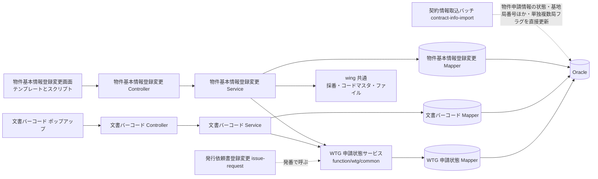
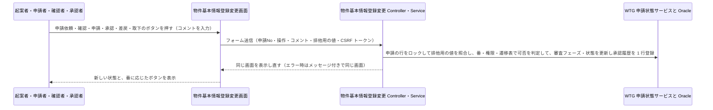
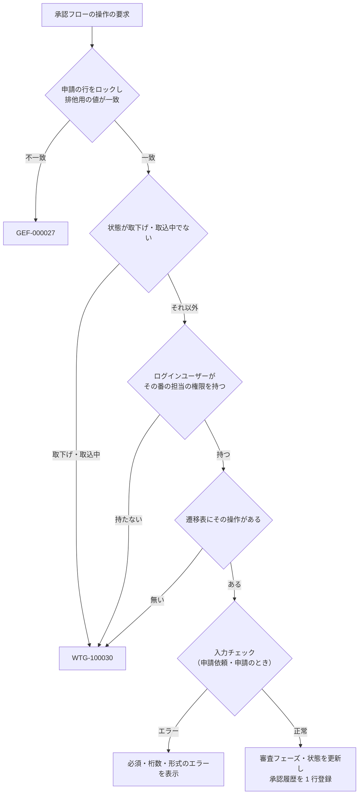

# 技術設計書

> このファイルは **「どう作るか」** を確定させる文書である。実装者ごとの解釈の食い違いを防ぎ、レビュー・実装・検証の共通の土台にする。\
> _分担_: 同一 feature の `requirements.md` が `status: approved` になるまで着手しない。本ファイルが `approved` になるまで `tasks.md` に進まない。`approved` は人間が付ける（エージェントは付けない）。

> _書き方_: 各節は結論から書き、検討の過程や調査ログは残さない。

> _出典の表記_: 「要件 N」「N.M」は `specs/property-basic-info/requirements.md` の要件と受け入れ基準ID。「Q-DS-PBI-xxx」は本 feature の design 作成中の質問への回答（回答者 Junichi Noumi）。既存 wing のパスは、steering が手本に挙げる既存の実装から読み取った根拠を示す。`WTX_Batch/src/jp/co/kccs/wt/wtg/wtg090/`（契約情報取込バッチ PWTGB090）には今回の案件の成果物（正解）にあたるコードが含まれていたため、本書の根拠にしていない（回答者 Junichi Noumi の指示、2026-10-06）。

## 概要（Overview）

> 実装者が最初に読む節。何を誰に提供し、既存の何が変わるかを示す。\
> _分担_: 要件そのものは `requirements.md`。ここには設計上の位置づけだけを書く。

> _書き方_: 設計用語を使わず、この設計書を初めて読む人に通じる言葉で書く。

- **目的（Purpose）**: 契約書の発行を依頼する起案者と、その依頼を審査する申請者・確認者・承認者 に 物件基本情報の登録から決裁までを、WiNG の 1 つの画面（物件基本情報登録変更 GWTG070）で順番どおりに進め、その経過を残せる仕組み を提供する。
- **利用者（Users）**: 起案者（全員）、申請者・確認者・承認者（審査権限マスタ `TWTGM170` に登録された人）。社外ユーザー（ベンダー／施工会社）を含む（`requirements.md` の概要）
- **影響（Impact）**: 現在の Excel マクロでの契約書作成と、紙の稟議資料の回覧・製本 を 物件基本情報の登録・承認フロー・承認履歴・契約稟議ファイル・文書バーコードを WiNG の画面と DB で管理する形 に変更する。

### 達成目標（Goals）
> このフィーチャーが成功したと言える状態を定める節。

> _書き方_: 1 項目 1 行。基準を明記して、達成したかどうかを後から判定できる書き方にする。

- 物件基本情報を登録すると、申請No（"B"＋年月日 6 桁＋日ごとの連番 4 桁）が採番され、未起案・下書きで保存される（1.1・1.2・1.5）
- 稟議依頼・修正稟議依頼・再製本依頼の審査フェーズと状態が、`### ドメインモデル（Domain Model）` の遷移表のとおりにだけ変わる（要件 2〜4）
- 申請依頼・申請・確認・承認・差戻し・取下げのたびに承認履歴が 1 件増え、それ以外の操作では増えない（要件 5）
- 画面のボタンと入力可否が、ログインユーザーの権限と「誰の番か」の表（`#### WTG 申請状態サービス`）のとおりに出し分けられ、サーバー側でも同じ判定で拒否される（要件 6・7・9・11・14・15）
- 決裁済みの申請から、修正稟議・再製本の新しい申請が 1 回の操作で複製される（要件 7）
- 契約稟議ファイルの登録・確定、進捗管理DB 用 CSV の出力、文書バーコードの生成と無効化が、受け入れ基準どおりに動く（要件 8・9・11）

### やらないこと（Non-Goals）

> 達成目標に含めないことを先に宣言する節。`### 達成目標（Goals）` と対で読む。\
> _分担_: 実装として持たないものは `### このスペックが持たない責務（Out of Boundary）`。ここには目標の話だけを書く。

> _書き方_: 今回やらないだけのものと、今後もやらないものを書き分ける。

- 今後もやらない：承認依頼・承認結果のメール等による通知（REQ-066。`steering/product.md` の `## プロダクトレベルでやらないこと`）
- 今後もやらない：物件基本情報の項目の変更履歴（`TWTGA120`）を残すこと（`requirements.md` の `## 対象外`）
- 今回やらない：本 feature 固有の性能目標値を設けること（`requirements.md` の非機能要件。既存 WiNG の水準に従う）
- 今回やらない：画面の項目の並び順・区画分けなどの配置と見た目を決めること。本書は画面に出す項目とその規則だけを書き、配置と見た目は Phase 8 の実装で決める（回答者 Junichi Noumi の指示、2026-10-07）

## 責務境界（Boundary Commitments）

> 実装物として**どのスペックが何を持つか**を確定させる節。タスク分解と後工程の検証もここを基準にする。\
> _分担_: 何を作り何を作らないかは `requirements.md` の `## スコープの境界（Boundary Context）`。ここには所有するデータとインターフェース、依存してよい相手を書く。

### このスペックが持つ責務（This Spec Owns）

> このスペックが持ち主になるものを宣言する節。

> _書き方_: 各項目 1 行。他のスペックとの間で担当が曖昧になりやすいものから先に書く。振る舞いをどのコンポーネントが担うかは `## コンポーネントとインターフェース（Components and Interfaces）` に書く。

- **所有するデータ**:
  - 契約局情報（`TWTGM140`）のテーブル定義と、物件基本情報登録変更画面での行の登録・更新・削除・並替え（`.aidd/feature-list.md` の注記。発行依頼書登録変更画面の更新と取込の洗替は各 feature が行う）
  - 物件申請情報（`TWTGM080`）：申請No・依頼内容・審査フェーズ・状態・申請回数・元申請No・決裁日時と物件基本情報の項目
  - 契約稟議ファイル（`TWTGM090`）
  - 承認履歴（`TWTGM180`）
  - 契約文書情報（`TWTGM110`）：文書バーコード
  - 審査権限マスタ（`TWTGM170`）のテーブル定義（値は発注者が投入し、発行依頼書登録変更も読む。Q-DS-PBI-006）
- **定義するインターフェース**:
  - 物件基本情報登録変更画面（GWTG070）と文書バーコードのポップアップ画面
  - WTG 申請状態サービス（`function/wtg/common`）：審査フェーズ・状態の遷移、誰の番かの判定、審査権限の取得、承認履歴の登録、社外ユーザーのデータ範囲の条件。発行依頼書登録変更画面（issue-request）など WTG の他の画面が使う
  - 審査フェーズ・状態・依頼内容・申請回数・元申請No の意味（データ契約）。物件申請情報を読む・状態を変える他の feature（issue-request・contract-info-import・application-status-search ほか）が従う

### このスペックが持たない責務（Out of Boundary）

> 関連はするが、このスペックが持ち主にならないものを宣言する節。「ついでに」で実装範囲が広がるのを防ぐ。\
> _分担_: ここには持ち主が他にあるものだけを書く。目標として掲げないものと、今回やらないと決めただけのものは `### やらないこと（Non-Goals）`。

> _書き方_: 他に任せるものは委譲先を必ず添える。委譲先が決まっていないものは `## 設計判断（Design Decisions）` で扱う。

- **他に任せる範囲と、その委譲先**:
  - 発行依頼書（`TWTGM100`）の項目の登録・更新と、契約書の発番（発番で申請を受付済・回覧中にし、承認履歴に発番の行を登録する呼出しを含む）→ `specs/issue-request/design.md`。本 feature は申請の削除での物理削除と、修正稟議・再製本での複製だけを行う（`.aidd/feature-list.md` の注記）
  - 発行依頼書登録変更画面での契約局情報の行の追加・更新 → `specs/issue-request/design.md`
  - 契約情報取込画面（GWTG090）と取込バッチ（取込中への状態の変更と戻し、契約局情報・発行依頼書の洗替、取込の終わりの TWTGM080 の計画基地局番号・計画基地局名・基地局番号・基地局名・基地局名(ｶﾅ)・エリアコード・単独複数局フラグ・排他用の値の更新を含む）→ `specs/contract-info-import/design.md`（横断確認 1 回目 #3）
  - 契約情報ダウンロード画面（GWTG100）→ `specs/contract-info-download/design.md`
  - 帳票の中身（閲覧・印刷で出力する PDF）→ `specs/print-report/design.md`。本 feature は閲覧・印刷ボタンの表示条件だけを持つ（6.9）
  - 申請状況の検索・一覧（GWTG060）→ `specs/application-status-search/design.md`。本 feature は戻る先として遷移するだけ
  - 審査権限マスタ（`TWTGM170`）とコードマスタ（`TWTZM040`）・採番マスタ（`TWTZM050`）への値の登録 → 発注者（`requirements.md` の前提）
- **後のフェーズに回す作業**:
  - 画面の配置・見た目：Phase 8 の実装で決める（回答者 Junichi Noumi、2026-10-07）
  - 画面部品の属性（入力バイト数・IME・ツールチップなど、回答者が別に渡したもの）：Phase 8 で使う（回答者 Junichi Noumi、2026-10-07）
  - Oracle を使う確認（Mapper XML の SQL）：総合テスト（試験仕様書）に回す（Q-DS-PBI-014）

### 依存してよい対象（Allowed Dependencies）

> このフィーチャーが前提にしてよい既存の仕組みを列挙する節。\
> _分担_: 要件として何に依存するかは `requirements.md` の `## 前提と依存（Dependencies / Assumptions）`。ここには実装が使ってよい範囲と守る制約を書く。

> _書き方_: 依存先は、システム名・コンポーネント名・共有基盤名など後から特定できる固有名で書く。制約には一方向性、循環の禁止、レイヤをまたぐ条件など、守るべき条件を書く。

- **依存先**:
  - wing の共通基盤：`SessionCheckInterceptor`・`AccessControlInterceptor`・`CSRFTokenCheckInterceptor`・`ExceptionResolver`・`LoginUserUtils`（`wing/src/main/java/jp/co/kccs/wt/common/`）
  - 採番：`NumberingService` と採番マスタ `TWTZM050`（1.5）。申請No はグループID `WTG070`・識別コード `01` の行で採番する（Q-DS-PBI-008）
  - コードマスタ：`CodeMstService` と `TWTZM040`（WTG/PARAM の `P27`〜`P30`・`P33`・`P34`・`P71`・`P78`〜`P80`・`P82` など。Q-DS-PBI-015）
  - ファイルの保存：`FileUploadService`。契約稟議ファイルは出力管理（`TZZZM027`）を使わず、`wing-web.properties` の `swf.upload.directory.root`（/remote_nfs）＋`swf.upload.directory.wtg070.ringi`（/wtg/wtg070/ringi）＋`/{申請No}` に保存する（Q-DS-PBI-004）
  - 審査権限マスタ `TWTGM170`（読むだけ）
  - 計画マスタ（BM010）（読むだけ。基地局番号から計画基地局・基地局名・エリアを設定する。Q-DS-PBI-002）
  - 発行依頼書情報 `TWTGM100`（表示のための読取りと、申請の削除・複製のときだけ書く。`.aidd/feature-list.md` の注記）
- **依存の制約**:
  - 画面は Controller → Service → Mapper の向きだけで呼び、他の機能パッケージの Service・Mapper を呼ばない（`steering/architecture.md` の `## レイヤーと依存ルール`）
  - WTG 申請状態サービスは `function/wtg/common` に置き、本 feature の画面と WTG の他の画面がこれを呼ぶ。WTG 申請状態サービスから画面の Controller・Form・機能パッケージを参照しない
  - 下流の feature（issue-request ほか）の design に依存しない。`TWTGM100` が無い申請でも画面が動く

### 再確認が必要になる変更（Revalidation Triggers）

> ここに挙げた変更が起きたら、依存するスペックや利用側に再確認を依頼する節。

> _書き方_: 1 項目 1 行（例: 契約の形（API・イベント・型の定義）の変更、データ所有権の移動、依存方向の変更、起動・実行時の前提条件の変更）。

- 審査フェーズ・状態・依頼内容のコード値や遷移表の変更（issue-request・contract-info-import・application-status-search・print-report が読む）
- WTG 申請状態サービスのメソッドの入出力の変更（issue-request が呼ぶ）
- `TWTGM080`・`TWTGM140`・`TWTGM180`・`TWTGM110` の列の変更（下流の画面とバッチが読む・書く）
- 社外ユーザーのデータ範囲の条件の変更（application-status-search などが同じ条件を使う）
- 申請No の形式・採番の変更
- 本書が「この形で読む」とした発行依頼書（`TWTGM100`）の列（`### データ契約と外部連携（Data Contracts & Integration）`）の変更（issue-request の design が合わせる。Q-DS-PBI-012）
- 本書が「この形で出す」とした進捗管理DB インポート用 CSV の形（同節）の変更、または契約情報取込の取込レイアウトの変更（contract-info-import の design が合わせる。Q-DS-PBI-012）

## アーキテクチャ（Architecture）

> このフィーチャーをどの構成に載せるかを決める節。\
> _分担_: レイヤ構成と依存のルールは `steering/architecture.md` の `## レイヤーと依存ルール`、命名とコード規約は `steering/tech.md` の `## 命名規則` と `## コード規約`。ここにはこのフィーチャー固有の構成だけを書く。

### 既存アーキテクチャの分析（Existing Architecture Analysis）

> 既存システムに手を入れる場合に、守るべき前提を確認する節。

> _書き方_: 今回の変更で壊してはいけないものを挙げる。現状の評価や改善案は書かない。

- **現行のパターンと制約**: wing の画面は Spring MVC の Controller（`@FuncID` でプログラムID を宣言）→ Service（クラスに `@Transactional(readOnly = true)`、更新メソッドに `@Transactional`）→ MyBatis Mapper の 3 層で、入力チェックは Service の `checkXxx` が `BindingResult.rejectValue` に積む（例 `wing/src/main/java/jp/co/kccs/wt/function/wtg/wtg002/`）。同時更新は `ExclusiveFG` の照合で防ぐ
- **守るべきドメイン境界**: 既存の WTG の契約情報（`TWTGM010`〜`TWTGM070`）と既存画面（GWTG003〜GWTG050）には手を入れない（`steering/product.md` の既存 WTG 機能の保全）
- **維持する統合ポイント**: ログインとセッション（`ZSESSION`）、メニュー権限（`ZMENUAUTH`）、CSRF トークン、採番マスタ（`TWTZM050`）とコードマスタ（`TWTZM040`）、ファイル出力の履歴（`TZZZM027`）
- **解消 / 回避する技術的負債**: <DSN_EXISTING_DEBT>（不要：既存の構成（Spring MVC＋MyBatis、既存の共通部品）にそのまま乗せる新しい機能で既存のコードは直さないため、解消する技術的負債も、避けるために設計を変える技術的負債も無い — 回答者 Junichi Noumi、2026-10-07）

### アーキテクチャ方式と境界図（Architecture Pattern & Boundary Map）

> 採用する構成とコンポーネント間の関係を、図と文で示す節。

> _書き方_: 図は例であり、大文字の名前はすべて実際のコンポーネント名に置き換えたり、ノードを追加したりして関係性を示すようにする。関係が複雑でない場合は図を省いて文だけでもよい。



- **選択したパターン**: 既存 wing の 3 層（Controller → Service → Mapper）。審査フェーズ・状態の遷移と「誰の番か」の判定だけを WTG 共通のサービスに切り出す
- **ドメイン / 機能の切り分け**: 物件基本情報の編集・複製・削除・ファイル・CSV は本画面の Service、文書バーコードはポップアップの Service、承認フローの規則（遷移・番・権限・履歴・社外ユーザーの範囲）は WTG 申請状態サービス
- **既存パターンとの整合**: 画面ごとに `function/wtg/<機能ID>/` の controller・service・mapper・form・bean を置く既存の置き方に従う（`steering/architecture.md` の `## 配置原則`）
- **新規コンポーネントを置く理由**: 承認フローの規則は発行依頼書登録変更画面（発番）や申請状況検索も使う。他の機能パッケージの Service を直接呼べないため（`steering/architecture.md` の `## レイヤーと依存ルール`）、WTG 共通（`function/wtg/common`）に置く
- **steering との整合**: 新しい技術・外部連携・メッセージングを持ち込まない（`steering/tech.md`）。権限は `AccessControlInterceptor` と `TWTGM170`・`P82` だけで判定する（`steering/security.md` の `#### 権限モデル`）

### 技術スタック（Technology Stack）

> このフィーチャーで追加する、または例外的に採用する技術を書く節。\
> _分担_: プロジェクト共通のスタックは `steering/tech.md` の `## コアテクノロジ` と `## 主要ライブラリ`。ここには差分だけを書く。

> _書き方_: 1 行 1 技術。レイヤは Frontend / CLI、Backend / Service、Data / Storage、Messaging / Event、Infrastructure / Runtime などから選ぶ。

| レイヤ | 採用 / バージョン | このフィーチャーでの役割 | 備考 |
|---|---|---|---|
| Backend / Service | orangesignal-csv 2.2.1（groupId `com.orangesignal`、artifactId `orangesignal-csv`。Maven Central、Apache License 2.0） | 進捗管理DB インポート用 CSV の書き出し（新しく作る `CsvUtils` が使う。9.1） | 複数の feature（物件基本情報登録変更・申請状況一覧・契約情報ダウンロード）の CSV 出力で使う共通部品の依存。最初に使う本 feature で `wing/pom.xml` の依存に足す（`steering/tech.md` の `## 主要ライブラリ` の分担どおり、機能だけで使うライブラリはここに書く。Q-DS-PBI-013） |
| Infrastructure / Runtime | 開発端末の JDK 1.8（`-source`/`-target` 1.7） | 開発端末でのコンパイルと自動テストの実行 | 本番は JDK 1.7（`steering/tech.md`）。1.7 系の JDK は開発端末に入れない（Q-DS-PBI-014） |

## データモデル（Data Models）

> このフィーチャーで変更するデータ構造を確定させる節。\
> _分担_: システム全体の ER 図・全体スキーマは `docs/architecture/data-model.md` の `## ER 図` に従う。命名と型の共通ルールは `steering/database.md` の `## 命名規則` と `## 型の指針`。

> _書き方_: このフィーチャーで変更するエンティティだけを書く。物理データモデルを変えたら `docs/architecture/data-model.md` との整合を確認する。

### ドメインモデル（Domain Model）

> 業務上の概念とその関係を、保存形式に依らない形で書く節。

> _書き方_: 実装の都合ではなく、業務としてどう成り立っているかで書く。集約は、一緒に更新しないと辻褄が合わなくなるデータのまとまり。値オブジェクトは、金額や住所のように、値が同じなら同じものとして扱ってよいもの。ドメインイベントは、「注文が確定した」のように業務で起きた出来事のうち、他に知らせる必要があるものを指す。不変条件は、いつ見ても成り立っていなければならない決まりを指す。

- **集約とトランザクション境界**: 「申請」を集約とする。根は物件申請情報（申請No）で、契約局情報・契約稟議ファイル・承認履歴・文書バーコード・発行依頼書（読取りと削除・複製だけ）がぶら下がる。画面の 1 操作を 1 トランザクションとし、申請の排他用の値（`ExclusiveFG`）を照合してから更新する。申請No の採番だけは別の接続で先に確定する（`steering/database.md` の採番のトランザクション）
- **エンティティ / 値オブジェクト / ドメインイベント**: エンティティは申請・契約局情報（行）・契約稟議ファイル・承認履歴（行）・文書バーコード（行）。値オブジェクトは申請No・依頼内容・審査フェーズ・状態・担当（起案者／申請者／確認者／承認者）。ドメインイベントは「承認フローの操作が行われた」（承認履歴の 1 行として記録する。他のシステムへは知らせない）
- **ビジネスルール / 不変条件**:
  - 審査フェーズと状態は次の遷移表のとおりにだけ変わる。表に無い組合せの操作は受け付けない（3.8・6.3）。状態が取下げ（04）・取込中（06）の申請はどの操作も受け付けない（4.6・6.4）

    | 依頼内容 | 操作前（審査フェーズ・状態） | 番 | 操作 | 操作後（審査フェーズ・状態） | 根拠 |
    |---|---|---|---|---|---|
    | 稟議・修正稟議 | 未起案 00・下書き 01 | 起案者 | 申請依頼 | 起案済 01・回覧中 02 | 2.1 |
    | 稟議・修正稟議 | 受付済 02・差戻し 03 | 起案者 | 申請依頼 | 受付済 02・回覧中 02 | 2.2 |
    | 稟議・修正稟議 | 起案済 01・回覧中 02 | 申請者 | 発番（発行依頼書登録変更画面で行う。本画面には操作のボタンを出さない） | 受付済 02・回覧中 02 | issue-request の design、Q-DS-PBI-011 |
    | 稟議・修正稟議 | 受付済 02・回覧中 02、申請済 03・差戻し 03 | 申請者 | 確認 | 受付済 02・確認中 05 | 2.4・4.8 |
    | 稟議・修正稟議 | 受付済 02・確認中 05 | 申請者 | 確認 | 変えない（承認履歴に判定 03 の行だけを残す） | 2.9、Q-DS-PBI-011 |
    | 稟議・修正稟議 | 受付済 02・回覧中 02、受付済 02・確認中 05、申請済 03・差戻し 03 | 申請者 | 申請 | 申請済 03・回覧中 02 | 2.5、Q-DS-PBI-011（受付済・確認中は申請者が確認作業中である印で、担当者の段階ではない。確認者・承認者は飛ばさないので 3.8 の段階を飛ばす操作にあたらない） |
    | 稟議・修正稟議 | 申請済 03・回覧中 02、確認済 04・差戻し 03 | 確認者 | 確認 | 確認済 04・回覧中 02 | 2.6・4.9 |
    | 稟議・修正稟議 | 確認済 04・回覧中 02 | 承認者 | 承認 | 承認済 05・完了 07（決裁日時を記録） | 2.7 |
    | 再製本 | 未起案 00・下書き 01、起案済 01・差戻し 03 | 起案者 | 申請依頼 | 起案済 01・回覧中 02 | 3.2 |
    | 再製本 | 起案済 01・回覧中 02、申請済 03・差戻し 03 | 申請者 | 申請（再製本に「確認」ボタンは無い） | 申請済 03・回覧中 02 | 3.3・3.9（再製本依頼の申請者からの確認は受け付けない）、Q-DS-PBI-011 |
    | 再製本 | 申請済 03・回覧中 02 | 承認者 | 承認 | 承認済 05・完了 07（決裁日時を記録） | 3.5 |
    | 共通 | 状態が回覧中 02（稟議・修正稟議の起案済 01・回覧中 02 を除く） | その番の申請者・確認者・承認者 | 差戻し | 審査フェーズはそのまま・差戻し 03 | 4.1・4.3、Q-DS-PBI-011 |
    | 稟議・修正稟議 | 受付済 02・確認中 05、申請済 03・差戻し 03 | 申請者 | 差戻し | 受付済 02・差戻し 03 | 4.10 |
    | 稟議・修正稟議 | 確認済 04・差戻し 03 | 確認者 | 差戻し | 申請済 03・差戻し 03 | 4.11 |
    | 再製本 | 申請済 03・差戻し 03 | 申請者 | 差戻し | 起案済 01・差戻し 03 | 4.12 |
    | 共通 | 番が回っている状態（未起案・下書きを含む。稟議・修正稟議の起案済 01・回覧中 02 を除く） | その番の起案者・申請者・確認者（承認者は取下げを持たない） | 取下げ | 審査フェーズはそのまま・取下げ 04（未起案・下書きなら未起案・取下げ） | 4.2・4.5（承認者の番の回覧の操作は承認と差戻だけで、承認者からの取下げは受け付けない）、Q-DS-PBI-011 |

  - 申請依頼のたびに申請回数を 1 増やす（2.3）。修正稟議・再製本で作った申請は未起案・下書き・申請回数 0 から始める（7.6）
  - 依頼内容は `TWTGM080.Irai_Naiyo` に `P29` のコード値ではなく名称の文字列で持つ。新規登録と修正稟議は "稟議依頼"、再製本は "再製本依頼"。画面には値をそのまま表示する。修正稟議は「依頼内容が "稟議依頼" で元申請No（`Moto_Application_No`）がある」ことで見分け、稟議依頼と同じ遷移で進む（2.8、Q-DS-PBI-002）
  - 審査フェーズは `TWTGM080.Status`、状態は `TWTGM080.JOTAI_KBN` に、それぞれ `P28`・`P27` のコード値で持つ（Q-DS-PBI-002）
  - 起案者は申請を登録した本人に限らず、ログインできる人なら誰でも起案者として起案者の番の操作（更新・申請依頼・取下・削除）と修正稟議・再製本の複製ができる。社外ユーザーは 6.5 の範囲の申請だけ（1.3・6.2・7.1、Q-DS-PBI-010）
  - 登録者（`RegisteredPerson`）には、新規登録・修正稟議・再製本で行を登録するときのログインユーザーID を入れる。起案者の判定には使わない。社外ユーザーの範囲（本人が登録した申請。6.5）の判定に使う（Q-DS-PBI-002）
  - 修正稟議・再製本で複製元から引き継ぐ物件申請情報の列は、計画基地局番号・名、基地局番号・名・名(ｶﾅ)、エリアｺｰﾄﾞ、施策ｺｰﾄﾞ、単独複数局ﾌﾗｸﾞ（7.3）。空にする列は、日時の各項目（申請依頼日時・初回申請依頼日時・決裁日時・確認日時・申請日時・発番日時）、発送の項目（発送希望日・発送書類有無ﾌﾗｸﾞ）、申送り事項、連絡先ﾒｰﾙｱﾄﾞﾚｽ、電話番号（7.7、Q-DS-PBI-002）
  - 修正稟議・再製本では、契約局情報（`TWTGM140`）の元の申請の全行を新しい申請No で登録する。連番・計画基地局番号ほかの列は元の値のまま、一時保存フラグは "0"、稟議バーコードNo は再製本では元の値を引き継ぎ、修正稟議では NULL にする。発行依頼書（`TWTGM100`）は元の申請の行を新しい申請No で登録し、一時保存フラグは "0"、受付No は再製本では元の値を引き継ぎ、修正稟議では NULL にする。再製本が元の稟議の稟議バーコードNo を使う（3.7）のは、この `TWTGM140` の稟議バーコードNo の引き継ぎで実現する（7.3、設計検査 2 回目の指示）
  - 「誰の番か」は依頼内容・審査フェーズ・状態だけで決まる（`#### WTG 申請状態サービス` の番の表）。差し戻すと一つ前の作業者の番になる（4.7）
  - 承認フローの操作（申請依頼・申請・確認・承認・差戻し・取下げ）1 回につき承認履歴が 1 行増え、それ以外の操作では増えない（5.1・5.2）
  - 承認履歴の行は、物件申請情報を更新した後に 1 行登録する。審査権限には操作した人の権限（`P82`）を入れる：申請依頼は 01、確認は申請者なら 02・確認者なら 03、承認は 04、申請は 02、差戻しは押した人に応じて 02・03・04、取下げは押した人に応じて 01・02・03。申請の削除では、その申請No の承認履歴を物理削除する（15.1、Q-DS-PBI-005）
  - 確定した契約稟議ファイルは申請ごとに 0 件か 1 件（8.2・8.3）
  - 文書バーコードは削除せず、有効・無効とコメントだけを変える。有効・無効は削除フラグ（`Delete_Flg`）で表し、「更新」でチェックを付けた行の削除フラグを反転する（0→1、1→0）。コメントは変更があった行だけを更新する（11.5・11.6、Q-DS-PBI-007）
  - 文書バーコードNo ＝ 基地局番号＋"-"＋エリア接頭語＋受付No＋"-"＋契約区分＋書類種別コード＋件数。基地局番号は契約局情報欄で押した行（`TWTGM140`）の基地局番号（物件申請情報のものではない）。エリア接頭語は発行依頼書の担当エリア（`TWTGM100.Area_Cd`）をキー3 にしてコードマスタ `WTG/PARAM/P34` を引いた文字項目1。受付No は `TWTGM100.Uketsuke_No`。契約区分は `TWTGM100.Keiyaku_Kbn` をキー3 にして `WTG/PARAM/P78` を引いた文字項目2（屋内 1・オープン 2・鉄道 3 の 1 桁）。稟議バーコードNo の契約区分（文字項目1 の 3 桁。ir design）とは別の決まりで、文書バーコードNo では文字項目2 を使う（横断確認 1 回目 #7）。書類種別コードは画面で選んだ `P33` のコード。件数は同じ稟議バーコードNo・書類種別コードの最大の件数（数値に変換して比べる）＋1。発行依頼書は申請No で引く（11.3・11.4・11.7、Q-DS-PBI-007）
  - 申請No ＝ "B"＋YYMMDD（システム日付）＋`NumberingService` で取得した値を 4 桁に 0 埋めしたもの。"B"＋YYMMDD はプログラムで付ける。採番するのは、メニューから開いた新規の「更新」と、修正稟議・再製本で新しい申請を作るとき。採番マスタ `TWTZM050` の行は、グループID `WTG070`、識別コード `01`、プレフィックス 空、最小値 1、現在値 0、最大値 9999、採番区分 02（日次リセット）、MAX区分 1（ローテーションなし。上限を超えて 0001 へ戻り既存の申請No と重なるのを避ける）、備考 "申請No"。上限を超えたときの動きは `NumberingService` の既存の動きに従う。採番は業務とは別の接続で確定するため、同時に登録しても番号は重ならない（1.2・1.5、Q-DS-PBI-008）
  - 「発番済」（6.9）と「発番後」（11.2）は、依頼内容で分けて判定する。稟議依頼・修正稟議依頼は、審査フェーズが受付済（02）以降（受付済・申請済・確認済・承認済）なら発番済。再製本依頼は常に発番済として扱う（元の申請の受付No と稟議バーコードNo を引き継いで作るので、作った時点で発番済み。発行依頼書登録変更で再製本を発番しないことと合う）（3.7・6.9・11.2、設計検査 4 回目の指示）
  - 契約局情報の 1 行目（代表局）は移動も削除もできない（14.3）。単独局に切り替えても行は消さない（14.8）

### 論理データモデル（Logical Data Model）
> ドメインモデルをデータ構造として整理する節。

> _書き方_: 保存先の製品には依存させない。製品固有の話は物理データモデルに書く

- **エンティティ間の多重度（カーディナリティ）**: 申請 1 : 契約局情報 0..n（表示順つき）、申請 1 : 契約稟議ファイル 0..n（確定は 0..1）、申請 1 : 承認履歴 0..n（発生順）、申請 1 : 文書バーコード 0..n（稟議バーコードNo・書類種別ごとの連番）、申請 1 : 発行依頼書 0..1（申請No で結ぶ。契約局ごとの項目は契約局情報の行に持つ。Q-DS-PBI-003）、申請 0..1 : 元申請 1（元申請No）、利用者 1 : 審査権限 0..n
- **属性と型**: 各エンティティの属性と型は `### 物理データモデル（Physical Data Model）` の各表（`TWTGM080`・`TWTGM140`・`TWTGM090`・`TWTGM180`・`TWTGM170`・`TWTGM110`）のとおり。コード値で持つ属性（審査フェーズ・状態・審査権限・書類種別）はコードマスタの識別、コードマスタを作らない属性（判定・権限ID）は DB レイアウトの備考の値を使う（Q-DS-PBI-002〜007）
- **自然キー / 識別子**: 申請は「会社コード＋申請No」。契約局情報・契約稟議ファイル・承認履歴は「会社コード＋申請No＋行の番号」。文書バーコードは「会社コード＋稟議バーコードNo＋文書バーコードNo」。審査権限は「会社コード＋ユーザーID＋権限」
- **参照整合性のルール**: DB の外部キーは張らず、既存 WiNG と同じくアプリ側で保つ（`steering/database.md` の `## 整合性`）。申請を削除するときは、ぶら下がる行を同じトランザクションで物理削除する（15.1）。ただし文書バーコード（`TWTGM110`）の行は消さず、申請を削除できる状態と条件で絞る：削除ボタンは起案者の番の未起案・下書き（稟議依頼・修正稟議依頼・再製本依頼とも。条件は付けない。15.1）と、再製本依頼の起案済・差戻し（その申請No の文書バーコードが 0 件のときだけ。15.2）で出す（設計検査 2 回目の指示。Q-DS-PBI-007 の「未起案・下書きのときだけ」は回答者が取り消した）。元申請No は複製元の申請を指し、複製元が後で削除されることは無い（承認済・完了の申請は削除できない。15.3）

### 物理データモデル（Physical Data Model）
> 論理データモデルを実際の保存形式に落とした定義を書く節。

> _書き方_: 種別は RDB / Document Store / Event Store / KV・Wide-column などから選ぶ。RDB ならテーブル定義・主キー・外部キー・インデックス・分割方針、Document Store ならコレクション構造・埋め込みと参照の使い分け・シャードキーを書く。

| 種別 | 記載 |
|---|---|
| RDB | **`TWTGM080`（TWTGM080物件申請情報ﾏｽﾀ）**。主キーは持たず、ユニークキー `AK_TWTGM080_1`（`CompanyCD`, `Application_No`）。列は下の表（Q-DS-PBI-002） |
| RDB | **`TWTGM140`（契約局情報）**。一意キーは（会社コード, `Application_No`, `Renban`, `Keikaku_Kichikyoku_No`）。行の順番は連番（`Renban`）で持ち、連番 1 が代表局。全 345 列で、主な列は下の表。残りは発行依頼書の契約局ごとの項目で、契約局取込の形式と同じ並び（Q-DS-PBI-003） |
| RDB | **`TWTGM090`（契約稟議ファイル）**。既存の `TWTGM050` 契約ファイルと同じ形に、確定の印と登録者名を足す。一意キーは（会社コード, `Application_No`, `Seq`）。ファイルの実体は `FileUploadService` で `swf.upload.directory.root`＋`swf.upload.directory.wtg070.ringi`＋`/{申請No}` に保存し、出力管理（`TZZZM027`）は使わない。列は下の表（Q-DS-PBI-004） |
| RDB | **`TWTGM180`（TWTGM180物件申請情報承認履歴ﾏｽﾀ）**。一意キーは（会社コード, `Application_No`, `Shinsa_Count`, `Tsuban`）。審査フェーズと状態は持たない（`TWTGM080` の `Status`・`JOTAI_KBN` だけで持つ）。列は下の表（Q-DS-PBI-005） |
| RDB | **`TWTGM170`（審査権限マスタ）**。主キーは定義せず、一意キーは（会社コード, `USER_ID`, `Kengen_ID`）。定義は本 feature が持ち、発行依頼書登録変更も読むだけ。登録・更新する画面やバッチは無く、値は発注者が投入する。列は下の表（Q-DS-PBI-006） |
| RDB | **`TWTGM110`（契約文書情報ﾏｽﾀ）**。主キーは定義せず、一意キーは（会社コード, `Ringi_Barcode_No`, `Doc_Barcode_No`）。行は物理削除しない。列は下の表（Q-DS-PBI-007） |

**`TWTGM080` の列**（型の番号は DB レイアウトの表記。0:Int、1:String、2:String（全角を含む）、3:DateTime）

| No | 表示名 | 項目名 | 型 | 桁数 | 必須 | 許可値 | 備考 |
|---|---|---|---|---|---|---|---|
| 1 | 会社ｺｰﾄﾞ | CompanyCD | 1:String | 5 | ○ | | Java-Kit共通 |
| 2 | 登録者 | RegisteredPerson | 1:String | 20 | | | Java-Kit共通 |
| 3 | 登録日時 | RegisteredDT | 3:DateTime | － | | | Java-Kit共通 |
| 4 | 更新者 | UpdatedPerson | 1:String | 20 | | | Java-Kit共通 |
| 5 | 更新日時 | UpdatedDT | 3:DateTime | － | | | Java-Kit共通 |
| 6 | 排他ﾌﾗｸﾞ | ExclusiveFG | 1:String | 32 | | | Java-Kit共通 |
| 7 | 申請No | Application_No | 1:String | 11 | ○ | | |
| 8 | 計画基地局番号 | Keikaku_Kichikyoku_No | 1:String | 9 | | | |
| 9 | 計画基地局名 | Keikaku_Kichikyoku_Name | 1:String | 120 | | | |
| 10 | 基地局番号 | Kichikyoku_No | 1:String | 9 | | | |
| 11 | 基地局名 | Kichikyoku_Name | 1:String | 120 | | | |
| 12 | 基地局名(ｶﾅ) | Kichikyoku_Name_Kana | 2:String | 120 | | | |
| 13 | ｴﾘｱｺｰﾄﾞ | Area_Cd | 1:String | 20 | | | |
| 14 | 施策ｺｰﾄﾞ | SHISAKU_CD | 1:String | 10 | | | |
| 15 | 発送希望日 | Hasso_Kibo_Date | 1:String | 8 | | | |
| 16 | ｽﾃｰﾀｽ | Status | 1:String | 20 | | | |
| 17 | 状態区分 | JOTAI_KBN | 1:String | 20 | | | |
| 18 | 依頼内容 | Irai_Naiyo | 1:String | 256 | | | |
| 19 | 申請依頼日時 | Application_Req_DateTime | 3:DateTime | － | | | 最新の申請依頼時のシステム日時を登録。 |
| 20 | 初回申請依頼日時 | First_Application_Req_DateTime | 3:DateTime | － | | | 初回申請依頼時のシステム日時を登録。 |
| 21 | 決裁日時 | Kessai_DateTime_From | 3:DateTime | － | | | 最新の決裁時のシステム日時を登録。 |
| 22 | 確認日時 | Check_DateTime_From | 3:DateTime | － | | | 最新の確認時のシステム日時を登録。 |
| 23 | 申請日時 | Application_Date | 3:DateTime | － | | | 最新の申請時のシステム日時を登録。 |
| 24 | 申請回数 | Application_Count | 0:Int | 2 | | | |
| 25 | 元申請No | Moto_Application_No | 1:String | 11 | | | |
| 26 | 申送り事項 | Moshiokuri_Jiko | 1:String | 1000 | | | |
| 27 | 発送書類有無ﾌﾗｸﾞ | Hasso_Shorui_Umu_Flg | 1:String | 1 | | 0:なし / 1:あり | |
| 28 | 単独複数局ﾌﾗｸﾞ | Tandoku_Fukusu_Flg | 1:String | 1 | | 0:単独局 / 1:複数局 | |
| 29 | 連絡先ﾒｰﾙｱﾄﾞﾚｽ | Mail | 1:String | 150 | | | |
| 30 | 電話番号 | Tel | 1:String | 11 | | | |
| 31 | 発番日時 | Hatsuban_Uketsuke_DateTime | 3:DateTime | － | | | 発番時のシステム日時を登録 |
| 32 | 更新者名 | UpdatedPerson_Name | 1:String | 20 | | | |

**`TWTGM140` の主な列**（Q-DS-PBI-003）

| 表示名 | 項目名 | 型 | 桁数 | 必須 | 許可値 |
|---|---|---|---|---|---|
| 申請No | Application_No | String | 11 | ○ | |
| 稟議バーコードNo | Ringi_Barcode_No | String | 25 | | |
| 連番 | Renban | Int | 4 | ○ | 1 が代表局 |
| 代表局番号 | Represent_SIteID_No | String | 9 | | |
| 代表局番号_枝番 | Represent_SiteID_Branch | String | 5 | | |
| 基地局番号 | Kichikyoku_No | String | 9 | | |
| 基地局番号_枝番 | Kichikyoku_No_Branch | String | 5 | | |
| 基地局名 | Kichikyoku_Name | String | 120 | | |
| 基地局名(ｶﾅ) | Kichikyoku_Name_Kana | String | 120 | | |
| 計画基地局番号 | Keikaku_Kichikyoku_No | String | 9 | ○ | |
| 計画基地局名 | Keikaku_Kichikyoku_Name | String | 120 | | |
| 物件名 | Bukken_Name | String | 100 | | |
| 一時保存フラグ | Draft_Flg | String | 1 | | 0:更新済 / 1:一時保存中 |
| （残りの列） | 発行依頼書の契約局ごとの項目 | | | | 契約局取込の形式と同じ並び |

**`TWTGM090` の列**（Q-DS-PBI-004）。ほかに Java-Kit 共通の列（会社コード・登録者・登録日時・更新者・更新日時・排他フラグ）を持つ

| 表示名 | 項目名 | 型 | 桁数 | 必須 | 許可値 | 備考 |
|---|---|---|---|---|---|---|
| 申請No | Application_No | String | 11 | ○ | | |
| ファイルパス | File_Path | String | 256 | | | |
| ファイル名 | File_Name | String | 256 | | | |
| SEQ | Seq | Int | 3 | ○ | | |
| 確定フラグ | Kakute_Flg | String | 2 | | 0:未確定 / 1:確定 | |
| 登録者名 | RegisteredPerson_Name | String | 20 | | | 登録したときのログインユーザー名を入れる。ユーザー管理マスタ（ZM010）とは結合しない |

**`TWTGM180` の列**（Q-DS-PBI-005）。ほかに Java-Kit 共通の列（会社コード・登録者・登録日時・更新者・更新日時・排他フラグ）を持つ

| 表示名 | 項目名 | 型 | 桁数 | 必須 | 許可値 | 備考 |
|---|---|---|---|---|---|---|
| 申請No | Application_No | String | 11 | ○ | | |
| 審査回 | Shinsa_Count | Int | 5 | ○ | | 物件申請情報を更新した後の申請回数（申請依頼では 1 増やした後の値） |
| 通番 | Tsuban | Int | 5 | ○ | | 同じ申請No・審査回の最大の通番＋1。行が無ければ 1 |
| 最終更新日 | Last_UpdatedDT | DateTime | － | | | システム日時 |
| 最終更新者 | Last_UpdatedPerson | String | 20 | | | ログインユーザーID |
| コメント | Hantei_Comment | String | 1000 | | | |
| 判定 | Hantei | String | 2 | | 01:申請依頼 / 02:申請 / 03:確認 / 04:承認 / 05:差戻 / 06:取下 / 11:発番/受付 | コードマスタは作らず、値は DB レイアウトの備考に書く。11 は発行依頼書登録変更が審査権限 "02" で登録する（Q-DS-PBI-005） |
| 審査権限 | Shinsa_Kengen | String | 10 | | `P82`（01:起案者 / 02:申請者 / 03:確認者 / 04:承認者） | 操作した人の権限 |
| 最終更新者名 | Last_UpdatedPerson_Name | String | 20 | | | ログインユーザー名。ユーザー管理マスタ（ZM010）とは結合しない |

**`TWTGM170` の列**（Q-DS-PBI-006）。ほかに Java-Kit 共通の列（会社コード・登録者・登録日時・更新者・更新日時・排他フラグ）を持つ

| 表示名 | 項目名 | 型 | 桁数 | 必須 | 許可値 | 備考 |
|---|---|---|---|---|---|---|
| ユーザID | USER_ID | String | 10 | ○ | | |
| 権限ID | Kengen_ID | String | 2 | | 1:稟議依頼-申請者 / 2:稟議依頼-確認者 / 3:稟議依頼-最終承認者 / 4:再製本-申請者 / 5:再製本-承認者 | このテーブル専用の値で、承認履歴の審査権限（`P82`）とは別の体系。コードマスタは作らず、値は DB レイアウトの備考に書く。起案者の権限は持たない（全ユーザーが起案者） |
| 権限有無 | Kengen_Umu | String | 1 | | 0:なし / 1:あり | |

**`TWTGM110` の列**（Q-DS-PBI-007）。ほかに Java-Kit 共通の列（会社コード・登録者・登録日時・更新者・更新日時・排他フラグ）を持つ

| 表示名 | 項目名 | 型 | 桁数 | 必須 | 許可値 | 備考 |
|---|---|---|---|---|---|---|
| 稟議バーコードNo | Ringi_Barcode_No | String | 25 | ○ | | |
| 文書バーコードNo | Doc_Barcode_No | String | 25 | ○ | | |
| 削除フラグ | Delete_Flg | String | 1 | | 0:未削除 / 1:削除 | 画面の「有効/無効」 |
| 書類種別コード | Doc_Kind_Cd | String | 20 | | `P33` | |
| 件数 | Count | String | 3 | | | 連番。比べるときは数値に変換する |
| 文書名 | Doc_Name | String | 256 | | | 将来のために列だけ作り、今回は値を入れない |
| コメント | Doc_Comment | String | 256 | | | |
| 申請No | Application_No | String | 11 | | | |

### データ契約と外部連携（Data Contracts & Integration）

> 外部とやり取りするデータの形と、その互換性の方針を決める節。

> _書き方_: API はリクエスト / レスポンスの schema・検証・シリアライズ形式、イベントは schema・バージョニング・互換性、サービス間は分散トランザクション（Saga / 2PC など）と整合性の方針を書く。

- **API**: 画面以外から呼ばれる API は持たない（`steering/api-standards.md` の本プロジェクトでの扱い）。画面の要求は `##### API 契約（API Contract）` のフォーム送信と、画面内で値を返す非同期の口 `/wtg070/inputHassoKiboDate` だけ。この口が失敗したとき（予期しない例外で既存の `ExceptionResolver` がエラー画面を返すとき）、画面のスクリプトは発送希望日に値を入れず、入力済みの値を変えない（横断確認 1 回目 #5。エラーの返し方の規約は steering に置かず、口ごとに書く）
- **イベント**: 持たない。メッセージングを使わない（`steering/tech.md` の `## コアテクノロジ`）
- **サービス間**: wing の画面と契約情報取込バッチは同じ DB を共有する。取込中（06）の申請は画面からどの操作も受け付けない（6.4）ことで、取込と画面の更新が重ならないようにする。画面の更新は `ExclusiveFG` を照合し、取込が書き換えた後の古い画面からの更新を排他エラーにする
- **発行依頼書（`TWTGM100`）から読む列**（定義は issue-request の design が持ち、本書のこの形に合わせる。Q-DS-PBI-012）。申請No と 1 対 1（一意キーは会社コード＋`Application_No`）

  | 使う箇所 | 論理名 | 列名 | 型・桁 |
  |---|---|---|---|
  | 12.1 の会社名 | 契約稟議起案者_会社名 | `Keiyaku_Ringi_Kiansha_Kaisha_Name` | String 50 |
  | 6.5・連絡先の条件付き必須 | 契約稟議起案者_会社コード | `Keiyaku_Ringi_Kiansha_Kaisha_Cd` | String 20 |
  | 7.3・14.6・文書バーコード | 受付No | `Uketsuke_No` | String 6 |
  | 14.6・文書バーコード | 契約区分 | `Keiyaku_Kbn` | String 20 |
  | 14.6・文書バーコード | 担当エリア | `Area_Cd` | String 20 |
  | 14.6 | 申請者 | `Application_Name` | String 100 |
  | 14.6 | 契約稟議起案者_所属名① | `Keiyaku_Ringi_Kiansha_Shozoku1` | String 100 |
  | 14.6 | 契約稟議起案者_所属名② | `Keiyaku_Ringi_Kiansha_Shozoku2` | String 100 |
  | 14.6 | 契約稟議起案者_氏名 | `Keiyaku_Ringi_Kiansha_Name` | String 100 |

  稟議バーコードNo は `TWTGM100` には無く、契約局情報（`TWTGM140`）の `Ringi_Barcode_No` で契約局の行ごとに持つ。7.3 の「稟議バーコードNo」はこの列を指す。契約者を作る関係者1〜5 の列は Q-DS-PBI-003 のとおり
- **進捗管理DB インポート用 CSV の形**（9.1。契約情報取込で読める形。contract-info-import の design が本書のこの形に合わせる。Q-DS-PBI-012）
  - 1 行目：発行依頼書（`TWTGM100`）の 1 行を 188 項目で出す。先頭は受付No
  - 2 行目以降：契約局情報（`TWTGM140`）を連番の順に 1 行ずつ 228 項目で出す。先頭は稟議バーコードNo、最後は添付資料(補足)⑤
  - ファイルは `WTG070_yyyyMMddHHmmss.csv`（出力した時刻）、Windows-31J（MS932）、カンマ区切り、改行は CRLF。見出し行は無く、1 行目からデータ。全項目をダブルクォートで囲み、値の中の " は "" にする。NULL は空文字。日付の項目は yyyy/MM/dd（DB の 8 桁 yyyyMMdd にスラッシュを入れる）。新しく作る共通部品 `jp.co.kccs.wt.common.utils.CsvUtils`（複数の feature で使う共通部品。最初に使う本 feature で作る。orangesignal-csv を使う。`defaultCsvConfig()` は区切り「,」・囲み「"」・エスケープ「"」・全項目を囲む（`QuotePolicy.ALL`）・空行は無視・NULL は空文字、`save(出力するリスト, 出力ストリーム, 文字コード, CsvConfig, ハンドラ)` は指定の文字コードで書き出す）で作る。1 行目（発行依頼書）と 2 行目以降（契約局）は項目の形が違うため、それぞれの行の項目を順に並べて書き出す。ダウンロード（`Content-Disposition: attachment`）で返す（Q-DS-PBI-013）
  - コード値の一部は名称に変換して出す（例：関係者の関係(地位)は `P45` の名称、法人個人区分は `P06` の名称、郵便番号から住所マスタ ZM400 の住所）。各項目の並びと出し方は、契約情報取込の取込レイアウトと同じ並び。項目ごとの並びと出し方（1 行目 188 項目・2 行目以降 228 項目、計 416 行）は `## 補足資料（Supporting References）` の「進捗管理DB インポート用 CSV の項目定義」を正とし、契約情報取込の design はこれに合わせる（設計検査 2 回目の指示）

## コンポーネントとインターフェース（Components and Interfaces）

> 各コンポーネントの責務と、外部に公開する契約を確定させる節。契約は 5 種類ある。
>
> - **サービスインターフェース**: 他のコンポーネントから呼ばれる口
> - **API 契約**: 外部から HTTP で呼ばれる口
> - **イベント契約**: 非同期にやり取りするイベントの発行・購読
> - **バッチ / ジョブ契約**: 定期実行や一括処理
> - **状態管理**: 状態の持ち方と守り方
>
> _分担_: 物理配置は `## ファイル配置計画（File Structure Plan）`。全 API 共通の形式は `steering/api-standards.md` の `## リクエスト / レスポンス形式`、エラー表現は同ファイルの `## エラーハンドリング（API 契約）`。ここには論理的な責務と、このフィーチャー固有の契約を書く。

- **ログ**: 本 feature 固有のログ項目は無い。ERROR は既存の `ExceptionResolver`、INFO は既存の `LoggingInterceptor` に任せる。担当者の氏名と連絡先はログに出さない（`steering/non-functional.md` の `### ログ方針`、設計検査 2 回目の指示）
- **監視**: 本 feature 固有の監視項目は無い。既存の WiNG の監視に任せる（`steering/non-functional.md` の `### 監視 / ヘルス`、設計検査 2 回目の指示）

> _書き方_: まず一覧で全体像を示し、そのあと新しい境界を持つコンポーネントだけ詳細を書く。契約の種類は該当するものにチェックを入れ、同じ名前の小節だけを書く。実装上の注意やリスクは、判断に関わるものは `## 設計判断（Design Decisions）`、確認方法は `## テスト戦略（Testing Strategy）` に書く。
>
> - **ドメイン / レイヤの見出し**: ドメイン名で切るかレイヤ名で切るかはプロジェクトで決め、この節の中で揃える。複数あれば同じ形で繰り返す。`_N` は繰り返す印であり、配下のコンポーネントの `_N` と番号が対応するわけではない。
> - **サービスインターフェース**: メソッドごとに 1 行。型名は設計上の名前でよく、実装の型と一致していなくてよい。事前条件は呼ぶ側が満たしておくこと、事後条件は呼び出しが成功したときに保証されること、不変条件は処理の前後どちらでも常に成り立つことを書く。
> - **API 契約**: 1 行 1 エンドポイント。エラー列には返しうるステータスコードを列挙する。
> - **イベント契約**: 到達保証・順序保証は at-least-once / FIFO などの方式名で書く。
> - **バッチ / ジョブ契約**: 冪等性（同じ処理を何度実行しても結果が変わらない性質）をどう担保するかと、失敗時の復旧手順を書く。
> - **状態管理**: 状態が同時に更新されうる場合は、並行制御の方式まで書く。

### コンポーネント一覧（Summary）

> このフィーチャーのコンポーネントを 1 行ずつ並べ、詳細を書くものを選ぶための節。

> _書き方_: 各行は下の詳細と対応し、コンポーネント名・ドメイン / レイヤ・目的・受け入れ基準ID は同じ値を書く。依存には主なものだけ、契約にはチェックした種類名を書く。

| コンポーネント | ドメイン / レイヤ | 目的 | 受け入れ基準ID | 依存 | 契約 |
|---|---|---|---|---|---|
| WTG 申請状態サービス | WTG 共通 / Service | 承認フローの遷移・番・審査権限・承認履歴・社外ユーザーの範囲を一か所で判定・記録する | 2.1〜2.9、3.2〜3.10、4.1〜4.12、5.1、5.2、6.1〜6.5、6.8 | WTG 申請状態 Mapper、`CodeMstService`、`LoginUserUtils` | サービスインターフェース、状態管理 |
| 物件基本情報登録変更 Controller | 物件基本情報登録変更 / Controller | 画面の要求を受け、Service を呼んで同じ画面または遷移先を返す | 1.1〜15.4 のうち画面操作のすべて | 物件基本情報登録変更 Service | API 契約 |
| 物件基本情報登録変更 Service | 物件基本情報登録変更 / Service | 表示・入力チェック・更新・承認フロー操作・複製・削除・契約稟議ファイル・CSV・契約局情報の操作 | 1.1〜1.5、6.6、6.7、6.9、7.1〜7.7、8.1〜8.5、9.1〜9.3、10.1〜10.3、12.1〜12.3、13.1、14.1〜14.14、15.1〜15.4 | WTG 申請状態サービス、物件基本情報登録変更 Mapper、`NumberingService`、`FileUploadService` | サービスインターフェース |
| 物件基本情報登録変更 Mapper | 物件基本情報登録変更 / Mapper | `TWTGM080`・`TWTGM140`・`TWTGM090`・`TWTGM100` の読み書き | 1.1、7.3、8.2、8.3、14.2、15.1 | Oracle | — |
| 文書バーコード Controller・Service・Mapper | 物件基本情報登録変更 / Controller・Service・Mapper | ポップアップの表示、文書バーコードの生成・有効と無効の切替・コメントの更新 | 11.1〜11.8 | WTG 申請状態サービス | API 契約、サービスインターフェース |
| 物件基本情報登録変更画面・文書バーコード画面のテンプレートとスクリプト | 画面 / FE | 項目とボタンの表示、戻る確認、ポップアップ・別ウインドウの表示 | 6.7〜6.9、7.1、7.2、9.2、9.3、10.1〜10.3、11.1、11.2、12.1〜12.3、14.2、14.9、14.11、14.12、14.14 | Controller | — |

### WTG 共通

#### WTG 申請状態サービス

| 項目 | 内容 |
|---|---|
| 目的（Intent） | 承認フローの遷移・番・審査権限・承認履歴・社外ユーザーの範囲を一か所で判定・記録する |
| 受け入れ基準ID | 2.1〜2.9、3.2〜3.10、4.1〜4.12、5.1、5.2、6.1〜6.5、6.8 |
| 担当 / レビュアー | <DSN_COMPONENT_OWNER>（不要：体制（担当・レビュアー）は案件の計画書で管理する — 回答者 Junichi Noumi、2026-10-07） |

**責務と制約**:
- **主たる責務**: 依頼内容・審査フェーズ・状態から「誰の番か」を決める。ログインユーザーの審査権限を `TWTGM170` から取得する。遷移表に沿って審査フェーズ・状態・申請回数・決裁日時を更新し、承認履歴を 1 行登録する。社外ユーザーが扱える申請の条件を返す
- **ドメイン境界 / トランザクションの範囲**: 呼び出し元の Service のトランザクションに参加する（自分では開始しない）。遷移の更新と承認履歴の登録は同じトランザクションで確定する
- **データ所有権 / 不変条件**: `TWTGM080` の審査フェーズ・状態・申請回数・決裁日時と `TWTGM180` を書き換えるのはこのサービスだけ（契約情報取込バッチの取込中への変更と戻しを除く）。遷移表に無い操作は書き換えずに拒否する

**依存関係**:
- **呼び出し元（Inbound）**:
  - 物件基本情報登録変更 Service — 画面の表示時の番・権限の判定と、承認フローの操作（重要度: 高）
  - 文書バーコード Service — リンクを使える人の判定（重要度: 中）
  - 発行依頼書登録変更（issue-request）の Service — 発番での受付済・回覧中への変更と、発番の承認履歴の登録（重要度: 高）
- **呼び出し先（Outbound）**:
  - WTG 申請状態 Mapper — `TWTGM080`・`TWTGM170`・`TWTGM180` の読み書き（重要度: 高）
  - `CodeMstService` — `P71`・`P82` の参照（重要度: 中）
- **外部（External）**:
  - なし — 外部システムと通信しない（`steering/architecture.md` の `### 外部 API / 外部システム`）（重要度: —）

**契約の種類**（チェックリスト）
- [x] サービスインターフェース（Service Interface）
- [ ] API 契約（API Contract）
- [ ] イベント契約（Event Contract）
- [ ] バッチ / ジョブ契約（Batch / Job Contract）
- [x] 状態管理（State Management）

##### サービスインターフェース（Service Interface）

| メソッド | 入力 | 出力 | エラー |
|---|---|---|---|
| 申請の取得（`getApplication`） | 会社コード、申請No | 申請（依頼内容・審査フェーズ・状態・申請回数・元申請No・排他用の値ほか）。無ければ null | なし |
| 番の判定（`resolveTurn`） | 申請（依頼内容・審査フェーズ・状態） | 番の担当（起案者／申請者／確認者／承認者／なし） | なし |
| 審査権限の取得（`getAuthorities`） | 会社コード、ユーザーID | 権限の集合（起案者は常に含む。`TWTGM170` のその会社コード・ユーザーID の行のうち権限有無が "1" の権限ID（1〜5）を加える。1 人が複数の権限を持てる。Q-DS-PBI-006） | なし |
| 操作できるかの判定（`canOperate`） | 申請、ログインユーザー、操作（申請依頼・確認・申請・承認・差戻し・取下げ・更新・削除・単独局と複数局の切替・契約局取込・契約局DL・処理状況・契約局情報追加・発行依頼書編集・契約局情報の並替え・契約局情報の削除） | 可否。単独局と複数局の切替・契約局取込・契約局DL・処理状況・発行依頼書編集は、稟議依頼・修正稟議依頼で、起案者（未起案・下書き、受付済・差戻し）・申請者（受付済・回覧中、受付済・確認中、申請済・差戻し）・確認者（申請済・回覧中、確認済・差戻し）が自分の番のときだけ可。契約局情報追加・並替え・削除は、さらに複数局のときだけ可。それ以外（再製本依頼、承認者、番でない人）は不可で、ボタンを出さない（14.2・14.5・14.11、設計検査 2 回目・3 回目の指示）。発行依頼書編集は、これに加えて申請者の番の稟議依頼・修正稟議依頼の起案済・回覧中でも可（申請者はここから発行依頼書登録変更画面へ行って発番する。単独局では基地局番号がラベルなので、発行依頼書編集ボタンが唯一の入口。設計検査 4 回目の指示）。複数局で契約局情報が無いときの `WTG-100022`（14.12）も合わせて判定する。基地局番号リンクは `canOperate` の条件に入れない（14.13 に番や依頼内容の制限は無い。設計検査 4 回目の指示）。処理状況は 14.5 の契約局取込に付随する遷移で、requirements に受け入れ基準は無い（設計検査 3 回目の指示） | なし |
| 承認フローの操作（`transit`） | 会社コード、申請No、操作、コメント、排他用の値、ログインユーザー | 操作後の申請 | 例外を投げず、`BindingResult` に積んで返す。遷移表に無い操作・番でない・権限なし・取下げ／取込中 → `result.reject("WTG-100030", …)`。排他用の値の不一致 → 既存のキー `GEF-000027` を `rejectValue` で積む |
| 発番の記録（`recordNumbering`） | 会社コード、申請No、排他用の値、ログインユーザー | 操作後の申請 | 例外を投げず、`BindingResult` に積んで返す。起案済・回覧中でない → `result.reject("WTG-100030", …)`。排他用の値の不一致 → `GEF-000027` を `rejectValue` で積む |
| 社外ユーザーの範囲（`getExternalScope`） | ログインユーザー（権限区分で `P71` を引く。`### セキュリティ上の考慮（Security Considerations）` の組織の判定） | 社外ユーザーなら「自社（`P71` の文字項目2）の会社コード」と「ユーザーID（`TWTGM080.RegisteredPerson` と比べる）」、社内なら絞り込み無し | なし |

- **事前条件（Preconditions）**: 呼び出し元の Service が更新用のトランザクションを開始している（`transit`・`recordNumbering`）。ログインユーザーの会社コードとユーザーID がセッションにある
- **事後条件（Postconditions）**: `transit` の成功後、申請の審査フェーズ・状態は遷移表の操作後の値で、申請依頼なら申請回数が 1 増え、承認なら決裁日時が記録され、承認履歴が 1 行増えている。`recordNumbering` の成功後、申請は受付済・回覧中で、承認履歴に発番の行が 1 行増えている
- **不変条件（Invariants）**: 遷移表に無い組合せで審査フェーズ・状態が変わらない。承認履歴の行は削除・更新しない（申請の削除を除く）

##### 状態管理（State Management）

- **状態モデル**: 審査フェーズ（`P28`：未起案 00・起案済 01・受付済 02・申請済 03・確認済 04・承認済 05）と状態（`P27`：下書き 01・回覧中 02・差戻し 03・取下げ 04・取込中 06・完了 07・確認中 05）の組。遷移は `### ドメインモデル（Domain Model）` の遷移表。番の表は次のとおり

  | 依頼内容 | 審査フェーズ・状態 | 番 |
  |---|---|---|
  | 共通 | 未起案 00・下書き 01 | 起案者 |
  | 稟議・修正稟議 | 受付済 02・差戻し 03 | 起案者 |
  | 再製本 | 起案済 01・差戻し 03 | 起案者 |
  | 稟議・修正稟議 | 受付済 02・回覧中 02、受付済 02・確認中 05、申請済 03・差戻し 03 | 申請者 |
  | 稟議・修正稟議 | 起案済 01・回覧中 02 | 申請者（定義されている操作は発行依頼書登録変更画面での発番だけで、発番すると受付済・回覧中になる。本画面では、どの担当にも状態を変えるボタン（更新・削除・取下げ・申請依頼・確認・申請・差戻し・承認）を出さない。申請者は発行依頼書編集ボタン（複数局では基地局番号リンクも）から発行依頼書登録変更画面へ行って発番する。Q-DS-PBI-011、設計検査 4 回目の指示） |
  | 再製本 | 起案済 01・回覧中 02、申請済 03・差戻し 03 | 申請者 |
  | 稟議・修正稟議 | 申請済 03・回覧中 02、確認済 04・差戻し 03 | 確認者 |
  | 稟議・修正稟議 | 確認済 04・回覧中 02 | 承認者 |
  | 再製本 | 申請済 03・回覧中 02 | 承認者 |
  | 共通 | 承認済 05・完了 07、状態が取下げ 04・取込中 06 | なし |

- **永続化 / 一貫性**: 審査フェーズ・状態・申請回数・決裁日時は `TWTGM080` に、操作の記録は `TWTGM180` に、同じトランザクションで保存する
- **並行制御**: 画面を表示したときの `TWTGM080.ExclusiveFG` を画面に持たせ、操作の前に `SELECT … FOR UPDATE` で申請の行をロックして照合する。一致しなければ例外を投げず、既存のキー `GEF-000027`（他のﾕｰｻﾞｰが更新しています）を `rejectValue` で積んで同じ画面に戻す（設計検査 2 回目の指示）。更新のたびに `ExclusiveFG` を新しいランダム値にする（`steering/database.md` の行ロック。照合に失敗したときに例外を投げない点は `steering/tech.md` の排他制御から意図して外れる。理由は `### 機能固有エラーコード` の後の注記。設計検査 3 回目の指示）。契約局情報・契約稟議ファイル・文書バーコードの更新も申請の `ExclusiveFG` で照合し、申請単位で直列にする

### 物件基本情報登録変更

#### 物件基本情報登録変更 Controller

| 項目 | 内容 |
|---|---|
| 目的（Intent） | 画面の要求を受け、Service を呼んで同じ画面または遷移先を返す |
| 受け入れ基準ID | 1.1〜15.4 のうち画面操作のすべて |
| 担当 / レビュアー | <DSN_COMPONENT_OWNER>（不要：体制（担当・レビュアー）は案件の計画書で管理する — 回答者 Junichi Noumi、2026-10-07） |

**責務と制約**:
- **主たる責務**: フォームを受け取り、Service の入力チェックの結果でエラーなら同じ画面へ戻し、成功なら同じ画面を表示し直すか遷移先へ送る。`@FuncID` でプログラムID を宣言し、権限の確認はインターセプタに任せる
- **ドメイン境界 / トランザクションの範囲**: トランザクションを持たない（Service が持つ）
- **データ所有権 / 不変条件**: Mapper を直接呼ばない

**依存関係**:
- **呼び出し元（Inbound）**:
  - 物件基本情報登録変更画面のテンプレートとスクリプト — フォーム送信（重要度: 高）
  - 申請状況一覧の画面（GWTG060）・メニュー — 画面を開く（重要度: 高）
  - 契約情報取込画面（`/wtg090/back`）— 戻り。セッションの申請No を付けて `forward:/wtg070/pushApplicationNo` で受ける（重要度: 中。横断確認 1 回目 #8）
- **呼び出し先（Outbound）**:
  - 物件基本情報登録変更 Service — すべての処理（重要度: 高）
- **外部（External）**:
  - なし — 外部システムと通信しない（重要度: —）

**契約の種類**（チェックリスト）
- [ ] サービスインターフェース（Service Interface）
- [x] API 契約（API Contract）
- [ ] イベント契約（Event Contract）
- [ ] バッチ / ジョブ契約（Batch / Job Contract）
- [ ] 状態管理（State Management）

##### API 契約（API Contract）

> 画面のフォーム送信の口であり、画面以外から呼ばれる API ではない。URL は既存の規約どおり `/wtg070/<アクション>` の 1 段にする。CSRF の照合は既存の `servlet-context.xml` の設定（URL の末尾が `regist`・`update`・`delete`・`approved`・`reset`・`execute`・`upload` に一致するものだけ）のままとし、本画面で照合に乗るのは `/wtg070/update`・`/wtg070/approved` だけ。ほかの更新系の URL は照合なしで進める（`steering/security.md` の攻撃対策と食い違う。設計判断 4）。Response の「画面」は物件基本情報登録変更画面（`pwtgo070.html`）を表示し直すこと。Errors の「入力」は同じ画面にメッセージを表示、「業務」は `WTG-100030`・`WTG-100011` などを同じ画面に表示、「排他」は既存の `GEF-000027` を表す。プログラムID は `PWTGO070`（`@FuncID("PWTGO070")`）（Q-DS-PBI-001）

| Method | Endpoint | Request | Response | Errors |
|---|---|---|---|---|
| GET・POST | `/wtg070` | なし（メニューからの新規） | 画面（新規の入力） | なし |
| POST | `/wtg070/pushApplicationNo` | 申請No（申請状況一覧から。契約情報取込画面の戻る `/wtg090/back` からは、セッションの申請No を付けた forward で受ける） | 画面 | 業務（社外ユーザーの範囲外・存在しない申請） |
| POST | `/wtg070/search` | 申請No | 画面（表示し直す） | 業務（社外ユーザーの範囲外・存在しない申請） |
| POST | `/wtg070/update` | 申請No（新規は空）、物件基本情報の項目、排他用の値 | 画面（新規は申請No を採番して表示） | 入力、業務（`WTG-100030`・`WTG-100011` ほか）、排他（`GEF-000027`） |
| POST | `/wtg070/shinseIrai` | 申請No、物件基本情報の項目、コメント、排他用の値 | 画面（申請依頼） | 入力、業務（`WTG-100030`・`WTG-100011` ほか）、排他（`GEF-000027`）、`WTG-100037`・`WTG-100040` |
| POST | `/wtg070/check` | 申請No、コメント、排他用の値 | 画面（確認） | 入力（コメント）、業務（`WTG-100030`）、排他（`GEF-000027`） |
| POST | `/wtg070/shinse` | 申請No、コメント、排他用の値 | 画面（申請） | 入力（コメント）、業務（`WTG-100030`）、排他（`GEF-000027`） |
| POST | `/wtg070/approved` | 申請No、コメント、排他用の値 | 画面（承認） | 入力（コメント）、業務（`WTG-100030`）、排他（`GEF-000027`） |
| POST | `/wtg070/sashimodoshi` | 申請No、コメント、排他用の値 | 画面（差戻し） | 入力（コメント）、業務（`WTG-100030`）、排他（`GEF-000027`） |
| POST | `/wtg070/cancel` | 申請No、コメント、排他用の値 | 画面（取下げ） | 入力（コメント）、業務（`WTG-100030`・`WTG-100011`）、排他（`GEF-000027`） |
| POST | `/wtg070/deleteShinse` | 申請No、排他用の値 | 申請状況一覧（GWTG060）へ戻る（確認は画面で `WTG-100021`） | 業務（`WTG-100030`・`WTG-100011`）、排他（`GEF-000027`） |
| POST | `/wtg070/Shusei` | 複製元の申請No、排他用の値 | 新しい申請の画面（修正稟議） | 業務（`WTG-100030`）、排他（`GEF-000027`） |
| POST | `/wtg070/Saisehon` | 複製元の申請No、排他用の値 | 新しい申請の画面（再製本） | 業務（`WTG-100030`）、排他（`GEF-000027`） |
| POST | `/wtg070/tandokuFukusu` | 申請No、単独局か複数局か、排他用の値 | 画面 | 業務（`WTG-100030`）、排他（`GEF-000027`） |
| POST | `/wtg070/sort` | 申請No、移動する行の連番、並替え先、排他用の値 | 画面 | 入力（`WTG-100034`・`WTG-100035`・`WTG-100006`・`WTG-100007`・`WTG-100008`・`WTG-100013`）、業務（`WTG-100030`）、排他（`GEF-000027`） |
| POST | `/wtg070/deleteContract` | 申請No、削除する行の連番、排他用の値 | 画面 | 入力（`WTG-100010`）、業務（`WTG-100030`）、排他（`GEF-000027`） |
| POST | `/wtg070/insertFile` | 申請No、ファイル、排他用の値 | 画面 | 入力（`WTG-100009`）、業務（`WTG-100030`・`WTG-100011`）、排他（`GEF-000027`） |
| POST | `/wtg070/commitFile` | 申請No、確定するファイルの連番、排他用の値 | 画面（確定。置き換えの警告は画面で `WTG-100012`） | 入力（`WTG-100005`）、業務（`WTG-100030`）、排他（`GEF-000027`） |
| POST | `/wtg070/deleteFile` | 申請No、削除するファイルの連番、排他用の値 | 画面 | 業務（`WTG-100030`）、排他（`GEF-000027`） |
| POST | `/wtg070/downLoad` → `/wtg070/executeDownLoad` | 申請No、ファイルの連番 | ファイル | 業務 |
| POST | `/wtg070/output` | 申請No | 進捗管理DB インポート用 CSV | 業務（単独局） |
| POST | `/wtg070/addKeyaku`・`/wtg070/henshu` | 申請No、連番、遷移元 | 発行依頼書登録変更画面（GWTG080）へ遷移（契約局情報追加・発行依頼書編集） | 業務（`WTG-100030`：`canOperate` の条件を満たさずに要求したとき。発行依頼書編集は稟議依頼・修正稟議依頼で起案者・申請者・確認者が自分の番のとき（申請者の番の起案済・回覧中を含む）だけ使え、再製本依頼・承認者・番でない人には出さない（14.11）。`WTG-100011`。`WTG-100022`：複数局で契約局情報が無いときの発行依頼書編集（14.12）。設計検査 3 回目・4 回目の指示） |
| POST | `/wtg070/hakkoLink` | 申請No、連番、遷移元 | 発行依頼書登録変更画面（GWTG080）へ遷移（基地局番号リンク。番や依頼内容による制限は無く、発行依頼書の項目を変えられるかは発行依頼書登録変更画面の側で番を見て決める。14.13、設計検査 4 回目の指示） | 業務（`WTG-100011`） |
| POST | `/wtg070/keyakuTorikomi` | 14.6 の項目 | 契約情報取込画面（GWTG090）へ遷移 | 業務（`WTG-100030`・`WTG-100011`） |
| POST | `/wtg070/keyakuDl` | 申請No | 契約情報ダウンロード画面（GWTG100）を別ウインドウで開く | 業務（`WTG-100030`） |
| POST | `/wtg070/taskList` | なし（遷移の前に今の申請No をセッションに置く） | 既存のバッチ処理状況一覧（`/zzz010/`）へ forward する。`Pzzzo011CondInfo` に戻り先 `/wtg070/return`、機能ID "WTG090"（契約情報取込）、ログインユーザーの会社コード・事業所コード・既定グループID を渡す（契約局取込のバッチの進み具合を見る） | 業務（`WTG-100030`） |
| GET・POST | `/wtg070/return` | なし（セッションの申請No） | バッチ処理状況一覧の「戻る」から戻り、セッションに置いた申請No で画面を出し直す | 業務（社外ユーザーの範囲外・存在しない申請） |
| POST | `/wtg070/inputHassoKiboDate` | なし | 発送希望日の既定値（非同期。画面は再読込しない） | なし（失敗したときはスクリプトが値を入れない。`### データ契約と外部連携（Data Contracts & Integration）` の API） |
| POST | `/wtg072/search` | 申請No | 印刷・閲覧用帳票（中身は print-report の design が持つ） | 業務 |
| POST | `/wtg070/returnList` | なし | 申請状況一覧（GWTG060、`/wtg060`）へ戻り、セッションに置いた一覧の検索条件で再検索する | なし |

- **他の画面への遷移**（遷移先の画面が受け取る口を持つ。URL は各画面の機能ID を小文字にした `/wtg<番号>`。Q-DS-PBI-001）:
  - 契約局取込ボタン（`/wtg070/keyakuTorikomi`）→ 契約情報取込画面（GWTG090、`/wtg090`）へ POST。申請No・受付No・契約区分・担当エリア・申請者・契約稟議起案者の会社コード・所属名①②・氏名を渡す（14.6）
  - 契約局情報追加ボタン・発行依頼書編集ボタン・基地局番号リンク（`/wtg070/addKeyaku`・`/wtg070/henshu`・`/wtg070/hakkoLink`）→ 発行依頼書登録変更画面（GWTG080、`/wtg080`）へ。申請No・連番・遷移元を渡す。連番は、契約局情報追加では今の契約局情報の件数＋1、発行依頼書編集では 1、基地局番号リンクでは選んだ行の連番（14.7・14.10・14.13）
  - 契約局DL ボタン（`/wtg070/keyakuDl`）→ 契約情報ダウンロード画面（GWTG100、`/wtg100`）を別ウインドウで開き、申請No だけを渡す（14.14）
  - 稟議バーコードNo のリンク → 文書バーコードのポップアップ（PWTGO073）を別ウインドウで開き、稟議バーコードNo・申請No・その行の基地局番号・受付No・依頼内容を渡す。リンクは発番後の申請者・確認者だけに出し、それ以外はラベルで表示する（11.1・11.2、Q-DS-PBI-007）
- **この画面を開く経路**: 新規登録はメニュー「[WTG070]物件契約情報登録」から開く。既存の申請は、申請状況一覧（GWTG060）の申請No のリンクから申請No を受け取って開く（`/wtg070/pushApplicationNo`）（取込中の申請は一覧の側で遷移させない）（Q-DS-PBI-001）。契約情報取込画面の戻る（`/wtg090/back`）からは `forward:/wtg070/pushApplicationNo` で申請No を受けて開き直す（横断確認 1 回目 #8）
- **画面の項目（申請情報欄）**（Q-DS-PBI-002）。必須は「更新時／申請依頼時」。入力できる人は項目ごとに制御せず、「更新」ボタンを出すかどうかで制御する（6.7〜6.9 の番の担当だけ。表の「更新の担当」はその担当）。申請情報欄の項目は社外ユーザーにも出し分けない（見られる申請の範囲は 6.5 の絞り込みで決まる）。配置は本書で決めない（`### やらないこと（Non-Goals）`）

  | 画面の項目名 | 列名 | 必須 | 形式 | 入力できる人 |
  |---|---|---|---|---|
  | 申請No | `Application_No` | ―（表示だけ） | 新規の更新時に "B"＋YYMMDD＋4桁連番を採番 | ―（入力不可） |
  | 依頼内容 | `Irai_Naiyo` | ―（表示だけ） | `P29` の名称 | ― |
  | 元申請No | `Moto_Application_No` | ―（表示だけ） | | ― |
  | 基地局番号 | `Kichikyoku_No` | 必須／― | 最大 9 桁・半角英数。Zoom あり（既存の基地局ズーム（カナ返却。ズーム管理台帳 `ZWTZ078`）を別ウインドウ（modal）で開き、計画マスタ（BM010）の基地局番号・基地局名を画面の基地局番号・基地局名へ返す） | 更新の担当 |
  | 基地局名 | `Kichikyoku_Name` | ―（表示だけ） | | ― |
  | エリア | `Area_Cd` | ―（表示だけ） | 「エリアコード:名称」（コードマスタ `TWTZM040` の `C01`） | ― |
  | 施策 | `SHISAKU_CD` | 任意／― | コンボ（`P30`） | 更新の担当 |
  | 発送書類有無 | `Hasso_Shorui_Umu_Flg` | 任意／― | コンボ（0:無 / 1:有） | 更新の担当 |
  | 発送希望日 | `Hasso_Kibo_Date` | 任意／― | 画面は YYYY/MM/DD（10 桁）、DB は yyyyMMdd（8 桁）。日付の形式を確かめ、過去日はエラー（`GEF-000020`）。発送書類有無を「あり」に変えたとき、システム日付から休日を除いて 12 営業日後の日付を既定値として入れる（`/wtg070/inputHassoKiboDate`。非同期で日付だけを受け取り、画面は再読込しない。休日は既存の休日コードマスタ `TWTZM040` の WTI/CODE/C06（休日だけが登録されている）でシステム日付から 1 か月後までを読んで判定する。入れたあとも利用者が変えられる。設計検査 2 回目の指示） | 更新の担当 |
  | 申送り事項 | `Moshiokuri_Jiko` | 任意／― | 最大 1000 桁 | 更新の担当 |
  | 連絡先メールアドレス | `Mail` | 条件付き必須／条件付き必須 | 最大 150 桁・半角英数記号 | 更新の担当 |
  | 電話番号(ハイフン無) | `Tel` | 条件付き必須／条件付き必須 | 最大 11 桁・半角数字（ハイフンなし） | 更新の担当 |

  - **画面に出さない列**：計画基地局番号・計画基地局名・基地局名・基地局名(ｶﾅ)・エリアｺｰﾄﾞは、「更新」のときに、入力された基地局番号で計画マスタ（BM010）を引いて設定する。修正稟議・再製本では複製元の値を引き継ぐ（7.3）（Q-DS-PBI-002）。契約情報取込の後は、取込が最初のデータ行の基地局番号で計画マスタを引いて入れ直した値になる（`### このスペックが持たない責務（Out of Boundary）`、ci design）
  - **連絡先メールアドレス・電話番号の条件付き必須**：発行依頼書が無い申請ではログインユーザーが社外ユーザー（ログインユーザーの権限区分をキー3 にして `P71` を引き、文字項目1 が "1"）のとき、発行依頼書がある申請では契約稟議起案会社が社外のときに必須とする。契約稟議起案会社は、申請No で引いた発行依頼書（`TWTGM100`）の 1 件目の契約稟議起案者_会社コード（`Keiyaku_Ringi_Kiansha_Kaisha_Cd`）とし、`P71` の文字項目2 がこの会社コードと一致する行（キー3 ではなく文字項目2 で突き合わせる）の文字項目1 が "1" なら社外とする。再製本の申請では必須にしない（Q-DS-PBI-002）
  - **単独局か複数局か**（14.1・14.8）：契約局の件数からは決めず、「複数局切替」「単独局切替」ボタンで選ぶ。押した時点で `Tandoku_Fukusu_Flg` を更新する（複数局切替は "1"、単独局切替は "0"）。メニューから新規で開いたときは "0"（単独局）で始め、新規の「更新」で画面の隠し項目の値を登録する。既存の申請は保存された値で表示する。修正稟議・再製本は複製元の値を引き継ぐ（Q-DS-PBI-002）。契約情報取込の後は、取込がデータ行の数で設定した値で表示する（ci design・ci requirements 2.8。横断確認 1 回目 #3）
  - **契約局情報の操作の条件**（14.2・14.5）：単独局と複数局の切替・契約局取込・契約局DL・契約局情報追加・並替え・削除は、`canOperate` の条件を満たすときだけボタンを出し、条件を満たさない要求が来たら `WTG-100030` で止める。並替え・削除では、1 行目を並べ替え・削除できない（14.3）も合わせて判定する。出力ボタンは、複数局なら依頼内容・番・状態を問わず全員が使える（9.3、設計検査 2 回目の指示）
  - **契約局情報欄に出す列**：No（連番）、稟議バーコードNo、基地局番号、枝番、基地局名、物件名、契約者。契約者は、発行依頼書（`TWTGM100`）の関係者1〜5 のうち契約者区分が "01"（契約者）で関係(地位) に「旧」を含まない人を「関係(地位)：氏名・法人名」の形にし、複数なら関係者番号の昇順に「、」でつなぐ。発行依頼書は申請No で結ぶため、どの行にも同じ契約者が出る。連番 1（代表局）の行は並替え・削除できない。基地局番号リンクは、その行の申請No と連番を発行依頼書登録変更画面へ渡し、遷移先は発行依頼書（`TWTGM100`）を申請No で、契約局を申請No＋連番で読む（14.3・14.13、Q-DS-PBI-003）。基地局番号は、複数局ではリンク、単独局ではラベルで表示する（画面の表示の違いだけ。設計検査 4 回目の指示）
  - **契約稟議ファイル欄**：登録・削除・確定ができるのは番が回っている担当だけで、承認者はできない。稟議依頼・修正稟議依頼では起案者（未起案・下書き、受付済・差戻し）、申請者（受付済・回覧中、受付済・確認中、申請済・差戻し）、確認者（申請済・回覧中、確認済・差戻し）。再製本依頼では起案者（未起案・下書き、起案済・差戻し）、申請者（起案済・回覧中、申請済・差戻し）。削除・確定のボタンはファイルが 1 件以上あるときだけ使える。確定は 1 件だけ選び（2 件以上は `WTG-100005`）、確定済みのファイルがあるときは警告（`WTG-100012`）を出して了承されたら続ける。ダウンロード（ファイル名のリンク）は画面を開ける人なら誰でもでき、承認者も含む。元申請の欄には、元申請の確定フラグが "1" のファイルだけを出す（8.3・8.4、Q-DS-PBI-004）
  - **契約条件欄**：社外ユーザーとの出し分けは無く、承認者の権限を持つ人にだけ表示する（Q-DS-PBI-002）
  - **担当者の氏名**：`TWTGM080` に担当者ごとの氏名の列は持たない。回覧情報欄・回覧履歴欄の「最終更新者」とコメント先頭の「(登録日時 氏名)」は、承認履歴（`TWTGM180`）の最終更新者名から出す。最終更新者名には操作したときのログインユーザー名を保存し、ユーザー管理マスタ（ZM010）とは結合しない。画面表示工程（起案者・申請者・確認者・承認者）はラベルと色だけで、氏名は出さない（Q-DS-PBI-002）
  - **コメント**：承認履歴の行ごとに持ち、操作のたびに画面のコメント欄（400 バイト）に入力した値をその操作の行の `Hantei_Comment` に保存する。物件申請情報に担当ごとのコメント欄は持たない。「更新」ボタンでは保存しないが、画面には編集中の値を残す。回覧情報欄には今の審査回（審査回＝今の申請回数）の行を審査権限ごとにまとめ、担当ごとに最終更新日時・最終更新者名とコメントを出す。コメントは「(登録日時 最終更新者名)」＋改行＋コメントを通番の大きい順に並べる。回覧履歴欄には過去の審査回の行を、審査回の新しい順に審査回ごとに同じ形で出す。審査権限の表示名は `P82` の名称を使う（6.6、Q-DS-PBI-005）

#### 文書バーコード Controller・Service・Mapper

| 項目 | 内容 |
|---|---|
| 目的（Intent） | ポップアップの表示、文書バーコードの生成・有効と無効の切替・コメントの更新 |
| 受け入れ基準ID | 11.1〜11.8 |
| 担当 / レビュアー | <DSN_COMPONENT_OWNER>（不要：体制（担当・レビュアー）は案件の計画書で管理する — 回答者 Junichi Noumi、2026-10-07） |

**責務と制約**:
- **主たる責務**: 稟議バーコードNo のリンクから開くポップアップで、その稟議バーコードNo の文書バーコードを一覧表示する（書類種別コードの昇順、件数（数値）の昇順。書類名は `P33` の名称）。書類種別を 1 つ選んで「文書バーコード生成」を押すと 1 行登録する（まとめて生成しない）。書類種別のプルダウンは、稟議依頼・修正稟議依頼では `P33` の全件を表示順に、再製本依頼では元の稟議と同じ稟議バーコードNo で生成済み（削除フラグが "0"）の書類種別だけを出す（11.8）。有効と無効の切替とコメントの更新だけを受け付ける（Q-DS-PBI-007）
- **ドメイン境界 / トランザクションの範囲**: 生成・切替・コメントの更新をそれぞれ 1 トランザクションとし、申請の `ExclusiveFG` で照合する
- **データ所有権 / 不変条件**: `TWTGM110` の行を削除しない。連番は稟議バーコードNo と書類種別の組ごとに登録済みの最大値＋1 とし、0 詰めしない（11.7）

**依存関係**:
- **呼び出し元（Inbound）**:
  - 物件基本情報登録変更画面の稟議バーコードNo のリンク — ポップアップを開く（重要度: 中）
- **呼び出し先（Outbound）**:
  - WTG 申請状態サービス — リンクを使える人（発番後の申請の申請者・確認者）の判定（重要度: 高）
  - 文書バーコード Mapper — `TWTGM110` の読み書き（重要度: 高）
- **外部（External）**:
  - なし — 外部システムと通信しない（重要度: —）

**契約の種類**（チェックリスト）
- [x] サービスインターフェース（Service Interface）
- [x] API 契約（API Contract）
- [ ] イベント契約（Event Contract）
- [ ] バッチ / ジョブ契約（Batch / Job Contract）
- [ ] 状態管理（State Management）

##### サービスインターフェース（Service Interface）

| メソッド | 入力 | 出力 | エラー |
|---|---|---|---|
| 一覧の取得（`getList`） | 稟議バーコードNo、申請No、依頼内容 | その稟議バーコードNo の文書バーコードの一覧（書類種別コードの昇順、件数（数値）の昇順。書類名は `P33` の名称）と、選べる書類種別（稟議依頼・修正稟議依頼は `P33` の全件、再製本依頼は生成済みで削除フラグが "0" の書類種別だけ。11.8） | 業務（リンクを使えない人。11.2） |
| 生成（`generate`） | 稟議バーコードNo、申請No、基地局番号、書類種別（1 つ）、排他用の値、ログインユーザー | 登録した 1 行（文書バーコードNo は `### ドメインモデル（Domain Model）` の組み立てのとおり。件数は同じ稟議バーコードNo・書類種別コードの最大の件数＋1） | 書類種別が `P33` に無い → `WTG-000072`（{0} は空、{1} に「書類種別」、{2} に選んだコード）。11.8 で選べない書類種別 → 業務エラー。排他用の値の不一致 → `GEF-000027` を `rejectValue` で積む（例外を投げない） |
| 更新（`update`） | 申請No、文書バーコードNo と有効/無効のチェックとコメントの組の一覧、排他用の値、ログインユーザー | チェックした行の削除フラグを反転し、変更があった行のコメントだけを更新する | コメントが 256 桁を超える → `GEF-000003`。排他用の値の不一致 → `GEF-000027` を `rejectValue` で積む（例外を投げない） |

- **事前条件（Preconditions）**: ログインユーザーが発番後（`### ドメインモデル（Domain Model）` の「発番後」の判定）の申請の申請者または確認者である。それ以外の人と発番前は、稟議バーコードNo をリンクにせずラベルで表示する（11.2、Q-DS-PBI-007）
- **事後条件（Postconditions）**: 生成の成功後、`TWTGM110` が 1 行増えている。切替・コメントの更新の成功後、対象の行の有効・無効またはコメントだけが変わっている
- **不変条件（Invariants）**: 登録済みの文書バーコードの値・書類種別・連番は変わらない（11.6）

##### API 契約（API Contract）

> プログラムID は `PWTGO073`。画面ID は持たず GWTG070 と同じ扱いで、クラスは `wtg070` パッケージに置き、別ウインドウで開く（Q-DS-PBI-001）。URL 用の機能ID は WTG073 とし、`/wtg073/<アクション>` にする。CSRF の照合に乗るのは `/wtg073/update` だけ（設計検査 2 回目の指示）。

| Method | Endpoint | Request | Response | Errors |
|---|---|---|---|---|
| POST | `/wtg073` | 稟議バーコードNo、申請No、基地局番号（押した契約局情報の行）、受付No、依頼内容 | 文書バーコードのポップアップ（`pwtgo073.html`）。その稟議バーコードNo の文書バーコードの一覧 | 業務（リンクを使えない人。11.2） |
| POST | `/wtg073/create` | 稟議バーコードNo、申請No、基地局番号、選んだ書類種別（1 つ）、排他用の値 | ポップアップを表示し直す（1 件生成） | 入力（`WTG-000072`）、業務（11.8 で選べない書類種別）、排他 |
| POST | `/wtg073/update` | 申請No、文書バーコードNo、有効/無効のチェック、コメント、排他用の値 | ポップアップを表示し直す（チェックした行の削除フラグの反転と、変更があった行のコメントの更新） | 業務、排他 |

## 処理フロー（System Flows）

> このフィーチャーの主要な処理の流れを図で示す節。\
> _分担_: システム全体の主要ビジネスフローは `docs/architecture/system-overview.md` の `## 主要ビジネスフロー`。エラーコードの出し分けが複雑な場合は `## 機能固有のエラー処理（Error Handling）` の `### エラー時の分岐フロー`。

> _書き方_: プレースホルダは実際のコンポーネント名に置き換える。分岐・リトライ・例外時の扱いは、図に描くか図の下に文で補う。


**フロー上の主要な判断**: 操作の可否は画面のボタンの表示に頼らず、サーバー側で毎回「取下げ・取込中でない → ログインユーザーがその番の担当の権限を持つ → 遷移表にその操作がある」の順に判定する（6.3・6.4・`steering/security.md` の禁止）。物件基本情報の項目を変える更新は、1.3 の番の担当だけが行え、承認フローの操作とは別の要求として送る。修正稟議・再製本は、押した時点で新しい申請No を採番して新しい申請を登録し、その申請の画面を表示する（7.3）。

## 機能固有のエラー処理（Error Handling）

> このフィーチャー固有のエラーコードと復旧の流れを決める節。\
> _分担_: API のエラー契約は `steering/api-standards.md` の `## エラーハンドリング（API 契約）`、例外処理の方針は `steering/tech.md` の `## 例外処理`、ログ・リトライ・監視は `steering/non-functional.md` の `## 信頼性・観測性`。

- **ログ**: 本 feature 固有のログ項目は無い。予期しない例外の ERROR は既存の `ExceptionResolver`、INFO は既存の `LoggingInterceptor` に任せる（設計検査 2 回目の指示）

### バリデーション設計

> 入力を受け付けるかどうかの判定条件を決める節。\
> _分担_: 入力検証と出力エスケープの全体方針は `steering/security.md` の `## 入力検証 / 出力エスケープ`、API 共通のバリデーション形式は `steering/api-standards.md` の `### 複数フィールドのバリデーション`。

> _書き方_: 全体方針と重複しない、このフィーチャー固有の条件だけを書く。

**チェックの時期**（13.1、Q-DS-PBI-002）。どれもエラーが出たら処理を止める。必須の誤りは `WTG-000002`（{0}:入力して下さい）、桁数の超過は共通チェック（`WTCheckUtils`）の桁数チェックで `GEF-000003`（桁数が制限を超えています）、日付の形式の誤りは `WTG-000003`（{0}:日付が不正です）とする。いずれも既存の wing の `messages.properties` のキー。
- 「更新」：申請情報欄の全項目の必須・桁数・文字種・日付形式と、メールアドレス・電話番号の条件付き必須。あわせて基地局番号の存在、契約局情報の連番 1 との一致、発送希望日の過去日
- 「申請依頼」（稟議依頼のとき）：メールアドレス・電話番号だけを、更新と同じ条件（必須・桁数・文字種）でもう一度
- 回覧の各ボタン（申請依頼・確認・承認・申請・差戻し・取下げ）：コメントの桁数（400 バイト）

| チェック対象 | 項目名 | 条件 / ルール | エラーコード | メッセージ例 | UI の対処 |
|---|---|---|---|---|---|
| 契約稟議ファイル | ファイル | 大きさがコードマスタ `WTG/PARAM/P80/01` の文字項目1（3500MB）以下。形式では拒否しない（8.1・8.4・8.5、Q-DS-PBI-004）。ただし wing 全体の上限（`maxUploadSize`、約 1000MB）が先に効く（`### 性能とスケーラビリティ（Performance & Scalability）` の既知の制約） | `WTG-100009`（新規。Warning） | {0}:ﾌｧｲﾙｻｲｽﾞを{1}より小さくしてください（{0} はファイル名、{1} は `P80/01` の値に "MB" を付けたもの） | 同じ画面にメッセージを表示し、登録しない |
| 契約局情報 | 並替え先 | 入力がある（14.4、Q-DS-PBI-004） | `WTG-100034`（新規） | 並び替え先を入力してください | 同じ画面にメッセージを表示し、並べ替えない |
| 契約局情報 | 並替え先 | 数字である（14.4、Q-DS-PBI-004） | `WTG-100035`（新規） | 並び替え先は数字で入力してください | 同じ画面にメッセージを表示し、並べ替えない |
| 契約局情報 | 並替え先 | 契約局情報の件数以下（14.4、Q-DS-PBI-004） | `WTG-100006`（新規） | 並び替え先は契約局の登録行数内で入力してください | 同じ画面にメッセージを表示し、並べ替えない |
| 契約局情報 | 並替え先 | 1 件分だけ入力されている（14.4、Q-DS-PBI-004） | `WTG-100007`（新規） | 並び替え先は1件分のみ入力をしてください | 同じ画面にメッセージを表示し、並べ替えない |
| 契約局情報 | 並替え先 | 1 行目を指定していない（14.3、Q-DS-PBI-004） | `WTG-100008`（新規） | 並び替え先に1行目を指定することはできません | 同じ画面にメッセージを表示し、並べ替えない |
| 契約局情報 | 並替えの対象 | 1 行目でない（14.3、Q-DS-PBI-004） | `WTG-100013`（新規） | 1行目を並べ替えることはできません | 同じ画面にメッセージを表示し、並べ替えない |
| 契約局情報 | 削除の対象 | 1 行目でない（14.3、Q-DS-PBI-004） | `WTG-100010`（新規） | 1行目を削除することはできません | 同じ画面にメッセージを表示し、削除しない |
| 申請情報 | 基地局番号 | 更新時に必須。最大 9 桁・半角英数（Q-DS-PBI-002） | 必須 `WTG-000002`・文字種 `WTX-100012`・桁数 `GEF-000003`（既存） | {0}:入力して下さい／半角英数字で入力してください／桁数が制限を超えています | 同じ画面にメッセージを表示し、更新しない |
| 申請情報 | 基地局番号 | 計画マスタ（BM010）にある（更新時。Q-DS-PBI-002） | `WTG-000029`（既存） | {0}:ﾏｽﾀに存在しません | 同じ画面にメッセージを表示し、更新しない |
| 申請情報 | 基地局番号 | 契約局情報の連番 1 の基地局番号と一致する。`TWTGM140` にその申請No の行が 1 件以上あるときだけ（更新時。Q-DS-PBI-002） | `WTG-100019`（新規） | 入力した基地局番号が、[TBL]契約局情報ﾏｽﾀ に存在しません。取込んだ契約局情報の連番No.1に該当する基地局番号を入力して下さい | 同じ画面にメッセージを表示し、更新しない |
| 申請情報 | 発送希望日 | 日付の形式（YYYY/MM/DD）で、過去日でない（Q-DS-PBI-002） | 日付の形式 `WTG-000003`・過去日 `GEF-000020`（既存） | {0}:日付が不正です（{0} は発送希望日）／既存のメッセージ | 同じ画面にメッセージを表示し、更新しない |
| 申請情報 | 申送り事項 | 最大 1000 桁（Q-DS-PBI-002） | `GEF-000003`（既存） | 桁数が制限を超えています | 同じ画面にメッセージを表示し、更新しない |
| 申請情報 | 連絡先メールアドレス・電話番号 | 更新時・申請依頼時に、発行依頼書が無ければログインユーザーが社外、あれば契約稟議起案会社が社外のとき必須。再製本の申請では必須にしない。メールは最大 150 桁・半角英数記号、電話番号は最大 11 桁・半角数字（Q-DS-PBI-002） | 必須 `WTG-000002`・文字種 `WTX-100011`（メール）・`WTX-100005`（電話番号）・桁数 `GEF-000003`（既存） | {0}:入力して下さい／半角で入力してください／数字で入力してください／桁数が制限を超えています | 同じ画面にメッセージを表示し、更新・申請依頼しない |
| 回覧 | コメント | 最大 400 バイト（回覧の各ボタン。列は 1000。Q-DS-PBI-002・Q-DS-PBI-005） | `GEF-000003`（既存） | 桁数が制限を超えています | 同じ画面にメッセージを表示し、操作しない |
| 契約稟議ファイル | 確定するファイル | 1 件だけ選ぶ（8.3、Q-DS-PBI-004） | `WTG-100005`（新規） | 対象は1つのみ選択してください | 同じ画面にメッセージを表示し、確定しない |
| 文書バーコード | 書類種別 | `P33` にある（生成の前。Q-DS-PBI-007） | `WTG-000072`（既存。{0} は空、{1} に「書類種別」、{2} に選んだコード。横断確認 1 回目 #6） | 行数[]:書類種別[選んだコード]:ｺｰﾄﾞﾏｽﾀに登録されていません | ポップアップにメッセージを表示し、生成しない |
| 文書バーコード | コメント | 最大 256 桁（Q-DS-PBI-007） | `GEF-000003`（既存） | 桁数が制限を超えています | ポップアップにメッセージを表示し、更新しない |

### 機能固有エラーコード

> このフィーチャーだけが返すエラーコードを一覧にする節。

> _書き方_: 例「`FEATURE_X_INVALID_STATE` / 409 / 状態遷移の不整合 / UI でステータスを取得し直す」「`FEATURE_X_DEPENDENCY_DOWN` / 503 / 外部依存が使えない / 自動リトライ後にフォールバック」。

| エラーコード | HTTP | 意味 | 対応 |
|---|---|---|---|
| `WTG-100012` | —（画面内の確認。種別 Attention） | 確定済みの契約稟議ファイルがあり、確定を置き換える。文言「既に確定文書が登録されています。変更してもよろしいですか？」（8.3、Q-DS-PBI-004） | OK なら置き換え、キャンセルなら確定しない |
| `WTG-100009` | 200（同じ画面に戻す） | 契約稟議ファイルの大きさが `P80/01` の上限を超える（8.1。種別は Warning。既存の `WTG-100002` は使わない。Q-DS-PBI-004） | 上限より小さいファイルを登録し直す |
| `WTG-100005` | 200（同じ画面に戻す） | 確定するファイルを 2 件以上選んだ（8.3、Q-DS-PBI-004） | 1 件だけ選び直す |
| `WTG-100006`・`WTG-100007`・`WTG-100008`・`WTG-100034`・`WTG-100035` | 200（同じ画面に戻す） | 並替え先の入力の誤り（`### バリデーション設計`。14.3・14.4、Q-DS-PBI-004） | 並替え先を入れ直す |
| `WTG-100010`・`WTG-100013` | 200（同じ画面に戻す） | 契約局情報の 1 行目を削除・並べ替えようとした（14.3、Q-DS-PBI-004） | 2 行目以降を選ぶ |
| `WTG-100011` | 200（同じ画面に戻す） | 申請情報がまだ登録されていない（新規で「更新」前）のに、ファイル登録・発行依頼書編集・契約局情報追加・契約局取込・申請依頼・取下げ・削除のいずれかをした。文言「申請情報が登録されていません。申請情報を更新してから実行してください」（Q-DS-PBI-004） | 「更新」してから操作し直す |
| `WTG-100019` | 200（同じ画面に戻す） | 基地局番号が契約局情報の連番 1 と一致しない（Q-DS-PBI-004） | 連番 1 の基地局番号を入れ直す |
| `WTG-100021` | —（画面内の確認） | 申請の削除の確認。文言「画面上に表示されている申請情報を削除します。（改行）削除した場合、この申請情報データはシステムより完全に削除されますが、宜しいでしょうか？」（15.1、Q-DS-PBI-004） | 了承すれば削除し、取り消せば画面に留まる |
| `WTG-100022` | 200（同じ画面に戻す） | 複数局の申請で契約局情報が 1 件も無いのに、発行依頼書編集ボタンを押した。発行依頼書登録変更画面へは遷移しない。文言「複数局を取り扱う場合は、先に契約局情報を登録して下さい。(契約局取込または発行依頼書情報編集)」（14.10・14.11、Q-DS-PBI-004） | 契約局取込または発行依頼書情報編集で契約局情報を登録する |
| `WTG-100030` | 200（同じ画面に戻す） | サーバー側の判定で、その操作ができない（審査フェーズ・状態・操作の組合せが遷移表に無い、番でない、権限が無い、取下げ・取込中・削除できない状態）。ふだんはボタンを出さない（6.7〜6.9）ので、古い画面から押されたときに出る。文言「ステータス、状態区分、操作の組み合わせが不正です。ステータス：{0}、状態区分：{1}、操作：{2}」（6.3・6.4、Q-DS-PBI-004） | 画面を開き直して最新の状態とボタンを確かめる |
| `WTG-100037` | 200（同じ画面に戻す） | 申請依頼のとき、その申請の発行依頼書（`TWTGM100`）か契約局情報（`TWTGM140`）のどちらかに一時保存中（`Draft_Flg` が "1"）のものがある。文言「一時保存中の発行依頼書を更新してから申請依頼をしてください」（Q-DS-PBI-004） | 発行依頼書を更新してから申請依頼する |
| `WTG-100040` | 200（同じ画面に戻す） | 申請依頼のとき、発行依頼書が無い。文言「発行依頼書がありません。先に発行依頼書を登録してください。」（Q-DS-PBI-004） | 発行依頼書を登録する |
| `GEF-000027`（既存。排他エラー） | 200（同じ画面に戻す。`BindingResult` に積む） | 画面を開いた後に、別の利用者または取込が申請を更新した | 画面を開き直してから操作し直す |

業務エラーと排他エラーは例外を投げず、Service の `checkXxx` で `BindingResult` に積んで同じ画面に戻す。これは `steering/tech.md` の方式（業務エラーは `ApplicationException`、排他は `ExclusiveException` を投げる）から意図して外れる。例外を投げると `ExceptionResolver` からエラー画面へ移り、入力中の内容が画面から消えるが、この画面では回覧の操作の失敗や排他の失敗を同じ画面にメッセージで出し、入力を残す必要があるため。既存の画面にも同じ作りがある（`wing/src/main/java/jp/co/kccs/wt/function/wtg/wtg005/service/Pwtgo010Service.java` の `GEF-000027` の `rejectValue`）。steering の追記は次に steering を開き直すときにまとめて行う（設計検査 3 回目の指示）。状態と操作の組合せ不正は `result.reject("WTG-100030", …)`、排他は `GEF-000027` を `rejectValue` で積む。`ApplicationException`・`ExclusiveException` は使わず、予期しない例外だけを `ExceptionResolver` に任せる（設計検査 2 回目の指示）

確認ダイアログ（戻るボタンの「編集中の内容を破棄して戻ります。よろしいですか？」（10.1）、「更新します。よろしいですか？」など）はメッセージキーを持たず、文言を画面に直接書く。取込中の申請は申請状況一覧（GWTG060）の側で遷移させず、一覧が既存の `WTG-100018` を出す。本 feature では使わない（Q-DS-PBI-004）

### エラー時の分岐フロー

> `### 機能固有エラーコード` で定めたコードを、どの条件で返すかを図で示す節。分岐が多く、表だけでは追いにくい場合に書く。\
> _分担_: 処理の主要な流れは `## 処理フロー（System Flows）`。

> _書き方_: 図の中の大文字の名前は実際の処理名・エラーコードに置き換える。分岐のラベル（成立 / 不成立 / 成功 / 失敗）も判定内容に合わせて書き換える。



## ファイル配置計画（File Structure Plan）

> このフィーチャーで追加・変更するファイルを、どのディレクトリに置くかを示す節。\
> _分担_: ディレクトリ構成の規約は `steering/architecture.md` の `## ディレクトリ構成`、ファイルやディレクトリの命名規則は `steering/tech.md` の `## 命名規則`。論理的な責務は `## コンポーネントとインターフェース（Components and Interfaces）`。ここには規約に従って置く実際のファイルだけを書く。

> _書き方_: 繰り返し現れる構造はパターンを 1 度だけ書く。個別ファイルは責務が読み取りにくいときだけ挙げる。

```
wing/src/main/
├── java/jp/co/kccs/wt/function/wtg/
│   ├── wtg070/                                   # 機能ID WTG070（Q-DS-PBI-001）
│   │   ├── controller/Pwtgo070Controller.java    # 物件基本情報登録変更（/wtg070）
│   │   ├── controller/Pwtgo073Controller.java    # 文書バーコードのポップアップ（/wtg073）
│   │   ├── service/Pwtgo070Service.java          # 表示・入力チェック・更新・複製・削除・ファイル・CSV・契約局情報
│   │   ├── service/Pwtgo073Service.java          # 文書バーコードの生成・切替・コメント
│   │   ├── mapper/Pwtgo070Mapper.java・Pwtgo073Mapper.java
│   │   ├── form/Pwtgo070Form.java・Pwtgo073Form.java
│   │   └── bean/                                 # 表示用の Info（申請・契約局情報・ファイル・承認履歴・文書バーコード）
│   └── common/                                   # WTG 共通（他の WTG の画面も使う）
│       ├── service/WtgApplicationStateService.java   # WTG 申請状態サービス
│       ├── mapper/WtgApplicationStateMapper.java
│       └── bean/                                 # 申請・番・審査権限の型
├── java/jp/co/kccs/wt/common/utils/CsvUtils.java # CSV の共通部品（新規。orangesignal-csv を使う。Q-DS-PBI-013）
├── resources/jp/co/kccs/wt/function/wtg/
│   ├── wtg070/Pwtgo070Mapper.xml・Pwtgo073Mapper.xml
│   └── common/WtgApplicationStateMapper.xml
└── webapp/WEB-INF/pages/wtg/wtg070/
    ├── pwtgo070.html・pwtgo070Script.html
    └── pwtgo073.html・pwtgo073Script.html
```

### 変更する既存ファイル（Modified Files）

> 新規追加ではなく、既存ファイルに手を入れる箇所を挙げる節。

> _書き方_: 何をどう変えるか、なぜ変えるかを 1 行で書く。

- `wing/src/main/resources/messages.properties` — `WTG-100005`〜`WTG-100013`・`WTG-100019`・`WTG-100021`・`WTG-100022`・`WTG-100030`・`WTG-100034`・`WTG-100035`・`WTG-100037`・`WTG-100040` を追加する（種別と文言は `### 機能固有エラーコード` と `### バリデーション設計`。WTG-1000xx は Q-DS-PBI-004）
- `wing/src/main/resources/wing-web.properties` — 契約稟議ファイルの保存先 `swf.upload.directory.wtg070.ringi=/wtg/wtg070/ringi` を追加する（今はキーが無い。Q-DS-PBI-004）
- `wing/pom.xml` — orangesignal-csv 2.2.1 を依存に足す（`### 技術スタック（Technology Stack）`。Q-DS-PBI-013）

## 追加検討事項（Additional Considerations）

> 機能の振る舞いそのものではないが、実装前に決めておくことをまとめる節。配下の見出しのうち、このフィーチャーに関係するものを書く。\
> _分担_: 選択肢を比べて選んだ判断は `## 設計判断（Design Decisions）`。要件としての目標値は `requirements.md` の `## 非機能要件（Non-Functional Requirements）`。

### セキュリティ上の考慮（Security Considerations）

> 認証・機密データ・外部連携・権限を扱うフィーチャーで書く節。\
> _分担_: 横断的な防御は `steering/security.md` の `## 基本方針`、認証・認可の標準は同ファイルの `## 認証・認可`。要件としてのセキュリティ目標は `requirements.md` の `## 非機能要件（Non-Functional Requirements）`。ここには実現手段だけを書く。

> _書き方_: 想定する攻撃者と守る対象を先に決めてから、対策を書く。

- **脅威と対策**:
  - 番でない利用者・権限の無い利用者が、ボタンを出さない操作の要求を直接送る → 操作のたびにサーバー側で WTG 申請状態サービスが番・権限・遷移表を判定して拒否する（6.3・`steering/security.md` の禁止）
  - 社外ユーザーが他社の申請No を指定して開く・操作する → 申請を取り出す SQL の条件に社外ユーザーの範囲（自社の契約稟議起案会社か本人の登録）を加え、範囲外は無いものとして扱う（6.5・`steering/security.md` の `#### 所有権・エンティティ境界`）
  - 更新系の要求のなりすまし（CSRF） → CSRF の照合は既存の `servlet-context.xml` の設定のままで、照合に乗るのは `/wtg070/update`・`/wtg070/approved`・`/wtg073/update` だけ。ほかの更新系は照合なしで、`steering/security.md` の `## 攻撃対策（主要パターン）` から意図して外れる（理由は `### 判断 4`。steering の追記は次に開き直すときにまとめて行う。設計検査 3 回目の指示）
  - 入力値・ファイル名による XSS・SQL インジェクション → 出力は `th:text`、SQL は `#{}` だけを使う（`steering/security.md` の `### 共通ルール`）。契約稟議ファイルは保存名をサーバーで付け直し（`FileUploadService.createDeployFileName`）、元のファイル名は表示とダウンロード名にだけ使う
- **認証・認可**: 画面を使えるかは既存の `AccessControlInterceptor`（`ZMENUAUTH`）で判定する。承認フローの番と権限は WTG 申請状態サービスが判定する。申請ごとに担当者は指名せず、今の番の権限を持つ人なら誰でもその番の操作ができる。ボタンの出し分けは、画面を開いたときの審査フェーズ・状態とログインユーザーの有効な権限（`TWTGM170` の権限有無が "1" の権限ID）を照らし合わせて決める。起案者の権限は全員に与える。承認履歴に記録する審査権限は `P82` を使う（6.1・6.2、Q-DS-PBI-006）。
- **組織の判定**: ログインユーザーの権限区分（ユーザー管理マスタ `TWTZM010` の `Kengen_Kbn`。1 人に 1 つ。`LoginUserUtils.getAuthority()`）をキー3 にして、コードマスタ `WTG/PARAM/P71` を 1 行引いて判定する。`steering/security.md` の権限モデルのパターンにある「ログインユーザーのグループ」は、この権限区分（コードマスタ `WTZ/CODE/C05`。組織のグループ単位で付く）を指すと読む。グループ所属（`TWTZM020` の `Grp_Id`・`Default_Kbn`）は使わない。社外ユーザーは引いた行の文字項目1 が "1" の利用者で、行が無ければ社内とする（6.5）。KDDI・K-ENG の所属は文字項目2 が "002"（KDDI）か "003"（K-ENG）で判定し、再製本ボタンの出し分けに使う（7.1。修正稟議には組織の条件は無い）。プロセス管理4G は権限区分が "G6" で判定し、閲覧・印刷に使う（6.9）（Q-DS-PBI-009）
- **データ保護 / プライバシー**: 担当者の氏名と連絡先（メールアドレス・電話番号）は画面に表示するだけで、ログに出さない（`steering/security.md` の `## 機密データ`、`steering/non-functional.md` の `#### 出力しない`）。

### 性能とスケーラビリティ（Performance & Scalability）

> 性能・高負荷・拡張に懸念があるフィーチャーで書く節。\
> _分担_: 目標値は `requirements.md` の `## 非機能要件（Non-Functional Requirements）` を参照する。

> _書き方_: 数値は再定義せず、参照元を示す。

- **目標値の参照元と計測方法**: `requirements.md` の非機能要件（`steering/non-functional.md` 準拠。本 feature 固有の目標値は無い）。総合テストで確かめる
- **拡張の方針（水平 / 垂直）**: 既存 WiNG の構成に従い、本 feature では変えない（`steering/non-functional.md` の `### 性能・容量運用（方針）`）
- **キャッシュ / 最適化**: キャッシュは持たない（`steering/tech.md` の `## コアテクノロジ`）。契約稟議ファイル（最大 3500MB）はメモリに読み込まず、ディスクの一時ファイルを経由して保存・出力する
- **既知の制約（ファイルの大きさ）**: wing の `servlet-context.xml` の `maxUploadSize`（1,048,576,000。約 1000MB）と前段の Apache の設定は、wing の全画面に影響するため変えない。そのため 3500MB の上限（`P80`）より先に約 1000MB の全体上限が効き、約 1000MB を超えるファイルは本 feature のチェックに届く前に既存の仕組みで拒否される（8.1、Q-DS-PBI-004）

### 移行方針（Migration Strategy）

> スキーマ移行やデータ移行が必要なフィーチャーで書く節。

> _書き方_: 各段階について、どこまで戻せるかを明記する。段階を図で示す場合は Mermaid のフローチャートを使う。

- **段階分け**:
  - 新しいテーブル（`TWTGM080`・`TWTGM090`・`TWTGM110`・`TWTGM140`・`TWTGM170`・`TWTGM180`）は DB レイアウトから DDL を作り、導入手順書に沿って発注者が適用する。既存データの移行は無い（どれも新しいテーブル）（`steering/database.md`、Q-DS-PBI-015）
  - 既存のテーブルに足すデータ（コードマスタ `TWTZM040` の WTG/PARAM の行、採番マスタ `TWTZM050` の `WTG070` の行）と審査権限マスタ `TWTGM170` の値は、導入手順書に沿って発注者が投入する（Q-DS-PBI-015）
  - `ZMENUAUTH`：`PWTGO070` の行を、［WTG070］物件契約情報登録と［WTG060］物件契約情報申請状況検索/一覧のメニュー（権限区分ごとに分かれていれば、そのすべて）に、メニューID ごとに 1 行登録する。子画面（`PWTGO072`・`PWTGO073`・`PWTGO080`・`PWTGO081`・`PWTGO090`・`PWTGO100`）の行も「`PWTGO070` を登録するメニューすべてに、メニューID ごとに 1 行」にそろえ、各 feature の design に書く。投入の文と手順は各 feature の tasks で作り、投入は発注者が導入手順書に沿って行う（横断確認 1 回目 #4）
- **ロールバックを実施する条件**: <DSN_MIGRATION_ROLLBACK>（不要：既存データの移行は無く、新しいテーブルと追加するマスタの行は導入手順書に沿って発注者が適用・投入する — Q-DS-PBI-015）
- **検証チェックポイント**: <DSN_MIGRATION_CHECKPOINT>（不要：既存データの移行は無く、テストの詳細は試験仕様書に書く — Q-DS-PBI-015）

#### 移行対象ファイル一覧

> 移行するファイル・テーブルを漏れなく数え上げる節。\
> _分担_: ファイルごとの詳細仕様は `## コンポーネントとインターフェース（Components and Interfaces）` のバッチ / ジョブ契約と `## データモデル（Data Models）`。

> _書き方_: 処理区分は 新規 / 更新 / 廃止。移行後の扱いは 削除 / アーカイブ / 引き継ぎ先 などを書く。

| ファイル / テーブル名 | 処理区分 | レコード数見込み | 移行方法 | 移行後の扱い |
|---|---|---|---|---|
| `TWTGM080`・`TWTGM090`・`TWTGM110`・`TWTGM140`・`TWTGM170`・`TWTGM180` | 新規 | 0 件（移行なし） | DDL を発注者が適用 | ― |
| `ZMENUAUTH`（`PWTGO070`） | 更新（行の追加） | ［WTG070］と［WTG060］のメニューID の数 | 投入の文を tasks で作り、発注者が導入手順書に沿って投入 | ― |
| `TWTZM040`（WTG/PARAM の本 feature が使う行）・`TWTZM050`（`WTG070` の行）・`TWTGM170` の値 | 更新（行の追加） | `TWTZM040` は本 feature が使うコード値の数、`TWTZM050` は 1 行、`TWTGM170` は利用者と権限の組の数 | 導入手順書に沿って発注者が投入 | ― |

### テスト体制 / テスト仕様

> 総合テストや受け入れテストで独立した仕様書が必要な場合に書く節。通常は `## テスト戦略（Testing Strategy）` で足りる。

> _書き方_: 連絡先は非機密の情報だけを書く。

- **テスト責任者 / 承認者**: <DSN_TEST_OWNER>（不要：体制・環境・期間・連絡先は案件の計画書で管理し、テストの詳細は試験仕様書に書くため。試験仕様書と計画書で扱う — Q-DS-PBI-015）
- **テスト環境**: <DSN_TEST_ENVIRONMENT>（不要：体制・環境・期間・連絡先は案件の計画書で管理し、テストの詳細は試験仕様書に書くため。試験仕様書と計画書で扱う — Q-DS-PBI-015）
- **テスト期間**: <DSN_TEST_PERIOD>（不要：体制・環境・期間・連絡先は案件の計画書で管理し、テストの詳細は試験仕様書に書くため。試験仕様書と計画書で扱う — Q-DS-PBI-015）
- **問題発生時の連絡先**: <DSN_TEST_ESCALATION>（不要：体制・環境・期間・連絡先は案件の計画書で管理し、テストの詳細は試験仕様書に書くため。試験仕様書と計画書で扱う — Q-DS-PBI-015）
- **詳細仕様書**: <DSN_TEST_SPEC_LINK>（不要：体制・環境・期間・連絡先は案件の計画書で管理し、テストの詳細は試験仕様書に書くため。試験仕様書と計画書で扱う — Q-DS-PBI-015）

## テスト戦略（Testing Strategy）

> このフィーチャーで何をどの粒度で確認するかを決める節。\
> _分担_: 共通のテスト方針は `steering/tech.md` の `## テスト方針`。総合テストや受け入れテストで独立した仕様書が要る場合は `### テスト体制 / テスト仕様`。

> _書き方_: 各項目は外から確認できる期待結果とセットで書き、**受け入れ基準ID** と対応づける。受け入れ基準を確認できる分だけ書き、区分ごとに件数を揃えることは目的にしない。

- **単体（Unit）**:
  - WTG 申請状態サービスの遷移：遷移表の各行の操作前の組で操作すると操作後の組になり、表に無い組合せ・番でない・権限なし・取下げ・取込中では業務エラーになる（2.1〜2.9、3.2〜3.10、4.1〜4.12、6.3、6.4）
  - 番の判定：番の表の各組で決まった担当を返す（4.7、6.7、6.8）
  - 申請回数・決裁日時・承認履歴：申請依頼で申請回数が 1 増え、承認で決裁日時が入り、承認フローの操作 1 回で承認履歴の登録が 1 回だけ呼ばれ、更新・削除・複製では呼ばれない（2.3、2.7、3.5、5.1、5.2）
  - 審査権限：`TWTGM170` に無い利用者でも起案者を返す（6.1、6.2）
  - 自動テストは JUnit 4.12 と spring-test で書き、Mapper の代わりは手書きの代替クラスにする（テスト用の依存は足さない）。結果は Maven Surefire の XML・HTML を使い、カバレッジ（JaCoCo）は取らない（Q-DS-PBI-014）
- **結合（Integration）**:
  - Oracle を使う確認（Mapper XML の SQL）は開発端末では動かせないため、総合テスト（試験仕様書）で行う（Q-DS-PBI-014）
- **E2E / UI**:
  - 画面の操作の確認（ボタンの出し分け・遷移・メッセージ）は自動テストにせず、総合テスト（試験仕様書）で行う（Q-DS-PBI-014・015）
- **性能 / 負荷（Performance / Load）**:
  - <DSN_TEST_PERFORMANCE_N>（不要：本 feature 固有の性能目標値は無い — `requirements.md` の非機能要件。既存 WiNG の水準に従う）

## 設計判断（Design Decisions）

> このフィーチャーで下した技術判断を、結論とその理由で残す節。\
> _分担_: セキュリティ・性能・移行など、実装前に決めておく観点は `## 追加検討事項（Additional Considerations）`。比較表や調査資料そのものは `## 補足資料（Supporting References）`。ここには選択肢を比べて選んだことだけを書く。

> _書き方_: 1 つの判断につき 1 ブロック。判断 2 以降も同じ形で追加する。背景には「なぜ判断が必要になったか」を書く。判断は選んだ結論だけを言い切る。採用理由には、他の案ではなくこれを選んだ決め手だけを書く。代替案は実際に検討したものだけを不採用の理由とセットで挙げ、検討していない案は書かない。採用による影響には、引き受ける負担・残るリスク・後で見直す条件を書く。

### 判断 1: 承認フローの規則を WTG 共通のサービスに置く

- **背景（Context）**: 審査フェーズ・状態の遷移と「誰の番か」は、本画面のほか、発行依頼書登録変更画面の発番（受付済・回覧中への変更と承認履歴の登録）でも使う。steering は他の機能パッケージの Service を直接呼ぶことを禁じている
- **判断（Decision）**: 遷移表・番の表・審査権限の取得・承認履歴の登録・社外ユーザーの範囲を `function/wtg/common` の WTG 申請状態サービスに置き、本画面と WTG の他の画面がこれを呼ぶ
- **採用理由（Rationale）**: 規則が 1 か所にあれば、画面ごとに判定が食い違わず、サーバー側の判定（`steering/security.md` の禁止）も 1 つの実装で済む
- **代替案（Alternatives）**: 本画面の Service に規則を置き、発行依頼書登録変更画面は自分で状態を更新する案 — 同じ規則が 2 か所に分かれ、片方だけ直す事故が起きるため採らない
- **採用による影響（Consequences）**: WTG 申請状態サービスのメソッドの変更は issue-request に波及する（`### 再確認が必要になる変更（Revalidation Triggers）`）

### 判断 2: 申請単位の排他を物件申請情報の排他用の値 1 つで行う

- **背景（Context）**: 1 つの申請に、物件基本情報の更新、承認フローの操作、契約局情報の並替え・削除、契約稟議ファイル、文書バーコードと、別々の要求で書き換える操作がある。取込バッチも同じ申請を書き換える
- **判断（Decision）**: どの操作でも `TWTGM080` の行を `SELECT … FOR UPDATE` でロックして `ExclusiveFG` を照合し、更新のたびに `ExclusiveFG` を変える
- **採用理由（Rationale）**: 子のテーブルごとに排他を持つと、承認フローの操作と項目の更新が同時に通り、確認していない内容で回覧が進むおそれがある。申請単位で 1 つにすれば、画面を開いた後の変更はすべて検出できる
- **代替案（Alternatives）**: テーブルごとの `ExclusiveFG` で照合する案 — 上の理由で採らない
- **採用による影響（Consequences）**: 同じ申請を 2 人が同時に開いていると、後から操作した人は排他エラーになり、開き直しが必要になる

### 判断 3: 機能固有のメッセージキーを `WTG-1000xx` の番号帯で追加する

- **背景（Context）**: 既存の `WTG-` のキーは `WTG-000001`〜`WTG-000108` と `WTG-100001`〜、`WTG-200001`〜 が使われている（`wing/src/main/resources/messages.properties`）
- **判断（Decision）**: 本 feature の新しいキーは、回答者が指定した `WTG-1000xx` のキー（`WTG-100005`〜`WTG-100013`・`WTG-100019`・`WTG-100021`・`WTG-100022`・`WTG-100030`・`WTG-100034`・`WTG-100035`・`WTG-100037`・`WTG-100040`）で追加する。必須・桁数・日付・文字種・マスタに無いの誤りは既存のキー（`WTG-000002`・`GEF-000003`・`WTG-000003`・`WTX-100012`・`WTX-100011`・`WTX-100005`・`WTG-000029`）を使い、既存の `WTG-100002` は使わない（Q-DS-PBI-004）
- **採用理由（Rationale）**: 回答者の指定に従う
- **代替案（Alternatives）**: 画面ID の番号を使う `WTG-0700xx` の番号帯 — 回答者が `WTG-1000xx` のキーを指定したため採らない
- **採用による影響（Consequences）**: `WTG-1000xx` は他の feature も追加しうる帯のため、docs の統合で番号の重なりを確認する

### 判断 4: URL は既存の規約（/機能ID/アクション）にそろえ、CSRF の照合の設定は変えない

- **背景（Context）**: wing の CSRF の照合（`CSRFTokenCheckInterceptor`）は、URL の末尾が `regist`・`update`・`delete`・`approved`・`reset`・`execute`・`upload` の要求にだけ掛かる（`wing/src/main/resources/servlet-context.xml`）。本画面は更新系の操作が多く、`steering/tech.md` の URL の規約（`/<機能ID小文字>` ＋ `/<アクション>`）にそろえると、末尾が一致しない更新系の URL が出る
- **判断（Decision）**: URL は `/wtg070/<アクション>`（文書バーコードのポップアップは `/wtg073/<アクション>`）の 1 段にそろえる。`servlet-context.xml` の CSRF の照合の設定は変えず、照合に乗るのは `/wtg070/update`・`/wtg070/approved`・`/wtg073/update` だけとし、ほかの更新系の URL は照合なしで進める（設計検査 2 回目の指示）
- **採用理由（Rationale）**: 既存の WiNG の画面も同じ扱い（末尾一致の対象だけを照合）であり、`servlet-context.xml` は wing 全体の設定なので、この feature では変えない（回答者 Junichi Noumi）
- **代替案（Alternatives）**: 機能ID の後に 2 段のパスを置き、末尾を照合される名前にそろえる案 — `steering/tech.md` の URL の規約から外れるため採らない。`servlet-context.xml` に本画面の URL を足す案 — wing 全体の設定を変えるため採らない
- **採用による影響（Consequences）**: `steering/security.md` の攻撃対策（更新系の要求で CSRF トークンを照合する）と食い違い、照合に乗らない更新系の URL が残る

## 補足資料（Supporting References）

> 本文に置くと長くなる資料の置き場所を示す節。\
> _分担_: 調査の結論は `## 設計判断（Design Decisions）` に要約だけを書く。ここには資料のありかだけを書く。

> _書き方_: 資料には巨大な型定義、製品比較、全カラム表などを挙げる。内容にはその資料を見ると何が分かるかを書く。参照先には変わりにくいパスまたは URL を書き、確定していなければ未定と書く。

| 資料 | 内容 | 参照先 |
|---|---|---|
| 既存の画面の手本 | Controller・Service・Mapper・テンプレートの書き方、排他、ファイルのダウンロード | `wing/src/main/java/jp/co/kccs/wt/function/wtg/wtg002/` |
| 採番 | 採番区分（日付ごとのリセット）と別接続での確定 | `wing/src/main/java/jp/co/kccs/wt/common/service/NumberingService.java` |
| ファイルの保存 | 保存名の付け方と出力履歴（`TZZZM027`） | `wing/src/main/java/jp/co/kccs/wt/common/service/FileUploadService.java` |
| 進捗管理DB インポート用 CSV の項目定義 | 出力ボタンの CSV の項目の並びと出し方（取得元・名称への変換）。1 行目は発行依頼書（`TWTGM100`）の 188 項目、2 行目以降は契約局情報（`TWTGM140`）の 228 項目。本書が項目定義の正で、契約情報取込の design はこれに合わせる（9.1、設計検査 2 回目の指示。回答者 Junichi Noumi が渡したもの） | `specs/property-basic-info/csv-layout-wtg070.md`（契約情報取込の design もここを参照する） |

---

_「どう作るか」を確定させる文書。_
