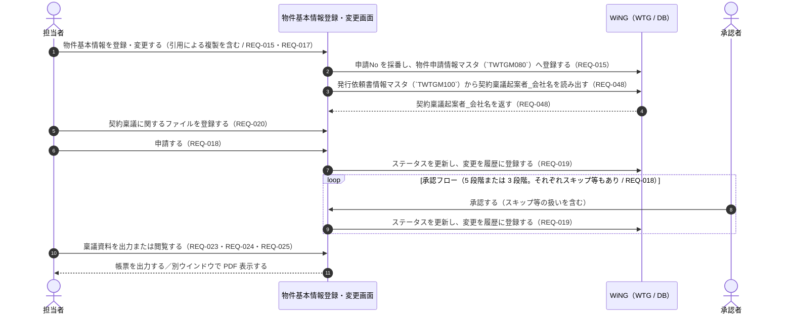

# 要件定義書

> このファイルは **「何を作るか」「完了の判定基準は何か」** の正です。
> 自律エージェントが解釈ぶれを起こさないよう、受け入れ基準は **EARS 形式** で記述してください。
> このフィーチャーが承認 (`status: approved`) されてから `design.md` の作成に進みます。
>
> **テンプレート**: 山括弧で囲んだ大文字の項目は、プロジェクト確定時に実値へ置換する。

## Introduction（概要）

> このフィーチャーが何のために、誰のためにあるかを 2〜3 段落で書く。`背景` はなぜ今このフィーチャーが必要か、`対象ユーザー` は想定する利用者像、`期待する変化` はこのフィーチャーがあると何が変わるか。

物件基本情報登録・変更は、契約稟議のもとになる物件基本情報を担当者が登録・変更し、承認フローに回して稟議資料となる帳票を出力するまでを担う機能である（REQ-015 / REQ-018 / REQ-023）。登録・変更画面と、印刷・閲覧用の帳票を新規に作成する（REQ-015）。

画面では権限による表示制御（REQ-016）、引用ボタンによるデータの複製（REQ-017）、承認フロー（5 段階または 3 段階。それぞれスキップ等もあり — REQ-018）、ステータスと履歴の管理（REQ-019）、契約稟議に関するファイル登録（REQ-020）、進捗管理DBインポート用の CSV 出力（REQ-021）、編集中データの処理の促し（REQ-022）を扱う。帳票では表紙情報（QR コード印字 — REQ-024）・発行依頼書・契約局情報を出力し、閲覧では別ウインドウで PDF 表示する（REQ-023 / REQ-025）。

利用者の用事が本フィーチャー単体で完結する User Feature であり、想定規模は「大」である（`.aidd/feature-list.md`）。他 feature への依存を持たず、優先度 1 に置かれている。作成組織は**会社名をラベルとして表示するのみ**で、入力欄は持たない（REQ-048。入力は `issue-request` が持つ）。

- **背景**: 契約書発行依頼業務が WiNG の契約・管財管理（WTG）で管理されておらず（REQ-001）、入力項目が多いことが担当者の負担になっている（REQ-002）。誤入力による不備指摘のやり取りが契約書発行までの納期を延ばしており（REQ-003）、稟議資料は紙に印刷して回覧する形式のため製本に手間と時間がかかっている（REQ-004）
- **対象ユーザー**: 契約書発行依頼業務を担当する社員、および権限制御の対象となるベンダー・施工会社（`steering/product.md` の対象ユーザー / REQ-005 / REQ-046）
- **期待する変化**: 物件基本情報の登録・変更から承認までが WiNG 上で完結し、進行状態がステータスで追えるようになる（REQ-019）。稟議資料を紙に印刷して回覧する代わりに、帳票出力・PDF 閲覧で扱えるようになる（REQ-004 / REQ-023 / REQ-025）

> プロダクトレベルの目的・価値は steering の `product.md` を参照。ここではこのフィーチャー固有の文脈を書く。

## 業務フロー（任意）

> 業務システムなど人とシステムの責務境界を整理する必要がある場合のみ記述する。
> 承認フロー・今まで紙で行っていた作業をシステムが担う場合など、人の判断が介在するステップを明示したいときに有効。
> 不要なフィーチャーではこのセクションごと削除してよい。
> `対象業務` はこのフィーチャーが自動化・支援する業務名、`Before` は現在の手順（紙・口頭・別システムでの対応方法を含む）、`After` はシステム稼働後の手順、`人が介在するステップ` は承認・確認・例外処理などシステム外の人的操作。

- **対象業務**: 契約稟議に用いる物件基本情報の登録・変更と、承認を経て稟議資料を作成するまでの業務（REQ-015 / REQ-018 / REQ-023）
- **Before（現状の業務手順）**: 契約書発行依頼業務は WiNG の WTG 機能で管理されていない（REQ-001）。入力項目が多く担当者の負担になっており（REQ-002）、誤入力があると不備指摘のやり取りが発生して契約書発行までの納期が延びる（REQ-003）。稟議資料は紙に印刷して回覧する形式で製本しており、手間と時間がかかる（REQ-004）。**現状の手順のうち、誰がどの様式に記入し、どの順で回覧しているかは要求一覧に記載が無い**（未確定事項 ⑫）
- **After（システム導入後）**: 担当者が物件基本情報登録・変更画面で登録・変更し（引用ボタンによる複製を利用できる — REQ-017）、契約稟議に関するファイルを登録して（REQ-020）承認フローに回す（REQ-018）。進行状態はステータスで管理され、申請・承認時の変更は履歴として残る（REQ-019）。稟議資料は帳票として出力するか、別ウインドウで PDF 表示する（REQ-023 / REQ-024 / REQ-025）。編集中のまま処理が完了していないデータは、利用者に処理を促す（REQ-022）
- **人が介在するステップ**: 物件基本情報の入力と申請（REQ-015）、各段階の承認者による承認（スキップ等の扱いを含む — REQ-018）、契約稟議に関するファイルの選択と登録（REQ-020）、編集中データに対する利用者の処理（REQ-022）、稟議資料の出力・閲覧の判断（REQ-023 / REQ-025）

> **記法**: Mermaid `sequenceDiagram`（スイムレーン形式）。人とシステムの責務境界が図で追える形にする。図が不要なら本スロットを残して直後に不要理由を書く。

<!-- 図に載せていない振る舞い: 進捗管理DBインポート用出力（REQ-021）と編集中データの促し（REQ-022）は、上図の一連の流れとは別の契機で動くため図に含めていない。起動契機は未確定事項 ⑧・⑨ として基本設計で確定する。 -->

> システム全体の主要ビジネスフローは `docs/architecture/system-overview.md §主要ビジネスフロー` を参照。

## Boundary Context（境界文脈）

> スコープの誤読が起こりやすい場合や、隣接するシステム / スペックに影響する場合は必ず記述する。
> `_N` の行を項目の数だけ増やす。`Out of Scope` は扱わない振る舞いに加えて理由または委譲先を書く。`Adjacent` は前提として動いている他フィーチャー / API / バッチ、およびこのフィーチャーが依頼している外部側の責務を書く。

- **In Scope（このフィーチャーで扱う）**:
  - 物件基本情報の登録・変更画面と、印刷・閲覧用帳票を新規に作成する（REQ-015）
  - 権限による画面制御（REQ-016）
  - 引用ボタンによるデータの複製と、複製対象の制御（REQ-017）
  - 承認フロー（5 段階または 3 段階。それぞれスキップ等もあり）（REQ-018）
  - ステータスと履歴の管理（REQ-019）
  - 契約稟議に関するファイル登録（REQ-020）
  - 進捗管理DBインポート用出力（CSV ファイル）（REQ-021）
  - 編集中データの処理を利用者に促す振る舞い（REQ-022）
  - 帳票の出力（表紙情報・発行依頼書・契約局情報。表紙情報への QR コード印字を含む）（REQ-023 / REQ-024）
  - 出力情報の別ウインドウでの PDF 表示（REQ-025）
  - 作成組織の会社名の表示（発行依頼書情報マスタ `TWTGM100` の `Keiyaku_Ringi_Kiansha_Kaisha_Name` をラベルとして表示する。REQ-048。根拠: WTG070 画面設計の項目5）
  - **申請No の採番**（新規登録時、および再製本・修正稟議時の新規採番）と、発行依頼書登録変更画面への引き渡し（REQ-015）
  - ログインユーザーの会社コードによるデータ範囲の絞り込み（`steering/security.md` の所有権・エンティティ境界）
- **Out of Scope（扱わない）**:
  - 作成組織を検索する独立した画面（ZOOM）の作成。2026-09-24 の設計変更により作成しない（`.aidd/requirement-list.md` の `## 要求の変更履歴` / REQ-048）
  - **作成組織の入力**（会社名のプルダウン、所属①・所属②の自由入力、社内／社外による必須・活性の制御）と、`TWTGM100` への書き込み。`issue-request` が持つ（REQ-049 / REQ-050）。本フィーチャーは `TWTGM100` を参照のみ行う
  - コードマスタ（`TWTZM040`）そのものの保守。既存 WiNG のマスタを参照するのみであり、本プロジェクトの改修対象外（REQ-007 / REQ-008）
  - 発行依頼書の登録・変更・発番。`issue-request` が持つ（REQ-026 / REQ-028）。本フィーチャーが扱うのは帳票の出力情報としての「発行依頼書」に限る（REQ-023）
  - 物件契約情報申請状況の検索・一覧・CSV 出力。`contract-application-status` が持つ（REQ-012 / REQ-013 / REQ-014）
  - 契約情報の取込・ダウンロード。`contract-info-import` / `contract-info-download` が持つ（REQ-040 / REQ-044）
  - 進捗管理DB そのものの改修。UQ 様社内システムは改修対象外であり（REQ-006 / REQ-008）、本フィーチャーが担うのはインポート用 CSV の出力までである（REQ-021）
  - ファイルアップロード・採番・コードマスタ取得・帳票エンジン・権限制御の各共通基盤の新規作成。既存 WiNG の構成要素であり本プロジェクトで作らない（REQ-053 / `steering/architecture.md` の共通基盤）
- **Adjacent（隣接システム / 隣接スペックへの期待）**:
  - `issue-request`: 作成組織（会社名・所属①・所属②）の入力を持ち、**本フィーチャーが採番して引き渡した申請No** で発行依頼書情報マスタ（`TWTGM100`）へ書き込む側である（REQ-049 / REQ-050 / Requirement 12 の受入基準 4）。本フィーチャーは同テーブルの `Keiyaku_Ringi_Kiansha_Kaisha_Name` を、物件申請情報（`TWTGM080`）との外部結合（会社コード + 申請No）で特定して参照・表示するだけである（受入基準 11-2）。**再製本・修正稟議で申請No を新しく採番した場合、新しい申請No での `TWTGM100` の行の作り直しは同 feature が行う**（受入基準 12-6）。**`issue-request` は本フィーチャーが採番する申請No に依存する側であり、`.aidd/feature-list.md` の同 feature の `依存` 列に `property-basic-info` が入っている**（2026-09-24 の Phase 3 改訂）。本フィーチャーから同 feature への依存は無い。**`TWTGM100` は本プロジェクトで新規に追加するテーブルであり、その列の構成を定義するのは同 feature である**（本フィーチャーは `Keiyaku_Ringi_Kiansha_Kaisha_Name` を参照するのみ。人間判断 / 2026-09-24）
  - `contract-application-status`: 本フィーチャーが登録・申請した物件契約情報を、申請状況として検索・一覧表示する（`.aidd/feature-list.md` の `依存` 列で同 feature が本 feature に依存する）
  - 既存 WiNG の共通基盤: 認証・セッション（`LoginService` / `SessionCheckInterceptor`）、権限制御（`AccessControlInterceptor` + `@FuncID`）、ファイルアップロード（`FileUploadService`）、採番（`NumberingService`）、コードマスタ取得（`CodeMstService`）を提供する（`steering/architecture.md` / `steering/tech.md`）

## Requirements（要件）

> 要件 ID は **数値**（`1`, `1.1`, `2`, `2.1` ...）のみ。`A`, `B` などのアルファベット ID は使わない。
> 各要件は **User Story** + **Acceptance Criteria（EARS 形式）** で構成する。
> **`### Requirement` のブロックを要件の数だけ複製する。** 要件領域名は、その要件がどの範囲を扱うかが分かる名前にする。

### Requirement 1: 物件基本情報の登録・変更

> 由来する要求ID: REQ-015

**User Story**: 契約書発行依頼業務の担当者として、物件基本情報を WiNG 上で登録・変更したい。なぜなら契約稟議のもとになる情報を紙ではなくシステムで管理したいから。

#### Acceptance Criteria（EARS 形式）

> 1 項目 = 1 基準。`_N` の行を基準の数だけ増やす。下の早見表のいずれかのパターンに当てはめて書く。

1. The system shall 物件基本情報を登録・変更する画面を新規に作成し、画面ID・PGID を既存の体系（`GWTG` + 3 桁 / `PWTGO` + 3 桁）に従って採番する（REQ-051 / `steering/tech.md` の命名規則）。採番の具体値と、画面・帳票を何本のプログラムに分割するかは基本設計で確定する（未確定事項 ①）。
2. When 担当者が物件基本情報を新規に登録したとき、the system shall 入力された内容を保存し、以降の表示・変更の対象にする。
3. When 担当者が既存の物件基本情報を変更して保存したとき、the system shall 排他フラグ（`ExclusiveFG`）を `WHERE` 条件に含めて更新し、更新件数が 0 件の場合は排他エラー（`ExclusiveException`）として処理する（`steering/database.md` のクエリパターン）。
4. If ログインしていないセッションから本画面のリクエストが行われた場合、then the system shall 画面を表示せずログイン画面へ遷移させる（`steering/security.md` の認証フロー）。
5. The system shall 物件基本情報を**物件申請情報マスタ（`TWTGM080`）**に格納する。行を特定するキーは **会社コード + 申請No** とする（人間判断 / 2026-09-24。根拠: WTG070 機能定義書の「更新条件(物件申請情報ﾏｽﾀ)」）。**`TWTGM080` は本プロジェクトで新規に追加するテーブルである**（人間判断 / 2026-09-24）。既存の命名規則と共通カラム（`CompanyCD` / `RegisteredPerson` / `RegisteredDT` / `UpdatedPerson` / `UpdatedDT` / `ExclusiveFG`）の規約に沿って追加し、列の構成は design で定義する（`steering/database.md` の命名規則・設計思想 / REQ-009 / REQ-053）。
6. The system shall 物件基本情報の検索・更新の SQL の `WHERE` 条件に、ログインユーザーの会社コードを必ず含める（`steering/security.md` の所有権・エンティティ境界 / `steering/database.md` のクエリパターン）。
7. If 入力チェックでエラーが検出された場合、then the system shall 元の画面を再表示し、`BindingResult` に積んだ全件のエラーを該当項目の近くに表示する（`steering/api-standards.md` のエラーハンドリング）。入力項目の一覧・桁・必須の定義は基本設計で確定する（未確定事項 ②）。
8. The system shall 物件基本情報のステータスに応じて変更を許すかどうかを判定し、許さない状態で変更の操作が行われた場合は保存せず業務エラーとして扱う（`steering/product.md` のビジネスルール「申請は承認フローを経て確定する」/ REQ-018 / REQ-019）。どのステータスで変更を許すか（申請中・承認済みを含む状態ごとの可否）は基本設計で確定する（未確定事項 ⑥）。

### Requirement 2: 権限による画面制御

> 由来する要求ID: REQ-016

**User Story**: 契約書発行依頼業務の担当者・承認者として、自分の権限で扱える範囲だけが操作できる状態にしたい。なぜなら契約金額・契約先などの契約情報を権限の無い利用者に見せたくないから。

#### Acceptance Criteria（EARS 形式）

1. If ログインユーザーが本画面の機能ID（PGID）に対する権限を持たない場合、then the system shall 画面を表示せずエラー画面にメッセージIDに対応する文言を表示する（`steering/security.md` の認可 / `InvalidAccessErrorException`）。
2. The system shall 権限に応じて画面要素の活性・非活性・非表示を制御する（REQ-016）。制御の対象となる画面要素と、`steering/security.md` の権限モデル（メニューID × 機能ID）との対応は基本設計で確定する（未確定事項 ③）。
3. The system shall 画面での制御だけを根拠とせず、登録・変更・承認・帳票出力の各処理でサーバ側でも権限を判定する（`steering/security.md` の二重防御）。
4. The system shall ベンダー／施工会社に対するデータ範囲の制御を、既存 WTB（計画・工程管理）と同様の方式に従って行う（REQ-046 / `steering/security.md` の認可）。
5. If 権限の無いアクセスを検出した場合、then the system shall ユーザーID・メニューID・機能IDをログに記録する（`steering/security.md` のセキュリティログ）。

### Requirement 3: 引用によるデータの複製

> 由来する要求ID: REQ-017

**User Story**: 担当者として、似た内容の物件基本情報を既存のデータから引用して作りたい。なぜなら入力項目が多く、毎回すべてを入力し直す負担が大きいから。

#### Acceptance Criteria（EARS 形式）

1. When 担当者が引用ボタンを操作したとき、the system shall 引用元として指定された物件基本情報の内容を、新規登録の入力値として画面に複製する。
2. The system shall 複製の対象とする項目と対象としない項目を区別して制御する（REQ-017 の「複製対象の制御あり」）。対象・対象外の項目は基本設計で確定する（未確定事項 ④）。
3. The system shall 引用によって複製した内容を、担当者が保存の操作を行うまで確定させない。
4. The system shall 引用の操作によって引用元の物件基本情報を変更しない。
5. The system shall 引用元として選べる物件基本情報を、ログインユーザーの会社コードの範囲に限る（`steering/security.md` の所有権・エンティティ境界）。

### Requirement 4: 承認フロー

> 由来する要求ID: REQ-018

**User Story**: 担当者および承認者として、物件基本情報を申請し段階的に承認したい。なぜなら紙に印刷して回覧する形式の稟議をシステム上で行いたいから。

#### Acceptance Criteria（EARS 形式）

1. The system shall 物件基本情報の申請に対して承認フローを設ける。
2. The system shall 承認フローの段階を 5 段階または 3 段階のいずれかとする。段階数の決まり方（5 段階と 3 段階の使い分け）と各段階の承認者は基本設計で確定する（未確定事項 ⑤）。
3. The system shall 各段階についてスキップを行えるようにする（REQ-018 の「それぞれスキップ等もあり」）。スキップの条件と、スキップ以外に設ける扱いの有無は基本設計で確定する（未確定事項 ⑤）。
4. When 申請または承認の操作が行われたとき、the system shall 承認フローを次の段階へ進め、最終段階の承認をもって承認済みとする。
5. If 承認の操作を行った利用者が当該段階の承認者でない場合、then the system shall 承認を行わず、業務エラー（`ApplicationException` 系）としてメッセージIDに対応する文言を表示する（`steering/api-standards.md` の分類の業務エラー）。当該段階の承認者であるかはデータに依存する業務判断であり、機能ID（PGID）に対する認可の判定とは区別する。
6. The system shall 承認フローの進行の判定をサーバ側（Service）で行い、画面の表示制御だけを根拠としない（`steering/security.md` の基本方針）。

### Requirement 5: ステータスと履歴の管理

> 由来する要求ID: REQ-019

**User Story**: 担当者および承認者として、申請がどこまで進んでいるかと、何がいつ変わったかを追いたい。なぜなら紙の回覧では追えなかった進行状態と変更の経緯を残したいから。

#### Acceptance Criteria（EARS 形式）

1. The system shall 物件基本情報に、申請・承認の進行状態を表すステータスを持たせ、画面に表示する。
2. When 申請または承認の操作により項目に変更があったとき、the system shall 変更内容を履歴として登録する（REQ-019）。
3. The system shall マスタ（現在値）の更新と履歴の登録を同一トランザクション内で行い、片方だけが反映された状態を作らない（`steering/database.md` の整合性）。
4. The system shall 履歴を変更履歴のテーブル（テーブル名の種別 `A`）として、現在値のマスタ（種別 `M`）と分けて保持する（`steering/database.md` の設計思想・命名規則）。
5. The system shall 登録済みの履歴を物理削除しない（`steering/database.md` の設計思想）。
6. The system shall ステータスの値の一覧と遷移、および履歴に残す項目の範囲を、基本設計で確定した内容に従う（未確定事項 ⑥）。

### Requirement 6: 契約稟議に関するファイル登録

> 由来する要求ID: REQ-020

**User Story**: 担当者として、契約稟議に関するファイルを物件基本情報に添えて登録したい。なぜなら稟議に必要な資料を物件基本情報と一緒に扱いたいから。

#### Acceptance Criteria（EARS 形式）

1. When 担当者がファイルを選択して登録の操作を行ったとき、the system shall 既存のファイルアップロードの仕組み（`FileUploadService`）を通じてファイルを受け取り、当該の物件基本情報に紐づけて管理する（`steering/security.md` の共通ルール 4）。
2. The system shall ファイル本体を DB のカラムに格納せず、出力管理マスター・出力制御マスターとファイルアップロードの仕組みで管理する（`steering/database.md` の型の指針）。
3. The system shall 登録されたファイルを直接の URL 参照でアクセスさせない（`steering/security.md` の機密データ）。
4. The system shall ファイルの参照・登録を、Requirement 2 と同じ権限判定の対象とする（REQ-016）。
5. The system shall 登録できるファイルの種類・件数・形式・サイズの上限を、基本設計で確定した内容に従って判定する（未確定事項 ⑦）。リクエスト全体の上限は既存設定（`CommonsMultipartResolver` の `maxUploadSize` = 1,048,576,000 バイト）に従う（`steering/tech.md`）。

### Requirement 7: 進捗管理DBインポート用出力

> 由来する要求ID: REQ-021

**User Story**: 担当者として、物件基本情報を進捗管理DBに取り込める形式の CSV として出力したい。なぜなら WiNG 側の情報を UQ 様社内システム側へ渡す必要があるから。

#### Acceptance Criteria（EARS 形式）

1. When 担当者が進捗管理DBインポート用出力の操作を行ったとき、the system shall CSV ファイルを生成し、**既存のファイルダウンロードの仕組みに載せて `Content-Disposition` 付きで返す**（`DownLoadFileInfo` でファイルパスとファイル名を受け取り、`FileInfo` を `executeDownLoad` へ forward する。`steering/api-standards.md` の `### パラメータ配置`「大量データ」）。本フィーチャー独自の出力経路を作らない（`steering/architecture.md` の `### 外部 API / 外部システム`。同節は責務に REQ-021 を明記している）。
2. The system shall CSV の内容を、本フィーチャーが扱う物件基本情報を取得する SQL の結果から作り、出力のためだけに別条件の SQL を作らない（`steering/database.md` のクエリパターンの CSV 出力。同行は REQ-021 を対象に含めている）。
3. The system shall CSV の文字コードを既存の設定（`wing-web.properties` の `CHARSET`）に従って決定し、区切り・引用符の扱いを本フィーチャー独自に変えない（`steering/security.md` の出力エスケープ）。
4. The system shall 出力の対象を、ログインユーザーの会社コードと権限の範囲に限る（`steering/security.md` の機密データ・所有権）。
5. The system shall CSV の出力項目・並び順・ファイル名・出力の起動契機を、基本設計で確定した内容に従う（未確定事項 ⑧）。

### Requirement 8: 編集中データの処理の促し

> 由来する要求ID: REQ-022

**User Story**: 担当者として、途中まで入力したまま放置している物件基本情報に気づきたい。なぜなら処理されないまま残ったデータが契約書発行の遅れにつながるから。

#### Acceptance Criteria（EARS 形式）

1. The system shall 編集中のまま処理が完了していない物件基本情報について、利用者に処理を促す（REQ-022 / `steering/product.md` のビジネスルール）。
2. The system shall 促しの対象を、ログインユーザーの会社コードと権限の範囲に限る（`steering/security.md` の所有権・エンティティ境界）。
3. The system shall 促しの処理によって、物件基本情報の内容を自動的に変更・削除しない。
4. The system shall 「編集中」と判定する条件・促す契機・促し方（画面上の表示か別の手段か）を、基本設計で確定した内容に従う（未確定事項 ⑨）。

### Requirement 9: 稟議資料の帳票出力

> 由来する要求ID: REQ-023 / REQ-024

**User Story**: 担当者として、承認された内容を稟議資料の帳票として出力したい。なぜなら紙に印刷して回覧する形式の製本にかかる手間と時間を減らしたいから。

#### Acceptance Criteria（EARS 形式）

1. The system shall 帳票の出力情報を「表紙情報」「発行依頼書」「契約局情報」の 3 種とし、これ以外の情報を帳票に出力しない（REQ-023 / `steering/security.md` の出力エスケープ）。
2. The system shall 「表紙情報」に QR コードを印字する（REQ-024）。QR コードに埋め込む内容は基本設計で確定する（未確定事項 ⑩）。
3. The system shall 帳票の出力に Requirement 2 と同じ権限判定を適用し、権限外の項目を帳票に含めない（`steering/security.md` の機密データ）。あわせて、印刷の操作は次の 3 条件をすべて満たすときだけ画面に表示し、満たさない場合は帳票の出力を受け付けない — (a) 契約局情報と発行依頼書が登録済みである (b) 物件申請のステータスが受付済以降である (c) ログインユーザーの所属組織が「K-ENG:プロセス管理センター:プロセス管理4G」である（人間判断 / 2026-09-25。帳票に限った業務上の条件。根拠: WTG070 機能定義書「別紙_ボタン表示制御」）。
4. The system shall 帳票を、原本の Excel テンプレートをコピーして値を書き込み、PDF に変換する方式で生成する（`steering/tech.md` の主要ライブラリ。人間判断 / 2026-09-25。根拠: WTG070 機能定義書_印刷・閲覧用帳票）。
5. The system shall 帳票を、**既存のファイルダウンロードの仕組みに載せて `Content-Disposition` 付きで返す**（`DownLoadFileInfo` / `executeDownLoad`。`steering/api-standards.md` の `### パラメータ配置`「大量データ」）。
6. The system shall 3 種それぞれの出力項目とレイアウトを、基本設計で確定した内容に従う（未確定事項 ⑩）。

### Requirement 10: 出力情報の閲覧（PDF 表示）

> 由来する要求ID: REQ-025

**User Story**: 担当者として、印刷せずに出力情報を画面で確認したい。なぜなら内容の確認のたびに紙に印刷したくないから。

#### Acceptance Criteria（EARS 形式）

1. When 担当者が閲覧の操作を行ったとき、the system shall 出力情報を別ウインドウで PDF として表示する（REQ-025）。閲覧の操作は、Requirement 9 の受入基準 3 が定める 3 条件をすべて満たすときだけ画面に表示する（人間判断 / 2026-09-25）。
2. The system shall 閲覧で表示する出力情報を、印刷用の帳票と同じ 3 種（表紙情報・発行依頼書・契約局情報）とする（REQ-023）。
3. The system shall 閲覧に Requirement 2 と同じ権限判定を適用する（`steering/security.md` の機密データ）。あわせて、Requirement 9 の受入基準 3 が定める 3 条件を満たさない場合は閲覧を受け付けない（人間判断 / 2026-09-25）。
4. The system shall 閲覧と印刷で同じ出力内容になるようにし、閲覧のためだけに別の出力情報を持たない（REQ-023）。出力経路（同一の帳票定義を用いるか）は基本設計で確定する（未確定事項 ⑪）。

### Requirement 11: 作成組織の会社名の表示

> 由来する要求ID: REQ-048
> **本要件は表示のみを扱う。** 作成組織の入力（会社名のプルダウン・所属①②の自由入力・必須／活性の制御）は `issue-request` が持つ（REQ-049 / REQ-050。`.aidd/feature-list.md` の `### 要求IDの多重割当（REQ-048）`）。

**User Story**: 契約書発行依頼業務の担当者として、物件基本情報の画面で作成組織の会社名を確認したい。なぜなら発行依頼書で指定された契約稟議起案者の会社を、物件基本情報を見るときにも把握したいから。

#### Acceptance Criteria（EARS 形式）

1. The system shall 作成組織の会社名を、発行依頼書情報マスタ（`TWTGM100`）の `Keiyaku_Ringi_Kiansha_Kaisha_Name`（契約稟議起案者_会社名）からラベルとして表示する（REQ-048。根拠: WTG070 画面設計の項目5）。
2. The system shall 表示対象の `TWTGM100` の行を、物件申請情報（`TWTGM080`）との**外部結合**で特定する。結合条件は `TWTGM100.会社コード = TWTGM080.会社コード AND TWTGM100.申請No = TWTGM080.申請No` とする（REQ-048。根拠: WTG070 機能定義書の転送仕様「発行依頼書情報ﾏｽﾀ＜外部結合＞ GM100．会社ｺｰﾄﾞ＝GM080．会社ｺｰﾄﾞ AND GM100．申請No＝GM080．申請No」）。
3. The system shall 作成組織について入力欄を設けない。会社名は編集できず、所属①・所属②は本画面で保持も表示もしない（REQ-048）。
4. The system shall 作成組織を検索する別ウインドウの画面（ZOOM）を起動しない（REQ-048）。
5. The system shall `TWTGM100` に対して参照のみを行い、書き込みを行わない（`TWTGM100` への保存は `issue-request` の責務 — REQ-049）。
6. If 外部結合の結果として `TWTGM100` の行が得られない（発行依頼書がまだ作られていない）、または `Keiyaku_Ringi_Kiansha_Kaisha_Name` が空の場合、then the system shall 当該ラベルを**空欄で表示し、エラーとして扱わない**（人間判断 / 2026-09-24。外部結合であり、発行依頼書の有無にかかわらず物件基本情報を表示できる必要があるため）。
7. The system shall `TWTGM100` を参照する SQL の `WHERE` 条件に、ログインユーザーの会社コードを必ず含める（`steering/security.md` の所有権・エンティティ境界 / `steering/database.md` のクエリパターン）。

### Requirement 12: 申請No の採番と引き渡し

> 由来する要求ID: REQ-015

**User Story**: 契約書発行依頼業務の担当者として、物件基本情報を登録したときに申請No が自動で付与されてほしい。なぜなら発行依頼書や帳票からこの物件申請を一意に指せるようにしたいから。

#### Acceptance Criteria（EARS 形式）

1. When 担当者が物件基本情報を新規に登録したとき、the system shall 申請No を採番する。採番した申請No は、Requirement 1 の受入基準 5 が定める `TWTGM080` の行のキー（会社コード + 申請No）の一部となる（**キーの定義は受入基準 1-5 を正とし、本節で再定義しない**。人間判断 / 2026-09-24。根拠: WTG070 機能定義書の「更新条件(物件申請情報ﾏｽﾀ)」）。
2. The system shall 申請No の採番を、採番マスタ（`TWTZM050`）と `NumberingService` の既存の仕組みに載せ、機能ごとに独自の採番処理を作らない。**採番は `SELECT ... FOR UPDATE` で行を固定してから更新する**（`steering/database.md` の `### 業務コード・区分値・採番の設計ルール`）。採番定義（グループID・識別コード・プレフィックス・連番の範囲・採番区分）は基本設計で確定する（未確定事項 ⑭）。
3. When 再製本または修正稟議が行われたとき、the system shall 申請No を**新しく採番**し、既存の行の申請No を書き換えない（人間判断 / 2026-09-24。根拠: WTG070 機能定義書の「更新条件(発行依頼書情報ﾏｽﾀ)」の 申請No＝「再製本時に新規採番した申請No」）。再製本・修正稟議と判定する条件は基本設計で確定する（未確定事項 ⑮）。
4. The system shall 採番した申請No を、発行依頼書登録変更画面へ引き渡す（`issue-request` が当該申請No で `TWTGM100` の行を登録するため — `specs/issue-request/requirements.md` の Requirement 13）。引き渡しの経路は基本設計で確定する（未確定事項 ⑮）。
5. If 申請No の採番に失敗した場合、then the system shall 物件基本情報の登録を確定させず、メッセージIDに対応する文言を表示して業務エラーとして扱う（`specs/issue-request/requirements.md` の Requirement 3 の受入基準 4 と同じ扱い）。表示するメッセージIDは基本設計で確定する（未確定事項 ⑮）。
6. The system shall 申請No を新しく採番した場合も、`TWTGM100` の行を本フィーチャーから作成・更新しない。新しい申請No での `TWTGM100` の行の作り直しは `issue-request` が行う（Requirement 11 の受入基準 5 と整合）。

## Non-Functional Requirements（非機能要件）

> 当該フィーチャーで成立させるべき非機能要件のみ記述（steering で固定済みのものは引用に留める）。
> 共通 SLO・障害フロー・当番は `non-functional.md`、ログ・監視の実装標準は `non-functional.md`（観測部）を参照。
> `要件` は steering の該当ファイルへの準拠を示したうえで、このフィーチャー固有の値を書く（例: パフォーマンスなら `non-functional.md` 準拠 + p95 200ms、アクセシビリティなら WCAG 2.1 AA、プライバシーなら扱う PII と保持期間）。`計測 / 検証方法` は負荷試験・SLO ダッシュボード・スキャン・監査ログなど、その要件を確認する手段を書く。区分の行は増減してよい。

| 区分 | 要件 | 計測 / 検証方法 |
|---|---|---|
| パフォーマンス | <NFR_PERFORMANCE_REQUIREMENT>（不要 / 人間 2026-09-11: `non-functional.md` に準拠し、feature 固有の値を設けない） | <NFR_PERFORMANCE_VERIFICATION>（同上） |
| 可用性 | <NFR_AVAILABILITY_REQUIREMENT>（同上） | <NFR_AVAILABILITY_VERIFICATION>（同上） |
| 運用・監視 | <NFR_OPERATIONS_REQUIREMENT>（同上） | <NFR_OPERATIONS_VERIFICATION>（同上） |
| セキュリティ | `steering/security.md` 準拠。`@FuncID` と `AccessControlInterceptor` による毎リクエストの権限判定、権限に応じた画面制御とサーバ側判定の二重防御（REQ-016）、ログインユーザーの会社コードによるデータ範囲の絞り込み、契約金額・契約先などの契約情報と契約稟議ファイルを権限のある利用者にのみ開示すること（帳票・CSV も同じ権限判定）、登録ファイルの直接 URL 参照の禁止、更新系リクエストの CSRF トークン検証、Thymeleaf の自動エスケープによる出力、MyBatis の `#{...}` による SQL 組み立て、**発行依頼書情報マスタ（`TWTGM100`）に対する参照専用の扱い**（本フィーチャーからの書き込みを行わない — Requirement 11 の受入基準 5） | 権限を持たないユーザーでのアクセス確認、他社の会社コードのデータが画面・帳票・CSV に現れないことの確認、登録ファイルへの直接 URL アクセスが拒否されることの確認、**本フィーチャーの実装が `TWTGM100` への INSERT / UPDATE / DELETE を持たないことの確認（Mapper XML の全 SQL を対象）** |
| アクセシビリティ | <NFR_ACCESSIBILITY_REQUIREMENT>（不要 / 人間 2026-09-11: `non-functional.md` に準拠し、feature 固有の値を設けない） | <NFR_ACCESSIBILITY_VERIFICATION>（不要 / 人間 2026-09-11: 同区分の要件を設けないため検証方法も設けない） |
| i18n / l10n | <NFR_I18N_REQUIREMENT>（不要 / 人間 2026-09-11: `non-functional.md` に準拠し、feature 固有の値を設けない） | <NFR_I18N_VERIFICATION>（不要 / 人間 2026-09-11: 同区分の要件を設けないため検証方法も設けない） |
| プライバシー | <NFR_PRIVACY_REQUIREMENT>（不要 / 人間 2026-09-11: `non-functional.md` に準拠し、feature 固有の値を設けない） | <NFR_PRIVACY_VERIFICATION>（不要 / 人間 2026-09-11: 同区分の要件を設けないため検証方法も設けない） |
| 監査 | <NFR_AUDIT_REQUIREMENT>（不要 / 人間 2026-09-11: `non-functional.md` に準拠し、feature 固有の値を設けない） | <NFR_AUDIT_VERIFICATION>（不要 / 人間 2026-09-11: 同区分の要件を設けないため検証方法も設けない） |

## Out of Scope（明示的に対象外）

> Boundary Context だけで誤読を防ぎきれないとき、追加でここに書く。
> 1 項目 = 1 件。`_N` の行を件数だけ増やす。対象外にするものと、なぜ対象外か、どこで扱う予定かを書く。

- 既存 WTG 機能（契約情報変更・参照、支払実績データ作成／変更／参照、電力会社直受支払実績変更、契約支払情報インポート、契約基本情報インポート、インボイス情報インポート）の仕様変更。デグレードを発生させない対象であり、新規の Controller / Service / Mapper / Form を追加する形で実装する（REQ-052 / REQ-073 / `steering/tech.md` の新規機能の追加方針）
- 進捗管理DB 側の取込処理。UQ 様社内システムは改修対象外であり、本フィーチャーはインポート用 CSV を出力するところまでを担う（REQ-008 / REQ-021）
- 物件基本情報のデータ移行。データ移行のテストは発注者にて実施する前提である（REQ-054）
- ベンダー／施工会社に対する権限制御方式そのものの定義。方式の正は `steering/security.md` であり、本フィーチャーはそれに従う（REQ-046 は `制約` 分類のため feature 割当の分母外 — `.aidd/feature-list.md`）
- 承認フローの承認者を決める組織・権限マスタの保守。既存のマスタ構造に従って参照するのみである（REQ-007 / REQ-009）

## Dependencies / Assumptions（前提と依存）

> `前提` はこのフィーチャーが成立するために真でなければならない事項、`依存` は他フィーチャー / 既存システム / 外部 API / データ、`未確定事項` は調査・確認待ちのトピック（design に進む前に解消する）。

- **前提**: 既存 WiNG の認証・セッション・権限制御の仕組み（`LoginService` / `SessionCheckInterceptor` / `AccessControlInterceptor`）がそのまま利用できること。ファイルアップロード／ダウンロードの仕組み（`FileUploadService` / `DownLoadFileInfo` と出力管理マスター・出力制御マスター）が既存 WiNG に存在し利用できること（REQ-009 / REQ-053 / `steering/architecture.md`）。承認フローの承認者を決めるための組織・権限の情報が既存のマスタから参照できること
- **依存**: `.aidd/feature-list.md` の `依存` 列は `なし`。既存 WiNG の共通基盤（前提に挙げたもの）と、採番マスタ（`TWTZM050`）・`NumberingService` に依存する。**`TWTGM080`（格納先）と `TWTGM100`（参照のみ）はいずれも本プロジェクトで新規に追加するテーブルであり**（人間判断 / 2026-09-24）、`TWTGM080` は本フィーチャーが、`TWTGM100` は `issue-request` が定義する。**本フィーチャーは他 feature に依存しないが、`issue-request` は本フィーチャーが採番する申請No に依存する側である**（`.aidd/feature-list.md` の 2026-09-24 の改訂）。なお `contract-application-status` は本フィーチャーに依存する側であり、本フィーチャーからの依存ではない。`issue-request` は `TWTGM100` へ書き込む側だが、同テーブルは既存 WiNG のものであり同 feature の完成を待つ必要が無いため、feature 間の依存ではない
- **未確定事項**: 次の 15 件は **いずれも基本設計で確定する**（REQ-010。Phase 4 の共通の扱いとして人間が確定 / 2026-09-11）。
  - ① **画面ID・PGID の採番の具体値**と、画面・帳票を何本のプログラムに分割するか（REQ-010 / REQ-051）
  - ② **物件基本情報の入力項目**の一覧・桁・必須の定義（REQ-015）
  - ③ **権限（メニューID × 機能ID）と、制御する画面要素の対応**（REQ-016）。権限の判定単位が機能ID（PGID）であることは `steering/security.md` の権限モデルが定めており、画面内のどの要素をどの権限でどう制御するかが未確定である
  - ④ **引用（複製）の対象項目と対象外項目**（REQ-017）
  - ⑤ **承認フローの段階数の決まり方**（5 段階と 3 段階の使い分け）、**各段階の承認者**、**スキップの条件**、およびスキップ以外に設ける扱い（差戻し等）の有無（REQ-018 の「それぞれスキップ等もあり」）
  - ⑥ **ステータスの値の一覧と遷移**、**ステータスごとに変更を許すかどうか**（申請中・承認済みのデータを変更できるか。`steering/product.md` の「申請は承認フローを経て確定する」に対応する具体）、および**履歴に残す項目の範囲**（REQ-018 / REQ-019）
  - ⑦ **契約稟議ファイルの種類・件数・形式・サイズの上限**（REQ-020）
  - ⑧ **進捗管理DBインポート用 CSV の出力項目・並び順・ファイル名・出力の起動契機**（REQ-021）
  - ⑨ **「編集中」と判定する条件・促す契機・促し方**（REQ-022）
  - ⑩ **帳票 3 種（表紙情報・発行依頼書・契約局情報）の出力項目とレイアウト**、および **QR コードに埋め込む内容**（REQ-023 / REQ-024）
  - ⑪ **閲覧（PDF 表示）と印刷の出力経路の違い**（同一の帳票定義を用いるか）（REQ-025）
  - ⑫ **現状（Before）の業務手順の詳細**（誰がどの様式に記入し、どの順で回覧しているか）。要求一覧に記載が無く、`## 業務フロー（任意）` の `Before` はそこから読み取れる範囲に留めている
  - ⑬ **帳票の出力情報である「発行依頼書」（REQ-023）の元データを、本フィーチャーと `issue-request`（REQ-026）のどちらが保持するか**。`.aidd/feature-list.md` の `依存` 列は、`issue-request` → 本フィーチャーの向き（申請No の採番元）でのみ依存を置いており、本フィーチャーから同 feature への依存は無い。**作成組織の会社名については `Adjacent` で `issue-request` が `TWTGM100` へ書き込む側であることを宣言済みであり、表示対象の行の特定方法も受入基準 11-2 で確定している。本項が未確定として残すのは、帳票の元データ全般についての分担である**
  - ⑭ **申請No の採番定義**（グループID・識別コード・プレフィックス・連番の範囲・採番区分）（受入基準 12-2 / `steering/database.md` の採番の設計ルール）
  - ⑮ **再製本・修正稟議と判定する条件**（受入基準 12-3）、**採番した申請No を発行依頼書登録変更画面へ引き渡す経路**（受入基準 12-4。画面遷移のパラメータか、別の手段か）、および**採番に失敗した場合に表示するメッセージID**（受入基準 12-5）

---

_「何を作るか」を契約する正のドキュメントです。実装方法 / コンポーネント設計は `design.md`、タスクの分解は `tasks.md` に書いてください。_